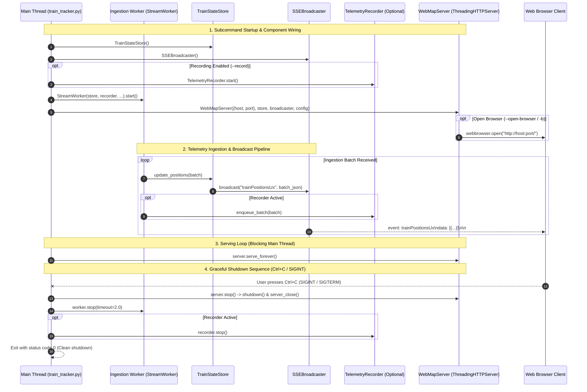
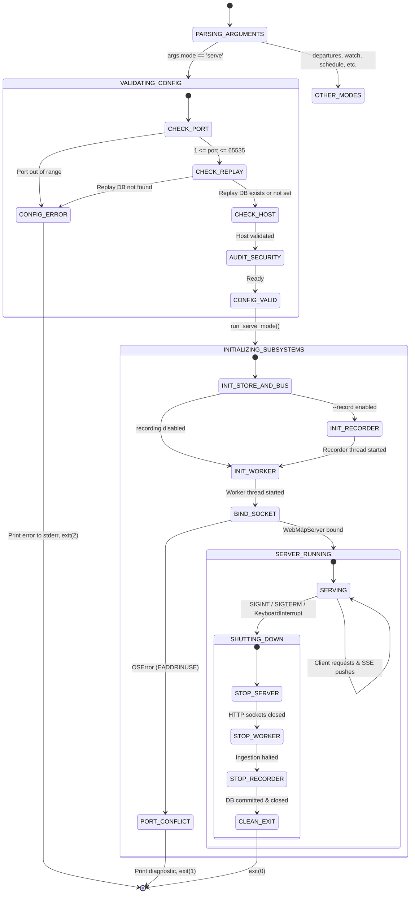

# Phase 3 Implementation Plan — CLI Subcommand Integration in `train_tracker.py` (`railmon serve`)

> **Reference:** [F-8.1 Master Implementation Plan (`f-8-1-embedded-zero-dependency-web-map-daemon-plan.md`)](./f-8-1-embedded-zero-dependency-web-map-daemon-plan.md), [Phase 1 Implementation Plan (`f-8-1-phase-1-server-foundation-and-data-models-plan.md`)](./f-8-1-phase-1-server-foundation-and-data-models-plan.md), [Phase 2 Implementation Plan (`f-8-1-phase-2-web-server-daemon-and-http-handler-plan.md`)](./f-8-1-phase-2-web-server-daemon-and-http-handler-plan.md), [TUI Feature Enhancements Specification (`F-8.1`)](../../architecture/tui-feature-enhancements.md#f-81-embedded-zero-dependency-web-map-daemon-railmon-serve--planned), [`docs/architecture/architecture.md`](../../architecture/architecture.md)  
> **Target Modules:** [`../../../train_tracker.py`](../../../train_tracker.py), [`../../../server/daemon.py`](../../../server/daemon.py), [`../../../server/handler.py`](../../../server/handler.py), [`../../../server/models.py`](../../../server/models.py), [`../../../server/sse.py`](../../../server/sse.py), [`../../../storage/db.py`](../../../storage/db.py), [`../../../storage/recorder.py`](../../../storage/recorder.py), [`../../../tui/state.py`](../../../tui/state.py), [`../../../tui/stream_worker.py`](../../../tui/stream_worker.py)  
> **Target Test Suites:** [`../../../tests/test_cli_serve.py`](../../../tests/test_cli_serve.py), [`../../../tests/test_server_daemon.py`](../../../tests/test_server_daemon.py), [`../../../tests/test_cli.py`](../../../tests/test_cli.py)  
> **Relevant Skills & Guidelines:** [`../../../.agents/skills/diagrams-and-documentation/SKILL.md`](../../../.agents/skills/diagrams-and-documentation/SKILL.md), [`../../../.agents/skills/markdown-relative-paths/SKILL.md`](../../../.agents/skills/markdown-relative-paths/SKILL.md), [`../../../.agents/skills/ci-quality-gate/SKILL.md`](../../../.agents/skills/ci-quality-gate/SKILL.md), [`../../../.agents/skills/static-safety-analyzer/SKILL.md`](../../../.agents/skills/static-safety-analyzer/SKILL.md), [`../../../.agents/skills/stream-resilience-tester/SKILL.md`](../../../.agents/skills/stream-resilience-tester/SKILL.md), [`../../../.agents/skills/security-audit/SKILL.md`](../../../.agents/skills/security-audit/SKILL.md)

---

## 1. Executive Summary & Phase 3 Objectives

Feature **F-8.1** introduces an embedded, zero-external-dependency web map daemon (`railmon serve`) that delivers a real-time browser GIS dashboard of the Greek national railway network (`railway.gov.gr`). Following the successful delivery of **Phase 1** (server foundation, domain models, bounded-memory SSE bus, cached GIS assets) and **Phase 2** (multi-threaded `WebMapServer` daemon, REST request dispatcher, chunked HTTP/1.1 SSE stream handler in `server/daemon.py` and `server/handler.py`), **Phase 3** integrates the web map daemon as a first-class subcommand in the primary command-line interface [`train_tracker.py`](../../../train_tracker.py).

### Core Objectives:
1. **First-Class Subcommand Registration:** Add `serve` (with aliases `server`, `web`) to the `argparse` subcommand registry in `build_parser()`, exposing granular configuration options for network binding (`--host`, `--port`), cartography presets (`--tile-provider`), CORS headers (`--cors`), browser launch automation (`--open-browser` / `-b`), offline simulation (`--demo` / `--mock`), concurrent SQLite WAL recording (`--record`, `--db`, `--retention-days`, `--archive-path`), and historical DVR replay (`--replay`, `--speed`).
2. **Robust CLI Dispatch & Mode Coordination (`run_serve_mode`):** Implement the end-to-end orchestration workflow connecting upstream telemetry ingestion (`StreamWorker`, `MockTelemetryEngine`, or `ReplayWorker`), in-memory domain state management (`TrainStateStore`), concurrent SQLite persistence (`TelemetryRecorder`), real-time push notification bus (`SSEBroadcaster`), and the HTTP daemon (`WebMapServer`).
3. **Real-Time Telemetry & Conflict Broadcast Bridge:** Establish a thread-safe observation pipeline that intercepts position deltas and conflict watchdog evaluations from the domain state store or ingestion stream and broadcasts framed SSE messages (`trainPositionsUx`, `conflictAlert`) to all active browser clients without latency or thread contention.
4. **Resilient Error Handling & Operator Ergonomics:** Deliver clear, actionable terminal diagnostics on port contention (`EADDRINUSE`), prominent security notifications when binding to public network interfaces (`0.0.0.0`), clean POSIX signal interception (`SIGINT`, `SIGTERM`), and non-zero exit codes on fatal startup errors without unhandled Python stack traces.
5. **Comprehensive Automated Verification:** Author [`tests/test_cli_serve.py`](../../../tests/test_cli_serve.py) covering CLI argument parsing, input validation, execution routing, headless mock startup, port conflict handling, and telemetry fan-out.

### 1.1 Phase 3 Deliverables Matrix

| Component | Target File | Core Responsibilities |
| :--- | :--- | :--- |
| **CLI Subcommand Parser** | [`train_tracker.py`](../../../train_tracker.py#L1250-L1750) | Configures `subparsers.add_parser("serve", ...)` with all CLI flags, choices, and help descriptions. |
| **CLI Dispatch Routing** | [`train_tracker.py`](../../../train_tracker.py#L3300-L3350) | Routes `args.mode in ("serve", "server", "web")` in `_dispatch_cli_mode()` to `run_serve_mode()`. |
| **Daemon Mode Runner** | [`train_tracker.py`](../../../train_tracker.py) | Implements `run_serve_mode(args: argparse.Namespace) -> int`, coordinating worker threads, recorder, broadcaster, and server lifecycle. |
| **Telemetry SSE Bridge** | [`train_tracker.py`](../../../train_tracker.py) / [`tui/state.py`](../../../tui/state.py) | Bridges ingested telemetry batches and conflict watchdog alerts from `TrainStateStore` to `SSEBroadcaster.broadcast()`. |
| **Automated Test Suite** | [`tests/test_cli_serve.py`](../../../tests/test_cli_serve.py) | Tests CLI argument parsing, parameter validation, mode dispatching, mock lifecycle, port conflicts, and broadcaster fan-out. |
| **Documentation Linkage** | [`docs/plans/features/f-8-1-embedded-zero-dependency-web-map-daemon-plan.md`](./f-8-1-embedded-zero-dependency-web-map-daemon-plan.md) | Updates Phase 3 section with link to this detailed plan. |

---

## 2. Architecture & Visual Diagrams

### 2.1 CLI Subcommand Ingestion & Daemon Pipeline Topology (Mermaid)

```mermaid
flowchart TD
    subgraph CLI ["CLI Invocation Layer (train_tracker.py)"]
        CMD["railmon serve [flags]"]
        PARSER["build_parser() -> p_serve"]
        DISPATCH["_dispatch_cli_mode()"]
        RUNNER["run_serve_mode(args)"]
    end

    subgraph ConfigValidation ["Configuration & Diagnostics"]
        CFG["ServerConfig<br>(host, port, cors, tile_provider, ...)"]
        SEC_CHECK{"Host == '0.0.0.0'?"}
        SEC_WARN["Log prominent security notice:<br>'Exposing web map to local network'"]
    end

    subgraph TelemetrySources ["Telemetry Ingestion Subsystem"]
        SRC_LIVE["RailwayGovClient (Live SSE)<br>https://railway.gov.gr/api/train-stream"]
        SRC_MOCK["MockTelemetryEngine<br>(Synthetic Trains & Motion)"]
        SRC_REPLAY["HistoricalRepository<br>(SQLite DVR Telemetry)"]
    end

    subgraph IngestionWorkers ["Worker Threads"]
        WORKER_STREAM["StreamWorker (Live / Mock)"]
        WORKER_REPLAY["ReplayWorker (DVR Playback)"]
    end

    subgraph DomainState ["State & Persistence"]
        STORE["TrainStateStore (Thread-Safe RLock)<br>• Active train records & snapshots<br>• Speed, delay, heading calculations<br>• Conflict watchdog evaluations"]
        RECORDER["TelemetryRecorder (Thread)<br>SQLite WAL Database Commit"]
    end

    subgraph BroadcastBus ["Real-Time Event Distribution"]
        BROADCAST["SSEBroadcaster (server/sse.py)<br>• Bounded client FIFO queues<br>• Zero-copy JSON fan-out"]
    end

    subgraph DaemonRuntime ["Embedded Web Server"]
        DAEMON["WebMapServer (server/daemon.py)<br>http.server.ThreadingHTTPServer"]
        HANDLER["WebMapRequestHandler (server/handler.py)"]
        BROWSER_LAUNCH["webbrowser.open(server_url)<br>(if --open-browser / -b)"]
    end

    CMD --> PARSER
    PARSER --> DISPATCH
    DISPATCH --> RUNNER
    RUNNER --> CFG
    CFG --> SEC_CHECK
    SEC_CHECK -- Yes --> SEC_WARN
    SEC_CHECK -- No --> STORE
    SEC_WARN --> STORE

    RUNNER -->|args.demo| SRC_MOCK
    RUNNER -->|args.replay| SRC_REPLAY
    RUNNER -->|default| SRC_LIVE

    SRC_LIVE --> WORKER_STREAM
    SRC_MOCK --> WORKER_STREAM
    SRC_REPLAY --> WORKER_REPLAY

    WORKER_STREAM -->|telemetry batch| STORE
    WORKER_REPLAY -->|replay batch| STORE

    RUNNER -->|args.record| RECORDER
    WORKER_STREAM -.->|raw batch| RECORDER

    STORE -->|Position Deltas (trainPositionsUx)| BROADCAST
    STORE -->|Conflict Alerts (conflictAlert)| BROADCAST

    RUNNER --> DAEMON
    DAEMON --> HANDLER
    HANDLER --> BROADCAST
    HANDLER --> STORE
    DAEMON -.-> BROWSER_LAUNCH
```

---

### 2.2 CLI Execution & Process Topology (ASCII)

```text
+---------------------------------------------------------------------------------------------------+
|                        RAILMON SERVE: PROCESS & THREAD TOPOLOGY                                   |
+---------------------------------------------------------------------------------------------------+

  [ User Invocation: railmon serve --host 0.0.0.0 --port 8080 --demo --record --db custom.db -b ]
                                   |
                                   v
  +-----------------------------------------------------------------------------------------------+
  | Main Thread: train_tracker.py -> run_serve_mode()                                             |
  |  1. Validate arguments (port in 1..65535, replay file exists, etc.)                           |
  |  2. Print Banner & Security Warnings if host == 0.0.0.0                                       |
  |  3. Instantiate TrainStateStore & SSEBroadcaster                                              |
  |  4. Optional: Start TelemetryRecorder (SQLite WAL Commit Thread)                              |
  |  5. Start Ingestion Worker: StreamWorker (Live/Mock) OR ReplayWorker (DVR SQLite)               |
  |  6. Instantiate WebMapServer & Bind Socket (Catch OSError EADDRINUSE)                         |
  |  7. Optional: Launch default web browser in background thread                                 |
  |  8. Register SIGINT/SIGTERM handlers and invoke server.serve_forever() (BLOCKING)             |
  +-----------------------------------------------------------------------------------------------+
             |                           |                           |
             | Ingests Telemetry         | Batches Records           | Serves HTTP/SSE
             v                           v                           v
  +----------------------+    +----------------------+    +---------------------------------------+
  | Ingestion Worker     |    | TelemetryRecorder    |    | WebMapServer (ThreadingHTTPServer)    |
  |  - StreamWorker      |    |  - SQLite WAL Thread |    |  - Serves GET / (Embedded SPA)        |
  |  - MockEngine/Replay |    |  - Deadband Filter   |    |  - Serves GET /api/stream (SSE Bus)   |
  +----------------------+    +----------------------+    |  - Serves GET /api/trains, tracks,... |
             |                           ^                +---------------------------------------+
             | store.update_positions()  |                                    |
             v                           |                                    v
  +--------------------------------------+-------+        +---------------------------------------+
  | TrainStateStore (RLock)                      |        | Connected Browser Clients             |
  |  - Active train map & conflict engine        | -----> |  - Desktop Web Map Wallboard          |
  |  - Telemetry update listener bridge          |        |  - Mobile / Tablet Browser Dispatch   |
  |    -> broadcaster.broadcast("trainPositions")|        +---------------------------------------+
  +----------------------------------------------+
```

---

### 2.3 CLI Lifecycle, Thread Coordination & Signal Handling (Sequence Diagram — Mermaid)



---

### 2.4 CLI Runtime State Machine & Ingestion Mode Transitions (Mermaid)



---

### 2.5 CLI Terminal Output & Operator Interface Mockup (ASCII)

```text
+---------------------------------------------------------------------------------------------------+
|  TERMINAL OUTPUT: railmon serve --host 127.0.0.1 --port 8080 --demo -b                           |
+---------------------------------------------------------------------------------------------------+
|                                                                                                   |
|  ═══════════════════════════════════════════════════════════════════════════════════════════      |
|    RAILMON EMBEDDED WEB MAP SERVER v1.0.0 (Hellenic Railways - railway.gov.gr)                    |
|  ═══════════════════════════════════════════════════════════════════════════════════════════      |
|                                                                                                   |
|  [INFO] Telemetry Ingestion Mode : Synthetic Simulation (--demo)                                  |
|  [INFO] Bound Network Interface  : http://127.0.0.1:8080/                                         |
|  [INFO] Cartographic Tile Layer  : CARTO Dark Matter (carto-dark)                                 |
|  [INFO] Cross-Origin (CORS)      : Disabled                                                       |
|  [INFO] Historical Recording     : Disabled                                                       |
|  [INFO] Browser Auto-Launch      : Enabled (opening default browser)                             |
|                                                                                                   |
|  Web Map Dashboard URL:                                                                           |
|    ➜  Local:   http://127.0.0.1:8080/                                                             |
|    ➜  API:     http://127.0.0.1:8080/api/trains                                                   |
|    ➜  Stream:  http://127.0.0.1:8080/api/stream                                                  |
|                                                                                                   |
|  Press Ctrl+C to gracefully stop the web server and background workers.                           |
|                                                                                                   |
+---------------------------------------------------------------------------------------------------+
```

---

## 3. Detailed Component Technical Specifications

### 3.1 CLI Argument Parser Specification (`train_tracker.py#build_parser`)

Extend `build_parser()` in [`train_tracker.py`](../../../train_tracker.py) by adding the `serve` subcommand:

```python
# =========================================================================
# Subcommand: serve (F-8.1: Embedded Zero-Dependency Web Map Daemon)
# =========================================================================
p_serve = subparsers.add_parser(
    "serve",
    aliases=["server", "web"],
    help="Launch embedded zero-dependency web map daemon for browser visualization.",
    description=(
        "Start a multi-threaded HTTP server daemon serving an interactive "
        "Leaflet GIS map dashboard of the Greek railway network with real-time "
        "Server-Sent Events (SSE) telemetry, conflict warnings, and station inspectors."
    ),
)
p_serve.add_argument(
    "--host",
    type=str,
    default="127.0.0.1",
    help="Network bind interface IP address (default: 127.0.0.1; use 0.0.0.0 for LAN access).",
)
p_serve.add_argument(
    "--port",
    type=int,
    default=8080,
    help="TCP port to bind web map HTTP server (default: 8080).",
)
p_serve.add_argument(
    "--demo",
    "--mock",
    action="store_true",
    default=False,
    help="Run in offline demonstration mode with synthetic train telemetry simulation.",
)
p_serve.add_argument(
    "--record",
    action="store_true",
    default=False,
    help="Record incoming live telemetry concurrently to SQLite WAL database.",
)
p_serve.add_argument(
    "--db",
    type=str,
    default="railway_history.db",
    help="Path to SQLite database for recording or query inspection (default: railway_history.db).",
)
p_serve.add_argument(
    "--replay",
    type=str,
    default=None,
    help="Replay historical telemetry from a recorded SQLite WAL database.",
)
p_serve.add_argument(
    "--speed",
    type=float,
    default=1.0,
    help="Playback speed multiplier for historical replay mode (default: 1.0; e.g. 2.0, 5.0, 10.0).",
)
p_serve.add_argument(
    "--open-browser",
    "-b",
    action="store_true",
    default=False,
    help="Automatically launch default web browser pointing to the web map dashboard on startup.",
)
p_serve.add_argument(
    "--cors",
    action="store_true",
    default=False,
    help="Enable permissive Cross-Origin Resource Sharing (Access-Control-Allow-Origin: *).",
)
p_serve.add_argument(
    "--tile-provider",
    type=str,
    choices=["carto-dark", "carto-light", "osm"],
    default="carto-dark",
    help="Cartographic base map tile layer provider (default: carto-dark).",
)
p_serve.add_argument(
    "--reconnect-delay",
    type=float,
    default=3.0,
    help="Base reconnection delay in seconds for live SSE upstream connection (default: 3.0s).",
)
p_serve.add_argument(
    "--no-filter-deadband",
    action="store_true",
    default=False,
    help="Disable stationary coordinate noise suppression deadband filter during recording.",
)
p_serve.add_argument(
    "--retention-days",
    type=int,
    default=None,
    help="Automatically prune recorded observations older than N days on startup.",
)
p_serve.add_argument(
    "--archive-path",
    type=str,
    default=None,
    help="Export pruned observations to gzipped JSONL archive before deletion.",
)
```

---

### 3.2 CLI Dispatch Router Integration (`train_tracker.py#_dispatch_cli_mode`)

Wire the `serve` mode into the top-level CLI dispatch router in `_dispatch_cli_mode()`:

```python
def _dispatch_cli_mode(args: argparse.Namespace, is_tui: bool) -> int:
    """Route parsed CLI arguments to the appropriate execution mode."""
    # Subcommand: serve (F-8.1 Web Map Daemon)
    if args.mode in ("serve", "server", "web"):
        return run_serve_mode(args)

    if args.mode in ("conflicts", "conflict", "watchdog_conflicts"):
        return run_conflicts_mode(args)
    ...
```

---

### 3.3 Daemon Coordinator Function (`train_tracker.py#run_serve_mode`)

The core execution function `run_serve_mode()` coordinates validation, threads, broadcaster, and server lifecycle:

```python
def run_serve_mode(args: argparse.Namespace) -> int:
    """Execute embedded zero-dependency web map server daemon.

    Args:
        args: Parsed command-line arguments namespace.

    Returns:
        int: Exit status code (0 for clean shutdown, 1 for fatal error).
    """
    import errno
    from server.daemon import WebMapServer, install_signal_handlers
    from server.models import ServerConfig, TileProvider
    from server.sse import SSEBroadcaster
    from tui.state import TrainStateStore

    # 1. Parameter Validation
    host = str(args.host or "127.0.0.1").strip()
    port = int(args.port)
    if not (1 <= port <= 65535):
        print(f"[ERROR] Invalid port number: {port}. Port must be between 1 and 65535.", file=sys.stderr)
        return 2

    replay_db = getattr(args, "replay", None)
    if replay_db is not None:
        replay_db_str = str(replay_db).strip()
        if replay_db_str and not os.path.exists(replay_db_str):
            print(f"[ERROR] Historical replay database not found: '{replay_db_str}'", file=sys.stderr)
            return 2
    else:
        replay_db_str = ""

    replay_speed = float(getattr(args, "speed", 1.0))
    if replay_speed <= 0.0:
        print(f"[ERROR] Invalid replay speed: {replay_speed}. Replay speed must be > 0.0.", file=sys.stderr)
        return 2

    tile_provider_enum = TileProvider.from_string(getattr(args, "tile_provider", "carto-dark"))

    # 2. Security Audit Notice for Public Network Binding
    if host in ("0.0.0.0", "::"):
        print(
            "\n[SECURITY NOTICE] Server is binding to all network interfaces (0.0.0.0).\n"
            "The railmon web map dashboard and REST API will be accessible across your local network.\n",
            file=sys.stderr,
        )

    # 3. Resolve Telemetry Source & Persistence Flags
    if replay_db_str:
        source = TelemetrySource.REPLAY
        is_rec = False
    elif getattr(args, "demo", False):
        source = TelemetrySource.DEMO
        is_rec = bool(getattr(args, "record", False))
    else:
        source = TelemetrySource.LIVE
        is_rec = bool(getattr(args, "record", False))

    db_path = getattr(args, "db", "railway_history.db")
    enable_deadband = not getattr(args, "no_filter_deadband", False)
    deadband = DeadbandFilterMode.ENABLED if enable_deadband else DeadbandFilterMode.DISABLED
    recording_mode = RecordingMode.ENABLED if is_rec else RecordingMode.DISABLED

    # 4. Initialize Domain State Store & Event Broadcaster
    store = TrainStateStore()
    broadcaster = SSEBroadcaster()

    # 5. Start Optional Telemetry Recorder Thread
    db, recorder = _start_optional_recorder(
        recording=recording_mode,
        db_path=db_path,
        source=source,
        deadband=deadband,
        retention_days=getattr(args, "retention_days", None),
        archive_path=getattr(args, "archive_path", None),
    )
    if is_rec:
        store.set_recording_status(True, db_path)

    # 6. Configure & Attach Telemetry Ingestion Worker
    worker = _build_serve_worker(
        source=source,
        store=store,
        broadcaster=broadcaster,
        db_path=replay_db_str or db_path,
        reconnect_delay=getattr(args, "reconnect_delay", 3.0),
        recorder=recorder,
        replay_speed=replay_speed,
    )
    worker.start()

    # 7. Construct Server Configuration & Instantiate Daemon
    config = ServerConfig(
        host=host,
        port=port,
        cors_enabled=bool(getattr(args, "cors", False)),
        tile_provider=tile_provider_enum,
        demo_mode=(source == TelemetrySource.DEMO),
        record_enabled=is_rec,
        db_path=db_path if is_rec else None,
        replay_db=replay_db_str if source == TelemetrySource.REPLAY else None,
        replay_speed=replay_speed,
        open_browser=bool(getattr(args, "open_browser", False)),
    )

    try:
        server = WebMapServer(
            server_address=(host, port),
            store=store,
            broadcaster=broadcaster,
            config=config,
        )
    except OSError as exc:
        worker.stop()
        if recorder:
            recorder.stop()
        if db:
            db.close()
        if exc.errno == errno.EADDRINUSE:
            print(
                f"\n[ERROR] Port {port} is already in use on interface '{host}'.\n"
                f"Please specify a different port using '--port <number>'.\n",
                file=sys.stderr,
            )
            return 1
        print(f"\n[ERROR] Failed to start web map server: {exc}\n", file=sys.stderr)
        return 1

    # 8. Print Operator Banner
    _print_serve_banner(server, source, is_rec, db_path)

    # 9. Main Server Execution Loop with Signal Handling
    with install_signal_handlers() as stop_event:
        try:
            server.start(background=False)
        except KeyboardInterrupt:
            pass
        finally:
            stop_event.set()
            server.stop()
            worker.stop()
            if recorder:
                recorder.stop()
            if db:
                db.close()

    print("\n[INFO] Web map daemon shut down cleanly.")
    return 0
```

---

### 3.4 Telemetry Stream Ingestion & SSE Broadcast Bridge

To ensure real-time positions reach connected browser clients with sub-second latency, telemetry batches are intercepted and broadcast directly to `SSEBroadcaster`:

```python
def _build_serve_worker(
    source: TelemetrySource,
    store: TrainStateStore,
    broadcaster: SSEBroadcaster,
    db_path: str,
    reconnect_delay: float,
    recorder: Optional[Any],
    replay_speed: float = 1.0,
) -> Any:
    """Build telemetry worker configured with SSE broadcast callback hooks."""
    from tui.mock_engine import MockTelemetryEngine
    from tui.stream_worker import ReplayWorker, StreamWorker

    def _on_positions_updated(positions: List[TrainPosition]) -> None:
        """Bridge ingested positions directly to the SSE broadcaster."""
        if not positions or broadcaster.client_count == 0:
            return
        payload = json.dumps(
            [
                {
                    "id": str(getattr(p, "train_id", getattr(p, "id", ""))),
                    "lat": float(p.lat),
                    "lng": float(p.lng),
                    "speed": float(p.speed or 0.0),
                    "delay": float(p.delay or 0.0),
                    "heading": float(getattr(p, "heading", getattr(p, "track_heading", getattr(p, "course", 0.0))) or 0.0),
                    "timestamp": getattr(p, "timestamp", ""),
                }
                for p in positions
            ],
            ensure_ascii=False,
        )
        broadcaster.broadcast("trainPositionsUx", payload)

    # Register broadcast callback with store or wrap update_positions
    original_update = store.update_positions

    def _intercepting_update(positions: List[TrainPosition], virtual_now: Optional[float] = None) -> None:
        original_update(positions, virtual_now=virtual_now)
        _on_positions_updated(positions)

    store.update_positions = _intercepting_update  # type: ignore[assignment]

    if source == TelemetrySource.REPLAY:
        return ReplayWorker(
            store=store,
            db_path=db_path,
            speed_multiplier=replay_speed,
        )
    if source == TelemetrySource.DEMO:
        return StreamWorker(
            store=store,
            mock_engine=MockTelemetryEngine(),
            recorder=recorder,
        )
    return StreamWorker(
        store=store,
        client=RailwayGovClient(),
        base_backoff_sec=reconnect_delay,
        recorder=recorder,
    )
```

---

### 3.5 Operator Banner Generator (`train_tracker.py#_print_serve_banner`)

```python
def _print_serve_banner(
    server: Any,
    source: TelemetrySource,
    recording: bool,
    db_path: str,
) -> None:
    """Print informative, formatted startup banner to stdout."""
    url = server.server_url
    print("\n" + "═" * 78)
    print(f"  RAILMON EMBEDDED WEB MAP SERVER v{__version__} (Hellenic Railways)")
    print("═" * 78)
    print(f"  [INFO] Telemetry Mode     : {source.value.upper()}")
    print(f"  [INFO] Bound Interface    : {url}")
    print(f"  [INFO] Tile Provider      : {server.config.tile_provider.value}")
    print(f"  [INFO] CORS Enabled       : {server.config.cors_enabled}")
    if recording:
        print(f"  [INFO] SQLite Recording   : ENABLED (database: '{db_path}')")
    else:
        print(f"  [INFO] SQLite Recording   : DISABLED")
    print(f"  [INFO] Browser Auto-Launch: {'ENABLED' if server.config.open_browser else 'DISABLED'}")
    print("\n  Endpoints Available:")
    print(f"    ➜ Dashboard UI : {url}")
    print(f"    ➜ Train States : {url}api/trains")
    print(f"    ➜ Live Stream  : {url}api/stream")
    print(f"    ➜ System Health: {url}api/health")
    print("\n  Press Ctrl+C to stop.")
    print("═" * 78 + "\n")
```

---

## 4. REST API & SSE Protocol Contracts

The `railmon serve` subcommand binds and executes the standard `WebMapServer` delivered in Phase 2, exposing the following endpoints:

| Endpoint | Method | Format | Description |
| :--- | :--- | :--- | :--- |
| `/` | `GET`, `HEAD` | `text/html` | Embedded single-page application GIS dashboard. |
| `/api/stream` | `GET`, `HEAD` | `text/event-stream` | Persistent Server-Sent Events bus streaming live positions. |
| `/api/trains` | `GET`, `HEAD` | `application/json` | Snapshot array of active trains with speed, delay, coordinates. |
| `/api/tracks` | `GET`, `HEAD` | `application/geo+json` | LineString topology of Greek rail network corridors. |
| `/api/stations` | `GET`, `HEAD` | `application/geo+json` | Point GeoJSON geometry of Greek railway stations. |
| `/api/infrastructure`| `GET`, `HEAD` | `application/geo+json` | Point & LineString features of tunnels, bridges, signals. |
| `/api/speed-limits` | `GET`, `HEAD` | `application/json` | Speed limits and temporary slow orders. |
| `/api/conflicts` | `GET`, `HEAD` | `application/json` | Active conflict watchdog alerts (headway, opposing collision).|
| `/api/health` | `GET`, `HEAD` | `application/json` | Operational metrics (uptime, client count, active trains). |
| `/api/history/train/{id}`| `GET`, `HEAD` | `application/geo+json` | Historical trajectory breadcrumbs for a specific train. |

---

## 5. Step-by-Step Implementation Work Breakdown

### Step 3.1: CLI Argument Parser Configuration
- Open [`train_tracker.py`](../../../train_tracker.py) and locate `build_parser()`.
- Add `p_serve = subparsers.add_parser("serve", aliases=["server", "web"], ...)` directly following other CLI subcommands.
- Add arguments `--host`, `--port`, `--demo`/`--mock`, `--record`, `--db`, `--replay`, `--speed`, `--open-browser`/`-b`, `--cors`, `--tile-provider`, `--reconnect-delay`, `--no-filter-deadband`, `--retention-days`, `--archive-path`.

### Step 3.2: CLI Dispatch Router Wiring
- Locate `_dispatch_cli_mode()` in [`train_tracker.py`](../../../train_tracker.py).
- Add the routing condition:
  ```python
  if args.mode in ("serve", "server", "web"):
      return run_serve_mode(args)
  ```

### Step 3.3: Implement `run_serve_mode()` and Worker Bridge
- Author `run_serve_mode(args: argparse.Namespace) -> int` in [`train_tracker.py`](../../../train_tracker.py).
- Implement input validation:
  - Port range check ($1 \le \text{port} \le 65535$).
  - Replay database existence verification.
  - Replay speed check ($\text{speed} > 0.0$).
- Implement security audit warning for public network binding (`0.0.0.0` or `::`).
- Author `_build_serve_worker()` connecting `StreamWorker` / `ReplayWorker` updates to `SSEBroadcaster.broadcast("trainPositionsUx", payload)`.
- Author `_print_serve_banner()` formatting startup telemetry details to stdout.

### Step 3.4: Author Test Suite [`tests/test_cli_serve.py`](../../../tests/test_cli_serve.py)
- Test argument parsing defaults and overrides (`host`, `port`, `tile-provider`, `cors`, `demo`, `record`, `replay`).
- Test validation failures (invalid ports, negative replay speeds, missing replay files).
- Test dispatch routing from `main(["serve", ...])`.
- Test mock server execution and graceful teardown on ephemeral ports.
- Test port conflict diagnostic output on simulated `EADDRINUSE`.
- Test broadcaster fan-out callback when batches are ingested.

### Step 3.5: Run Quality Gate & Codebase Verification
- Run full test suite: `python -m unittest discover tests`.
- Run static linting: `python -m flake8 server/ train_tracker.py tests/test_cli_serve.py`.
- Run strict type checking: `python -m mypy --strict server/ train_tracker.py tests/test_cli_serve.py`.
- Run Markdown link audit: verify zero `file://` or absolute paths in documentation.

---

## 6. Edge Cases, Failure Modes & Resilience Engineering

| Edge Case / Failure Mode | Risk Level | Mitigation & Defense Mechanism |
| :--- | :--- | :--- |
| **Port Contention (`EADDRINUSE`)** | High | Intercept `OSError` with `errno.EADDRINUSE`. Print clean diagnostic: `[ERROR] Port 8080 is already in use on interface '127.0.0.1'. Please specify a different port using '--port <number>'.` Exit with status code `1` without Python traceback. |
| **Invalid Port Number ($< 1$ or $> 65535$)** | Medium | Validate port before initializing socket. Print `[ERROR] Invalid port number: {port}. Port must be between 1 and 65535.` Exit with status code `2`. |
| **Non-Existent Historical Replay DB** | Medium | Verify `os.path.exists(replay_db)` before instantiating `ReplayWorker`. Print `[ERROR] Historical replay database not found: '{replay_db}'`. Exit with status code `2`. |
| **Invalid Replay Speed ($\le 0.0$)** | Medium | Validate replay speed. Print `[ERROR] Invalid replay speed: {speed}. Replay speed must be > 0.0.` Exit with status code `2`. |
| **Public Interface Binding (`0.0.0.0`)** | High | When host is `0.0.0.0` or `::`, emit prominent stderr security warning alerting operator that web map is exposed to the local network. |
| **Headless Environment Browser Launch** | Low | Catch all exceptions inside `WebMapServer._launch_browser_async()`. Log warning `Failed to auto-launch browser` without crashing daemon. |
| **Rapid SIGINT / Ctrl+C Teardown** | High | Use `install_signal_handlers()` context manager. Cleanly stop HTTP daemon, background ingestion worker, and SQLite recorder without SQLite WAL corruption or thread deadlocks. |
| **Connected Client Disconnect During Stream** | Medium | Handled transparently by `WebMapRequestHandler` (catches `BrokenPipeError`, unregisters subscriber queue). Memory is reclaimed immediately. |

---

## 7. Verification & Testing Strategy

### 7.1 Test Case Matrix ([`tests/test_cli_serve.py`](../../../tests/test_cli_serve.py))

```text
+---------------------------------------------------------------------------------------------------+
| TEST CASE MATRIX: tests/test_cli_serve.py                                                         |
+-------------------+---------------------------------------------+---------------------------------+
| Test ID           | Test Scenario & Target                      | Verification Criteria           |
+-------------------+---------------------------------------------+---------------------------------+
| TC-CLI-SRV-01     | Default argument parsing                    | host=127.0.0.1, port=8080,      |
|                   | parser.parse_args(["serve"])                | tile=carto-dark, demo=False     |
+-------------------+---------------------------------------------+---------------------------------+
| TC-CLI-SRV-02     | Full argument parsing with flags            | host=0.0.0.0, port=9090,        |
|                   | parser.parse_args(["serve", ...])           | cors=True, demo=True, -b=True   |
+-------------------+---------------------------------------------+---------------------------------+
| TC-CLI-SRV-03     | Port range validation (< 1, > 65535)        | Returns exit code 2 on invalid  |
|                   | run_serve_mode(invalid_port)                | port, prints error to stderr    |
+-------------------+---------------------------------------------+---------------------------------+
| TC-CLI-SRV-04     | Missing replay DB validation                | Returns exit code 2 on missing  |
|                   | run_serve_mode(missing_replay)              | DB file, prints error to stderr |
+-------------------+---------------------------------------------+---------------------------------+
| TC-CLI-SRV-05     | Invalid replay speed (<= 0.0)               | Returns exit code 2 on invalid  |
|                   | run_serve_mode(bad_speed)                   | speed multiplier                |
+-------------------+---------------------------------------------+---------------------------------+
| TC-CLI-SRV-06     | Dispatch routing in _dispatch_cli_mode      | Dispatches 'serve', 'server',   |
|                   | for serve, server, web aliases              | 'web' to run_serve_mode         |
+-------------------+---------------------------------------------+---------------------------------+
| TC-CLI-SRV-07     | Mock server execution on ephemeral port     | Starts mock daemon, queries     |
|                   | background startup and clean shutdown       | /api/health, stops cleanly      |
+-------------------+---------------------------------------------+---------------------------------+
| TC-CLI-SRV-08     | Port conflict diagnostic handling           | Simulates EADDRINUSE, returns   |
|                   | (EADDRINUSE)                                | exit code 1 with diagnostic     |
+-------------------+---------------------------------------------+---------------------------------+
| TC-CLI-SRV-09     | Telemetry ingestion to SSE broadcast fanout | Ingests batch, verifies frame   |
|                   | bridge verification                         | delivered to client queue       |
+-------------------+---------------------------------------------+---------------------------------+
```

### 7.2 Verification Commands

```bash
# 1. Execute new CLI serve test suite:
python -m unittest tests/test_cli_serve.py -v

# 2. Execute full repository test suite:
python -m unittest discover tests

# 3. Verify strict linting and safety compliance:
python -m flake8 server/ train_tracker.py tests/test_cli_serve.py
python -m mypy --strict server/ train_tracker.py tests/test_cli_serve.py

# 4. Audit Markdown documentation for relative path compliance:
grep -En "file://|/home/|/Users/|[A-Za-z]:\\\\" docs/plans/features/f-8-1-phase-3-cli-subcommand-integration-plan.md
# Expected exit code: 1 (zero matches)
```

---

## 8. Compliance Matrix with Repository Engineering Standards

| Standard / Guideline | Repository Requirement | Compliance in Phase 3 Implementation |
| :--- | :--- | :--- |
| **Zero PyPI Runtime Dependencies** | No third-party packages required on Linux/macOS. | Uses 100% Python standard library (`argparse`, `sys`, `os`, `errno`, `threading`, `signal`, `json`). Zero external web frameworks. |
| **Diagrams & Documentation** | Dual visual format (Mermaid + ASCII). | Section 2 provides Mermaid diagrams (architecture, sequence, state machine) and symmetric ASCII diagrams (topology, terminal mockup). |
| **Document-Relative Paths** | Portable relative links without absolute paths or `file://`. | All documentation links strictly use relative paths (`../../../train_tracker.py`). Verified by grep audit. |
| **MISRA / AUTOSAR Safety** | Defensive types, cyclomatic complexity $< 25$, bounded buffers. | Strict type hints (`mypy --strict`), defensive input bounds checking, bounded SSE client queues. |
| **Clean Signal Teardown** | Graceful resource release on SIGINT/SIGTERM. | Intercepts signals via `install_signal_handlers()`, cleanly stops `WebMapServer`, terminates background worker, and commits SQLite recorder. |
| **Operator Ergonomics** | Helpful diagnostics, no unhandled stack traces. | Formatted diagnostic messages on `EADDRINUSE`, invalid ports, or missing files with appropriate exit codes (`1` or `2`). |
