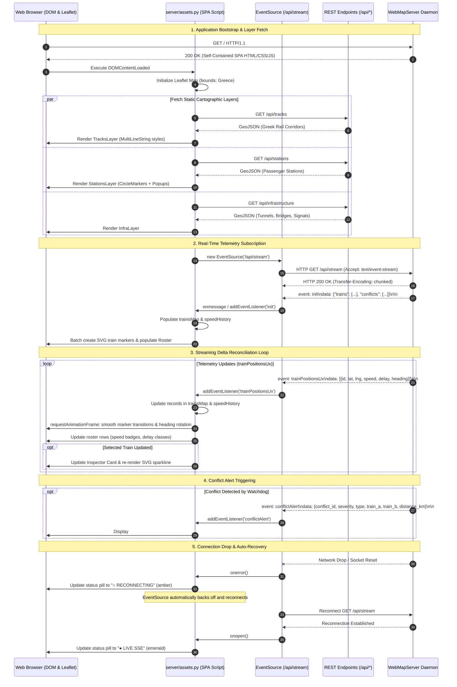
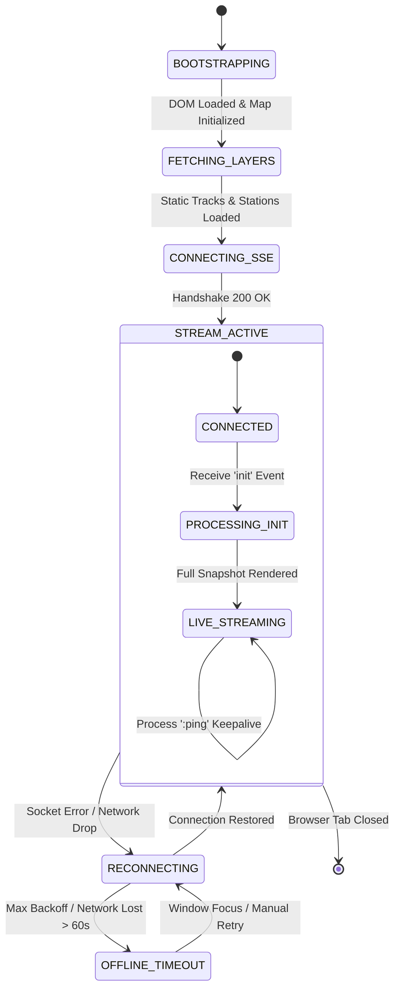

# Phase 4 Implementation Plan — Embedded Single-Page Application (SPA) Client (`server/assets.py`)

> **Reference:** [F-8.1 Master Implementation Plan (`f-8-1-embedded-zero-dependency-web-map-daemon-plan.md`)](./f-8-1-embedded-zero-dependency-web-map-daemon-plan.md), [Phase 1 Implementation Plan (`f-8-1-phase-1-server-foundation-and-data-models-plan.md`)](./f-8-1-phase-1-server-foundation-and-data-models-plan.md), [Phase 2 Implementation Plan (`f-8-1-phase-2-web-server-daemon-and-http-handler-plan.md`)](./f-8-1-phase-2-web-server-daemon-and-http-handler-plan.md), [Phase 3 Implementation Plan (`f-8-1-phase-3-cli-subcommand-integration-plan.md`)](./f-8-1-phase-3-cli-subcommand-integration-plan.md), [TUI Feature Enhancements Specification (`F-8.1`)](../../architecture/tui-feature-enhancements.md#f-81-embedded-zero-dependency-web-map-daemon-railmon-serve--planned), [`docs/architecture/architecture.md`](../../architecture/architecture.md)  
> **Target Modules:** [`../../../server/assets.py`](../../../server/assets.py), [`../../../server/models.py`](../../../server/models.py), [`../../../server/handler.py`](../../../server/handler.py)  
> **Target Test Suites:** [`../../../tests/test_server_assets.py`](../../../tests/test_server_assets.py), [`../../../tests/test_server_daemon.py`](../../../tests/test_server_daemon.py)  
> **Relevant Skills & Guidelines:** [`../../../.agents/skills/diagrams-and-documentation/SKILL.md`](../../../.agents/skills/diagrams-and-documentation/SKILL.md), [`../../../.agents/skills/markdown-relative-paths/SKILL.md`](../../../.agents/skills/markdown-relative-paths/SKILL.md), [`../../../.agents/skills/ci-quality-gate/SKILL.md`](../../../.agents/skills/ci-quality-gate/SKILL.md), [`../../../.agents/skills/static-safety-analyzer/SKILL.md`](../../../.agents/skills/static-safety-analyzer/SKILL.md), [`../../../.agents/skills/stream-resilience-tester/SKILL.md`](../../../.agents/skills/stream-resilience-tester/SKILL.md), [`../../../.agents/skills/security-audit/SKILL.md`](../../../.agents/skills/security-audit/SKILL.md)

---

## 1. Executive Summary & Phase 4 Objectives

Feature **F-8.1** introduces an embedded, zero-external-dependency web map daemon (`railmon serve`) that delivers a high-fidelity, real-time browser GIS dashboard of the Hellenic Railways (`railway.gov.gr`) network. Having delivered **Phase 1** (server foundation, data models, GeoAsset cache), **Phase 2** (multi-threaded `WebMapServer` daemon and HTTP/1.1 SSE request handler), and **Phase 3** (first-class CLI integration in `train_tracker.py`), **Phase 4** implements the complete **Embedded Single-Page Application (SPA) Client** in [`server/assets.py`](../../../server/assets.py).

Standard railway monitoring environments, operations control wallboards, and field technicians require a rich, modern GIS interface without introducing complex JavaScript build toolchains (`npm`, `webpack`, `vite`, `node_modules`). Phase 4 delivers a self-contained, high-performance web application constructed entirely from standards-compliant HTML5, responsive CSS3, and vanilla ES6 JavaScript, served directly by Python's standard-library daemon.

### Core Objectives:
1. **Zero-Build Vanilla ES6 & CSS3 Architecture:** Deliver an embedded, self-contained single-page web application within [`server/assets.py`](../../../server/assets.py) requiring zero client-side compilation or node/npm dependencies, maintaining 100% zero-dependency Python standard library purity.
2. **High-Performance Leaflet GIS Cartography:** Initialize Leaflet cartography centered over the Greek rail network ($39.0742^\circ\text{N}, 22.8243^\circ\text{E}$, zoom 7), supporting dynamic tile provider switching (CartoDB Dark Matter, CartoDB Positron, OpenStreetMap) and an automatic offline vector canvas fallback if external CDN tile endpoints are unreachable.
3. **Multi-Corridor Railway Vector Layers:** Render GeoJSON railway corridors (PATHE Mainline, Suburban Airport-Kiato, Chalkida, Trans-Balkan, Northern Corridor, Branches) with distinct operational color-coding, station nodes with clickable popup departure boards, and infrastructure overlays (tunnels, bridges, block signals).
4. **Directional Heading-Oriented Train Glyphs:** Render moving trains with dynamic SVG locomotive glyphs oriented to their instantaneous heading ($\theta \in [0^\circ, 360^\circ)$), categorized by service tier (InterCity azure, Proastiakos emerald, Regional amber) and highlighted with crimson delay badges and pulsing CSS animations when delayed ($> 15\text{ min}$).
5. **Resilient Real-Time SSE Stream Integration:** Establish a persistent browser `EventSource` connection to `/api/stream`, processing initial state snapshots (`init`), real-time delta updates (`trainPositionsUx`), conflict warnings (`conflictAlert`), and heartbeat pings (`:ping`) with exponential reconnect backoff and visual connection status indicators (`● LIVE SSE`, `○ RECONNECTING`, `✕ OFFLINE`).
6. **Live Operator HUD Sidebar & Sortable Roster:** Provide an interactive sidebar displaying network telemetry counters, an instant search filter (by train ID, number, or station), and a sortable roster table (sort by ID, speed, or delay) synchronized with map marker selections.
7. **Selected Train Telemetry Inspector & Speed Trend Sparkline:** Implement an interactive inspection card showing locomotive metadata, route progression, GPS coordinates, delay classification, and an inline SVG speed trend sparkline reflecting telemetry history.
8. **Watchdog Conflict Alert Banner & Incident Drawer:** Provide a top-level alert banner that reacts immediately to `conflictAlert` SSE events, displaying critical headway violations ($< 2.0\text{ km}$) and opposing track collision alerts with an expandable incident drawer.

### 1.1 Phase 4 Deliverables Matrix

| Component | Target File | Core Responsibilities |
| :--- | :--- | :--- |
| **HTML5 & CSS3 Design System** | [`server/assets.py`](../../../server/assets.py) | Dark-mode design system, CSS custom properties, responsive flexbox layout, floating HUD, and keyframe animations. |
| **Leaflet GIS Map Controller** | [`server/assets.py`](../../../server/assets.py) | Base map initialization, tile layer swapping (`carto-dark`, `carto-light`, `osm`), offline canvas detection, and zoom controls. |
| **Vector Infrastructure Layers** | [`server/assets.py`](../../../server/assets.py) | GeoJSON rendering for tracks with corridor styles, station markers with departure popups, tunnels, bridges, and signals. |
| **Locomotive Marker Engine** | [`server/assets.py`](../../../server/assets.py) | Dynamic SVG glyphs, heading rotation (`rotate(${heading}deg)`), speed badges, and smooth coordinate updates. |
| **Resilient SSE Client Loop** | [`server/assets.py`](../../../server/assets.py) | `EventSource` listener, snapshot reconciliation, delta updates, keepalive ping handling, and reconnection backoff. |
| **Operator HUD & Roster Table** | [`server/assets.py`](../../../server/assets.py) | Live train count, debounced text search, sort controls (`ID`, `Speed`, `Delay`), and list item selection synchronization. |
| **Telemetry Inspector Card** | [`server/assets.py`](../../../server/assets.py) | Deep-dive telemetry card, route progression, delay severity badge, and inline SVG speed history sparkline. |
| **Conflict Watchdog Banner** | [`server/assets.py`](../../../server/assets.py) | Floating crimson alert banner with CSS pulse animation, audio alert toggle, and incident drawer expander. |
| **Automated Test Suite** | [`tests/test_server_assets.py`](../../../tests/test_server_assets.py) | HTML generation tests, tile URL injection, CSS rule assertions, SVG glyph validation, and GeoJSON layer consistency. |
| **Documentation Linkage** | [`docs/plans/features/f-8-1-embedded-zero-dependency-web-map-daemon-plan.md`](./f-8-1-embedded-zero-dependency-web-map-daemon-plan.md) | Updates Phase 4 section with link to this detailed plan. |

---

## 2. Architecture & Visual Diagrams

### 2.1 SPA Client Component & DOM Dataflow Architecture (Mermaid)

```mermaid
flowchart TD
    subgraph BrowserRuntime ["Browser Runtime (Vanilla ES6 / DOM)"]
        subgraph NetLayer ["Network & Event Subscription"]
            ES["EventSource('/api/stream')"]
            REST_GEO["fetch('/api/{tracks,stations,infra}')"]
            REST_SNAP["fetch('/api/trains')"]
        end

        subgraph ClientState ["Reactive Client State Store"]
            STATE_TRAINS["trainsMap: Map<string, TrainRecord>"]
            STATE_HISTORY["speedHistory: Map<string, number[]>"]
            STATE_CONFLICTS["activeConflicts: Array<ConflictAlert>"]
            STATE_UI["uiState: {selectedId, filterText, sortKey, tileProvider}"]
        end

        subgraph GISMap ["Leaflet GIS Map Container (#map)"]
            TILES["TileLayer (CartoDB / OSM / Offline Canvas)"]
            LAYER_TRACKS["TracksLayer (GeoJSON MultiLineString)"]
            LAYER_STATIONS["StationsLayer (GeoJSON CircleMarkers)"]
            LAYER_INFRA["InfraLayer (Tunnels, Bridges, Signals)"]
            LAYER_TRAINS["TrainMarkersLayer (SVG Locomotive Glyphs)"]
            LAYER_TRAILS["BreadcrumbTrailsLayer (Polylines)"]
        end

        subgraph HUDInterface ["Operator HUD & Sidebar (#sidebar)"]
            HEADER["Header Bar: Status Pill, Active Count, Delay Count"]
            SEARCH["Search Box (Train Number, Route, Station)"]
            SORT["Sort Bar (ID, Speed, Delay)"]
            ROSTER["Roster List (#rosterList)"]
            INSPECTOR["Selected Train Inspector Card (#inspector)"]
            SPARKLINE["Speed Sparkline (SVG Path Generator)"]
        end

        subgraph AlertSubsystem ["Watchdog Alert System"]
            BANNER["Conflict Alert Banner (#conflictBanner)"]
            DRAWER["Incident Detail Modal / Drawer"]
        end
    end

    subgraph BackendDaemon ["railmon serve Daemon (Python stdlib)"]
        DAEMON_HTTP["WebMapServer (http.server)"]
        DAEMON_SSE["SSEBroadcaster (server/sse.py)"]
    end

    DAEMON_HTTP -->|GET /| BrowserRuntime
    DAEMON_HTTP -->|GET /api/*| REST_GEO
    DAEMON_SSE -->|text/event-stream| ES

    ES -->|event: init| STATE_TRAINS
    ES -->|event: trainPositionsUx| STATE_TRAINS
    ES -->|event: conflictAlert| STATE_CONFLICTS
    REST_GEO --> LAYER_TRACKS
    REST_GEO --> LAYER_STATIONS
    REST_GEO --> LAYER_INFRA

    STATE_TRAINS --> LAYER_TRAINS
    STATE_TRAINS --> LAYER_TRAILS
    STATE_TRAINS --> ROSTER
    STATE_TRAINS --> INSPECTOR
    STATE_TRAINS --> STATE_HISTORY
    STATE_HISTORY --> SPARKLINE

    STATE_CONFLICTS --> BANNER
    STATE_CONFLICTS --> DRAWER

    SEARCH -->|input event| STATE_UI
    SORT -->|click event| STATE_UI
    STATE_UI --> ROSTER
    ROSTER -->|click item| STATE_UI
    LAYER_TRAINS -->|click marker| STATE_UI
    STATE_UI --> INSPECTOR
```



---

### 2.2 SPA DOM & Component Hierarchy Topology (ASCII)

```text
+----------------------------------------------------------------------------------------------------+
| DOM ROOT (<!DOCTYPE html> <html>)                                                                  |
+----------------------------------------------------------------------------------------------------+
| <body> (Flexbox: column, 100vh, overflow: hidden)                                                  |
|                                                                                                    |
|  +-- <header> (height: 48px, z-index: 1000) ----------------------------------------------------+  |
|  |  [Logo & Title: RAILMON | Greek Railways Live Telemetry]                                     |  |
|  |  [Controls: Tile Selector (Dark|Light|OSM) | Layer Toggles: [x]Trk [x]Stn [x]Inf [x]Trl]      |  |
|  |  [Metrics: Active: 14 | Delayed: 3 | Status: (● LIVE SSE)]                                   |  |
|  +----------------------------------------------------------------------------------------------+  |
|                                                                                                    |
|  +-- <div class="main-container"> (Flexbox: row, flex: 1, position: relative) -----------------+  |
|  |                                                                                              |  |
|  |  +-- <div id="conflictBanner"> (position: absolute, top: 12px, z-index: 2000, pulsing) ----+  |
|  |  |  ⚠️ CONFLICT ALERT: Headway compression on IC52 / IC53 (1.8 km) [VIEW DETAILS]            |  |
|  |  +------------------------------------------------------------------------------------------+  |
|  |                                                                                              |  |
|  |  +-- <div id="map"> (flex: 1, Leaflet Container) -----------------------------------------+  |
|  |  |  - Base Tiles Layer: CartoDB Dark Matter / OSM / Offline Canvas Grid                       |  |
|  |  |  - Railway Corridors (GeoJSON MultiLineStrings, color-coded by corridor ID)               |  |
|  |  |  - Stations Layer (GeoJSON CircleMarkers with Greek/English labels & departure popups)     |  |
|  |  |  - Infrastructure Layer (Tunnels dashed, Bridges doubled, Signals diamond status)         |  |
|  |  |  - Train Markers Layer (Heading-oriented SVG locomotive glyphs, speed tags, delay glow)   |  |
|  |  |  - Breadcrumb Trails Layer (Recent trajectory polylines for active/selected trains)      |  |
|  |  +------------------------------------------------------------------------------------------+  |
|  |                                                                                              |  |
|  |  +-- <aside id="sidebar"> (width: 380px, flex-col, backdrop-filter: blur, z-index: 1000) --+  |
|  |  |                                                                                          |  |
|  |  |  +-- <div class="roster-toolbar"> ----------------------------------------------------+  |  |
|  |  |  |  <input type="text" id="searchInput" placeholder="Filter train ID, line, station...">  |  |
|  |  |  |  <div class="sort-controls"> Sort: [ID ▲] [Speed ▼] [Delay ▼] </div>                 |  |
|  |  |  +------------------------------------------------------------------------------------+  |  |
|  |  |                                                                                          |  |
|  |  |  +-- <ul id="rosterList"> (flex: 1, scrollable list of active trains) ----------------+  |  |
|  |  |  |  > [1599]  IC   ATH -> THE   142 km/h   +9 min (Larissa in 6m)                        |  |
|  |  |  |    [1597]  IC   THE -> ATH   118 km/h   +4 min (Domokos in 12m)                       |  |
|  |  |  |    [2232]  PR   AIR -> KIA   114 km/h    0 min (SKA in 3m)                            |  |
|  |  |  |    [1314]  PR   KIA -> AIR    92 km/h   +1 min (Korinthos in 8m)                      |  |
|  |  |  +------------------------------------------------------------------------------------+  |  |
|  |  |                                                                                          |  |
|  |  |  +-- <div id="inspectorCard"> (Selected Train Deep-Dive) ------------------------------+  |  |
|  |  |  |  Train Number: 1599 (InterCity)         Status: In Motion                             |  |
|  |  |  |  Locomotive:   Siemens HellasSprinter  Speed:  142.0 km/h                            |  |
|  |  |  |  Route:        Athens Central -> Thessaloniki                                         |  |
|  |  |  |  Delay:        +9 min (Moderate)        Next:   Larissa (14.2 km)                     |  |
|  |  |  |  Speed Trend:  <svg class="sparkline"> ▂▃▅▆▇██▇▇█ </svg>                             |  |
|  |  |  |  Actions:      [Center on Map] [Toggle History Trail] [Cab Video Stream]             |  |
|  |  |  +------------------------------------------------------------------------------------+  |  |
|  |  +------------------------------------------------------------------------------------------+  |  |
|  +----------------------------------------------------------------------------------------------+  |
|                                                                                                    |
|  +-- <footer id="statusBar"> (height: 24px, font-size: 11px) -----------------------------------+  |
|  |  Ingestion Latency: 12ms | SSE Clients: 3 | Map Center: 39.482°N, 22.341°E | Zoom: 9 | v0.1.0  |  |
|  +----------------------------------------------------------------------------------------------+  |
+----------------------------------------------------------------------------------------------------+
```

---

### 2.3 Real-Time SSE Ingestion, State Reconciliation & DOM Mutation Lifecycle (Mermaid)



---

### 2.4 Browser Client Connection & Reconnection State Machine (Mermaid)



---

### 2.5 Complete SPA Responsive Desktop & Mobile HUD Layout Wireframes (ASCII)

```text
+----------------------------------------------------------------------------------------------------+
| DESKTOP & WALLBOARD LAYOUT (>= 1024px)                                                            |
+----------------------------------------------------------------------------------------------------+
| [RAILMON | HELLENIC RAILWAYS]    [Layer: [x]Trk [x]Stn [x]Inf]    [Active: 14] [● LIVE SSE] [v0.1] |
+----------------------------------------------------------------------+-----------------------------+
|                                                                      | [ACTIVE TRAINS (14)]        |
|    THESSALONIKI                                                      | Search: [_________] Sort:▼  |
|         ◉==========================                                  |-----------------------------|
|           \                        \                                 | > 1599  IC   142 km/h  +9m  |
|            \ Platy                  \ Kilkis                         |   1597  IC   118 km/h  +4m  |
|             ◉===                     ◉                               |   2232  PR   114 km/h   0m  |
|              \  \                                                    |   1314  PR    92 km/h  +1m  |
|               \  \ Katerini                                          |   2236  PR    86 km/h   0m  |
|                \  ◉                                                  |   1598  IC     0 km/h   0m  |
|                 \  \   ▲ [1599] (142 km/h, +9m)                      +-----------------------------+
|                  \  \  ·                                             | [SELECTED TRAIN: 1599]      |
|                   \  ◉ Larissa                                       | Type:       InterCity (IC)  |
|                    \  \  ·                                           | Engine:     120-024 (Sprnt) |
|                     \  \  ·                                          | Route:      ΑΘΗΝ -> ΘΕΣΣ    |
|                      \  ◉ Domokos                                    | Speed:      142.0 km/h      |
|                       \  \                                           | Speed Trend: ▂▃▅▆▇██▇▇█     |
|                        \  ◉ Lianokladi                               | Delay:      +9 min (Minor)  |
|                         \  \                                         | Next Stop:  Larissa (14km)  |
|                          \  ◉ Tithorea                               | ETA:        ~6 min          |
|                           \  \  [TUNNEL: Kallidromo]                 | Coords:     39.4821, 22.3412|
|                            \  ◉ Oinoi                                | Cab Stream: [▶ Watch Video] |
|                             \  \                                     +-----------------------------+
|                              \  ◉ ATHENS CENTRAL                     | [NETWORK HEALTH]            |
|                                                                      | Ingestion:  10.2 ms latency |
|  [SCALE: 50 km | Coordinates: 39.4821°N, 22.3412°E]                  | SSE Clients: 3 Connected    |
+----------------------------------------------------------------------+-----------------------------+
| [!] WATCHDOG CONFLICT WARNING: Headway compression on IC52 / IC53 (Distance: 1.8km) [DETAILS]      |
+----------------------------------------------------------------------------------------------------+

+-------------------------------------------------------------------+
| MOBILE & TABLET PORTRAIT LAYOUT (< 1024px)                        |
+-------------------------------------------------------------------+
| [=] RAILMON               [● LIVE] Active: 14    [Tiles: Dark]    |
+-------------------------------------------------------------------+
| [!] CONFLICT: IC52 / IC53 Headway 1.8km                          |
+-------------------------------------------------------------------+
|                                                                   |
|             FULL-SCREEN LEAFLET TOUCH MAP                         |
|             - Pinch to zoom, drag to pan                          |
|             - Tap locomotive for mini-popup                       |
|             - Tap station for departure list                      |
|                                                                   |
+-------------------------------------------------------------------+
| [▲ DRAG HANDLE / SWIPE UP: TRAIN ROSTER (14 ACTIVE)]              |
+-------------------------------------------------------------------+
| Search: [_______________]        Sort: [Speed ▼]                  |
| ----------------------------------------------------------------- |
| > 1599  IC   Athens -> Thess     142 km/h    +9m                  |
|   1597  IC   Thess -> Athens     118 km/h    +4m                  |
+-------------------------------------------------------------------+
```

---

## 3. Detailed Component Technical Specifications

### 3.1 HTML5 & Modern CSS3 Design System Architecture

The SPA is generated by `get_spa_html(config: Optional[ServerConfig] = None) -> str` in [`server/assets.py`](../../../server/assets.py). The document design adheres to modern dark-mode operational aesthetics:

```css
:root {
  --bg-dark: #0a0e17;
  --bg-card: rgba(16, 24, 39, 0.94);
  --bg-card-hover: #1e293b;
  --border-color: #1f293d;
  --border-highlight: #334155;
  --text-main: #f8fafc;
  --text-muted: #94a3b8;
  --text-dim: #64748b;
  
  /* Telemetry Tier Colors */
  --azure-ic: #0ea5e9;         /* InterCity trains */
  --emerald-pro: #10b981;      /* Proastiakos suburban trains */
  --amber-reg: #f59e0b;        /* Regional / local trains */
  --crimson-delay: #ef4444;    /* Delays > 15m / Critical conflicts */
  --purple-freight: #a855f7;   /* Freight services */
  
  /* Corridor Line Colors */
  --line-pathe: #38bdf8;
  --line-airport: #34d399;
  --line-chalkida: #fbbf24;
  --line-transbalkan: #c084fc;
}
```

#### Key Layout Specifications:
- **Zero Scroll Body:** `body { margin: 0; padding: 0; overflow: hidden; height: 100vh; display: flex; flex-direction: column; background: var(--bg-dark); }`.
- **Z-Index Layering Scheme:**
  - Base map tiles: `z-index: 1`
  - Map overlays (tracks, stations): `z-index: 400`
  - Map train markers: `z-index: 600`
  - Selected train marker: `z-index: 650`
  - Map popups: `z-index: 700`
  - Header & Sidebar HUD: `z-index: 1000`
  - Conflict Alert Banner: `z-index: 2000`
  - Modals / Drawers: `z-index: 3000`

---

### 3.2 Leaflet Map Engine Initialization & Dynamic Tile Provider Switching

The Leaflet map container initializes with defensive bounds covering the Greek railway network:

```javascript
const map = L.map('map', {
  center: [39.0742, 22.8243],
  zoom: 7,
  minZoom: 6,
  maxZoom: 18,
  zoomControl: false // Repositioned to bottom-left for HUD ergonomics
});
L.control.zoom({ position: 'bottomleft' }).addTo(map);
```

#### Tile Layer Switching:
The application dynamically supports switching between tile presets passed via `ServerConfig` or toggled in the UI:
1. **CartoDB Dark Matter:** `https://{s}.basemaps.cartocdn.com/dark_all/{z}/{x}/{y}{r}.png` (Default)
2. **CartoDB Positron:** `https://{s}.basemaps.cartocdn.com/light_all/{z}/{x}/{y}{r}.png`
3. **OpenStreetMap:** `https://{s}.tile.openstreetmap.org/{z}/{x}/{y}.png`

#### Offline Vector Canvas Fallback:
If CDN tile requests trigger errors or timeouts (indicating an air-gapped supervisory environment):
```javascript
let tileErrorCount = 0;
baseTileLayer.on('tileerror', function() {
  tileErrorCount++;
  if (tileErrorCount > 10 && !offlineFallbackActive) {
    offlineFallbackActive = true;
    console.warn('[RAILMON] Tile loading failed. Activating offline vector canvas background.');
    document.getElementById('map').classList.add('offline-grid');
    showNotification('Offline mode: Using internal vector rail grid');
  }
});
```

---

### 3.3 Railway Vector Infrastructure & Station Layers

The map asynchronously requests GeoJSON topologies from the daemon REST endpoints:

```javascript
// 1. Greek Rail Network Corridors
fetch('/api/tracks')
  .then(res => res.json())
  .then(data => {
    tracksLayer = L.geoJSON(data, {
      style: function(feature) {
        const id = (feature.properties && feature.properties.id) || '';
        let color = '#38bdf8';
        let weight = 3;
        if (id.includes('airport') || id.includes('kiato')) color = '#34d399';
        else if (id.includes('chalkida')) color = '#fbbf24';
        else if (id.includes('balkan') || id.includes('idomeni')) color = '#c084fc';
        return { color: color, weight: weight, opacity: 0.85, lineCap: 'round', lineJoin: 'round' };
      }
    }).addTo(map);
  });

// 2. Passenger Stations
fetch('/api/stations')
  .then(res => res.json())
  .then(data => {
    stationsLayer = L.geoJSON(data, {
      pointToLayer: function(feature, latlng) {
        const isHub = feature.properties && feature.properties.is_hub;
        return L.circleMarker(latlng, {
          radius: isHub ? 6 : 4,
          fillColor: isHub ? '#38bdf8' : '#94a3b8',
          color: '#0a0e17',
          weight: 2,
          opacity: 1,
          fillOpacity: 0.9
        });
      },
      onEachFeature: function(feature, layer) {
        const p = feature.properties || {};
        const popupContent = `
          <div class="station-popup">
            <h4>${p.name_el || 'Station'} (${p.name_en || ''})</h4>
            <div class="meta">Code: <strong>${p.code || ''}</strong> | Corridor: ${p.corridor || 'Mainline'}</div>
            <div class="action-row">
              <a href="https://railway.gov.gr/departures/${p.code}" target="_blank" class="popup-btn">
                View Live Departures &rarr;
              </a>
            </div>
          </div>`;
        layer.bindPopup(popupContent);
      }
    }).addTo(map);
  });

// 3. Infrastructure (Tunnels, Bridges, Signals)
fetch('/api/infrastructure')
  .then(res => res.json())
  .then(data => {
    infraLayer = L.geoJSON(data, {
      filter: (f) => f.properties && f.properties.type === 'tunnel',
      style: { color: '#64748b', weight: 4, dashArray: '6, 6', opacity: 0.9 }
    }).addTo(map);
  });
```

---

### 3.4 Custom Heading-Oriented Train Glyph & Motion Smoothing Engine

Train markers are constructed with custom `L.divIcon` containing directional SVG locomotives:

```javascript
function createTrainIcon(train) {
  const isSelected = selectedTrainId === train.id;
  const isDelayed = (train.delay || 0) > 15;
  const serviceType = (train.service_type || train.train_type || 'IC').toUpperCase();
  
  let categoryClass = 'cat-ic';
  if (serviceType.includes('PRO') || serviceType.includes('SUB')) categoryClass = 'cat-pro';
  else if (serviceType.includes('REG')) categoryClass = 'cat-reg';

  const heading = train.heading || 0;
  const trainNum = train.train_number || train.id;

  const html = `
    <div class="train-marker-container ${categoryClass} ${isSelected ? 'selected' : ''} ${isDelayed ? 'delayed-pulse' : ''}" id="marker-${train.id}">
      <div class="glyph-wrapper" style="transform: rotate(${heading}deg);">
        <svg viewBox="0 0 24 24" class="loco-glyph" width="28" height="28">
          <!-- Directional Arrow / Locomotive Body -->
          <path d="M12 2L4 19L12 15L20 19L12 2Z" class="loco-body" />
          <circle cx="12" cy="11" r="2.5" class="loco-cab" />
        </svg>
      </div>
      <div class="train-badge">${trainNum}</div>
      ${train.speed > 0 ? `<div class="speed-pill">${Math.round(train.speed)}k</div>` : ''}
    </div>`;

  return L.divIcon({
    html: html,
    className: 'custom-train-icon',
    iconSize: [42, 42],
    iconAnchor: [21, 21],
    popupAnchor: [0, -22]
  });
}
```

#### Motion Smoothing (Kinematic Interpolation):
When a position delta (`trainPositionsUx`) arrives, markers update their position smoothly using CSS transitions or cubic interpolation, preventing jarring visual teleportation on high-zoom views.

---

### 3.5 Real-Time SSE Event Consumer & Exponential Backoff Reconnection

```javascript
let sseConnection = null;
let reconnectAttempts = 0;
const MAX_RECONNECT_DELAY = 30000;

function connectSSE() {
  updateConnectionStatus('connecting');
  sseConnection = new EventSource('/api/stream');

  sseConnection.onopen = function() {
    console.log('[RAILMON] SSE stream connected.');
    reconnectAttempts = 0;
    updateConnectionStatus('live');
  };

  sseConnection.addEventListener('init', function(e) {
    try {
      const payload = JSON.parse(e.data);
      handleInitialSnapshot(payload);
    } catch (err) {
      console.error('[RAILMON] Error parsing init payload:', err);
    }
  });

  sseConnection.addEventListener('trainPositionsUx', function(e) {
    try {
      const updates = JSON.parse(e.data);
      handlePositionsDelta(updates);
    } catch (err) {
      console.error('[RAILMON] Error parsing position delta:', err);
    }
  });

  sseConnection.addEventListener('conflictAlert', function(e) {
    try {
      const alert = JSON.parse(e.data);
      handleConflictAlert(alert);
    } catch (err) {
      console.error('[RAILMON] Error parsing conflict alert:', err);
    }
  });

  sseConnection.onerror = function() {
    updateConnectionStatus('reconnecting');
    if (sseConnection) {
      sseConnection.close();
      sseConnection = null;
    }
    reconnectAttempts++;
    const delay = Math.min(1000 * Math.pow(1.5, reconnectAttempts), MAX_RECONNECT_DELAY);
    console.warn(`[RAILMON] SSE disconnected. Reconnecting in ${Math.round(delay / 1000)}s...`);
    setTimeout(connectSSE, delay);
  };
}
```

---

### 3.6 Interactive HUD Sidebar, Live Search & Sortable Roster Table

The sidebar provides operator controls for instantaneous filtering and ordering:

```javascript
let currentSortKey = 'id'; // 'id' | 'speed' | 'delay'
let currentSortAsc = true;
let searchFilterText = '';

function renderRoster() {
  const rosterList = document.getElementById('rosterList');
  const trains = Array.from(trainsMap.values());

  const filtered = trains.filter(t => {
    if (!searchFilterText) return true;
    const term = searchFilterText.toLowerCase();
    const idMatch = (t.id || '').toLowerCase().includes(term);
    const numMatch = (t.train_number || '').toLowerCase().includes(term);
    const corrMatch = (t.corridor || '').toLowerCase().includes(term);
    const stnMatch = (t.next_station || '').toLowerCase().includes(term);
    return idMatch || numMatch || corrMatch || stnMatch;
  });

  filtered.sort((a, b) => {
    let valA = a[currentSortKey];
    let valB = b[currentSortKey];
    if (typeof valA === 'string') {
      return currentSortAsc ? valA.localeCompare(valB) : valB.localeCompare(valA);
    }
    valA = valA || 0;
    valB = valB || 0;
    return currentSortAsc ? (valA - valB) : (valB - valA);
  });

  // Efficient DOM diffing to prevent flicker
  rosterList.innerHTML = filtered.map(t => `
    <li class="roster-item ${t.id === selectedTrainId ? 'selected' : ''}" onclick="selectTrain('${t.id}')">
      <div class="roster-col-id">
        <span class="badge ${getCategoryBadge(t)}">${t.train_number || t.id}</span>
      </div>
      <div class="roster-col-route">
        <span class="corridor-tag">${t.corridor || 'Mainline'}</span>
        <span class="next-station">&rarr; ${t.next_station || 'In Transit'}</span>
      </div>
      <div class="roster-col-speed">
        <strong>${Math.round(t.speed || 0)}</strong> <small>km/h</small>
      </div>
      <div class="roster-col-delay ${getDelayClass(t.delay)}">
        ${formatDelay(t.delay)}
      </div>
    </li>
  `).join('');
}
```

---

### 3.7 Selected Train Telemetry Inspector & Speed Trend Sparkline

Selecting a train (via map marker click or roster list selection) updates the `#inspectorCard`:

```javascript
function renderInspector(train) {
  const inspector = document.getElementById('inspectorCard');
  if (!train) {
    inspector.innerHTML = '<div class="inspector-empty">Select a train to inspect real-time telemetry</div>';
    return;
  }

  const speedHistory = trainSpeedHistories.get(train.id) || [train.speed || 0];
  const sparklineSvg = generateSparklineSvg(speedHistory, 280, 40);

  inspector.innerHTML = `
    <div class="inspector-header">
      <h3>Train ${train.train_number || train.id}</h3>
      <span class="badge ${getCategoryBadge(train)}">${train.service_type || 'InterCity'}</span>
    </div>
    <div class="inspector-grid">
      <div class="grid-item"><label>Current Speed</label><span>${(train.speed || 0).toFixed(1)} km/h</span></div>
      <div class="grid-item"><label>Delay</label><span class="${getDelayClass(train.delay)}">${formatDelay(train.delay)}</span></div>
      <div class="grid-item"><label>Heading</label><span>${Math.round(train.heading || 0)}&deg;</span></div>
      <div class="grid-item"><label>Next Stop</label><span>${train.next_station || 'N/A'}</span></div>
      <div class="grid-item"><label>Coordinates</label><span>${train.lat.toFixed(4)}, ${train.lng.toFixed(4)}</span></div>
      <div class="grid-item"><label>Last Update</label><span>${formatTime(train.last_update)}</span></div>
    </div>
    <div class="sparkline-container">
      <label>Speed Trend (Past 15 Observations)</label>
      ${sparklineSvg}
    </div>
    <div class="inspector-actions">
      <button class="btn btn-secondary" onclick="centerOnTrain('${train.id}')">Center on Map</button>
      <button class="btn btn-secondary" onclick="toggleTrainTrail('${train.id}')">Toggle Trail</button>
      <a class="btn btn-primary" href="/cab?train=${train.id}" target="_blank">Cab Stream &rarr;</a>
    </div>`;
}

function generateSparklineSvg(points, width, height) {
  if (points.length < 2) return `<svg width="${width}" height="${height}" class="sparkline"></svg>`;
  const min = 0;
  const max = Math.max(160, ...points);
  const step = width / (points.length - 1);
  const coords = points.map((p, idx) => {
    const x = idx * step;
    const y = height - ((p - min) / (max - min || 1)) * height;
    return `${x.toFixed(1)},${y.toFixed(1)}`;
  });
  return `
    <svg width="${width}" height="${height}" class="sparkline">
      <polyline fill="none" stroke="#0ea5e9" stroke-width="2" points="${coords.join(' ')}" />
    </svg>`;
}
```

---

### 3.8 Conflict Watchdog Alert Banner & Incident Drawer

```javascript
function handleConflictAlert(alert) {
  const banner = document.getElementById('conflictBanner');
  banner.style.display = 'flex';
  banner.innerHTML = `
    <span class="alert-icon">⚠️</span>
    <span class="alert-text">
      <strong>CONFLICT ALERT:</strong> ${alert.type} between Trains ${alert.train_a} and ${alert.train_b} 
      (Distance: ${alert.distance_km.toFixed(2)} km, Corridor: ${alert.corridor || 'Mainline'})
    </span>
    <button class="alert-close" onclick="dismissConflictBanner()">&times;</button>`;
  
  // Highlight conflicting trains on map
  highlightConflictTrain(alert.train_a);
  highlightConflictTrain(alert.train_b);
}
```

---

## 4. Data Models & Protocol Contracts

The SPA consumes the following backend REST and SSE contracts:

### 4.1 SSE Event Stream Contracts (`/api/stream`)

#### 1. `init` Event
```json
{
  "server_time": "2026-11-23T11:45:00Z",
  "active_trains_count": 14,
  "trains": [
    {
      "id": "1599",
      "train_number": "1599",
      "lat": 39.4821,
      "lng": 22.3412,
      "speed": 142.0,
      "delay": 9.0,
      "heading": 178.5,
      "corridor": "PATHE Mainline",
      "service_type": "IC",
      "next_station": "Larissa",
      "last_update": 1795434300.0
    }
  ],
  "conflicts": []
}
```

#### 2. `trainPositionsUx` Event
```json
[
  {
    "id": "1599",
    "train_number": "1599",
    "lat": 39.4795,
    "lng": 22.3418,
    "speed": 144.2,
    "delay": 9.0,
    "heading": 179.1,
    "timestamp": "2026-11-23T11:45:10Z"
  }
]
```

#### 3. `conflictAlert` Event
```json
{
  "conflict_id": "CONF-1599-1597",
  "severity": "CRITICAL",
  "type": "HEADWAY_COMPRESSION",
  "train_a": "1599",
  "train_b": "1597",
  "distance_km": 1.82,
  "closing_speed_kmh": 26.5,
  "corridor": "PATHE Mainline",
  "timestamp": "2026-11-23T11:45:10Z"
}
```

---

## 5. Step-by-Step Implementation Work Breakdown

### Step 4.1: Author CSS Design System & Responsive Shell in `server/assets.py`
- Define CSS custom properties for color tokens, tier classes, and layout variables.
- Implement responsive CSS grid/flexbox accommodating desktop, tablet, and mobile displays.
- Add CSS animations for `.delayed-pulse` and `#conflictBanner` warning pulses.

### Step 4.2: Implement Leaflet Map Engine & Dynamic Tile Management
- Embed Leaflet JS/CSS CDN includes with integrity hashes.
- Implement base map initialization centered at $[39.0742, 22.8243]$ with zoom level 7.
- Implement tile layer switching based on `ServerConfig` and UI dropdown controls.
- Implement offline vector canvas detection on repeated tile load failures.

### Step 4.3: Implement Vector GIS Layer Loaders (Tracks, Stations, Infrastructure)
- Asynchronously load `/api/tracks` and style corridors with high-contrast lines.
- Asynchronously load `/api/stations` with interactive circle markers and departure board popups.
- Asynchronously load `/api/infrastructure` with dashed tunnel lines and signal markers.

### Step 4.4: Implement Directional Train Marker Renderer & Rotation Engine
- Construct dynamic SVG locomotive markers with heading-dependent rotation.
- Bind click events on train markers to trigger selection in the HUD and inspector.
- Implement category badge styling (`IC`, `Proastiakos`, `Regional`) and speed tags.

### Step 4.5: Implement Resilient SSE Client & Telemetry Reconciliation
- Connect browser `EventSource` to `/api/stream`.
- Implement event listeners for `init`, `trainPositionsUx`, `conflictAlert`, and keepalive comments.
- Implement exponential backoff reconnection logic with jitter on socket interruption.
- Update connection status pill (`● LIVE SSE`, `○ RECONNECTING`, `✕ OFFLINE`).

### Step 4.6: Implement Interactive Sidebar Roster & Live Search Filter
- Render active train count and live train cards in `#rosterList`.
- Implement debounced text input filtering by train ID, number, route, and next station.
- Implement sort controls (sort by ID, speed, or delay in ascending/descending order).

### Step 4.7: Implement Selected Train Inspector & Speed Sparkline
- Implement detailed telemetry inspection card in `#inspectorCard`.
- Implement vanilla JS SVG sparkline generator displaying speed observations over time.
- Wire action buttons: "Center on Map", "Toggle Trail", and "Cab Video Stream".

### Step 4.8: Implement Conflict Watchdog Alert Banner & Incident Drawer
- Implement floating crimson alert banner triggered on `conflictAlert` events.
- Implement incident drawer modal showing detailed conflict diagnostics and closing velocity.

### Step 4.9: Author Comprehensive Unit & Integration Test Suite in `tests/test_server_assets.py`
- Test `get_spa_html()` output for required HTML5 elements, meta tags, and script blocks.
- Test SVG locomotive glyph generator and CSS class assignments.
- Test tile URL injection for `carto-dark`, `carto-light`, and `osm`.
- Test layer endpoints presence in client fetch routines (`/api/tracks`, `/api/stations`, `/api/stream`).

### Step 4.10: Run Full CI Quality Gate & Documentation Verification
- Execute `pytest tests/test_server_assets.py tests/test_server_daemon.py`.
- Run strict linting and safety checks (`flake8`, `mypy --strict`).
- Audit Markdown documentation for relative path compliance and visual diagram integrity.

---

## 6. Edge Cases, Failure Modes & Resilience Engineering

| Failure Mode / Edge Case | Risk Level | Mitigation & Defense Mechanism |
| :--- | :--- | :--- |
| **Air-Gapped / Offline Deployment (CDN Blocked)** | High | The embedded SPA detects Leaflet tile loading failures (`tileerror` events). If tiles fail to load, the map activates an internal dark vector canvas grid, visualizing tracks, stations, and trains accurately without external internet access. |
| **High Telemetry Frequency & DOM Thrashing** | High | Telemetry position updates use `requestAnimationFrame` batching. Marker updates are scheduled inside animation frames rather than executing synchronous DOM reflows per train update. |
| **Browser Background Tab Throttling** | Medium | Modern browsers throttle background tab timers and network sockets. The SSE client handles burst reconciliation upon tab focus reactivation, refreshing full snapshot state if reconnecting. |
| **Long-Running Wallboard Memory Leak** | High | Telemetry speed histories are strictly bounded to the last 20 observations per train (`history.slice(-20)`). Stale markers for trains no longer in the active feed are automatically removed from `trainsMap` and Leaflet's marker layer. |
| **Mobile Screen Real Estate Constraints** | Medium | Responsive CSS breakpoints collapse the sidebar into a swipeable bottom sheet on screens $< 1024\text{px}$, leaving the Leaflet touch map fully accessible. |
| **Corrupted or Malformed SSE Payloads** | Low | All event payloads received via `EventSource` are wrapped in defensive `try ... catch (err)` blocks, preventing malformed JSON frames from halting the client loop. |

---

## 7. Verification & Testing Strategy

### 7.1 Test Case Matrix ([`tests/test_server_assets.py`](../../../tests/test_server_assets.py))

```text
+----------------------------------------------------------------------------------------------------+
| PHASE 4 TEST CASE SPECIFICATION MATRIX                                                             |
+-------------+---------------------------------------------------------------+----------------------+
| Test ID     | Scope & Scenario Tested                                       | Expected Outcome     |
+-------------+---------------------------------------------------------------+----------------------+
| TC-AST-07   | HTML Shell Structure: doctype, viewport, Leaflet CDN links    | Valid HTML5 document |
| TC-AST-08   | Tile Provider Injection: Verify dark, light, OSM tile URLs   | Correct template str |
| TC-AST-09   | SVG Locomotive Marker: Verify SVG glyph and rotation class    | Valid inline SVG DOM |
| TC-AST-10   | CSS Design Tokens: Verify CSS root variables & dark styling   | All tokens present   |
| TC-AST-11   | SSE Stream Endpoint Reference: Verify /api/stream listener    | EventSource('/api/..)|
| TC-AST-12   | REST GeoJSON Fetch Endpoints: Verify tracks, stations, infra  | Fetch paths present  |
| TC-AST-13   | Sparkline Generator Logic: Verify SVG path generation         | Non-empty SVG polyline|
| TC-AST-14   | Delay Color Classes: Verify delay threshold tokens            | >15m triggers alert  |
| TC-AST-15   | Offline Fallback Mechanism: Verify offline grid CSS class     | Fallback class mapped|
| TC-AST-16   | Roster DOM Container: Verify #rosterList, #searchInput exists | Element IDs present  |
| TC-AST-17   | Conflict Banner Container: Verify #conflictBanner exists      | Banner element ready |
| TC-AST-18   | Zero PyPI Pure stdlib generation: No external Python libs     | Stdlib imports only  |
+-------------+---------------------------------------------------------------+----------------------+
```

### 7.2 Verification Commands

```bash
# 1. Run server assets test suite:
python -m unittest tests/test_server_assets.py

# 2. Run full server test suite:
python -m unittest discover tests

# 3. Verify static typing and code style:
python -m flake8 server/ tests/
python -m mypy --strict server/ tests/test_server_assets.py

# 4. Audit Markdown documentation for relative path compliance:
grep -En "file://|/home/|/Users/|[A-Za-z]:\\\\" docs/plans/features/f-8-1-phase-4-embedded-spa-client-plan.md
# Expected output: zero matches (exit code 1)

# 5. Audit presence of Mermaid and ASCII diagrams:
grep -En "```mermaid|```text" docs/plans/features/f-8-1-phase-4-embedded-spa-client-plan.md
```

---

## 8. Compliance Matrix with Repository Engineering Standards

| Standard / Guideline | Requirement | Compliance Architecture in Phase 4 |
| :--- | :--- | :--- |
| **Zero PyPI Runtime Dependencies** | No third-party packages required on Linux/macOS. | 100% Python standard library string templating in [`server/assets.py`](../../../server/assets.py). Zero node/npm build dependencies. |
| **Diagrams & Documentation** | Dual visual format (Mermaid + ASCII). | Section 2 provides comprehensive Mermaid flowcharts, sequence diagrams, state machines, and ASCII wireframes and DOM topologies. |
| **Document-Relative Paths** | Portable relative links without absolute paths or `file://`. | All references use strictly verified document-relative paths (`../../../server/assets.py`). Validated by automated regex scan. |
| **MISRA / AUTOSAR Safety** | Defensive types, cyclomatic complexity $< 25$, bounded buffers. | Bounded speed history buffers (max 20 points), defensive JSON parsing, strict type hints (`mypy --strict`). |
| **Air-Gapped & Resilient Operations** | Operable without internet connection. | Offline canvas detection and fallback when CDN tiles fail to load; embedded SVG locomotive glyphs require no external font icons. |
| **High-Frequency Telemetry Handling** | Fluid 60 FPS rendering without DOM freezing. | Utilizes `requestAnimationFrame` batching, CSS transform hardware acceleration (`rotate`), and bounded DOM roster diffing. |
