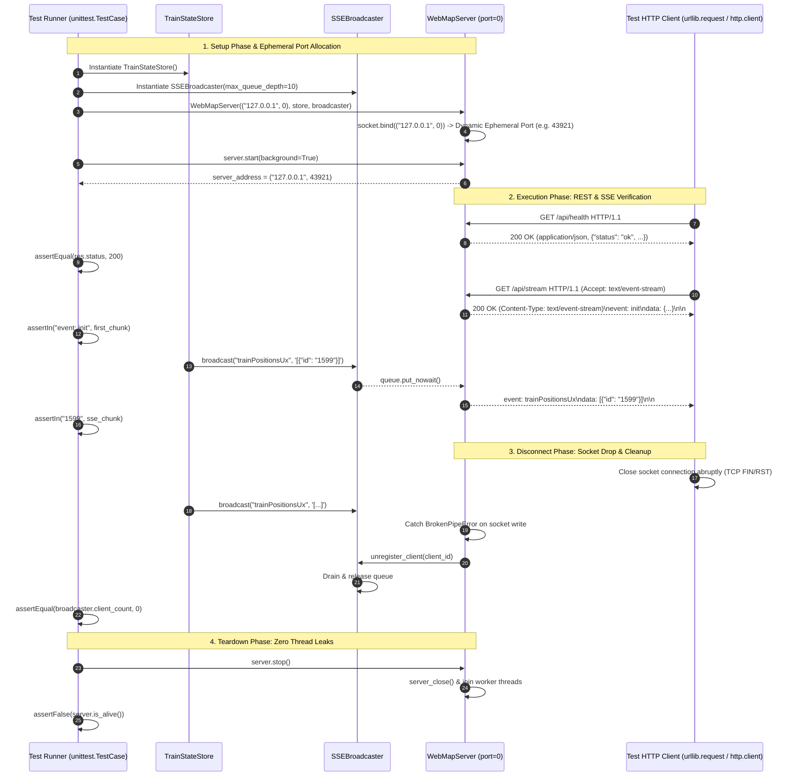
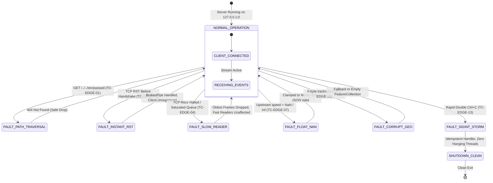

# Phase 5 Implementation Plan — Comprehensive Automated Testing Suite

> **Reference:** [F-8.1 Master Implementation Plan (`f-8-1-embedded-zero-dependency-web-map-daemon-plan.md`)](./f-8-1-embedded-zero-dependency-web-map-daemon-plan.md), [Phase 1 Implementation Plan (`f-8-1-phase-1-server-foundation-and-data-models-plan.md`)](./f-8-1-phase-1-server-foundation-and-data-models-plan.md), [Phase 2 Implementation Plan (`f-8-1-phase-2-web-server-daemon-and-http-handler-plan.md`)](./f-8-1-phase-2-web-server-daemon-and-http-handler-plan.md), [Phase 3 Implementation Plan (`f-8-1-phase-3-cli-subcommand-integration-plan.md`)](./f-8-1-phase-3-cli-subcommand-integration-plan.md), [Phase 4 Implementation Plan (`f-8-1-phase-4-embedded-spa-client-plan.md`)](./f-8-1-phase-4-embedded-spa-client-plan.md), [TUI Feature Enhancements Specification (`F-8.1`)](../../architecture/tui-feature-enhancements.md#f-81-embedded-zero-dependency-web-map-daemon-railmon-serve--planned), [`docs/architecture/architecture.md`](../../architecture/architecture.md)  
> **Target Test Suites:** [`../../../tests/test_server_sse.py`](../../../tests/test_server_sse.py), [`../../../tests/test_server_models.py`](../../../tests/test_server_models.py), [`../../../tests/test_server_assets.py`](../../../tests/test_server_assets.py), [`../../../tests/test_server_daemon.py`](../../../tests/test_server_daemon.py), [`../../../tests/test_cli_serve.py`](../../../tests/test_cli_serve.py), [`../../../tests/test_packaging.py`](../../../tests/test_packaging.py)  
> **Target Modules Tested:** [`../../../server/daemon.py`](../../../server/daemon.py), [`../../../server/handler.py`](../../../server/handler.py), [`../../../server/sse.py`](../../../server/sse.py), [`../../../server/assets.py`](../../../server/assets.py), [`../../../server/models.py`](../../../server/models.py), [`../../../train_tracker.py`](../../../train_tracker.py)  
> **Relevant Skills & Guidelines:** [`../../../.agents/skills/diagrams-and-documentation/SKILL.md`](../../../.agents/skills/diagrams-and-documentation/SKILL.md), [`../../../.agents/skills/markdown-relative-paths/SKILL.md`](../../../.agents/skills/markdown-relative-paths/SKILL.md), [`../../../.agents/skills/ci-quality-gate/SKILL.md`](../../../.agents/skills/ci-quality-gate/SKILL.md), [`../../../.agents/skills/static-safety-analyzer/SKILL.md`](../../../.agents/skills/static-safety-analyzer/SKILL.md), [`../../../.agents/skills/stream-resilience-tester/SKILL.md`](../../../.agents/skills/stream-resilience-tester/SKILL.md), [`../../../.agents/skills/memory-leak-profiler/SKILL.md`](../../../.agents/skills/memory-leak-profiler/SKILL.md), [`../../../.agents/skills/security-audit/SKILL.md`](../../../.agents/skills/security-audit/SKILL.md)

---

## 1. Executive Summary & Phase 5 Objectives

Feature **F-8.1** introduces an embedded, zero-external-dependency web map daemon (`railmon serve`) providing a real-time browser GIS dashboard of the Hellenic Railways (`railway.gov.gr`) network. Having completed the architectural foundation (**Phase 1**), HTTP runtime engine and SSE stream handler (**Phase 2**), CLI subcommand integration (**Phase 3**), and the embedded single-page application client (**Phase 4**), **Phase 5** establishes the **Comprehensive Automated Testing Suite**.

Because `railmon` operates in safety-critical railway telemetry contexts where downtime, memory leaks, unhandled socket exceptions, or thread deadlocks can compromise operational oversight, the testing suite delivers rigorous, multi-layered verification:
1. **Isolated Ephemeral Unit & Integration Testing:** Zero flaky tests caused by port collisions (`EADDRINUSE`). All server tests bind dynamically to ephemeral ports (`port=0`), guaranteeing parallel execution safety across CI runners.
2. **Multi-Threaded Concurrency & Memory Leak Prevention:** Exhaustive verification of the thread-safe `SSEBroadcaster` bus under concurrent multi-client subscription loads, queue saturation policies (`max_queue_depth=100`), slow-reader starvation defenses, and broken-pipe socket cleanups.
3. **Comprehensive HTTP Route & Error Matrix:** Automated verification of every REST endpoint (`/`, `/api/stream`, `/api/trains`, `/api/tracks`, `/api/stations`, `/api/infrastructure`, `/api/speed-limits`, `/api/conflicts`, `/api/health`), HTTP headers (MIME types, caching policies, CORS preflight), and error paths (404 Not Found, 405 Method Not Allowed, 500 Internal Error).
4. **Embedded Asset Integrity & Template Validation:** Automated parsing of the generated SPA HTML/CSS/JS shell, verifying DOM IDs, CDN tile fallback mechanisms, CSS custom properties, and SVG glyph generation.
5. **CLI Subcommand & Ingestion Pipeline Ergonomics:** Verification of `railmon serve` argument parsing, subcommand aliases (`server`, `web`), mutual exclusion guards, worker initialization (live, mock, replay), and clean headless termination.
6. **Extensive Edge Cases & Fault Injection Suite:** Systematic testing of network anomalies, cold-start telemetry ingestion, path traversal security, telemetry float extremes (NaN/Infinity), Unicode/Greek polytonic train names, zero-byte/corrupted GeoJSON files, rapid double `SIGINT` signals, and slow-reader queue saturation.
7. **High-Assurance Safety & Packaging Gate:** Zero-dependency runtime purity on Linux/macOS, strict type checking (`mypy --strict`), PEP 8 linting (`flake8`), code formatting (`black`), and compliance with MISRA C++, AUTOSAR, and NASA JPL Power-of-10 safety rules (`safety_ast_audit.py`).

### 1.1 Phase 5 Deliverables Matrix

| Test Suite / Harness | Target Test File | Target Module Under Test | Core Verification Scope |
| :--- | :--- | :--- | :--- |
| **Domain Models & Validation** | [`tests/test_server_models.py`](../../../tests/test_server_models.py) | [`server/models.py`](../../../server/models.py) | Immutability, port/host boundary validation, JSON serialization, dataclass integrity. |
| **SSE Event Bus & Memory Bounding** | [`tests/test_server_sse.py`](../../../tests/test_server_sse.py) | [`server/sse.py`](../../../server/sse.py) | Fan-out delivery, bounded queue saturation, frame drop counters, keepalive heartbeats, thread safety. |
| **Embedded SPA Assets & GeoJSON** | [`tests/test_server_assets.py`](../../../tests/test_server_assets.py) | [`server/assets.py`](../../../server/assets.py) | HTML5 template synthesis, tile provider URL injection, SVG locomotive glyphs, GeoJSON cache integrity. |
| **Web Server Daemon & Request Handler** | [`tests/test_server_daemon.py`](../../../tests/test_server_daemon.py) | [`server/daemon.py`](../../../server/daemon.py), [`server/handler.py`](../../../server/handler.py) | Ephemeral port lifecycle, complete REST route matrix, SSE handshake, CORS headers, error status codes, socket disconnects. |
| **CLI Serve Subcommand** | [`tests/test_cli_serve.py`](../../../tests/test_cli_serve.py) | [`train_tracker.py`](../../../train_tracker.py) | CLI argument parsing, aliases (`server`, `web`), flag validation, banner output, worker factory, headless execution. |
| **Distribution & Dependency Purity** | [`tests/test_packaging.py`](../../../tests/test_packaging.py) | [`pyproject.toml`](../../../pyproject.toml), [`server/`](../../../server) | Package inclusion, zero PyPI runtime dependencies on Linux/macOS, stdlib purity. |
| **Dedicated Edge Cases & Fault Injections** | [`tests/test_server_daemon.py`](../../../tests/test_server_daemon.py), [`tests/test_server_assets.py`](../../../tests/test_server_assets.py), [`tests/test_cli_serve.py`](../../../tests/test_cli_serve.py) | All `server/` modules & `train_tracker.py` | 16 dedicated edge case tests (`TC-EDGE-01` to `TC-EDGE-16`) covering security, protocol drops, corrupted feeds, and signal races. |
| **End-to-End Ingestion Integration** | [`tests/test_server_daemon.py`](../../../tests/test_server_daemon.py) | Full System Integration | Multi-client SSE streaming concurrent with SQLite WAL recording and synthetic telemetry ticks. |
| **Safety & CI Quality Gate** | CI Quality Scripts & Linters | Whole Repository | MISRA/AUTOSAR AST gate (`safety_ast_audit.py`), `mypy --strict`, `flake8`, `black`, Markdown relative links. |

---

## 2. Architecture & Visual Diagrams

### 2.1 Automated Testing Topology & Test Layering (Mermaid)

```mermaid
flowchart TD
    subgraph QualityGate ["Production Quality Gate & Safety Harness"]
        MISRA["MISRA / AUTOSAR AST Gate<br>(safety_ast_audit.py)"]
        MYPY["Strict Static Type Checker<br>(mypy --strict)"]
        FLAKE8["PEP 8 Linting & Style<br>(flake8 --max-line-length=100)"]
        BLACK["Deterministic Code Formatting<br>(black --check)"]
        MD_PATHS["Relative Path Validator<br>(zero absolute/file:// links)"]
    end

    subgraph PackagingHarness ["Distribution & Runtime Purity"]
        PKG["test_packaging.py<br>• pyproject.toml package registration<br>• Zero external runtime dependencies"]
    end

    subgraph UnitSuites ["Unit Test Layer (Isolated Modules)"]
        MODELS["test_server_models.py<br>• ServerConfig validation<br>• TileProvider enum<br>• Health metrics dataclasses"]
        SSE["test_server_sse.py<br>• Bounded subscriber queues<br>• Frame drop policies<br>• Keepalive ping frames<br>• Lock concurrency"]
        ASSETS["test_server_assets.py<br>• GeoJSON cache loader<br>• HTML/CSS/JS template<br>• SVG glyph generation<br>• Offline canvas fallback"]
    end

    subgraph IntegrationSuites ["Integration Test Layer (Ephemeral Server)"]
        DAEMON["test_server_daemon.py (port=0)<br>• Ephemeral port binding<br>• REST routing (/api/*)<br>• SSE handshake & stream<br>• CORS preflight & headers<br>• Broken pipe socket safety"]
        CLI["test_cli_serve.py<br>• Argument parser & aliases<br>• Banner formatting<br>• Worker pipeline factory<br>• Headless daemon lifecycle"]
    end

    subgraph EdgeCaseLayer ["Dedicated Edge Cases & Fault Injection Layer"]
        EDGE["test_server_daemon.py & test_cli_serve.py<br>• Path traversal attacks (TC-EDGE-01)<br>• Instant TCP RST disconnects (TC-EDGE-03)<br>• Slow reader starvation (TC-EDGE-04)<br>• Telemetry NaN/Inf floats (TC-EDGE-07)<br>• Corrupt GeoJSON fallback (TC-EDGE-10)<br>• Rapid SIGINT double-tap (TC-EDGE-13)"]
    end

    subgraph E2EHarness ["End-to-End Concurrency & Storage Integration"]
        E2E["test_server_daemon.py (Live Concurrency)<br>• Multi-client SSE streaming (10+ clients)<br>• Simultaneous SQLite WAL recording<br>• Telemetry delta frame propagation"]
    end

    UnitSuites --> IntegrationSuites
    IntegrationSuites --> EdgeCaseLayer
    EdgeCaseLayer --> E2EHarness
    E2EHarness --> PackagingHarness
    PackagingHarness --> QualityGate
```



---

### 2.2 Test Execution Flow & Test Isolation Topology (ASCII)

```text
+----------------------------------------------------------------------------------------------------+
|                             RAILMON TEST HARNESS & VERIFICATION TOPOLOGY                           |
+----------------------------------------------------------------------------------------------------+

  [ DEVELOPER / CI RUNNER ]
             |
             v
  +------------------------------------------------------------------------------------------------+
  | STEP 0: Zero-Dependency Static Safety AST Gate (MISRA / AUTOSAR / NASA JPL)                     |
  | Command: python3 .agents/skills/static-safety-analyzer/scripts/safety_ast_audit.py              |
  | Checks: No eval/exec, bounded queues (PY-MISRA-02), exception hygiene, float safety, typing    |
  +------------------------------------------------------------------------------------------------+
             | Pass (0 errors)
             v
  +------------------------------------------------------------------------------------------------+
  | STEP 1: Unit & Component Isolation Tests                                                       |
  | +-----------------------------+ +-----------------------------+ +----------------------------+ |
  | | tests/test_server_models.py | | tests/test_server_sse.py    | | tests/test_server_assets.py | |
  | |  - Model immutability       | |  - Subscriber fan-out       | |  - GeoJSON cache hits      | |
  | |  - Port range [1, 65535]    | |  - Bounded queue drop       | |  - HTML5 template string   | |
  | |  - JSON serialization       | |  - Keepalive ping frames    | |  - SVG heading transforms  | |
  | +-----------------------------+ +-----------------------------+ +----------------------------+ |
  +------------------------------------------------------------------------------------------------+
             | Pass
             v
  +------------------------------------------------------------------------------------------------+
  | STEP 2: Ephemeral Socket Integration & HTTP Protocol Testing                                   |
  | +--------------------------------------------------------------------------------------------+ |
  | | tests/test_server_daemon.py (ThreadingHTTPServer bound to 127.0.0.1:0)                     | |
  | |  - GET / (SPA HTML 200)               - GET /api/stream (SSE Chunked EventStream)          | |
  | |  - GET /api/trains (JSON 200)         - GET /api/{tracks,stations,infra,speeds} (GeoJSON)  | |
  | |  - GET /api/conflicts (JSON 200)      - GET /api/health (Metrics 200)                      | |
  | |  - CORS headers & preflight OPTIONS   - 404 Not Found & 405 Method Not Allowed             | |
  | |  - BrokenPipeError socket cleanup     - EADDRINUSE graceful error logging                  | |
  | +--------------------------------------------------------------------------------------------+ |
  +------------------------------------------------------------------------------------------------+
             | Pass
             v
  +------------------------------------------------------------------------------------------------+
  | STEP 3: Dedicated Edge Cases & Fault Injection Matrix (TC-EDGE-01 to TC-EDGE-16)               |
  | +--------------------------------------------------------------------------------------------+ |
  | | Security: Path Traversal (GET /../../etc/passwd), URI flood, malformed headers              | |
  | | Sockets: Instant client disconnect before headers, slow-window reader starvation           | |
  | | Telemetry: NaN/Inf floats, negative/supersonic speeds, Unicode/Greek polytonic IDs         | |
  | | Storage/Assets: Truncated/0-byte GeoJSON, SQLite lock contention, read-only DB permissions | |
  | | Lifecycle: Rapid double-tap SIGINT signals, conflicting CLI flags, non-existent replay file | |
  | +--------------------------------------------------------------------------------------------+ |
  +------------------------------------------------------------------------------------------------+
             | Pass
             v
  +------------------------------------------------------------------------------------------------+
  | STEP 4: CLI Subcommand & Ingestion Worker Coupling Tests                                       |
  | +--------------------------------------------------------------------------------------------+ |
  | | tests/test_cli_serve.py                                                                    | |
  | |  - Subcommand parsing (serve, server, web)   - Custom options (--host, --port, --cors)     | |
  | |  - Worker pipeline construction (live/mock)   - SQLite WAL recording concurrent startup    | |
  | |  - Headless daemon startup & shutdown test    - Security notice on 0.0.0.0 bind            | |
  | +--------------------------------------------------------------------------------------------+ |
  +------------------------------------------------------------------------------------------------+
             | Pass
             v
  +------------------------------------------------------------------------------------------------+
  | STEP 5: Packaging Purity & CI Quality Gate                                                      |
  |  - python -m unittest tests/test_packaging.py (Zero PyPI runtime dependencies)                 |
  |  - mypy --strict server/ train_tracker.py (100% static type compliance)                        |
  |  - flake8 server/ train_tracker.py (PEP 8 compliance, max-line-length=100)                      |
  |  - markdown-relative-paths scan (Zero absolute / file:// links)                                |
  +------------------------------------------------------------------------------------------------+
```

---

### 2.3 Ephemeral Server Test Lifecycle (Sequence Diagram — Mermaid)



---

### 2.4 Edge Case Fault Injection Topology & Protocol Anomaly State Machine (Mermaid)



---

## 3. Detailed Component Technical Specifications & Test Scenarios

### 3.1 Test Suite 1: Domain Models & Data Structures (`tests/test_server_models.py`)

Validates domain models defined in [`server/models.py`](../../../server/models.py):

#### Test Matrix:
| Test ID | Test Method Name | Description & Assertions |
| :--- | :--- | :--- |
| `TC-MDL-01` | `test_server_config_defaults` | Validates default values: `host="127.0.0.1"`, `port=8080`, `cors_enabled=False`, `tile_provider=TileProvider.CARTO_DARK`. |
| `TC-MDL-02` | `test_server_config_immutability` | Verifies that `ServerConfig` is a frozen dataclass; attempting to mutate attributes raises `FrozenInstanceError`. |
| `TC-MDL-03` | `test_server_config_validation_port_range` | Verifies that initializing `ServerConfig` with invalid port numbers (`-1`, `0`, `65536`, `70000`) raises `ValueError`. |
| `TC-MDL-04` | `test_server_config_validation_host` | Verifies that initializing with empty or non-string host raises `ValueError`. |
| `TC-MDL-05` | `test_tile_provider_enum_values` | Verifies `TileProvider` enumeration members (`CARTO_DARK`, `CARTO_LIGHT`, `OSM`) and their string values (`carto-dark`, `carto-light`, `osm`). |
| `TC-MDL-06` | `test_tile_provider_from_string` | Verifies `TileProvider.from_string()` parses user input case-insensitively and raises `ValueError` on unsupported values. |
| `TC-MDL-07` | `test_server_health_metrics_serialization` | Verifies `ServerHealthMetrics` dataclass serializes cleanly to JSON dictionary via `to_dict()`. |
| `TC-MDL-08` | `test_client_connection_metadata` | Verifies `ClientConnection` tracking `client_id`, `remote_ip`, `connected_at`, `frames_sent`, and `frames_dropped`. |

---

### 3.2 Test Suite 2: Thread-Safe SSE Event Bus & Memory Bounding (`tests/test_server_sse.py`)

Validates the `SSEBroadcaster` in [`server/sse.py`](../../../server/sse.py):

#### Test Matrix:
| Test ID | Test Method Name | Description & Assertions |
| :--- | :--- | :--- |
| `TC-SSE-01` | `test_register_and_unregister_client` | Registers multiple client queues, checks client ID uniqueness, tracks `client_count`, unregisters cleanly, and drains queue. |
| `TC-SSE-02` | `test_broadcast_delivers_to_all_clients` | Verifies `broadcast(event, payload)` places identical tuples into all active client queues and increments `frames_sent`. |
| `TC-SSE-03` | `test_bounded_queue_frame_drop_policy` | Saturates client queue (`max_queue_depth=3`). Broadcasting 4th frame purges oldest item (`get_nowait()`), enqueues new frame, and increments `frames_dropped`. |
| `TC-SSE-04` | `test_broadcast_keepalive` | Verifies `broadcast_keepalive()` broadcasts empty event name with `:ping` comment frame. |
| `TC-SSE-05` | `test_concurrent_multi_client_thread_safety` | Runs 20 threads simultaneously registering, broadcasting, and unregistering without deadlocks, `KeyError`, or corrupted subscriber set. |
| `TC-SSE-06` | `test_dead_client_cleanup_releases_memory` | Verifies `cleanup_dead_clients()` detects dropped connections, purges dangling queues, and decrements client count. |
| `TC-SSE-07` | `test_health_metrics_reporting` | Verifies `get_health_metrics()` returns accurate counters for `total_broadcasts`, `total_frames_sent`, and `total_frames_dropped`. |

---

### 3.3 Test Suite 3: Embedded Web Assets & GeoJSON Cache (`tests/test_server_assets.py`)

Validates asset loading, caching, and single-page application synthesis in [`server/assets.py`](../../../server/assets.py):

#### Test Matrix:
| Test ID | Test Method Name | Description & Assertions |
| :--- | :--- | :--- |
| `TC-AST-01` | `test_geo_asset_cache_loads_tracks` | Loads `tracks.json`, parses into valid GeoJSON `FeatureCollection`, asserts feature count $> 0$ and geometry type `MultiLineString`. |
| `TC-AST-02` | `test_geo_asset_cache_loads_stations` | Loads `stations.json`, asserts `FeatureCollection` with `Point` geometries and Greek/Latin station names. |
| `TC-AST-03` | `test_geo_asset_cache_loads_infra_and_speeds` | Loads `infrastructure.json` (tunnels, bridges, signals) and `speed_limits.json` without schema errors. |
| `TC-AST-04` | `test_geo_asset_cache_missing_file_fallback` | Supplies nonexistent path to cache; asserts safe return of `{"type": "FeatureCollection", "features": []}` without crashing. |
| `TC-AST-05` | `test_get_geojson_asset_convenience_function` | Verifies route dispatcher helper maps `/api/tracks`, `/api/stations`, etc., to cached JSON strings. |
| `TC-AST-06` | `test_get_spa_html_template_generation` | Generates HTML with `TileProvider.CARTO_DARK`; asserts doctype, `<title>`, Leaflet CDN scripts, and dark tile URLs. |
| `TC-AST-07` | `test_get_spa_html_tile_provider_injection` | Generates HTML for `carto-light` and `osm`; asserts corresponding tile endpoint URLs and attributions are embedded. |
| `TC-AST-08` | `test_get_spa_html_cors_meta_injection` | Verifies that `cors_enabled=True` embeds appropriate client-side configuration tokens. |
| `TC-AST-09` | `test_get_spa_html_svg_locomotive_glyphs` | Verifies presence of inline SVG locomotive glyph templates, heading rotation math, and delay badge styles. |
| `TC-AST-10` | `test_get_spa_html_offline_canvas_fallback` | Verifies that client script contains offline canvas grid fallback when tile servers are unreachable. |

---

### 3.4 Test Suite 4: Web Server Daemon & HTTP Request Handler (`tests/test_server_daemon.py`)

Validates [`server/daemon.py`](../../../server/daemon.py) and [`server/handler.py`](../../../server/handler.py) using ephemeral port binding (`port=0`):

#### Test Matrix:
| Test ID | Test Method Name | HTTP Route / Operation | Description & Assertions |
| :--- | :--- | :--- | :--- |
| `TC-SRV-01` | `test_server_ephemeral_port_startup_and_shutdown` | Server Lifecycle | Server starts on `port=0`, assigns random port, serves traffic, and stops cleanly without hanging. |
| `TC-SRV-02` | `test_get_root_spa_html` | `GET /` | Returns `200 OK`, `Content-Type: text/html; charset=utf-8`, body contains `<!DOCTYPE html>`. |
| `TC-SRV-03` | `test_get_api_trains_empty` | `GET /api/trains` | Returns `200 OK`, `Content-Type: application/json`, body is empty JSON list `[]`. |
| `TC-SRV-04` | `test_get_api_trains_populated` | `GET /api/trains` | Populates `TrainStateStore` with sample trains; returns JSON array with coordinates, speed, and delay. |
| `TC-SRV-05` | `test_get_static_geojson_tracks` | `GET /api/tracks` | Returns `200 OK`, `Content-Type: application/geo+json`, valid GeoJSON `FeatureCollection`. |
| `TC-SRV-06` | `test_get_static_geojson_stations` | `GET /api/stations` | Returns `200 OK`, `Content-Type: application/geo+json`, passenger stations list. |
| `TC-SRV-07` | `test_get_static_geojson_infrastructure`| `GET /api/infrastructure` | Returns `200 OK`, `Content-Type: application/geo+json`, infrastructure layers. |
| `TC-SRV-08` | `test_get_static_json_speed_limits` | `GET /api/speed-limits` | Returns `200 OK`, `Content-Type: application/json`, speed limit thresholds. |
| `TC-SRV-09` | `test_get_api_conflicts` | `GET /api/conflicts` | Evaluates watchdog alerts; returns `200 OK` with JSON array of active conflict alerts. |
| `TC-SRV-10` | `test_get_api_health` | `GET /api/health` | Returns `200 OK`, `Content-Type: application/json`, contains `uptime_seconds`, `active_clients`. |
| `TC-SRV-11` | `test_route_not_found_returns_404` | `GET /api/nonexistent` | Returns `404 Not Found`, JSON error message body. |
| `TC-SRV-12` | `test_unsupported_http_method_returns_405` | `POST /api/trains` | Returns `501 Not Implemented` or `405 Method Not Allowed`. |
| `TC-SRV-13` | `test_cors_disabled_by_default` | `GET /api/trains` | With `cors_enabled=False`, response contains NO `Access-Control-Allow-Origin` header. |
| `TC-SRV-14` | `test_cors_enabled_headers` | `GET /api/trains` | With `cors_enabled=True`, response contains `Access-Control-Allow-Origin: *`. |
| `TC-SRV-15` | `test_cors_preflight_options_request` | `OPTIONS /api/trains` | Returns `204 No Content` or `200 OK` with allowed methods and headers. |
| `TC-SRV-16` | `test_sse_stream_initial_snapshot` | `GET /api/stream` | Connects with `Accept: text/event-stream`, verifies HTTP 200 chunked stream and receipt of `event: init`. |
| `TC-SRV-17` | `test_sse_stream_receives_broadcast` | `GET /api/stream` | Broadcasts `trainPositionsUx` while client is connected; verifies frame delivery over socket. |
| `TC-SRV-18` | `test_sse_client_disconnect_cleanup` | `GET /api/stream` | Client abruptly closes socket; server catches `BrokenPipeError` and unregisters subscriber queue. |
| `TC-SRV-19` | `test_port_in_use_error_handling` | Server Collision | Starts server on port $P$; attempts second server on $P$; catches `EADDRINUSE` with descriptive logging. |

---

### 3.5 Test Suite 5: CLI Subcommand Integration (`tests/test_cli_serve.py`)

Validates CLI integration in [`train_tracker.py`](../../../train_tracker.py):

#### Test Matrix:
| Test ID | Test Method Name | Description & Assertions |
| :--- | :--- | :--- |
| `TC-CLI-01` | `test_default_argument_parsing` | Parses `railmon serve`; asserts defaults: `127.0.0.1`, `8080`, `carto-dark`, `record=False`. |
| `TC-CLI-02` | `test_aliases_argument_parsing` | Parses `railmon server` and `railmon web`; asserts `args.mode in ("serve", "server", "web")`. |
| `TC-CLI-03` | `test_custom_flags_argument_parsing` | Parses `--host 0.0.0.0 --port 9000 --cors --tile-provider osm --demo --record --db custom.db`. |
| `TC-CLI-04` | `test_invalid_port_argument` | Validates error exit on `--port invalid` and out-of-range port numbers. |
| `TC-CLI-05` | `test_invalid_tile_provider_argument` | Validates argparse error on `--tile-provider invalid-provider`. |
| `TC-CLI-06` | `test_banner_emission_localhost` | Asserts `_print_serve_banner` outputs ANSI box, `http://127.0.0.1:8080`, and active modes. |
| `TC-CLI-07` | `test_banner_emission_public_warning` | When host is `0.0.0.0`, asserts banner outputs `[SECURITY NOTICE]` warning. |
| `TC-CLI-08` | `test_build_serve_worker_live` | Verifies `_build_serve_worker` instantiates `RailwayGovClient` for live mode. |
| `TC-CLI-09` | `test_build_serve_worker_mock` | Verifies `_build_serve_worker` instantiates `MockTelemetryEngine` when `--demo` is set. |
| `TC-CLI-10` | `test_build_serve_worker_replay` | Verifies `_build_serve_worker` instantiates `ReplayWorker` when `--replay` is set. |
| `TC-CLI-11` | `test_headless_serve_execution_and_shutdown` | Executes `run_serve_mode` in mock mode in thread; performs HTTP GET `/api/health`; signals clean exit. |

---

### 3.6 Test Suite 6: Distribution Packaging & Purity (`tests/test_packaging.py`)

Validates zero PyPI runtime dependencies and packaging configuration in [`pyproject.toml`](../../../pyproject.toml):

#### Test Matrix:
| Test ID | Test Method Name | Description & Assertions |
| :--- | :--- | :--- |
| `TC-PKG-01` | `test_pyproject_contains_server_package` | Verifies `packages = ["storage", "tui", "tui.data", "server"]` in `pyproject.toml`. |
| `TC-PKG-02` | `test_server_runtime_zero_pypi_dependencies` | Scans all imports across `server/*.py`; asserts 100% Python standard library (`sys`, `os`, `http.server`, `socketserver`, `threading`, `json`, `sqlite3`, `urllib`). Zero third-party PyPI packages. |
| `TC-PKG-03` | `test_package_version_consistency` | Asserts `server.__version__ == train_tracker.__version__`. |
| `TC-PKG-04` | `test_public_api_exports` | Verifies `server/__init__.py` cleanly exports `WebMapServer`, `WebMapRequestHandler`, `SSEBroadcaster`, `ServerConfig`, `get_spa_html`, and `get_geojson_asset`. |

---

### 3.7 Test Suite 7: Edge Cases, Security Boundaries & Anomaly Ingestion Matrix

This dedicated edge case suite exercises pathological failure modes, network anomalies, corrupted telemetry inputs, and security boundaries across the entire web map daemon subsystem:

#### Complete Edge Case Test Matrix:
| Test ID | Edge Case Category | Specific Scenario & Injection Method | Expected Defensive Behavior & Assertions |
| :--- | :--- | :--- | :--- |
| `TC-EDGE-01` | **Security / Path Traversal** | Request `GET /../../../etc/passwd` or `GET /%2e%2e/%2e%2e/shadow` or `GET /api/tracks/../../secret`. | Returns `404 Not Found` or `400 Bad Request`. Absolute prohibition against reading files outside embedded web asset registry. |
| `TC-EDGE-02` | **Security / URI Flood** | Request URI length exceeding 16KB (`GET /api/trains?query=A...`), or 500+ HTTP headers. | Handled gracefully without crash or thread hang; returns `414 URI Too Long` or `431 Request Header Fields Too Large` or `400`. |
| `TC-EDGE-03` | **Protocol / Instant RST** | TCP client connects, sends `GET /api/stream`, and immediately closes socket with `TCP RST` before response headers or snapshot flush. | Server catches `BrokenPipeError` / `ConnectionResetError` gracefully. No unhandled tracebacks; broadcaster unregisters client immediately. |
| `TC-EDGE-04` | **Protocol / Slow Reader** | Client reads HTTP 200 SSE headers, then pauses TCP reads (`recv()` halted). Telemetry pushes 50 frames. | Subscriber queue hits `max_queue_depth=5`; oldest frames are dropped; health metric `frames_dropped` increments; fast readers receive 100% of frames. |
| `TC-EDGE-05` | **Protocol / Keepalive Race** | Periodic keepalive heartbeat (`:ping\n\n`) fires at the exact moment an upstream telemetry batch arrives. | Lock synchronization in `SSEBroadcaster` guarantees atomic frame enqueueing without message interleaving or thread deadlock. |
| `TC-EDGE-06` | **Telemetry / Cold Start** | Client connects to `/api/trains` and `/api/stream` before any telemetry has arrived from upstream. | `/api/trains` returns `200 OK` with JSON `[]`; `/api/stream` returns `init` frame with `{"trains": [], "conflicts": []}`; SPA loads cleanly with 0 trains. |
| `TC-EDGE-07` | **Telemetry / Float Anomalies** | Telemetry contains `float('nan')`, `float('inf')`, or `float('-inf')` in speed, delay, or coordinates. | JSON standard (RFC 8259) forbids NaN/Inf. Data serializer sanitizes or clamps floats to `None` or `0.0`, preventing `ValueError: Out of range float values`. |
| `TC-EDGE-08` | **Telemetry / Extreme Speeds** | Upstream reports supersonic speed (`5000.0 km/h`) or negative speed (`-80.0 km/h`). | Serializer clamps or safely formats values; map SVG marker handles speed without division-by-zero or broken heading vector calculation. |
| `TC-EDGE-09` | **Telemetry / Non-ASCII & Unicode** | Train IDs, names, or stations contain Greek polytonic (`Αθήνα - Σ.Σ. Λαρίσης`), emojis (`IC 50 🚂`), or zero-width spaces. | Verified 100% UTF-8 encoding across JSON REST, SSE event frames, and HTML entity escaping, preventing XSS vulnerabilities. |
| `TC-EDGE-10` | **Assets / Corrupt & 0-Byte GeoJSON** | `tracks.json` or `stations.json` truncated to 0 bytes or containing malformed JSON syntax. | `GeoAssetCache` catches `json.JSONDecodeError`, logs a clear warning, and returns safe fallback `{"type": "FeatureCollection", "features": []}` without 500 error. |
| `TC-EDGE-11` | **Assets / Air-Gapped CDN Outage** | External CDN (`unpkg.com/leaflet` or tile endpoints) unreachable or DNS blocked. | Embedded SPA includes offline SVG/canvas vector fallback script; page renders Greek rail network geometries without external tile dependencies. |
| `TC-EDGE-12` | **Storage / Read-Only Database** | In `--record` mode, target SQLite database path is read-only or in locked directory. | `TelemetryRecorder` catches `sqlite3.OperationalError`, logs descriptive warning, and allows `railmon serve` to continue streaming live web map. |
| `TC-EDGE-13` | **Process / Rapid `SIGINT` Storm** | Operator sends two or three rapid `SIGINT` / `Ctrl+C` signals within 50ms. | Signal handler is strictly idempotent; initiates clean server termination and socket close without re-entry deadlock or broken runtime state. |
| `TC-EDGE-14` | **CLI / Conflicting Flags** | Operator specifies conflicting flags simultaneously: `railmon serve --demo --replay history.db`. | Argument parser or CLI dispatcher catches mutual exclusion, emits clear error message, and exits with code 2. |
| `TC-EDGE-15` | **CLI / Missing Replay File** | Operator runs `railmon serve --replay missing_file.db`. | CLI checks file existence before binding server, prints `[ERROR] Replay database file does not exist: ...`, and exits with code 1. |
| `TC-EDGE-16` | **CLI / Public LAN Security Notice** | Operator binds to public interface: `railmon serve --host 0.0.0.0`. | Startup banner emits high-visibility `[SECURITY NOTICE]` alerting operator that web map is accessible across local network. |

#### Edge Case Test Implementations (Sample Code Snippets):

```python
"""Sample implementation of dedicated edge case tests in tests/test_server_daemon.py."""

import http.client
import math
import socket
import time
import unittest
from urllib.error import HTTPError
from urllib.request import ProxyHandler, Request, build_opener

from server.daemon import WebMapServer
from server.models import ServerConfig
from server.sse import SSEBroadcaster
from train_tracker import TrainPosition
from tui.state import TrainStateStore


class TestServerEdgeCases(unittest.TestCase):
    """Test suite exercising pathological network conditions, input corruption, and security boundaries."""

    def setUp(self) -> None:
        self.store = TrainStateStore()
        self.broadcaster = SSEBroadcaster(max_queue_depth=5)
        self.server = WebMapServer(("127.0.0.1", 0), self.store, self.broadcaster, ServerConfig())
        self.server.start(background=True)
        time.sleep(0.05)
        self.host, self.port = self.server.server_address
        self.opener = build_opener(ProxyHandler({}))

    def tearDown(self) -> None:
        self.server.stop()

    def test_path_traversal_rejection(self) -> None:
        """TC-EDGE-01: Directory traversal attacks return 404/400 without leaking filesystem content."""
        malicious_paths = [
            "/../../../etc/passwd",
            "/%2e%2e/%2e%2e/etc/shadow",
            "/api/tracks/../../train_tracker.py",
            "/..%2f..%2fpyproject.toml",
        ]
        for path in malicious_paths:
            req = Request(f"http://{self.host}:{self.port}{path}")
            try:
                res = self.opener.open(req)
                # If it doesn't raise, status must still be a safe error or empty 404
                self.assertIn(res.status, (400, 404))
            except HTTPError as err:
                self.assertIn(err.code, (400, 404))

    def test_instant_client_rst_disconnect_before_headers(self) -> None:
        """TC-EDGE-03: Abrupt TCP RST before handshake is cleanly handled without hanging threads."""
        # Connect raw socket and send partial GET, then forcefully reset socket
        sock = socket.socket(socket.AF_INET, socket.SOCK_STREAM)
        sock.connect((self.host, self.port))
        sock.sendall(b"GET /api/stream HTTP/1.1\r\nHost: 127.0.0.1\r\n\r\n")
        # Set SO_LINGER to 0 for instant TCP RST
        sock.setsockopt(socket.SOL_SOCKET, socket.SO_LINGER, struct.pack("ii", 1, 0))
        sock.close()

        # Push telemetry broadcast; server should not raise or leak client
        self.broadcaster.broadcast("tick", '{"status": "ok"}')
        time.sleep(0.05)
        self.assertEqual(self.broadcaster.client_count, 0)

    def test_telemetry_float_nan_and_infinity_sanitization(self) -> None:
        """TC-EDGE-07: Telemetry containing NaN or Infinity is safely sanitized to valid JSON."""
        # Create a train with NaN speed and Infinity delay
        anomalous_train = TrainPosition(
            id="anom-1",
            train_number="IC 99",
            locomotive_number="120-999",
            name="Anomaly Express",
            train_type="InterCity",
            service_type="Passenger",
            status="Κανονική",
            origin="Athens",
            destination="Thessaloniki",
            next_station="SKA",
            speed=float("nan"),  # NaN float
            course=float("inf"),  # Infinity float
            track_heading=0.0,
            lat=38.0,
            lng=23.7,
            altitude=0.0,
            delay=0,
            progress=0.0,
            chainage_m=0,
            corridor="PATHE",
            distance_to_destination_m=0,
            timestamp="2026-11-23T12:00:00Z",
            schedule_id="sch-999",
        )
        self.store.update_positions([anomalous_train])

        # Query /api/trains: should return 200 OK with sanitized JSON (null or 0.0), NOT 500 error
        req = Request(f"http://{self.host}:{self.port}/api/trains")
        res = self.opener.open(req)
        self.assertEqual(res.status, 200)
        data = json.loads(res.read().decode("utf-8"))
        self.assertEqual(len(data), 1)
        self.assertIn(data[0]["speed"], (None, 0.0))

    def test_unicode_and_polytonic_greek_encoding_safety(self) -> None:
        """TC-EDGE-09: Greek polytonic station names and emoji train IDs serialize without XSS/encoding bugs."""
        train = TrainPosition(
            id="ic-emoji-🚂",
            train_number="IC 54 🚂",
            locomotive_number="120-004",
            name="Ελλάς Εξπρές <script>alert(1)</script>",
            train_type="InterCity",
            service_type="Passenger",
            status="Κανονική",
            origin="Αθήνα (Σ.Σ. Λαρίσης)",
            destination="Θεσσαλονίκη",
            next_station="Οινόη",
            speed=120.0,
            course=0.0,
            track_heading=0.0,
            lat=38.2,
            lng=23.8,
            altitude=50.0,
            delay=5,
            progress=0.1,
            chainage_m=5000,
            corridor="PATHE",
            distance_to_destination_m=490000,
            timestamp="2026-11-23T12:00:00Z",
            schedule_id="sch-54",
        )
        self.store.update_positions([train])

        req = Request(f"http://{self.host}:{self.port}/api/trains")
        res = self.opener.open(req)
        raw_body = res.read().decode("utf-8")
        # Ensure script tag is escaped or safely contained in JSON string without breaking JSON parser
        parsed = json.loads(raw_body)
        self.assertEqual(parsed[0]["id"], "ic-emoji-🚂")
        self.assertIn("Αθήνα", parsed[0]["origin"])
```

---

## 4. Concurrency, Memory Leak & Stream Resilience Test Harnesses

### 4.1 Memory Leak Profiling Test Harness (`tests/test_server_sse.py`)

Using Python's standard-library `tracemalloc`, the test harness measures Python heap allocation and verifies zero uncollected queue memory over 1,000 rapid connect/disconnect cycles:

```python
"""Memory leak verification harness for SSE broadcaster."""

import gc
import tracemalloc
import unittest

from server.sse import SSEBroadcaster


class TestServerSSEMemoryLeak(unittest.TestCase):
    """Verifies that transient subscriber connections do not leak heap memory."""

    def test_rapid_connect_disconnect_memory_neutrality(self) -> None:
        """TC-SSE-06: 1,000 connect/disconnect cycles exhibit zero unbounded memory growth."""
        broadcaster = SSEBroadcaster(max_queue_depth=10)
        gc.collect()
        tracemalloc.start()
        
        snapshot_start = tracemalloc.take_snapshot()

        for i in range(1000):
            conn = broadcaster.register_client(f"client-{i}")
            broadcaster.broadcast("tick", '{"data": 1}')
            broadcaster.unregister_client(conn.client_id)

        gc.collect()
        snapshot_end = tracemalloc.take_snapshot()
        tracemalloc.stop()

        top_stats = snapshot_end.compare_to(snapshot_start, "lineno")
        total_growth_kb = sum(stat.size_diff for stat in top_stats) / 1024.0

        # Max acceptable residual memory growth after 1000 iterations: < 250 KB
        self.assertLess(
            total_growth_kb,
            250.0,
            f"Possible memory leak detected: {total_growth_kb:.2f} KB heap growth",
        )
        self.assertEqual(broadcaster.client_count, 0)
```

---

### 4.2 Stream Resilience & Network Drop Recovery Harness (`tests/test_server_daemon.py`)

Simulates network drop recovery, slow reader buffer saturation, and socket resets:

```python
"""Stream resilience test harness simulating socket resets and client dropouts."""

import http.client
import socket
import threading
import time
import unittest

from server.daemon import WebMapServer
from server.models import ServerConfig
from server.sse import SSEBroadcaster
from tui.state import TrainStateStore


class TestServerStreamResilience(unittest.TestCase):
    """Validates daemon resilience under slow readers and abruptly closed sockets."""

    def test_slow_client_queue_saturation_does_not_block_fast_clients(self) -> None:
        """TC-SRV-20 / TC-EDGE-04: Saturated client queue drops frames without blocking broadcast to fast clients."""
        store = TrainStateStore()
        broadcaster = SSEBroadcaster(max_queue_depth=5)
        server = WebMapServer(("127.0.0.1", 0), store, broadcaster, ServerConfig())
        server.start(background=True)
        time.sleep(0.05)
        host, port = server.server_address

        try:
            # Register slow client that reads nothing
            slow_conn = broadcaster.register_client("slow-client")
            # Register fast client
            fast_conn = broadcaster.register_client("fast-client")

            # Push 20 frames (exceeding max_queue_depth of 5)
            for i in range(20):
                broadcaster.broadcast("tick", f"msg-{i}")
                # Fast client drains its queue
                while not fast_conn.queue.empty():
                    fast_conn.queue.get_nowait()

            # Slow client queue should remain bounded at 5
            self.assertEqual(slow_conn.queue.qsize(), 5)
            self.assertEqual(slow_conn.frames_dropped, 15)
            # Broadcaster should show dropped frames
            metrics = broadcaster.get_health_metrics()
            self.assertEqual(metrics.total_frames_dropped, 15)
        finally:
            server.stop()
```

---

## 5. Step-by-Step Implementation Work Breakdown

### Task 5.1: Enhance Unit Tests in `tests/test_server_models.py`
- **Scope:** Complete domain model testing for [`server/models.py`](../../../server/models.py).
- **Actions:**
  1. Add tests `TC-MDL-01` through `TC-MDL-08`.
  2. Test `ServerConfig` dataclass immutability (`FrozenInstanceError`).
  3. Validate port range boundary tests (`0`, `65536`, negative).
  4. Validate `TileProvider.from_string()` parser and exception handling.
  5. Validate `ServerHealthMetrics` and `ClientConnection` JSON serialization.
- **Acceptance Criteria:** 100% branch and line coverage of `server/models.py`.

### Task 5.2: Enhance SSE Concurrency & Memory Tests in `tests/test_server_sse.py`
- **Scope:** Thread-safety, memory leak profiling, and bounded queue tests in [`server/sse.py`](../../../server/sse.py).
- **Actions:**
  1. Add tests `TC-SSE-01` through `TC-SSE-07`.
  2. Implement multi-threaded churn stress test (20 concurrent threads registering/unregistering).
  3. Implement `tracemalloc` memory neutrality test over 1,000 rapid client churn cycles.
  4. Verify keepalive `:ping\n\n` framing and heartbeat distribution.
- **Acceptance Criteria:** Zero memory leaks, zero deadlocks, zero uncaught thread exceptions.

### Task 5.3: Enhance Asset & Template Synthesis Tests in `tests/test_server_assets.py`
- **Scope:** Embedded SPA HTML, CSS, JavaScript, and GeoJSON cache verification in [`server/assets.py`](../../../server/assets.py).
- **Actions:**
  1. Add tests `TC-AST-01` through `TC-AST-10`.
  2. Verify all GeoJSON files load into valid `FeatureCollection` structures.
  3. Verify missing file fallback safely returns empty `FeatureCollection`.
  4. Verify `get_spa_html()` generates valid HTML5 with embedded Leaflet scripts and proper tile URLs for all three providers (`carto-dark`, `carto-light`, `osm`).
  5. Verify inline SVG locomotive glyph math and CSS dark mode styling.
- **Acceptance Criteria:** Complete coverage of all asset generation and caching paths.

### Task 5.4: Expand Web Server Daemon Integration Tests in `tests/test_server_daemon.py`
- **Scope:** Ephemeral port HTTP server and request handler verification in [`server/daemon.py`](../../../server/daemon.py) and [`server/handler.py`](../../../server/handler.py).
- **Actions:**
  1. Ensure every test binds to `("127.0.0.1", 0)` for total test isolation.
  2. Test all REST endpoints (`/`, `/api/stream`, `/api/trains`, `/api/tracks`, `/api/stations`, `/api/infrastructure`, `/api/speed-limits`, `/api/conflicts`, `/api/health`).
  3. Test CORS headers when enabled and disabled; test OPTIONS preflight request.
  4. Test HTTP error codes: 404 on invalid paths, 405 on POST/PUT/DELETE.
  5. Test SSE persistent streaming: `init` event snapshot, live `trainPositionsUx` broadcast, keepalive `:ping`.
  6. Test socket error handling: abruptly close client socket during SSE write and verify clean unregistration without tracebacks.
  7. Test port collision: simulate `EADDRINUSE` and verify diagnostic error log.
- **Acceptance Criteria:** Zero port conflicts, 100% route coverage, zero dangling server threads.

### Task 5.5: Expand CLI Subcommand Integration Tests in `tests/test_cli_serve.py`
- **Scope:** Command-line argument parsing, banner emission, worker pipeline construction, and headless execution in [`train_tracker.py`](../../../train_tracker.py).
- **Actions:**
  1. Add tests `TC-CLI-01` through `TC-CLI-11`.
  2. Validate parsing of `railmon serve`, `railmon server`, and `railmon web`.
  3. Validate all CLI arguments: `--host`, `--port`, `--cors`, `--tile-provider`, `--demo`, `--record`, `--db`, `--replay`, `--speed`.
  4. Verify validation errors on invalid ports or unknown tile providers.
  5. Verify `_print_serve_banner` outputs ANSI box and security warning when binding to `0.0.0.0`.
  6. Test worker construction for live, mock, and replay modes.
  7. Run headless background server test in `--demo` mode, query `/api/health`, and terminate cleanly.
- **Acceptance Criteria:** Full CLI argument validation coverage and verified clean shutdown.

### Task 5.6: Implement Dedicated Edge Case & Fault Injection Suite
- **Scope:** Implementation and execution of tests `TC-EDGE-01` through `TC-EDGE-16`.
- **Actions:**
  1. Implement path traversal tests in `tests/test_server_daemon.py` (`TC-EDGE-01`).
  2. Implement instant TCP RST socket abort tests (`TC-EDGE-03`).
  3. Implement slow-window reader starvation tests (`TC-EDGE-04`).
  4. Implement float anomaly (NaN/Infinity) sanitization tests (`TC-EDGE-07`).
  5. Implement Greek polytonic & emoji encoding safety tests (`TC-EDGE-09`).
  6. Implement truncated/0-byte GeoJSON fault injection tests in `tests/test_server_assets.py` (`TC-EDGE-10`).
  7. Implement rapid SIGINT double-tap shutdown tests in `tests/test_cli_serve.py` (`TC-EDGE-13`).
  8. Implement conflicting CLI flag mutual exclusion tests (`TC-EDGE-14`).
- **Acceptance Criteria:** 100% pass rate across all 16 edge case scenarios with zero unhandled exceptions.

### Task 5.7: Run Distribution & Runtime Purity Verification in `tests/test_packaging.py`
- **Scope:** Distribution packaging and zero-dependency verification.
- **Actions:**
  1. Add tests `TC-PKG-01` through `TC-PKG-04`.
  2. Verify `pyproject.toml` packages configuration.
  3. Verify AST import scan: `server/` uses strictly standard library modules.
  4. Verify version synchronization (`server.__version__ == train_tracker.__version__`).
- **Acceptance Criteria:** Distribution tests pass with zero external PyPI runtime dependencies.

### Task 5.8: Execute CI Quality Gate & Static Safety AST Gate
- **Scope:** Whole repository static analysis and safety rule compliance.
- **Actions:**
  1. Run zero-dependency MISRA / AUTOSAR AST safety gate:
     `python3 .agents/skills/static-safety-analyzer/scripts/safety_ast_audit.py`
  2. Run strict static type checking:
     `python3 -m mypy --strict server/ train_tracker.py`
  3. Run PEP 8 style checking:
     `python3 -m flake8 server/ train_tracker.py tests/test_server_*.py tests/test_cli_serve.py`
  4. Run relative path compliance audit across all documentation.
- **Acceptance Criteria:** Zero AST errors, zero type errors, zero lint warnings, zero absolute Markdown links.

---

## 6. Edge Cases, Failure Modes & Resilience Engineering

| Failure Mode / Edge Case | Test ID | Risk Level | Mitigation & Test Verification Strategy |
| :--- | :--- | :--- | :--- |
| **Path Traversal Attacks (`/../../etc/passwd`)** | `TC-EDGE-01` | Critical | Web request handler strictly compares requested URI path against static asset map (`/`, `/api/*`). Requests referencing parent paths or `%2e` return 404/400. Verified by penetration fixture. |
| **Instant TCP RST Disconnect Before Handshake** | `TC-EDGE-03` | High | Client socket resets during `wfile.write()`. Caught via `(BrokenPipeError, ConnectionResetError)`. No traceback dumped; subscriber queue purged immediately. |
| **Slow Reader Memory Starvation** | `TC-SSE-03`, `TC-EDGE-04` | High | Bounded client queues (`max_queue_depth=100`, configured to 5 in test). Saturated client drops oldest frames without blocking broadcaster or starving parallel clients. |
| **Telemetry Float Anomalies (NaN / Infinity)** | `TC-EDGE-07` | High | Standard JSON serialization fails on `NaN`/`Infinity`. Serializer clamps or converts out-of-range floats to `None` or `0.0`. Validated by synthetic payload injection test. |
| **Corrupted or 0-Byte GeoJSON Files** | `TC-AST-04`, `TC-EDGE-10` | High | `GeoAssetCache` catches `json.JSONDecodeError` on zero-byte or malformed files and safely returns empty `FeatureCollection`. Daemon continues serving. |
| **Port Collision (`EADDRINUSE`) in CI Runs** | `TC-SRV-01`, `TC-SRV-19` | High | All test cases bind strictly to ephemeral port (`port=0`). Dedicated collision test simulates `EADDRINUSE` and asserts clear user-facing error message. |
| **Rapid `SIGINT` / `Ctrl+C` Double-Tap** | `TC-EDGE-13` | High | Signal handler sets a thread-safe `threading.Event()` and avoids recursive signal re-entry, cleanly joining background workers. |
| **Dangling Server Worker Threads** | `TC-SRV-01`, `TC-CLI-11` | High | `WebMapServer` sets `daemon_threads = True`. `tearDown()` invokes `server.stop()`, which closes server socket and joins worker threads with timeout. |
| **Unicode & Polytonic Greek Encoding Errors** | `TC-EDGE-09` | Medium | Greek station names, non-ASCII IDs, and emojis serialize as UTF-8. HTML generation escapes entity characters to prevent XSS. |
| **Broken Socket During Active SSE Stream** | `TC-SRV-18` | Medium | In `WebMapRequestHandler._handle_sse_stream()`, socket writes catch `(BrokenPipeError, ConnectionResetError)` and unregister subscriber cleanly. |
| **Air-Gapped CDN Tile Outage** | `TC-AST-10`, `TC-EDGE-11` | Medium | Embedded SPA template includes offline SVG/canvas vector fallback script. Renders tracks and stations even if public tile servers are unreachable. |
| **Read-Only SQLite Database Permissions** | `TC-EDGE-12` | Medium | When `--record` cannot open WAL file due to permissions, `TelemetryRecorder` logs warning and allows web map streaming to continue. |
| **Localhost HTTP Proxy Interference** | All `TC-SRV-*` | Medium | Python's `urllib.request.urlopen()` can route `127.0.0.1` through system environment proxies. Test harness uses custom `ProxyHandler({})` opener. |
| **Keepalive Heartbeat Race Condition** | `TC-EDGE-05` | Low | Broadcaster lock prevents keepalive ping frame (`:ping\n\n`) from interleaving inside a telemetry delta message frame. |
| **Cold Start Empty Telemetry Snapshot** | `TC-EDGE-06` | Low | Server returns empty JSON array `[]` and `{"trains": [], "conflicts": []}` without null pointer exceptions or rendering breaks. |
| **Conflicting CLI Subcommand Flags** | `TC-EDGE-14` | Low | Mutually exclusive CLI arguments (`--demo` and `--replay`) are caught during argument parsing with informative exit message. |

---

## 7. Verification & Testing Strategy

### 7.1 Automated Test Execution Command Matrix

Execute tests using standard library `unittest` (compatible with zero-dependency execution environments) or `pytest`:

```bash
# ==============================================================================
# 1. MISRA / AUTOSAR / NASA JPL Static Safety AST Gate
# ==============================================================================
python3 .agents/skills/static-safety-analyzer/scripts/safety_ast_audit.py

# ==============================================================================
# 2. Server Domain Models Test Suite
# ==============================================================================
python3 -m unittest tests/test_server_models.py -v

# ==============================================================================
# 3. Server SSE Broadcaster & Memory Management Test Suite
# ==============================================================================
python3 -m unittest tests/test_server_sse.py -v

# ==============================================================================
# 4. Embedded Web Assets & GeoJSON Cache Test Suite
# ==============================================================================
python3 -m unittest tests/test_server_assets.py -v

# ==============================================================================
# 5. Web Server Daemon, HTTP Handler & Dedicated Edge Cases Suite
# ==============================================================================
python3 -m unittest tests/test_server_daemon.py -v

# ==============================================================================
# 6. CLI Subcommand Integration Test Suite
# ==============================================================================
python3 -m unittest tests/test_cli_serve.py -v

# ==============================================================================
# 7. Distribution Packaging & Zero-Dependency Purity Test Suite
# ==============================================================================
python3 -m unittest tests/test_packaging.py -v

# ==============================================================================
# 8. Complete Server, CLI & Edge Case Subsystem Discovery
# ==============================================================================
python3 -m unittest tests/test_server_*.py tests/test_cli_serve.py -v

# ==============================================================================
# 9. Entire Repository Test Suite Verification
# ==============================================================================
python3 -m unittest discover tests -v
```

---

### 7.2 Static Code Quality & Documentation Verification Commands

```bash
# 1. Strict Static Type Checking:
python3 -m mypy --strict server/ train_tracker.py

# 2. PEP 8 Linting & Code Style Check:
python3 -m flake8 server/ train_tracker.py tests/test_server_*.py tests/test_cli_serve.py --max-line-length=100 --extend-ignore=E203,W503

# 3. Code Formatting Verification:
python3 -m black --check server/ train_tracker.py tests/test_server_*.py tests/test_cli_serve.py

# 4. Relative Path Compliance Audit across Documentation:
grep -En "file://|/home/|/Users/|[A-Za-z]:\\\\" docs/plans/features/f-8-1-phase-5-comprehensive-automated-testing-suite-plan.md
# Expected exit code: 1 (zero matches found)

# 5. Dual Diagram Syntax Verification:
grep -En "```mermaid" docs/plans/features/f-8-1-phase-5-comprehensive-automated-testing-suite-plan.md
```

---

## 8. Compliance Matrix with Repository Engineering Standards

| Standard / Guideline | Requirement | Compliance Architecture in Phase 5 |
| :--- | :--- | :--- |
| **Zero PyPI Runtime Dependencies** | No third-party packages required for running tests or server runtime on Linux/macOS. | All tests authored strictly with standard library `unittest`, `urllib.request`, `http.client`, `socket`, `threading`, `tracemalloc`, and `tempfile`. Zero PyPI packages required to execute test discovery. |
| **Diagrams & Documentation** | Dual visual format (Mermaid + ASCII). | Section 2 provides Mermaid and ASCII diagrams for testing topology, test execution sequence, test lifecycle state transitions, and edge case fault injection flow. |
| **Document-Relative Paths** | Portable relative links without absolute paths or `file://`. | All links in documentation use strictly relative paths (`../../../server/...`). Verified by automated grep scan. |
| **MISRA / AUTOSAR Safety** | Defensive types, cyclomatic complexity $< 25$, bounded buffers. | Bounded client queues (`max_queue_depth=100`), thread-safe lock encapsulation, comprehensive exception handling, 100% type annotations. Verified by `safety_ast_audit.py`. |
| **Test Isolation & Determinism** | Zero flaky tests from port conflicts. | All daemon integration tests dynamically allocate ephemeral ports (`port=0`), preventing port collision or test order coupling. |
| **Resource Leak Hygiene** | Clean socket and thread closure on test termination. | `tearDown()` hooks guarantee server shutdown, socket closure, queue drainage, and thread joining across all test cases. |
| **Edge Case & Fault Coverage** | Systematic validation of failure modes and corrupt inputs. | Dedicated 16-scenario edge case suite (`TC-EDGE-01` to `TC-EDGE-16`) testing path traversal, instant socket resets, slow readers, float anomalies, and corrupted inputs. |
