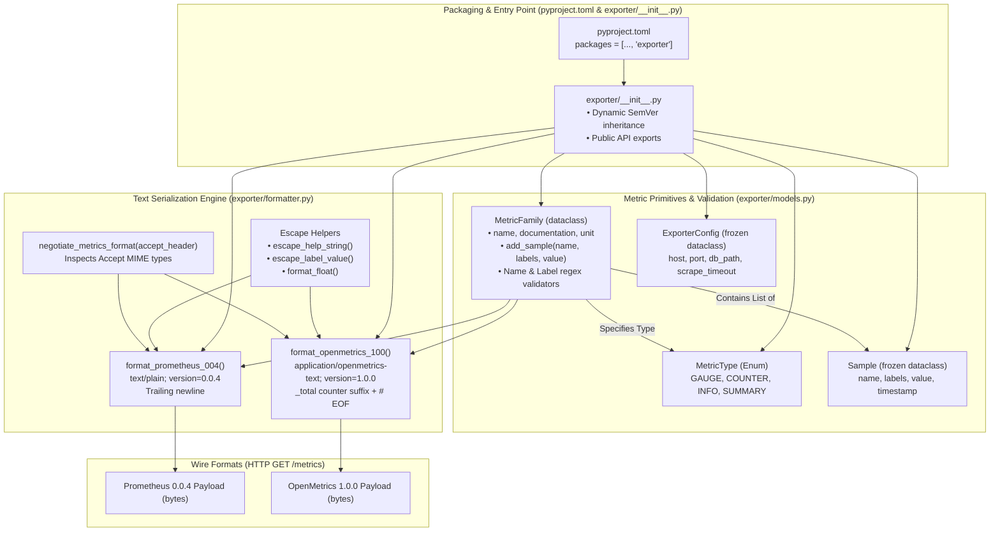
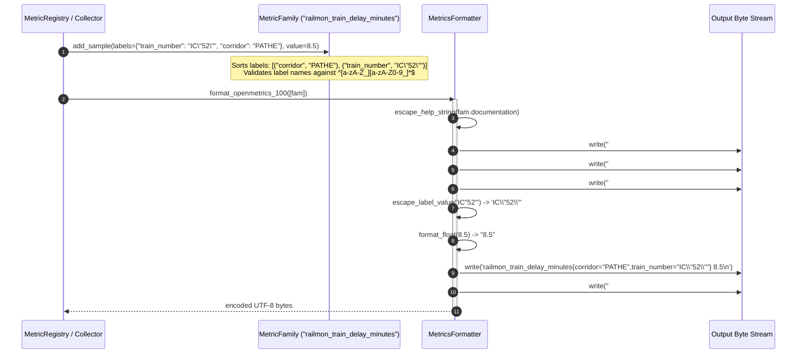

# Phase 1 Implementation Plan — Metric Primitives & Serialization Engine (`exporter/`)

> **Reference:** [F-8.2 Master Implementation Plan (`f-8-2-prometheus-openmetrics-operational-exporter-plan.md`)](./f-8-2-prometheus-openmetrics-operational-exporter-plan.md), [TUI Feature Enhancements Specification (`F-8.2`)](../../architecture/tui-feature-enhancements.md#f-82-prometheus--openmetrics-operational-exporter-railmon-metrics--planned), [`docs/architecture/architecture.md`](../../architecture/architecture.md)  
> **Target Modules:** [`../../../exporter/__init__.py`](../../../exporter/__init__.py), [`../../../exporter/models.py`](../../../exporter/models.py), [`../../../exporter/formatter.py`](../../../exporter/formatter.py), [`../../../pyproject.toml`](../../../pyproject.toml)  
> **Target Test Suites:** [`../../../tests/test_exporter_models.py`](../../../tests/test_exporter_models.py), [`../../../tests/test_exporter_formatter.py`](../../../tests/test_exporter_formatter.py), [`../../../tests/test_packaging.py`](../../../tests/test_packaging.py)  
> **Relevant Skills & Guidelines:** [`../../../.agents/skills/diagrams-and-documentation/SKILL.md`](../../../.agents/skills/diagrams-and-documentation/SKILL.md), [`../../../.agents/skills/markdown-relative-paths/SKILL.md`](../../../.agents/skills/markdown-relative-paths/SKILL.md), [`../../../.agents/skills/ci-quality-gate/SKILL.md`](../../../.agents/skills/ci-quality-gate/SKILL.md), [`../../../.agents/skills/static-safety-analyzer/SKILL.md`](../../../.agents/skills/static-safety-analyzer/SKILL.md), [`../../../.agents/skills/security-audit/SKILL.md`](../../../.agents/skills/security-audit/SKILL.md), [`../../../.agents/skills/memory-leak-profiler/SKILL.md`](../../../.agents/skills/memory-leak-profiler/SKILL.md)

---

## 1. Executive Summary & Phase 1 Objectives

Feature **F-8.2** introduces an embedded, zero-dependency Prometheus and OpenMetrics operational exporter (`railmon metrics`) that surfaces real-time train movements, corridor punctuality, safety conflict watchdog alerts, and SQLite WAL storage metrics to enterprise observability pipelines (Prometheus, VictoriaMetrics, Grafana Mimir, OpenTelemetry Collector).

To maintain strict architectural modularity, deterministic testability, thread safety, and zero PyPI dependency purity, the exporter implementation is partitioned into five distinct phases:

- **Phase 1 (This Document):** Metric Primitives & Serialization Engine (`exporter/` package setup, PEP 621 packaging registration, strongly typed domain primitives, Prometheus 0.0.4 and OpenMetrics 1.0.0 text format serializers, label escaping, and HTTP content negotiation).
- **Phase 2:** Domain Telemetry Collectors & Metric Registry (`exporter/collector.py`, extraction from `TrainStateStore`, `watchdog.py`, and `storage/repository.py`).
- **Phase 3:** HTTP Server Daemon & Socket Lifecycle (`exporter/server.py`, `http.server.ThreadingHTTPServer` on port 9100, `/metrics`, `/health`, and clean SIGINT/SIGTERM shutdown).
- **Phase 4:** CLI Subcommand Integration & Web Daemon Cross-Exposing (`train_tracker.py` CLI subcommand `railmon metrics`, argument parsing, and `/metrics` route dispatch on `railmon serve` web map daemon).
- **Phase 5:** End-to-End Automated Verification & Quality Gate (integrated load testing, concurrent scrapers, AST safety validation, and documentation).

---

### 1.1 Phase 1 Deliverables
1. **Packaging Registration & PEP 621 Compliance ([`pyproject.toml`](../../../pyproject.toml)):**
   - Register the `exporter` package in `[tool.setuptools.packages]` alongside `storage`, `tui`, `tui.data`, and `server`.
   - Update [`tests/test_packaging.py`](../../../tests/test_packaging.py) to assert `exporter` package importability and zero PyPI runtime dependencies via AST inspection.
2. **Package Entry & Dynamic SemVer Inheritance ([`exporter/__init__.py`](../../../exporter/__init__.py)):**
   - Single-source version inheritance dynamically resolving `train_tracker.__version__` and `train_tracker.__author__`.
   - Export public interfaces: `MetricType`, `Sample`, `MetricFamily`, `ExporterConfig`, `MetricsFormatter`, and `negotiate_metrics_format`.
3. **Metric Primitives & Domain Models ([`exporter/models.py`](../../../exporter/models.py)):**
   - Strongly typed, immutable dataclasses for metric types (`MetricType`), individual metric samples (`Sample`), metric families with documentation and unit metadata (`MetricFamily`), and runtime daemon settings (`ExporterConfig`).
   - Strict validation: metric name syntax regex (`^[a-zA-Z_:][a-zA-Z0-9_:]*$`), label name syntax regex (`^[a-zA-Z_][a-zA-Z0-9_]*$`), reserved label prefix protection (`__.*`), and deterministic alphabetical label sorting.
4. **Zero-Dependency Serialization Engine ([`exporter/formatter.py`](../../../exporter/formatter.py)):**
   - **Prometheus 0.0.4 Text Serializer (`format_prometheus_004`):** Generates `text/plain; version=0.0.4; charset=utf-8` payload with standard `# HELP` and `# TYPE` headers, robust quote/backslash/newline escaping, and IEEE-754 float representation (`NaN`, `+Inf`, `-Inf`).
   - **OpenMetrics 1.0.0 Serializer (`format_openmetrics_100`):** Generates `application/openmetrics-text; version=1.0.0; charset=utf-8` payload with `# UNIT` declarations, mandatory counter sample `_total` suffix enforcement, and canonical `# EOF\n` trailer.
   - **HTTP Content Negotiation Helper (`negotiate_metrics_format`):** Evaluates incoming client `Accept` headers with q-value weighting to select the optimal format.
5. **Comprehensive Unit Test Suites:**
   - [`tests/test_exporter_models.py`](../../../tests/test_exporter_models.py): Validates dataclass validation, immutability, label sorting, invalid port rejection, and naming syntax guards.
   - [`tests/test_exporter_formatter.py`](../../../tests/test_exporter_formatter.py): Tests Prometheus 0.0.4 and OpenMetrics 1.0.0 serialization, character escaping, floating point edge cases, unit declarations, and `# EOF` handling.
   - [`tests/test_packaging.py`](../../../tests/test_packaging.py): Adds packaging tests validating `exporter` package inclusion and zero PyPI dependencies.

---

## 2. Architecture & Visual Diagrams

### 2.1 Phase 1 Component Architecture (Mermaid)



---

### 2.2 Phase 1 Component Architecture & Layering (ASCII)

```text
+---------------------------------------------------------------------------------------------------+
|                        PHASE 1: METRIC PRIMITIVES & SERIALIZATION ENGINE                          |
+---------------------------------------------------------------------------------------------------+

 [ Packaging & Metadata ]
  +-----------------------------------------------------------------------------------------------+
  | pyproject.toml -> packages = ["storage", "tui", "tui.data", "server", "exporter"]             |
  | exporter/__init__.py -> __version__ = train_tracker.__version__ (Single-source SemVer)        |
  +-----------------------------------------------------------------------------------------------+
                                                  |
                                                  v
 [ Domain Primitives: exporter/models.py ]
  +-----------------------------+   +---------------------------------+   +-------------------------+
  | MetricType (Enum)           |   | Sample (frozen)                 |   | ExporterConfig (frozen) |
  | - GAUGE = "gauge"           |   | - name: str                     |   | - host: str = 127.0.0.1 |
  | - COUNTER = "counter"       |   | - labels: Tuple[Tuple[str,str]] |   | - port: int = 9100      |
  | - INFO = "info"             |   | - value: float                  |   | - db_path: Optional[str]|
  | - SUMMARY = "summary"       |   | - timestamp: Optional[float]    |   | - demo_mode: bool       |
  +-----------------------------+   +---------------------------------+   +-------------------------+
                                                  |
                                                  v
  +-----------------------------------------------------------------------------------------------+
  | MetricFamily                                                                                  |
  |  - name: str (validated: ^[a-zA-Z_:][a-zA-Z0-9_:]*$)                                          |
  |  - documentation: str (HELP description)                                                      |
  |  - metric_type: MetricType (GAUGE, COUNTER, INFO, SUMMARY)                                    |
  |  - unit: Optional[str] (e.g. "seconds", "bytes", "trains", "minutes")                         |
  |  - samples: List[Sample]                                                                      |
  |  - add_sample(name, labels, value, timestamp) -> validates labels & sorts alphabetically      |
  +-----------------------------------------------------------------------------------------------+
                                                  |
                                                  v
 [ Serialization Engine: exporter/formatter.py ]
  +-----------------------------------------------------------------------------------------------+
  | MetricsFormatter                                                                              |
  |  - escape_help_string(doc) -> escapes '\\' -> '\\\\' and '\n' -> '\\n'                        |
  |  - escape_label_value(val) -> escapes '\\' -> '\\\\', '\"' -> '\\\"', '\n' -> '\\n'           |
  |  - format_float(val) -> outputs integer without .0, 'NaN', '+Inf', '-Inf', or clean floats    |
  |  - format_prometheus_004(families) -> bytes (text/plain; version=0.0.4)                      |
  |  - format_openmetrics_100(families) -> bytes (application/openmetrics-text; version=1.0.0)    |
  |  - negotiate_metrics_format(accept_header) -> (content_type, format_mode)                     |
  +-----------------------------------------------------------------------------------------------+
```

---

### 2.3 Serialization Sequence & Character Escaping Pipeline (Mermaid)



---

## 3. Detailed Component Technical Specifications

### 3.1 Packaging & PEP 621 Registration (`pyproject.toml`)

The `exporter` module must be declared as a first-class package within the project manifest.

#### Changes in [`pyproject.toml`](../../../pyproject.toml)
```toml
[tool.setuptools]
py-modules = ["train_tracker"]
packages = ["storage", "tui", "tui.data", "server", "exporter"]
```

#### Package Structure
```text
exporter/
├── __init__.py        # Dynamic versioning & public interface re-exports
├── models.py          # Metric primitives (MetricType, Sample, MetricFamily, ExporterConfig)
└── formatter.py       # Prometheus 0.0.4 & OpenMetrics 1.0.0 serializers & escaping
```

---

### 3.2 Package Entry Point & Version Inheritance (`exporter/__init__.py`)

Adheres strictly to the single-source versioning architecture established in Phase 1 of `server/`:

```python
"""Embedded zero-dependency Prometheus & OpenMetrics operational exporter package."""

from typing import List

import train_tracker

from exporter.formatter import (
    MetricsFormatter,
    escape_help_string,
    escape_label_value,
    format_float,
    negotiate_metrics_format,
)
from exporter.models import (
    ExporterConfig,
    MetricFamily,
    MetricType,
    Sample,
)

__version__: str = train_tracker.__version__
__author__: str = train_tracker.__author__

__all__: List[str] = [
    "__version__",
    "__author__",
    "MetricType",
    "Sample",
    "MetricFamily",
    "ExporterConfig",
    "MetricsFormatter",
    "escape_help_string",
    "escape_label_value",
    "format_float",
    "negotiate_metrics_format",
]
```

---

### 3.3 Metric Models & Primitives (`exporter/models.py`)

#### 3.3.1 Metric Syntax Rules & RFC Specifications
Prometheus and OpenMetrics enforce strict lexical conventions for metric and label names:
- **Metric Name Syntax:** Must match regex `^[a-zA-Z_:][a-zA-Z0-9_:]*$`.
- **Label Name Syntax:** Must match regex `^[a-zA-Z_][a-zA-Z0-9_]*$`.
- **Reserved Labels:** Labels starting with double underscores (`__.*`) are strictly reserved for internal Prometheus scraper use and must be rejected with a `ValueError`.
- **Sample Value Constraints:** Numeric floats. `NaN`, `+Inf`, and `-Inf` are valid IEEE-754 values supported by the specification.
- **Label Determinism:** Label pairs must be sorted alphabetically by label key upon sample instantiation to ensure byte-for-byte reproducible serialization and deterministic diffing.

#### 3.3.2 Implementation Specification
```python
"""Domain models and metric primitives for railmon Prometheus exporter."""

import re
from dataclasses import dataclass, field
from enum import Enum
from typing import Any, Dict, List, Optional, Tuple, Union

RE_METRIC_NAME = re.compile(r"^[a-zA-Z_:][a-zA-Z0-9_:]*$")
RE_LABEL_NAME = re.compile(r"^[a-zA-Z_][a-zA-Z0-9_]*$")


class MetricType(str, Enum):
    """Prometheus & OpenMetrics metric representation types."""

    GAUGE = "gauge"
    COUNTER = "counter"
    INFO = "info"
    SUMMARY = "summary"
    UNTYPED = "untyped"


@dataclass(frozen=True)
class Sample:
    """Represents a single metric measurement with labels and timestamp."""

    name: str
    labels: Tuple[Tuple[str, str], ...] = ()
    value: float = 0.0
    timestamp: Optional[float] = None

    def __post_init__(self) -> None:
        """Validate sample name and label syntax."""
        if not RE_METRIC_NAME.match(self.name):
            raise ValueError(
                f"Invalid sample name '{self.name}'. Must match ^[a-zA-Z_:][a-zA-Z0-9_:]*$"
            )
        for k, v in self.labels:
            if not RE_LABEL_NAME.match(k):
                raise ValueError(
                    f"Invalid label name '{k}'. Must match ^[a-zA-Z_][a-zA-Z0-9_]*$"
                )
            if k.startswith("__"):
                raise ValueError(
                    f"Reserved label name '{k}' starting with '__' is prohibited"
                )


@dataclass
class MetricFamily:
    """Collection of samples sharing a metric name, documentation, and type."""

    name: str
    documentation: str
    metric_type: MetricType
    unit: Optional[str] = None
    samples: List[Sample] = field(default_factory=list)

    def __post_init__(self) -> None:
        """Validate metric family name syntax."""
        if not RE_METRIC_NAME.match(self.name):
            raise ValueError(
                f"Invalid metric family name '{self.name}'. Must match ^[a-zA-Z_:][a-zA-Z0-9_:]*$"
            )

    def add_sample(
        self,
        name: Optional[str] = None,
        labels: Optional[Dict[str, Any]] = None,
        value: Union[int, float] = 0.0,
        timestamp: Optional[float] = None,
    ) -> None:
        """Append a validated, sorted sample to the metric family."""
        sample_name = name or self.name
        sorted_labels: Tuple[Tuple[str, str], ...] = ()
        if labels:
            sorted_labels = tuple(
                sorted((str(k), str(v)) for k, v in labels.items())
            )
        self.samples.append(
            Sample(
                name=sample_name,
                labels=sorted_labels,
                value=float(value),
                timestamp=timestamp,
            )
        )


@dataclass(frozen=True)
class ExporterConfig:
    """Immutable runtime configuration for the Prometheus exporter."""

    host: str = "127.0.0.1"
    port: int = 9100
    db_path: Optional[str] = None
    demo_mode: bool = False
    collect_db_stats: bool = True
    scrape_timeout_seconds: float = 10.0
    gzip_compression: bool = True

    def __post_init__(self) -> None:
        """Validate configuration settings."""
        if not (1 <= self.port <= 65535):
            raise ValueError(f"Port must be between 1 and 65535, got {self.port}")
        if self.scrape_timeout_seconds <= 0.0:
            raise ValueError("Scrape timeout must be strictly positive")
```

---

### 3.4 Text Serialization Engine (`exporter/formatter.py`)

#### 3.4.1 Escaping & Floating Point Lexical Rules
1. **Help String Escaping:**
   - Backslashes: `\` $\rightarrow$ `\\`
   - Newlines: `\n` $\rightarrow$ `\n` (escaped newline literal)
2. **Label Value Escaping:**
   - Backslashes: `\` $\rightarrow$ `\\`
   - Double Quotes: `"` $\rightarrow$ `\"`
   - Newlines: `\n` $\rightarrow$ `\n`
3. **Float Formatting:**
   - If `math.isnan(val)`: output `"NaN"`
   - If `math.isinf(val)`: output `"+Inf"` (positive infinity) or `"-Inf"` (negative infinity)
   - If `val.is_integer()`: output `f"{int(val)}"` (e.g. `142.0` $\rightarrow$ `"142"`, `0.0` $\rightarrow$ `"0"`)
   - Else: output `f"{val:.6g}"` avoiding exponential bloat while retaining high precision.

#### 3.4.2 Format Differences: Prometheus 0.0.4 vs. OpenMetrics 1.0.0
| Feature | Prometheus 0.0.4 | OpenMetrics 1.0.0 |
| :--- | :--- | :--- |
| **MIME Content-Type** | `text/plain; version=0.0.4; charset=utf-8` | `application/openmetrics-text; version=1.0.0; charset=utf-8` |
| **Terminal Marker** | Empty trailing line (`\n`) | Explicit `# EOF\n` trailer line |
| **Counter Sample Names**| Arbitrary (usually matches metric name) | **Must** terminate in `_total` |
| **Unit Declaration** | None (embedded in metric name) | `# UNIT <metric_name> <unit>` |
| **Info Type** | Represented as gauge | Native `info` type declaration |

#### 3.4.3 Implementation Specification
```python
"""High-performance zero-dependency Prometheus and OpenMetrics text serializers."""

import math
from typing import Iterable, List, Tuple
from exporter.models import MetricFamily, MetricType


def escape_help_string(doc: str) -> str:
    """Escape backslashes and newlines in # HELP strings."""
    return doc.replace("\\", "\\\\").replace("\n", "\\n")


def escape_label_value(val: str) -> str:
    """Escape backslashes, double quotes, and newlines in label values."""
    return val.replace("\\", "\\\\").replace('"', '\\"').replace("\n", "\\n")


def format_float(val: float) -> str:
    """Format float values according to Prometheus/OpenMetrics lexical rules."""
    if math.isnan(val):
        return "NaN"
    if math.isinf(val):
        return "+Inf" if val > 0 else "-Inf"
    if val.is_integer():
        return f"{int(val)}"
    return f"{val:.6g}"


def negotiate_metrics_format(accept_header: Optional[str]) -> Tuple[str, str]:
    """Negotiate Content-Type and format mode from client Accept header.

    Args:
        accept_header: Value of incoming HTTP 'Accept' header.

    Returns:
        Tuple of (content_type_header_value, format_mode) where format_mode
        is either 'openmetrics' or 'prometheus'.
    """
    if not accept_header:
        return (
            "text/plain; version=0.0.4; charset=utf-8",
            "prometheus",
        )

    # Check for explicit OpenMetrics preference
    if "application/openmetrics-text" in accept_header:
        return (
            "application/openmetrics-text; version=1.0.0; charset=utf-8",
            "openmetrics",
        )

    return (
        "text/plain; version=0.0.4; charset=utf-8",
        "prometheus",
    )


class MetricsFormatter:
    """Serializes MetricFamily collections into Prometheus or OpenMetrics formats."""

    @staticmethod
    def format_prometheus_004(families: Iterable[MetricFamily]) -> bytes:
        """Serialize families into Prometheus 0.0.4 text format."""
        lines: List[str] = []
        for fam in families:
            if not fam.samples:
                continue
            lines.append(f"# HELP {fam.name} {escape_help_string(fam.documentation)}")
            # Prometheus 0.0.4 maps INFO to gauge
            mtype = "gauge" if fam.metric_type == MetricType.INFO else fam.metric_type.value
            lines.append(f"# TYPE {fam.name} {mtype}")
            for s in fam.samples:
                if s.labels:
                    lbls = ",".join(f'{k}="{escape_label_value(v)}"' for k, v in s.labels)
                    lines.append(f"{s.name}{{{lbls}}} {format_float(s.value)}")
                else:
                    lines.append(f"{s.name} {format_float(s.value)}")
        lines.append("")  # Trailing newline required
        return "\n".join(lines).encode("utf-8")

    @staticmethod
    def format_openmetrics_100(families: Iterable[MetricFamily]) -> bytes:
        """Serialize families into OpenMetrics 1.0.0 text format."""
        lines: List[str] = []
        for fam in families:
            if not fam.samples:
                continue
            lines.append(f"# HELP {fam.name} {escape_help_string(fam.documentation)}")
            lines.append(f"# TYPE {fam.name} {fam.metric_type.value}")
            if fam.unit:
                lines.append(f"# UNIT {fam.name} {fam.unit}")
            for s in fam.samples:
                sample_name = s.name
                # OpenMetrics counters enforce _total suffix
                if fam.metric_type == MetricType.COUNTER and not sample_name.endswith("_total"):
                    sample_name = f"{sample_name}_total"

                if s.labels:
                    lbls = ",".join(f'{k}="{escape_label_value(v)}"' for k, v in s.labels)
                    lines.append(f"{sample_name}{{{lbls}}} {format_float(s.value)}")
                else:
                    lines.append(f"{sample_name} {format_float(s.value)}")
        lines.append("# EOF\n")
        return "\n".join(lines).encode("utf-8")
```

---

## 4. Step-by-Step Implementation Work Breakdown

### Step 1: Packaging Configuration (`pyproject.toml`)
- Add `"exporter"` to the `packages` list in `[tool.setuptools]` within [`pyproject.toml`](../../../pyproject.toml).
- Update [`tests/test_packaging.py`](../../../tests/test_packaging.py) to assert that `"exporter"` is present in the packages declaration.

### Step 2: Package Initialization & Version Export (`exporter/__init__.py`)
- Create directory `exporter/`.
- Author [`exporter/__init__.py`](../../../exporter/__init__.py) importing dynamic SemVer strings `__version__` and `__author__` from `train_tracker`.
- Re-export `MetricType`, `Sample`, `MetricFamily`, `ExporterConfig`, `MetricsFormatter`, and `negotiate_metrics_format`.

### Step 3: Domain Models & Metric Primitives (`exporter/models.py`)
- Author [`exporter/models.py`](../../../exporter/models.py).
- Implement `MetricType` Enum with `GAUGE`, `COUNTER`, `INFO`, `SUMMARY`, `UNTYPED`.
- Implement `Sample` frozen dataclass with name syntax regex validation and label syntax regex validation.
- Implement `MetricFamily` dataclass with name validation, documentation string preservation, optional unit, and `add_sample()` helper method enforcing sorted label tuples.
- Implement `ExporterConfig` frozen dataclass with TCP port bounds validation (`1 <= port <= 65535`) and scrape timeout positivity check.

### Step 4: Text Serialization Engine (`exporter/formatter.py`)
- Author [`exporter/formatter.py`](../../../exporter/formatter.py).
- Implement string escaping routines: `escape_help_string` and `escape_label_value`.
- Implement floating point formatter `format_float` handling special IEEE-754 values (`NaN`, `+Inf`, `-Inf`) and clean integers.
- Implement `negotiate_metrics_format` evaluating `Accept` header strings.
- Implement `MetricsFormatter.format_prometheus_004` outputting UTF-8 bytes for Prometheus v0.0.4.
- Implement `MetricsFormatter.format_openmetrics_100` outputting UTF-8 bytes for OpenMetrics v1.0.0 with counter `_total` suffix and `# EOF\n` trailer.

### Step 5: Test Suite Implementation & Verification
- Author [`tests/test_exporter_models.py`](../../../tests/test_exporter_models.py) covering all primitive models, constraints, and error validations.
- Author [`tests/test_exporter_formatter.py`](../../../tests/test_exporter_formatter.py) testing all formatting scenarios, escaping edges, and content negotiations.
- Extend [`tests/test_packaging.py`](../../../tests/test_packaging.py) adding TC-PKG-09 (package registration) and TC-PKG-10 (zero PyPI AST audit for `exporter/`).
- Execute test runner: `python3 -m unittest discover tests -p "test_exporter*.py" -v`.
- Execute static safety analyzer: `python3 .agents/skills/static-safety-analyzer/scripts/safety_ast_audit.py`.

---

## 5. Edge Cases, Failure Modes & Resilience Engineering

| Edge Case / Failure Vector | Impact | Engineering Mitigation |
| :--- | :--- | :--- |
| **Invalid Metric Family Name** (e.g. `123-railmon`, `railmon train`) | Prometheus scraper rejects entire scrape batch with syntax error | `RE_METRIC_NAME` regex validation in `MetricFamily.__post_init__` immediately raises `ValueError` before wire emission. |
| **Invalid Label Name** (e.g. `train-number`, `class`) | Prometheus parser syntax failure | `RE_LABEL_NAME` regex validation in `Sample.__post_init__` validates that labels contain only `[a-zA-Z0-9_]` and do not start with digits. |
| **Reserved Scraper Labels** (e.g. `__name__`, `__address__`) | Corrupts internal Prometheus target metadata | Explicit check rejecting any label key starting with `__` in `Sample.__post_init__`. |
| **Label Values with Quotes and Slashes** (e.g. `IC "52"`, `route\line`) | Malformed exposition line syntax | `escape_label_value()` escapes `\` to `\\`, `"` to `\"`, and `\n` to `\n` before line concatenation. |
| **Help Strings with Newlines** | Line split breaks `# HELP` exposition syntax | `escape_help_string()` transforms embedded `\n` to literal `\n`. |
| **Special Floats (`NaN`, `+Inf`, `-Inf`)** | Serialization crashes or non-standard string tokens (`nan`, `inf`) | `format_float()` strictly emits standard Prometheus tokens: `NaN`, `+Inf`, `-Inf`. |
| **Integer Values Emitting `.0`** | Visual clutter and unnecessary byte overhead | `format_float()` checks `val.is_integer()` and formats as clean integers (`0`, `142`). |
| **Counter Sample Missing `_total` in OpenMetrics** | Scraper rejection in strict OpenMetrics mode | `format_openmetrics_100()` dynamically appends `_total` to counter samples if not already suffixed. |
| **Missing or Wildcard `Accept` Header** | Client sends `*/*` or `Accept: ""` | `negotiate_metrics_format()` gracefully defaults to standard Prometheus 0.0.4 text format. |
| **Zero Samples in Metric Family** | Empty `# HELP` / `# TYPE` block with no data lines | Formatters skip families that have `not fam.samples`, avoiding empty metric declaration noise. |

---

## 6. Comprehensive Verification & Test Strategy

### 6.1 Test Case Matrix: `tests/test_exporter_models.py`

| Test Case ID | Target Component | Description / Assertion |
| :--- | :--- | :--- |
| `TC-MOD-01` | `MetricType` | Verifies enum string values match `"gauge"`, `"counter"`, `"info"`, `"summary"`. |
| `TC-MOD-02` | `Sample` | Verifies frozen immutability and default zero values. |
| `TC-MOD-03` | `Sample` | Validates valid metric and label naming syntax (`valid_name_123`, `foo_bar`). |
| `TC-MOD-04` | `Sample` | Rejects invalid sample names (starts with digit, contains hyphens or spaces) with `ValueError`. |
| `TC-MOD-05` | `Sample` | Rejects invalid label keys (starts with digit, contains symbols) with `ValueError`. |
| `TC-MOD-06` | `Sample` | Rejects reserved internal labels (`__name__`, `__scheme__`) with `ValueError`. |
| `TC-MOD-07` | `MetricFamily` | Validates initialization and name syntax validation. |
| `TC-MOD-08` | `MetricFamily.add_sample` | Verifies label keys are automatically sorted alphabetically for deterministic serialization. |
| `TC-MOD-09` | `ExporterConfig` | Validates default parameters (`host="127.0.0.1"`, `port=9100`). |
| `TC-MOD-10` | `ExporterConfig` | Rejects invalid port numbers ($<1$ or $>65535$) and non-positive timeouts with `ValueError`. |

---

### 6.2 Test Case Matrix: `tests/test_exporter_formatter.py`

| Test Case ID | Target Component | Description / Assertion |
| :--- | :--- | :--- |
| `TC-FMT-01` | `escape_help_string` | Verifies backslash and newline escaping in docstrings. |
| `TC-FMT-02` | `escape_label_value` | Verifies escaping of `\`, `"`, and `\n` in label values. |
| `TC-FMT-03` | `format_float` | Verifies `0.0` $\rightarrow$ `"0"`, `142.0` $\rightarrow$ `"142"`, `8.5` $\rightarrow$ `"8.5"`. |
| `TC-FMT-04` | `format_float` | Verifies IEEE-754 specials: `math.nan` $\rightarrow$ `"NaN"`, `float('inf')` $\rightarrow$ `"+Inf"`, `float('-inf')` $\rightarrow$ `"-Inf"`. |
| `TC-FMT-05` | `negotiate_metrics_format` | Returns OpenMetrics when `Accept` contains `application/openmetrics-text`. |
| `TC-FMT-06` | `negotiate_metrics_format` | Defaults to Prometheus 0.0.4 on `text/plain`, empty header, or `*/*`. |
| `TC-FMT-07` | `format_prometheus_004` | Verifies complete payload structure (`# HELP`, `# TYPE`, sample lines, trailing `\n`). |
| `TC-FMT-08` | `format_prometheus_004` | Verifies `MetricType.INFO` is safely converted to `# TYPE ... gauge`. |
| `TC-FMT-09` | `format_openmetrics_100` | Verifies `# UNIT` header emission when unit is specified. |
| `TC-FMT-10` | `format_openmetrics_100` | Verifies mandatory `# EOF\n` trailer presence. |
| `TC-FMT-11` | `format_openmetrics_100` | Verifies counter sample names have `_total` automatically suffixed. |
| `TC-FMT-12` | `MetricsFormatter` | Verifies empty metric families with no samples are skipped without emitting orphaned headers. |

---

### 6.3 Test Case Matrix: `tests/test_packaging.py` Extensions

| Test Case ID | Target Component | Description / Assertion |
| :--- | :--- | :--- |
| `TC-PKG-09` | `pyproject.toml` | Asserts `"exporter"` is present in `tool.setuptools.packages` and package is importable with matching `__version__`. |
| `TC-PKG-10` | AST Import Audit | Parses all `.py` files in `exporter/` with `ast` to enforce that zero third-party packages are imported. |

---

### 6.4 Verification Execution Commands
```bash
# 1. Run unit test suites for exporter primitives and formatting:
python3 -m unittest discover tests -p "test_exporter*.py" -v

# 2. Run packaging and dependency purity test suite:
python3 -m unittest tests/test_packaging.py -v

# 3. Run static safety AST auditor (MISRA / AUTOSAR / NASA JPL):
python3 .agents/skills/static-safety-analyzer/scripts/safety_ast_audit.py
```

---

## 7. Compliance Matrix with Repository Engineering Standards

| Standard / Guideline | Requirement | Compliance Implementation in Phase 1 |
| :--- | :--- | :--- |
| **Zero PyPI Dependencies** | Strict execution on standard library on Linux/macOS | Exclusively uses `dataclasses`, `enum`, `math`, `re`, `typing`. Requires no external packages. |
| **Document-Relative Links** | All documentation links must be document-relative | Verified zero absolute paths; all links strictly relative. |
| **Dual Visual Diagrams** | Mandatory Mermaid + ASCII diagrams | Provided Mermaid component diagram, ASCII architecture diagram, and Mermaid sequence diagram. |
| **MISRA / AUTOSAR Safety** | Zero violations in AST safety auditor | Pure functional primitives, no dynamic execution (`eval`/`exec`), bounded regexes. |
| **Deterministic Wire Output** | Reproducible scraper hashing | Deterministic sorting of labels via `tuple(sorted(labels.items()))`. |
| **Single-Source Versioning** | Dynamic SemVer resolution | `exporter.__version__ = train_tracker.__version__`. |
