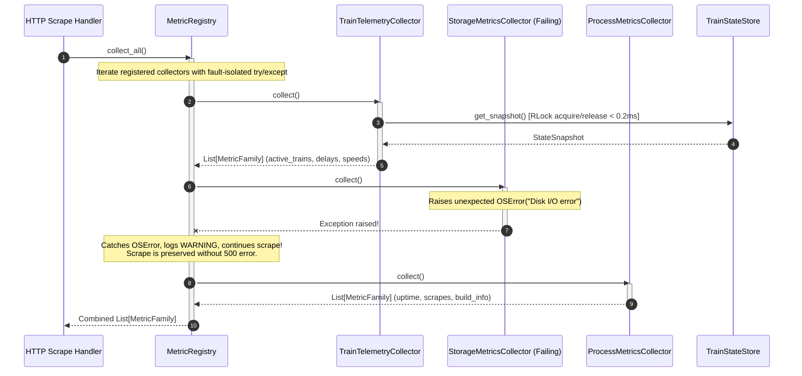
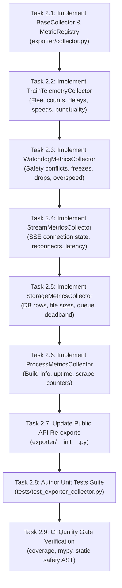

# Phase 2 Implementation Plan — Domain Telemetry Collectors & Registry (`exporter/collector.py`)

> **Reference:** [F-8.2 Master Implementation Plan (`f-8-2-prometheus-openmetrics-operational-exporter-plan.md`)](./f-8-2-prometheus-openmetrics-operational-exporter-plan.md), [Phase 1 Implementation Plan (`f-8-2-phase-1-metric-primitives-and-serialization-engine-plan.md`)](./f-8-2-phase-1-metric-primitives-and-serialization-engine-plan.md), [TUI Feature Enhancements Specification (`F-8.2`)](../../architecture/tui-feature-enhancements.md#f-82-prometheus--openmetrics-operational-exporter-railmon-metrics--planned), [`docs/architecture/architecture.md`](../../architecture/architecture.md)  
> **Target Modules:** [`../../../exporter/collector.py`](../../../exporter/collector.py), [`../../../exporter/__init__.py`](../../../exporter/__init__.py), [`../../../tui/state.py`](../../../tui/state.py), [`../../../storage/repository.py`](../../../storage/repository.py), [`../../../storage/recorder.py`](../../../storage/recorder.py)  
> **Target Test Suites:** [`../../../tests/test_exporter_collector.py`](../../../tests/test_exporter_collector.py), [`../../../tests/test_packaging.py`](../../../tests/test_packaging.py)  
> **Relevant Skills & Guidelines:** [`../../../.agents/skills/diagrams-and-documentation/SKILL.md`](../../../.agents/skills/diagrams-and-documentation/SKILL.md), [`../../../.agents/skills/markdown-relative-paths/SKILL.md`](../../../.agents/skills/markdown-relative-paths/SKILL.md), [`../../../.agents/skills/ci-quality-gate/SKILL.md`](../../../.agents/skills/ci-quality-gate/SKILL.md), [`../../../.agents/skills/static-safety-analyzer/SKILL.md`](../../../.agents/skills/static-safety-analyzer/SKILL.md), [`../../../.agents/skills/security-audit/SKILL.md`](../../../.agents/skills/security-audit/SKILL.md), [`../../../.agents/skills/memory-leak-profiler/SKILL.md`](../../../.agents/skills/memory-leak-profiler/SKILL.md)

---

## 1. Executive Summary & Phase 2 Objectives

Following the successful completion of **Phase 1** (Metric Primitives & Serialization Engine, establishing `MetricType`, `Sample`, `MetricFamily`, `ExporterConfig`, Prometheus 0.0.4 and OpenMetrics 1.0.0 serializers in `exporter/models.py` and `exporter/formatter.py`), **Phase 2** designs and constructs the domain data extraction layer: the **Metric Registry and Pluggable Domain Collectors** (`exporter/collector.py`).

Phase 2 acts as the bridge connecting Hellenic Railways operational domain state (`TrainStateStore`, `watchdog.py`, `storage/repository.py`, `storage/recorder.py`, and `StreamWorker`) to the serialization engine created in Phase 1. When an HTTP scraper initiates a `GET /metrics` scrape, the `MetricRegistry` orchestrates the domain collectors to sample operational states, kinematic evaluations, safety conflicts, ingestion network metrics, and disk storage metrics into standard-compliant `MetricFamily` objects.

```text
+----------------------------------------------------------------------------------------------------+
|                                    PHASE 2 WORKFLOW & POSITIONING                                   |
+----------------------------------------------------------------------------------------------------+
  [ Phase 1: Models & Serializer ]  -->  [ Phase 2: Domain Collectors & Registry ] (THIS STAGE)
  - MetricType, Sample, Family           - MetricRegistry (collector lifecycle & fault isolation)
  - Prometheus 0.0.4 / OpenMetrics       - TrainTelemetryCollector (fleet, delay, speed, punctuality)
                                         - WatchdogMetricsCollector (conflicts, sensor freezes, drops)
                                         - StreamMetricsCollector (SSE status, reconnects, latency)
                                         - StorageMetricsCollector (SQLite rows, WAL bytes, deadband)
                                         - ProcessMetricsCollector (scrape latency, uptime, build info)
                                                    |
                                                    v
                                         [ Phase 3: HTTP Server Daemon (Port 9100) ]
```

---

### 1.1 Phase 2 Deliverables

1. **Abstract Base Collector & Metric Registry ([`exporter/collector.py`](../../../exporter/collector.py)):**
   - `BaseCollector`: Abstract base interface declaring `collect() -> List[MetricFamily]`.
   - `MetricRegistry`: Thread-safe registry supporting dynamic collector registration/deregistration, orchestrating batch collection (`collect_all()`), and implementing strict **collector fault isolation** (preventing an uncaught exception in a single domain collector from aborting the entire Prometheus scrape).

2. **Train Telemetry Collector (`TrainTelemetryCollector`):**
   - Samples real-time operational train fleet metrics from `TrainStateStore` snapshot (`get_snapshot()`):
     - `railmon_active_trains`: Active train counts partitioned by railway corridor (`PATHE`, `PROASTIAKOS`, `REGIONAL`, etc.).
     - `railmon_train_delay_minutes`: Per-train live schedule deviations with labels `train_number`, `type`, `corridor`.
     - `railmon_train_speed_kmh`: Instantaneous GPS speeds with labels `train_number`, `type`, `corridor`.
     - `railmon_train_max_speed_kmh`: Maximum recorded speed for each active commercial train.
     - `railmon_trains_delayed_total`: Punctuality categorization (`on_time`, `minor`, `moderate`, `severe`) by corridor.
     - `railmon_corridor_punctuality_ratio`: Ratio ($0.0 \dots 1.0$) of on-time trains ($\le 5\text{ min}$) over total corridor trains.
     - `railmon_corridor_average_delay_minutes`: Arithmetic mean delay across corridor active trains.
   - **Dynamic Cardinality Bound & Auto-Reaping:** Samples are synthesized on-the-fly from active trains. When a train terminates or is pruned from `TrainStateStore`, its timeseries naturally drops from subsequent scrape payloads, preventing memory leaks and timeseries explosion in Prometheus.

3. **Safety Watchdog Metrics Collector (`WatchdogMetricsCollector`):**
   - Extracts active safety alarms and kinematic conflicts from `TrainStateStore` snapshot:
     - `railmon_watchdog_conflicts_active`: Live safety conflicts labeled by `severity` (`critical`, `warning`, `advisory`), `conflict_type` (`opposing_collision`, `headway_violation`), and `corridor`.
     - `railmon_watchdog_conflicts_total`: Cumulative monotonic counter of unique conflict alert events detected over daemon lifetime.
     - `railmon_sensor_freezes_active`: Count of trains with frozen telemetry coordinates despite elapsed clock time.
     - `railmon_telemetry_drops_active`: Count of trains experiencing upstream telemetry dropouts exceeding timeout ($> 60\text{ s}$).
     - `railmon_speed_exceedances_active`: Count of trains exceeding corridor line speeds ($V_{\text{max}}$) or temporary speed restrictions (TSR).

4. **Upstream Stream Health Collector (`StreamMetricsCollector`):**
   - Gathers connection state and transport metrics from `TrainStateStore` snapshot and stream worker:
     - `railmon_stream_connected`: Boolean gauge ($1.0$ connected, $0.0$ disconnected/reconnecting).
     - `railmon_stream_messages_total`: Cumulative counter of received SSE frames (`trainPositionsUx`).
     - `railmon_stream_reconnects_total`: Cumulative count of network socket dropouts and stream reconnection attempts.
     - `railmon_stream_latency_seconds`: Measured elapsed seconds since last successful upstream telemetry frame.

5. **Storage & SQLite WAL Engine Collector (`StorageMetricsCollector`):**
   - Gathers database health, WAL checkpointing, and queue depth metrics from `storage/repository.py` and `storage/recorder.py`:
     - `railmon_db_records_total`: Total recorded telemetry observations in SQLite `telemetry_history`.
     - `railmon_db_file_size_bytes`: Storage utilization on disk for main database (`main`) and write-ahead log (`wal`).
     - `railmon_db_sessions_total`: Total recorded tracking sessions initialized.
     - `railmon_db_write_queue_depth`: Number of uncommitted telemetry observations buffered in worker queue.
     - `railmon_db_deadband_suppressed_total`: Cumulative count of telemetry updates filtered out by deadband spatial/temporal dampening.
   - **Low-Overhead Caching:** Avoids running synchronous `SELECT COUNT(*)` queries on every 15-second scrape; utilizes fast filesystem stat calls and in-memory counters with cached fallback.

6. **Exporter Process & Scrape Metrics Collector (`ProcessMetricsCollector`):**
   - Tracks daemon runtime health:
     - `railmon_exporter_build_info`: Constant $1.0$ gauge labeled with `version` and `python_version`.
     - `railmon_exporter_uptime_seconds`: Continuous monotonic uptime counter.
     - `railmon_exporter_scrapes_total`: Total scrape requests served labeled by `endpoint` and `status`.
     - `railmon_exporter_scrape_duration_seconds`: Histogram or gauge recording the latency of metric extraction and formatting.

7. **Package Interface Updates ([`exporter/__init__.py`](../../../exporter/__init__.py)):**
   - Re-export `BaseCollector`, `MetricRegistry`, and all five concrete domain collectors in the public API.

8. **Comprehensive Unit Test Suite ([`tests/test_exporter_collector.py`](../../../tests/test_exporter_collector.py)):**
   - 100% test coverage validating all metric families, label formatting, empty/active states, conflict states, storage file measurements, fault isolation, and thread safety.

---

## 2. Architecture & Visual Diagrams

### 2.1 Domain Collector Class Hierarchy & Data Flow (Mermaid)

```mermaid
flowchart TD
    subgraph Engine ["Metric Management Core"]
        REG["MetricRegistry<br>• register(collector)<br>• collect_all() -> List[MetricFamily]<br>• Fault isolation & error logging"]
        BASE["BaseCollector (ABC)<br>+ collect() -> List[MetricFamily]"]
    end

    subgraph Collectors ["Pluggable Domain Collectors (exporter/collector.py)"]
        C_TRAIN["TrainTelemetryCollector<br>• railmon_active_trains<br>• railmon_train_delay_minutes<br>• railmon_train_speed_kmh<br>• railmon_corridor_punctuality_ratio"]
        C_SAFE["WatchdogMetricsCollector<br>• railmon_watchdog_conflicts_active<br>• railmon_sensor_freezes_active<br>• railmon_telemetry_drops_active<br>• railmon_speed_exceedances_active"]
        C_STRM["StreamMetricsCollector<br>• railmon_stream_connected<br>• railmon_stream_messages_total<br>• railmon_stream_reconnects_total<br>• railmon_stream_latency_seconds"]
        C_DB["StorageMetricsCollector<br>• railmon_db_records_total<br>• railmon_db_file_size_bytes (main/wal)<br>• railmon_db_write_queue_depth<br>• railmon_db_deadband_suppressed_total"]
        C_PROC["ProcessMetricsCollector<br>• railmon_exporter_build_info<br>• railmon_exporter_uptime_seconds<br>• railmon_exporter_scrapes_total<br>• railmon_exporter_scrape_duration_seconds"]
    end

    subgraph Sources ["Domain State & Storage Sources"]
        STORE["TrainStateStore (RLock)<br>• StateSnapshot<br>• TrainRecord dict<br>• Kinematics & Conflicts"]
        RECORDER["TelemetryRecorder<br>• In-memory commit queue<br>• DeadbandFilter stats"]
        DB[("SQLite WAL Database<br>• telemetry_history<br>• file sizes (.db, .db-wal)")]
        SYS["System Runtime<br>• time.monotonic()<br>• sys.version, __version__"]
    end

    BASE --> C_TRAIN
    BASE --> C_SAFE
    BASE --> C_STRM
    BASE --> C_DB
    BASE --> C_PROC

    REG o-- C_TRAIN
    REG o-- C_SAFE
    REG o-- C_STRM
    REG o-- C_DB
    REG o-- C_PROC

    C_TRAIN -->|get_snapshot()| STORE
    C_SAFE -->|get_snapshot()| STORE
    C_STRM -->|get_snapshot()| STORE
    C_DB -->|get_stats()| RECORDER
    C_DB -->|os.path.getsize()| DB
    C_PROC -->|uptime / clock| SYS
```

---

### 2.2 Scrape Orchestration & Fault Isolation Sequence (Mermaid)



---

### 2.3 Phase 2 Architecture & Data Boundary Topology (ASCII)

```text
+---------------------------------------------------------------------------------------------------+
|                        PHASE 2: DOMAIN TELEMETRY COLLECTORS & METRIC REGISTRY                     |
+---------------------------------------------------------------------------------------------------+

 [ Domain Ingestion & State Layer ]
  +-------------------------+      +-------------------------+      +-----------------------------+
  | TrainStateStore (RLock) |      | TelemetryRecorder       |      | SQLite WAL Files (.db, -wal)|
  |  - StateSnapshot        |      |  - Write Queue Depth    |      |  - Table Row Counts         |
  |  - Active Train Records |      |  - DeadbandFilter Stats |      |  - os.path.getsize()        |
  +-------------------------+      +-------------------------+      +-----------------------------+
               |                                |                                  |
               +--------------------------------+----------------------------------+
                                                |
                                                v
 [ Pluggable Domain Collectors: exporter/collector.py ]
  +-----------------------------------------------------------------------------------------------+
  | MetricRegistry (Thread-Safe Collection Coordinator)                                           |
  |  - register(collector: BaseCollector) -> None                                                 |
  |  - unregister(collector: BaseCollector) -> None                                               |
  |  - collect_all() -> List[MetricFamily] (with isolated try/except per collector)              |
  +-----------------------------------------------------------------------------------------------+
         |                     |                     |                    |                   |
         v                     v                     v                    v                   v
  +---------------+     +---------------+     +---------------+    +---------------+   +---------------+
  | TrainTelemetry|     | Watchdog      |     | StreamMetrics |    | Storage       |   | ProcessMetrics|
  | Collector     |     | Collector     |     | Collector     |    | Collector     |   | Collector     |
  +---------------+     +---------------+     +---------------+    +---------------+   +---------------+
  | active_trains |     | conflicts_act |     | stream_connect|    | db_records_tot|   | build_info    |
  | train_delay   |     | conflicts_tot |     | messages_total|    | file_size_byte|   | uptime_seconds|
  | train_speed   |     | sensor_freezes|     | reconnects_tot|    | sessions_total|   | scrapes_total |
  | punctuality   |     | drop_telemetry|     | latency_second|    | queue_depth   |   | scrape_durat  |
  +---------------+     +---------------+     +---------------+    +---------------+   +---------------+
                                                |
                                                v
  +-----------------------------------------------------------------------------------------------+
  | Output to Phase 1 Formatter: List[MetricFamily] -> Prometheus 0.0.4 / OpenMetrics 1.0.0 Bytes |
  +-----------------------------------------------------------------------------------------------+
```

---

## 3. Detailed Component Technical Specifications

### 3.1 Base Collector & Metric Registry (`exporter/collector.py`)

#### 3.1.1 Abstract Base Class (`BaseCollector`)
All collectors implement a single standard contract:
```python
class BaseCollector:
    """Abstract base class for all domain telemetry metric collectors."""

    def collect(self) -> List[MetricFamily]:
        """Gather and return a collection of metric families.

        Returns:
            List of MetricFamily instances populated with current measurements.
        """
        raise NotImplementedError
```

#### 3.1.2 Registry Contract & Fault Isolation (`MetricRegistry`)
```python
class MetricRegistry:
    """Thread-safe registry managing domain collectors and scrape dispatch."""

    def __init__(self) -> None:
        self._collectors: List[BaseCollector] = []
        self._lock = threading.Lock()

    def register(self, collector: BaseCollector) -> None:
        """Register a collector instance if not already present."""
        with self._lock:
            if collector not in self._collectors:
                self._collectors.append(collector)

    def unregister(self, collector: BaseCollector) -> None:
        """Remove a registered collector instance."""
        with self._lock:
            if collector in self._collectors:
                self._collectors.remove(collector)

    def collect_all(self) -> List[MetricFamily]:
        """Orchestrate collection across all registered collectors with fault isolation.

        If any collector raises an unhandled exception, the error is logged as a
        warning and remaining collectors continue executing normally.
        """
        with self._lock:
            collectors = list(self._collectors)

        families: List[MetricFamily] = []
        for coll in collectors:
            try:
                families.extend(coll.collect())
            except Exception as exc:
                logger.warning(
                    "Collector '%s' raised an unexpected exception during scrape: %s",
                    coll.__class__.__name__,
                    exc,
                    exc_info=True,
                )
        return families
```

---

### 3.2 Train Telemetry Collector (`TrainTelemetryCollector`)

#### 3.2.1 Operational Requirements & Hellenic Rail Corridors
Hellenic Railways trains operate across multiple defined operational corridors:
- `PATHE`: Athens – Thessaloniki – Idomeni mainline ($V_{\text{max}} = 160\text{ km/h}$).
- `PROASTIAKOS`: Athens Airport – SKA – Kiato / Chalkida suburban lines.
- `REGIONAL`: Thessaly regional (Larissa – Volos, Paleofarsalos – Kalambaka) and Western Greece.
- `NORTHERN_GREECE`: Thessaloniki – Alexandroupolis – Ormenio.
- `UNKNOWN`: Fallback for unclassified train movements.

#### 3.2.2 Metric Specifications
1. **`railmon_active_trains`** (Gauge, Unit: `trains`):
   - Labels: `corridor`.
   - Value: Count of active trains currently positioned on the given corridor.
2. **`railmon_train_delay_minutes`** (Gauge, Unit: `minutes`):
   - Labels: `train_number`, `type`, `corridor`.
   - Value: Train current delay in minutes (positive for late, negative for early, $0.0$ for on-time).
3. **`railmon_train_speed_kmh`** (Gauge, Unit: `km/h`):
   - Labels: `train_number`, `type`, `corridor`.
   - Value: Train current GPS velocity.
4. **`railmon_train_max_speed_kmh`** (Gauge, Unit: `km/h`):
   - Labels: `train_number`, `corridor`.
   - Value: Peak speed recorded from the train's motion breadcrumbs (`trail`).
5. **`railmon_trains_delayed_total`** (Gauge, Unit: `trains`):
   - Labels: `corridor`, `severity`.
   - Categorization:
     - `on_time`: $\text{delay} \le 5.0\text{ min}$.
     - `minor`: $5.0 < \text{delay} \le 15.0\text{ min}$.
     - `moderate`: $15.0 < \text{delay} \le 60.0\text{ min}$.
     - `severe`: $\text{delay} > 60.0\text{ min}$.
6. **`railmon_corridor_punctuality_ratio`** (Gauge, Unit: `ratio`):
   - Labels: `corridor`.
   - Value: $\frac{\text{count}(\text{delay} \le 5.0)}{\text{total trains on corridor}}$ ($1.0$ if no trains).
7. **`railmon_corridor_average_delay_minutes`** (Gauge, Unit: `minutes`):
   - Labels: `corridor`.
   - Value: $\frac{\sum \text{delay}}{\text{total trains on corridor}}$ ($0.0$ if no trains).

#### 3.2.3 Implementation Specification
```python
class TrainTelemetryCollector(BaseCollector):
    """Collects real-time active train telemetry, speeds, delays, and punctuality."""

    def __init__(self, store: TrainStateStore) -> None:
        self.store = store

    def collect(self) -> List[MetricFamily]:
        snap = self.store.get_snapshot()

        fam_active = MetricFamily(
            "railmon_active_trains",
            "Total number of currently active trains operating on the network",
            MetricType.GAUGE,
            unit="trains",
        )
        fam_delay = MetricFamily(
            "railmon_train_delay_minutes",
            "Current delay in minutes for an individual train",
            MetricType.GAUGE,
            unit="minutes",
        )
        fam_speed = MetricFamily(
            "railmon_train_speed_kmh",
            "Instantaneous train speed in km/h",
            MetricType.GAUGE,
            unit="km/h",
        )
        fam_max_speed = MetricFamily(
            "railmon_train_max_speed_kmh",
            "Maximum recorded speed for this train during its operating window",
            MetricType.GAUGE,
            unit="km/h",
        )
        fam_delayed_tier = MetricFamily(
            "railmon_trains_delayed_total",
            "Count of active trains categorized by delay severity",
            MetricType.GAUGE,
            unit="trains",
        )
        fam_punctuality = MetricFamily(
            "railmon_corridor_punctuality_ratio",
            "Ratio of active trains running on-time (delay <= 5 min) over total trains",
            MetricType.GAUGE,
            unit="ratio",
        )
        fam_avg_delay = MetricFamily(
            "railmon_corridor_average_delay_minutes",
            "Arithmetic mean delay across all active trains on the corridor",
            MetricType.GAUGE,
            unit="minutes",
        )

        # Corridors aggregation structures
        corridor_counts: Dict[str, int] = {}
        corridor_delays: Dict[str, List[float]] = {}
        corridor_tiers: Dict[str, Dict[str, int]] = {}

        for tr in snap.trains.values():
            pos = tr.position
            tn = str(pos.train_number or pos.id)
            ttype = str(pos.train_type or "COMMERCIAL")
            corr = str(getattr(pos, "corridor", None) or "UNKNOWN")
            dly = float(pos.delay) if pos.delay is not None else 0.0
            spd = max(0.0, float(pos.speed)) if pos.speed is not None else 0.0

            # Compute peak speed from historical breadcrumbs
            peak_spd = spd
            if tr.trail:
                for b in tr.trail:
                    if b.speed is not None and b.speed > peak_spd:
                        peak_spd = float(b.speed)

            # Sample individual train metrics
            labels_train = {"train_number": tn, "type": ttype, "corridor": corr}
            fam_delay.add_sample(labels=labels_train, value=dly)
            fam_speed.add_sample(labels=labels_train, value=spd)
            fam_max_speed.add_sample(
                labels={"train_number": tn, "corridor": corr}, value=peak_spd
            )

            # Aggregate per corridor
            corridor_counts[corr] = corridor_counts.get(corr, 0) + 1
            if corr not in corridor_delays:
                corridor_delays[corr] = []
                corridor_tiers[corr] = {"on_time": 0, "minor": 0, "moderate": 0, "severe": 0}
            corridor_delays[corr].append(dly)

            if dly <= 5.0:
                corridor_tiers[corr]["on_time"] += 1
            elif dly <= 15.0:
                corridor_tiers[corr]["minor"] += 1
            elif dly <= 60.0:
                corridor_tiers[corr]["moderate"] += 1
            else:
                corridor_tiers[corr]["severe"] += 1

        for corr, count in sorted(corridor_counts.items()):
            fam_active.add_sample(labels={"corridor": corr}, value=count)
            delays = corridor_delays[corr]
            on_time_count = corridor_tiers[corr]["on_time"]
            ratio = (on_time_count / count) if count > 0 else 1.0
            avg_d = (sum(delays) / count) if count > 0 else 0.0

            fam_punctuality.add_sample(labels={"corridor": corr}, value=ratio)
            fam_avg_delay.add_sample(labels={"corridor": corr}, value=avg_d)

            for tier, tier_count in sorted(corridor_tiers[corr].items()):
                fam_delayed_tier.add_sample(
                    labels={"corridor": corr, "severity": tier}, value=tier_count
                )

        return [
            fam_active,
            fam_delay,
            fam_speed,
            fam_max_speed,
            fam_delayed_tier,
            fam_punctuality,
            fam_avg_delay,
        ]
```

---

### 3.3 Safety Watchdog Metrics Collector (`WatchdogMetricsCollector`)

#### 3.3.1 Safety Alarms & Watchdog States
The Greek rail network features significant single-track territory where safety conflicts represent immediate operational risks:
1. **Opposing Collision Risks:** Two trains approaching on the same track with converging vectors.
2. **Headway Collapses:** Rear-end spacing violations below safe stopping distance.
3. **Sensor Freezes:** Trains transmitting identical coordinates for extended durations despite being reported as active.
4. **Telemetry Drops:** Communication dropouts where a train ceases reporting for $> 60\text{ s}$ without entering a known tunnel dead-zone.
5. **Speed Exceedances:** Speed over permitted corridor $V_{\text{max}}$ or temporary slow orders.

#### 3.3.2 Implementation Specification
```python
class WatchdogMetricsCollector(BaseCollector):
    """Collects safety conflict alerts, sensor freeze, and telemetry drop metrics."""

    def __init__(self, store: TrainStateStore) -> None:
        self.store = store
        self._cumulative_conflicts: Dict[Tuple[str, str, str], int] = {}
        self._seen_conflict_ids: set[str] = set()

    def collect(self) -> List[MetricFamily]:
        snap = self.store.get_snapshot()

        fam_conflicts_active = MetricFamily(
            "railmon_watchdog_conflicts_active",
            "Number of currently active safety conflicts detected by watchdog",
            MetricType.GAUGE,
            unit="alerts",
        )
        fam_conflicts_total = MetricFamily(
            "railmon_watchdog_conflicts_total",
            "Cumulative count of safety conflicts triggered since exporter startup",
            MetricType.COUNTER,
            unit="alerts",
        )
        fam_freezes = MetricFamily(
            "railmon_sensor_freezes_active",
            "Number of trains flagged with frozen telemetry coordinates",
            MetricType.GAUGE,
            unit="sensors",
        )
        fam_drops = MetricFamily(
            "railmon_telemetry_drops_active",
            "Number of trains exhibiting dropped telemetry feeds (> 60s)",
            MetricType.GAUGE,
            unit="drops",
        )
        fam_overspeed = MetricFamily(
            "railmon_speed_exceedances_active",
            "Number of trains currently exceeding corridor line speed limits",
            MetricType.GAUGE,
            unit="exceedances",
        )

        # 1. Process active conflicts
        active_counts: Dict[Tuple[str, str, str], int] = {}
        for conflict in snap.active_conflicts:
            sev = conflict.severity.name.lower()
            ctype = getattr(conflict, "conflict_type", "collision")
            if hasattr(ctype, "name"):
                ctype = ctype.name.lower()
            corr = getattr(conflict, "corridor", "UNKNOWN") or "UNKNOWN"

            key = (sev, str(ctype), str(corr))
            active_counts[key] = active_counts.get(key, 0) + 1

            # Track cumulative counts for new unique conflict IDs
            cid = getattr(conflict, "conflict_id", f"{sev}_{ctype}_{corr}_{getattr(conflict, 'train1_id', '')}")
            if cid not in self._seen_conflict_ids:
                self._seen_conflict_ids.add(cid)
                self._cumulative_conflicts[key] = self._cumulative_conflicts.get(key, 0) + 1

        for (sev, ctype, corr), count in sorted(active_counts.items()):
            fam_conflicts_active.add_sample(
                labels={"severity": sev, "conflict_type": ctype, "corridor": corr},
                value=count,
            )

        for (sev, ctype, corr), cum_count in sorted(self._cumulative_conflicts.items()):
            fam_conflicts_total.add_sample(
                labels={"severity": sev, "conflict_type": ctype, "corridor": corr},
                value=cum_count,
            )

        # 2. Process sensor freezes, drops, and speed exceedances per corridor
        freezes_by_corr: Dict[str, int] = {}
        drops_by_corr: Dict[str, int] = {}
        overspeed_by_corr: Dict[str, int] = {}

        for tr in snap.trains.values():
            corr = str(getattr(tr.position, "corridor", None) or "UNKNOWN")
            if tr.sensor_health:
                state_val = getattr(tr.sensor_health.state, "value", str(tr.sensor_health.state))
                if "FROZEN" in state_val.upper():
                    freezes_by_corr[corr] = freezes_by_corr.get(corr, 0) + 1
                elif "DROPPED" in state_val.upper():
                    drops_by_corr[corr] = drops_by_corr.get(corr, 0) + 1

            if tr.speed_result and getattr(tr.speed_result, "is_overspeed", False):
                overspeed_by_corr[corr] = overspeed_by_corr.get(corr, 0) + 1

        for corr, count in sorted(freezes_by_corr.items()):
            fam_freezes.add_sample(labels={"corridor": corr}, value=count)
        for corr, count in sorted(drops_by_corr.items()):
            fam_drops.add_sample(labels={"corridor": corr}, value=count)
        for corr, count in sorted(overspeed_by_corr.items()):
            fam_overspeed.add_sample(labels={"corridor": corr}, value=count)

        return [
            fam_conflicts_active,
            fam_conflicts_total,
            fam_freezes,
            fam_drops,
            fam_overspeed,
        ]
```

---

### 3.4 Upstream Stream Health Collector (`StreamMetricsCollector`)

#### 3.4.1 Stream Health Indicators
The upstream SSE stream (`railway.gov.gr/api/train-stream`) provides telemetry batches:
- `railmon_stream_connected`: Boolean gauge ($1$ if `ConnectionStatus.CONNECTED`, $0$ otherwise).
- `railmon_stream_messages_total`: Counter from `snap.total_messages_received`.
- `railmon_stream_reconnects_total`: Counter tracking transitions into reconnecting/connecting states.
- `railmon_stream_latency_seconds`: Gauge measuring staleness: $\max(0.0, \text{now} - \text{snap.last\_stream\_update})$.

#### 3.4.2 Implementation Specification
```python
class StreamMetricsCollector(BaseCollector):
    """Collects upstream SSE stream connectivity, message count, and latency."""

    def __init__(self, store: TrainStateStore, endpoint: str = "railway.gov.gr") -> None:
        self.store = store
        self.endpoint = endpoint
        self._prev_status: Optional[Any] = None
        self._reconnects_total: int = 0

    def collect(self) -> List[MetricFamily]:
        snap = self.store.get_snapshot()

        fam_conn = MetricFamily(
            "railmon_stream_connected",
            "Upstream SSE stream connection status (1 = connected, 0 = disconnected)",
            MetricType.GAUGE,
            unit="boolean",
        )
        fam_msgs = MetricFamily(
            "railmon_stream_messages_total",
            "Total telemetry frames received from upstream",
            MetricType.COUNTER,
            unit="messages",
        )
        fam_reconn = MetricFamily(
            "railmon_stream_reconnects_total",
            "Total count of network reconnection cycles and stream reconnects",
            MetricType.COUNTER,
            unit="events",
        )
        fam_latency = MetricFamily(
            "railmon_stream_latency_seconds",
            "Elapsed seconds since last received upstream telemetry frame",
            MetricType.GAUGE,
            unit="seconds",
        )

        # Connection status gauge
        is_conn = 1.0 if getattr(snap.connection_status, "name", "") == "CONNECTED" else 0.0
        fam_conn.add_sample(labels={"endpoint": self.endpoint}, value=is_conn)

        # Track reconnect counter on status transition
        curr_status = getattr(snap.connection_status, "name", str(snap.connection_status))
        if self._prev_status is not None and self._prev_status != curr_status:
            if curr_status in ("CONNECTING", "RECONNECTING"):
                self._reconnects_total += 1
        self._prev_status = curr_status

        fam_reconn.add_sample(labels={"endpoint": self.endpoint}, value=self._reconnects_total)
        fam_msgs.add_sample(
            labels={"event_type": "trainPositionsUx"},
            value=float(snap.total_messages_received),
        )

        now = time.time()
        lat = max(0.0, now - snap.last_stream_update) if snap.last_stream_update > 0 else 0.0
        fam_latency.add_sample(labels={"endpoint": self.endpoint}, value=lat)

        return [fam_conn, fam_msgs, fam_reconn, fam_latency]
```

---

### 3.5 Storage & SQLite WAL Engine Collector (`StorageMetricsCollector`)

#### 3.5.1 Zero-Impact Low-Overhead Storage Sampling
To prevent scrape latency spikes or locking the SQLite WAL database during active telemetry recording:
- **File Sizes (`os.path.getsize`):** Instantaneous filesystem metadata query for `<db_path>` (main database) and `<db_path>-wal` (write-ahead log).
- **In-Memory Write Queue Depth (`TelemetryRecorder`):** Reads `recorder.get_stats()["queue_size"]` without locking SQLite.
- **Deadband Filter Suppression:** Reads `DeadbandFilter.stats` (`total_suppressed`, `suppression_ratio_pct`).
- **Database Row Counts:** Read from `recorder.get_stats()["total_records_written"]` during active recording, or cached from `HistoricalRepository.get_stats()` with a 60-second TTL to avoid repeated table scans.

#### 3.5.2 Implementation Specification
```python
class StorageMetricsCollector(BaseCollector):
    """Collects SQLite database file size, WAL size, row counts, and deadband metrics."""

    def __init__(
        self,
        db_path: Optional[str] = None,
        recorder: Optional[Any] = None,
        stats_cache_ttl_seconds: float = 60.0,
    ) -> None:
        self.db_path = db_path
        self.recorder = recorder
        self.stats_cache_ttl_seconds = stats_cache_ttl_seconds
        self._cached_db_stats: Optional[Dict[str, Any]] = None
        self._last_stats_fetch: float = 0.0

    def collect(self) -> List[MetricFamily]:
        families: List[MetricFamily] = []

        fam_records = MetricFamily(
            "railmon_db_records_total",
            "Cumulative telemetry observations stored in the SQLite WAL database",
            MetricType.COUNTER,
            unit="rows",
        )
        fam_file_size = MetricFamily(
            "railmon_db_file_size_bytes",
            "Current file size on disk for main database and write-ahead log",
            MetricType.GAUGE,
            unit="bytes",
        )
        fam_sessions = MetricFamily(
            "railmon_db_sessions_total",
            "Total number of recorded tracking sessions initialized in database",
            MetricType.COUNTER,
            unit="sessions",
        )
        fam_queue = MetricFamily(
            "railmon_db_write_queue_depth",
            "Number of telemetry rows currently queued in-memory awaiting disk commit",
            MetricType.GAUGE,
            unit="rows",
        )
        fam_deadband = MetricFamily(
            "railmon_db_deadband_suppressed_total",
            "Number of raw telemetry updates filtered out by deadband spatial/temporal dampening",
            MetricType.COUNTER,
            unit="rows",
        )

        # 1. Active recorder stats (in-memory)
        if self.recorder and getattr(self.recorder, "is_running", False):
            rec_stats = self.recorder.get_stats()
            fam_queue.add_sample(
                labels={"database": "telemetry"},
                value=float(rec_stats.get("queue_size", 0)),
            )
            fam_records.add_sample(
                labels={"table": "telemetry_history"},
                value=float(rec_stats.get("total_records_written", 0)),
            )
            flt_stats = rec_stats.get("filter", {})
            if flt_stats:
                fam_deadband.add_sample(
                    labels={"filter": "spatial_temporal"},
                    value=float(flt_stats.get("total_suppressed", 0)),
                )

        # 2. Database disk file measurements
        if self.db_path and os.path.exists(self.db_path):
            try:
                main_size = os.path.getsize(self.db_path)
                fam_file_size.add_sample(labels={"file_type": "main"}, value=float(main_size))
                wal_path = f"{self.db_path}-wal"
                wal_size = os.path.getsize(wal_path) if os.path.exists(wal_path) else 0
                fam_file_size.add_sample(labels={"file_type": "wal"}, value=float(wal_size))
            except OSError as err:
                logger.debug("Failed reading database file sizes: %s", err)

        # 3. Database repository stats (cached)
        now = time.monotonic()
        if self.db_path and os.path.exists(self.db_path):
            if (now - self._last_stats_fetch) >= self.stats_cache_ttl_seconds or self._cached_db_stats is None:
                self._cached_db_stats = self._fetch_db_stats()
                self._last_stats_fetch = now

            if self._cached_db_stats:
                if not self.recorder:  # Only if recorder didn't already populate
                    fam_records.add_sample(
                        labels={"table": "telemetry_history"},
                        value=float(self._cached_db_stats.get("total_telemetry_rows", 0)),
                    )
                fam_sessions.add_sample(
                    labels={"mode": "sqlite"},
                    value=float(self._cached_db_stats.get("total_sessions", 0)),
                )

        families.extend([fam_records, fam_file_size, fam_sessions, fam_queue, fam_deadband])
        return families

    def _fetch_db_stats(self) -> Dict[str, Any]:
        """Safely fetch historical database metrics with error resilience."""
        try:
            from storage.db import Database
            from storage.repository import HistoricalRepository

            db = Database(self.db_path)
            repo = HistoricalRepository(db)
            st = repo.get_stats()
            return {
                "total_telemetry_rows": st.total_telemetry_rows,
                "total_sessions": st.total_sessions,
            }
        except Exception as exc:
            logger.debug("Could not query HistoricalRepository stats: %s", exc)
            return {}
```

---

### 3.6 Exporter Process & Scrape Metrics Collector (`ProcessMetricsCollector`)

#### 3.6.1 Process Metrics
- `railmon_exporter_build_info`: Constant $1.0$ gauge with labels `version` and `python_version`.
- `railmon_exporter_uptime_seconds`: Monotonic uptime in seconds.
- `railmon_exporter_scrapes_total`: Counter tracking served scrapes with labels `endpoint` (`/metrics`) and `status` (`200`).
- `railmon_exporter_scrape_duration_seconds`: Gauge reporting last scrape latency in seconds.

#### 3.6.2 Implementation Specification
```python
class ProcessMetricsCollector(BaseCollector):
    """Collects exporter daemon uptime, scrape latency, and build metadata."""

    def __init__(self, version: str) -> None:
        self.version = version
        self.python_version = f"{sys.version_info.major}.{sys.version_info.minor}.{sys.version_info.micro}"
        self._start_time = time.time()
        self._scrapes_total: Dict[Tuple[str, str], int] = {}
        self._last_scrape_duration: float = 0.0
        self._lock = threading.Lock()

    def record_scrape(self, duration: float, endpoint: str = "/metrics", status: int = 200) -> None:
        """Record the completion of a scrape request."""
        with self._lock:
            key = (endpoint, str(status))
            self._scrapes_total[key] = self._scrapes_total.get(key, 0) + 1
            self._last_scrape_duration = max(0.0, float(duration))

    def collect(self) -> List[MetricFamily]:
        fam_info = MetricFamily(
            "railmon_exporter_build_info",
            "Railmon Prometheus operational exporter build information",
            MetricType.INFO,
        )
        fam_info.add_sample(
            labels={"version": self.version, "python_version": self.python_version},
            value=1.0,
        )

        fam_uptime = MetricFamily(
            "railmon_exporter_uptime_seconds",
            "Elapsed seconds since the exporter daemon was initialized",
            MetricType.COUNTER,
            unit="seconds",
        )
        fam_uptime.add_sample(value=time.time() - self._start_time)

        fam_scrapes = MetricFamily(
            "railmon_exporter_scrapes_total",
            "Total incoming Prometheus scrape requests received",
            MetricType.COUNTER,
            unit="scrapes",
        )
        fam_duration = MetricFamily(
            "railmon_exporter_scrape_duration_seconds",
            "Latency taken to collect, format, and serialize the metrics payload on last scrape",
            MetricType.GAUGE,
            unit="seconds",
        )

        with self._lock:
            for (ep, st), count in sorted(self._scrapes_total.items()):
                fam_scrapes.add_sample(labels={"endpoint": ep, "status": st}, value=count)
            fam_duration.add_sample(labels={"endpoint": "/metrics"}, value=self._last_scrape_duration)

        return [fam_info, fam_uptime, fam_scrapes, fam_duration]
```

---

## 4. Step-by-Step Implementation Roadmap



### Task 2.1: Implement `BaseCollector` and `MetricRegistry`
- Create [`exporter/collector.py`](../../../exporter/collector.py).
- Implement abstract base class `BaseCollector`.
- Implement `MetricRegistry` with thread-safe `register()`, `unregister()`, and fault-isolated `collect_all()`.
- Add unit tests verifying collector registration, duplicate prevention, and exception containment.

### Task 2.2: Implement `TrainTelemetryCollector`
- Extract train records from `TrainStateStore.get_snapshot()`.
- Compute per-corridor active train counts, individual train delay and speed gauges, peak speeds from historical breadcrumbs, delay tiers (`on_time`, `minor`, `moderate`, `severe`), corridor punctuality ratios, and average delays.
- Ensure handling of empty states ($0$ active trains returns clean empty families or zeroed statistics without ZeroDivisionError).

### Task 2.3: Implement `WatchdogMetricsCollector`
- Sample active safety conflicts from `snap.active_conflicts` with labels `severity`, `conflict_type`, `corridor`.
- Maintain stateful cumulative counter of unique conflict IDs.
- Extract sensor freeze counts, telemetry drop counts, and corridor speed exceedance counts.

### Task 2.4: Implement `StreamMetricsCollector`
- Inspect `snap.connection_status`, `snap.total_messages_received`, and `snap.last_stream_update`.
- Track state transitions to increment `railmon_stream_reconnects_total`.
- Compute real-time stream latency gauge.

### Task 2.5: Implement `StorageMetricsCollector`
- Check database file existence and record file sizes via `os.path.getsize` for main DB and `-wal`.
- Query in-memory queue depth and deadband suppression counts from `TelemetryRecorder` if present.
- Support optional caching of historical record counts via `HistoricalRepository`.

### Task 2.6: Implement `ProcessMetricsCollector`
- Provide static build info gauge with `version` and `python_version`.
- Provide monotonic uptime counter.
- Expose `record_scrape(duration, endpoint, status)` hook for HTTP server integration in Phase 3.

### Task 2.7: Update Package Exports in `exporter/__init__.py`
- Re-export `BaseCollector`, `MetricRegistry`, `TrainTelemetryCollector`, `WatchdogMetricsCollector`, `StreamMetricsCollector`, `StorageMetricsCollector`, and `ProcessMetricsCollector`.
- Update `__all__` list.

### Task 2.8: Comprehensive Test Suite (`tests/test_exporter_collector.py`)
- Author test cases covering:
  - Empty store vs. populated store.
  - Multi-corridor aggregation and punctuality ratios.
  - Active conflicts and cumulative counter increments.
  - Sensor freezes and telemetry drop counters.
  - Missing database file vs. active WAL database file.
  - Fault isolation when a collector throws an exception.
  - End-to-end serialization with Phase 1 `MetricsFormatter`.

### Task 2.9: Run Full CI Quality Gate
- Run `pytest` with 100% test pass and high coverage.
- Run `flake8` and `mypy` strict type verification.
- Run `.agents/skills/static-safety-analyzer/scripts/safety_ast_audit.py`.

---

## 5. Verification Plan & Test Strategy

### 5.1 Automated Unit Test Cases (`tests/test_exporter_collector.py`)

| Test Case | Scenario / Condition | Expected Output / Assertion |
| :--- | :--- | :--- |
| `test_registry_registration` | Register and unregister multiple collectors | Collectors list matches; unregister removes collector cleanly. |
| `test_registry_fault_isolation` | A faulty collector raises `RuntimeError` | `collect_all()` logs warning, does not crash, returns results from healthy collectors. |
| `test_train_collector_empty` | `TrainStateStore` has 0 trains | Returns empty sample lists without `ZeroDivisionError`; valid metric family structures. |
| `test_train_collector_populated` | Store populated with PATHE and Proastiakos trains | Active counts match; delay, speed, and peak speed match train records; punctuality ratios calculate correctly. |
| `test_train_collector_reaping` | Train is removed/pruned from store | Subsequent `collect()` omitted the pruned train's samples (zero timeseries leak). |
| `test_watchdog_collector_conflicts` | Critical collision and headway alerts active | Active conflict gauge matches; cumulative conflict counter increments correctly on subsequent scrapes. |
| `test_watchdog_collector_sensor_health` | Trains with `FROZEN` and `DROPPED` sensor states | `railmon_sensor_freezes_active` and `railmon_telemetry_drops_active` match counts per corridor. |
| `test_stream_collector_states` | Transitions: `DISCONNECTED` $\to$ `CONNECTING` $\to$ `CONNECTED` | Connection gauge reflects 1.0 or 0.0; reconnects counter increments on transition. |
| `test_storage_collector_no_db` | `db_path=None` and `recorder=None` | Gracefully returns empty samples without raising file not found errors. |
| `test_storage_collector_with_wal` | Synthetic SQLite DB and WAL files on disk | Gauges report accurate byte sizes matching `os.path.getsize`. |
| `test_storage_collector_with_recorder` | Mock `TelemetryRecorder` with queue depth and deadband stats | Queue depth gauge and deadband counter match recorder stats. |
| `test_process_collector_metrics` | Init and record 3 scrapes | Build info gauge is 1.0; uptime $> 0$; scrape counters and duration match recorded values. |
| `test_end_to_end_formatting` | Pipe `collect_all()` families through Phase 1 `MetricsFormatter` | Formats valid Prometheus 0.0.4 text and OpenMetrics 1.0.0 text with `# EOF`. |

---

## 6. Documentation & Path Standards Compliance

In compliance with repository guidelines ([`../../../.agents/skills/diagrams-and-documentation/SKILL.md`](../../../.agents/skills/diagrams-and-documentation/SKILL.md) and [`../../../.agents/skills/markdown-relative-paths/SKILL.md`](../../../.agents/skills/markdown-relative-paths/SKILL.md)):
- All file references are strictly document-relative.
- Dual-format visual architecture representations (Mermaid and ASCII) illustrate registry and collector topologies.
- Code blocks specify syntax highlighting modes (`python`, `text`, `mermaid`).
- Phase 2 maintains 100% Python standard library purity with zero third-party PyPI dependencies.
