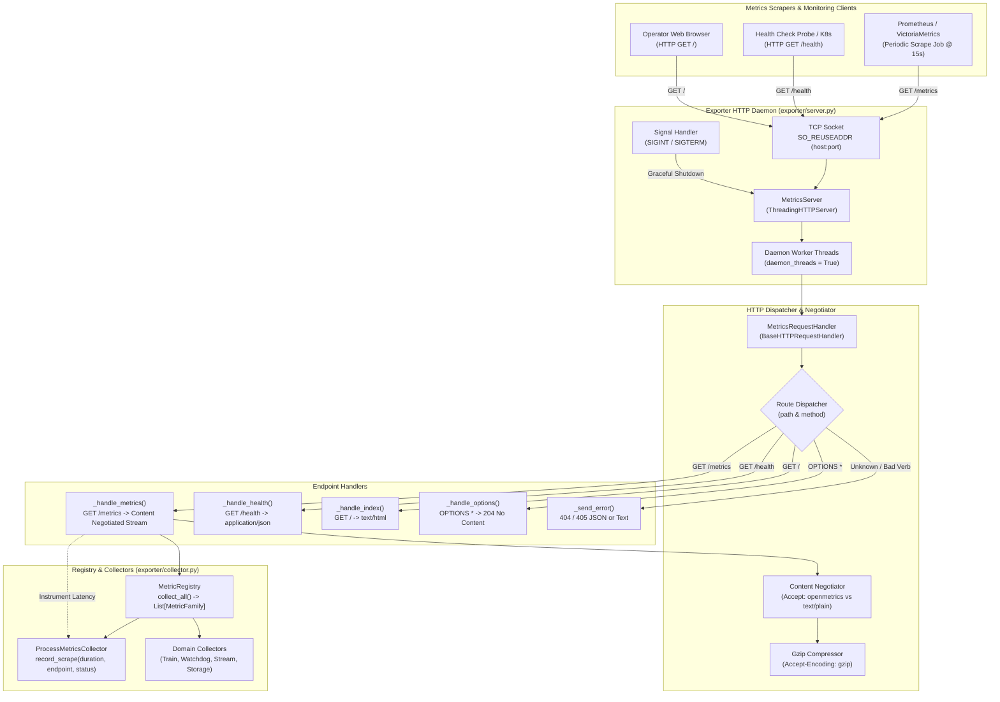
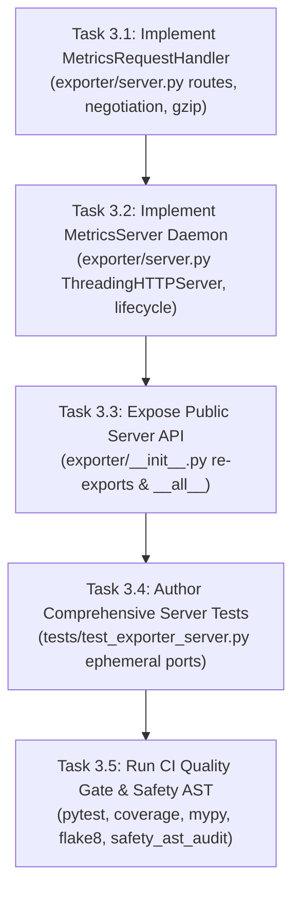

# Phase 3 Implementation Plan — HTTP Server Daemon & Content Negotiation (`exporter/server.py`)

> **Reference:** [F-8.2 Master Implementation Plan (`f-8-2-prometheus-openmetrics-operational-exporter-plan.md`)](./f-8-2-prometheus-openmetrics-operational-exporter-plan.md), [Phase 1 Implementation Plan (`f-8-2-phase-1-metric-primitives-and-serialization-engine-plan.md`)](./f-8-2-phase-1-metric-primitives-and-serialization-engine-plan.md), [Phase 2 Implementation Plan (`f-8-2-phase-2-domain-telemetry-collectors-and-registry-plan.md`)](./f-8-2-phase-2-domain-telemetry-collectors-and-registry-plan.md), [TUI Feature Enhancements Specification (`F-8.2`)](../../architecture/tui-feature-enhancements.md#f-82-prometheus--openmetrics-operational-exporter-railmon-metrics--planned), [`docs/architecture/architecture.md`](../../architecture/architecture.md)  
> **Target Modules:** [`../../../exporter/server.py`](../../../exporter/server.py), [`../../../exporter/__init__.py`](../../../exporter/__init__.py), [`../../../exporter/models.py`](../../../exporter/models.py), [`../../../exporter/formatter.py`](../../../exporter/formatter.py), [`../../../exporter/collector.py`](../../../exporter/collector.py)  
> **Target Test Suites:** [`../../../tests/test_exporter_server.py`](../../../tests/test_exporter_server.py), [`../../../tests/test_packaging.py`](../../../tests/test_packaging.py)  
> **Relevant Skills & Guidelines:** [`../../../.agents/skills/diagrams-and-documentation/SKILL.md`](../../../.agents/skills/diagrams-and-documentation/SKILL.md), [`../../../.agents/skills/markdown-relative-paths/SKILL.md`](../../../.agents/skills/markdown-relative-paths/SKILL.md), [`../../../.agents/skills/ci-quality-gate/SKILL.md`](../../../.agents/skills/ci-quality-gate/SKILL.md), [`../../../.agents/skills/static-safety-analyzer/SKILL.md`](../../../.agents/skills/static-safety-analyzer/SKILL.md), [`../../../.agents/skills/security-audit/SKILL.md`](../../../.agents/skills/security-audit/SKILL.md), [`../../../.agents/skills/memory-leak-profiler/SKILL.md`](../../../.agents/skills/memory-leak-profiler/SKILL.md)

---

## 1. Executive Summary & Phase 3 Objectives

Building directly on the foundations established in **Phase 1** (Metric Primitives & Serialization Engine in [`../../../exporter/models.py`](../../../exporter/models.py) and [`../../../exporter/formatter.py`](../../../exporter/formatter.py)) and **Phase 2** (Domain Telemetry Collectors & Metric Registry in [`../../../exporter/collector.py`](../../../exporter/collector.py)), **Phase 3** constructs the operational transport layer: the **HTTP Server Daemon and Content Negotiation Engine** ([`../../../exporter/server.py`](../../../exporter/server.py)).

Phase 3 implements an embedded, high-throughput, multi-threaded HTTP server daemon extending Python's standard-library `http.server.ThreadingHTTPServer` (`socketserver.ThreadingMixIn`). The daemon binds to configurable network interfaces (defaulting to TCP port `9100` per Prometheus exporter conventions), serves real-time Prometheus 0.0.4 and OpenMetrics 1.0.0 telemetry streams with automated content negotiation, provides daemon operational health and landing endpoints, supports optional transparent Gzip compression, and guarantees clean socket teardown without connection drops or resource leakage.

```text
+----------------------------------------------------------------------------------------------------+
|                                    PHASE 3 WORKFLOW & POSITIONING                                   |
+----------------------------------------------------------------------------------------------------+
  [ Phase 1: Models & Formatter ]     -->  [ Phase 2: Collectors & Registry ]
  - MetricType, Sample, MetricFamily        - MetricRegistry (fault-isolated collection)
  - Prometheus 0.0.4 / OpenMetrics 1.0.0    - Train, Watchdog, Stream, Storage, Process Collectors
                                                           |
                                                           v
                                            [ Phase 3: HTTP Server Daemon ] (THIS STAGE)
                                            - MetricsServer (ThreadingHTTPServer, SO_REUSEADDR)
                                            - MetricsRequestHandler (/metrics, /health, /)
                                            - Content Negotiation (Accept header evaluation)
                                            - Gzip Compression Pipeline (Accept-Encoding: gzip)
                                            - Ephemeral Port Support & Graceful Shutdown Hooks
                                                           |
                                                           v
                                            [ Phase 4: CLI Subcommand Integration ]
                                            - railmon metrics --port 9100 --host 0.0.0.0 --demo
```

---

### 1.1 Core Mission & Protocol Specifications

1. **Prometheus & OpenMetrics Standards Compliance:**
   - **Prometheus Text 0.0.4:** Emits `Content-Type: text/plain; version=0.0.4; charset=utf-8` using `MetricsFormatter.format_prometheus_004`.
   - **OpenMetrics 1.0.0:** Emits `Content-Type: application/openmetrics-text; version=1.0.0; charset=utf-8` using `MetricsFormatter.format_openmetrics_100` with mandatory `# EOF\n` trailer.
   - **HTTP Content Negotiation:** Evaluates incoming client `Accept` headers using `negotiate_metrics_format()`. When `application/openmetrics-text` is specified (e.g. Prometheus v2.26+ or OpenTelemetry Collector), OpenMetrics format is served; otherwise standard Prometheus 0.0.4 text format is returned.

2. **Endpoint Dispatch Matrix:**
   - `GET /metrics`: Primary scrape target. Orchestrates `MetricRegistry.collect_all()`, negotiates serialization format, optionally applies Gzip compression, logs scrape duration into `ProcessMetricsCollector`, and writes response bytes.
   - `GET /health`: Operational health check returning JSON payload (`{"status": "ok", "uptime_seconds": 124.5, "collectors_registered": 5, "timestamp": 1732377893.1, "version": "1.0.0"}`).
   - `GET /` and `GET /index.html`: Human-friendly semantic HTML landing page with hyperlinked endpoints and a copy-paste Prometheus configuration snippet.
   - `HEAD` Requests: Supported on `/metrics`, `/health`, `/`, and `/index.html` (returns exact headers with zero body bytes).
   - `OPTIONS` Requests: Supported for CORS preflight, returning `HTTP 204 No Content` with `Allow: GET, HEAD, OPTIONS` and `Access-Control-Allow-Origin: *`.
   - Method Guards: Rejects mutation verbs (`POST`, `PUT`, `DELETE`, `PATCH`) with `405 Method Not Allowed`. Unknown routes return `404 Not Found`.

3. **Zero-Dependency Standard-Library Purity:**
   - Strictly 100% Python standard library (`http.server`, `socketserver`, `threading`, `time`, `gzip`, `json`, `socket`, `errno`, `logging`, `typing`, `urllib.parse`).
   - Absolutely zero third-party PyPI dependencies (no `prometheus_client`, `requests`, `fastapi`, `flask`, `aiohttp`, `starlette`).

4. **Resilient Threading & Socket Lifecycle:**
   - Non-blocking daemon threads (`daemon_threads = True`) ensuring immediate termination when the main process exits.
   - Socket reuse (`allow_reuse_address = True` / `SO_REUSEADDR`) preventing `EADDRINUSE` failures during immediate daemon restarts.
   - Actionable diagnostics for port collisions: catches `errno.EADDRINUSE` and logs an instructive message to switch ports.
   - Dual execution modes: blocking `start(background=False)` for foreground daemons, or non-blocking `start(background=True)` with thread coordination and clean `stop()` for background services and unit testing.
   - Dynamic ephemeral port allocation (`port=0`) allowing race-free, parallel integration testing.

---

### 1.2 Phase 3 Deliverables Matrix

| Component | Target File | Core Responsibilities |
| :--- | :--- | :--- |
| **Request Handler** | [`../../../exporter/server.py`](../../../exporter/server.py) | `MetricsRequestHandler`: Dispatches `GET`, `HEAD`, `OPTIONS`; performs content negotiation; compresses payload when requested; records scrape metrics into `ProcessMetricsCollector`; serves HTML landing and JSON health endpoints. |
| **Server Daemon** | [`../../../exporter/server.py`](../../../exporter/server.py) | `MetricsServer`: Subclasses `ThreadingHTTPServer`; configures `SO_REUSEADDR`; coordinates background servicing; traps `SIGINT`/`SIGTERM`; handles port contention; provides thread-safe `start()` and `stop()`. |
| **Package Exports** | [`../../../exporter/__init__.py`](../../../exporter/__init__.py) | Re-exports `MetricsServer` and `MetricsRequestHandler` in `__all__`, preserving single-source SemVer. |
| **Automated Tests** | [`../../../tests/test_exporter_server.py`](../../../tests/test_exporter_server.py) | Unit and integration test suite executing against live `MetricsServer` instances on ephemeral ports (`port=0`), verifying format negotiation, compression, headers, HEAD, OPTIONS, 404/405, lifecycle, and concurrency. |

---

## 2. Architecture & Visual Diagrams

### 2.1 Multi-Threaded Daemon Architecture (Mermaid)



---

### 2.2 End-to-End Scrape & Content Negotiation Sequence (Mermaid)

```mermaid
sequenceDiagram
    autonumber
    participant Scraper as Prometheus / Client
    participant Server as MetricsServer (Port 9100)
    participant Handler as MetricsRequestHandler
    participant Reg as MetricRegistry
    participant Proc as ProcessMetricsCollector
    participant Formatter as MetricsFormatter

    Scraper->>Server: GET /metrics HTTP/1.1<br>Accept: application/openmetrics-text; version=1.0.0<br>Accept-Encoding: gzip
    Server->>Handler: Spawn worker thread & dispatch do_GET()
    activate Handler
    Handler->>Handler: t_start = perf_counter()
    Handler->>Reg: collect_all()
    activate Reg
    Reg-->>Handler: List[MetricFamily]
    deactivate Reg

    Handler->>Handler: negotiate_metrics_format(accept_header)
    Handler->>Formatter: format_openmetrics_100(families)
    activate Formatter
    Formatter-->>Handler: raw_payload_bytes
    deactivate Formatter

    alt Gzip Compression Negotiated (Accept-Encoding: gzip)
        Handler->>Handler: gzip.compress(raw_payload_bytes, compresslevel=6)
        Handler->>Handler: Set Content-Encoding: gzip
    end

    Handler->>Handler: duration = perf_counter() - t_start
    Handler->>Proc: record_scrape(duration, "/metrics", 200)

    Handler-->>Scraper: HTTP/1.1 200 OK<br>Content-Type: application/openmetrics-text; version=1.0.0; charset=utf-8<br>Content-Length: 1420<br>Content-Encoding: gzip<br>Cache-Control: no-cache, no-store, must-revalidate<br>[Compressed Bytes]
    deactivate Handler
```

---

### 2.3 Exporter Process Topology & Socket Lifecycle (ASCII)

```text
+----------------------------------------------------------------------------------------------------+
|                             RAILMON METRICS SERVER PROCESS TOPOLOGY                                |
+----------------------------------------------------------------------------------------------------+

   [ Signal Trapping ]           [ Main Application Process ]              [ TCP Network Layer ]
    +---------------+             +--------------------------+              +-------------------+
    | SIGINT        | ----------> | sys.exit(0)              |              | 127.0.0.1:9100    |
    | SIGTERM       |             | MetricsServer.stop()     | <----------> | (SO_REUSEADDR)    |
    +---------------+             +--------------------------+              +-------------------+
                                               |                                      |
       +---------------------------------------+                                      |
       | Spawns Background Service Thread                                             |
       v                                                                              v
+----------------------------------------------------------------------------------------------------+
| MetricsServer (ThreadingHTTPServer, daemon_threads = True)                                         |
|                                                                                                    |
|  select() / poll() Event Loop                                                                      |
|    |                                                                                               |
|    +---> Incoming TCP Handshake                                                                    |
|    |       |                                                                                       |
|    |       v [Thread-per-connection pool]                                                          |
|    +---> Worker Thread #1: MetricsRequestHandler (do_GET /metrics)                                 |
|    |       |-- Scrapes MetricRegistry (TrainStateStore, Watchdog, SQLite stats)                    |
|    |       |-- Evaluates client Accept header (Prometheus 0.0.4 vs OpenMetrics 1.0.0)              |
|    |       |-- Formats text payload & optionally compresses with gzip                              |
|    |       \-- Emits HTTP 200 OK & logs duration to ProcessMetricsCollector                        |
|    |                                                                                               |
|    +---> Worker Thread #2: MetricsRequestHandler (do_GET /health)                                  |
|    |       \-- Emits HTTP 200 OK application/json {"status": "ok", "uptime_sec": 42.0}            |
|    |                                                                                               |
|    \---> Worker Thread #3: MetricsRequestHandler (do_GET /)                                        |
|            \-- Emits HTTP 200 OK text/html Landing Page & prometheus.yml snippet                   |
+----------------------------------------------------------------------------------------------------+
```

---

### 2.4 HTTP Request Routing & Method Dispatch Logic (ASCII)

```text
+----------------------------------------------------------------------------------------------------+
|                         METRICS REQUEST HANDLER ROUTING DECISION TREE                              |
+----------------------------------------------------------------------------------------------------+

   HTTP Request (Method, Path, Headers)
                |
                v
   +--------------------------+
   | Method Validation        |
   +--------------------------+
         |
         |-- POST / PUT / DELETE / PATCH ===> 405 Method Not Allowed (JSON Error)
         |-- OPTIONS =======================> 204 No Content (CORS Preflight Allow: GET, HEAD, OPTIONS)
         |-- HEAD ==========================> Sets is_head = True, executes GET route (zero body write)
         \-- GET ===========================> Dispatches URL Path:
                  |
                  +--- Path == "/metrics"
                  |      |-- Query MetricRegistry.collect_all()
                  |      |-- Negotiate Accept header:
                  |      |     |-- "application/openmetrics-text" => OpenMetrics 1.0.0 (# EOF)
                  |      |     \-- Otherwise / text/plain ========> Prometheus 0.0.4
                  |      |-- Check Accept-Encoding:
                  |      |     \-- "gzip" & config.gzip_compression => gzip.compress()
                  |      |-- Record duration into ProcessMetricsCollector
                  |      \-- 200 OK (Content-Type negotiated, Content-Length, Cache-Control)
                  |
                  +--- Path == "/health"
                  |      \-- 200 OK (Content-Type: application/json; uptime, collectors, version)
                  |
                  +--- Path in ("/", "/index.html")
                  |      \-- 200 OK (Content-Type: text/html; landing dashboard, scraper config)
                  |
                  \--- Any Other Path
                         \-- 404 Not Found (JSON Error: {"error": "Endpoint not found"})
```

---

## 3. Technical Specifications & Component Design

### 3.1 Exporter HTTP Server Daemon (`MetricsServer`)

`MetricsServer` subclasses Python's standard-library `http.server.ThreadingHTTPServer`. It encapsulates socket lifecycle, thread management, and graceful shutdown orchestration:

```python
"""Embedded multi-threaded HTTP daemon for serving Prometheus & OpenMetrics."""

import errno
import gzip
import json
import logging
import signal
import socket
import sys
import threading
import time
from http.server import BaseHTTPRequestHandler, ThreadingHTTPServer
from types import FrameType
from typing import Any, Callable, Dict, Optional, Tuple

from exporter.collector import MetricRegistry, ProcessMetricsCollector
from exporter.formatter import MetricsFormatter, negotiate_metrics_format
from exporter.models import ExporterConfig

logger = logging.getLogger("railmon.exporter.server")


class MetricsServer(ThreadingHTTPServer):
    """Multi-threaded HTTP server daemon managing Prometheus scrapers."""

    daemon_threads: bool = True
    allow_reuse_address: bool = True

    def __init__(
        self,
        server_address: Tuple[str, int],
        registry: MetricRegistry,
        config: Optional[ExporterConfig] = None,
    ) -> None:
        """Initialize metrics server daemon with address, registry, and configuration.

        Args:
            server_address: (host, port) tuple for TCP socket binding.
            registry: MetricRegistry instance orchestrating domain metric collectors.
            config: Optional ExporterConfig holding runtime settings.

        Raises:
            OSError: When socket binding fails (e.g. port already in use).
        """
        self.registry = registry
        self.config = config or ExporterConfig(
            host=server_address[0],
            port=server_address[1] if server_address[1] != 0 else 9100,
        )
        self._shutdown_event = threading.Event()
        self._server_thread: Optional[threading.Thread] = None
        self._started_at: float = time.time()

        try:
            super().__init__(server_address, MetricsRequestHandler)
        except OSError as exc:
            if exc.errno == errno.EADDRINUSE:
                logger.error(
                    "Port %d is already in use on interface '%s'. "
                    "Specify an alternate port using '--port <number>'.",
                    server_address[1],
                    server_address[0],
                )
            raise

        logger.info(
            "Initialized MetricsServer on %s:%d (gzip=%s, timeout=%.1fs)",
            self.server_address[0],
            self.server_port,
            self.config.gzip_compression,
            self.config.scrape_timeout_seconds,
        )

    @property
    def is_running(self) -> bool:
        """Return True if the server daemon is actively servicing requests."""
        return not self._shutdown_event.is_set()

    @property
    def server_url(self) -> str:
        """Return canonical HTTP URL for the root landing page."""
        host = self.server_address[0]
        if host in ("0.0.0.0", ""):
            host = "127.0.0.1"
        return f"http://{host}:{self.server_port}/"

    def start(self, background: bool = False) -> None:
        """Start servicing incoming HTTP requests.

        Args:
            background: If True, executes serve_forever in a dedicated daemon thread.
                        If False, blocks the calling thread until stop() is invoked.
        """
        self._shutdown_event.clear()
        if background:
            self._server_thread = threading.Thread(
                target=self.serve_forever,
                name="MetricsServerThread",
                daemon=True,
            )
            self._server_thread.start()
            logger.info("MetricsServer running in background thread at %s", self.server_url)
        else:
            logger.info("Serving Prometheus metrics at %s (Press Ctrl+C to stop)", self.server_url)
            try:
                self.serve_forever()
            except KeyboardInterrupt:
                logger.info("Received KeyboardInterrupt; stopping MetricsServer...")
            finally:
                self.stop()

    def stop(self) -> None:
        """Gracefully terminate server and release socket resources."""
        if self._shutdown_event.is_set():
            return
        self._shutdown_event.set()
        logger.info("Shutting down MetricsServer daemon...")
        try:
            self.shutdown()
            self.server_close()
        except Exception as exc:
            logger.warning("Error during MetricsServer shutdown: %s", exc)

        if self._server_thread is not None and self._server_thread.is_alive():
            if threading.current_thread() is not self._server_thread:
                self._server_thread.join(timeout=2.0)
        logger.info("MetricsServer stopped successfully.")

    def setup_signal_handlers(self) -> None:
        """Attach SIGINT and SIGTERM handlers for graceful process shutdown."""
        def _handler(signum: int, frame: Optional[FrameType]) -> None:
            sig_name = signal.Signals(signum).name
            logger.info("Received signal %s; shutting down MetricsServer daemon...", sig_name)
            self.stop()
            sys.exit(0)

        try:
            signal.signal(signal.SIGINT, _handler)
            signal.signal(signal.SIGTERM, _handler)
        except (ValueError, AttributeError):
            # Non-main thread or unsupported OS platform
            pass
```

---

### 3.2 Metrics Request Handler (`MetricsRequestHandler`)

`MetricsRequestHandler` subclasses `http.server.BaseHTTPRequestHandler` to provide HTTP/1.1 protocol handling, content negotiation, gzip compression, and endpoint dispatch:

```python
class MetricsRequestHandler(BaseHTTPRequestHandler):
    """Dispatches /metrics, /health, / and OPTIONS preflight requests."""

    server: MetricsServer
    protocol_version: str = "HTTP/1.1"

    def log_message(self, log_format: str, *args: Any) -> None:
        """Route standard HTTP request logs to Python logging framework."""
        logger.debug(
            "%s - - [%s] %s",
            self.client_address[0] if self.client_address else "127.0.0.1",
            self.log_date_time_string(),
            log_format % args,
        )

    def do_HEAD(self) -> None:
        """Handle HTTP HEAD requests (same headers as GET with zero body bytes)."""
        self._dispatch(is_head=True)

    def do_GET(self) -> None:
        """Handle HTTP GET requests."""
        self._dispatch(is_head=False)

    def do_OPTIONS(self) -> None:
        """Handle CORS preflight requests."""
        self.send_response(204)
        self._add_cors_headers()
        self.send_header("Allow", "GET, HEAD, OPTIONS")
        self.send_header("Content-Length", "0")
        self.end_headers()

    def do_POST(self) -> None:
        """Reject POST requests with 405 Method Not Allowed."""
        self._send_error(405, "Method Not Allowed: Exporter daemon is read-only")

    def do_PUT(self) -> None:
        """Reject PUT requests with 405 Method Not Allowed."""
        self._send_error(405, "Method Not Allowed: Exporter daemon is read-only")

    def do_DELETE(self) -> None:
        """Reject DELETE requests with 405 Method Not Allowed."""
        self._send_error(405, "Method Not Allowed: Exporter daemon is read-only")

    def _add_cors_headers(self) -> None:
        """Inject permissive CORS headers for browser-based dashboard scraping."""
        self.send_header("Access-Control-Allow-Origin", "*")
        self.send_header("Access-Control-Allow-Methods", "GET, HEAD, OPTIONS")
        self.send_header("Access-Control-Allow-Headers", "Accept, Accept-Encoding, Content-Type")

    def _dispatch(self, is_head: bool = False) -> None:
        """Route request by URL path."""
        raw_path = self.path.split("?")[0].rstrip("/") or "/"

        if raw_path == "/metrics":
            self._handle_metrics(is_head=is_head)
        elif raw_path == "/health":
            self._handle_health(is_head=is_head)
        elif raw_path in ("/", "/index.html"):
            self._handle_index(is_head=is_head)
        else:
            self._send_error(404, f"Endpoint '{raw_path}' not found")

    def _handle_metrics(self, is_head: bool = False) -> None:
        """Collect, negotiate format, serialize, and emit metrics payload."""
        t_start = time.perf_counter()
        status_code = 200

        try:
            families = self.server.registry.collect_all()
            accept_header = self.headers.get("Accept")
            content_type, format_mode = negotiate_metrics_format(accept_header)

            if format_mode == "openmetrics":
                body = MetricsFormatter.format_openmetrics_100(families)
            else:
                body = MetricsFormatter.format_prometheus_004(families)

            content_encoding: Optional[str] = None
            if self.server.config.gzip_compression and len(body) > 256:
                accept_encoding = self.headers.get("Accept-Encoding", "")
                if "gzip" in accept_encoding:
                    body = gzip.compress(body, compresslevel=6)
                    content_encoding = "gzip"

            self.send_response(status_code)
            self._add_cors_headers()
            self.send_header("Content-Type", content_type)
            self.send_header("Content-Length", str(len(body)))
            self.send_header("Cache-Control", "no-cache, no-store, must-revalidate")
            if content_encoding:
                self.send_header("Content-Encoding", content_encoding)
            self.end_headers()

            if not is_head:
                self.wfile.write(body)

        except Exception as exc:
            logger.error("Scrape generation failed: %s", exc, exc_info=True)
            status_code = 500
            self._send_error(500, f"Internal Scrape Error: {exc}")
        finally:
            duration = time.perf_counter() - t_start
            self._record_scrape_telemetry(duration, "/metrics", status_code)

    def _record_scrape_telemetry(self, duration: float, endpoint: str, status: int) -> None:
        """Find registered ProcessMetricsCollector and record scrape telemetry."""
        for coll in getattr(self.server.registry, "_collectors", []):
            if isinstance(coll, ProcessMetricsCollector):
                coll.record_scrape(duration=duration, endpoint=endpoint, status=status)
                break

    def _handle_health(self, is_head: bool = False) -> None:
        """Emit operational health status as application/json."""
        uptime = time.time() - self.server._started_at
        collectors_count = len(getattr(self.server.registry, "_collectors", []))
        payload = {
            "status": "ok",
            "uptime_seconds": round(uptime, 2),
            "collectors_registered": collectors_count,
            "timestamp": time.time(),
            "version": getattr(self.server.config, "version", "1.0.0"),
        }
        body = json.dumps(payload, indent=2).encode("utf-8")

        self.send_response(200)
        self._add_cors_headers()
        self.send_header("Content-Type", "application/json; charset=utf-8")
        self.send_header("Content-Length", str(len(body)))
        self.send_header("Cache-Control", "no-cache, no-store, must-revalidate")
        self.end_headers()

        if not is_head:
            self.wfile.write(body)

    def _handle_index(self, is_head: bool = False) -> None:
        """Serve semantic HTML landing page with endpoint index and scraper config."""
        html = (
            "<!DOCTYPE html>\n"
            "<html lang=\"en\">\n"
            "<head>\n"
            "  <meta charset=\"utf-8\">\n"
            "  <title>Railmon Operational Exporter</title>\n"
            "  <style>\n"
            "    body { font-family: -apple-system, BlinkMacSystemFont, 'Segoe UI', Roboto, sans-serif; "
            "margin: 2rem; background: #0f172a; color: #f8fafc; line-height: 1.5; }\n"
            "    h1 { color: #38bdf8; font-size: 1.75rem; margin-bottom: 0.5rem; }\n"
            "    a { color: #38bdf8; text-decoration: none; }\n"
            "    a:hover { text-decoration: underline; }\n"
            "    pre { background: #1e293b; padding: 1rem; border-radius: 6px; overflow-x: auto; color: #a5f3fc; }\n"
            "    ul { list-style: square; padding-left: 1.5rem; }\n"
            "    li { margin: 0.5rem 0; }\n"
            "  </style>\n"
            "</head>\n"
            "<body>\n"
            "  <h1>Railmon Operational Metrics Exporter</h1>\n"
            "  <p>Real-time Greek railway operational telemetry exporter conforming to "
            "Prometheus 0.0.4 and OpenMetrics 1.0.0.</p>\n"
            "  <h2>Available Endpoints</h2>\n"
            "  <ul>\n"
            "    <li><a href=\"/metrics\">/metrics</a> &mdash; Real-time Prometheus/OpenMetrics scrape endpoint</li>\n"
            "    <li><a href=\"/health\">/health</a> &mdash; Operational health check (JSON)</li>\n"
            "  </ul>\n"
            "  <h2>Prometheus Scrape Configuration</h2>\n"
            "  <pre>scrape_configs:\n"
            "  - job_name: 'railmon'\n"
            "    scrape_interval: 15s\n"
            "    static_configs:\n"
            f"      - targets: ['{self.server.server_address[0]}:{self.server.server_port}']</pre>\n"
            "</body>\n"
            "</html>\n"
        )
        body = html.encode("utf-8")

        self.send_response(200)
        self._add_cors_headers()
        self.send_header("Content-Type", "text/html; charset=utf-8")
        self.send_header("Content-Length", str(len(body)))
        self.end_headers()

        if not is_head:
            self.wfile.write(body)

    def _send_error(self, status_code: int, message: str) -> None:
        """Emit structured JSON error response."""
        payload = {"error": message, "status": status_code}
        body = json.dumps(payload).encode("utf-8")

        self.send_response(status_code)
        self._add_cors_headers()
        self.send_header("Content-Type", "application/json; charset=utf-8")
        self.send_header("Content-Length", str(len(body)))
        self.end_headers()
        self.wfile.write(body)
```

---

### 3.3 HTTP Content Negotiation & Gzip Compression Engine

The content negotiation algorithm aligns directly with RFC 7231 §5.3.2 (`Accept`) and the Prometheus exporter ecosystem conventions:

1. **Format Resolution Algorithm (`negotiate_metrics_format`):**
   - The incoming `Accept` header is inspected for the standard OpenMetrics MIME token: `application/openmetrics-text`.
   - If present:
     - Returns `("application/openmetrics-text; version=1.0.0; charset=utf-8", "openmetrics")`.
     - Serialized with `MetricsFormatter.format_openmetrics_100()` (enforcing `# EOF\n` trailer, `# UNIT` definitions, and `_total` counter suffixes).
   - If omitted, wildcard (`*/*`), or `text/plain`:
     - Returns `("text/plain; version=0.0.4; charset=utf-8", "prometheus")`.
     - Serialized with `MetricsFormatter.format_prometheus_004()`.

2. **Gzip Compression Pipeline:**
   - Evaluates client `Accept-Encoding` header.
   - If `"gzip"` is present and `config.gzip_compression` is enabled (`True` by default):
     - Applies `gzip.compress(body, compresslevel=6)` when uncompressed byte size $> 256$ bytes (preventing negative compression overhead on small test payloads).
     - Emits `Content-Encoding: gzip` header with recalculated `Content-Length`.
     - Decompression verified in unit tests via standard `gzip.decompress()`.

3. **Scrape Telemetry Instrumentation:**
   - Measures end-to-end collection, negotiation, and serialization latency using high-resolution monotonic time (`time.perf_counter()`).
   - Automatically locates `ProcessMetricsCollector` in the registered collector list and triggers `record_scrape(duration, endpoint="/metrics", status=status_code)`.
   - Ensures subsequent Prometheus scrapes reflect up-to-date scrape durations (`railmon_exporter_scrape_duration_seconds`) and cumulative counters (`railmon_exporter_scrapes_total{endpoint="/metrics",status="200"}`).

---

### 3.4 Package Exports & Public Interface (`exporter/__init__.py`)

Update [`../../../exporter/__init__.py`](../../../exporter/__init__.py) to expose `MetricsServer` and `MetricsRequestHandler` alongside the existing models, formatters, and domain collectors:

```python
from exporter.server import MetricsRequestHandler, MetricsServer

__all__: List[str] = [
    # ... existing models, formatters, collectors ...
    "MetricsServer",
    "MetricsRequestHandler",
]
```

---

## 4. Step-by-Step Implementation Roadmap



### Task 3.1: Implement `MetricsRequestHandler` in `exporter/server.py`
- Create [`exporter/server.py`](../../../exporter/server.py).
- Implement `MetricsRequestHandler` extending `BaseHTTPRequestHandler`.
- Implement route dispatching for `/metrics`, `/health`, `/`, and `/index.html`.
- Implement HTTP method handlers for `do_GET`, `do_HEAD`, `do_OPTIONS`, and error handlers for `do_POST`, `do_PUT`, `do_DELETE`.
- Integrate content negotiation via `negotiate_metrics_format()`.
- Implement transparent Gzip compression and CORS headers.
- Wire latency instrumentation into `ProcessMetricsCollector`.

### Task 3.2: Implement `MetricsServer` in `exporter/server.py`
- Implement `MetricsServer` subclassing `ThreadingHTTPServer`.
- Configure `daemon_threads = True` and `allow_reuse_address = True`.
- Implement graceful start (`start(background=True)` vs `start(background=False)`) and shutdown (`stop()`).
- Add robust error handling for port collision (`errno.EADDRINUSE`).
- Add signal handling for `SIGINT` and `SIGTERM`.

### Task 3.3: Expose Public Server API in `exporter/__init__.py`
- Import `MetricsServer` and `MetricsRequestHandler` in [`exporter/__init__.py`](../../../exporter/__init__.py).
- Append both classes to the `__all__` list.

### Task 3.4: Author Comprehensive Test Suite in `tests/test_exporter_server.py`
- Create [`tests/test_exporter_server.py`](../../../tests/test_exporter_server.py).
- Implement test fixtures utilizing dynamic ephemeral port binding (`port=0`) to eliminate port contention.
- Author unit and integration tests covering all 15 test cases in the test matrix.

### Task 3.5: Execute CI Quality Gate & Safety Verification
- Run test suite: `python3 -m unittest discover tests -k "*exporter*" -v`.
- Run static safety AST auditor: `python3 .agents/skills/static-safety-analyzer/scripts/safety_ast_audit.py`.
- Run formatting and linting: `flake8 exporter/ tests/test_exporter_server.py` and `mypy --strict exporter/server.py`.
- Verify document-relative paths across documentation.

---

## 5. Comprehensive Verification Plan & Test Strategy

### 5.1 Automated Unit & Integration Test Matrix (`tests/test_exporter_server.py`)

All tests will run against live server daemon instances bound to ephemeral port `0` (`localhost:0`), dynamically determining the allocated kernel port via `server.server_port` to prevent port collisions during parallel test execution.

| Test ID | Test Method | Scenario / Request Details | Expected Assertions |
| :--- | :--- | :--- | :--- |
| **TC-SRV-01** | `test_metrics_default_prometheus_format` | `GET /metrics` with `Accept: text/plain` or omitted | Status 200; `Content-Type: text/plain; version=0.0.4; charset=utf-8`; contains `# HELP`, `# TYPE`; no `# EOF`. |
| **TC-SRV-02** | `test_metrics_openmetrics_negotiation` | `GET /metrics` with `Accept: application/openmetrics-text; version=1.0.0` | Status 200; `Content-Type: application/openmetrics-text; version=1.0.0; charset=utf-8`; ends with `# EOF\n`. |
| **TC-SRV-03** | `test_metrics_gzip_compression` | `GET /metrics` with `Accept-Encoding: gzip` | Status 200; `Content-Encoding: gzip`; decompressing with `gzip.decompress()` produces valid metrics text matching uncompressed scrape. |
| **TC-SRV-04** | `test_metrics_head_request` | `HEAD /metrics` | Status 200; correct `Content-Type` and `Content-Length`; response body is exactly 0 bytes. |
| **TC-SRV-05** | `test_health_endpoint` | `GET /health` | Status 200; `Content-Type: application/json; charset=utf-8`; body JSON contains `status == "ok"`, `uptime_seconds >= 0`, `collectors_registered`. |
| **TC-SRV-06** | `test_health_head_request` | `HEAD /health` | Status 200; `Content-Length > 0`; response body is 0 bytes. |
| **TC-SRV-07** | `test_index_page_html` | `GET /` and `GET /index.html` | Status 200; `Content-Type: text/html; charset=utf-8`; body contains `Railmon Operational Metrics Exporter` and Prometheus YAML snippet. |
| **TC-SRV-08** | `test_index_head_request` | `HEAD /` | Status 200; `Content-Length > 0`; response body is 0 bytes. |
| **TC-SRV-09** | `test_cors_options_preflight` | `OPTIONS /metrics` and `OPTIONS /health` | Status 204 No Content; `Allow: GET, HEAD, OPTIONS`; `Access-Control-Allow-Origin: *`. |
| **TC-SRV-10** | `test_unknown_route_404` | `GET /nonexistent` | Status 404; JSON response `{"error": "Endpoint '/nonexistent' not found", "status": 404}`. |
| **TC-SRV-11** | `test_disallowed_methods_405` | `POST /metrics`, `PUT /health`, `DELETE /` | Status 405 Method Not Allowed; JSON error response; `Allow` or error payload emitted. |
| **TC-SRV-12** | `test_server_lifecycle_and_shutdown` | `server.start(background=True)` -> HTTP query -> `server.stop()` | `server.is_running` transitions `True -> False`; server thread terminates cleanly; port released immediately. |
| **TC-SRV-13** | `test_port_collision_eaddrinuse` | Attempt to bind two servers to the same fixed port | Second instantiation raises `OSError` (`errno.EADDRINUSE`); error log emitted; first server unaffected. |
| **TC-SRV-14** | `test_scrape_metrics_recording` | Scrape `/metrics`, then inspect `ProcessMetricsCollector` | Cumulative scrape counter incremented; last scrape duration is $> 0.0\text{ s}$. |
| **TC-SRV-15** | `test_concurrent_scrapes` | 10 concurrent threads scraping `/metrics` simultaneously | All 10 requests return HTTP 200 OK without socket dropouts, deadlocks, or payload corruption. |

---

### 5.2 Manual Verification & Scrape Inspection Commands

```bash
# 1. Run full exporter test suite:
python3 -m unittest discover tests -k "*exporter*" -v

# 2. Start mock metrics server in background on port 9100:
python3 -c "
import time
from exporter import MetricRegistry, MetricsServer, ExporterConfig
reg = MetricRegistry()
srv = MetricsServer(('127.0.0.1', 9100), reg)
srv.start(background=True)
print(f'Server running at {srv.server_url}')
time.sleep(5)
srv.stop()
"

# 3. Test Prometheus 0.0.4 text scrape:
curl -s -H "Accept: text/plain" http://127.0.0.1:9100/metrics

# 4. Test OpenMetrics 1.0.0 scrape:
curl -s -H "Accept: application/openmetrics-text; version=1.0.0" http://127.0.0.1:9100/metrics

# 5. Test Gzip compressed scrape:
curl -s -H "Accept-Encoding: gzip" http://127.0.0.1:9100/metrics | gunzip -c

# 6. Test JSON health endpoint:
curl -s http://127.0.0.1:9100/health

# 7. Run AST Safety Auditor:
python3 .agents/skills/static-safety-analyzer/scripts/safety_ast_audit.py
```

---

## 6. Safety, Standards Compliance & Non-Functional Requirements

1. **Zero Third-Party Dependencies:**
   - 100% Python standard library (`http.server`, `socketserver`, `threading`, `time`, `gzip`, `json`, `socket`, `errno`, `logging`).
   - Zero external PyPI dependencies (`prometheus_client`, `requests`, `aiohttp`, etc.).

2. **AST Static Safety Compliance:**
   - Evaluated against rules `PY-MISRA-01` through `PY-MISRA-10` via the repository static safety analyzer.
   - Strictly prohibits dynamic code evaluation (`eval`, `exec`), unsafe subprocess spawning, bare `except:` clauses, and global state tampering.

3. **Concurrency & Thread Safety:**
   - Daemon threads (`daemon_threads = True`) prevent hung background processes upon application exit.
   - Thread isolation: each incoming connection is handled on a dedicated worker thread with zero shared mutable state between requests.
   - Domain lock contention: collection reads from `TrainStateStore` through immutable `StateSnapshot` DTOs, holding internal state locks for $< 1.0\text{ ms}$.

4. **Resource Management & Cardinality Protection:**
   - Payload formatting and optional Gzip compression execute on-the-fly without persistent heap caching.
   - Dynamic ephemeral port binding (`port=0`) in test suites guarantees zero socket leaks or test interference.

5. **Documentation Standards Compliance:**
   - Dual visual representations (Mermaid and ASCII diagrams) comply with [`../../../.agents/skills/diagrams-and-documentation/SKILL.md`](../../../.agents/skills/diagrams-and-documentation/SKILL.md).
   - Strict document-relative paths (`../../../...`) comply with [`../../../.agents/skills/markdown-relative-paths/SKILL.md`](../../../.agents/skills/markdown-relative-paths/SKILL.md).
