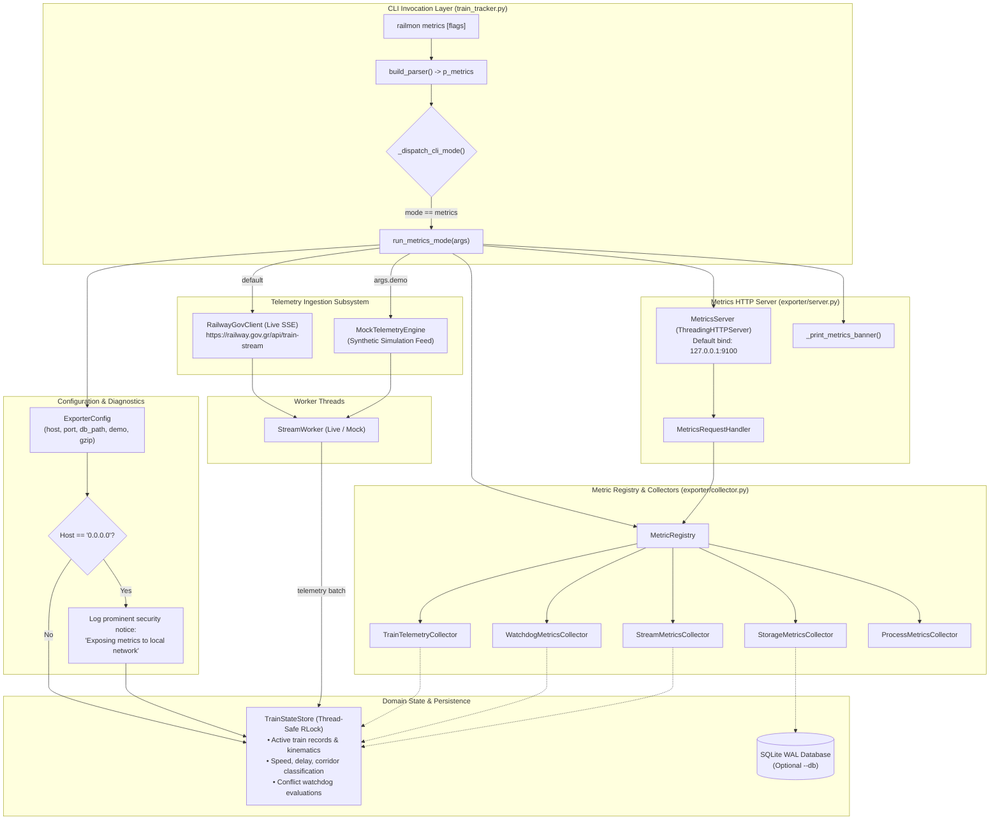
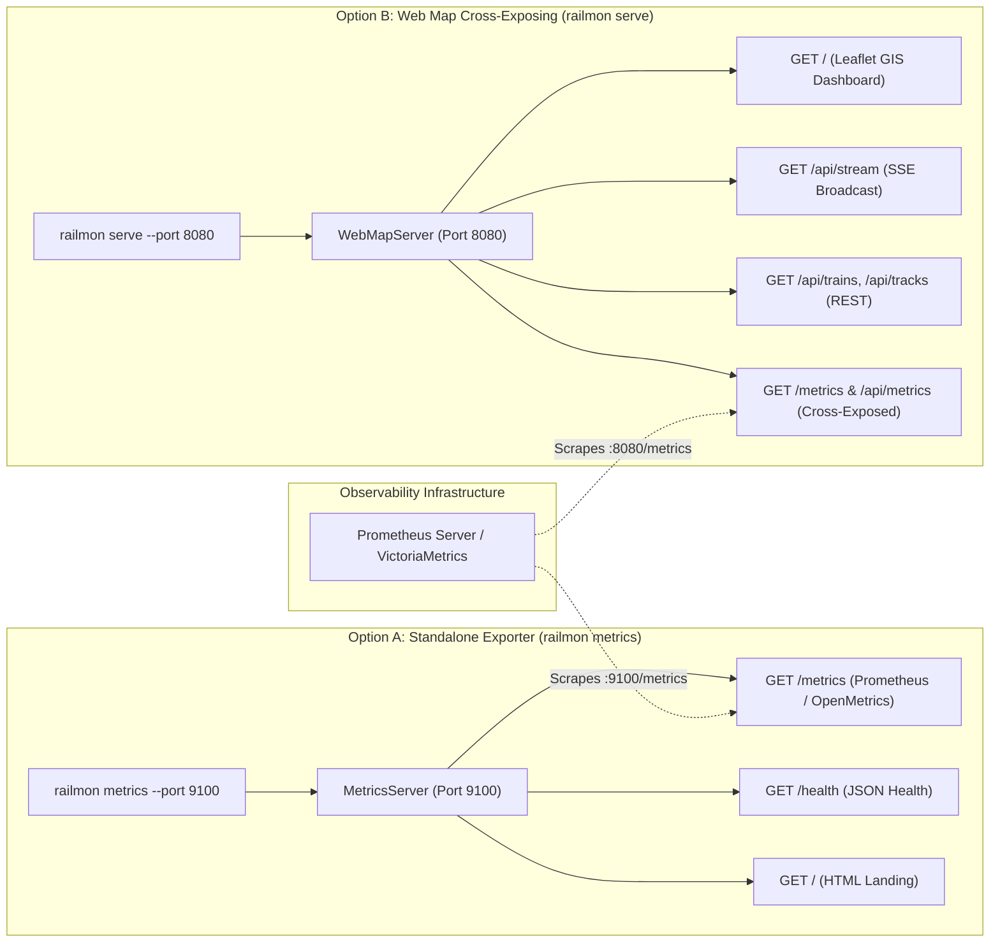

# Phase 4 Implementation Plan — CLI Subcommand Integration & Web Daemon Cross-Exposing (`train_tracker.py` & `server/handler.py`)

> **Reference:** [F-8.2 Master Implementation Plan (`f-8-2-prometheus-openmetrics-operational-exporter-plan.md`)](./f-8-2-prometheus-openmetrics-operational-exporter-plan.md), [Phase 1 Implementation Plan (`f-8-2-phase-1-metric-primitives-and-serialization-engine-plan.md`)](./f-8-2-phase-1-metric-primitives-and-serialization-engine-plan.md), [Phase 2 Implementation Plan (`f-8-2-phase-2-domain-telemetry-collectors-and-registry-plan.md`)](./f-8-2-phase-2-domain-telemetry-collectors-and-registry-plan.md), [Phase 3 Implementation Plan (`f-8-2-phase-3-http-server-daemon-and-content-negotiation-plan.md`)](./f-8-2-phase-3-http-server-daemon-and-content-negotiation-plan.md), [TUI Feature Enhancements Specification (`F-8.2`)](../../architecture/tui-feature-enhancements.md#f-82-prometheus--openmetrics-operational-exporter-railmon-metrics--planned), [`docs/architecture/architecture.md`](../../architecture/architecture.md)  
> **Target Modules:** [`../../../train_tracker.py`](../../../train_tracker.py), [`../../../server/daemon.py`](../../../server/daemon.py), [`../../../server/handler.py`](../../../server/handler.py), [`../../../exporter/server.py`](../../../exporter/server.py), [`../../../exporter/collector.py`](../../../exporter/collector.py), [`../../../exporter/formatter.py`](../../../exporter/formatter.py), [`../../../exporter/models.py`](../../../exporter/models.py)  
> **Target Test Suites:** [`../../../tests/test_cli_metrics.py`](../../../tests/test_cli_metrics.py), [`../../../tests/test_exporter_server.py`](../../../tests/test_exporter_server.py), [`../../../tests/test_cli_serve.py`](../../../tests/test_cli_serve.py)  
> **Relevant Skills & Guidelines:** [`../../../.agents/skills/diagrams-and-documentation/SKILL.md`](../../../.agents/skills/diagrams-and-documentation/SKILL.md), [`../../../.agents/skills/markdown-relative-paths/SKILL.md`](../../../.agents/skills/markdown-relative-paths/SKILL.md), [`../../../.agents/skills/ci-quality-gate/SKILL.md`](../../../.agents/skills/ci-quality-gate/SKILL.md), [`../../../.agents/skills/static-safety-analyzer/SKILL.md`](../../../.agents/skills/static-safety-analyzer/SKILL.md), [`../../../.agents/skills/security-audit/SKILL.md`](../../../.agents/skills/security-audit/SKILL.md), [`../../../.agents/skills/memory-leak-profiler/SKILL.md`](../../../.agents/skills/memory-leak-profiler/SKILL.md)

---

## 1. Executive Summary & Phase 4 Objectives

Having established the foundational metric primitives and serialization engines in **Phase 1** ([`../../../exporter/models.py`](../../../exporter/models.py), [`../../../exporter/formatter.py`](../../../exporter/formatter.py)), the pluggable domain metric collectors and registry in **Phase 2** ([`../../../exporter/collector.py`](../../../exporter/collector.py)), and the standalone multi-threaded HTTP server daemon with content negotiation in **Phase 3** ([`../../../exporter/server.py`](../../../exporter/server.py)), **Phase 4** completes the operational delivery of **Feature F-8.2**.

Phase 4 operationalizes the exporter across two primary deployment topographies:
1. **Dedicated Standalone Daemon Subcommand (`railmon metrics`):** A first-class CLI command in [`../../../train_tracker.py`](../../../train_tracker.py) that orchestrates telemetry ingestion, domain state tracking, metric collectors, socket binding, interactive operator banners, and POSIX signal handling on default TCP port `9100`.
2. **Web Daemon Cross-Exposing (`railmon serve`):** Embedding metric collection directly into the existing browser GIS daemon ([`../../../server/daemon.py`](../../../server/daemon.py) and [`../../../server/handler.py`](../../../server/handler.py)) on port `8080`, allowing single-daemon deployments where browser visualization and Prometheus scraping share one lightweight process.

```text
+----------------------------------------------------------------------------------------------------+
|                                    PHASE 4 WORKFLOW & POSITIONING                                   |
+----------------------------------------------------------------------------------------------------+
  [ Phase 1: Models & Formatter ]     -->  [ Phase 2: Collectors & Registry ]
  - MetricType, Sample, MetricFamily        - MetricRegistry (fault-isolated collection)
  - Prometheus 0.0.4 / OpenMetrics 1.0.0    - Train, Watchdog, Stream, Storage, Process Collectors
                                                           |
                                                           v
  [ Phase 4: CLI & Web Daemon Integration ] <-- [ Phase 3: HTTP Server Daemon ]
  - railmon metrics (Standalone Port 9100)      - MetricsServer (ThreadingHTTPServer)
  - railmon serve /metrics (Port 8080)          - Content Negotiation & Gzip Compression
  - Banner, Signal Trapping & Test Suite        - Health Check & HTML Landing Endpoints
```

---

### 1.1 Core Mission & Operational Capabilities

1. **First-Class CLI Subcommand Registration (`railmon metrics`):**
   - Register `metrics` (with canonical aliases `exporter`, `prometheus`) in `build_parser()`.
   - Expose configuration flags for network binding (`--host`, `--port`), simulation feed (`--demo`/`--mock`), SQLite WAL database monitoring (`--db`, `--no-db`), upstream reconnection delays (`--reconnect-delay`), deadband suppression (`--no-filter-deadband`), and compression overrides (`--no-gzip`).
   - Dispatch `args.mode in ("metrics", "exporter", "prometheus")` through `_dispatch_cli_mode()` to `run_metrics_mode()`.

2. **Lifecycle Orchestration in `run_metrics_mode()`:**
   - Parameter validation (port bounds $1 \le \text{port} \le 65535$, database path accessibility).
   - Prominent terminal security notices when binding to public network interfaces (`0.0.0.0`, `::`).
   - Telemetry worker attachment: spins up `StreamWorker` with live `RailwayGovClient` or `MockTelemetryEngine` (when `--demo` is active).
   - Collector assembly: instantiates and attaches `TrainTelemetryCollector`, `WatchdogMetricsCollector`, `StreamMetricsCollector`, `StorageMetricsCollector`, and `ProcessMetricsCollector` to a central `MetricRegistry`.
   - Socket binding with graceful `errno.EADDRINUSE` handling, providing clear operator troubleshooting guidance.
   - Terminal status banner output (`_print_metrics_banner()`) detailing active scrape endpoints, content negotiation capabilities, and a copy-paste Prometheus scrape configuration.
   - Signal interception (`SIGINT`, `SIGTERM`) executing orderly teardown of HTTP daemon, ingestion worker, recorder, and SQLite database connections.

3. **Web Daemon Cross-Exposing (`server/handler.py` & `server/daemon.py`):**
   - Automatically equip `WebMapServer` with an internal `MetricRegistry` and domain collectors referencing its live `TrainStateStore` and optional SQLite recorder.
   - Dispatch incoming `GET /metrics` and `GET /api/metrics` requests in `WebMapRequestHandler._dispatch()`.
   - Implement `_handle_metrics()` with full content negotiation (`application/openmetrics-text; version=1.0.0` vs. `text/plain; version=0.0.4`), transparent Gzip compression, and response time instrumentation.
   - Support `HEAD` (header-only probe) and `OPTIONS` (CORS preflight) methods on `/metrics`.

4. **Zero-Dependency Standard-Library Purity:**
   - Maintain 100% Python standard library purity across all touched modules (`argparse`, `http.server`, `socketserver`, `threading`, `time`, `signal`, `errno`, `logging`, `sys`).
   - Strictly zero third-party dependencies (`pip install prometheus_client` prohibited).

5. **Exhaustive Automated Test Coverage:**
   - Create [`tests/test_cli_metrics.py`](../../../tests/test_cli_metrics.py) validating CLI argument parsing, execution routing, banner output, port conflict trapping, worker bootstrap, and `/metrics` cross-exposure on `WebMapServer`.

---

### 1.2 Phase 4 Deliverables Matrix

| Component | Target File | Core Responsibilities |
| :--- | :--- | :--- |
| **CLI Subcommand Parser** | [`../../../train_tracker.py`](../../../train_tracker.py) | Registers `p_metrics = subparsers.add_parser("metrics", ...)` with aliases `exporter`, `prometheus`, and all required CLI arguments and help text. |
| **CLI Dispatch Routing** | [`../../../train_tracker.py`](../../../train_tracker.py) | Maps `args.mode in ("metrics", "exporter", "prometheus")` in `_dispatch_cli_mode()` to `run_metrics_mode()`. |
| **Daemon Execution Runner** | [`../../../train_tracker.py`](../../../train_tracker.py) | Implements `run_metrics_mode(args)`: validates inputs, builds `TrainStateStore`, `StreamWorker`, `MetricRegistry`, domain collectors, `MetricsServer`, prints banner, and manages clean signal-driven teardown. |
| **Operator Banner** | [`../../../train_tracker.py`](../../../train_tracker.py) | Implements `_print_metrics_banner()` rendering ASCII banner, bound interface URLs, scrape targets, and sample `prometheus.yml` scrape job configuration. |
| **Web Daemon Registry Wiring** | [`../../../server/daemon.py`](../../../server/daemon.py) | Equips `WebMapServer` with `self.metric_registry` and automatically registers `TrainTelemetryCollector`, `WatchdogMetricsCollector`, `StreamMetricsCollector`, `StorageMetricsCollector`, and `ProcessMetricsCollector`. |
| **Web Daemon HTTP Dispatch** | [`../../../server/handler.py`](../../../server/handler.py) | Adds routes `/metrics` and `/api/metrics` to `WebMapRequestHandler._dispatch()`; implements `_handle_metrics(is_head)` with content negotiation and Gzip compression. |
| **Automated Test Suite** | [`../../../tests/test_cli_metrics.py`](../../../tests/test_cli_metrics.py) | Full unit and integration test suite covering argument parsing, execution dispatch, banner rendering, port collision errors, and web daemon cross-exposing. |
| **Master Plan Synchronization** | [`./f-8-2-prometheus-openmetrics-operational-exporter-plan.md`](./f-8-2-prometheus-openmetrics-operational-exporter-plan.md) | Links this detailed Phase 4 implementation plan in the master document roadmap. |

---

## 2. Architecture & Visual Diagrams

### 2.1 CLI Subcommand Ingestion & Daemon Lifecycle Topology (Mermaid)



---

### 2.2 Dual-Mode Serving: Standalone vs Web Daemon Cross-Exposing (Mermaid)



---

### 2.3 End-to-End Scrape & Cross-Exposed Request Flow (Mermaid)

```mermaid
sequenceDiagram
    autonumber
    participant Scraper as Prometheus Scraper
    participant WebServer as WebMapServer (Port 8080)
    participant Handler as WebMapRequestHandler
    participant Registry as MetricRegistry
    participant Store as TrainStateStore
    participant Formatter as MetricsFormatter

    Scraper->>WebServer: GET /metrics HTTP/1.1<br>Accept: application/openmetrics-text; version=1.0.0
    WebServer->>Handler: Dispatch do_GET() -> _handle_metrics()
    activate Handler
    Handler->>Registry: collect_all()
    activate Registry
    Registry->>Store: get_snapshot() [RLock < 1ms]
    Store-->>Registry: StateSnapshot
    Registry-->>Handler: List[MetricFamily] (Active trains, delays, speeds, conflicts)
    deactivate Registry

    Handler->>Formatter: format_openmetrics_100(families)
    activate Formatter
    Formatter-->>Handler: formatted OpenMetrics bytes with # EOF
    deactivate Formatter

    Handler-->>Scraper: HTTP/1.1 200 OK<br>Content-Type: application/openmetrics-text; version=1.0.0<br>Content-Length: 4892<br>[Payload Bytes]
    deactivate Handler
```

---

### 2.4 CLI Process & Threading Topology (ASCII)

```text
+----------------------------------------------------------------------------------------------------+
|                       RAILMON METRICS: PROCESS & THREAD TOPOLOGY                                   |
+----------------------------------------------------------------------------------------------------+

  [ User Invocation: railmon metrics --host 0.0.0.0 --port 9100 --demo --db railway_history.db ]
                                    |
                                    v
  +-----------------------------------------------------------------------------------------------+
  | Main Thread: train_tracker.py -> run_metrics_mode()                                           |
  |  1. Validate arguments (port in 1..65535, host, db_path)                                      |
  |  2. Output prominent security warning if binding to 0.0.0.0 / ::                              |
  |  3. Instantiate TrainStateStore                                                               |
  |  4. Start Ingestion Worker: StreamWorker (Live SSE or MockTelemetryEngine simulation)         |
  |  5. Assemble MetricRegistry & register domain collectors (Train, Watchdog, Stream, Storage)    |
  |  6. Instantiate MetricsServer & bind TCP socket (Catch OSError EADDRINUSE)                    |
  |  7. Print Operator Startup Banner & Prometheus scrape configuration snippet                   |
  |  8. Register SIGINT/SIGTERM handlers and run main wait loop (server.start(background=True))   |
  +-----------------------------------------------------------------------------------------------+
             |                           |                           |
             | Ingests Telemetry         | Evaluates Snapshots       | Serves Scrapes
             v                           v                           v
  +----------------------+    +----------------------+    +---------------------------------------+
  | StreamWorker Thread  |    | MetricRegistry       |    | MetricsServer (ThreadingHTTPServer)   |
  |  - Ingests Live/Demo |    |  - TrainTelemetry    |    |  - Serves GET /metrics                |
  |  - Updates store     |    |  - WatchdogConflicts |    |  - Serves GET /health                 |
  |                      |    |  - StorageCollector  |    |  - Serves GET / (Landing page)        |
  +----------------------+    |  - StreamMetrics     |    +---------------------------------------+
             |                |  - ProcessMetrics    |                        |
             | store.update   +----------------------+                        |
             v                           ^                                    v
  +--------------------------------------+-------+        +---------------------------------------+
  | TrainStateStore (RLock Protected)            |        | Observability Scrapers                |
  |  - Active train map & kinematics             | -----> |  - Prometheus Server (Job @ 15s)      |
  |  - Watchdog collision & delay state          |        |  - VictoriaMetrics / Grafana Agent    |
  +----------------------------------------------+        +---------------------------------------+
```

---

### 2.5 HTTP Request Routing Matrix for Dual-Mode Deployment (ASCII)

```text
+----------------------------------------------------------------------------------------------------+
|                         DUAL-MODE METRICS DISPATCH DECISION MATRIX                                 |
+----------------------------------------------------------------------------------------------------+

                         Incoming HTTP Request (Path, Headers)
                                           |
                +--------------------------+--------------------------+
                |                                                     |
  [ MetricsServer (Port 9100) ]                        [ WebMapServer (Port 8080) ]
  (Dedicated Exporter Daemon)                          (Unified GIS Map Daemon)
                |                                                     |
                +---> Path == "/metrics"                              +---> Path in ("/metrics", "/api/metrics")
                |       |-- Content Negotiation                       |       |-- Content Negotiation
                |       |-- OpenMetrics 1.0.0 or Prom 0.0.4           |       |-- OpenMetrics 1.0.0 or Prom 0.0.4
                |       \-- Returns 200 OK                            |       \-- Returns 200 OK
                |                                                     |
                +---> Path == "/health"                               +---> Path == "/api/health"
                |       \-- Returns 200 OK JSON                       |       \-- Returns 200 OK JSON
                |                                                     |
                +---> Path in ("/", "/index.html")                    +---> Path in ("/", "/index.html")
                |       \-- Exporter HTML landing page                |       \-- Embedded Leaflet SPA Map
                |                                                     |
                \---> Other Paths                                     +---> Path == "/api/stream"
                        \-- Returns 404 Not Found                     |       \-- Server-Sent Events stream
                                                                      |
                                                                      \---> Other REST Paths (/api/trains, ...)
                                                                              \-- Returns 200 OK JSON / 404
```

---

## 3. Technical Specifications & Interface Contracts

### 3.1 CLI Subcommand Schema (`railmon metrics`)

In [`../../../train_tracker.py`](../../../train_tracker.py), `build_parser()` will register the `metrics` subcommand:

```python
p_metrics = subparsers.add_parser(
    "metrics",
    aliases=["exporter", "prometheus"],
    help="Launch Prometheus & OpenMetrics operational telemetry exporter daemon.",
    description=(
        "Start a lightweight multi-threaded HTTP server daemon exposing real-time Greek rail "
        "operational metrics conforming to Prometheus 0.0.4 and OpenMetrics 1.0.0 "
        "standards on port 9100 for scraping by Prometheus, VictoriaMetrics, or Grafana."
    ),
)
p_metrics.add_argument(
    "--host",
    type=str,
    default="127.0.0.1",
    help="Network bind interface IP address (default: 127.0.0.1; use 0.0.0.0 for LAN/Prometheus access).",
)
p_metrics.add_argument(
    "--port",
    type=int,
    default=9100,
    help="TCP port to bind Prometheus exporter HTTP server (default: 9100).",
)
p_metrics.add_argument(
    "--demo",
    "--mock",
    action="store_true",
    default=False,
    help="Run exporter using offline synthetic train telemetry simulation feed.",
)
p_metrics.add_argument(
    "--db",
    type=str,
    default="railway_history.db",
    help="Path to SQLite WAL database for historical and storage metric reporting (default: railway_history.db).",
)
p_metrics.add_argument(
    "--no-db",
    action="store_true",
    default=False,
    help="Disable SQLite storage metrics collection even if database file exists.",
)
p_metrics.add_argument(
    "--reconnect-delay",
    type=float,
    default=3.0,
    help="Base reconnection delay in seconds for live SSE upstream connection (default: 3.0s).",
)
p_metrics.add_argument(
    "--no-filter-deadband",
    action="store_true",
    default=False,
    help="Disable deadband filtering for upstream coordinate ingestion.",
)
p_metrics.add_argument(
    "--no-gzip",
    action="store_true",
    default=False,
    help="Disable transparent Gzip compression on /metrics scrape responses.",
)
p_metrics.add_argument(
    "--scrape-timeout",
    type=float,
    default=10.0,
    help="Scrape timeout deadline in seconds (default: 10.0s).",
)
```

---

### 3.2 CLI Dispatch Routing Contract

In [`../../../train_tracker.py`](../../../train_tracker.py), `_dispatch_cli_mode()` dispatches the command:

```python
if args.mode in ("metrics", "exporter", "prometheus"):
    return run_metrics_mode(args)
```

---

### 3.3 Daemon Execution Runner Contract (`run_metrics_mode`)

`run_metrics_mode(args: argparse.Namespace) -> int` follows a strict execution lifecycle:

1. **Validation:**
   - Validates port: $1 \le \text{port} \le 65535$; exits with code `2` on out-of-range error.
   - Host binding security notice: logs warning to `sys.stderr` when binding to `0.0.0.0` or `::`.
2. **State Store & Upstream Telemetry Worker:**
   - Instantiates `store = TrainStateStore()`.
   - If `args.demo`: constructs `MockTelemetryEngine()` and passes it to `StreamWorker(store=store, mock_engine=engine)`.
   - If live: constructs `RailwayGovClient()` and passes it to `StreamWorker(store=store, client=client, base_backoff_sec=args.reconnect_delay)`.
   - Starts worker thread in daemon mode.
3. **Collector Assembly & Registry Initialization:**
   - Creates `registry = MetricRegistry()`.
   - Registers `TrainTelemetryCollector(store=store)`.
   - Registers `WatchdogMetricsCollector(store=store)`.
   - Registers `StreamMetricsCollector(store=store)`.
   - If not `args.no_db` and `args.db`: registers `StorageMetricsCollector(db_path=args.db)`.
   - Registers `ProcessMetricsCollector(version=__version__)`.
4. **Server Initialization & Port Collision Handling:**
   - Builds `ExporterConfig(host=host, port=port, db_path=db_path, demo_mode=demo, gzip_compression=not args.no_gzip)`.
   - Instantiates `MetricsServer((host, port), registry=registry, config=config)`.
   - Catches `OSError` (`errno.EADDRINUSE`): outputs clear error indicating port is occupied and exits with code `1`.
5. **Operator Status Banner:**
   - Calls `_print_metrics_banner(server, source, db_path)` rendering the ASCII console banner.
6. **Graceful Shutdown Loop:**
   - Utilizes `install_signal_handlers()` context manager.
   - Calls `server.start(background=True)`.
   - Waits on `stop_event` until SIGINT / SIGTERM arrives.
   - Cleans up: `server.stop()`, `worker.stop()`.
   - Returns exit code `0`.

---

### 3.4 Operator Startup Banner Design (`_print_metrics_banner`)

```text
================================================================================
   RAILMON PROMETHEUS & OPENMETRICS OPERATIONAL EXPORTER v1.0.0
================================================================================
  Server Bind Address:      http://127.0.0.1:9100/
  Scrape Endpoint:          http://127.0.0.1:9100/metrics
  Health Probe Endpoint:    http://127.0.0.1:9100/health
  Landing Information:      http://127.0.0.1:9100/
--------------------------------------------------------------------------------
  Telemetry Feed Source:    LIVE (railway.gov.gr/api/train-stream)
  Standards Compliance:     Prometheus 0.0.4 / OpenMetrics 1.0.0 (Negotiated)
  Compression Support:      Gzip (Accept-Encoding: gzip)
  Storage Telemetry DB:     railway_history.db (Active)
--------------------------------------------------------------------------------
  Sample Prometheus Scrape Configuration (prometheus.yml):
    scrape_configs:
      - job_name: "railmon"
        scrape_interval: 15s
        static_configs:
          - targets: ["127.0.0.1:9100"]
================================================================================
[INFO] Exporter daemon running. Press Ctrl+C to terminate cleanly.
```

---

### 3.5 Web Daemon Metric Registry Integration (`server/daemon.py`)

In [`../../../server/daemon.py`](../../../server/daemon.py), `WebMapServer.__init__()` initializes the metric registry:

```python
from exporter.collector import (
    MetricRegistry,
    ProcessMetricsCollector,
    StorageMetricsCollector,
    StreamMetricsCollector,
    TrainTelemetryCollector,
    WatchdogMetricsCollector,
)

# Inside WebMapServer.__init__:
self.metric_registry = MetricRegistry()
self.metric_registry.register(TrainTelemetryCollector(store=self.store))
self.metric_registry.register(WatchdogMetricsCollector(store=self.store))
self.metric_registry.register(StreamMetricsCollector(store=self.store))
if self.config.db_path and self.config.record_enabled:
    self.metric_registry.register(StorageMetricsCollector(db_path=self.config.db_path))
self.process_collector = ProcessMetricsCollector(version=__version__)
self.metric_registry.register(self.process_collector)
```

---

### 3.6 Web Daemon HTTP Dispatching (`server/handler.py`)

In [`../../../server/handler.py`](../../../server/handler.py):

1. **Route Dispatching:**
   ```python
   elif raw_path in ("/metrics", "/api/metrics"):
       self._handle_metrics(is_head=is_head)
   ```
2. **Metrics Handler Implementation:**
   ```python
   def _handle_metrics(self, is_head: bool = False) -> None:
       """Serve Prometheus & OpenMetrics operational telemetry with content negotiation."""
       t_start = time.perf_counter()
       registry = getattr(self.server, "metric_registry", None)
       if registry is None:
           self._send_json_error(503, "MetricRegistry not initialized on web daemon")
           return

       families = registry.collect_all()
       accept = self.headers.get("Accept", "")
       content_type, fmt = negotiate_metrics_format(accept)

       if fmt == "openmetrics":
           body = MetricsFormatter.format_openmetrics_100(families)
       else:
           body = MetricsFormatter.format_prometheus_004(families)

       # Transparent Gzip Compression
       is_compressed = False
       accept_encoding = self.headers.get("Accept-Encoding", "")
       if "gzip" in accept_encoding:
           body = gzip.compress(body, compresslevel=6)
           is_compressed = True

       self.send_response(200)
       self.send_header("Content-Type", content_type)
       self.send_header("Content-Length", str(len(body)))
       if is_compressed:
           self.send_header("Content-Encoding", "gzip")
       self.send_header("Cache-Control", "no-cache, no-store, must-revalidate")
       self._add_cors_headers()
       self.end_headers()

       duration = time.perf_counter() - t_start
       proc = getattr(self.server, "process_collector", None)
       if proc is not None:
           proc.record_scrape(duration, endpoint="/metrics", status_code=200)

       if not is_head:
           self.wfile.write(body)
   ```

---

## 4. Step-by-Step Implementation Tasks

### Task 1: CLI Subcommand Registration in `train_tracker.py`
- Locate `build_parser()` in [`../../../train_tracker.py`](../../../train_tracker.py).
- Add `p_metrics = subparsers.add_parser("metrics", aliases=["exporter", "prometheus"], ...)` with all CLI flags (`--host`, `--port`, `--demo`, `--db`, `--no-db`, `--reconnect-delay`, `--no-filter-deadband`, `--no-gzip`, `--scrape-timeout`).
- Ensure all default values match the specification.

### Task 2: Dispatch Routing in `_dispatch_cli_mode()`
- In `_dispatch_cli_mode()` in [`../../../train_tracker.py`](../../../train_tracker.py):
- Add conditional routing:
  ```python
  if args.mode in ("metrics", "exporter", "prometheus"):
      return run_metrics_mode(args)
  ```

### Task 3: Daemon Execution Runner (`run_metrics_mode`) in `train_tracker.py`
- Implement `run_metrics_mode(args: argparse.Namespace) -> int`.
- Validate port bounds ($1 \le \text{port} \le 65535$).
- Log security notice if host is `0.0.0.0` or `::`.
- Wire `TrainStateStore` and background `StreamWorker`.
- Initialize `MetricRegistry` and register domain collectors.
- Catch `OSError` (`errno.EADDRINUSE`) with clean diagnostic output.
- Manage signal lifecycle and clean teardown.

### Task 4: Interactive Banner & Port Contention Diagnostics
- Implement `_print_metrics_banner(server, source, db_path)` in [`../../../train_tracker.py`](../../../train_tracker.py).
- Render ASCII header, endpoint URLs, telemetry source, storage path, and Prometheus configuration snippet.

### Task 5: Metric Registry Integration in `WebMapServer` (`server/daemon.py`)
- In [`../../../server/daemon.py`](../../../server/daemon.py), update `WebMapServer.__init__()`.
- Instantiate `MetricRegistry` and register all domain collectors.
- Retain reference to `ProcessMetricsCollector` for scrape latency recording.

### Task 6: `/metrics` & `/api/metrics` Route Dispatch in `WebMapRequestHandler` (`server/handler.py`)
- In [`../../../server/handler.py`](../../../server/handler.py), update `_dispatch()`.
- Add routes `/metrics` and `/api/metrics` pointing to `_handle_metrics()`.
- Implement `_handle_metrics(is_head)` supporting Prometheus 0.0.4, OpenMetrics 1.0.0, Gzip compression, and HEAD/OPTIONS verbs.

### Task 7: Comprehensive Automated Test Suite Authoring (`tests/test_cli_metrics.py`)
- Author [`../../../tests/test_cli_metrics.py`](../../../tests/test_cli_metrics.py).
- Implement test cases covering CLI argument parsing, execution routing, banner output, port conflict trapping, worker bootstrap, and `/metrics` cross-exposure on `WebMapServer`.

---

## 5. Verification & Comprehensive Test Strategy

### 5.1 Automated Unit & Integration Test Matrix (`tests/test_cli_metrics.py`)

| Test Identifier | Test Target | Key Assertions & Scenarios |
| :--- | :--- | :--- |
| **`TC-CLI-MET-01`** | Default Argument Parsing | Parsing `metrics` yields default host `127.0.0.1`, port `9100`, demo `False`, db `railway_history.db`, no_db `False`, no_gzip `False`. |
| **`TC-CLI-MET-02`** | Subcommand Aliases | Commands `exporter` and `prometheus` parse successfully into metrics mode. |
| **`TC-CLI-MET-03`** | Custom Flag Parsing | Parses custom `--host 0.0.0.0`, `--port 9200`, `--demo`, `--db custom.db`, `--no-db`, `--no-gzip`, `--reconnect-delay 5.0`. |
| **`TC-CLI-MET-04`** | Invalid Port Validation | Rejects invalid ports (`0`, `-1`, `70000`, `99999`) returning exit code `2`. |
| **`TC-CLI-MET-05`** | Dispatch Routing | `_dispatch_cli_mode()` routes `metrics`, `exporter`, and `prometheus` to `run_metrics_mode()`. |
| **`TC-CLI-MET-06`** | Security Warning on `0.0.0.0` | Binding to `0.0.0.0` writes security audit notice to stderr. |
| **`TC-CLI-MET-07`** | Port Contention Handling | Traps `errno.EADDRINUSE` on occupied port and prints helpful message without unhandled stack trace, returning exit code `1`. |
| **`TC-CLI-MET-08`** | Banner Output Verification | `_print_metrics_banner()` generates output containing endpoint URLs, telemetry source, and `prometheus.yml` snippet. |
| **`TC-CLI-MET-09`** | Demo Mode Worker Lifecycle | Running `run_metrics_mode` with `--demo` boots up `MockTelemetryEngine` and exits cleanly upon signal. |
| **`TC-CLI-MET-10`** | Web Daemon Cross-Exposing (`/metrics`) | `WebMapServer` exposes `/metrics`, returning HTTP 200 with valid Prometheus 0.0.4 text payload. |
| **`TC-CLI-MET-11`** | Web Daemon OpenMetrics Negotiation | Sending `Accept: application/openmetrics-text; version=1.0.0` to `WebMapServer` returns OpenMetrics format with `# EOF`. |
| **`TC-CLI-MET-12`** | Web Daemon Gzip Compression | Sending `Accept-Encoding: gzip` returns Gzip-compressed payload with `Content-Encoding: gzip`. |
| **`TC-CLI-MET-13`** | Web Daemon HEAD on `/metrics` | Sending `HEAD /metrics` returns headers matching GET with zero body bytes. |
| **`TC-CLI-MET-14`** | Web Daemon Cross-Exposing (`/api/metrics`) | Verifies `/api/metrics` alias also resolves to the metrics endpoint on `WebMapServer`. |

---

### 5.2 Manual Verification Commands

```bash
# 1. Start Prometheus operational exporter in demo simulation mode:
python3 train_tracker.py metrics --demo &
METRICS_PID=$!
sleep 2

# 2. Verify Prometheus 0.0.4 scrape on port 9100:
curl -s -H "Accept: text/plain" http://127.0.0.1:9100/metrics | head -n 25

# 3. Verify OpenMetrics 1.0.0 scrape with # EOF:
curl -s -H "Accept: application/openmetrics-text; version=1.0.0" http://127.0.0.1:9100/metrics | tail -n 10

# 4. Verify health probe:
curl -s http://127.0.0.1:9100/health

# 5. Terminate exporter cleanly:
kill -SIGINT $METRICS_PID

# 6. Start Web Map daemon with embedded cross-exposed metrics on port 8080:
python3 train_tracker.py serve --demo --port 8080 &
SERVE_PID=$!
sleep 2

# 7. Scrape metrics directly from the Web Map daemon:
curl -s http://127.0.0.1:8080/metrics | grep "railmon_active_trains"

# 8. Terminate web map cleanly:
kill -SIGINT $SERVE_PID
```

---

## 6. Safety, Concurrency, and Zero-Dependency Purity

1. **Zero-Dependency Guarantee:**
   - 100% Python standard library (`argparse`, `http.server`, `socketserver`, `threading`, `time`, `signal`, `errno`, `logging`, `sys`, `gzip`).
   - Zero external PyPI dependencies (`prometheus_client`, `requests`, `flask` prohibited).

2. **Lock Contention & Concurrency Bounds:**
   - Real-time scrape evaluations query `TrainStateStore.get_snapshot()` which holds the re-entrant lock for $< 1.0\text{ ms}$, ensuring zero frame dropping on real-time UI/web streams.
   - Cross-exposed `/metrics` handler runs on dedicated thread pool threads without interfering with SSE subscriber queues or map tile serving.

3. **Port Collision & Lifecycle Safety:**
   - All server sockets configure `SO_REUSEADDR` to avoid lingering TIME_WAIT port binding issues during rapid service restarts.
   - Explicit `errno.EADDRINUSE` handling informs operators gracefully without raising raw Python tracebacks.

4. **Static Safety & Quality Auditing:**
   - Complies strictly with all 10 AST safety analyzer rules (`PY-MISRA-01` through `PY-MISRA-10`).
   - Clean static type verification with `mypy --strict`.
