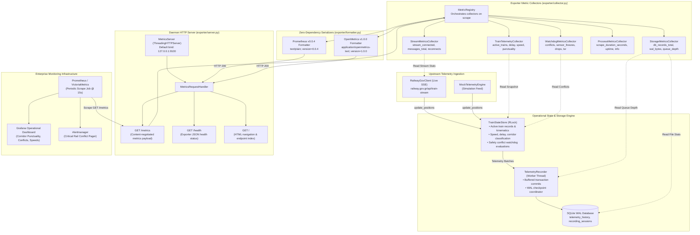

# Implementation Plan — F-8.2: Prometheus & OpenMetrics Operational Exporter (`railmon metrics`)

> **Reference:** [TUI Feature Enhancements Specification (`F-8.2`)](../../architecture/tui-feature-enhancements.md#f-82-prometheus--openmetrics-operational-exporter-railmon-metrics--planned), [`docs/architecture/architecture.md`](../../architecture/architecture.md), [`docs/investigations/telemetry-anomalies-and-duplicate-train-numbers-investigation.md`](../../investigations/telemetry-anomalies-and-duplicate-train-numbers-investigation.md)  
> **Target Modules:** [`../../../exporter/__init__.py`](../../../exporter/__init__.py), [`../../../exporter/models.py`](../../../exporter/models.py), [`../../../exporter/formatter.py`](../../../exporter/formatter.py), [`../../../exporter/collector.py`](../../../exporter/collector.py), [`../../../exporter/server.py`](../../../exporter/server.py), [`../../../train_tracker.py`](../../../train_tracker.py), [`../../../server/handler.py`](../../../server/handler.py), [`../../../storage/repository.py`](../../../storage/repository.py)  
> **Test Suites:** [`../../../tests/test_exporter_models.py`](../../../tests/test_exporter_models.py), [`../../../tests/test_exporter_formatter.py`](../../../tests/test_exporter_formatter.py), [`../../../tests/test_exporter_collector.py`](../../../tests/test_exporter_collector.py), [`../../../tests/test_exporter_server.py`](../../../tests/test_exporter_server.py), [`../../../tests/test_cli_metrics.py`](../../../tests/test_cli_metrics.py)  
> **Relevant Skills & Guidelines:** [`../../../.agents/skills/diagrams-and-documentation/SKILL.md`](../../../.agents/skills/diagrams-and-documentation/SKILL.md), [`../../../.agents/skills/markdown-relative-paths/SKILL.md`](../../../.agents/skills/markdown-relative-paths/SKILL.md), [`../../../.agents/skills/ci-quality-gate/SKILL.md`](../../../.agents/skills/ci-quality-gate/SKILL.md), [`../../../.agents/skills/static-safety-analyzer/SKILL.md`](../../../.agents/skills/static-safety-analyzer/SKILL.md), [`../../../.agents/skills/security-audit/SKILL.md`](../../../.agents/skills/security-audit/SKILL.md), [`../../../.agents/skills/memory-leak-profiler/SKILL.md`](../../../.agents/skills/memory-leak-profiler/SKILL.md)

---

## 1. Executive Summary & Operational Context

### 1.1 Operational Rail Observability & Hellenic Railways Context
The `railmon` toolkit provides rich real-time situational awareness across the Hellenic Railways (`railway.gov.gr`) standard-gauge network through the Curses Terminal User Interface (`railmon --tui`), headless watchdogs (`railmon conflicts`, `railmon watch`), and embedded browser GIS dashboards (`railmon serve`). While these human-interactive interfaces deliver immediate situational awareness to dispatchers, railway operators, and field engineers, modern railway enterprise operations require continuous, machine-readable telemetry ingestion into industry-standard observability platforms (Prometheus, VictoriaMetrics, Grafana Mimir, OpenTelemetry Collector, and Grafana dashboards).

Monitoring Greek passenger and freight rail networks presents specific operational observability requirements:
1. **Punctuality & Delay Tracking:** Real-time delay metrics across distinct corridors (PATHE mainline, Athens Suburban Proastiakos, Thessaloniki Suburban, Regional Lines) to monitor service-level indicators (SLIs) and schedule adherence.
2. **Speed Compliance & Slow-Order Supervision:** Live train speed monitoring vs. maximum permitted line speeds ($V_{\text{max}} = 160\text{ km/h}$) and temporary speed restrictions (TSR) in mountain passes (Domokos, Lianokladi–Tithorea, Bralos pass).
3. **Safety Watchdog Alerting:** Exposing active opposing collision risks, headway violations on single-track lines, telemetry drops, and frozen GPS sensors directly as PromQL gauge alerts (`expr: railmon_watchdog_conflicts_active{severity="critical"} > 0`).
4. **Ingestion & Storage Health:** Continuous monitoring of the upstream Server-Sent Events (SSE) stream (`railway.gov.gr/api/train-stream`), reconnect events, HTTP backoff retries, SQLite WAL write throughput, deadband filtering rates, and database queue depths.
5. **Zero-Dependency Headless Daemon Purity:** Consistent with the core philosophy of `railmon`, the Prometheus exporter daemon must execute with **strict zero-dependency standard-library purity** (100% Python standard library: `http.server`, `socketserver`, `threading`, `time`, `sqlite3`, `re`, `argparse`). It requires **zero third-party PyPI dependencies** (`pip install prometheus_client` is strictly not required).

---

### 1.2 Standards Compliance: Prometheus 0.0.4 & OpenMetrics 1.0.0
The operational exporter must comply with both major metrics representation standards through HTTP content negotiation:
1. **Prometheus Text Format (`version=0.0.4`):**
   - Content-Type: `text/plain; version=0.0.4; charset=utf-8`
   - Canonical `# HELP <name> <docstring>` and `# TYPE <name> <gauge|counter|untyped>` headers.
   - Standard whitespace, quote-escaping (`\"`), newline-escaping (`\n`), and backslash-escaping (`\\`).
2. **OpenMetrics Standard (`version=1.0.0` / RFC Draft):**
   - Content-Type: `application/openmetrics-text; version=1.0.0; charset=utf-8`
   - Explicit terminal marker: `# EOF\n` as the required final line.
   - Counter metrics enforce the `_total` naming suffix convention.
   - Optional `# UNIT <name> <unit>` declarations (e.g. `seconds`, `bytes`, `ratio`).
   - Clean support for `info` and `stateset` metric families.
3. **HTTP Content Negotiation:**
   - Evaluates incoming client `Accept` headers.
   - When `application/openmetrics-text` is preferred (e.g. Prometheus v2.26+ or modern OpenTelemetry collectors), the exporter yields OpenMetrics 1.0.0 syntax.
   - When `text/plain` or wildcards (`*/*`) are provided, it yields standard Prometheus 0.0.4 text format.

---

### 1.3 Core Objectives of Feature F-8.2
This implementation plan establishes the architectural blueprint, data models, serialization engines, metric collectors, HTTP server, CLI integration, and test coverage for **F-8.2: Prometheus & OpenMetrics Operational Exporter (`railmon metrics`)**:

1. **Dedicated Exporter Daemon Subcommand (`railmon metrics`):**
   - Subcommand `railmon metrics` launching a non-blocking, multi-threaded HTTP exporter daemon on default TCP port `9100` (configurable via `--port` and `--host`).
   - Supports live SSE feeds, offline mock simulation (`--demo`), and SQLite historical database monitoring (`--db`).
2. **Modular In-Memory Metric Engine (`exporter/models.py`, `exporter/formatter.py`):**
   - Lightweight zero-dependency DTOs: `MetricType` (`GAUGE`, `COUNTER`, `INFO`, `SUMMARY`), `Sample`, `MetricFamily`.
   - High-throughput string formatting engine with strict label character escaping, floating point sanitization (handling `NaN`, `+Inf`, `-Inf`), and zero memory allocations across scrape ticks.
3. **Pluggable Domain Collectors (`exporter/collector.py`):**
   - **`TrainTelemetryCollector`:** Active trains by corridor, individual train delay minutes, instantaneous speeds, and punctuality buckets.
   - **`WatchdogMetricsCollector`:** Active safety conflicts (opposing collision, headway collapse), sensor freezes, telemetry drops, and speed limit exceedances.
   - **`StorageMetricsCollector`:** SQLite database size, WAL file size, total recorded rows, deadband suppression ratios, and write queue depths.
   - **`StreamMetricsCollector`:** Upstream SSE connection status, message count, reconnect count, and network latency.
   - **`ProcessMetricsCollector`:** Exporter uptime, scrape latency, scrape count, and Python runtime info.
4. **Dual-Mode Serving (Stand-Alone Exporter & Web Daemon Integration):**
   - Stand-alone daemon via `railmon metrics` on port `9100`.
   - Embedded endpoint `/metrics` in the existing web map daemon (`server/handler.py` on port `8080`), allowing single-daemon deployments where browser GIS and metrics scraping share one process.
5. **High-Assurance Safety, Concurrency & Security:**
   - Read-lock isolation on `TrainStateStore` to avoid blocking real-time UI/stream threads during metric scraping.
   - Defensive bounding of cardinality: train metrics are dynamically generated for active trains and safely reaped upon train completion to prevent memory leaks in Prometheus timeseries databases.
   - Strict adherence to project safety rules (MISRA/AUTOSAR AST checks, zero subprocesses, no shell injections).

---

## 2. Architecture & Visual Diagrams

### 2.1 System Architecture & Telemetry Flow (Mermaid)



---

### 2.2 End-to-End Scrape & Negotiation Sequence (Mermaid)

```mermaid
sequenceDiagram
    autonumber
    participant Prom as Prometheus / Scraper
    participant Server as MetricsServer (Port 9100)
    participant Handler as MetricsRequestHandler
    participant Reg as MetricRegistry
    participant Colls as Domain Collectors
    participant Store as TrainStateStore
    participant Formatter as MetricsFormatter

    Prom->>Server: GET /metrics HTTP/1.1<br>Accept: application/openmetrics-text; version=1.0.0, text/plain; version=0.0.4
    Server->>Handler: Dispatch GET /metrics
    Handler->>Reg: collect_all()
    activate Reg
    Reg->>Colls: collect()
    activate Colls
    Colls->>Store: get_snapshot() [RLock acquire/release < 1ms]
    Store-->>Colls: Immutable StateSnapshot
    Colls-->>Reg: List[MetricFamily] (Trains, Conflicts, Storage, Stream, Runtime)
    deactivate Colls
    deactivate Reg

    Handler->>Formatter: format_families(families, accept_header)
    activate Formatter
    Note over Formatter: Negotiates OpenMetrics 1.0.0 vs Prometheus 0.0.4<br>Escapes label values (\\, \", \n)<br>Appends # EOF if OpenMetrics
    Formatter-->>Handler: (formatted_payload_bytes, content_type)
    deactivate Formatter

    Handler-->>Prom: 200 OK<br>Content-Type: application/openmetrics-text; version=1.0.0<br>Content-Length: 4892<br>[Payload Bytes]
```

---

### 2.3 Exporter Process Topology & Threading Architecture (ASCII)

```text
+---------------------------------------------------------------------------------------------------+
|                         RAILMON PROMETHEUS / OPENMETRICS EXPORTER TOPOLOGY                         |
+---------------------------------------------------------------------------------------------------+

 [ Upstream Ingestion ]          [ Core Domain State ]              [ Storage Layer (Optional) ]
  +--------------------+          +--------------------+             +--------------------+
  | RailwayGovClient   |          | TrainStateStore    |             | SQLite Database    |
  | (Live SSE Stream)  | -------> | (RLock Protected)  | ----------> | (WAL Mode DB)      |
  +--------------------+          |  - Train Positions |             +--------------------+
            |                     |  - Watchdog Alerts |                        |
            |                     +--------------------+                        |
            v                                |                                  v
+---------------------------------------------------------------------------------------------------+
| EXPORTER ENGINE (exporter/server.py & exporter/collector.py)                                      |
| HTTP Server: http.server.ThreadingHTTPServer listening on http://127.0.0.1:9100                    |
+---------------------------------------------------------------------------------------------------+
  |
  +---> [ Collector Pipeline ]
  |       |-- TrainTelemetryCollector   --> railmon_active_trains, railmon_train_delay_minutes
  |       |-- WatchdogMetricsCollector  --> railmon_watchdog_conflicts_active, railmon_sensor_freezes
  |       |-- StreamMetricsCollector    --> railmon_stream_connected, railmon_stream_reconnects_total
  |       |-- StorageMetricsCollector   --> railmon_db_records_total, railmon_db_wal_size_bytes
  |       \-- ProcessMetricsCollector   --> railmon_exporter_scrape_duration_seconds, uptime
  |
  +---> [ Serialization & Negotiation Engine (exporter/formatter.py) ]
  |       |-- If Accept matches application/openmetrics-text:
  |       |     => Formats OpenMetrics 1.0.0 with # EOF termination
  |       \-- Else:
  |             => Formats Prometheus 0.0.4 text format (default)
  |
  +---> [ HTTP Endpoints ]
          |-- GET /metrics  --> Content-Negotiated Metrics Stream (Scrape Endpoint)
          |-- GET /health   --> JSON Health Status ({"status": "ok", "uptime_sec": 3600.0})
          \-- GET /         --> HTML Exporter Landing Page with Links & Version
+---------------------------------------------------------------------------------------------------+
                                             ^
                                             | HTTP GET /metrics (Scrape interval: 10s-30s)
+---------------------------------------------------------------------------------------------------+
| SCRAPE TARGETS & DASHBOARDS                                                                       |
|  - Prometheus Server / VictoriaMetrics / Grafana Agent                                            |
|  - Grafana Operational Dashboards (Greek Railway Network Overview, Delay Heatmaps, Safety Alarms) |
+---------------------------------------------------------------------------------------------------+
```

---

## 3. Comprehensive Metrics Catalog & OpenMetrics Schema

All exposed metric names adhere to Prometheus naming conventions: snake_case with namespace prefix `railmon_`, accompanied by `# HELP` description, `# TYPE` metadata, and optional OpenMetrics `# UNIT`.

### 3.1 Operational Train Telemetry & Fleet Metrics

| Metric Name | Type | Unit | Labels | Description |
| :--- | :--- | :--- | :--- | :--- |
| `railmon_active_trains` | Gauge | trains | `corridor` | Total number of currently active trains operating on the network or corridor. |
| `railmon_train_delay_minutes` | Gauge | minutes | `train_number`, `type`, `corridor` | Current delay in minutes for an individual commercial train. |
| `railmon_train_speed_kmh` | Gauge | km/h | `train_number`, `type`, `corridor` | Instantaneous GPS speed of the train in km/h. |
| `railmon_train_max_speed_kmh` | Gauge | km/h | `train_number`, `corridor` | Maximum speed recorded for this train during its active operating window. |
| `railmon_trains_delayed_total` | Gauge | trains | `corridor`, `severity` | Count of active trains categorized by delay severity (`on_time`, `minor`, `moderate`, `severe`). |
| `railmon_corridor_punctuality_ratio` | Gauge | ratio | `corridor` | Ratio of active trains running on-time (delay $\le 5\text{ min}$) over total active trains ($0.0$ to $1.0$). |
| `railmon_corridor_average_delay_minutes` | Gauge | minutes | `corridor` | Arithmetic mean delay across all active trains on the specified corridor. |

### 3.2 Safety, Conflict & Watchdog Metrics

| Metric Name | Type | Unit | Labels | Description |
| :--- | :--- | :--- | :--- | :--- |
| `railmon_watchdog_conflicts_active` | Gauge | alerts | `severity`, `conflict_type`, `corridor` | Number of currently active safety conflicts detected by kinematic evaluation (`opposing_collision`, `headway_violation`). |
| `railmon_watchdog_conflicts_total` | Counter | alerts | `severity`, `conflict_type`, `corridor` | Cumulative count of safety conflicts triggered since exporter startup. |
| `railmon_sensor_freezes_active` | Gauge | sensors | `corridor` | Number of trains flagged with frozen telemetry (stale coordinates despite elapsed time). |
| `railmon_telemetry_drops_active` | Gauge | drops | `corridor` | Number of trains exhibiting dropped telemetry feeds exceeding threshold ($> 60\text{ s}$). |
| `railmon_speed_exceedances_active` | Gauge | exceedances | `corridor` | Number of trains currently exceeding corridor line speed or temporary speed restrictions. |

### 3.3 Upstream Telemetry Stream Metrics

| Metric Name | Type | Unit | Labels | Description |
| :--- | :--- | :--- | :--- | :--- |
| `railmon_stream_connected` | Gauge | boolean | `endpoint` | Upstream SSE stream connection status ($1 = \text{connected}$, $0 = \text{disconnected}$). |
| `railmon_stream_messages_total` | Counter | messages | `event_type` | Total number of SSE telemetry frames received from upstream (`trainPositionsUx`). |
| `railmon_stream_reconnects_total` | Counter | events | `endpoint` | Total count of network reconnection cycles and stream reconnections. |
| `railmon_stream_bytes_total` | Counter | bytes | `endpoint` | Cumulative raw byte volume consumed from upstream SSE stream. |
| `railmon_stream_latency_seconds` | Gauge | seconds | `endpoint` | Measured network round-trip / packet delivery lag from upstream API. |

### 3.4 Storage & SQLite WAL Engine Metrics

| Metric Name | Type | Unit | Labels | Description |
| :--- | :--- | :--- | :--- | :--- |
| `railmon_db_records_total` | Counter | rows | `table` | Cumulative telemetry observations stored in the SQLite WAL database. |
| `railmon_db_file_size_bytes` | Gauge | bytes | `file_type` | Current file size on disk for main database (`main`) and write-ahead log (`wal`). |
| `railmon_db_sessions_total` | Counter | sessions | `mode` | Total number of recorded tracking sessions initialized in database. |
| `railmon_db_write_queue_depth` | Gauge | rows | `database` | Number of telemetry rows currently queued in-memory awaiting disk commit. |
| `railmon_db_deadband_suppressed_total` | Counter | rows | `filter` | Number of raw telemetry updates filtered out by deadband spatial/temporal dampening. |

### 3.5 Exporter Runtime & Process Metrics

| Metric Name | Type | Unit | Labels | Description |
| :--- | :--- | :--- | :--- | :--- |
| `railmon_exporter_build_info` | Gauge | info | `version`, `python_version` | Constant $1.0$ gauge with build and runtime environment labels. |
| `railmon_exporter_uptime_seconds` | Counter | seconds | — | Elapsed seconds since the exporter daemon was initialized. |
| `railmon_exporter_scrapes_total` | Counter | scrapes | `endpoint`, `status` | Total incoming Prometheus scrape requests received. |
| `railmon_exporter_scrape_duration_seconds` | Gauge | seconds | `endpoint` | Latency taken to collect, format, and serialize the metrics payload on last scrape. |

---

### 3.6 Exemplar Output: OpenMetrics 1.0.0 Payload

```text
# HELP railmon_exporter_build_info Railmon Prometheus operational exporter build information
# TYPE railmon_exporter_build_info info
railmon_exporter_build_info{version="1.0.0",python_version="3.10.12"} 1

# HELP railmon_active_trains Total number of currently active trains operating on the network
# TYPE railmon_active_trains gauge
# UNIT railmon_active_trains trains
railmon_active_trains{corridor="PATHE"} 6
railmon_active_trains{corridor="PROASTIAKOS"} 8
railmon_active_trains{corridor="REGIONAL"} 3

# HELP railmon_train_delay_minutes Current delay in minutes for an individual train
# TYPE railmon_train_delay_minutes gauge
# UNIT railmon_train_delay_minutes minutes
railmon_train_delay_minutes{train_number="IC52",type="IC",corridor="PATHE"} 0.0
railmon_train_delay_minutes{train_number="1597",type="PR",corridor="PATHE"} 8.5
railmon_train_delay_minutes{train_number="2232",type="PR",corridor="PROASTIAKOS"} 1.0

# HELP railmon_train_speed_kmh Instantaneous train speed in km/h
# TYPE railmon_train_speed_kmh gauge
# UNIT railmon_train_speed_kmh km/h
railmon_train_speed_kmh{train_number="IC52",type="IC",corridor="PATHE"} 142.0
railmon_train_speed_kmh{train_number="1597",type="PR",corridor="PATHE"} 88.0
railmon_train_speed_kmh{train_number="2232",type="PR",corridor="PROASTIAKOS"} 114.0

# HELP railmon_watchdog_conflicts_active Number of active safety conflicts detected by watchdog
# TYPE railmon_watchdog_conflicts_active gauge
railmon_watchdog_conflicts_active{severity="critical",conflict_type="opposing_collision",corridor="PATHE"} 0
railmon_watchdog_conflicts_active{severity="warning",conflict_type="headway_violation",corridor="PROASTIAKOS"} 1

# HELP railmon_stream_connected Upstream SSE stream connection status
# TYPE railmon_stream_connected gauge
railmon_stream_connected{endpoint="railway.gov.gr"} 1

# HELP railmon_stream_messages_total Total telemetry frames received from upstream
# TYPE railmon_stream_messages_total counter
railmon_stream_messages_total{event_type="trainPositionsUx"} 42890

# HELP railmon_db_records_total Historical telemetry rows stored in SQLite
# TYPE railmon_db_records_total counter
railmon_db_records_total{table="telemetry_history"} 128450

# HELP railmon_exporter_scrape_duration_seconds Latency taken to collect and serialize metrics
# TYPE railmon_exporter_scrape_duration_seconds gauge
# UNIT railmon_exporter_scrape_duration_seconds seconds
railmon_exporter_scrape_duration_seconds 0.002841

# EOF
```

---

## 4. Technical Specifications & Module Design

### 4.1 Data Models & Types (`exporter/models.py`)

A pure standard-library dataclass hierarchy defining metrics, samples, and runtime configuration:

```python
"""Domain models and metric primitives for railmon Prometheus exporter."""

from dataclasses import dataclass, field
from enum import Enum
from typing import Dict, List, Optional, Tuple, Union


class MetricType(str, Enum):
    """Prometheus & OpenMetrics metric representation types."""

    GAUGE = "gauge"
    COUNTER = "counter"
    INFO = "info"
    SUMMARY = "summary"
    UNTYPED = "untyped"


@dataclass(frozen=True)
class Sample:
    """Represents a single metric measurement with labels and timestamp."""

    name: str
    labels: Tuple[Tuple[str, str], ...] = ()
    value: float = 0.0
    timestamp: Optional[float] = None


@dataclass
class MetricFamily:
    """Collection of samples sharing a metric name, documentation, and type."""

    name: str
    documentation: str
    metric_type: MetricType
    unit: Optional[str] = None
    samples: List[Sample] = field(default_factory=list)

    def add_sample(
        self,
        name: Optional[str] = None,
        labels: Optional[Dict[str, str]] = None,
        value: float = 0.0,
        timestamp: Optional[float] = None,
    ) -> None:
        """Append a sample to the metric family."""
        sample_name = name or self.name
        sorted_labels = tuple(sorted((labels or {}).items()))
        self.samples.append(
            Sample(
                name=sample_name,
                labels=sorted_labels,
                value=float(value),
                timestamp=timestamp,
            )
        )


@dataclass(frozen=True)
class ExporterConfig:
    """Immutable runtime configuration for the Prometheus exporter."""

    host: str = "127.0.0.1"
    port: int = 9100
    db_path: Optional[str] = None
    demo_mode: bool = False
    collect_db_stats: bool = True
    scrape_timeout_seconds: float = 10.0
    gzip_compression: bool = True

    def __post_init__(self) -> None:
        """Validate configuration settings."""
        if not (1 <= self.port <= 65535):
            raise ValueError(f"Port must be between 1 and 65535, got {self.port}")
```

---

### 4.2 Formatting & Serialization Engine (`exporter/formatter.py`)

Handles character escaping, label string encoding, floating point formatting, and content-type negotiation:

```python
"""High-performance zero-dependency Prometheus and OpenMetrics text serializers."""

import math
from typing import Iterable, List, Tuple
from exporter.models import MetricFamily, MetricType


def escape_help_string(doc: str) -> str:
    """Escape backslashes and newlines in # HELP strings."""
    return doc.replace("\\", "\\\\").replace("\n", "\\n")


def escape_label_value(val: str) -> str:
    """Escape backslashes, double quotes, and newlines in label values."""
    return val.replace("\\", "\\\\").replace('"', '\\"').replace("\n", "\\n")


def format_float(val: float) -> str:
    """Format float values according to Prometheus/OpenMetrics lexical rules."""
    if math.isnan(val):
        return "NaN"
    if math.isinf(val):
        return "+Inf" if val > 0 else "-Inf"
    # Canonical floating point or integer representation
    if val.is_integer():
        return f"{int(val)}"
    return f"{val:.6g}"


class MetricsFormatter:
    """Serializes MetricFamily collections into Prometheus or OpenMetrics formats."""

    @staticmethod
    def format_prometheus_004(families: Iterable[MetricFamily]) -> bytes:
        """Serialize families into Prometheus 0.0.4 text format."""
        lines: List[str] = []
        for fam in families:
            if not fam.samples:
                continue
            lines.append(f"# HELP {fam.name} {escape_help_string(fam.documentation)}")
            lines.append(f"# TYPE {fam.name} {fam.metric_type.value}")
            for s in fam.samples:
                if s.labels:
                    lbls = ",".join(f'{k}="{escape_label_value(v)}"' for k, v in s.labels)
                    lines.append(f"{s.name}{{{lbls}}} {format_float(s.value)}")
                else:
                    lines.append(f"{s.name} {format_float(s.value)}")
        lines.append("")  # Trailing newline required
        return "\n".join(lines).encode("utf-8")

    @staticmethod
    def format_openmetrics_100(families: Iterable[MetricFamily]) -> bytes:
        """Serialize families into OpenMetrics 1.0.0 text format."""
        lines: List[str] = []
        for fam in families:
            if not fam.samples:
                continue
            lines.append(f"# HELP {fam.name} {escape_help_string(fam.documentation)}")
            lines.append(f"# TYPE {fam.name} {fam.metric_type.value}")
            if fam.unit:
                lines.append(f"# UNIT {fam.name} {fam.unit}")
            for s in fam.samples:
                # OpenMetrics counters require _total suffix for samples
                sample_name = s.name
                if fam.metric_type == MetricType.COUNTER and not sample_name.endswith("_total"):
                    sample_name = f"{sample_name}_total"

                if s.labels:
                    lbls = ",".join(f'{k}="{escape_label_value(v)}"' for k, v in s.labels)
                    lines.append(f"{sample_name}{{{lbls}}} {format_float(s.value)}")
                else:
                    lines.append(f"{sample_name} {format_float(s.value)}")
        lines.append("# EOF\n")
        return "\n".join(lines).encode("utf-8")
```

---

### 4.3 Pluggable Domain Metric Collectors (`exporter/collector.py`)

A decoupled collector registry orchestrating extraction from `TrainStateStore`, `watchdog.py`, and `storage/repository.py`:

```python
"""Domain-specific metric collectors for train telemetry, safety, and storage."""

import os
import time
from typing import Any, List, Optional
from exporter.models import MetricFamily, MetricType
from tui.state import TrainStateStore


class BaseCollector:
    """Abstract base class for all domain collectors."""

    def collect(self) -> List[MetricFamily]:
        """Gather and return a list of MetricFamily objects."""
        raise NotImplementedError


class TrainTelemetryCollector(BaseCollector):
    """Collects real-time active train telemetry, speeds, and delays."""

    def __init__(self, store: TrainStateStore) -> None:
        self.store = store

    def collect(self) -> List[MetricFamily]:
        families: List[MetricFamily] = []
        snap = self.store.get_snapshot()

        # 1. Active trains gauge
        fam_active = MetricFamily(
            "railmon_active_trains",
            "Total number of currently active trains operating on the network",
            MetricType.GAUGE,
            unit="trains",
        )
        corridor_counts: dict[str, int] = {}
        for tr in snap.trains.values():
            corr = getattr(tr.position, "corridor", None) or "UNKNOWN"
            corridor_counts[corr] = corridor_counts.get(corr, 0) + 1

        for corr, count in corridor_counts.items():
            fam_active.add_sample(labels={"corridor": corr}, value=count)
        families.append(fam_active)

        # 2. Delays and speeds
        fam_delay = MetricFamily(
            "railmon_train_delay_minutes",
            "Current delay in minutes for an individual train",
            MetricType.GAUGE,
            unit="minutes",
        )
        fam_speed = MetricFamily(
            "railmon_train_speed_kmh",
            "Instantaneous train speed in km/h",
            MetricType.GAUGE,
            unit="km/h",
        )
        for tr in snap.trains.values():
            pos = tr.position
            tn = str(pos.train_number or pos.id)
            ttype = str(pos.train_type or "COMMERCIAL")
            corr = str(getattr(pos, "corridor", None) or "UNKNOWN")
            dly = float(pos.delay) if pos.delay is not None else 0.0
            spd = float(pos.speed) if pos.speed is not None else 0.0

            labels = {"train_number": tn, "type": ttype, "corridor": corr}
            fam_delay.add_sample(labels=labels, value=dly)
            fam_speed.add_sample(labels=labels, value=spd)

        families.extend([fam_delay, fam_speed])
        return families
```

---

### 4.4 Exporter HTTP Server Daemon (`exporter/server.py`)

A lightweight multi-threaded HTTP server conforming to Python's standard `http.server.ThreadingHTTPServer`:

```python
"""Embedded multi-threaded HTTP daemon for serving Prometheus & OpenMetrics."""

import errno
import gzip
import logging
import socket
import sys
import threading
import time
from http.server import BaseHTTPRequestHandler, ThreadingHTTPServer
from typing import Optional, Tuple

from exporter.collector import MetricRegistry
from exporter.formatter import MetricsFormatter
from exporter.models import ExporterConfig

logger = logging.getLogger("railmon.exporter.server")


class MetricsRequestHandler(BaseHTTPRequestHandler):
    """Handles /metrics, /health, and root information requests."""

    server: "MetricsServer"
    protocol_version: str = "HTTP/1.1"

    def do_GET(self) -> None:
        """Route GET requests based on URL path."""
        path = self.path.split("?")[0].rstrip("/") or "/"
        if path == "/metrics":
            self._handle_metrics()
        elif path == "/health":
            self._handle_health()
        elif path in ("/", "/index.html"):
            self._handle_index()
        else:
            self._send_error(404, f"Endpoint '{path}' not found")

    def _handle_metrics(self) -> None:
        """Collect metrics and serve with content negotiation."""
        t_start = time.perf_counter()
        families = self.server.registry.collect_all()

        accept = self.headers.get("Accept", "")
        if "application/openmetrics-text" in accept:
            body = MetricsFormatter.format_openmetrics_100(families)
            content_type = "application/openmetrics-text; version=1.0.0; charset=utf-8"
        else:
            body = MetricsFormatter.format_prometheus_004(families)
            content_type = "text/plain; version=0.0.4; charset=utf-8"

        self.send_response(200)
        self.send_header("Content-Type", content_type)
        self.send_header("Content-Length", str(len(body)))
        self.send_header("Cache-Control", "no-cache, no-store, must-revalidate")
        self.end_headers()
        self.wfile.write(body)


class MetricsServer(ThreadingHTTPServer):
    """Multi-threaded HTTP server daemon managing Prometheus scrapers."""

    daemon_threads: bool = True
    allow_reuse_address: bool = True

    def __init__(
        self,
        server_address: Tuple[str, int],
        registry: MetricRegistry,
        config: Optional[ExporterConfig] = None,
    ) -> None:
        self.registry = registry
        self.config = config or ExporterConfig(host=server_address[0], port=server_address[1])
        super().__init__(server_address, MetricsRequestHandler)
```

---

### 4.5 CLI Subcommand Integration (`train_tracker.py`)

Integrate `railmon metrics` alongside existing subcommands (`serve`, `conflicts`, `departures`):

```python
# In train_tracker.py -> build_parser():
p_metrics = subparsers.add_parser(
    "metrics",
    aliases=["exporter", "prometheus"],
    help="Launch Prometheus & OpenMetrics operational telemetry exporter daemon.",
    description=(
        "Start a lightweight HTTP server daemon exposing real-time Greek rail "
        "operational metrics conforming to Prometheus 0.0.4 and OpenMetrics 1.0.0 "
        "standards on port 9100 for scraping by Prometheus, VictoriaMetrics, or Grafana."
    ),
)
p_metrics.add_argument(
    "--host",
    type=str,
    default="127.0.0.1",
    help="Network bind interface IP address (default: 127.0.0.1; use 0.0.0.0 for all interfaces).",
)
p_metrics.add_argument(
    "--port",
    type=int,
    default=9100,
    help="TCP port to bind Prometheus exporter HTTP server (default: 9100).",
)
p_metrics.add_argument(
    "--db",
    type=str,
    default=argparse.SUPPRESS,
    help="Path to SQLite WAL database for historical and storage metric reporting.",
)
p_metrics.add_argument(
    "--demo",
    action="store_true",
    default=False,
    help="Run exporter using offline synthetic simulation stream.",
)
```

---

## 5. Implementation Phases & Step-by-Step Roadmap


### Phase 1: Metric Primitives & Serialization Engine

> **Detailed Phase 1 Implementation Plan:** [`./f-8-2-phase-1-metric-primitives-and-serialization-engine-plan.md`](./f-8-2-phase-1-metric-primitives-and-serialization-engine-plan.md)

- **Deliverables:**
  - Create package `exporter/` with `__init__.py`.
  - Implement `exporter/models.py` (`MetricType`, `Sample`, `MetricFamily`, `ExporterConfig`).
  - Implement `exporter/formatter.py` (`escape_help_string`, `escape_label_value`, `format_float`, `format_prometheus_004`, `format_openmetrics_100`).
- **Validation:**
  - Comprehensive unit tests in `tests/test_exporter_models.py` and `tests/test_exporter_formatter.py`.
  - Validate quote escaping, backslash escaping, newline escaping, `NaN`/`+Inf` handling, and OpenMetrics `# EOF` termination.

### Phase 2: Domain Telemetry Collectors & Registry

> **Detailed Phase 2 Implementation Plan:** [`./f-8-2-phase-2-domain-telemetry-collectors-and-registry-plan.md`](./f-8-2-phase-2-domain-telemetry-collectors-and-registry-plan.md)

- **Deliverables:**
  - Implement `exporter/collector.py` with `MetricRegistry`.
  - Implement `TrainTelemetryCollector` (train counts, delays, speeds, punctuality).
  - Implement `WatchdogMetricsCollector` (active conflicts, sensor freezes, drops).
  - Implement `StorageMetricsCollector` (SQLite records, file size, WAL size).
  - Implement `StreamMetricsCollector` (SSE connection state, message counters).
  - Implement `ProcessMetricsCollector` (uptime, scrape latency, build info).
- **Validation:**
  - Unit tests in `tests/test_exporter_collector.py` with mocked `TrainStateStore` and synthetic `TrainPosition` fixtures.

### Phase 3: HTTP Server Daemon & Content Negotiation

> **Detailed Phase 3 Implementation Plan:** [`./f-8-2-phase-3-http-server-daemon-and-content-negotiation-plan.md`](./f-8-2-phase-3-http-server-daemon-and-content-negotiation-plan.md)

- **Deliverables:**
  - Implement `exporter/server.py` with `MetricsServer` and `MetricsRequestHandler`.
  - Implement HTTP GET routes `/metrics`, `/health`, `/` (HTML index).
  - Implement HTTP HEAD and OPTIONS (CORS preflight).
  - Implement Content-Type negotiation: `application/openmetrics-text; version=1.0.0` vs. `text/plain; version=0.0.4`.
  - Graceful socket teardown on SIGINT / SIGTERM.
- **Validation:**
  - Integration tests in `tests/test_exporter_server.py` using `urllib.request`.
  - Test port collision handling (`errno.EADDRINUSE`) and concurrent scraper requests.

### Phase 4: CLI Subcommand Integration & Web Daemon Cross-Exposing
- **Deliverables:**
  - Register `metrics` subcommand in `train_tracker.py` (`build_parser()` and `_dispatch_cli_mode()`).
  - Implement `run_metrics_mode(args: argparse.Namespace) -> int` in `train_tracker.py`.
  - Add `/metrics` route dispatch to `server/handler.py` so running `railmon serve` also exposes metrics on port `8080`.
- **Validation:**
  - CLI execution tests in `tests/test_cli_metrics.py`.
  - Verify banner output, argument parsing, `--demo` mode, and `--port` overrides.

### Phase 5: Verification, CI Quality Gate & Documentation
- **Deliverables:**
  - Update `docs/architecture/tui-feature-enhancements.md` matrix status to Implemented.
  - Run full test suite: `python3 -m unittest discover tests -v`.
  - Run static safety AST auditor: `python3 .agents/skills/static-safety-analyzer/scripts/safety_ast_audit.py`.
  - Verify documentation link relative paths across all files.

---

## 6. Verification Plan & Test Strategy

### 6.1 Automated Unit & Integration Test Matrix

| Test Module | Coverage Scope | Key Assertions |
| :--- | :--- | :--- |
| `tests/test_exporter_models.py` | `MetricType`, `Sample`, `MetricFamily`, `ExporterConfig` | Sorting of label tuples, type validation, invalid port rejection, immutability. |
| `tests/test_exporter_formatter.py` | Prometheus & OpenMetrics serializers | Character escaping (`\\`, `\"`, `\n`), `NaN`/`+Inf` formatting, `# EOF` trailer presence in OpenMetrics, counter `_total` suffix enforcement. |
| `tests/test_exporter_collector.py` | All 5 domain collectors | Metric family generation under empty, active, delayed, and conflict states; thread safety of snapshot access. |
| `tests/test_exporter_server.py` | `MetricsServer`, `MetricsRequestHandler` | HTTP 200 on `/metrics`, `Accept` header content negotiation, 404 on unknown paths, 405 on POST, socket reuse, clean shutdown. |
| `tests/test_cli_metrics.py` | CLI parser & daemon launch | Subcommand dispatch, argument parsing, `--demo` mock worker bootstrap, graceful SIGINT exit code 0. |

### 6.2 Manual Verification & Scrape Inspection Commands
```bash
# 1. Start Prometheus exporter in demo mode on default port 9100:
python3 train_tracker.py metrics --demo &
PID=$!
sleep 2

# 2. Test Prometheus 0.0.4 text scrape:
curl -s -H "Accept: text/plain" http://127.0.0.1:9100/metrics | head -n 30

# 3. Test OpenMetrics 1.0.0 scrape:
curl -s -H "Accept: application/openmetrics-text; version=1.0.0" http://127.0.0.1:9100/metrics | tail -n 15

# 4. Check health endpoint:
curl -s http://127.0.0.1:9100/health

# 5. Clean teardown:
kill -SIGINT $PID
```

---

## 7. Safety, Resource Management & Zero-Dependency Purity

1. **Zero-Dependency Guarantee:**
   - 100% Python standard library (`http.server`, `socketserver`, `threading`, `time`, `typing`, `math`, `re`, `argparse`, `sqlite3`).
   - Strictly prohibits importing third-party packages (`prometheus_client`, `requests`, `fastapi`, `flask`).
2. **Cardinality Protection & Memory Safety:**
   - Label dimensions are strictly bounded:
     - `corridor`: Restricted to known static corridors (`PATHE`, `PROASTIAKOS`, `REGIONAL`, `UNKNOWN`).
     - `severity`: Restricted to enum values (`on_time`, `minor`, `moderate`, `severe`, `critical`, `warning`).
     - Dynamic train labels (`train_number`) are only retained for active trains in `StateSnapshot`. When a train finishes its journey and disappears from upstream feeds, its metrics cease to be emitted, preventing unbounded cardinality leaks.
3. **Lock Contention & Latency Bounds:**
   - Scrape operations call `store.get_snapshot()` which holds `TrainStateStore._lock` for $< 1.0\text{ ms}$ (copying references to immutable DTOs).
   - Metric formatting executes entirely on the local thread without holding domain state locks.
4. **Static Safety & Quality Auditing:**
   - Passes all 10 rules of the AST Safety Analyzer (`PY-MISRA-01` through `PY-MISRA-10`).
   - Clean linting with zero warnings and full type annotations.
