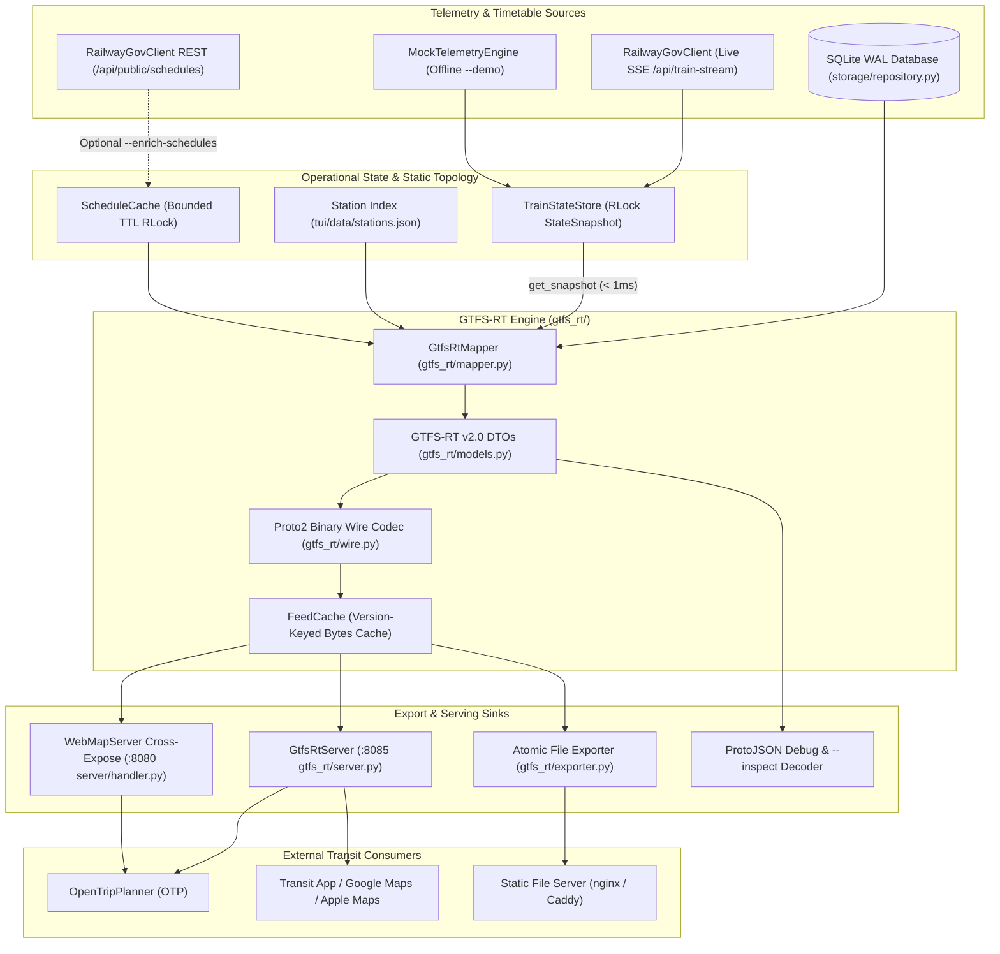
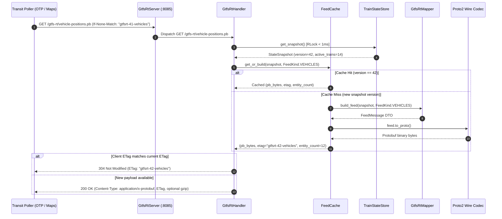
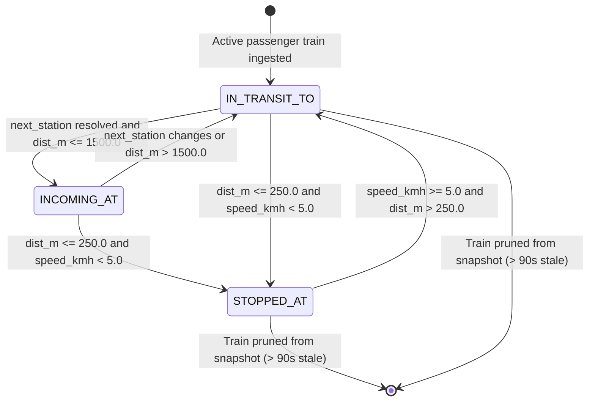
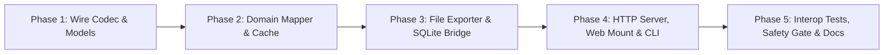

# Implementation Plan — F-8.3: GTFS-Realtime (GTFS-RT) Protocol Buffer Feed Exporter (`railmon export --gtfs-rt`)

> **Reference:** [TUI Feature Enhancements Specification (`F-8.3`)](../../architecture/tui-feature-enhancements.md#f-83-gtfs-realtime-gtfs-rt-protocol-buffer-feed-exporter--planned), [`docs/architecture/architecture.md`](../../architecture/architecture.md), [`docs/architecture/railway-gov-gr-api-reference.md`](../../architecture/railway-gov-gr-api-reference.md), [`docs/investigations/telemetry-anomalies-and-duplicate-train-numbers-investigation.md`](../../investigations/telemetry-anomalies-and-duplicate-train-numbers-investigation.md)  
> **Target Modules:** [`../../../gtfs_rt/__init__.py`](../../../gtfs_rt/__init__.py), [`../../../gtfs_rt/wire.py`](../../../gtfs_rt/wire.py), [`../../../gtfs_rt/models.py`](../../../gtfs_rt/models.py), [`../../../gtfs_rt/mapper.py`](../../../gtfs_rt/mapper.py), [`../../../gtfs_rt/exporter.py`](../../../gtfs_rt/exporter.py), [`../../../gtfs_rt/server.py`](../../../gtfs_rt/server.py), [`../../../storage/repository.py`](../../../storage/repository.py), [`../../../server/daemon.py`](../../../server/daemon.py), [`../../../server/handler.py`](../../../server/handler.py), [`../../../train_tracker.py`](../../../train_tracker.py), [`../../../pyproject.toml`](../../../pyproject.toml)  
> **Test Suites:** [`../../../tests/test_gtfs_wire.py`](../../../tests/test_gtfs_wire.py), [`../../../tests/test_gtfs_models.py`](../../../tests/test_gtfs_models.py), [`../../../tests/test_gtfs_mapper.py`](../../../tests/test_gtfs_mapper.py), [`../../../tests/test_gtfs_exporter.py`](../../../tests/test_gtfs_exporter.py), [`../../../tests/test_gtfs_server.py`](../../../tests/test_gtfs_server.py), [`../../../tests/test_cli_export.py`](../../../tests/test_cli_export.py), [`../../../tests/test_packaging.py`](../../../tests/test_packaging.py)  
> **Relevant Skills & Guidelines:** [`../../../.agents/skills/diagrams-and-documentation/SKILL.md`](../../../.agents/skills/diagrams-and-documentation/SKILL.md), [`../../../.agents/skills/markdown-relative-paths/SKILL.md`](../../../.agents/skills/markdown-relative-paths/SKILL.md), [`../../../.agents/skills/ci-quality-gate/SKILL.md`](../../../.agents/skills/ci-quality-gate/SKILL.md), [`../../../.agents/skills/static-safety-analyzer/SKILL.md`](../../../.agents/skills/static-safety-analyzer/SKILL.md), [`../../../.agents/skills/security-audit/SKILL.md`](../../../.agents/skills/security-audit/SKILL.md), [`../../../.agents/skills/package-distribution-validator/SKILL.md`](../../../.agents/skills/package-distribution-validator/SKILL.md)

---

## 1. Executive Summary & Operational Context

### 1.1 Transit Ecosystem Interoperability & Hellenic Railways Context
`railmon` ingests real-time HEPOS/RTK track-snapped train telemetry, schedule itineraries, and safety watchdog assessments from Hellenic Railways (`railway.gov.gr`) for terminal operations (`railmon --tui`), browser GIS dashboards (`railmon serve`), and enterprise Prometheus monitoring (`railmon metrics`). However, external multimodal trip planners and rider-facing transit platforms — including **OpenTripPlanner (OTP)**, **Transit App**, **Google Maps Transit**, **Apple Maps**, **Citymapper**, **Transitland**, and municipal station display boards — cannot consume proprietary `railway.gov.gr` Server-Sent Events (`trainPositionsUx`) directly.

They standardize on the **General Transit Feed Specification Realtime (GTFS-Realtime v2.0)** Protocol Buffers binary wire format (`transit_realtime.FeedMessage`), exposing three complementary real-time feed entity types:
1. **`VehiclePosition`:** Physical locomotive coordinates (WGS84), track-aligned bearing, ground speed (`m/s`), odometer chainage (`m`), current stop proximity status (`INCOMING_AT`, `STOPPED_AT`, `IN_TRANSIT_TO`), and vehicle identity.
2. **`TripUpdate`:** Live schedule adherence (`delay` in signed seconds) and predicted intermediate/terminus stop arrivals and departures (`StopTimeUpdate[]`).
3. **`Alert` (Service Alerts):** Bilingual (`el` Greek + `en` English) disruption advisories synthesized automatically from severe train delays and `railmon` Tier 5 safety watchdog assessments (corridor conflicts, optional sensor anomalies).

### 1.2 Protocol Compliance & Zero-Dependency Purity
Consistent with `railmon`'s core packaging invariant verified in [`tests/test_packaging.py`](../../../tests/test_packaging.py#L55-L74):
- **100% Python Standard Library:** The `gtfs_rt/` package implements a native, zero-dependency **Protocol Buffers (proto2) binary wire encoder and decoder** (`gtfs_rt/wire.py`) using only Python stdlib (`struct`, `math`, `json`, `gzip`, `http.server`, `zoneinfo`, `threading`, `sqlite3`, `os`). It requires **zero PyPI dependencies** (`protobuf` and `gtfs-realtime-bindings` are strictly not required at runtime).
- **Byte-for-Byte Spec Conformance:** Every tag, wire type, signed two's complement varint, IEEE-754 little-endian float/double, and proto2 presence semantic adheres strictly to the official Google Transit `gtfs-realtime.proto` (v2.0, `syntax = "proto2"`).
- **Canonical ProtoJSON Representation:** In addition to binary `application/x-protobuf`, every `FeedMessage` serializes cleanly to Protobuf JSON Mapping (`application/json`) for CLI debugging, REST inspection, and browser tooling without external `protoc` binaries.

### 1.3 Core Capabilities & Execution Modes
Feature F-8.3 delivers six unified workflows under `railmon export --gtfs-rt` (alias `railmon gtfs-rt`) and cross-exposed routes on `railmon serve`:
1. **One-Shot Snapshot Export:** Capture a live SSE or `--demo` fleet batch and write an atomic `.pb` file (`--out feed.pb`), split directory bundle (`--out-dir ./feeds/`), stdout binary (`--out -`), or ProtoJSON (`--format json`).
2. **Historical SQLite Point-in-Time Export:** Synthesize a GTFS-RT `FeedMessage` from recorded telemetry and timetable tables in SQLite WAL storage (`--from-db railway_history.db [--at 2026-11-23T18:00:00Z]`).
3. **Continuous Atomic File-Sync (`--watch`):** Refresh `.pb` feed files on a fixed cadence (`--interval 10`) using atomic temporary-file swap (`os.replace`) for static web servers (`nginx`/`Caddy`) and file-polling consumers.
4. **Standalone Multi-Threaded HTTP Feed Server (`--serve`):** Serve standard GTFS-RT endpoints (`/gtfs-rt/feed.pb`, `/gtfs-rt/vehicle-positions.pb`, `/gtfs-rt/trip-updates.pb`, `/gtfs-rt/alerts.pb`, plus `.json` variants) on default port `8085` with `ETag`/`304 Not Modified`, `gzip`, and CORS.
5. **Web Daemon Cross-Exposure (`railmon serve`):** Automatically mount `/gtfs-rt/*` endpoints inside `WebMapServer` (`server/handler.py`, port `8080`), enabling single-process deployment of GIS web map + Prometheus `/metrics` + GTFS-RT feeds.
6. **Zero-Dependency Feed Inspector (`--inspect`):** Decode any existing `.pb` file back to validated domain DTOs and pretty-printed ProtoJSON (`railmon export --gtfs-rt --inspect feed.pb`).

---

## 2. Architecture & Visual Diagrams

### 2.1 System Architecture & Ingestion-to-Protobuf Pipeline (Mermaid)



### 2.2 HTTP Poll, Version-Keyed Cache & ETag Negotiation Sequence (Mermaid)



### 2.3 Vehicle Stop Status Inference State Machine (Mermaid)



### 2.4 Process Topology & Protobuf Wire Frame Layout (ASCII)

```text
+---------------------------------------------------------------------------------------------------+
|                        RAILMON GTFS-REALTIME v2.0 EXPORTER ARCHITECTURE                           |
+---------------------------------------------------------------------------------------------------+

 [ Sources ]                   [ Translation Pipeline (gtfs_rt/) ]         [ Delivery Sinks ]
  +--------------------+        +-----------------------------------+       +----------------------+
  | Live SSE / --demo  | -----> | TrainStateStore -> StateSnapshot  | ----> | --out feed.pb        |
  | (StreamWorker)     |        +-----------------------------------+       | (Atomic os.replace)  |
  +--------------------+                         |                          +----------------------+
                                                 v                          | --watch --interval N |
  +--------------------+        +-----------------------------------+       | (Periodic File Sync) |
  | SQLite WAL DB      | -----> | GtfsRtMapper (gtfs_rt/mapper.py)  | ----> +----------------------+
  | (--from-db [--at]) |        |  - Units: km/h->m/s, min->sec     |       | --serve :8085        |
  +--------------------+        |  - TZ: Europe/Athens service date |       | /gtfs-rt/*.pb|.json  |
                                |  - Consist dedup (id vs trip_id)  |       +----------------------+
  +--------------------+        |  - Bilingual Alerts (el / en)     |       | railmon serve :8080  |
  | stations.json +    | -----> +-----------------------------------+       | (Cross-Exposed HTTP) |
  | ScheduleCache(TTL) |                         |                          +----------------------+
  +--------------------+                         v
                                +-----------------------------------+
                                | Proto2 Wire Codec (gtfs_rt/wire.py)|
                                |  - Varint (64-bit signed int32)   |
                                |  - IEEE-754 LE float/double       |
                                |  - Length-delimited submessages   |
                                +-----------------------------------+

+---------------------------------------------------------------------------------------------------+
|                        PROTOBUF (PROTO2) WIRE FRAME LAYOUT (FeedMessage)                          |
+---------------------------------------------------------------------------------------------------+
| Tag = (field_number << 3) | wire_type                                                             |
|   Wire 0 (VARINT)  : uint32, uint64, int32/int64 (neg => 10-byte 2's complement), bool, enum      |
|   Wire 1 (FIXED64) : double (8-byte IEEE-754 LE, e.g. Position.odometer)                          |
|   Wire 2 (LEN)     : varint byte_length + UTF-8 string / bytes / nested message bytes             |
|   Wire 5 (FIXED32) : float  (4-byte IEEE-754 LE, e.g. Position.latitude, longitude, bearing, spd) |
+---------------------------------------------------------------------------------------------------+
| FeedMessage bytes:                                                                                |
|   [0x0A][len][ FeedHeader: tag1="2.0", tag2=0 (FULL_DATASET), tag3=<epoch_u64> ]                  |
|   [0x12][len][ FeedEntity #1: tag1="vp:6b04...", tag4=<VehiclePosition bytes> ]                   |
|   [0x12][len][ FeedEntity #2: tag1="tu:6a94...", tag3=<TripUpdate bytes> ]                        |
|   [0x12][len][ FeedEntity #3: tag1="al:delay:...", tag5=<Alert bytes> ]                           |
+---------------------------------------------------------------------------------------------------+
```

---

## 3. GTFS-Realtime v2.0 Schema & Hellenic Railways Domain Mapping

### 3.1 Official `gtfs-realtime.proto` (v2.0) Field Tag & Wire Type Matrix

Every field number and wire type below matches the canonical Google Transit `transit_realtime` (`syntax = "proto2"`) specification verbatim:

| Message | Field Name | Tag | Proto Type | Wire Type | Rule | Notes |
| :--- | :--- | :---: | :--- | :---: | :--- | :--- |
| **`FeedMessage`** | `header` | `1` | `FeedHeader` | `LEN (2)` | Required | Always emitted first |
| | `entity` | `2` | `FeedEntity` | `LEN (2)` | Repeated | Deterministic sorted order by `id` |
| **`FeedHeader`** | `gtfs_realtime_version` | `1` | `string` | `LEN (2)` | Required | Literal `"2.0"` |
| | `incrementality` | `2` | `Incrementality` | `VARINT (0)` | Optional | `0 = FULL_DATASET`, `1 = DIFFERENTIAL` |
| | `timestamp` | `3` | `uint64` | `VARINT (0)` | Optional | POSIX UTC epoch seconds of snapshot |
| | `feed_version` | `4` | `string` | `LEN (2)` | Optional | Optional static GTFS alignment version |
| **`FeedEntity`** | `id` | `1` | `string` | `LEN (2)` | Required | Feed-unique entity key (`vp:`, `tu:`, `al:`) |
| | `is_deleted` | `2` | `bool` | `VARINT (0)` | Optional | Only emitted when `True` (`DIFFERENTIAL`) |
| | `trip_update` | `3` | `TripUpdate` | `LEN (2)` | Optional | Schedule delay & stop ETAs |
| | `vehicle` | `4` | `VehiclePosition` | `LEN (2)` | Optional | Live GNSS kinematics & stop status |
| | `alert` | `5` | `Alert` | `LEN (2)` | Optional | Delay / safety disruption advisory |
| **`VehiclePosition`** | `trip` | `1` | `TripDescriptor` | `LEN (2)` | Optional | Active commercial trip reference |
| | `position` | `2` | `Position` | `LEN (2)` | Optional | WGS84 lat/lng, bearing, odometer, speed |
| | `current_stop_sequence` | `3` | `uint32` | `VARINT (0)` | Optional | Current calling point index (when known) |
| | `current_status` | `4` | `VehicleStopStatus` | `VARINT (0)` | Optional | `0=INCOMING_AT`, `1=STOPPED_AT`, `2=IN_TRANSIT_TO` |
| | `timestamp` | `5` | `uint64` | `VARINT (0)` | Optional | POSIX UTC epoch seconds of GNSS fix |
| | `congestion_level` | `6` | `CongestionLevel` | `VARINT (0)` | Optional | Optional congestion enum (`0..4`) |
| | `stop_id` | `7` | `string` | `LEN (2)` | Optional | Resolved station ID or station code |
| | `vehicle` | `8` | `VehicleDescriptor` | `LEN (2)` | Optional | Transponder ID, train label, loco number |
| **`Position`** | `latitude` | `1` | `float` | `FIXED32 (5)` | Required | WGS84 degrees North `[-90.0, 90.0]` |
| | `longitude` | `2` | `float` | `FIXED32 (5)` | Required | WGS84 degrees East `[-180.0, 180.0]` |
| | `bearing` | `3` | `float` | `FIXED32 (5)` | Optional | Degrees clockwise from True North `[0, 360)` |
| | `odometer` | `4` | `double` | `FIXED64 (1)` | Optional | Corridor chainage in meters (`chainage_m`) |
| | `speed` | `5` | `float` | `FIXED32 (5)` | Optional | Ground speed in **meters/second** (`m/s`) |
| **`TripDescriptor`** | `trip_id` | `1` | `string` | `LEN (2)` | Optional | `schedule_id` or `<train_no>-<YYYYMMDD>` |
| | `start_time` | `2` | `string` | `LEN (2)` | Optional | `HH:MM:SS` in `Europe/Athens` local time |
| | `start_date` | `3` | `string` | `LEN (2)` | Optional | `YYYYMMDD` in `Europe/Athens` local time |
| | `schedule_relationship` | `4` | `ScheduleRel` | `VARINT (0)` | Optional | `0=SCHEDULED`, `1=ADDED`, `2=UNSCHEDULED`, `3=CANCELED` |
| | `route_id` | `5` | `string` | `LEN (2)` | Optional | Canonical corridor/service route ID |
| | `direction_id` | `6` | `uint32` | `VARINT (0)` | Optional | `0` or `1` when directional |
| **`VehicleDescriptor`** | `id` | `1` | `string` | `LEN (2)` | Optional | Unique transponder/train `id` |
| | `label` | `2` | `string` | `LEN (2)` | Optional | Passenger-facing `train_number` (e.g. `"IC56"`) |
| | `license_plate` | `3` | `string` | `LEN (2)` | Optional | Physical `locomotive_number` (e.g. `"120-024"`) |
| **`TripUpdate`** | `trip` | `1` | `TripDescriptor` | `LEN (2)` | Required | Canonical commercial trip descriptor |
| | `stop_time_update` | `2` | `StopTimeUpdate` | `LEN (2)` | Repeated | Ordered predicted stop times |
| | `vehicle` | `3` | `VehicleDescriptor` | `LEN (2)` | Optional | Operating lead traction unit |
| | `timestamp` | `4` | `uint64` | `VARINT (0)` | Optional | POSIX UTC epoch of prediction |
| | `delay` | `5` | `int32` | `VARINT (0)` | Optional | Current trip delay in **signed seconds** |
| **`StopTimeUpdate`** | `stop_sequence` | `1` | `uint32` | `VARINT (0)` | Optional | 1-based stop sequence number |
| | `arrival` | `2` | `StopTimeEvent` | `LEN (2)` | Optional | Predicted arrival delay/time |
| | `departure` | `3` | `StopTimeEvent` | `LEN (2)` | Optional | Predicted departure delay/time |
| | `stop_id` | `4` | `string` | `LEN (2)` | Optional | Resolved stop identifier |
| | `schedule_relationship` | `5` | `StopScheduleRel` | `VARINT (0)` | Optional | `0=SCHEDULED`, `1=SKIPPED`, `2=NO_DATA`, `3=UNSCHEDULED` |
| **`StopTimeEvent`** | `delay` | `1` | `int32` | `VARINT (0)` | Optional | Signed delay offset in **seconds** |
| | `time` | `2` | `int64` | `VARINT (0)` | Optional | Predicted POSIX UTC epoch seconds |
| | `uncertainty` | `3` | `int32` | `VARINT (0)` | Optional | Uncertainty radius in seconds (`0` = exact) |
| **`Alert`** | `active_period` | `1` | `TimeRange` | `LEN (2)` | Repeated | Active disruption interval (`start`, `end`) |
| | `informed_entity` | `5` | `EntitySelector` | `LEN (2)` | Repeated | Affected agency, route, trip, or stop |
| | `cause` | `6` | `AlertCause` | `VARINT (0)` | Optional | `1=UNKNOWN_CAUSE`, `3=TECHNICAL_PROBLEM`, ... |
| | `effect` | `7` | `AlertEffect` | `VARINT (0)` | Optional | `3=SIGNIFICANT_DELAYS`, `6=MODIFIED_SERVICE`, ... |
| | `url` | `8` | `TranslatedString` | `LEN (2)` | Optional | Link to `https://railway.gov.gr/train-tracker` |
| | `header_text` | `10` | `TranslatedString` | `LEN (2)` | Optional | Short bilingual alert headline (`el`, `en`) |
| | `description_text` | `11` | `TranslatedString` | `LEN (2)` | Optional | Detailed bilingual alert text (`el`, `en`) |
| | `severity_level` | `14` | `AlertSeverity` | `VARINT (0)` | Optional | `1=UNKNOWN`, `2=INFO`, `3=WARNING`, `4=SEVERE` |
| **`TimeRange`** | `start` | `1` | `uint64` | `VARINT (0)` | Optional | Inclusive interval start (POSIX UTC sec) |
| | `end` | `2` | `uint64` | `VARINT (0)` | Optional | Exclusive interval end (POSIX UTC sec) |
| **`EntitySelector`** | `agency_id` | `1` | `string` | `LEN (2)` | Optional | Agency ID (default `"OSE"`) |
| | `route_id` | `2` | `string` | `LEN (2)` | Optional | Affected corridor/service route ID |
| | `route_type` | `3` | `int32` | `VARINT (0)` | Optional | GTFS Rail route type (`2`) |
| | `trip` | `4` | `TripDescriptor` | `LEN (2)` | Optional | Affected specific trip |
| | `stop_id` | `5` | `string` | `LEN (2)` | Optional | Affected station stop ID |
| | `direction_id` | `6` | `uint32` | `VARINT (0)` | Optional | Optional affected direction |
| **`TranslatedString`** | `translation` | `1` | `Translation` | `LEN (2)` | Repeated | One entry per language (`el`, `en`) |
| **`Translation`** | `text` | `1` | `string` | `LEN (2)` | Required | UTF-8 localized text |
| | `language` | `2` | `string` | `LEN (2)` | Optional | BCP-47 language code (`"el"`, `"en"`) |

### 3.2 Hellenic Railways Domain Mapping & Edge-Case Rules

1. **Unit & Coordinate Conversions:**
   - **Speed:** `TrainPosition.speed` (`km/h`) $\rightarrow$ `Position.speed = max(0.0, speed / 3.6)` (`m/s`). Guarded by `math.isfinite()`.
   - **Delay:** `TrainPosition.delay` (integer minutes) $\rightarrow$ `TripUpdate.delay = delay * 60` (signed `int32` seconds; negative values for early trains encode as 10-byte two's complement 64-bit varints per Protobuf spec).
   - **Bearing:** Prefer finite `pos.track_heading`; fallback to `pos.course`; normalize via `val % 360.0` to `[0.0, 360.0)`.
   - **Odometer:** Map `pos.chainage_m` (`int`) to `Position.odometer` (`float` / proto `double`) only when `chainage_m is not None and chainage_m >= 0`.
   - **Timestamps:** Parse `pos.timestamp` (ISO-8601 UTC) via [`parse_iso_to_epoch`](../../../storage/repository.py#L130-L153), falling back to `TrainRecord.last_updated` or `int(now)` if missing or `<= 0`.
2. **Agency Local Timezone (`Europe/Athens`):**
   - GTFS-RT mandates `TripDescriptor.start_date` (`YYYYMMDD`) and `TripDescriptor.start_time` (`HH:MM:SS`) in the transit agency's local service timezone (`Europe/Athens`), never raw UTC (preventing midnight date rollovers between 22:00 UTC and 00:00 EET).
   - Resolve via Python stdlib `zoneinfo.ZoneInfo("Europe/Athens")` with a safe fallback to `timezone(timedelta(hours=2))` when OS `tzdata` is absent on minimal Windows Python environments.
3. **Coupled Multiple-Unit Consists (`Διπλή Έλξη`):**
   - As documented in [`telemetry-anomalies-and-duplicate-train-numbers-investigation.md`](../../investigations/telemetry-anomalies-and-duplicate-train-numbers-investigation.md), twin EMUs broadcast independent transponder `id` values sharing one `train_number` / `schedule_id`.
   - **`VehiclePosition` Entities:** Keyed strictly by unique transponder `id` (`f"vp:{pos.id or pos.train_number}"`) so every physical unit has a unique `FeedEntity.id`.
   - **`TripUpdate` Entities:** Deduplicated per canonical `trip_id` (`f"tu:{trip_id}"`), selecting the coupled unit with the freshest `timestamp` (tie-broken deterministically by `pos.id`) so downstream trip planners never reject the feed for duplicate `trip_id` updates.
4. **Passenger vs. Non-Passenger Filtering:**
   - Default configuration (`include_freight=False`, `include_unassigned=False`) excludes freight trains (`train_type` / `service_type` containing `"freight"` or `"εμπορ"`) and unassigned depot/shunting locomotives (`train_type == "unassigned"` or live records without `schedule_id`/`origin`/`destination`).
   - Synthetic `--demo` passenger trains (which lack live 24-hex `schedule_id` but carry `origin`, `destination`, and passenger `train_type`) are retained seamlessly.
   - Operators needing raw fleet feeds (e.g. internal GIS ingestion) may pass `--include-freight` and/or `--include-unassigned`.
5. **Station ID & `VehicleStopStatus` Inference:**
   - Normalize `pos.next_station` via the diacritic-insensitive lookup index built from [`tui/data/stations.json`](../../../tui/data/stations.json) (reusing [`load_stations`](../../../tui/mock_engine.py) and Unicode `NFD` accent stripping).
   - Compute Haversine distance $d$ from `(pos.lat, pos.lng)` to the matched `StationNode`:
     - `speed < 5.0` km/h and $d \le 250.0\text{ m}$ $\rightarrow$ `VehicleStopStatus.STOPPED_AT (1)`
     - $d \le 1500.0\text{ m}$ $\rightarrow$ `VehicleStopStatus.INCOMING_AT (0)`
     - Otherwise $\rightarrow$ `VehicleStopStatus.IN_TRANSIT_TO (2)`
   - Emit `stop_id` using `station.id` (e.g. `"ATH"`, `"LAR"`) or `station.code` (`"1001"`) per `--stop-id-field {id,code}`.
6. **Two-Tier `TripUpdate` Stop Prediction:**
   - **Fast Zero-Network Path (Default):** Always emits trip-level `delay = delay_min * 60` plus synthetic `StopTimeUpdate` for resolved `next_station` (kinematic `time = now + round(d_km / speed * 3600)` when `speed >= 5.0 km/h`, `uncertainty = 60` s) and terminus `destination` (using `distance_to_destination_m` when present).
   - **Enriched Timetable Path (Opt-in `--enrich-schedules` or SQLite `schedule_stops`):** Uses a thread-safe bounded `ScheduleCache` (`max_entries=256`, `ttl_sec=300.0`) backed by [`RailwayGovClient.get_schedule_by_id`](../../../train_tracker.py#L872-L875) / [`get_schedule_by_train_number`](../../../train_tracker.py#L877-L880) (or SQLite `schedule_stops` in `--from-db` mode) to emit the complete ordered `StopTimeUpdate[]` sequence including `SKIPPED` stops and exact scheduled + delayed epoch times. Skips test trains matching `/^T\d+$/`.
7. **Bilingual Service Alerts (`Alert`):**
   - Enabled by default (`include_alerts=True`; disable with `--no-alerts`).
   - **Severe Delay Alert:** Triggered when `pos.delay >= config.delay_alert_min` (default: `15` min). Emits `AlertEffect.SIGNIFICANT_DELAYS (3)`, `AlertCause.UNKNOWN_CAUSE (1)`, `AlertSeverity.WARNING (3)` (or `SEVERE (4)` at `>= 30` min), targeting `EntitySelector(agency_id, route_id, trip)`.
   - **Track Conflict Watchdog Alert:** Triggered from `StateSnapshot.active_conflicts` (`CRITICAL`/`WARNING`). Emits `AlertEffect.MODIFIED_SERVICE (6)`, `AlertCause.TECHNICAL_PROBLEM (3)`, `AlertSeverity.SEVERE (4)` targeting affected trips and corridor `route_id`.
   - **Bilingual `TranslatedString`:** Every alert carries both `el` (Greek) and `en` (English) `Translation` entries.

### 3.3 Exemplar ProtoJSON Output (`--format json`)

```json
{
  "header": {
    "gtfsRealtimeVersion": "2.0",
    "incrementality": "FULL_DATASET",
    "timestamp": "1795469559"
  },
  "entity": [
    {
      "id": "vp:mock-ic-52",
      "vehicle": {
        "trip": {
          "tripId": "IC 52-20261123",
          "routeId": "OSE-PATHE-IC",
          "startDate": "20261123",
          "scheduleRelationship": "SCHEDULED"
        },
        "vehicle": {
          "id": "mock-ic-52",
          "label": "IC 52",
          "licensePlate": "120018"
        },
        "position": {
          "latitude": 38.9034,
          "longitude": 22.3692,
          "bearing": 342.5,
          "odometer": 221400.0,
          "speed": 38.89
        },
        "currentStatus": "IN_TRANSIT_TO",
        "timestamp": "1795469558",
        "stopId": "LIA"
      }
    },
    {
      "id": "tu:IC 52-20261123",
      "tripUpdate": {
        "trip": {
          "tripId": "IC 52-20261123",
          "routeId": "OSE-PATHE-IC",
          "startDate": "20261123",
          "scheduleRelationship": "SCHEDULED"
        },
        "vehicle": {
          "id": "mock-ic-52",
          "label": "IC 52",
          "licensePlate": "120018"
        },
        "stopTimeUpdate": [
          {
            "stopId": "LIA",
            "arrival": { "delay": 420, "time": "1795470098", "uncertainty": 60 },
            "scheduleRelationship": "SCHEDULED"
          }
        ],
        "timestamp": "1795469558",
        "delay": 420
      }
    }
  ]
}
```

---

## 4. Technical Specifications & Module Design

All public and internal function names strictly obey the repository's `< 30`-character naming guideline ([`communication.md`](../../../.agents/rules/communication.md#L16)), 100% type annotations (`PY-MISRA-06`), frozen value objects (`PY-MISRA-05`), zero recursion (`PY-MISRA-10`), and McCabe complexity $\le 15$ (`PY-MISRA-08`).

### 4.1 Zero-Dependency Proto2 Wire Codec (`gtfs_rt/wire.py`)

Implements iterative, bounded binary Protocol Buffers encoding and decoding with zero third-party packages:

```python
"""Zero-dependency Protocol Buffers (proto2) binary wire encoder and decoder."""

from enum import IntEnum
import math
import struct
from typing import Iterator, Tuple


class WireType(IntEnum):
    """Protobuf wire types supported by GTFS-Realtime v2.0."""

    VARINT = 0
    FIXED64 = 1
    LEN = 2
    FIXED32 = 5


class WireDecodeError(ValueError):
    """Raised when a binary protobuf stream is malformed or truncated."""


MAX_VARINT_BYTES: int = 10
UINT64_MASK: int = (1 << 64) - 1
SIGN_BIT_64: int = 1 << 63


def encode_varint(value: int) -> bytes:
    """Encode unsigned or 64-bit two's-complement integer as LEB128 varint."""
    n = value & UINT64_MASK if value < 0 else value
    if n > UINT64_MASK:
        raise ValueError(f"Varint value exceeds 64-bit unsigned range: {value}")
    out = bytearray()
    for _ in range(MAX_VARINT_BYTES):
        byte = n & 0x7F
        n >>= 7
        if n:
            out.append(byte | 0x80)
        else:
            out.append(byte)
            return bytes(out)
    raise ValueError(f"Varint overflow encoding value: {value}")


def decode_varint(buf: bytes, offset: int) -> Tuple[int, int]:
    """Decode unsigned LEB128 varint from buf at offset, returning (value, next_offset)."""
    result = 0
    shift = 0
    buf_len = len(buf)
    for idx in range(MAX_VARINT_BYTES):
        pos = offset + idx
        if pos >= buf_len:
            raise WireDecodeError(f"Truncated varint at byte offset {offset}")
        b = buf[pos]
        result |= (b & 0x7F) << shift
        if not (b & 0x80):
            return result & UINT64_MASK, pos + 1
        shift += 7
    raise WireDecodeError(f"Varint exceeds {MAX_VARINT_BYTES} bytes at offset {offset}")


def to_signed_int32(raw: int) -> int:
    """Interpret a decoded 64-bit varint as a signed 32-bit integer."""
    val = raw & 0xFFFFFFFF
    return val - (1 << 32) if val >= (1 << 31) else val


def to_signed_int64(raw: int) -> int:
    """Interpret a decoded 64-bit varint as a signed 64-bit integer."""
    val = raw & UINT64_MASK
    return val - (1 << 64) if val >= SIGN_BIT_64 else val


def encode_tag(field_no: int, wire_type: WireType) -> bytes:
    """Encode a protobuf field tag as a varint."""
    if field_no <= 0:
        raise ValueError(f"Protobuf field number must be >= 1, got {field_no}")
    return encode_varint((field_no << 3) | int(wire_type))


def encode_float(field_no: int, value: float) -> bytes:
    """Encode finite IEEE-754 32-bit little-endian float field."""
    if not math.isfinite(value):
        raise ValueError(f"Non-finite float rejected for field {field_no}: {value}")
    return encode_tag(field_no, WireType.FIXED32) + struct.pack("<f", value)


def encode_double(field_no: int, value: float) -> bytes:
    """Encode finite IEEE-754 64-bit little-endian double field."""
    if not math.isfinite(value):
        raise ValueError(f"Non-finite double rejected for field {field_no}: {value}")
    return encode_tag(field_no, WireType.FIXED64) + struct.pack("<d", value)


def encode_string(field_no: int, text: str) -> bytes:
    """Encode UTF-8 string as length-delimited field."""
    raw = text.encode("utf-8")
    return encode_tag(field_no, WireType.LEN) + encode_varint(len(raw)) + raw


def encode_submsg(field_no: int, payload: bytes) -> bytes:
    """Encode serialized nested protobuf message as length-delimited field."""
    return encode_tag(field_no, WireType.LEN) + encode_varint(len(payload)) + payload


def iter_wire_fields(buf: bytes) -> Iterator[Tuple[int, WireType, bytes | int]]:
    """Iteratively scan all (field_no, wire_type, raw_value) tuples in a protobuf message."""
    offset = 0
    end = len(buf)
    while offset < end:
        tag, offset = decode_varint(buf, offset)
        field_no = tag >> 3
        raw_wt = tag & 0x07
        if field_no <= 0:
            raise WireDecodeError(f"Invalid field number 0 at offset {offset}")
        if raw_wt == WireType.VARINT:
            val, offset = decode_varint(buf, offset)
            yield field_no, WireType.VARINT, val
        elif raw_wt == WireType.FIXED64:
            if offset + 8 > end:
                raise WireDecodeError("Truncated FIXED64 field")
            yield field_no, WireType.FIXED64, buf[offset : offset + 8]
            offset += 8
        elif raw_wt == WireType.LEN:
            length, offset = decode_varint(buf, offset)
            if offset + length > end:
                raise WireDecodeError("Truncated LEN field")
            yield field_no, WireType.LEN, buf[offset : offset + length]
            offset += length
        elif raw_wt == WireType.FIXED32:
            if offset + 4 > end:
                raise WireDecodeError("Truncated FIXED32 field")
            yield field_no, WireType.FIXED32, buf[offset : offset + 4]
            offset += 4
        else:
            raise WireDecodeError(f"Unsupported wire type {raw_wt} for field {field_no}")
```

Key design properties:
- **Zero Recursion:** `iter_wire_fields` and message decoders (`FeedMessage.from_proto` $\rightarrow$ `FeedEntity.from_proto` $\rightarrow$ `VehiclePosition.from_proto` $\rightarrow$ `Position.from_proto`) form a fixed, acyclic depth-4 DAG, strictly obeying `PY-MISRA-10`.
- **Unknown Field Forward-Compatibility:** Unrecognized field tags (e.g., GTFS-RT experimental extensions 1000–1999) are cleanly skipped by `iter_wire_fields` without raising errors.
- **Strict Negative Varint Fidelity:** `encode_varint(-120)` yields the canonical 10-byte two's complement representation (`b"\x88\xff\xff\xff\xff\xff\xff\xff\xff\x01"`), and `to_signed_int32()` round-trips it cleanly back to `-120`.

### 4.2 GTFS-RT v2.0 Models & Configuration (`gtfs_rt/models.py`)

Defines all frozen `@dataclass(frozen=True)` DTOs, strongly typed `Enum` / `IntEnum` definitions, configuration validation, binary serialization (`to_proto` / `from_proto`), and canonical ProtoJSON (`to_dict`):

- **Enums:** `Incrementality`, `ScheduleRel`, `StopScheduleRel`, `VehicleStopStatus`, `CongestionLevel`, `AlertCause`, `AlertEffect`, `AlertSeverity`, `FeedKind`, `OutputFormat`, `ExportMode`, `StopIdField`.
- **Core DTOs:** `FeedHeader`, `TripDescriptor`, `VehicleDescriptor`, `Position`, `VehiclePosition`, `StopTimeEvent`, `StopTimeUpdate`, `TripUpdate`, `TimeRange`, `EntitySelector`, `Translation`, `TranslatedString`, `Alert`, `FeedEntity`, `FeedMessage`.
- **Validation in `__post_init__`:**
  - `Position`: verifies `math.isfinite(latitude)` & `-90.0 <= latitude <= 90.0`, `math.isfinite(longitude)` & `-180.0 <= longitude <= 180.0`, optional `speed >= 0.0`, optional `bearing` in `[0.0, 360.0]`.
  - `FeedEntity`: verifies non-empty `id`.
  - `GtfsRtConfig`: validates `1 <= port <= 65535`, `refresh_interval_sec > 0.0`, `delay_alert_min >= 1`, `station_proximity_m > 0.0`, `incoming_proximity_m >= station_proximity_m`.
- **ProtoJSON Compliance:** Follows Google Proto3 JSON Mapping rules (`camelCase` field names, `int64`/`uint64` encoded as JSON strings such as `"timestamp": "1795469559"`, enum names as strings such as `"FULL_DATASET"`, omitted `None` fields).

### 4.3 Domain Mapper & Bounded Schedule Cache (`gtfs_rt/mapper.py`)

Translates `StateSnapshot` (live/demo/replay) or raw `Sequence[TrainPosition]` into a valid `FeedMessage`:

- **`StationIndex`:** Precomputes a diacritic-insensitive dictionary mapping station `id`, `code`, `name_el`, `name_en`, and parenthetical-stripped base names from [`tui/data/stations.json`](../../../tui/data/stations.json) to `StationNode` (`O(1)` lookup per train).
- **`ScheduleCache`:** Thread-safe (`threading.RLock`), bounded LRU/TTL cache (`max_entries=256`, `ttl_sec=300.0`) storing fetched schedule dictionaries keyed by `schedule_id` or `train_number`. Automatically evicts oldest entries when at capacity (`PY-MISRA-02` bounded memory) and suppresses failed lookups for `60.0s` (negative caching) so unreachable schedules never stall feed builds.
- **`GtfsRtMapper`:**
  - `build_feed(snapshot, feed_kind, now=None) -> FeedMessage`
  - `build_from_positions(positions, conflicts=(), feed_kind=..., now=None, schedules=None) -> FeedMessage`
  - Helper decomposition (all names `< 30` chars, McCabe $\le 12$):
    - `_is_eligible_train(pos) -> bool`
    - `_resolve_route_id(pos) -> str`
    - `_build_trip_desc(pos, ref_ts) -> TripDescriptor`
    - `_build_vehicle_desc(pos) -> VehicleDescriptor`
    - `_infer_stop_status(pos, station) -> Tuple[VehicleStopStatus, Optional[str]]`
    - `_build_vehicle_entity(rec, now) -> FeedEntity`
    - `_dedup_trip_records(records) -> List[TrainRecord]`
    - `_build_trip_entity(rec, now, sched) -> FeedEntity`
    - `_build_delay_alert(rec, now) -> Optional[FeedEntity]`
    - `_build_conflict_alert(alert, now) -> FeedEntity`
- **`FeedCache`:** Thread-safe version-keyed cache `(snapshot_version: int, feed_kind: FeedKind) -> CachedFeed(pb_bytes, json_bytes, etag, entity_count, timestamp)` keeping only the latest version (`max_entries=8`, covering 4 feed kinds × 2 formats) to guarantee zero memory growth over multi-week daemon runs.

### 4.4 Atomic File Exporter, Historical SQLite Bridge & Inspector (`gtfs_rt/exporter.py` & `storage/repository.py`)

1. **Historical SQLite Snapshot Query in [`storage/repository.py`](../../../storage/repository.py):**
   - Add `HistoricalRepository.get_gtfs_snapshot(at_time: Optional[str] = None, window_sec: int = 120) -> Tuple[List[TrainPosition], Dict[str, List[Dict[str, Any]]], float]`:
     - Uses 100% parameterized SQL (`?` placeholders) to select the latest observation per active `train_number` within `[target_ts - window_sec, target_ts]` (defaulting `target_ts` to `MAX(recorded_at)` when `at_time` is `None`), joined with `trains` and `scheduled_trips` metadata (reusing `_build_replay_observation`).
     - Also fetches matching rows from `schedule_stops` for any non-null `schedule_id` in the active batch so historical `TripUpdate` entities include full intermediate `StopTimeUpdate[]` records!
2. **Atomic File Writer & Export Orchestration (`gtfs_rt/exporter.py`):**
   - `write_atomic_bytes(path: str, payload: bytes) -> str`:
     - Validates target via [`validate_export_path`](../../../storage/repository.py#L30-L92) (defending against `../` path traversal, null bytes, non-writable directories).
     - Writes to sibling temporary file `f"{abs_path}.tmp.{os.getpid()}"` using `with open(..., "wb")`, calls `f.flush()` + `os.fsync(f.fileno())`, then atomically swaps via `os.replace(tmp_path, abs_path)`. Cleans up temp file on exception.
   - `export_feed_dir(feed_map: Dict[FeedKind, FeedMessage], out_dir: str, fmt: OutputFormat) -> List[str]`:
     - Atomically exports `feed.{pb|json}`, `vehicle_positions.{pb|json}`, `trip_updates.{pb|json}`, and `alerts.{pb|json}` into a validated directory.
   - `inspect_pb_file(path: str) -> Dict[str, Any]`:
     - Reads binary `.pb` file (enforcing a defensive `16 MiB` max file size limit), decodes via `FeedMessage.from_proto()`, and returns canonical ProtoJSON dictionary plus summary metadata (`entity_count`, `vehicle_count`, `trip_update_count`, `alert_count`, `feed_timestamp`).

### 4.5 Embedded HTTP Feed Server & `railmon serve` Cross-Exposure (`gtfs_rt/server.py`, `server/daemon.py`, `server/handler.py`)

1. **Standalone `GtfsRtServer(ThreadingHTTPServer)` & `GtfsRtHandler(BaseHTTPRequestHandler)` (`gtfs_rt/server.py`):**
   - Mirrors the battle-tested architecture of [`MetricsServer`](../../../exporter/server.py#L230-L357) (`daemon_threads = True`, `allow_reuse_address = True`, `handle_error` override trapping `BrokenPipeError`/`ConnectionResetError`/`ConnectionAbortedError`).
   - **Supported Routes:**

| Endpoint | Default Content-Type | Entity Scope | Notes |
| :--- | :--- | :--- | :--- |
| `GET /gtfs-rt/feed.pb` | `application/x-protobuf` | Vehicles + Trips + Alerts | Combined feed (default) |
| `GET /gtfs-rt/vehicle-positions.pb` | `application/x-protobuf` | `VehiclePosition` only | Standard OTP/Maps vehicle endpoint |
| `GET /gtfs-rt/trip-updates.pb` | `application/x-protobuf` | `TripUpdate` only | Standard OTP/Maps trip delay endpoint |
| `GET /gtfs-rt/alerts.pb` | `application/x-protobuf` | `Alert` only | Standard OTP/Maps service alert endpoint |
| `GET /gtfs-rt/{feed}.json` | `application/json; charset=utf-8` | Matching scope | ProtoJSON debug & REST view |
| `GET /health` | `application/json; charset=utf-8` | Operational status | Uptime, active trains, last build ms, ETag |
| `GET /` | `text/html; charset=utf-8` | Landing page | Feed links + sample OTP `router-config.json` |

   - **HTTP Semantics & Caching:**
     - Supports `GET`, `HEAD`, `OPTIONS` (CORS preflight); returns `405 Method Not Allowed` for `POST`/`PUT`/`DELETE` (read-only server).
     - Content negotiation fallback: `?format=json` query param or `Accept: application/json` on `.pb` routes returns ProtoJSON; default binary returns `application/x-protobuf`.
     - Emits `ETag: "gtfsrt-<version>-<kind>-<fmt>"`, honoring `If-None-Match` with `304 Not Modified` (zero body bytes).
     - Emits `Cache-Control: public, max-age=5`, `X-GTFS-RT-Version: 2.0`, `X-Entity-Count: <N>`, and transparent `gzip` when `Accept-Encoding: gzip` and `len(body) > 256`.
2. **Cross-Exposure in `railmon serve` ([`server/daemon.py`](../../../server/daemon.py) & [`server/handler.py`](../../../server/handler.py)):**
   - Initialize `self.gtfs_mapper = GtfsRtMapper()` and `self.gtfs_cache = FeedCache()` inside `WebMapServer.__init__()` (matching how `self.metric_registry` was wired in F-8.2).
   - Route `/gtfs-rt/*` inside `WebMapRequestHandler._dispatch()` to `_handle_gtfs_rt(raw_path, is_head)` so operators running `railmon serve` expose the Leaflet GIS UI, Prometheus `/metrics`, and GTFS-RT `/gtfs-rt/*.pb` from a single daemon process.

### 4.6 CLI Subcommand Integration (`train_tracker.py`)

Register the `export` subcommand (with convenience aliases `gtfs-rt`, `gtfsrt`) via a dedicated helper `_add_export_subparser(subparsers)` to keep `build_parser()` below the `PY-MISRA-08` complexity threshold:

```python
# In train_tracker.py -> _add_export_subparser(subparsers):
p_export = subparsers.add_parser(
    "export",
    aliases=["gtfs-rt", "gtfsrt"],
    help="Export live or historical Hellenic Railways telemetry to GTFS-Realtime (GTFS-RT v2.0).",
)
p_export.add_argument("--gtfs-rt", action="store_true", default=False, help="Enable GTFS-Realtime v2.0 Protocol Buffer exporter.")
p_export.add_argument("--feed", choices=["combined", "vehicles", "trips", "alerts"], default="combined", help="Entity scope to emit (default: combined).")
p_export.add_argument("--format", dest="output_format", choices=["pb", "json"], default="pb", help="Output serialization format: binary protobuf (pb) or ProtoJSON (json).")
p_export.add_argument("--out", "-o", type=str, default=None, help="Output file path (use '-' for raw stdout).")
p_export.add_argument("--out-dir", type=str, default=None, help="Write split feed files (feed, vehicle_positions, trip_updates, alerts) into directory.")
p_export.add_argument("--watch", action="store_true", default=False, help="Continuously refresh output file(s) at --interval seconds.")
p_export.add_argument("--interval", type=float, default=10.0, help="Refresh cadence in seconds for --watch mode (default: 10.0).")
p_export.add_argument("--serve", action="store_true", default=False, help="Launch embedded HTTP server exposing /gtfs-rt/*.pb endpoints.")
p_export.add_argument("--host", type=str, default="127.0.0.1", help="HTTP bind interface for --serve (default: 127.0.0.1).")
p_export.add_argument("--port", type=int, default=8085, help="TCP port for --serve (default: 8085).")
p_export.add_argument("--from-db", type=str, default=None, help="Synthesize GTFS-RT feed from recorded SQLite WAL database.")
p_export.add_argument("--at", type=str, default=None, help="ISO-8601 UTC timestamp for --from-db point-in-time snapshot.")
p_export.add_argument("--inspect", type=str, default=None, help="Decode an existing GTFS-RT .pb file and print ProtoJSON summary.")
p_export.add_argument("--demo", "--mock", action="store_true", default=False, help="Use offline synthetic simulation telemetry.")
p_export.add_argument("--corridor", "-c", type=str, default=None, help="Filter exported entities to a specific corridor (e.g. PATHE, PROASTIAKOS).")
p_export.add_argument("--enrich-schedules", action="store_true", default=False, help="Fetch full intermediate calling stops from railway.gov.gr (cached).")
p_export.add_argument("--include-freight", action="store_true", default=False, help="Include freight trains in GTFS-RT feed.")
p_export.add_argument("--include-unassigned", action="store_true", default=False, help="Include unassigned depot/shunting locomotives.")
p_export.add_argument("--no-alerts", action="store_true", default=False, help="Disable GTFS-RT Service Alert synthesis.")
p_export.add_argument("--delay-alert-min", type=int, default=15, help="Delay threshold in minutes for SIGNIFICANT_DELAYS alerts (default: 15).")
p_export.add_argument("--stop-id-field", choices=["id", "code"], default="id", help="Station attribute emitted as GTFS stop_id (default: id).")
p_export.add_argument("--agency-id", type=str, default="OSE", help="GTFS agency_id value for alert selectors (default: OSE).")
p_export.add_argument("--feed-version", type=str, default=None, help="Optional FeedHeader.feed_version matching static GTFS.")
p_export.add_argument("--cors", action="store_true", default=False, help="Enable permissive CORS headers on --serve endpoints.")
p_export.add_argument("--no-gzip", action="store_true", default=False, help="Disable transparent Gzip compression in --serve mode.")
p_export.add_argument("--reconnect-delay", type=float, default=3.0, help="Base reconnect delay in seconds for live SSE stream.")
```

Execution routing in `run_export_mode(args: argparse.Namespace) -> int`:
1. If invoked as `railmon export` without `--gtfs-rt` (and not via `gtfs-rt`/`gtfsrt` alias), print actionable usage guidance pointing to `--gtfs-rt` and return exit code `2`.
2. Dispatch cleanly to decomposed mode handlers (`_export_inspect`, `_export_from_db`, `_export_serve`, `_export_watch`, `_export_snapshot`) with signal handling via `install_signal_handlers()`, port range validation (`1 <= port <= 65535`), `0.0.0.0` security notice, and `errno.EADDRINUSE` handling.
3. Guard TTY safety: refuse to dump raw binary protobuf to an interactive TTY stdout unless `--out -` is explicitly passed or `--format json` is used (preventing terminal corruption).

### 4.7 Packaging & Quality Gate Configuration

- [`pyproject.toml`](../../../pyproject.toml):
  - Add `"gtfs_rt"` to `[tool.setuptools].packages`, `[tool.ruff].src`, and `[tool.coverage.run].source`.
- [`tests/test_packaging.py`](../../../tests/test_packaging.py):
  - Add `TC-PKG-11` (`test_gtfs_rt_package_configured_and_importable`) and `TC-PKG-12` (`test_gtfs_rt_runtime_zero_pypi_dependencies`) enforcing stdlib-only AST imports (`struct`, `zoneinfo`, `datetime`, `enum`, `dataclasses`, `http`, `gzip`, `json`, `math`, `os`, `pathlib`, `re`, `signal`, `socket`, `sys`, `threading`, `time`, `types`, `typing`, `unicodedata`, `urllib`, `errno`).
  - Add `"gtfs_rt"` to `allowed_internal` in `test_server_runtime_zero_pypi_dependencies`.
- [`safety_ast_audit.py`](../../../.agents/skills/static-safety-analyzer/scripts/safety_ast_audit.py):
  - Include `"server"`, `"exporter"`, and `"gtfs_rt"` in `DEFAULT_PRODUCTION_TARGETS` (or run audit explicitly across all production packages).

---

## 5. Phased Implementation Roadmap



### Phase 1: Protobuf (Proto2) Wire Codec & GTFS-RT v2.0 Models
- **Deliverables:**
  - Create package `gtfs_rt/` (`gtfs_rt/__init__.py`, `gtfs_rt/wire.py`, `gtfs_rt/models.py`).
  - Implement iterative varint encoder/decoder (including 64-bit two's complement negative `int32`/`int64`), IEEE-754 `<f`/`<d` encoders with `math.isfinite()` guards, length-delimited encoders, and bounded `iter_wire_fields()`.
  - Implement all 15 GTFS-RT v2.0 frozen DTO dataclasses, 8 `IntEnum` definitions, `GtfsRtConfig`, `.to_proto()`, `.from_proto()`, and ProtoJSON `.to_dict()`.
- **Validation:**
  - Unit tests in `tests/test_gtfs_wire.py` and `tests/test_gtfs_models.py` covering golden hex vectors, negative delays (`-60`, `-3600`), Greek UTF-8 strings, `NaN`/`Inf` rejection, truncated/corrupted wire buffers, and full `FeedMessage` binary round-trips.

### Phase 2: Hellenic Railways Domain Mapper & Bounded Schedule Cache
- **Deliverables:**
  - Implement `gtfs_rt/mapper.py` (`StationIndex`, `ScheduleCache`, `GtfsRtMapper`, `FeedCache`).
  - Implement unit conversions (`km/h -> m/s`, `min -> sec`), `Europe/Athens` service date/time formatting (with `tzdata` fallback), coupled consist deduplication, passenger/freight filtering, Haversine `VehicleStopStatus` inference, two-tier `TripUpdate` generation, and bilingual (`el`/`en`) `Alert` synthesis.
- **Validation:**
  - Unit tests in `tests/test_gtfs_mapper.py` covering mock fleets, live-shaped `TrainPosition` fixtures, early/delayed trains, coupled EMUs sharing `train_number`, station proximity state transitions, corridor filtering, cache eviction bounds, and bilingual alerts.

### Phase 3: Atomic File Exporter, Historical SQLite Bridge & Inspector
- **Deliverables:**
  - Extend [`storage/repository.py`](../../../storage/repository.py) with `HistoricalRepository.get_gtfs_snapshot()` (100% parameterized SQL joining `telemetry_history`, `trains`, `scheduled_trips`, and `schedule_stops`).
  - Implement `gtfs_rt/exporter.py` (`write_atomic_bytes`, `export_feed_dir`, `export_from_db`, `inspect_pb_file`).
- **Validation:**
  - Unit & integration tests in `tests/test_gtfs_exporter.py` covering atomic file replacement, path traversal rejection (`../`), split directory bundle export, SQLite point-in-time (`--at`) reconstruction, empty DB handling, and `.pb` round-trip inspection.

### Phase 4: Embedded HTTP Feed Server, `railmon serve` Cross-Exposure & CLI
- **Deliverables:**
  - Implement `gtfs_rt/server.py` (`GtfsRtServer`, `GtfsRtHandler`) supporting `/gtfs-rt/feed.pb`, `/gtfs-rt/vehicle-positions.pb`, `/gtfs-rt/trip-updates.pb`, `/gtfs-rt/alerts.pb`, `.json` routes, `/health`, `/`, `ETag`/`304`, `gzip`, CORS, and disconnect hardening.
  - Cross-expose `/gtfs-rt/*` inside [`server/daemon.py`](../../../server/daemon.py) and [`server/handler.py`](../../../server/handler.py).
  - Register `_add_export_subparser()` and `run_export_mode()` in [`train_tracker.py`](../../../train_tracker.py) supporting snapshot, `--from-db`, `--watch`, `--serve`, and `--inspect`.
- **Validation:**
  - Integration tests in `tests/test_gtfs_server.py` and `tests/test_cli_export.py` verifying HTTP routes, `Content-Type: application/x-protobuf`, `304 Not Modified`, `gzip`, 404/405/path-traversal defense, concurrent pollers, `railmon serve` cross-exposure, port validation, and clean SIGINT teardown.

### Phase 5: Verification, Packaging Purity, Safety Gate & Documentation
- **Deliverables:**
  - Update [`pyproject.toml`](../../../pyproject.toml) and [`tests/test_packaging.py`](../../../tests/test_packaging.py) (`TC-PKG-11`, `TC-PKG-12`).
  - Run full test suite (`python3 -m unittest discover tests -v` / `pytest`), strict `mypy`, `ruff`, `flake8`, `black --check`, `bandit`, and `safety_ast_audit.py --strict`.
  - Update [`docs/architecture/tui-feature-enhancements.md`](../../architecture/tui-feature-enhancements.md), [`docs/architecture/architecture.md`](../../architecture/architecture.md), and [`README.md`](../../../README.md) once implementation completes.

---

## 6. Verification Plan & Test Strategy

### 6.1 Automated Test Suite Matrix

| Test Module | Coverage Scope | Key Assertions |
| :--- | :--- | :--- |
| `tests/test_gtfs_wire.py` | Proto2 wire codec (`gtfs_rt/wire.py`) | Golden byte vectors for varints (`0`, `127`, `128`, `300`, `-1`, `-120`), IEEE-754 `<f`/`<d`, UTF-8 strings, nested submessages, unknown-tag skipping, truncated buffer `WireDecodeError`, `NaN`/`Inf` rejection. |
| `tests/test_gtfs_models.py` | All 15 DTOs & enums (`gtfs_rt/models.py`) | Required/optional proto2 presence (zero values preserved when set, `None` omitted), binary `to_proto` $\leftrightarrow$ `from_proto` round-trip equality, ProtoJSON schema (`camelCase`, stringified `uint64`), bounds validation (`lat`/`lng`/`port`). |
| `tests/test_gtfs_mapper.py` | Domain translation (`gtfs_rt/mapper.py`) | `km/h -> m/s` & `min -> sec` math, `Europe/Athens` date rollover near midnight UTC, coupled EMU deduplication (`vp:` distinct, `tu:` deduplicated), freight/unassigned filtering, `INCOMING_AT`/`STOPPED_AT`/`IN_TRANSIT_TO` thresholds, bilingual (`el`/`en`) delay & conflict alerts, TTL `ScheduleCache` eviction. |
| `tests/test_gtfs_exporter.py` | File & SQLite export (`gtfs_rt/exporter.py`, `storage/repository.py`) | Atomic `.tmp` $\rightarrow$ `os.replace`, directory traversal rejection (`../`), split `--out-dir` bundle, SQLite `--from-db` + `--at` join with `schedule_stops`, `--inspect` decoding and max-size guard. |
| `tests/test_gtfs_server.py` | HTTP server & web mount (`gtfs_rt/server.py`, `server/handler.py`) | `200 OK` binary protobuf decoding over HTTP, `.json` & `?format=json` negotiation, `ETag` + `If-None-Match` $\rightarrow$ `304`, `gzip`, `HEAD`/`OPTIONS`, `405` on `POST`, `404` on unknown/traversal paths, abrupt socket drop resilience, `railmon serve` `/gtfs-rt/*` endpoints. |
| `tests/test_cli_export.py` | CLI parser & modes (`train_tracker.py`) | `railmon export --gtfs-rt` & `railmon gtfs-rt` parsing, snapshot file creation, JSON stdout, TTY binary guard, `--from-db` error on missing DB, `--serve` port bounds (`1..65535`), `--inspect` output, clean SIGINT exit `0`. |
| `tests/test_packaging.py` | Packaging & zero-dep purity | `gtfs_rt` listed in `pyproject.toml`, single-source `__version__`, AST check confirming zero PyPI runtime imports. |

### 6.2 Wire-Level Interoperability Validation (Optional External Cross-Check)
In addition to 100% stdlib self-decoding round-trip tests, Phase 5 includes golden binary test vectors verified against the official `google/transit` `gtfs-realtime.proto` compiler (`protoc --decode=transit_realtime.FeedMessage gtfs-realtime.proto < feed.pb`) and/or MobilityData's `gtfs-realtime-validator` during manual developer verification.

### 6.3 Manual Verification & OpenTripPlanner Integration

```bash
# 1. One-shot binary export from offline synthetic simulation
python3 train_tracker.py export --gtfs-rt --demo --out /tmp/hellenic_rail.pb

# 2. Zero-dependency inspection of the generated .pb file
python3 train_tracker.py export --gtfs-rt --inspect /tmp/hellenic_rail.pb

# 3. Export point-in-time snapshot from SQLite WAL recording
python3 train_tracker.py export --gtfs-rt --from-db railway_history.db --format json

# 4. Launch standalone GTFS-RT HTTP server in demo mode (port 8085)
python3 train_tracker.py export --gtfs-rt --serve --demo --port 8085 &
PID=$!
sleep 2

# 5. Fetch binary VehiclePositions, inspect headers & test ETag 304
curl -i -s http://127.0.0.1:8085/gtfs-rt/vehicle-positions.pb -o /tmp/vp.pb
curl -s http://127.0.0.1:8085/gtfs-rt/feed.json | head -n 40
curl -s http://127.0.0.1:8085/health

# 6. Clean teardown
kill -SIGINT $PID
```

Sample OpenTripPlanner (`router-config.json`) updater configuration consuming `railmon`:

```json
{
  "updaters": [
    {
      "type": "vehicle-positions",
      "url": "http://127.0.0.1:8085/gtfs-rt/vehicle-positions.pb",
      "feedId": "OSE",
      "frequencySec": 10
    },
    {
      "type": "stop-time-updater",
      "url": "http://127.0.0.1:8085/gtfs-rt/trip-updates.pb",
      "feedId": "OSE",
      "frequencySec": 15
    },
    {
      "type": "real-time-alerts",
      "url": "http://127.0.0.1:8085/gtfs-rt/alerts.pb",
      "feedId": "OSE",
      "frequencySec": 30
    }
  ]
}
```

---

## 7. Safety, Security, Performance & Zero-Dependency Compliance

1. **MISRA / AUTOSAR / NASA JPL Static Safety (`PY-MISRA-01` – `PY-MISRA-10`):**
   - **Zero Recursion (`PY-MISRA-10`):** Both wire codec and message decoders are strictly iterative; no recursive calls anywhere in `gtfs_rt/`.
   - **Floating-Point & Coordinate Safety (`PY-MISRA-07`):** Every float/double (`latitude`, `longitude`, `bearing`, `speed`, `odometer`) passes `math.isfinite()` and domain range clamping prior to `struct.pack()`; zero exact float literal `==`/`!=` comparisons.
   - **Bounded Resources (`PY-MISRA-02`):** `ScheduleCache` capped at `256` entries with `300s` TTL; `FeedCache` retains only active `snapshot.version` (`<= 8` entries); `--inspect` caps read buffer at `16 MiB`; all `while` loops check `stop_event.is_set()`.
   - **Complexity & Naming (`PY-MISRA-08` & `communication.md`):** Every function/method name is `< 30` characters, McCabe complexity $\le 15$, max nesting depth $\le 5$, 100% typed signatures (`PY-MISRA-06`), frozen dataclasses (`PY-MISRA-05`), and zero production `assert` statements (`PY-MISRA-10`).
2. **Security & Data Protection:**
   - **Path Traversal Defense:** All file writes (`--out`, `--out-dir`) pass [`validate_export_path`](../../../storage/repository.py#L30-L92) and atomic `os.replace()`.
   - **Parameterized SQL:** `HistoricalRepository.get_gtfs_snapshot()` uses 100% `?` parameter binding.
   - **Read-Only HTTP & Network Hygiene:** `GtfsRtServer` binds to `127.0.0.1` by default, prints an explicit security notice on `0.0.0.0`/`::`, rejects `POST`/`PUT`/`DELETE` with `405`, and uses [`RailwayGovClient`](../../../train_tracker.py#L778-L784) strict HTTPS allowlisting when `--enrich-schedules` is enabled.
3. **Lock Contention & Serialization Latency:**
   - Snapshot acquisition holds `TrainStateStore._lock` for $< 1.0\text{ ms}$.
   - Serialization runs lock-free against immutable `StateSnapshot` DTOs; version-keyed `FeedCache` ensures repeated concurrent HTTP polls perform zero redundant protobuf encoding (`< 0.1 ms` cache hit; `< 5.0 ms` full 30-train cold build).
