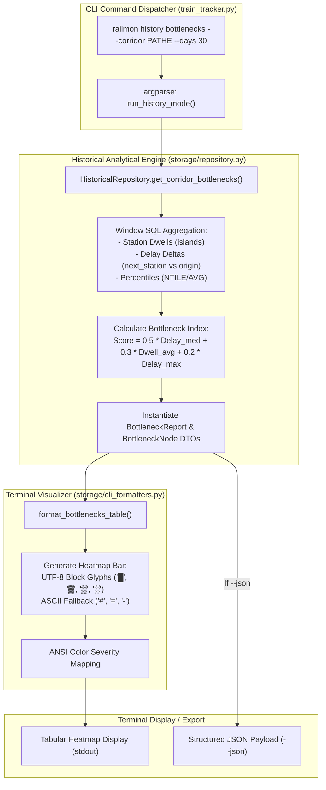
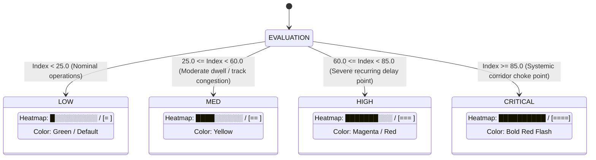

# Implementation Plan — F-9.1: Corridor Bottleneck & Station Dwell Delay Heatmaps (`railmon history bottlenecks`)

> **Reference:** [TUI Feature Enhancements & Expansion Specification (`F-9.1`)](../../architecture/tui-feature-enhancements.md#f-91-corridor-bottleneck--station-dwell-delay-heatmaps-railmon-history-bottlenecks), [`docs/architecture/architecture.md`](../../architecture/architecture.md)  
> **Target Modules:** [`../../../storage/models.py`](../../../storage/models.py), [`../../../storage/repository.py`](../../../storage/repository.py), [`../../../storage/cli_formatters.py`](../../../storage/cli_formatters.py), [`../../../train_tracker.py`](../../../train_tracker.py)  
> **Test Suites:** `tests/test_bottlenecks.py` *(to be created)*, [`../../../tests/test_storage_repository.py`](../../../tests/test_storage_repository.py), [`../../../tests/test_cli_storage.py`](../../../tests/test_cli_storage.py), [`../../../tests/test_tracker.py`](../../../tests/test_tracker.py)  
> **Relevant Rules & Skills:** [`../../../.agents/skills/diagrams-and-documentation/SKILL.md`](../../../.agents/skills/diagrams-and-documentation/SKILL.md), [`../../../.agents/skills/markdown-relative-paths/SKILL.md`](../../../.agents/skills/markdown-relative-paths/SKILL.md), [`../../../.agents/skills/storage-benchmark-gate/SKILL.md`](../../../.agents/skills/storage-benchmark-gate/SKILL.md), [`../../../.agents/skills/ci-quality-gate/SKILL.md`](../../../.agents/skills/ci-quality-gate/SKILL.md), [`../../../.agents/skills/static-safety-analyzer/SKILL.md`](../../../.agents/skills/static-safety-analyzer/SKILL.md)

---

## 1. Executive Summary & Objective

In Hellenic Railways operations, delays accumulate unevenly across the network. Recurring bottlenecks frequently arise at specific physical nodes—either at major intermediate passenger stations due to protracted platform dwell times (e.g., Larissa, Lianokladi, SKA Hub) or along single-track infrastructure segments and mountainous passes (e.g., Domokos Pass, Tempi, Mount Othrys) due to opposing train meets, speed restrictions, and block congestion.

While `railmon history punctuality` provides macro-level punctuality compliance rates and `railmon history dwell <train_num>` analyzes dwell times for a single train trip, operators, dispatch analysts, and commuters lack a macro-level infrastructure analysis tool that aggregates historical telemetry over time to identify and quantify systemic network bottlenecks.

This implementation plan delivers **Feature F-9.1: Corridor Bottleneck & Station Dwell Delay Heatmaps (`railmon history bottlenecks`)**. It provides an analytical query engine, domain data structures, and terminal visualizers that aggregate telemetry observations into ranked bottleneck profiles with Unicode block heatmaps and 7-bit ASCII fallbacks.

### Core Objectives
1. **Analytical SQLite Aggregate Queries ([`storage/repository.py`](../../../storage/repository.py)):**
   - Implement `get_corridor_bottlenecks()` in `HistoricalRepository` evaluating historical telemetry across two critical bottleneck dimensions:
     - **Station Dwells:** Identifies station nodes with recurring high dwell durations, dwell variance, and cumulative delay accumulation between arrival and departure.
     - **Corridor Segments (Inter-Station Blocks):** Computes segment transit times and delay growth between consecutive reporting points along corridor routes.
   - Aggregate statistics: sample trip count ($N$), mean dwell time ($T_{\text{avg}}$), median dwell time ($T_{\text{med}}$), 90th percentile dwell time ($T_{p90}$), median delay delta ($\Delta_{\text{med}}$), max delay observed ($D_{\text{max}}$), and normalized **Bottleneck Severity Index** ($0.0 \dots 100.0$).
   - Filtering capabilities: filter by corridor (`--corridor`), date span (`--start-date`, `--end-date`, `--days`), train service type (`--type`), and minimum observation threshold (`--min-trips`).
2. **Domain Models & DTOs ([`storage/models.py`](../../../storage/models.py)):**
   - Add `BottleneckNode` and `BottleneckReport` dataclasses with robust type annotations, serializable helper methods (`to_dict()`, `from_db_row()`), and severity classifications (`LOW`, `MED`, `HIGH`, `CRITICAL`).
3. **Responsive Visual Terminal Formatter & Heatmap Engine ([`storage/cli_formatters.py`](../../../storage/cli_formatters.py)):**
   - Implement `format_bottlenecks_table()`:
     - Terminal ASCII/UTF-8 bar heatmaps (e.g., `██████████ [CRITICAL]`, `██████░░░░ [MED]`, `==== [LOW]` in 7-bit `--ascii` mode).
     - Color-coded severity tiers using ANSI escapes when enabled.
     - Formatted columns: `RANK`, `SEGMENT / STATION`, `TYPE`, `TRIPS`, `AVG DWELL`, `MED DELAY`, `MAX DELAY`, `BOTTLENECK INDEX`.
     - Summary footer displaying aggregate corridor delay impact and worst-performing bottleneck node.
4. **CLI Subcommand Integration ([`train_tracker.py`](../../../train_tracker.py)):**
   - Add `bottlenecks` subparser under `railmon history`:
     `railmon history bottlenecks [--corridor <NAME>] [--days <N>] [--start-date <DATE>] [--end-date <DATE>] [--type <TYPE>] [--min-trips <N>] [--limit <N>] [--ascii] [--json]`
   - Implement clean JSON serialization (`--json`) for automated reporting, Grafana ingestion, and programmatic pipelines.

---

## 2. Architecture & Workflow Diagrams

### 2.1 Bottleneck Evaluation & Presentation Pipeline (Mermaid)



### 2.2 Terminal Visual Layout (ASCII Diagram)

```text
====================================================================================================
CORRIDOR BOTTLENECK ANALYSIS: PATHE MAINLINE (Last 30 Days | 284 Trips Analyzed)
====================================================================================================
 #  SEGMENT / STATION        TYPE    TRIPS   AVG DWELL   MED DELAY   MAX DELAY   BOTTLENECK INDEX
----------------------------------------------------------------------------------------------------
 1  Larissa Station          STATION   284     4m 12s      +7.4m        +42m     ██████████ 94 [CRITICAL]
 2  Lianokladi Station       STATION   280     3m 45s      +4.1m        +28m     ██████░░░░ 62 [HIGH]
 3  Domokos Pass             SEGMENT   278     0m 00s      +3.8m        +35m     █████░░░░░ 54 [MED]
 4  SKA Hub                  STATION   284     2m 50s      +2.5m        +19m     ████░░░░░░ 41 [MED]
 5  Oinoi Junction           STATION   272     2m 10s      +1.2m        +14m     ██░░░░░░░░ 22 [LOW]
 6  Platy Junction           STATION   284     1m 50s      +0.8m        +11m     █░░░░░░░░░ 14 [LOW]
----------------------------------------------------------------------------------------------------
Corridor Health: 6 Bottlenecks Identified | Primary Contributor: Larissa Station (+7.4m median delay)
====================================================================================================
```

### 2.3 Bottleneck Severity State Machine (Mermaid)



---

## 3. Detailed Technical Design & Data Structures

### 3.1 Domain Model Extensions in [`storage/models.py`](../../../storage/models.py)

Extend [`storage/models.py`](../../../storage/models.py) with two new immutable, typed dataclasses:

```python
from enum import Enum

class BottleneckSeverity(Enum):
    """Severity classification for network bottlenecks."""
    LOW = "LOW"
    MED = "MED"
    HIGH = "HIGH"
    CRITICAL = "CRITICAL"

@dataclass(frozen=True)
class BottleneckNode:
    """Analytical summary of delay accumulation at a station node or corridor segment."""
    rank: int
    name: str
    node_type: str  # "STATION" or "SEGMENT"
    total_trips: int
    avg_dwell_seconds: float
    median_delay_minutes: float
    p90_delay_minutes: float
    max_delay_minutes: float
    delay_delta_minutes: float  # Delay gained specifically at this node
    bottleneck_score: float     # Normalized 0.0 - 100.0 index
    severity: BottleneckSeverity

    def to_dict(self) -> Dict[str, Any]:
        """Convert to dictionary for JSON serialization."""
        return {
            "rank": self.rank,
            "name": self.name,
            "type": self.node_type,
            "total_trips": self.total_trips,
            "avg_dwell_seconds": round(self.avg_dwell_seconds, 1),
            "median_delay_minutes": round(self.median_delay_minutes, 1),
            "p90_delay_minutes": round(self.p90_delay_minutes, 1),
            "max_delay_minutes": round(self.max_delay_minutes, 1),
            "delay_delta_minutes": round(self.delay_delta_minutes, 1),
            "bottleneck_score": round(self.bottleneck_score, 1),
            "severity": self.severity.value,
        }

@dataclass(frozen=True)
class BottleneckReport:
    """Aggregate corridor bottleneck report containing ranked nodes."""
    corridor: Optional[str]
    time_window_start: Optional[str]
    time_window_end: Optional[str]
    total_trips_analyzed: int
    total_observations_analyzed: int
    nodes: Tuple[BottleneckNode, ...]

    def to_dict(self) -> Dict[str, Any]:
        """Convert entire report to dictionary."""
        return {
            "corridor": self.corridor or "ALL",
            "time_window_start": self.time_window_start,
            "time_window_end": self.time_window_end,
            "total_trips_analyzed": self.total_trips_analyzed,
            "total_observations_analyzed": self.total_observations_analyzed,
            "bottlenecks": [n.to_dict() for n in self.nodes],
        }
```

### 3.2 Bottleneck Scoring Algorithm & Formula

To establish a fair, normalized **Bottleneck Index** ($B \in [0, 100]$) that balances recurring median delays, station dwell overheads, and tail-risk maximum delays, we define:

$$B = \min\left(100.0, \; w_1 \cdot \frac{\Delta_{\text{med}}}{\Delta_{\text{ref}}} \times 100 + w_2 \cdot \frac{T_{\text{dwell}}}{T_{\text{ref}}} \times 100 + w_3 \cdot \frac{D_{\text{max}}}{D_{\text{ref}}} \times 100\right)$$

Where:
- Weights: $w_1 = 0.50$ (median delay delta contribution), $w_2 = 0.30$ (average dwell contribution), $w_3 = 0.20$ (peak anomaly contribution).
- Normalization Reference Baselines:
  - $\Delta_{\text{ref}} = 10.0\text{ min}$ (a station where median delay increases by $+10\text{m}$ reaches $100\%$ score on component 1).
  - $T_{\text{ref}} = 300\text{ s}$ ($5\text{ min}$ average dwell reaches $100\%$ score on component 2).
  - $D_{\text{ref}} = 45.0\text{ min}$ ($45\text{ min}$ peak delay reaches $100\%$ score on component 3).
- Severity Cutoffs:
  - $B \ge 85.0 \implies \text{CRITICAL}$
  - $60.0 \le B < 85.0 \implies \text{HIGH}$
  - $25.0 \le B < 60.0 \implies \text{MED}$
  - $B < 25.0 \implies \text{LOW}$

### 3.3 Analytical SQL Engine in [`storage/repository.py`](../../../storage/repository.py)

Implement `get_corridor_bottlenecks()` using SQLite window functions and CTEs:
1. **Dwell Extraction CTE:** Reuses island clustering logic from `get_station_dwell_times()` grouped by `(next_station, train_number, schedule_id)` to identify contiguous stops ($v \le 2.0\text{ km/h}$).
2. **Delay Delta Calculation:** Compares `departure_delay_min` with `arrival_delay_min` for each dwell event to isolate delay generated *at* that station versus delay inherited from upstream.
3. **Corridor Segment Delay Growth CTE:** Tracks inter-station transitions where `next_station` changes while train is moving, measuring delay divergence along track blocks.
4. **Aggregation & Percentiles:** Employs SQLite `AVG()`, `MAX()`, and ordered subqueries to compute median ($50\text{th}$ percentile) and $90\text{th}$ percentile delays per station/segment.
5. **Threshold Pruning:** Discards stations with fewer than `min_trips` observations to eliminate statistical noise from one-off test runs or corrupted GPS records.

```python
def get_corridor_bottlenecks(
    self,
    corridor: Optional[str] = None,
    start_date: Optional[str] = None,
    end_date: Optional[str] = None,
    train_type: Optional[str] = None,
    min_trips: int = 3,
    limit: int = 20,
) -> BottleneckReport:
    """Compute aggregate bottleneck scores and delay heatmaps across network nodes."""
    ...
```

### 3.4 Terminal Formatter in [`storage/cli_formatters.py`](../../../storage/cli_formatters.py)

Implement `format_bottlenecks_table(report: BottleneckReport, use_ascii: bool = False, use_color: bool = True) -> str`:
- Generates fixed-width bar heatmaps (10 characters wide):
  - UTF-8: `█` (Full block), `░` (Light shade)
  - ASCII: `#` (Active block), `-` (Empty block)
- Dynamic terminal width adaptation (supports standard $80$-column and wide $120+$-column viewports).
- ANSI color formatting:
  - `CRITICAL`: Red / Bold (`\033[1;31m`)
  - `HIGH`: Magenta (`\033[35m`)
  - `MED`: Yellow (`\033[33m`)
  - `LOW`: Green / Reset (`\033[32m`)
- Transliterates Greek names if `--ascii` is requested via `transliterate_greek_to_latin()`.

---

## 4. CLI Subcommand Specification (`railmon history bottlenecks`)

### 4.1 Argument Parser Definition in [`train_tracker.py`](../../../train_tracker.py)

Add under `hist_subs`:

```python
# history bottlenecks
p_bottlenecks = hist_subs.add_parser(
    "bottlenecks",
    parents=[db_parent],
    help="Analyze corridor bottlenecks, station dwell delays, and infrastructure heatmaps.",
)
p_bottlenecks.add_argument("--corridor", type=str, help="Filter by corridor name (e.g. PATHE, Proastiakos).")
p_bottlenecks.add_argument("--days", type=int, help="Analyze the last N days of recorded telemetry.")
p_bottlenecks.add_argument("--start-date", type=str, help="Start date filter (YYYY-MM-DD).")
p_bottlenecks.add_argument("--end-date", type=str, help="End date filter (YYYY-MM-DD).")
p_bottlenecks.add_argument("--type", choices=["all", "intercity", "suburban", "regional"], default="all", help="Filter by train service type.")
p_bottlenecks.add_argument("--min-trips", type=int, default=3, help="Minimum evaluated trips per node (default: 3).")
p_bottlenecks.add_argument("--limit", type=int, default=15, help="Maximum bottleneck nodes to display (default: 15).")
p_bottlenecks.add_argument("--ascii", action="store_true", help="Force 7-bit ASCII characters without Unicode blocks.")
p_bottlenecks.add_argument("--json", action="store_true", help="Output machine-readable JSON format.")
```

### 4.2 Dispatch Logic in `run_history_mode(args)`

```python
elif action == "bottlenecks":
    # Calculate date ranges if --days is specified
    start_date = args.start_date
    if args.days and not start_date:
        cutoff = datetime.now(timezone.utc) - timedelta(days=args.days)
        start_date = cutoff.strftime("%Y-%m-%d")

    report = repo.get_corridor_bottlenecks(
        corridor=args.corridor,
        start_date=start_date,
        end_date=args.end_date,
        train_type=args.type if args.type != "all" else None,
        min_trips=args.min_trips,
        limit=args.limit,
    )

    if getattr(args, "json", False):
        print(json.dumps(report.to_dict(), indent=2))
    else:
        print(format_bottlenecks_table(report, use_ascii=getattr(args, "ascii", False)))
```

---

## 5. Testing & Verification Strategy

### 5.1 Automated Test Suites

Create `tests/test_bottlenecks.py` and extend existing test files ([`../../../tests/test_storage_repository.py`](../../../tests/test_storage_repository.py), [`../../../tests/test_cli_storage.py`](../../../tests/test_cli_storage.py)):

1. **Analytical SQL Engine Tests (`tests/test_storage_repository.py` & `tests/test_bottlenecks.py`):**
   - Populate temporary SQLite database with known synthetic telemetry trips having deliberate dwell stops and delay spikes at `Larissa`, `Lianokladi`, and `Domokos`.
   - Verify `get_corridor_bottlenecks()` returns correct `avg_dwell_seconds`, `median_delay_minutes`, and `delay_delta_minutes`.
   - Verify `min_trips` pruning excludes nodes with insufficient observations.
   - Verify corridor and date range filtering logic correctly scopes SQL query execution.
2. **DTO & Scoring Tests (`tests/test_bottlenecks.py`):**
   - Verify `BottleneckSeverity` categorization:
     - Score $92.0 \implies \text{CRITICAL}$
     - Score $70.0 \implies \text{HIGH}$
     - Score $45.0 \implies \text{MED}$
     - Score $15.0 \implies \text{LOW}$
   - Verify `to_dict()` produces JSON-compliant serializable dictionaries with rounded floats.
3. **Table & Heatmap Formatter Tests (`tests/test_cli_storage.py` / `tests/test_bottlenecks.py`):**
   - Test default UTF-8 block rendering: verifies presence of `█`, `░`, and formatted headers.
   - Test 7-bit ASCII purity with `--ascii`: confirms zero characters with `ord(c) >= 128` and correct Greek transliteration.
   - Test empty report handling: renders clean `"No corridor bottlenecks identified matching criteria."` message without crash.
4. **CLI Dispatch & Integration Tests (`tests/test_tracker.py`):**
   - Test `railmon history bottlenecks --corridor PATHE` CLI execution via runner.
   - Test `--json` flag: verify stdout parses cleanly via `json.loads()`.
   - Test missing database error handling: exits with code `1` and descriptive error message.

### 5.2 Quality Gate & Compliance

Execute:
```bash
# 1. Full pytest suite
pytest tests/test_bottlenecks.py tests/test_storage_repository.py tests/test_cli_storage.py -v

# 2. CI quality gate
flake8 storage/ tests/
mypy --strict storage/models.py storage/repository.py storage/cli_formatters.py
```

---

## 6. Implementation Checklist & Deliverables

- [x] **Step 1:** Define `BottleneckSeverity`, `BottleneckNode`, and `BottleneckReport` in [`storage/models.py`](../../../storage/models.py).
- [x] **Step 2:** Implement `get_corridor_bottlenecks()` analytical query engine in [`storage/repository.py`](../../../storage/repository.py).
- [x] **Step 3:** Implement `format_bottlenecks_table()` with UTF-8/ASCII heatmap rendering and ANSI colors in [`storage/cli_formatters.py`](../../../storage/cli_formatters.py).
- [x] **Step 4:** Add `bottlenecks` subparser and dispatch handling in [`train_tracker.py`](../../../train_tracker.py).
- [x] **Step 5:** Author comprehensive unit tests in `tests/test_bottlenecks.py` and update existing test suites.
- [x] **Step 6:** Run static safety analyzer, strict mypy type checking, and test suite.
- [x] **Step 7:** Update architectural documentation in [`docs/architecture/tui-feature-enhancements.md`](../../architecture/tui-feature-enhancements.md) marking F-9.1 implementation plan completed.
