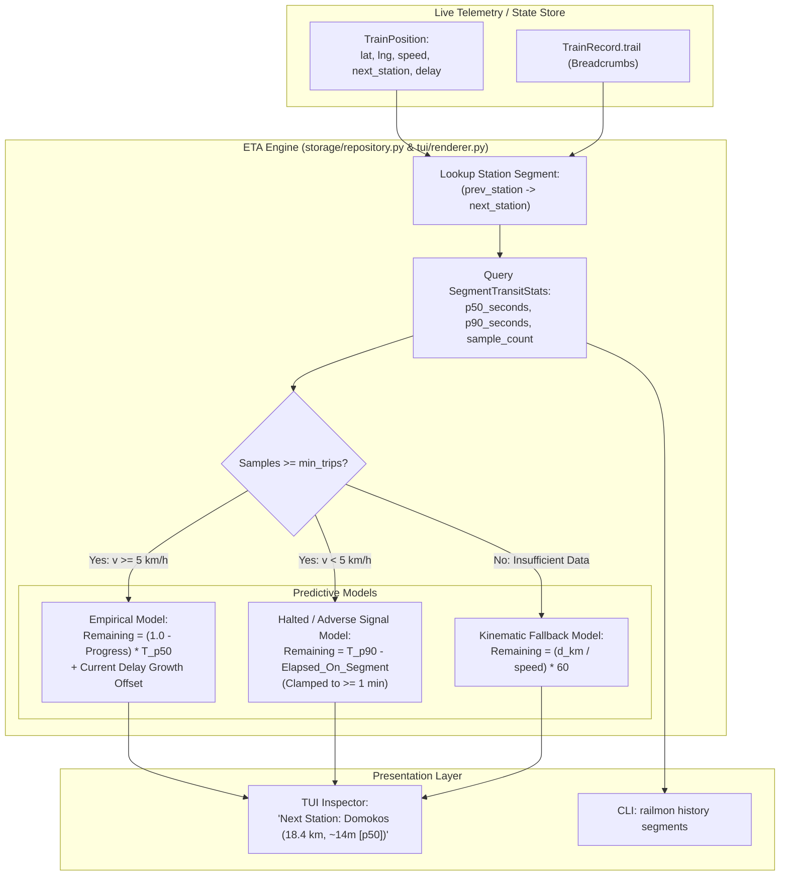

# Implementation Plan — F-9.2: Empirical Segment Transit Time & ETA Engine

> **Reference:** [TUI Feature Enhancements & Expansion Specification (`F-9.2`)](../../architecture/tui-feature-enhancements.md#f-92-empirical-segment-transit-time--eta-engine--planned), [`docs/architecture/architecture.md`](../../architecture/architecture.md)  
> **Target Modules:** [`../../../storage/models.py`](../../../storage/models.py), [`../../../storage/repository.py`](../../../storage/repository.py), [`../../../storage/cli_formatters.py`](../../../storage/cli_formatters.py), [`../../../tui/renderer.py`](../../../tui/renderer.py), [`../../../train_tracker.py`](../../../train_tracker.py)  
> **Test Suites:** `tests/test_eta_engine.py` *(to be created)*, [`../../../tests/test_storage_repository.py`](../../../tests/test_storage_repository.py), [`../../../tests/test_tui_renderer.py`](../../../tests/test_tui_renderer.py), [`../../../tests/test_cli_storage.py`](../../../tests/test_cli_storage.py)  
> **Relevant Skills & Guidelines:** [`../../../.agents/skills/diagrams-and-documentation/SKILL.md`](../../../.agents/skills/diagrams-and-documentation/SKILL.md), [`../../../.agents/skills/markdown-relative-paths/SKILL.md`](../../../.agents/skills/markdown-relative-paths/SKILL.md), [`../../../.agents/skills/static-safety-analyzer/SKILL.md`](../../../.agents/skills/static-safety-analyzer/SKILL.md), [`../../../.agents/skills/storage-benchmark-gate/SKILL.md`](../../../.agents/skills/storage-benchmark-gate/SKILL.md), [`../../../.agents/skills/ci-quality-gate/SKILL.md`](../../../.agents/skills/ci-quality-gate/SKILL.md)

---

## 1. Executive Summary & Problem Statement

### 1.1 The Kinematic ETA Limitation
Currently, `railmon` calculates estimated time of arrival (ETA) to the next station in [`format_next_station_eta`](../../../tui/renderer.py#L624-L672) using instantaneous great-circle geodesic velocity:
$$\text{ETA}_{\text{kinematic}} = \frac{d_{\text{km}}}{v_{\text{instant}}} \times 60 \quad (\text{minutes})$$

While computationally straightforward, this pure kinematic calculation suffers from severe failure modes in real-world railway operations:
1. **Station Dwell & Halts:** When a train is halted at an intermediate station or stopped at an adverse signal (speed $v < 5.0\text{ km/h}$), velocity-based ETA collapses—reporting no ETA at all (`Λάρισα (14.2 km)`) or infinite duration, failing to inform operators when transit to the next station is expected to complete.
2. **Terrain & Grade Invariance:** Real-world corridors feature speed-restricted mountain passes (e.g., Lianokladi–Domokos, Mount Othrys, Tempi, Bralos Pass) where line geometry and grades dictate actual transit durations far better than instantaneous velocity. A train cruising at $140\text{ km/h}$ into an impending mountain grade will severely underestimate its remaining segment transit time.
3. **Signal & Congestion Delays:** Recurring dispatch bottlenecks and block occupancy patterns systematically lengthen transit times during specific operating conditions.
4. **Schedule Schedule Disconnect:** Pure kinematic ETAs ignore the train's scheduled timetable arrival times and historical transit distribution percentiles ($p50, p90$).

### 1.2 The Solution: Feature F-9.2
**Feature F-9.2: Empirical Segment Transit Time & ETA Engine** bridges historical SQLite WAL telemetry archives with live TUI rendering and CLI inspection. It introduces:
1. **Empirical Transit Matrix Extraction ([`storage/repository.py`](../../../storage/repository.py)):** An analytical SQLite aggregation engine that segments historical trips into distinct station-to-station directed edges (`from_station -> to_station`), computing statistical distributions: sample trip count ($N$), minimum transit duration ($T_{\min}$), median transit duration ($T_{p50}$), 90th percentile duration ($T_{p90}$), mean velocity, and average delay gain.
2. **Hybrid Multi-Tier ETA Estimation Model:**
   - **Tier 1 (Empirical Historical Transit):** When historical segment records exist ($N \ge N_{\min}$), predict ETA using progress along the segment polyline calibrated by median empirical transit times ($T_{p50}$) and current delay state.
   - **Tier 2 (Kinematic Velocity Fallback):** When historical segment data is unrecorded (new corridor or first run), gracefully fallback to the existing geodesic velocity model.
   - **Tier 3 (Halted / Signal-Stop Mode):** If a train is stopped en route ($v < 5.0\text{ km/h}$), predict remaining segment transit using the historical 90th-percentile transit time ($T_{p90}$) rather than collapsing to indefinite/unknown.
3. **CLI Historical Matrix Inspector (`railmon history segments`):** A command-line inspection tool and tabular visualizer displaying empirical segment runtimes, speed profiles, and percentile variance across network corridors.
4. **Seamless TUI Integration ([`tui/renderer.py`](../../../tui/renderer.py)):** Enhanced Selected Train Telemetry Inspector displaying empirical ETAs with confidence indicators (e.g., `Next Station: Domokos (18.4 km, ~14m [p50])` or `(Halted, ~22m [p90])`).

---

## 2. Architecture & Operational Workflows

### 2.1 Multi-Tier ETA Evaluation Pipeline (Mermaid)



### 2.2 Telemetry Ingestion to Empirical Matrix Generation (ASCII Diagram)

```text
+---------------------------------------------------------------------------------------------------+
| Historical Telemetry Archive (SQLite WAL: telemetry_history)                                      |
| Records: (train_number, schedule_id, next_station, recorded_at, lat, lng, speed, delay)           |
+---------------------------------------------------------------------------------------------------+
                                                  |
                                                  v  Window Function / Partitioning
+---------------------------------------------------------------------------------------------------+
| Segment Transit Boundary Detector (storage/repository.py)                                         |
| 1. Detect station departure: next_station transitions from S_A to S_B                             |
| 2. Detect station arrival: speed <= 2.0 km/h within 250m of S_B or next_station changes to S_C    |
| 3. Compute transit duration: delta_t = t_arrival(S_B) - t_departure(S_A)                          |
+---------------------------------------------------------------------------------------------------+
                                                  |
                                                  v  Aggregation & Statistical Profiling
+---------------------------------------------------------------------------------------------------+
| SegmentTransitStats Matrix                                                                        |
| - from_station: Lianokladi (LIA)                                                                  |
| - to_station:   Domokos (DOM)                                                                     |
| - corridor:     PATHE Mainline                                                                    |
| - sample_count: 142 trips                                                                         |
| - min_transit:  16m 20s                                                                           |
| - p50_transit:  19m 45s                                                                           |
| - p90_transit:  26m 10s                                                                           |
| - avg_speed:    78.4 km/h                                                                         |
+---------------------------------------------------------------------------------------------------+
                         |                                                  |
                         v In-Memory Cache                                  v Tabular CLI Display
+-----------------------------------+              +------------------------------------------------+
| TUIRenderer / State Store         |              | railmon history segments --corridor PATHE      |
| Real-time predictive ETA readout  |              | Output empirical runtimes & speed percentiles  |
+-----------------------------------+              +------------------------------------------------+
```

---

## 3. Data Structures & Domain Models

### 3.1 Model Extensions in [`storage/models.py`](../../../storage/models.py)

Extend [`storage/models.py`](../../../storage/models.py) with typed, immutable dataclasses:

```python
@dataclass(frozen=True)
class SegmentTransitStats:
    """Statistical transit profile for a directed track segment between two stations."""

    from_station: str
    to_station: str
    corridor: Optional[str]
    sample_count: int
    min_duration_seconds: float
    p50_duration_seconds: float   # Median empirical transit duration
    p90_duration_seconds: float   # 90th-percentile conservative duration
    max_duration_seconds: float
    avg_speed_kmh: float
    avg_delay_delta_minutes: float  # Mean delay accumulated along segment
    distance_km: Optional[float] = None

    def to_dict(self) -> Dict[str, Any]:
        """Serialize segment stats to dictionary for JSON/CLI output."""
        return {
            "from_station": self.from_station,
            "to_station": self.to_station,
            "corridor": self.corridor or "UNKNOWN",
            "sample_count": self.sample_count,
            "min_duration_seconds": round(self.min_duration_seconds, 1),
            "p50_duration_seconds": round(self.p50_duration_seconds, 1),
            "p90_duration_seconds": round(self.p90_duration_seconds, 1),
            "max_duration_seconds": round(self.max_duration_seconds, 1),
            "avg_speed_kmh": round(self.avg_speed_kmh, 1),
            "avg_delay_delta_minutes": round(self.avg_delay_delta_minutes, 1),
            "distance_km": round(self.distance_km, 1) if self.distance_km is not None else None,
        }


@dataclass(frozen=True)
class SegmentTransitReport:
    """Aggregate empirical transit matrix report across a corridor."""

    corridor: Optional[str]
    time_window_start: Optional[str]
    time_window_end: Optional[str]
    total_trips_analyzed: int
    total_segments_analyzed: int
    segments: Tuple[SegmentTransitStats, ...]

    def to_dict(self) -> Dict[str, Any]:
        """Serialize transit report to dictionary."""
        return {
            "corridor": self.corridor or "ALL",
            "time_window_start": self.time_window_start,
            "time_window_end": self.time_window_end,
            "total_trips_analyzed": self.total_trips_analyzed,
            "total_segments_analyzed": self.total_segments_analyzed,
            "segments": [s.to_dict() for s in self.segments],
        }


class ETAPredictionSource(Enum):
    """Origin and methodology of ETA calculation."""

    KINEMATIC = "KINEMATIC"    # Pure velocity / distance
    EMPIRICAL_P50 = "EMP_P50"  # Calibrated against historical median transit
    EMPIRICAL_P90 = "EMP_P90"  # Conservative 90th percentile (halted / congested)
    SCHEDULED = "SCHEDULED"    # Preserved from published timetable


@dataclass(frozen=True)
class ETAPrediction:
    """Computed ETA result with confidence and methodology details."""

    station_name: str
    eta_minutes: int
    distance_km: float
    source: ETAPredictionSource
    confidence_pct: float
    formatted_eta: str
    is_halted: bool = False
```

---

## 4. Empirical Transit Matrix Engine (`HistoricalRepository`)

### 4.1 SQL Segment Boundary Detection & Statistical Profiling

Implement `get_segment_transit_times()` in [`storage/repository.py`](../../../storage/repository.py):
1. **Window Query for Segment Transitions:** Group telemetry by `(train_number, schedule_id)` ordered chronologically by `recorded_at`.
2. **Lag Tracking:** Use `LAG(next_station) OVER (PARTITION BY train_number, schedule_id ORDER BY recorded_at)` to detect station handoffs.
3. **Transit Window Calculation:**
   $$\Delta t = t_{\text{arrival}}(\text{target}) - t_{\text{departure}}(\text{origin})$$
4. **Percentile Computation:** Use SQLite `NTILE(10)` or subquery ranking to determine empirical $T_{p50}$ (median) and $T_{p90}$ values while discarding statistical anomalies ($\Delta t < 60\text{ s}$ or $> 24\text{ hours}$).

```python
def get_segment_transit_times(
    self,
    corridor: Optional[str] = None,
    from_station: Optional[str] = None,
    to_station: Optional[str] = None,
    train_type: Optional[str] = None,
    start_date: Optional[str] = None,
    end_date: Optional[str] = None,
    min_trips: int = 3,
    limit: int = 50,
) -> SegmentTransitReport:
    """Aggregate historical station-to-station transit runtimes and percentiles."""
    ...
```

### 4.2 In-Memory Fast Cache for Live TUI Lookups
In [`HistoricalRepository`](../../../storage/repository.py), provide an in-memory cached lookup index:
```python
def get_segment_stats_map(
    self,
    corridor: Optional[str] = None,
    ttl_seconds: float = 300.0,
) -> Dict[Tuple[str, str], SegmentTransitStats]:
    """Return dictionary of (normalized_from, normalized_to) -> SegmentTransitStats."""
    ...
```

---

## 5. ETA Prediction Algorithm & Formulation

### 5.1 Hybrid Mathematical Formulation

Given a train at coordinates $\mathbf{x}_{\text{train}}$, moving along a directed segment from station $S_A$ to station $S_B$:
1. **Distance to Destination:** Compute geodesic distance $d_B = \text{haversine}(\mathbf{x}_{\text{train}}, \mathbf{x}_{S_B})$.
2. **Total Segment Geodesic Length:** $d_{\text{total}} = \text{haversine}(\mathbf{x}_{S_A}, \mathbf{x}_{S_B})$.
3. **Estimated Segment Progress:**
   $$\rho = \text{clamp}\left(1.0 - \frac{d_B}{d_{\text{total}}}, \; 0.0, \; 0.99\right)$$
4. **Case A: Train in Motion ($v \ge 5.0\text{ km/h}$):**
   - If historical stats exist for $(S_A, S_B)$ with $N \ge 3$:
     $$\text{ETA}_{\text{emp}} = (1.0 - \rho) \cdot \frac{T_{p50}}{60.0} \quad (\text{minutes})$$
     - Blend with kinematic speed if speed is stable:
       $$\text{ETA}_{\text{hybrid}} = \alpha \cdot \text{ETA}_{\text{emp}} + (1 - \alpha) \cdot \text{ETA}_{\text{kinematic}}$$
       Where $\alpha = 0.75$ on mountain/regional corridors, $0.50$ on high-speed flat corridors.
   - If no historical stats exist: fallback to pure kinematic $\text{ETA} = (d_B / v) \times 60$.
5. **Case B: Train Halted / Signal Stop ($v < 5.0\text{ km/h}$):**
   - If at station platform ($d_A < 0.25\text{ km}$ or $d_B < 0.25\text{ km}$):
     - Renders `AT` platform marker (`Λάρισα (0.1 km, AT)`).
   - If stopped en route (adverse signal / block hold):
     - Predict remaining runtime using the conservative 90th-percentile transit time:
       $$\text{Remaining} = \max\left(1.0, \; (1.0 - \rho) \cdot \frac{T_{p90}}{60.0}\right)$$
     - Format: `Domokos (14.2 km, ~18m [p90])`.

---

## 6. Presentation Layer: TUI & CLI Integration

### 6.1 TUI Selected Train Inspector Readout ([`tui/renderer.py`](../../../tui/renderer.py))

Update `format_next_station_eta` to accept an optional `segment_stats: Optional[SegmentTransitStats] = None`:

```text
+------------------------------+
| [ SELECTED TRAIN TELEMETRY ] |
| Train No:     1599 (IC)      |
| Route:        ΑΘΗΝ -> ΘΕΣΣ   |
| Next Station: Domokos        |
|               (14.2km, ~11m) |  <-- Empirical p50 ETA
| Speed:        114.0 km/h     |
| Delay:        +4 min (Minor) |
+------------------------------+
```

When halted en route:
```text
| Next Station: Domokos (14.2 km, ~18m [p90]) |
```

### 6.2 CLI Subcommand: `railmon history segments`

Add `segments` subparser under `railmon history` in [`train_tracker.py`](../../../train_tracker.py):
```bash
# Query empirical segment transit times for the PATHE corridor
railmon history segments --corridor PATHE

# Inspect specific inter-station transit stats
railmon history segments --from Lianokladi --to Domokos

# Machine-readable JSON output
railmon history segments --corridor PATHE --json
```

#### Terminal Output Mockup:
```text
====================================================================================================
EMPIRICAL SEGMENT TRANSIT ANALYSIS: PATHE MAINLINE (284 Trips Analyzed)
====================================================================================================
FROM STATION        TO STATION          TRIPS   MIN DURATION  MEDIAN (p50)  P90 DURATION  AVG SPEED 
----------------------------------------------------------------------------------------------------
Athens (Larissa)    SKA Hub              284      7m 15s        8m 40s        12m 10s     68.2 km/h 
SKA Hub             Oinoi Junction       280     22m 10s       25m 30s        31m 45s     84.5 km/h 
Lianokladi          Domokos Pass         278     16m 20s       19m 45s        26m 10s     78.4 km/h 
Domokos             Larissa              278     24m 50s       27m 15s        33m 00s    112.0 km/h 
Larissa             Katerini             272     31m 10s       34m 20s        41m 15s    124.6 km/h 
Katerini            Platy Junction       272     18m 05s       20m 10s        24m 50s    118.2 km/h 
Platy Junction      Thessaloniki         272     21m 40s       24m 00s        29m 15s     96.4 km/h 
====================================================================================================
Corridor Summary: 7 Track Segments Profiled | Longest Median Transit: Larissa -> Katerini (34m 20s)
====================================================================================================
```

---

## 7. Implementation Checklist & Deliverables

- [x] **Phase 1: Domain Models & Data Structures**
  - [x] Add `SegmentTransitStats`, `SegmentTransitReport`, `ETAPredictionSource`, and `ETAPrediction` to [`storage/models.py`](../../../storage/models.py).
  - [x] Provide dictionary serialization methods (`to_dict()`) with rounded floating-point metrics.
- [x] **Phase 2: Repository Analytical Engine**
  - [x] Implement `get_segment_transit_times()` in [`storage/repository.py`](../../../storage/repository.py).
  - [x] Implement `get_segment_stats_map()` with memory caching.
  - [x] Support `--corridor`, `--from-station`, `--to-station`, `--start-date`, and `--end-date` filters.
- [x] **Phase 3: Hybrid ETA Calculation & TUI Formatting**
  - [x] Extend `format_next_station_eta` in [`tui/renderer.py`](../../../tui/renderer.py) to incorporate empirical segment transit distributions.
  - [x] Implement halted train $p90$ estimation logic.
  - [x] Wire segment stats cache into `TrainStateStore` and `TUIRenderer`.
- [x] **Phase 4: CLI Subcommand Integration**
  - [x] Add `segments` subparser to `railmon history` in [`train_tracker.py`](../../../train_tracker.py).
  - [x] Implement `format_segment_transit_table()` in [`storage/cli_formatters.py`](../../../storage/cli_formatters.py) with UTF-8 and `--ascii` support.
  - [x] Support `--json` output format.
- [x] **Phase 5: Automated Testing & Quality Gate**
  - [x] Author `tests/test_eta_engine.py` covering empirical estimation, fallback behavior, halted mode, and edge cases.
  - [x] Add repository unit tests in [`tests/test_storage_repository.py`](../../../tests/test_storage_repository.py).
  - [x] Add CLI tests in [`tests/test_cli_storage.py`](../../../tests/test_cli_storage.py).
  - [x] Run full CI quality gate (`pytest`, strict `mypy`, `flake8`, AST safety analyzer).
- [x] **Phase 6: Documentation & Specification Sync**
  - [x] Update [`docs/architecture/tui-feature-enhancements.md`](../../architecture/tui-feature-enhancements.md) marking F-9.2 implemented.
