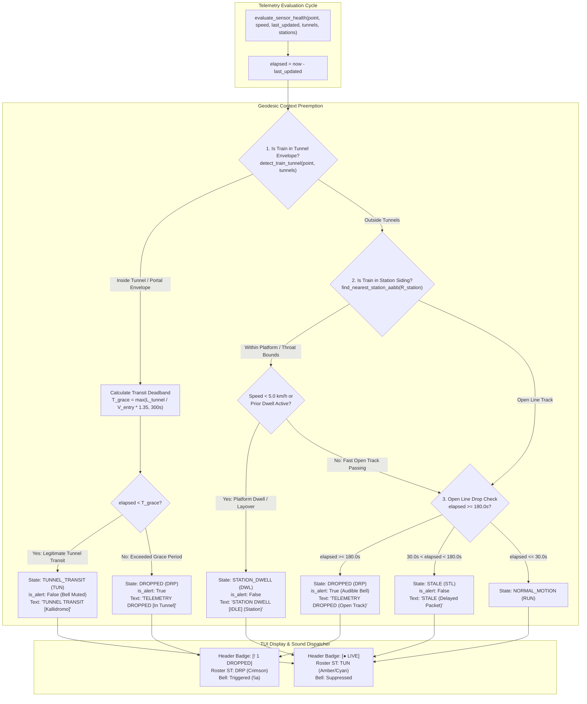
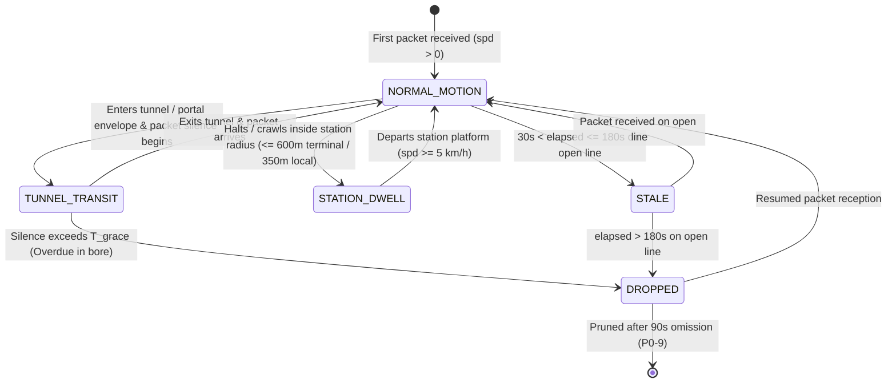

# Implementation Plan — P0-10: Telemetry Drop Watchdog Resilience, Tunnel Deadbands & Terminal Layover Preemption

> **Reference Investigation:** [`../../../investigations/telemetry-anomalies-and-duplicate-train-numbers-investigation.md`](../../../investigations/telemetry-anomalies-and-duplicate-train-numbers-investigation.md)  
> **Related Fix Plan:** [`./p0-9-stale-train-pruning-and-screen-warning-clearance-fix-plan.md`](./p0-9-stale-train-pruning-and-screen-warning-clearance-fix-plan.md)  
> **Target Modules:** [`../../../../tui/geo.py`](../../../../tui/geo.py), [`../../../../tui/state.py`](../../../../tui/state.py), [`../../../../tui/renderer.py`](../../../../tui/renderer.py), [`../../../../tui/app.py`](../../../../tui/app.py), [`../../../../watchdog.py`](../../../../watchdog.py)  
> **Data Sources:** [`../../../../tui/data/infrastructure.json`](../../../../tui/data/infrastructure.json), [`../../../../tui/data/stations.json`](../../../../tui/data/stations.json)  
> **Test Suites:** [`../../../../tests/test_tui_sensor_health_geo.py`](../../../../tests/test_tui_sensor_health_geo.py), [`../../../../tests/test_tui_sensor_health_state.py`](../../../../tests/test_tui_sensor_health_state.py), `tests/test_tui_telemetry_drop_watchdog.py` (New Unit Suite)  
> **Relevant Rules & Skills:** [`../../../../.agents/skills/diagrams-and-documentation/SKILL.md`](../../../../.agents/skills/diagrams-and-documentation/SKILL.md), [`../../../../.agents/skills/markdown-relative-paths/SKILL.md`](../../../../.agents/skills/markdown-relative-paths/SKILL.md), [`../../../../.agents/rules/misra-autosar-python.md`](../../../../.agents/rules/misra-autosar-python.md), [`../../../../.agents/skills/ci-quality-gate/SKILL.md`](../../../../.agents/skills/ci-quality-gate/SKILL.md)

---

## 1. Executive Summary & Problem Overview

During live operation against the Hellenic Railways (`railway.gov.gr`) telemetry stream, `railmon`'s sensor health watchdog routinely triggers critical **`TELEMETRY DROPPED` (`DRP`)** alarms and rings terminal audio alert bells on trains that are operating normally. As diagnosed in Section 3.2 of [`telemetry-anomalies-and-duplicate-train-numbers-investigation.md`](../../../investigations/telemetry-anomalies-and-duplicate-train-numbers-investigation.md), the root cause is a rigid, one-size-fits-all $120\text{-second}$ silence timeout that disregards Greek rail topography and terminal station dwell patterns.

### 1.1 Topographical Context: Mountain Tunnels & Cellular Dead Zones
The mainland Greek high-speed mainline (PATHE: Athens–Thessaloniki) traverses severe mountain ranges and geological rifts that feature long tunnel bores:
1. **Kallidromo Twin-Bore Tunnel (`tun-kallidromo`):** At $9,038\text{ meters}$, Kallidromo is the longest railway tunnel in Greece and the Balkan peninsula. An Intercity train operating at maximum permissible line speed ($160\text{ km/h}$) requires:
   $$T_{\text{transit}} = \frac{9{,}038\text{ m}}{160 \times \frac{1{,}000}{3{,}600}\text{ m/s}} \approx 203.4\text{ seconds} \approx 3.4\text{ minutes}$$
   At typical cruising speeds ($120\text{–}140\text{ km/h}$), transit lasts $3.9\text{ to }4.5\text{ minutes}$. Because satellite GNSS and commercial cellular uplinks are completely blocked inside the bore, the $120\text{s}$ watchdog **guarantees recurring false `DROPPED` panic alerts on every single Intercity passage**.
2. **Mount Othrys Tunnel Complex (`tun-othrys`):** At $7,026\text{ meters}$, crossing the Othrys massif between Lianokladi and Domokos requires $2.6\text{ to }3.5\text{ minutes}$. Cellular handovers in the canyon portals regularly drop.
3. **Tempi Tunnels (`tun-tempi-t1`, `tun-tempi-t2`):** Southern and northern bores totaling over $7.5\text{ km}$ through the Tempe gorge, creating repeat deadbands.
4. **Rural Mountain Corridors:** Passing loops and deep cuttings along the Central Greece and Thrace corridors regularly experience carrier Base Transceiver Station (BTS) handover deadbands of $120\text{ to }180\text{ seconds}$.

### 1.2 Station Platform Layovers & Terminal Throat Geometry
1. **Station Dwell Preemption Defect:** In [`tui/geo.py:1873-1923`](../../../../tui/geo.py#L1873-L1923), the telemetry drop check triggers at Step 1 whenever $\text{elapsed} \ge 120.0\text{s}$. While a station check exists, it requires $\text{spd} < 1.0\text{ km/h}$ and is constrained to an overly narrow $250\text{m}$ radius from the station centroid.
2. **Terminal Hub Realities:** Large terminal stations (Athens Central `ath`, Thessaloniki `skg`, SKA `ska`, Lianokladi `lian`) possess platforms and approach tracks extending $400\text{m}$ to $700\text{m}$ from the station point node. When trains dwell at platforms before departure, perform crew changes, or coast into arrival tracks at low approach speed ($1\text{ to }3\text{ km/h}$), any telemetry pause beyond $2\text{ minutes}$ trips `TELEMETRY DROPPED`.

### 1.3 Core Objectives
1. **Elevate Baseline Open-Line Drop Threshold:** Increase default `telemetry_drop_threshold_sec` from $120.0\text{s}$ to **$180.0\text{s}$ ($3.0\text{ minutes}$)** to absorb rural cellular handovers without false alarms.
2. **Tunnel Infrastructure Integration & Deadband Grace Period:** Inject GIS tunnel data into `evaluate_sensor_health()`. When a train is detected inside a tunnel or entering a tunnel portal envelope, classify it as **`TUNNEL_TRANSIT` (`TUN`)** and apply a dynamic deadband grace period based on tunnel length and entry speed ($\tau_{\text{tunnel}} = \max(T_{\text{transit}} \times 1.35, 300\text{s})$), suppressing panic bells.
3. **Station Platform & Terminal Siding Dwell Preemption:** Invert the evaluation sequence so station proximity takes precedence. Expand search radius to $600\text{m}$ for terminal hubs, and classify parked/idling trains as **`STATION_DWELL` (`DWL`)** even during prolonged silence.
4. **Renderer & Audio Bell Suppression:** Render `TUN` (amber/cyan) and `DWL` (blue/green) as normal operational states in the Curses status bar and roster table, completely silencing the `\a` terminal bell unless a genuine open-track drop exceeds threshold limits.

---

## 2. Technical Architecture & Transformation Pipeline

### 2.1 Before vs. After Watchdog Pipeline Comparison

```text
BEFORE (Static 120s Timeout & False Alarm Triggering):
+------------------------------------+      +-------------------------------------------+      +-------------------------------+
| Train Traverses Kallidromo Tunnel  |      | evaluate_sensor_health() (tui/geo.py)     |      | Curses UI (tui/renderer.py)   |
| (9,038m bore, 160 km/h, 203s transit)      |  - No tunnel GIS awareness                | ---> |  [+00:30s] STALE (STL)        |
| Cellular/GNSS signal absent in bore| ---> |  - Hardcoded drop threshold: 120.0s       |      |  [+02:00m] TELEMETRY DROP(DRP)|
+------------------------------------+      |  - Station check requires spd < 1.0 km/h  |      |            CRIMSON ALERT BADGE|
                                            +-------------------------------------------+      |            TERMINAL BELL RING |
                                                                                               +-------------------------------+

AFTER (Geodesic Tunnel Deadband & Station Layover Preemption):
+------------------------------------+      +-------------------------------------------+      +-------------------------------+
| Train Traverses Kallidromo Tunnel  |      | evaluate_sensor_health() (tui/geo.py)     |      | Curses UI (tui/renderer.py)   |
| (9,038m bore, 160 km/h, 203s transit)      |  - detect_train_tunnel() identifies bore  | ---> |  [+00:30s] Subtle STL status  |
| Cellular/GNSS signal absent in bore| ---> |  - Calculates T_grace: 275s (max 300s)    |      |  [+02:00m] TUNNEL TRANSIT     |
+------------------------------------+      |  - Classification: TUNNEL_TRANSIT (TUN)   |      |            [∩ Kallidromo, 2m] |
                                            |  - is_alert = False (Bell suppressed)     |      |            NO PANIC BELLS     |
                                            +-------------------------------------------+      |  [+03:30m] Train exits tunnel |
                                                           |                                   |            Resumes RUN/DWL    |
                                                           v                                   +-------------------------------+
                                            +-------------------------------------------+
                                            | Terminal Siding / Platform Check:         |
                                            |  - Preempts drop evaluation               |
                                            |  - R_terminal = 600m (Athens, SKA, SKG)   |
                                            |  - Station dwell preserved with quiet note|
                                            +-------------------------------------------+
```

### 2.2 End-to-End Dynamic Evaluation Flowchart



### 2.3 Sensor Health State Machine Transitions



---

## 3. Mathematical Models & Geodesic Deadband Formulations

### 3.1 Kinematic Tunnel Transit Time Estimation
When a locomotive approaches or enters a tunnel portal at position $\mathbf{P}_0 = (\text{lat}_0, \text{lng}_0)$ with instantaneous entry speed $v_{\text{entry}} > 0$:

1. **Nominal Transit Duration ($T_{\text{transit}}$):**
   $$T_{\text{transit}} = \frac{L_{\text{tunnel}}}{\max(v_{\text{entry}}, v_{\text{min\_tunnel}})}$$
   Where:
   - $L_{\text{tunnel}}$ is the exact GIS centerline polyline length in meters from [`tui/data/infrastructure.json`](../../../../tui/data/infrastructure.json) (e.g. $9{,}038\text{ m}$ for Kallidromo).
   - $v_{\text{min\_tunnel}}$ is the conservative lower-bound velocity floor set to $40.0\text{ km/h}$ ($11.11\text{ m/s}$) to handle freight and slow-order operations.

2. **Adaptive Deadband Grace Window ($T_{\text{grace}}$):**
   To accommodate speed restrictions, signal braking inside the bore, and cellular re-acquisition latency after portal egress:
   $$T_{\text{grace}} = \max\left(T_{\text{transit}} \times \alpha_{\text{margin}}, \tau_{\text{tunnel\_min}}\right)$$
   Where:
   - $\alpha_{\text{margin}} = 1.35$ ($35\%$ safety margin over nominal transit time).
   - $\tau_{\text{tunnel\_min}} = 300.0\text{ seconds}$ ($5.0\text{ minutes}$ minimum floor for any tunnel feature).

| Tunnel Name | Length ($L$) | Speed ($v_{\text{entry}}$) | Nominal ($T_{\text{transit}}$) | Grace Period ($T_{\text{grace}}$) |
| :--- | :--- | :--- | :--- | :--- |
| **Kallidromo Twin Tunnel** | $9{,}038\text{ m}$ | $160\text{ km/h}$ | $203.4\text{s}$ ($3.4\text{m}$) | **$300.0\text{s}$ ($5.0\text{m}$)** |
| **Kallidromo (Freight/Slow)** | $9{,}038\text{ m}$ | $80\text{ km/h}$ | $406.7\text{s}$ ($6.8\text{m}$) | **$549.0\text{s}$ ($9.1\text{m}$)** |
| **Mount Othrys Tunnel** | $7{,}026\text{ m}$ | $140\text{ km/h}$ | $180.7\text{s}$ ($3.0\text{m}$) | **$300.0\text{s}$ ($5.0\text{m}$)** |
| **Tempi Tunnel T2** | $5{,}500\text{ m}$ | $160\text{ km/h}$ | $123.8\text{s}$ ($2.1\text{m}$) | **$300.0\text{s}$ ($5.0\text{m}$)** |
| **Panagopoula Tunnel** | $4{,}000\text{ m}$ | $120\text{ km/h}$ | $120.0\text{s}$ ($2.0\text{m}$) | **$300.0\text{s}$ ($5.0\text{m}$)** |

### 3.2 Dynamic Multi-Tier Station Proximity Envelope
Standard passenger platforms and terminal throats require varying geodesic radii $\mathcal{R}_{\text{dwell}}$:
$$\mathcal{R}_{\text{dwell}}(\text{Station}) = \begin{cases}
  600.0\text{ m} & \text{if Station} \in \{\text{ath}, \text{skg}, \text{ska}, \text{lian}, \text{lar}\} \text{ (Major Terminal / Hub)} \\
  350.0\text{ m} & \text{otherwise (Standard Intermediate Station / Siding)}
\end{cases}$$

Station siding preemption condition:
$$\text{IsStationDwell} \iff \text{dist}(\mathbf{P}, \mathbf{S}_{\text{nearest}}) \le \mathcal{R}_{\text{dwell}}(\mathbf{S}_{\text{nearest}}) \land (v \le 5.0\text{ km/h} \lor \text{WasDwellActive})$$

---

## 4. Detailed Implementation Phases

### Phase 1: Tunable Baseline Thresholds in `tui/geo.py` & `tui/state.py`

In [`tui/geo.py:1834-1848`](../../../../tui/geo.py#L1834-L1848):
1. Elevate default `telemetry_drop_threshold_sec` from $120.0\text{s}$ to **$180.0\text{s}$** ($3\text{ minutes}$).
2. Introduce configuration constants:
   ```python
   DEFAULT_OPEN_LINE_DROP_THRESHOLD_SEC: float = 180.0
   DEFAULT_TUNNEL_DROP_MIN_SEC: float = 300.0
   DEFAULT_TUNNEL_MARGIN_FACTOR: float = 1.35
   DEFAULT_TERMINAL_DWELL_RADIUS_M: float = 600.0
   DEFAULT_STATION_DWELL_RADIUS_M: float = 350.0
   ```
3. Add `SensorHealthState.TUNNEL_TRANSIT` to `SensorHealthState` enum:
   ```python
   class SensorHealthState(Enum):
       NORMAL_MOTION = "NORMAL_MOTION"
       STATION_DWELL = "STATION_DWELL"
       SIGNAL_HALT = "SIGNAL_HALT"
       TUNNEL_TRANSIT = "TUNNEL_TRANSIT"  # Safe deadband inside mountain tunnel bore
       STALE = "STALE"
       FROZEN = "FROZEN"
       DROPPED = "DROPPED"
   ```

---

### Phase 2: Geodesic Tunnel Awareness & Deadband Engine in `tui/geo.py`

Extend `evaluate_sensor_health()` in [`tui/geo.py:1834`](../../../../tui/geo.py#L1834) to receive tunnel infrastructure:

```python
def evaluate_sensor_health(
    point: GeoPoint,
    current_speed: Optional[float],
    last_updated: float,
    last_moved_pt: Optional[GeoPoint],
    last_moved_time: float,
    station_dwell_start: Optional[float],
    stations: Sequence[Any],
    tunnels: Optional[Sequence[InfrastructureFeature]] = None,
    now: Optional[float] = None,
    telemetry_drop_threshold_sec: float = DEFAULT_OPEN_LINE_DROP_THRESHOLD_SEC,
    telemetry_stale_threshold_sec: float = 30.0,
    sensor_freeze_threshold_sec: float = 45.0,
    station_dwell_radius_m: float = DEFAULT_STATION_DWELL_RADIUS_M,
    terminal_dwell_radius_m: float = DEFAULT_TERMINAL_DWELL_RADIUS_M,
    displacement_epsilon_m: float = 10.0,
) -> Tuple[SensorHealthAssessment, Optional[GeoPoint], float, Optional[float]]:
```

#### Step 1: Tunnel Deadband Check
```python
# 1. Check for Active Mountain Tunnel Transit
tunnel_info = detect_train_tunnel(point, tunnels) if tunnels else None
if tunnel_info is not None:
    tunnel, dist_along_m, progress_ratio = tunnel_info
    tun_len = tunnel.length_m or 5000.0
    entry_spd = max(spd, 40.0) # Assume 40 km/h minimum traverse speed
    nominal_transit_sec = tun_len / (entry_spd * (1000.0 / 3600.0))
    grace_sec = max(DEFAULT_TUNNEL_DROP_MIN_SEC, nominal_transit_sec * DEFAULT_TUNNEL_MARGIN_FACTOR)
    
    if elapsed >= grace_sec:
        # Genuinely overdue inside tunnel
        assessment = SensorHealthAssessment(
            state=SensorHealthState.DROPPED,
            elapsed_sec=elapsed,
            static_duration_sec=max(0.0, ref_now - last_moved_time),
            displacement_m=0.0,
            current_speed_kmh=spd,
            nearest_station=tunnel.name,
            station_distance_m=dist_along_m,
            dwell_duration_sec=0.0,
            is_alert=True,
            short_code="DRP",
            description=f"DROPPED [OVERDUE IN TUNNEL] ({tunnel.name}, {int(elapsed // 60)}m)",
        )
        return assessment, last_moved_pt, last_moved_time, station_dwell_start
    elif elapsed > telemetry_stale_threshold_sec:
        # Legitimate tunnel transit: suppress alarm bell
        assessment = SensorHealthAssessment(
            state=SensorHealthState.TUNNEL_TRANSIT,
            elapsed_sec=elapsed,
            static_duration_sec=max(0.0, ref_now - last_moved_time),
            displacement_m=0.0,
            current_speed_kmh=spd,
            nearest_station=tunnel.name,
            station_distance_m=dist_along_m,
            dwell_duration_sec=0.0,
            is_alert=False,  # Audio bell muted
            short_code="TUN",
            description=f"TUNNEL TRANSIT ({tunnel.name}, {int(elapsed)}s silent)",
        )
        return assessment, last_moved_pt, last_moved_time, station_dwell_start
```

---

### Phase 3: Station Siding & Terminal Platform Dwell Preemption

In [`tui/geo.py:1879-1923`](../../../../tui/geo.py#L1879-L1923):
Ensure station proximity evaluation preempts any open-line `DROPPED` classification:

```python
# 2. Check for Station Dwell / Terminal Platform Layover Preemption
TERMINAL_STATION_IDS = {"ath", "skg", "ska", "lian", "lar", "dom", "kth"}
nearest_stn, stn_dist = (None, None)
if stations:
    # Use adaptive radius: 600m for major terminal hubs, 350m for local sidings
    stn_candidate, cand_dist = find_nearest_station_aabb(
        point, stations, max_radius_m=terminal_dwell_radius_m
    )
    if stn_candidate is not None and cand_dist is not None:
        cand_id = str(getattr(stn_candidate, "id", "")).lower()
        effective_radius = terminal_dwell_radius_m if cand_id in TERMINAL_STATION_IDS else station_dwell_radius_m
        if cand_dist <= effective_radius:
            nearest_stn, stn_dist = stn_candidate, cand_dist

is_dwelling = nearest_stn is not None and (spd <= 5.0 or station_dwell_start is not None)
if is_dwelling:
    stn_name = getattr(nearest_stn, "name_en", getattr(nearest_stn, "name_el", "Station"))
    new_dwell_start = station_dwell_start if station_dwell_start is not None else ref_now
    dwell_sec = max(0.0, ref_now - new_dwell_start)
    age_label = f"{int(elapsed // 60)}m silent" if elapsed >= 60.0 else f"{int(elapsed)}s silent"
    
    assessment = SensorHealthAssessment(
        state=SensorHealthState.STATION_DWELL,
        elapsed_sec=elapsed,
        static_duration_sec=max(0.0, ref_now - last_moved_time),
        displacement_m=0.0,
        current_speed_kmh=spd,
        nearest_station=stn_name,
        station_distance_m=stn_dist,
        dwell_duration_sec=dwell_sec,
        is_alert=False,  # Audio bell muted
        short_code="DWL",
        description=f"STATION DWELL [IDLE/PLATFORM] ({stn_name}, {age_label})",
    )
    return assessment, last_moved_pt, last_moved_time, new_dwell_start
```

---

### Phase 4: State Store Infrastructure Injection & Watchdog Daemon Synchronization

In [`tui/state.py:408-540`](../../../../tui/state.py#L408-L540):
1. Add `self._tunnels: List[InfrastructureFeature] = []` to `TrainStateStore`.
2. Provide `set_tunnels(tunnels: Sequence[InfrastructureFeature]) -> None`.
3. In `TrainStateStore.__init__`, automatically initialize `_tunnels` from `load_infrastructure()` if available:
   ```python
   try:
       from tui.mock_engine import load_infrastructure
       infra = load_infrastructure()
       self._tunnels = [f for f in infra.values() if f.feature_type == InfrastructureType.TUNNEL]
   except Exception:
       self._tunnels = []
   ```
4. In `_upsert_train_position()`, `evaluate_all_sensor_health()`, and `get_snapshot()`, forward `tunnels=self._tunnels` into every `evaluate_sensor_health()` call.
5. In [`watchdog.py`](../../../../watchdog.py):
   Ensure `WatchTriggerType.TELEMETRY_LOST` is not tripped by `SensorHealthState.TUNNEL_TRANSIT` or `SensorHealthState.STATION_DWELL`.

---

### Phase 5: Curses TUI & Renderer Integration

In [`tui/renderer.py`](../../../../tui/renderer.py#L1766-L2130):
1. **Roster Table (`ST` column):**
   - For `state == SensorHealthState.TUNNEL_TRANSIT`: display `TUN` in cyan/amber (`PAIR_RUNNING` or `PAIR_WARN`).
   - For `state == SensorHealthState.STATION_DWELL`: display `DWL` in green (`PAIR_NORMAL`).
2. **Status Bar Alert Badge (`_render_header_status_bar`):**
   - Count `TUNNEL_TRANSIT` trains under normal active operations, NOT in `dropped_cnt`.
   - Prevent terminal bell `\a` from triggering when a train transitions into `TUNNEL_TRANSIT`.
3. **Inspector Window:**
   - Display: `Status: TUNNEL TRANSIT (Kallidromo Tunnel, 140 km/h, 2m silent)`.

---

## 5. Comprehensive Test Specifications & Verification Matrix

### 5.1 Unit Test Suite (`tests/test_tui_telemetry_drop_watchdog.py`)

Create a dedicated unit test suite validating threshold resilience and tunnel/station deadbands:

| Test Case ID | Test Method | Scenario & Validation Criteria |
| :--- | :--- | :--- |
| **TC-DRP-01** | `test_open_line_default_180s_threshold` | At $150\text{s}$ silence on open line, assert state is `STALE` (`STL`), `is_alert == False`. At $181\text{s}$, assert state is `DROPPED` (`DRP`), `is_alert == True`. |
| **TC-DRP-02** | `test_kallidromo_tunnel_transit_grace` | Place train inside Kallidromo Tunnel ($9{,}038\text{m}$) at $160\text{ km/h}$. Advance clock to $220\text{s}$ silence. Assert state is `TUNNEL_TRANSIT` (`TUN`), `is_alert == False`, and description mentions Kallidromo. |
| **TC-DRP-03** | `test_tunnel_overdue_drop_escalation` | Inside Kallidromo Tunnel, advance clock past computed $T_{\text{grace}}$ ($320\text{s}$). Assert state escalates to `DROPPED` (`DRP`), `is_alert == True`. |
| **TC-DRP-04** | `test_terminal_hub_expanded_radius_dwell` | Place stationary train $450\text{m}$ from Athens Central centroid (`ath`). Advance clock to $240\text{s}$ silence. Assert state is `STATION_DWELL` (`DWL`), `is_alert == False`. |
| **TC-DRP-05** | `test_terminal_approach_crawl_suppression` | Place train $300\text{m}$ from Thessaloniki centroid (`skg`) with $v = 2.5\text{ km/h}$. Advance clock to $200\text{s}$ silence. Assert state is `STATION_DWELL` (`DWL`), NOT `DROPPED`. |
| **TC-DRP-06** | `test_terminal_bell_suppression_on_tunnel_dwell` | Validate that transitions into `TUNNEL_TRANSIT` or `STATION_DWELL` produce `snapshot.dropped_count == 0` and trigger zero terminal bell events. |
| **TC-DRP-07** | `test_state_store_tunnel_injection` | Verify `TrainStateStore` automatically injects tunnels into `evaluate_all_sensor_health()` and updates `rec.sensor_health.state` to `TUNNEL_TRANSIT`. |
| **TC-DRP-08** | `test_non_regression_existing_health_tests` | Run all existing sensor health tests (`test_tui_sensor_health_geo.py`, `test_tui_sensor_health_state.py`) ensuring zero breaking regressions. |

### 5.2 Verification Commands & Quality Gate
```bash
# 1. Run new watchdog test suite:
python3 -m unittest tests/test_tui_telemetry_drop_watchdog.py

# 2. Run all sensor health and state test suites:
python3 -m unittest tests/test_tui_sensor_health_geo.py \
                     tests/test_tui_sensor_health_state.py \
                     tests/test_tui_stale_prune_clearance.py

# 3. Verify zero absolute paths or file:// links remain:
grep -En "file://|/home/|/Users/|[A-Za-z]:\\\\" docs/plans/fixes/p0/p0-10-telemetry-drop-watchdog-resilience-fix-plan.md
```

---

## 6. Document Cross-References & History

- Investigation Document: [`telemetry-anomalies-and-duplicate-train-numbers-investigation.md`](../../../investigations/telemetry-anomalies-and-duplicate-train-numbers-investigation.md#32-issue-2-telemetry-drop-watchdog-is-too-aggressive)
- Preceding Stale Pruning Fix: [`p0-9-stale-train-pruning-and-screen-warning-clearance-fix-plan.md`](./p0-9-stale-train-pruning-and-screen-warning-clearance-fix-plan.md)
- Original Feature Specification: [`f-5-2-telemetry-drop-sensor-freezing-watchdog-plan.md`](../../features/f-5-2-telemetry-drop-sensor-freezing-watchdog-plan.md)
- Global Documentation Index: [`docs/README.md`](../../../README.md)
