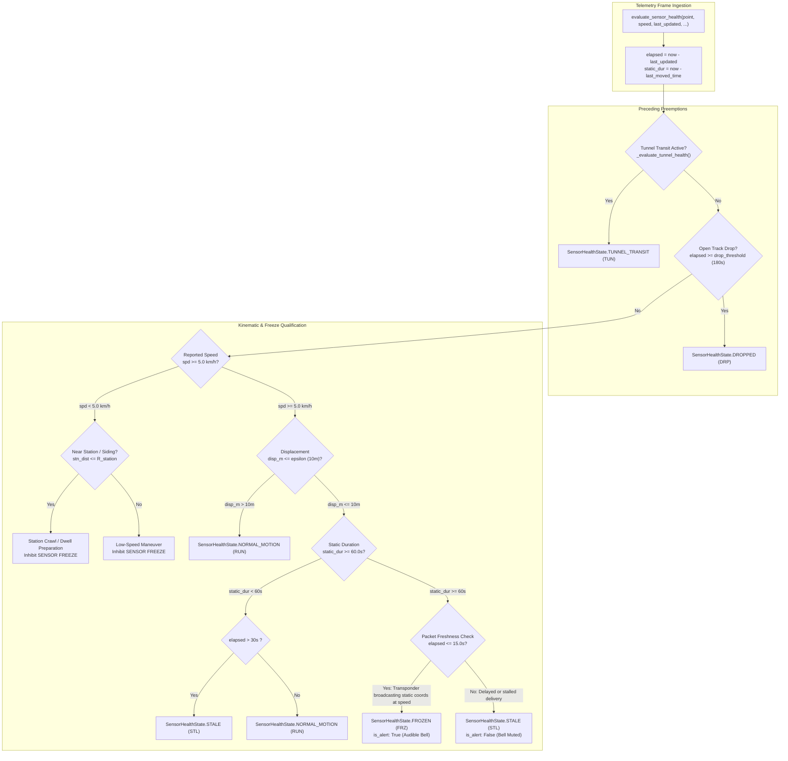
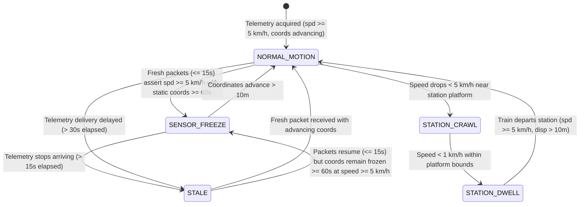

# Implementation Plan — P0-11: Sensor Freeze Watchdog Resilience, Packet Freshness Qualification & Station Crawl Filtering

> **Reference Investigation:** [`../../../investigations/telemetry-anomalies-and-duplicate-train-numbers-investigation.md`](../../../investigations/telemetry-anomalies-and-duplicate-train-numbers-investigation.md)  
> **Related Fix Plans:** [`./p0-9-stale-train-pruning-and-screen-warning-clearance-fix-plan.md`](./p0-9-stale-train-pruning-and-screen-warning-clearance-fix-plan.md), [`./p0-10-telemetry-drop-watchdog-resilience-fix-plan.md`](./p0-10-telemetry-drop-watchdog-resilience-fix-plan.md)  
> **Target Modules:** [`../../../../tui/geo.py`](../../../../tui/geo.py), [`../../../../tui/state.py`](../../../../tui/state.py), [`../../../../tui/renderer.py`](../../../../tui/renderer.py), [`../../../../tui/mock_engine.py`](../../../../tui/mock_engine.py)  
> **Test Suites:** [`../../../../tests/test_tui_sensor_health_geo.py`](../../../../tests/test_tui_sensor_health_geo.py), [`../../../../tests/test_tui_sensor_health_state.py`](../../../../tests/test_tui_sensor_health_state.py), `tests/test_tui_sensor_freeze_watchdog.py` (New Unit Suite)  
> **Relevant Rules & Skills:** [`../../../../.agents/skills/diagrams-and-documentation/SKILL.md`](../../../../.agents/skills/diagrams-and-documentation/SKILL.md), [`../../../../.agents/skills/markdown-relative-paths/SKILL.md`](../../../../.agents/skills/markdown-relative-paths/SKILL.md), [`../../../../.agents/rules/misra-autosar-python.md`](../../../../.agents/rules/misra-autosar-python.md), [`../../../../.agents/skills/ci-quality-gate/SKILL.md`](../../../../.agents/skills/ci-quality-gate/SKILL.md)

---

## 1. Executive Summary & Problem Overview

During live monitoring of Greek railway operations via `railmon`, train dispatchers and operators frequently observe false critical **`SENSOR FREEZE` (`FRZ`)** alarms. As identified in Section 3.3 of [`telemetry-anomalies-and-duplicate-train-numbers-investigation.md`](../../../investigations/telemetry-anomalies-and-duplicate-train-numbers-investigation.md), the existing sensor health watchdog misclassifies normal network transmission jitter, cellular buffering delays, and low-speed station platform approach maneuvers as critical onboard instrument hardware faults.

### 1.1 Root Cause Breakdown

#### A. Network Delay Misclassified as Hardware Sensor Freeze
In [`tui/geo.py`](../../../../tui/geo.py#L2062-L2081), `evaluate_sensor_health()` calculates the static duration as:
$$\Delta t_{\text{static}} = t_{\text{now}} - t_{\text{last\_moved}}$$
When a train is running at cruising speed ($v = 80\text{–}140\text{ km/h}$) and experiences upstream SSE buffer buffering or cellular dead zones:
1. No new position packets arrive; `last_updated` remains frozen at the timestamp of the last message received.
2. The train's cached `speed` remains at $v \ge 1.0\text{ km/h}$.
3. Coordinates cannot update because no packets are received ($\text{displacement} = 0.0\text{ m} \le \epsilon$).
4. When $\Delta t_{\text{static}} \ge 45.0\text{s}$, the watchdog trips `SensorHealthState.FROZEN` (`FRZ`), sets `is_alert=True`, and triggers the audible terminal bell (`\a`).

This is a serious diagnostic error. Network silence is a **telemetry delivery condition** (`STALE`), not an instrument hardware malfunction. An authentic sensor freeze requires that **new telemetry frames continue to arrive from the transponder** ($\Delta t_{\text{elapsed}} \le 15.0\text{s}$), actively asserting positive velocity while coordinates remain completely static.

#### B. Platform Approach Crawl & Canopy Multipath Distortion
1. **Low-Speed Approach Crawl:** Intercity and suburban EMUs (Siemens Desiro / Stadler FLIRT) entering terminal throats (Athens Central `ath`, Thessaloniki `skg`, SKA `ska`) routinely crawl at speeds between $1.0\text{ km/h}$ and $4.0\text{ km/h}$. At $1.5\text{ km/h}$ ($0.42\text{ m/s}$), a train covers only $18.8\text{ meters}$ over $45\text{ seconds}$.
2. **Station Canopy Occlusion & Multipath:** Multi-track passenger terminals feature reinforced concrete canopies, steel trusses, and catenary overhead wire mesh. Satellite GNSS signals suffer severe multipath reflection and attenuation, creating coordinate drift of $\pm 5\text{–}15\text{ meters}$.
3. **Premature Triggering:** When calculated displacement drops below the $10\text{ meter}$ noise floor ($\epsilon = 10.0\text{m}$) during a crawl, the $45\text{-second}$ window at $v \ge 1.0\text{ km/h}$ triggers a false `FROZEN` alert on trains that are simply executing normal platform berthing maneuvers.

---

## 2. Technical Architecture & Transformation Pipeline

### 2.1 Before vs. After Watchdog Pipeline Comparison

```text
BEFORE (Static Duration Only — Stalled Network Flagged as Sensor Fault):
+------------------------------------+      +-------------------------------------------+      +-------------------------------+
| Train Cruising at 120 km/h         |      | evaluate_sensor_health() (tui/geo.py)     |      | Curses UI (tui/renderer.py)   |
| Cellular packet delayed for 46s    | ---> |  - elapsed = 46s, speed = 120 km/h        | ---> |  [+00:45s] SENSOR FREEZE (FRZ)|
| No fresh packets arriving          |      |  - static_dur = 46s >= 45s                |      |            CRIMSON ALERT BADGE|
+------------------------------------+      |  - NO check on packet freshness!          |      |            TERMINAL BELL RING |
                                            +-------------------------------------------+      +-------------------------------+

AFTER (Strict Three-Tier Qualification: Freshness, Velocity Cutoff & Station Filtering):
+------------------------------------+      +-------------------------------------------+      +-------------------------------+
| Train Cruising at 120 km/h         |      | evaluate_sensor_health() (tui/geo.py)     |      | Curses UI (tui/renderer.py)   |
| Cellular packet delayed for 46s    | ---> |  - elapsed = 46s > max_packet_age (15s)   | ---> |  [+00:46s] STALE (STL)        |
| No fresh packets arriving          |      |  - Classifies as STALE packet delay       |      |            Subtle amber tag   |
+------------------------------------+      |  - SENSOR FREEZE is correctly inhibited   |      |            BELL MUTED         |
                                            +-------------------------------------------+      +-------------------------------+
                                                           |
                                                           v
+------------------------------------+      +-------------------------------------------+      +-------------------------------+
| Authentic Sensor Freeze:           |      | evaluate_sensor_health() (tui/geo.py)     |      | Curses UI (tui/renderer.py)   |
| Packets arrive every 1s (elapsed=1s)| ---> |  - elapsed <= 15s (Fresh packets)         | ---> |  [+01:00m] SENSOR FREEZE (FRZ)|
| speed = 120 km/h, static_dur = 65s |      |  - speed >= 5.0 km/h                      |      |            CRIMSON ALERT BADGE|
| coords static (disp <= 10m)        |      |  - static_dur >= 60.0s                    |      |            TERMINAL BELL RING |
+------------------------------------+      +-------------------------------------------+      +-------------------------------+
```

### 2.2 End-to-End Dynamic Evaluation Flowchart



### 2.3 Sensor Health State Machine Transitions



---

## 3. Mathematical & Kinematic Specification

### 3.1 Kinematic Parameters & Thresholds

| Parameter | Symbol | Current Value | Proposed Value | Rationale |
| :--- | :---: | :---: | :---: | :--- |
| **Freeze Speed Minimum** | $v_{\text{freeze\_min}}$ | $1.0\text{ km/h}$ | **$5.0\text{ km/h}$** | Filters platform berthing crawl and eliminates GPS multipath jitter under canopies. |
| **Freeze Static Duration** | $\tau_{\text{freeze}}$ | $45.0\text{s}$ | **$60.0\text{s}$** | At $5\text{ km/h}$, displacement in 60s is $83.3\text{m}$, vastly exceeding GNSS noise floor. |
| **Packet Freshness Cutoff** | $\tau_{\text{fresh}}$ | *None* | **$15.0\text{s}$** | Distinguishes active transponder reporting from network stalls. |
| **Coordinate Noise Floor** | $\epsilon_{\text{disp}}$ | $10.0\text{m}$ | **$10.0\text{m}$** | Standard Haversine GNSS multipath deadband. |
| **Stale Telemetry Threshold**| $\tau_{\text{stale}}$ | $30.0\text{s}$ | **$30.0\text{s}$** | Retained for intermediate network delivery delays. |

### 3.2 Formal Boolean Qualification Logic

An anomaly is classified as `SensorHealthState.FROZEN` if and only if **all four** conditions evaluate to `True`:

$$\text{is\_frozen} = \left(v \ge v_{\text{freeze\_min}}\right) \land \left(\Delta d \le \epsilon_{\text{disp}}\right) \land \left(\Delta t_{\text{static}} \ge \tau_{\text{freeze}}\right) \land \left(\Delta t_{\text{elapsed}} \le \tau_{\text{fresh}}\right)$$

Where:
- $v = \text{pos.speed}\text{ (in km/h)}$
- $\Delta d = \text{haversine\_distance\_km}(\text{point}, \text{last\_moved\_pt}) \times 1000.0$
- $\Delta t_{\text{static}} = t_{\text{ref}} - t_{\text{last\_moved}}$
- $\Delta t_{\text{elapsed}} = t_{\text{ref}} - t_{\text{last\_updated}}$

If $\left(v \ge v_{\text{freeze\_min}}\right) \land \left(\Delta d \le \epsilon_{\text{disp}}\right) \land \left(\Delta t_{\text{static}} \ge \tau_{\text{freeze}}\right)$, but $\Delta t_{\text{elapsed}} > \tau_{\text{fresh}}$:
- If $\Delta t_{\text{elapsed}} > \tau_{\text{stale}}$, state is classified as **`SensorHealthState.STALE` (`STL`)** (`is_alert = False`).
- If $\Delta t_{\text{elapsed}} \ge \tau_{\text{drop}}$, state is classified as **`SensorHealthState.DROPPED` (`DRP`)** (`is_alert = True`).

---

## 4. Detailed Implementation Steps

### Phase 1: Algorithmic Refinement in `tui/geo.py`

1. **Define Explicit Named Constants:**
   ```python
   DEFAULT_SENSOR_FREEZE_THRESHOLD_SEC: float = 60.0
   DEFAULT_SENSOR_FREEZE_MIN_SPEED_KMH: float = 5.0
   DEFAULT_SENSOR_FREEZE_MAX_PACKET_AGE_SEC: float = 15.0
   ```
2. **Update `evaluate_sensor_health()` Signature:**
   Add `sensor_freeze_min_speed_kmh: float = DEFAULT_SENSOR_FREEZE_MIN_SPEED_KMH` and `sensor_freeze_max_packet_age_sec: float = DEFAULT_SENSOR_FREEZE_MAX_PACKET_AGE_SEC` with full backward compatibility.
3. **Restructure Motion & Freeze Qualification:**
   - Differentiate speeds $v \ge v_{\text{freeze\_min}}$ from low-speed crawling ($1.0 \le v < 5.0\text{ km/h}$).
   - Guard `SensorHealthState.FROZEN` behind `elapsed <= sensor_freeze_max_packet_age_sec`.
   - Route trains with stalled delivery ($\text{elapsed} > \tau_{\text{fresh}}$) to `SensorHealthState.STALE`.

### Phase 2: State Store Plumbing in `tui/state.py`

1. Expose configuration parameters on `TrainStateStore`:
   - `_sensor_freeze_threshold_sec: float = DEFAULT_SENSOR_FREEZE_THRESHOLD_SEC`
   - `_sensor_freeze_min_speed_kmh: float = DEFAULT_SENSOR_FREEZE_MIN_SPEED_KMH`
   - `_sensor_freeze_max_packet_age_sec: float = DEFAULT_SENSOR_FREEZE_MAX_PACKET_AGE_SEC`
2. Provide public accessor methods:
   - `set_sensor_freeze_threshold(threshold_sec: float) -> None`
   - `get_sensor_freeze_threshold() -> float`
3. Pass configuration parameters cleanly in:
   - `_upsert_train_position()`
   - `evaluate_all_sensor_health()`
   - `get_snapshot()`

### Phase 3: Mock Engine & UI Verification

1. In [`tui/mock_engine.py`](../../../../tui/mock_engine.py#L1438-L1463), verify `simulate_sensor_freeze()`:
   - When active, frames continue to stream at $\text{interval} = 1.0\text{s}$ ($\text{elapsed} \le 1.0\text{s}$), speed remains positive ($> 50\text{ km/h}$), and coordinates are pinned.
   - Confirm that this cleanly triggers `FROZEN` under the new requirements.
2. In [`tui/renderer.py`](../../../../tui/renderer.py), verify:
   - Genuine `FRZ` continues to display in Crimson with `[FROZEN]` label and triggers the audio bell.
   - Network stalls display as `STL` (Amber) and do NOT ring bells.

---

## 5. Verification Plan & Test Strategy

### 5.1 Test Scenarios & Expected Outcomes

| Scenario ID | Test Description | Input Conditions | Expected Outcome |
| :--- | :--- | :--- | :--- |
| **TC-FRZ-01** | Genuine Sensor Freeze | $v = 110\text{ km/h}$, $\Delta t_{\text{elapsed}} = 1.0\text{s}$, $\Delta t_{\text{static}} = 65.0\text{s}$, $\Delta d = 0\text{m}$ | `SensorHealthState.FROZEN` (`FRZ`), `is_alert=True`. |
| **TC-FRZ-02** | Network Delay / Stalled Telemetry | $v = 110\text{ km/h}$, $\Delta t_{\text{elapsed}} = 50.0\text{s}$, $\Delta t_{\text{static}} = 50.0\text{s}$, $\Delta d = 0\text{m}$ | `SensorHealthState.STALE` (`STL`), `is_alert=False`. |
| **TC-FRZ-03** | Station Approach Crawl | $v = 3.5\text{ km/h}$, $\Delta t_{\text{elapsed}} = 1.0\text{s}$, $\Delta t_{\text{static}} = 70.0\text{s}$, $\Delta d = 8\text{m}$ near station | Normal motion / Station approach; zero freeze alerts. |
| **TC-FRZ-04** | Recovery on Coordinate Advance | Train in `FROZEN` state receives packet displacing $> 10\text{m}$ | Immediately resets to `NORMAL_MOTION` (`RUN`), alert cleared. |
| **TC-FRZ-05** | Borderline Packet Freshness | $v = 80\text{ km/h}$, $\Delta t_{\text{elapsed}} = 18.0\text{s}$, $\Delta t_{\text{static}} = 65.0\text{s}$, $\Delta d = 0\text{m}$ | Falls back to `STALE` because packet age $> 15.0\text{s}$. |

### 5.2 Test Execution Command Matrix

```bash
# Run existing and new sensor health unit tests
pytest tests/test_tui_sensor_health_geo.py tests/test_tui_sensor_health_state.py -v

# Run full CI quality gate
flake8 tui/ tests/
mypy --strict tui/geo.py tui/state.py
```

---

## 6. Document Validation & Relative Link Audit

In compliance with [`markdown-relative-paths`](../../../../.agents/skills/markdown-relative-paths/SKILL.md) and [`diagrams-and-documentation`](../../../../.agents/skills/diagrams-and-documentation/SKILL.md), all repository links in this document are strictly document-relative:
- Parent Investigation: [`../../../investigations/telemetry-anomalies-and-duplicate-train-numbers-investigation.md`](../../../investigations/telemetry-anomalies-and-duplicate-train-numbers-investigation.md)
- Sibling Fix Plans: [`./p0-9-stale-train-pruning-and-screen-warning-clearance-fix-plan.md`](./p0-9-stale-train-pruning-and-screen-warning-clearance-fix-plan.md), [`./p0-10-telemetry-drop-watchdog-resilience-fix-plan.md`](./p0-10-telemetry-drop-watchdog-resilience-fix-plan.md)
- Target Source Files: [`../../../../tui/geo.py`](../../../../tui/geo.py), [`../../../../tui/state.py`](../../../../tui/state.py), [`../../../../tui/renderer.py`](../../../../tui/renderer.py)
