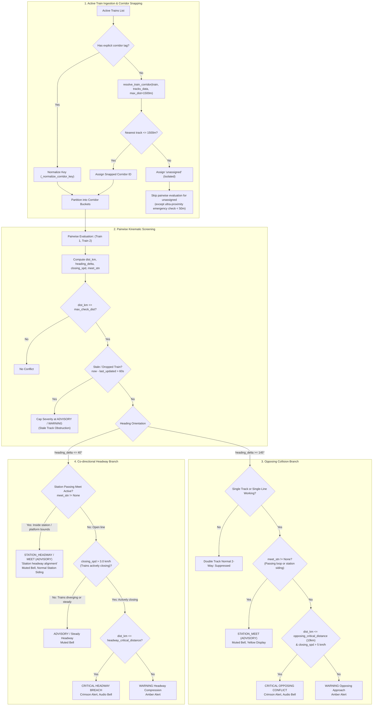
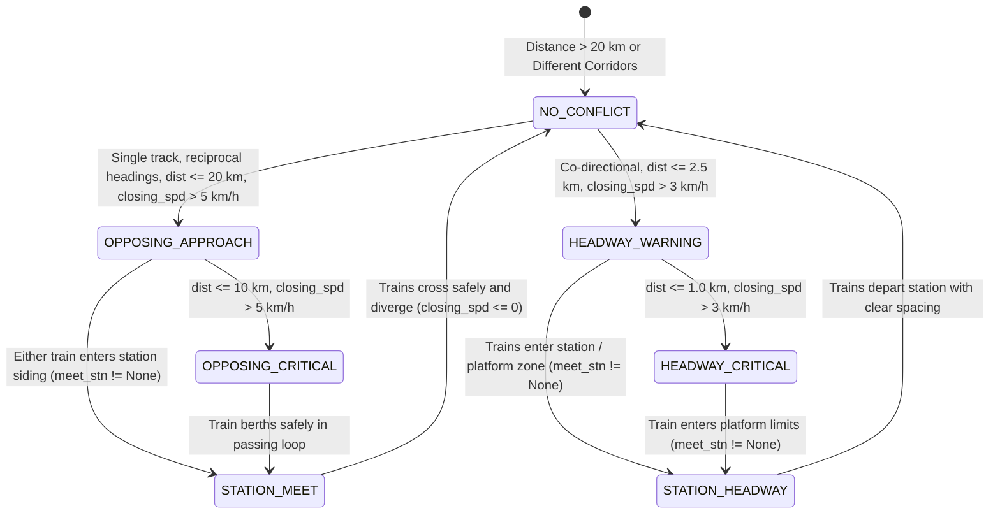

# Implementation Plan — P0-12: Track Conflict Watchdog Resilience, Dynamic Corridor Snapping & Station Siding Headway Suppression

> **Reference Investigation:** [`../../../investigations/telemetry-anomalies-and-duplicate-train-numbers-investigation.md`](../../../investigations/telemetry-anomalies-and-duplicate-train-numbers-investigation.md)  
> **Related Fix Plans:** [`./p0-9-stale-train-pruning-and-screen-warning-clearance-fix-plan.md`](./p0-9-stale-train-pruning-and-screen-warning-clearance-fix-plan.md), [`./p0-10-telemetry-drop-watchdog-resilience-fix-plan.md`](./p0-10-telemetry-drop-watchdog-resilience-fix-plan.md), [`./p0-11-sensor-freeze-watchdog-resilience-fix-plan.md`](./p0-11-sensor-freeze-watchdog-resilience-fix-plan.md)  
> **Target Modules:** [`../../../../tui/geo.py`](../../../../tui/geo.py), [`../../../../tui/state.py`](../../../../tui/state.py), [`../../../../tui/renderer.py`](../../../../tui/renderer.py), [`../../../../tui/mock_engine.py`](../../../../tui/mock_engine.py)  
> **Test Suites:** [`../../../../tests/test_tui_conflict_watchdog_geo.py`](../../../../tests/test_tui_conflict_watchdog_geo.py), [`../../../../tests/test_tui_conflict_watchdog_state.py`](../../../../tests/test_tui_conflict_watchdog_state.py), [`../../../../tests/test_tui_conflict_watchdog_renderer.py`](../../../../tests/test_tui_conflict_watchdog_renderer.py)  
> **Relevant Rules & Skills:** [`../../../../.agents/skills/diagrams-and-documentation/SKILL.md`](../../../../.agents/skills/diagrams-and-documentation/SKILL.md), [`../../../../.agents/skills/markdown-relative-paths/SKILL.md`](../../../../.agents/skills/markdown-relative-paths/SKILL.md), [`../../../../.agents/rules/misra-autosar-python.md`](../../../../.agents/rules/misra-autosar-python.md), [`../../../../.agents/skills/ci-quality-gate/SKILL.md`](../../../../.agents/skills/ci-quality-gate/SKILL.md)

---

## 1. Executive Summary & Problem Overview

During continuous operational monitoring of the Hellenic Railways (`railway.gov.gr`) telemetry stream with `railmon`, railway operators and dispatchers experience chronic, false **`CRITICAL HEADWAY BREACH`** and **`CRITICAL OPPOSING CONFLICT`** alarms. As identified in Section 3.4 of [`telemetry-anomalies-and-duplicate-train-numbers-investigation.md`](../../../investigations/telemetry-anomalies-and-duplicate-train-numbers-investigation.md), the conflict detection engine in [`tui/geo.py`](../../../../tui/geo.py) generates high-urgency alarms for normal, safe railway movements.

These false alarms trigger the edge-triggered terminal audio bell (`\a`), flash prominent crimson toasts on the TUI screen, and induce alarm fatigue—severely degrading dispatcher trust in automated conflict alerting.

```text
+----------------------------------------------------------------------------------------------------+
| False Track Conflict Alarm Cascade at Multi-Track Stations                                        |
+----------------------------------------------------------------------------------------------------+
|                                                                                                    |
|  Athens Central (Larissa Station) Platform 1: Train 2232 dwelling / creeping at 2 km/h             |
|  Athens Central (Larissa Station) Platform 2: Train 1597 boarding at 0 km/h                       |
|  Lateral separation: 25 meters (parallel platform tracks)                                          |
|                                                                                                    |
|  Kinematic Engine Evaluation:                                                                      |
|    - dist_km = 0.025 km (<= headway_critical_distance_km: 1.0 km)                                  |
|    - is_active_motion = True (spd1 = 2.0 km/h > 1.0 km/h)                                          |
|    - meet_stn = "Athens Central" (DETECTED BUT COMPLETELY IGNORED BY HEADWAY ENGINE!)              |
|                                                                                                    |
|  Resulting Alarm in Curses UI:                                                                     |
|    [!] CRITICAL HEADWAY BREACH: 2232 / 1597 on PATHE Mainline (0.02km)                            |
|    * AUDIO BELL LATCH TRIPPED (\a) *                                                               |
+----------------------------------------------------------------------------------------------------+
```

### 1.1 Detailed Root Cause Breakdown

#### A. Blind Fallback Corridor Grouping (`pathe-mainline`)
In [`tui/geo.py:2673-2680`](../../../../tui/geo.py#L2673-L2680), active trains are partitioned into corridor buckets for pairwise conflict evaluation:
```python
corridor_buckets: Dict[str, List[Any]] = {}
for train in active_trains:
    cid = getattr(train, "corridor", None)
    if not cid:
        cid = "pathe-mainline"
    norm_cid = _normalize_corridor_key(str(cid)) or str(cid)
    corridor_buckets.setdefault(norm_cid, []).append(train)
```
1. Upstream SSE payloads from `railway.gov.gr` do **not** supply an explicit `corridor` attribute for most trains.
2. The engine falls back to assigning all untagged trains across the country to `"pathe-mainline"`.
3. Consequently, trains operating hundreds of kilometers apart on geographically isolated lines (e.g., Volos–Larissa branch, Chalkida branch, or Western Macedonia) are evaluated as sharing the same physical double-track mainline. If two untagged regional trains pass each other or approach junctions (such as Inoi or Larissa), the engine falsely asserts single-corridor co-location and generates spurious alerts.

#### B. Complete Absence of Station Siding Suppression for Headway Violations
While opposing collision detection checks station sidings via `find_station_passing_meet()` and demotes alerts to `ConflictType.STATION_MEET` with `ConflictSeverity.ADVISORY`, **headway violations completely ignore station proximity**:
```python
# tui/geo.py:2577-2602
is_codirectional = heading_delta <= cfg.heading_codirectional_tolerance_deg
if is_codirectional:
    is_active_motion = closing_spd > 0.0 or spd1 > 1.0 or spd2 > 1.0
    if dist_km <= cfg.headway_critical_distance_km and is_active_motion:
        # Fired even if meet_stn is not None!
        return ConflictAlert(
            ...
            conflict_type=ConflictType.HEADWAY_VIOLATION,
            severity=ConflictSeverity.CRITICAL,
            station_proximity_name=meet_stn,  # Tagged, but severity remains CRITICAL!
        )
```
At multi-track passenger terminals (e.g., Athens Central `ath`, Thessaloniki `skg`, SKA `ska`, Larissa `lar`), trains dwell or crawl at $1\text{–}5\text{ km/h}$ on parallel platform tracks separated by only $15\text{–}30\text{ meters}$. Because they share roughly the same heading (e.g., Northbound outbound throat), Haversine distance is $\approx 0.02\text{ km} \le 1.0\text{ km}$, tripping an immediate `CRITICAL HEADWAY BREACH`.

#### C. Inadequate Hub Station Siding & Switch Throat Radii
`find_station_passing_meet()` enforces a fixed siding radius of `350.0m`:
```python
def find_station_passing_meet(
    pos1: Any,
    pos2: Any,
    stations: Optional[Sequence[Any]],
    radius_m: float = 350.0,
) -> Optional[str]:
```
Intermediate rural passing loops (e.g., Avlis, Lianokladi siding, Tithorea) fit comfortably within $350\text{m}$. However, major terminal complexes and classification yards have platform tracks exceeding $450\text{m}$ and switch throats extending $600\text{–}800\text{m}$ from the station reference centroid. Trains entering or exiting the station throat fall outside the $350\text{m}$ circle, causing `find_station_passing_meet()` to return `None` and unleashing full-scale critical alarms.

#### D. Double-Track Blindness & Lack of Closing Velocity Gating
On double-track corridors (`double_track=True`):
1. Trains running in the same direction on parallel tracks or following each other under automatic permissive block signalling are normal operations.
2. The current logic fires `CRITICAL` headway breach when $d \le 1.0\text{ km}$ even if the trailing train is moving **slower** than the leading train ($\text{closing\_spd} \le 0\text{ km/h}$, distance increasing).
3. Furthermore, on double-track lines, trains running side-by-side or overtaking (e.g., an express Intercity passing a commuter suburban train near SKA) are on physically distinct parallel tracks. The engine has no cross-track lateral tolerance check.

#### E. Lingering Dropped & Stale Ghost Trains
When a train completes its run at a terminus, if its telemetry drops out, previous 30-minute stale retention caused incoming trains to register collision and headway breaches against stationary "ghost" trains. Even with P0-9 (90s eviction) and P0-10 (drop handling), actively evaluating high-speed kinematic TTC against a train whose telemetry is stale or dropped produces misleading alerts.

---

## 2. Technical Architecture & Transformation Pipeline

### 2.1 Before vs. After Conflict Evaluation Comparison

```text
BEFORE (Blind Fallback & Unconditional Headway Alarms):
+------------------------------------+      +-------------------------------------------+      +-------------------------------+
| Trains with no 'corridor' tag      | ---> | evaluate_train_conflicts()                | ---> | Grouped into 'pathe-mainline' |
| (e.g. Volos, Chalkida, Peloponnese)|      | cid = "pathe-mainline" (blind fallback)   |      | False regional conflicts      |
+------------------------------------+      +-------------------------------------------+      +-------------------------------+
                                                           |
+------------------------------------+      +-------------------------------------------+      +-------------------------------+
| Two trains at Athens Central       | ---> | Headway Check (tui/geo.py):               | ---> | CRITICAL HEADWAY BREACH       |
| Tracks 1 & 2 (25m apart)           |      | - meet_stn = "Athens Central" (ignored!)  |      | Status toast: CRIMSON ALERT   |
| Speed: 2 km/h (crawling)           |      | - dist = 0.02km <= 1.0km, spd > 1 km/h    |      | Edge bell latch rings (\a)    |
+------------------------------------+      +-------------------------------------------+      +-------------------------------+

AFTER (Dynamic Geometric Snapping, Tiered Station Demotion & Velocity Gating):
+------------------------------------+      +-------------------------------------------+      +-------------------------------+
| Trains with no 'corridor' tag      | ---> | resolve_train_corridor()                  | ---> | Snapped to real track line    |
| (Uses tracks_data polyline KD/AABB)|      | - Matches nearest track within 1500m      |      | Unmatched -> 'unassigned'     |
|                                    |      | - Isolated by verified geographic route   |      | Zero cross-region false alarms|
+------------------------------------+      +-------------------------------------------+      +-------------------------------+
                                                           |
+------------------------------------+      +-------------------------------------------+      +-------------------------------+
| Two trains at Athens Central       | ---> | Headway Check (tui/geo.py):               | ---> | STATION_MEET / HEADWAY        |
| Tracks 1 & 2 (25m apart)           |      | - meet_stn = "Athens Central" (MATCHED)   |      | Severity: ADVISORY (Yellow)   |
| Siding radius: 650m (Hub Tier)     |      | - Demoted to Station Headway Alignment    |      | Audible bell muted            |
| Closing speed <= 3.0 km/h          |      | - Safe platform operations acknowledged   |      | Zero false critical alarms    |
+------------------------------------+      +-------------------------------------------+      +-------------------------------+
```

### 2.2 End-to-End Dynamic Evaluation Flowchart



### 2.3 Headway & Collision Severity State Machine



---

## 3. Mathematical, Spatial & Kinematic Specification

### 3.1 Dynamic Geographic Corridor Snapping Formulation

When a train telemetry record lacks an explicit `corridor` attribute, its position $P_{\text{train}} = (\phi, \lambda)$ is orthogonally projected across all loaded track corridor polylines in `tracks_data`.

Each corridor $C_k$ consists of polyline segments $S_{k, j} = \left(P_{k, j}, P_{k, j+1}\right)$.

For a segment between $P_0 = (\phi_0, \lambda_0)$ and $P_1 = (\phi_1, \lambda_1)$:
1. Equirectangular flat-earth approximation centered at $\bar{\phi} = \frac{\phi_0 + \phi_1}{2}$:
   $$x_1 = (\lambda_1 - \lambda_0) \cos\bar{\phi} \cdot R_E, \quad y_1 = (\phi_1 - \phi_0) \cdot R_E$$
   $$x_{\text{tr}} = (\lambda_{\text{tr}} - \lambda_0) \cos\bar{\phi} \cdot R_E, \quad y_{\text{tr}} = (\phi_{\text{tr}} - \phi_0) \cdot R_E$$
2. Orthogonal projection parameter $t \in [0, 1]$:
   $$t = \text{clamp}\left(\frac{x_{\text{tr}} x_1 + y_{\text{tr}} y_1}{x_1^2 + y_1^2}, 0.0, 1.0\right)$$
3. Snapped perpendicular distance:
   $$d_{\perp} = \sqrt{(x_{\text{tr}} - t x_1)^2 + (y_{\text{tr}} - t y_1)^2}$$

The resolved corridor $C^*$ is selected by:
$$C^* = \arg\min_{C_k} \min_{j} d_{\perp}(P_{\text{train}}, S_{k, j})$$

$$\text{Corridor}(P_{\text{train}}) = \begin{cases} C^* & \text{if } \min d_{\perp} \le d_{\text{snap\_max}} \ (1500\text{m}) \\ \text{"unassigned"} & \text{if } \min d_{\perp} > d_{\text{snap\_max}} \end{cases}$$

> [!IMPORTANT]
> Trains assigned to `"unassigned"` are strictly partitioned into isolated singleton sets and are **never** grouped together or matched with `"pathe-mainline"`.

### 3.2 Tiered Station Siding & Hub Throat Geometry

To accommodate large multi-track hubs (Athens Central, SKA, Thessaloniki, Larissa), station detection employs a two-tier siding radius:

$$R_{\text{siding}}(S) = \begin{cases} R_{\text{terminal\_hub}} = 650.0\text{m} & \text{if } S.\text{is\_hub} = \text{True or } S.\text{id} \in \{\text{"ath"}, \text{"skg"}, \text{"lar"}, \text{"ska"}, \text{"kio"}\} \\ R_{\text{intermediate}} = 350.0\text{m} & \text{otherwise} \end{cases}$$

A passing meet or platform alignment is confirmed if:
1. Either train is stationary/dwelling ($v_1 \le 5.0\text{ km/h}$ or $v_2 \le 5.0\text{ km/h}$) within $R_{\text{siding}}(S)$.
2. Or both trains are operating within station approach throat ($R \le 1.5 \times R_{\text{siding}}(S)$) belonging to the **same** station node $S$.

### 3.3 Kinematic Closing Velocity & Lateral Separation

Given two train positions $P_1, P_2$ with velocities $v_1, v_2$ and heading bearings $\theta_1, \theta_2$:
1. Azimuth angles from $P_1 \to P_2$ ($\beta_{12}$) and $P_2 \to P_1$ ($\beta_{21}$):
   $$\beta_{12} = \text{bearing}(P_1, P_2), \quad \beta_{21} = \text{bearing}(P_2, P_1)$$
2. Angular line-of-sight divergence:
   $$\alpha_1 = |\theta_1 - \beta_{12}| \pmod{360^\circ}, \quad \alpha_2 = |\theta_2 - \beta_{21}| \pmod{360^\circ}$$
3. Mutual closing velocity:
   $$v_{\text{closing}} = v_1 \cos\alpha_1 + v_2 \cos\alpha_2 \quad (\text{in km/h})$$

For co-directional headway ($\Delta\theta \le \theta_{\text{codir\_tol}}$):
- If $v_{\text{closing}} \le v_{\text{close\_min}}$ ($3.0\text{ km/h}$), the trailing train is not closing on the leading train; spacing is either static or expanding. Severity is capped at `ADVISORY`.
- If trains are inside station siding limits ($S_{\text{meet}} \ne \text{None}$), severity is demoted to `ADVISORY` (`ConflictType.STATION_MEET` / `STATION_HEADWAY`).

### 3.4 Parameter Comparison & Tuning Matrix

| Parameter | Symbol | Current Value | Proposed Value | Engineering Rationale |
| :--- | :---: | :---: | :---: | :--- |
| **Default Corridor Fallback** | $C_{\text{default}}$ | `"pathe-mainline"` | **Geometric Snapping / `"unassigned"`** | Prevents untagged regional trains across Greece from being dumped into the PATHE mainline bucket. |
| **Max Track Snap Distance** | $d_{\text{snap\_max}}$ | *N/A (Disabled)* | **$1500.0\text{m}$** | Accurately maps trains with GPS drift or wide mainline rights-of-way to the correct corridor. |
| **Intermediate Siding Radius**| $R_{\text{siding}}$ | $350.0\text{m}$ | **$350.0\text{m}$** | Standard radius for intermediate single-track passing loops (Avlis, Lianokladi, Tithorea). |
| **Terminal Hub Siding Radius**| $R_{\text{hub}}$ | $350.0\text{m}$ | **$650.0\text{m}$** | Encompasses $450\text{m}$ platform tracks and $200\text{m}$ switch throats at Athens, SKA, Thessaloniki, Larissa. |
| **Station Headway Demotion** | $H_{\text{stn\_demote}}$ | *None (Fires CRITICAL)* | **`ADVISORY`** | Prevents false headway breach alarms for trains standing or crawling on adjacent station platform tracks. |
| **Headway Closing Speed Gate**| $v_{\text{close\_min}}$ | $0.0\text{ km/h}$ | **$3.0\text{ km/h}$** | Suppresses critical alarms when trailing train is stationary, diverging, or maintaining constant block spacing. |
| **Double-Track Headway Critical**| $d_{\text{dt\_crit}}$ | $1.0\text{ km}$ | **$0.5\text{ km}$** | On double-track lines with block signalling, $1.0\text{ km}$ is standard spacing; critical threshold reduced to $500\text{m}$. |
| **Stale Train Conflict Cap** | $\tau_{\text{stale\_conf}}$ | *None (Fires CRITICAL)* | **`ADVISORY` (if age > 60s)** | Prevents high-speed collision TTC alerts against stationary ghost trains whose telemetry has dropped. |

---

## 4. Detailed Implementation Steps

### Phase 1: Algorithmic Refinements in `tui/geo.py`

1. **Implement `resolve_train_corridor()`:**
   - Accepts `train: Any`, `tracks_data: Optional[Dict[str, Any]]`, and `max_snap_distance_m: float = 1500.0`.
   - If `getattr(train, "corridor", None)` is populated, return `_normalize_corridor_key(corridor)`.
   - If missing, evaluate orthogonal projection across `tracks_data` polylines.
   - Return closest matching corridor ID if within `max_snap_distance_m`; otherwise return `"unassigned"`.
2. **Eliminate Blind Fallback to `"pathe-mainline"`:**
   - In `evaluate_train_conflicts()`, replace `if not cid: cid = "pathe-mainline"` with `resolve_train_corridor(train, tracks_data)`.
   - Isolate `"unassigned"` trains so they do not share pairwise buckets with other unassigned trains.
3. **Upgrade `find_station_passing_meet()` with Tiered Radii:**
   - Inspect station metadata: if `is_hub=True` or `stn.id in DEFAULT_TERMINAL_STATION_IDS`, use `terminal_siding_radius_m` ($650.0\text{m}$); else use `station_siding_radius_m` ($350.0\text{m}$).
   - Also allow passing approach speed up to $15.0\text{ km/h}$ (station yard speed).
4. **Demote Station Headway Violations to `ADVISORY`:**
   - In `_evaluate_corridor_pair_conflict()`, when `is_codirectional` is True:
     - Check `if meet_stn is not None:`
     - Return `ConflictAlert` with `conflict_type=ConflictType.STATION_MEET` (or `ConflictType.HEADWAY_VIOLATION`), `severity=ConflictSeverity.ADVISORY`, and description:
       `f"Station headway alignment at {meet_stn} ({t1_no} / {t2_no}, {dist_km:.2f}km)"`.
5. **Add Headway Closing Speed Gating:**
   - If $v_{\text{closing}} \le 3.0\text{ km/h}$, do not trigger `ConflictSeverity.CRITICAL`. Demote to `ConflictSeverity.ADVISORY` or `WARNING`.
6. **Add Stale Telemetry Preemption:**
   - If either train has `now - last_updated > 60.0s`, cap maximum conflict severity at `ConflictSeverity.ADVISORY` with description indicating stale track occupancy.

### Phase 2: State Store Plumbing & Latching in `tui/state.py`

1. **Audio Bell Muting for Advisory Conflicts:**
   - In `_recompute_conflicts()`, ensure that `self._new_conflict_bell_pending = True` is only latched for `ConflictSeverity.CRITICAL` and `ConflictSeverity.WARNING`.
   - Explicitly confirm `ConflictSeverity.ADVISORY` never sets `_new_conflict_bell_pending = True`.
2. **Tracks Data Forwarding:**
   - Verify `self._tracks_data` loaded via `load_tracks()` is continuously passed into `evaluate_train_conflicts()`.
3. **State Snapshot Counts:**
   - Ensure `snapshot.advisory_conflict_count` is tracked alongside `critical_conflict_count` and `warning_conflict_count`.

### Phase 3: TUI Presentation in `tui/renderer.py`

1. **Advisory Badge & Toast Rendering:**
   - Ensure `[ADVISORY]` station meets/headways appear in subtle yellow or cyan without pulsing borders.
   - Suppress screen flash and status bar toast locks for `ADVISORY` station alignments.
2. **Active Conflict Table Formatting:**
   - Format station headway descriptions clearly: `Station Headway (Athens Central) [0.04km]`.

---

## 5. Verification Plan & Test Strategy

### 5.1 Test Scenarios & Expected Outcomes

| Scenario ID | Test Description | Input Conditions | Expected Outcome |
| :--- | :--- | :--- | :--- |
| **TC-CNF-01** | Station Parallel Track Headway | Two trains 30m apart on Athens Central Tracks 1 & 2, both heading North (0°), $v_1 = 2\text{ km/h}, v_2 = 0\text{ km/h}$. | Demoted to `ConflictSeverity.ADVISORY`, `meet_stn = "Athens Central"`. Zero audio bells. |
| **TC-CNF-02** | Open Track Single-Line Headway | Two trains 600m apart on single track (Chalkida branch), co-directional, $v_{\text{closing}} = 35\text{ km/h}$. Outside stations. | `ConflictSeverity.CRITICAL`, `ConflictType.HEADWAY_VIOLATION`. Audible bell latches. |
| **TC-CNF-03** | Untagged Trains Corridor Resolution | Two untagged trains: one near Larissa on PATHE, one near Volos ($60\text{ km}$ away). Both lack `corridor`. | `resolve_train_corridor()` snaps Larissa train to `pathe-mainline` and Volos train to `thessaly-volos`. Zero pairwise conflicts. |
| **TC-CNF-04** | Off-Grid Train Isolation | Untagged train in yard $> 2\text{ km}$ from any track polyline. | Classified as `"unassigned"`. Not grouped into `pathe-mainline`. Zero false conflicts. |
| **TC-CNF-05** | Hub Throat Passing Loop Extent | Train dwelling 520m from Athens Central centroid ($> 350\text{m}$, $\le 650\text{m}$) facing incoming train. | Correctly identified as `meet_stn = "Athens Central"`. Classified as `STATION_MEET (ADVISORY)`. |
| **TC-CNF-06** | Double-Track Diverging Headway | Two co-directional trains 800m apart on PATHE double track, leading train moving faster than trailing train ($v_{\text{closing}} = -20\text{ km/h}$). | Demoted from `CRITICAL` because closing speed is non-positive (spacing increasing). |
| **TC-CNF-07** | Stale / Dropped Ghost Obstruction | Active train approaching stationary train whose telemetry dropped 120s ago ($d = 500\text{m}$). | Alert generated as `ADVISORY` stale obstruction; no high-speed active dynamic collision alert. |
| **TC-CNF-08** | Inoi Junction Branch Isolation | Train on PATHE mainline and train on Chalkida branch near Inoi junction within 100m. | Different corridors preserved; no cross-corridor headway breach. |

### 5.2 Test Execution Command Matrix

```bash
# Run conflict watchdog geo, state, and renderer unit suites
python3 -m unittest discover -s tests -p "test_tui_conflict_*.py"

# Run full CI quality gate
flake8 tui/ tests/
mypy --strict tui/geo.py tui/state.py
```

---

## 6. Document Validation & Relative Link Audit

In compliance with [`markdown-relative-paths`](../../../../.agents/skills/markdown-relative-paths/SKILL.md) and [`diagrams-and-documentation`](../../../../.agents/skills/diagrams-and-documentation/SKILL.md), all repository links in this document are strictly document-relative:
- Parent Investigation: [`../../../investigations/telemetry-anomalies-and-duplicate-train-numbers-investigation.md`](../../../investigations/telemetry-anomalies-and-duplicate-train-numbers-investigation.md)
- Sibling Fix Plans: [`./p0-9-stale-train-pruning-and-screen-warning-clearance-fix-plan.md`](./p0-9-stale-train-pruning-and-screen-warning-clearance-fix-plan.md), [`./p0-10-telemetry-drop-watchdog-resilience-fix-plan.md`](./p0-10-telemetry-drop-watchdog-resilience-fix-plan.md), [`./p0-11-sensor-freeze-watchdog-resilience-fix-plan.md`](./p0-11-sensor-freeze-watchdog-resilience-fix-plan.md)
- Target Source Files: [`../../../../tui/geo.py`](../../../../tui/geo.py), [`../../../../tui/state.py`](../../../../tui/state.py), [`../../../../tui/renderer.py`](../../../../tui/renderer.py), [`../../../../tui/mock_engine.py`](../../../../tui/mock_engine.py)
