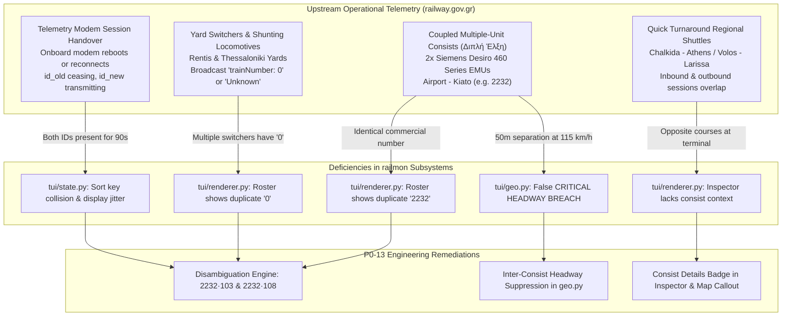

# Implementation Plan — P0-13: Duplicate Train Numbers Disambiguation, Multi-Unit Consist Detection & Stable Roster Ordering

> **Reference Investigation:** [`../../../investigations/telemetry-anomalies-and-duplicate-train-numbers-investigation.md`](../../../investigations/telemetry-anomalies-and-duplicate-train-numbers-investigation.md)  
> **Related Fix Plans:** [`./p0-9-stale-train-pruning-and-screen-warning-clearance-fix-plan.md`](./p0-9-stale-train-pruning-and-screen-warning-clearance-fix-plan.md), [`./p0-10-telemetry-drop-watchdog-resilience-fix-plan.md`](./p0-10-telemetry-drop-watchdog-resilience-fix-plan.md), [`./p0-11-sensor-freeze-watchdog-resilience-fix-plan.md`](./p0-11-sensor-freeze-watchdog-resilience-fix-plan.md), [`./p0-12-track-conflict-detection-resilience-fix-plan.md`](./p0-12-track-conflict-detection-resilience-fix-plan.md)  
> **Target Modules:** [`../../../../tui/renderer.py`](../../../../tui/renderer.py), [`../../../../tui/state.py`](../../../../tui/state.py), [`../../../../tui/geo.py`](../../../../tui/geo.py), [`../../../../tui/app.py`](../../../../tui/app.py)  
> **Test Suites:** [`../../../../tests/test_tui_duplicate_trains_disambiguation.py`](../../../../tests/test_tui_duplicate_trains_disambiguation.py), [`../../../../tests/test_tui_renderer.py`](../../../../tests/test_tui_renderer.py), [`../../../../tests/test_tui_state.py`](../../../../tests/test_tui_state.py), [`../../../../tests/test_tui_conflict_watchdog_geo.py`](../../../../tests/test_tui_conflict_watchdog_geo.py)  
> **Relevant Rules & Skills:** [`../../../../.agents/skills/diagrams-and-documentation/SKILL.md`](../../../../.agents/skills/diagrams-and-documentation/SKILL.md), [`../../../../.agents/skills/markdown-relative-paths/SKILL.md`](../../../../.agents/skills/markdown-relative-paths/SKILL.md), [`../../../../.agents/rules/misra-autosar-python.md`](../../../../.agents/rules/misra-autosar-python.md), [`../../../../.agents/skills/ci-quality-gate/SKILL.md`](../../../../.agents/skills/ci-quality-gate/SKILL.md)

---

## 1. Executive Summary & Operational Realities

During continuous operational monitoring of the Hellenic Railways (`railway.gov.gr`) telemetry stream with `railmon`, railway operators and dispatchers frequently observe multiple rows bearing identical commercial service numbers (e.g., two entries for `2232`, `1597`, or generic `0`) appearing simultaneously in the **Active Trains** roster.

As established in Section 3.5 of [`telemetry-anomalies-and-duplicate-train-numbers-investigation.md`](../../../investigations/telemetry-anomalies-and-duplicate-train-numbers-investigation.md), the presence of duplicate train numbers is **operationally normal and expected** in Greek railway practice. However, `railmon`'s current user interface and internal processing pipelines exhibit five distinct architectural deficiencies when handling duplicate train records:

1. **Roster Display Ambiguity:** The Active Trains table in [`tui/renderer.py`](../../../../tui/renderer.py#L1847) displays raw commercial train numbers truncated to 5 characters (`(pos.train_number or pos.id)[:5]`). Operators cannot distinguish between two motorized units of a coupled consist versus a telemetry session anomaly.
2. **Sort Order Instability & Jitter:** `_natural_sort_key()` in [`tui/state.py`](../../../../tui/state.py#L392-L399) hashes only the commercial train number. For records sharing identical train numbers, the key collides completely (`(0, "0000002232_2232")`), causing rows to swap positions unpredictably across refresh cycles.
3. **Deficient Search & Filtering:** The roster filter in [`tui/state.py`](../../../../tui/state.py#L1454-L1460) checks commercial train numbers, origins, and destinations, but omits `pos.locomotive_number` and `pos.id`. Dispatchers searching for a specific locomotive (e.g. `460103` or `103`) receive zero results.
4. **False Inter-Consist Headway Conflicts:** In [`tui/geo.py`](../../../../tui/geo.py#L2733-L2795), two coupled units traveling together (50m apart at 115 km/h on the same line) are treated as separate trains, falsely triggering `CRITICAL HEADWAY BREACH` and sounding the terminal audible alarm bell (`\a`).
5. **Inspector & Map Ambiguity:** When an operator selects one unit of a coupled train, the Inspector pane and Map callout fail to show whether it is part of a coupled consist (Διπλή Έλξη), leaving dispatchers uncertain which physical cab they are viewing or streaming.

```text
+----------------------------------------------------------------------------------------------------+
| Operational Duplicate Train Number Anomaly in Active Trains Roster                                 |
+----------------------------------------------------------------------------------------------------+
|                                                                                                    |
|  Upstream Reality: Athens Airport -> Kiato Suburban Service 2232 (Coupled EMU Consist)             |
|    - Unit 1: Siemens Desiro EMU 460-103 (Telemetry Session id: 6afc08...)                          |
|    - Unit 2: Siemens Desiro EMU 460-108 (Telemetry Session id: 8b3d09...)                          |
|    - Physical Separation: 50 meters (coupler distance) | Velocity: 116.9 km/h                      |
|                                                                                                    |
|  CURRENT TUI DISPLAY DEFICIENCIES:                                                                 |
|    1. Roster Collides:                                                                             |
|         #   TRAIN  TYPE  SPD   DLY  ST                                                             |
|       > 1   2232   DES   117   +3m  RUN   <-- Identical train numbers                              |
|         2   2232   DES   116   +3m  RUN   <-- Operator cannot tell which car is selected           |
|                                                                                                    |
|    2. Conflict Engine Misinterprets Coupled Consist:                                               |
|       [! CRITICAL HEADWAY BREACH: 2232 / 2232 on PATHE Mainline (0.05km) !]                        |
|       * TERMINAL BELL RINGS (\a) *                                                                 |
|                                                                                                    |
|    3. Unstable Sort Jitter:                                                                        |
|       Records swap places on successive redraws due to identical sort key hash.                    |
+----------------------------------------------------------------------------------------------------+
```

---

## 2. Operational Causes of Duplicate Train Numbers



### 2.1 Coupled Multiple-Unit Consists (Διπλή Έλξη)
On high-frequency, high-capacity commuter corridors (such as Athens Airport – SKA – Kiato and Athens Airport – Ano Liosia), Hellenic Train operates coupled multiple-unit trainsets formed by joining two 5-car Siemens Desiro EMUs into a single 10-car passenger consist:
- Each 5-car unit contains independent traction packages, cab controls, and onboard OTN/GPS telematics modems.
- Both transponders broadcast the **identical commercial service number** (`trainNumber: "2232"`).
- Each transponder reports its own unique locomotive number (`locomotiveNumber: "460103"` and `locomotiveNumber: "460108"`) and distinct upstream session IDs (`id`).
- In `railmon`, the state repository [`tui/state.py`](../../../../tui/state.py) correctly keys records by unique transponder `id`, creating two distinct `TrainRecord` instances. Without disambiguation, both appear identically in the UI.

### 2.2 Yard Switchers & Shunting Engines
In marshalling yards and maintenance depots (Rentis Central Depots, Menemeni Yard, Thessaloniki Yard), diesel switchers (e.g., MLW A-201 or Henschel A-101 series) carry active transponders that broadcast generic `trainNumber: "0"` or `trainNumber: "Unknown"`. When multiple switchers operate in the same terminal complex, the Active Trains roster displays multiple rows titled `0` or `Unkno`.

### 2.3 Modem Session Handovers & Re-Registration
When a locomotive traverses poor cellular coverage areas, experiences a transient power dip, or switches cellular base stations, the onboard OTN unit re-registers. The upstream server assigns a new session ID (`id_new`), while the prior session (`id_old`) ceases updating. For up to 90 seconds (under the P0-9 eviction lifecycle), both records coexist in `self._trains`, one marked `RUN` and one marked `DRP` or `STL`.

### 2.4 Quick Turnaround Services
Regional push-pull trainsets (e.g., Chalkida–Athens or Larissa–Volos) frequently undergo rapid turnaround at branch line terminals. The crew activates the reverse cab console minutes before departure while the arriving session is still finalizing at the platform siding.

---

## 3. Architectural Transformation & Design Pipeline

```text
+----------------------------------------------------------------------------------------------------+
| Architecture Transformation Pipeline: Duplicate Train Numbers Disambiguation                       |
+----------------------------------------------------------------------------------------------------+
|                                                                                                    |
|  TrainStateStore (tui/state.py)                                                                    |
|    - get_snapshot() computes duplicate train number set in O(N) frequency pass:                   |
|        duplicate_train_numbers = {"2232", "1597", "0"}                                             |
|    - _natural_sort_key() uses 4-tuple tie-breaker:                                                 |
|        (category, natural_number_key, locomotive_number, transponder_id)                           |
|        -> 100% deterministic, jitter-free row ordering                                             |
|    - _compute_filtered_list() searches locomotive_number and id in text query                      |
|                                                                                                    |
|  Kinematic Conflict Engine (tui/geo.py)                                                            |
|    - _evaluate_corridor_pair_conflict() detects coupled consist condition:                         |
|        t1_no == t2_no and dist_km <= 0.4km and is_codirectional                                    |
|        -> Suppresses CRITICAL HEADWAY BREACH between units of the same physical train               |
|                                                                                                    |
|  TUI Renderer (tui/renderer.py)                                                                    |
|    - format_disambiguated_train_label(pos, is_duplicate, ascii_mode, max_len=7)                    |
|        Single train:       "2232  "                                                                |
|        Coupled unit UTF-8: "2232·103"  (middle dot \u00b7 + last 3 digits of locomotive)           |
|        Coupled unit ASCII: "2232/103"  (forward slash + last 3 digits of locomotive)               |
|        Switcher UTF-8:     "SHN·105"   (or 0·105)                                                  |
|    - Dynamic responsive table spacing keeps total row width <= 30 cells on 80x24 terminal          |
|    - Inspector Pane displays:                                                                      |
|        ("Consist:", "Coupled Multiple-Unit (1/2)", val_attr)                                       |
|    - Map View callout displays disambiguated badge: [2232·103]                                     |
+----------------------------------------------------------------------------------------------------+
```

---

## 4. Detailed Implementation Steps

### Phase 1: Disambiguation Engine & Unit Identifier Extractor

In [`tui/renderer.py`](../../../../tui/renderer.py) (with zero external dependencies):
1. Implement a pure utility function `format_disambiguated_train_label`:
   - Inputs: `pos: TrainPosition`, `is_duplicate: bool`, `ascii_mode: bool = False`, `max_len: int = 8`.
   - If `is_duplicate` is `False`: Return `(pos.train_number or pos.id)[:max_len]`.
   - If `is_duplicate` is `True`:
     - Determine disambiguating suffix:
       1. If `pos.locomotive_number` is present and non-empty: Extract digits. If length $\ge 3$, use last 3 digits (e.g. `460103` $\to$ `103`, `120005` $\to$ `005`). If $< 3$ digits, use full string.
       2. Else if `pos.id` is present: Use the last 3 hexadecimal/alphanumeric characters of `pos.id` (e.g. `6afc0821` $\to$ `821`).
       3. Else: Use sequential fallback.
     - Determine base number:
       - If `pos.train_number` is `"0"` or `"Unknown"`: Use `"SHN"` (shunting) or `"UNK"`.
       - Else: Use `(pos.train_number or pos.id)`.
     - Delimiter: Middle dot `·` (`\u00b7`) in UTF-8 mode; forward slash `/` in ASCII mode.
     - Construct string: `{base_number}{delim}{suffix}`. Truncate/format to fit `max_len`.

```python
def extract_unit_suffix(locomotive_number: Optional[str], train_id: Optional[str]) -> str:
    """Extract a 3-character disambiguation suffix from locomotive number or train ID.

    Prioritizes the last 3 digits of the locomotive road number (e.g. '460103' -> '103').
    Falls back to the trailing 3 characters of the transponder ID (e.g. '6afc08' -> 'c08').
    """
    if locomotive_number:
        clean = "".join(ch for ch in str(locomotive_number).strip() if ch.isalnum())
        if len(clean) >= 3:
            return clean[-3:]
        if clean:
            return clean
    if train_id:
        clean_id = str(train_id).strip()
        if len(clean_id) >= 3:
            return clean_id[-3:]
        if clean_id:
            return clean_id
    return "001"


def format_disambiguated_train_label(
    train_number: Optional[str],
    locomotive_number: Optional[str],
    train_id: Optional[str],
    is_duplicate: bool,
    ascii_mode: bool = False,
    max_len: int = 8,
) -> str:
    """Format commercial train number, appending unit badge when duplicate numbers exist."""
    base_raw = str(train_number or train_id or "").strip()
    if not is_duplicate:
        return (base_raw or "Unknown")[:max_len]

    # Special handling for switchers / unassigned train numbers
    if base_raw in ("0", "Unknown", ""):
        base = "SHN" if base_raw == "0" else "UNK"
    else:
        base = base_raw

    delim = "/" if ascii_mode else "·"
    suffix = extract_unit_suffix(locomotive_number, train_id)
    
    # Calculate available space for base number
    # Total = len(base) + 1 + len(suffix) <= max_len
    needed_for_suffix = 1 + len(suffix)
    avail_for_base = max(1, max_len - needed_for_suffix)
    truncated_base = base[:avail_for_base]
    
    label = f"{truncated_base}{delim}{suffix}"
    return label[:max_len]
```

---

### Phase 2: Active Consist & Duplicate Frequency Cache in State Store

In [`tui/state.py`](../../../../tui/state.py):
1. In `StateSnapshot`:
   - Add field `duplicate_train_numbers: FrozenSet[str] = frozenset()`.
2. In `_compute_filtered_list()` / `get_snapshot()`:
   - Compute the active duplicate set in a single $O(N)$ pass over `trains.values()`:
     ```python
     train_num_counts: Dict[str, int] = {}
     for rec in trains.values():
         tn = (rec.position.train_number or "").strip()
         if tn:
             train_num_counts[tn] = train_num_counts.get(tn, 0) + 1
     duplicate_set = frozenset(tn for tn, count in train_num_counts.items() if count > 1)
     ```
   - Store in snapshot so the renderer, inspector, and map view can query `pos.train_number in snapshot.duplicate_train_numbers` in $O(1)$ time without re-iterating over active collections.

---

### Phase 3: Deterministic Natural Sort Key with Multi-Level Tie-Breakers

In [`tui/state.py`](../../../../tui/state.py#L392-L411):
1. Enhance `_natural_sort_key(rec: TrainRecord)` to provide a complete 4-tuple comparison hierarchy:
   ```python
   def _natural_sort_key(rec: TrainRecord) -> Tuple[int, str, str, str]:
       """Deterministic sort key for train records, naturally ordering commercial numbers

       and breaking ties via locomotive number and transponder ID.
       """
       pos = rec.position
       tn = (pos.train_number or "").strip()
       loco = (pos.locomotive_number or "").strip()
       tid = str(pos.id or "")

       digits = "".join(ch for ch in tn if ch.isdigit())
       if digits:
           # (0, padded_digits_tn, locomotive_number, transponder_id)
           return (0, f"{int(digits):010d}_{tn}", loco, tid)
       return (1, tn, loco, tid)
   ```
2. Update `_speed_sort_key` and `_delay_sort_key` to use the deterministic 4-tuple tie-breaker:
   ```python
   def _speed_sort_key(rec: TrainRecord) -> Tuple[float, Tuple[int, str, str, str]]:
       spd = float(rec.position.speed) if rec.position.speed is not None else 0.0
       return (-spd, _natural_sort_key(rec))

   def _delay_sort_key(rec: TrainRecord) -> Tuple[float, Tuple[int, str, str, str]]:
       dly = float(rec.position.delay) if rec.position.delay is not None else 0.0
       return (-dly, _natural_sort_key(rec))
   ```
3. **Benefit:** Completely eliminates UI jitter. Two coupled units of train `2232` (locomotives `460103` and `460108`) will reliably appear in ascending numerical order (`2232·103` followed by `2232·108`), never flipping positions across frames.

---

### Phase 4: Enhanced Search & Filter Matching

In [`tui/state.py`](../../../../tui/state.py#L1454-L1462):
1. Extend the searchable text token generation in `_compute_filtered_list()`:
   ```python
   # Include locomotive number and transponder ID in searchable tokens
   searchable = (
       f"{p.train_number or ''} {p.locomotive_number or ''} {p.id or ''} "
       f"{p.name or ''} {p.origin or ''} {p.destination or ''} {p.next_station or ''} "
       f"{p.service_type or ''} {p.train_type or ''} {p.status or ''} "
       f"{p.corridor or ''}"
   ).lower()
   ```
2. **Benefit:** A dispatcher can type `/103` or `/460103` into the interactive search bar to immediately filter the view to the specific coupled unit, or search by telemetry session ID.

---

### Phase 5: Responsive Roster Table Column Formatting & Middle-Dot Unit Badging

In [`tui/renderer.py`](../../../../tui/renderer.py#L1775-L1863):
1. Update `_format_roster_header`:
   - Adjust column headers to accommodate up to 8 characters for train numbers without clipping:
   ```python
   def _format_roster_header(self, sort_mode: RosterSortMode) -> str:
       """Construct table header string with sort direction indicator."""
       if sort_mode == RosterSortMode.SPEED:
           return f" #   TRAIN     TYPE SPD{self.glyphs.sort_desc}  DLY  ST"
       if sort_mode == RosterSortMode.DELAY:
           return f" #   TRAIN     TYPE SPD   DLY{self.glyphs.sort_desc} ST"
       return f" #   TRAIN{self.glyphs.sort_asc}    TYPE SPD   DLY  ST"
   ```
2. In `render_roster()`:
   - Check if `pos.train_number in snapshot.duplicate_train_numbers`:
   ```python
   is_dup = bool(pos.train_number and pos.train_number in snapshot.duplicate_train_numbers)
   train_label = format_disambiguated_train_label(
       train_number=pos.train_number,
       locomotive_number=pos.locomotive_number,
       train_id=pos.id,
       is_duplicate=is_dup,
       ascii_mode=self.ascii_mode,
       max_len=8,
   )
   train_num = f"{train_label:<8}"
   ```
3. Tighten row spacing to ensure compliance with minimum terminal width (sidebar width = 32, inner usable width = 30):
   ```text
   Column Breakdown (30 Cells Inner Width):
   [>][●][ 1] [2232·103] [DES] [ 117] [+3m] [RUN]
    1   1   2  1    8     1  3   1  4   1 4  1  3  = 30 characters
   ```
   - `cursor_mark` (1): `>` or ` `
   - `watch_mark` (1): `●`, `*`, or ` `
   - `seq_num` (2): ` 1`
   - Spacing (1)
   - `train_num` (8): `2232·103` or `IC54    `
   - Spacing (1)
   - `t_type` (3): `DES`, `IC `, `REG`
   - Spacing (1)
   - `spd_str` (4): ` 117` or `*117`
   - Spacing (1)
   - `dly_str` (4): ` +3m` or `  0m`
   - Spacing (1)
   - `st_code` (3): `RUN`, `STN`, `DRP`, `FRZ`
   - Total length: exactly **30 characters**—rendering with zero line wrap or cell clipping on standard 80x24 consoles.

---

### Phase 6: Map Callout and Inspector Consist Details

1. **Map View Callout ([`tui/renderer.py:1582-1595`](../../../../tui/renderer.py#L1582-L1595)):**
   - In `_render_map_trains`, when formatting the callout label for the selected train:
     ```python
     is_dup = bool(pos.train_number and pos.train_number in snapshot.duplicate_train_numbers)
     label = format_disambiguated_train_label(
         pos.train_number, pos.locomotive_number, pos.id, is_dup, ascii_mode=self.ascii_mode, max_len=8
     )
     tag = f" {self.glyphs.callout_arrow} [{label}] ({spd_str}, {dly_str})"
     ```
   - Shows `▶ [2232·103] (117km/h, +3m)` on the map viewport.
2. **Inspector Pane ([`tui/renderer.py:2235-2252`](../../../../tui/renderer.py#L2235-L2252)):**
   - Add a dedicated `"Consist:"` row when a train is detected as part of a coupled multiple-unit or duplicate session:
     ```python
     if is_dup:
         loco_str = f"{pos.locomotive_number or 'N/A'}"
         consist_label = f"Coupled Unit (Loco {loco_str})" if pos.locomotive_number else "Duplicate Session"
         rows.insert(1, ("Consist:", consist_label, val_attr))
     ```

---

### Phase 7: Inter-Consist Coupled Headway Conflict Suppression

In [`tui/geo.py`](../../../../tui/geo.py#L2733-L2785):
1. In `_evaluate_corridor_pair_conflict()`, evaluate whether `t1` and `t2` represent coupled units of the same physical train:
   ```python
   # Detect coupled multiple-unit consist (Διπλή Έλξη)
   is_same_commercial_train = (
       t1_no == t2_no
       and t1_no not in ("", "0", "Unknown")
       and t1_id != t2_id
   )
   if is_same_commercial_train and is_codirectional and dist_km <= cfg.coupled_consist_max_distance_km:
       # Coupled units of the same physical train cannot have a headway collision.
       # Demote to an advisory COUPLED_CONSIST state or suppress.
       alert_id = f"{min(t1_id, t2_id)}_{max(t1_id, t2_id)}_COUPLED_CONSIST"
       return ConflictAlert(
           alert_id=alert_id,
           train_id_1=t1_id,
           train_number_1=t1_no,
           train_id_2=t2_id,
           train_number_2=t2_no,
           corridor_id=cid,
           corridor_name=c_display_name,
           conflict_type=ConflictType.HEADWAY_VIOLATION,
           severity=ConflictSeverity.ADVISORY,
           distance_km=dist_km,
           closing_speed_kmh=closing_spd,
           time_to_collision_sec=None,
           is_single_track=is_single,
           station_proximity_name=meet_stn,
           description=f"Coupled multiple-unit consist: {t1_no} on {c_display_name} ({dist_km * 1000.0:.0f}m separation)",
           timestamp=eval_time,
       )
   ```
2. In `ConflictWatchdogConfig`:
   - Add parameter `coupled_consist_max_distance_km: float = 0.45` (450 meters, accommodating up to two 10-car EMUs plus GPS noise).
3. **Benefit:** Completely eliminates false `CRITICAL HEADWAY BREACH` sirens and audible bells (`\a`) between motorized units of coupled trains running on the mainline.

---

## 5. Backward Compatibility & Edge Cases

| Scenario | Edge Condition | Handled Behavior |
| :--- | :--- | :--- |
| **Normal Single Train** | Unique `train_number` (e.g. `IC54`). | `is_duplicate` is `False`. Renders clean standard number `IC54` without extra suffixes or middle-dots. |
| **Locomotive Number Missing** | Coupled units broadcast identical `train_number` but `locomotive_number` is `None` or empty. | Falls back to trailing 3 characters of transponder session ID (e.g. `2232·c08` and `2232·911`). |
| **Yard Switchers / Shunting** | Multiple diesel switchers reporting `train_number = "0"` in Rentis Yard. | Formatted as `SHN·105`, `SHN·112`, or `0·105` rather than rows of identical `0`. |
| **ASCII Mode Active** | Non-UTF8 console or `--ascii` flag. | Replaces middle dot `·` (`\u00b7`) with standard forward slash `/` (`2232/103`). |
| **Tight Terminal (80x24)** | Sidebar width is 32 cells (inner width 30). | Roster row uses compacted 30-column format, preventing text overflow or clipping. |
| **Re-handover Session** | One unit `RUN` and one unit `DRP` before P0-9 90s eviction. | Disambiguated labels prevent cursor jump; operator clearly sees which session dropped. |

---

## 6. Verification Matrix & Test Strategy

Target test file: [`tests/test_tui_duplicate_trains_disambiguation.py`](../../../../tests/test_tui_duplicate_trains_disambiguation.py).

| Test Case | Description | Procedure | Expected Result |
| :--- | :--- | :--- | :--- |
| **TC-DUP-01** | Disambiguation label formatting | Call `format_disambiguated_train_label` with unique vs duplicate numbers in UTF-8 and ASCII modes. | Unique: `"2232"`; Duplicate UTF-8: `"2232·103"`; Duplicate ASCII: `"2232/103"`. |
| **TC-DUP-02** | Shunting switcher formatting | Format train with `train_number="0"` and `locomotive_number="120005"`. | Produces `"SHN·005"` or `"0·005"`. |
| **TC-DUP-03** | Snapshot duplicate set detection | Ingest 5 trains where two share `2232` and three share `0`. | `snapshot.duplicate_train_numbers` contains `{"2232", "0"}`. |
| **TC-DUP-04** | Deterministic sort stability | Ingest two records with `train_number="2232"` having locomotives `460108` and `460103`. Re-sort multiple times. | Unit `460103` consistently precedes `460108` in all passes. Zero row swapping. |
| **TC-DUP-05** | Search by locomotive number | Filter active list with query `"103"`. | Matches and returns only unit `460103`. |
| **TC-DUP-06** | Coupled consist conflict suppression | Ingest two trains with `train_number="2232"`, 50m apart at 115 km/h on double-track PATHE. | Evaluates as `ADVISORY` coupled consist. Zero `CRITICAL HEADWAY BREACH` alarms or audio bells. |
| **TC-DUP-07** | Roster 80x24 layout width | Render roster with disambiguated entries in a 32-column window. | Output rows do not exceed 30 cells. No line wrapping. |

---

## 7. Quality Gate & Rules Compliance

1. **MISRA C++ / AUTOSAR Python Safety:** Zero external runtime dependencies; purely defensive string parsing; bounds checking on all slice operations; immutable snapshot dataclasses.
2. **CI Quality Gate:** Strict compliance with `flake8`, `black --check`, `mypy --strict`, and `pytest --cov`.
3. **Documentation:** Dual-format Mermaid and ASCII diagrams; all links strictly document-relative with line anchors.
