# Implementation Plan — P0-14: Four Shipping CLI Bugs (History Crashes & Silent GTFS-RT `--from-db --out-dir` Data Loss)

> **Reference Review:** [`../../../architecture/codebase-architecture-review.md`](../../../architecture/codebase-architecture-review.md#L166-L180) (Finding **P0-1**)  
> **Target Modules:** [`../../../../train_tracker.py`](../../../../train_tracker.py), [`../../../../gtfs_rt/exporter.py`](../../../../gtfs_rt/exporter.py), [`../../../../gtfs_rt/__init__.py`](../../../../gtfs_rt/__init__.py)  
> **Test Suites:** [`../../../../tests/test_bottlenecks.py`](../../../../tests/test_bottlenecks.py), [`../../../../tests/test_eta_engine.py`](../../../../tests/test_eta_engine.py), [`../../../../tests/test_cli_storage.py`](../../../../tests/test_cli_storage.py), [`../../../../tests/test_gtfs_exporter.py`](../../../../tests/test_gtfs_exporter.py), [`../../../../tests/test_cli_export.py`](../../../../tests/test_cli_export.py)  
> **Relevant Rules & Skills:** [`../../../../.agents/skills/diagrams-and-documentation/SKILL.md`](../../../../.agents/skills/diagrams-and-documentation/SKILL.md), [`../../../../.agents/skills/markdown-relative-paths/SKILL.md`](../../../../.agents/skills/markdown-relative-paths/SKILL.md), [`../../../../.agents/rules/misra-autosar-python.md`](../../../../.agents/rules/misra-autosar-python.md), [`../../../../.agents/skills/ci-quality-gate/SKILL.md`](../../../../.agents/skills/ci-quality-gate/SKILL.md)

---

## 1. Executive Summary & Root Causes

Full empirical verification of `master` (`HEAD = 531c446`) identified four shipping P0 defects across the `railmon history` and `railmon export --gtfs-rt` CLI subcommands — three guaranteed runtime crashes and one silent total data-loss defect — alongside a Windows SQLite `tearDown()` handle leak in [`tests/test_bottlenecks.py`](../../../../tests/test_bottlenecks.py#L34-L35) causing 8 additional test errors.

| # | Broken CLI Command | Current Failure | Verified Root Cause |
|---|---|---|---|
| **1** | `railmon history bottlenecks` | `NameError: name 'format_bottlenecks_table' is not defined` | [`format_bottlenecks_table`](../../../../train_tracker.py#L3241) is imported in `run_history_mode()`'s local scope, not inside extracted helper [`_handle_history_bottlenecks_action()`](../../../../train_tracker.py#L3202-L3229) (currently failing on `HEAD`). |
| **2** | `railmon history segments` | `NameError: name 'format_segment_transit_table' is not defined` | [`format_segment_transit_table`](../../../../train_tracker.py#L3242) is imported in `run_history_mode()`'s local scope, not inside extracted helper [`_handle_history_segments_action()`](../../../../train_tracker.py#L3171-L3200). |
| **3** | `railmon history trips` | `TypeError: HistoricalRepository.get_active_trips() got an unexpected keyword argument 'date'` | [`run_history_mode()`](../../../../train_tracker.py#L3278) passes `date=args.date`, while [`HistoricalRepository.get_active_trips()`](../../../../storage/repository.py#L827-L832) accepts `service_date`. |
| **4** | `railmon export --gtfs-rt --from-db <db> --out-dir <dir>` | **Silent total data loss:** writes 4 empty feeds (0 entities), prints `[OK]`, exits `0` | [`_export_db_mode()`](../../../../train_tracker.py#L4813-L4831) calls [`_emit_feed_output(msg, mapper, args)`](../../../../train_tracker.py#L4718-L4750) without `positions` or `schedules`; [`export_feed_dir()`](../../../../gtfs_rt/exporter.py#L80-L106) silently coerces `positions=None` to `()` and rebuilds 4 empty feeds. |

### Companion Hygiene Fixes Included in Scope
1. **Windows SQLite `tearDown()` leak (8 errors on `HEAD`):** [`tests/test_bottlenecks.py`](../../../../tests/test_bottlenecks.py#L34-L35) cleans up `TemporaryDirectory` without calling `self.db.close()`, raising `PermissionError [WinError 32]` on Windows. Add explicit `self.db.close()` in both [`tests/test_bottlenecks.py`](../../../../tests/test_bottlenecks.py#L34-L35) and [`tests/test_eta_engine.py`](../../../../tests/test_eta_engine.py#L30-L36).
2. **Greek Unicode JSON output:** [`_handle_history_segments_action()`](../../../../train_tracker.py#L3196) and [`_handle_history_bottlenecks_action()`](../../../../train_tracker.py#L3225) omit `ensure_ascii=False` in `json.dumps()`, escaping Greek station names (`\u039b...`) inconsistently with `history export` ([`L3334`](../../../../train_tracker.py#L3334)) and `export --gtfs-rt` ([`L4808`](../../../../train_tracker.py#L4808)).
3. **Incomplete `history` usage help text:** [`train_tracker.py`](../../../../train_tracker.py#L3268) omits `bottlenecks`, `segments`, and `archive` when no action is provided.

---

## 2. Failure Flows vs. Remediated Flows

### A. Visual Overview (ASCII)

```text
+------------------------------------------------------------------------------+
| CURRENT BROKEN FLOWS (HEAD = 531c446)                                        |
+------------------------------------------------------------------------------+
| 1 & 2. railmon history bottlenecks / segments                                |
|    run_history_mode() [local import format_*_table]                          |
|        |--> _handle_history_*_action() --> format_*_table() --> NameError!   |
|                                                                              |
| 3. railmon history trips                                                     |
|    run_history_mode() --> repo.get_active_trips(date=...) --> TypeError!     |
|                                                                              |
| 4. railmon export --gtfs-rt --from-db hist.db --out-dir out/                 |
|    _export_db_mode() --> export_from_db() [discards positions & schedules]   |
|        |--> _emit_feed_output(msg, mapper, args) [positions=None]            |
|        |--> export_feed_dir(..., positions=None) --> positions or () == ()   |
|        +--> Writes 4 EMPTY feeds (0 entities) + prints [OK] + exits 0!       |
+------------------------------------------------------------------------------+

+------------------------------------------------------------------------------+
| REMEDIATED FLOWS (P0-14)                                                     |
+------------------------------------------------------------------------------+
| 1 & 2. _handle_history_*_action() imports its own formatter + ensure_ascii   |
|        =False for JSON; dead imports removed from run_history_mode().        |
|                                                                              |
| 3. run_history_mode() passes service_date=args.date to get_active_trips().   |
|                                                                              |
| 4. _export_db_mode() --> load_db_snapshot() -> (positions, schedules, ts)    |
|        |--> mapper.build_from_positions(positions, schedules, now=ts)        |
|        |--> _emit_feed_output(msg, mapper, args, positions=..., schedules=.) |
|        |--> export_feed_dir() [fails loud if snapshot & positions both None; |
|        |                       pins resolved_now once across all 4 files]    |
|        +--> Writes 4 POPULATED feeds with stops + identical header.timestamp |
+------------------------------------------------------------------------------+
```

### B. Remediated Data & Control Flow (Mermaid)

```mermaid
flowchart TD
    subgraph HistoryCLI ["railmon history (train_tracker.py)"]
        H0["run_history_mode(args)"]
        H1["action == trips: repo.get_active_trips(service_date=args.date)"]
        H2["action == bottlenecks: _handle_history_bottlenecks_action()"]
        H3["action == segments: _handle_history_segments_action()"]
        F1["storage/cli_formatters.py: format_trips_table()"]
        F2["Local import: format_bottlenecks_table() + JSON ensure_ascii=False"]
        F3["Local import: format_segment_transit_table() + JSON ensure_ascii=False"]

        H0 --> H1 --> F1
        H0 --> H2 --> F2
        H0 --> H3 --> F3
    end

    subgraph GtfsDbExport ["railmon export --gtfs-rt --from-db (gtfs_rt/exporter.py + train_tracker.py)"]
        E0["_export_db_mode(args, mapper, feed_kind)"]
        E1["load_db_snapshot(db_path, at_time, window_sec)"]
        E2["Returns (positions, schedules, ref_ts)"]
        E3["msg = mapper.build_from_positions(positions, feed_kind, now=ref_ts, schedules=schedules)"]
        E4["_emit_feed_output(msg, mapper, args, positions=positions, schedules=schedules)"]
        E5["export_feed_dir(): guard snapshot/positions not both None + pin resolved_now"]
        E6["Atomic writes: feed, vehicle_positions, trip_updates, alerts"]

        E0 --> E1 --> E2 --> E3 --> E4 --> E5 --> E6
    end
```



---

## 3. Detailed Implementation Specification

### 3.1 `gtfs_rt/exporter.py` — Extract `load_db_snapshot()` & Harden `export_feed_dir()`

Target file: [`gtfs_rt/exporter.py`](../../../../gtfs_rt/exporter.py#L1-L137)

1. **Imports:** Add `import time` and `Tuple` to `from typing import ...` (preserving zero PyPI runtime dependency purity verified by [`tests/test_packaging.py`](../../../../tests/test_packaging.py#L227-L280)).
2. **Add `load_db_snapshot()`:**
   ```python
   def load_db_snapshot(
       db_path: str,
       at_time: Optional[str] = None,
       window_sec: int = 120,
   ) -> Tuple[List[TrainPosition], Dict[str, Dict[str, Any]], Optional[float]]:
       """Load point-in-time positions, schedules, and reference epoch from SQLite WAL storage."""
       if not db_path or not os.path.isfile(db_path):
           raise FileNotFoundError(f"SQLite database file not found: '{db_path}'")

       db = Database(db_path, auto_migrate=False)
       try:
           repo = HistoricalRepository(db)
           positions, schedules, snap_epoch = repo.get_gtfs_snapshot(
               at_time=at_time,
               window_sec=window_sec,
           )
       finally:
           db.close()

       ref_ts = snap_epoch if snap_epoch > 0.0 else None
       return positions, schedules, ref_ts
   ```
3. **Delegate inside `export_from_db()` ([`L109-L136`](../../../../gtfs_rt/exporter.py#L109-L136)):**
   ```python
   def export_from_db(
       db_path: str,
       mapper: GtfsRtMapper,
       feed_kind: FeedKind = FeedKind.COMBINED,
       at_time: Optional[str] = None,
       window_sec: int = 120,
   ) -> FeedMessage:
       """Build a GTFS-RT FeedMessage from a recorded SQLite WAL database snapshot."""
       positions, schedules, ref_ts = load_db_snapshot(
           db_path=db_path,
           at_time=at_time,
           window_sec=window_sec,
       )
       return mapper.build_from_positions(
           positions=positions,
           feed_kind=feed_kind,
           now=ref_ts,
           schedules=schedules,
       )
   ```
   Preserves 100% backward compatibility of `export_from_db() -> FeedMessage`.
4. **Fail-loud validation & consistent bundle timestamp in `export_feed_dir()` ([`L80-L106`](../../../../gtfs_rt/exporter.py#L80-L106)):**
   - Validate `clean_dir = _validate_out_dir(out_dir)` first (retaining path-traversal error precedence verified by `TC-GTFS-EXP-02`).
   - Raise `ValueError` if `snapshot is None and positions is None`:
     ```python
     if snapshot is None and positions is None:
         raise ValueError(
             "export_feed_dir requires either 'snapshot' or 'positions' to be provided"
         )
     ```
     *(Explicitly passing `positions=[]` for a legitimately empty DB/time window remains valid and writes 4 empty feeds.)*
   - Pin `resolved_now = now if now is not None else time.time()` once before iterating `FEED_STEMS.items()`, and pass `now=resolved_now` into every `build_feed` / `build_from_positions` call so all 4 files share an identical `FeedHeader.timestamp`.

### 3.2 `gtfs_rt/__init__.py` — Export `load_db_snapshot`

Target file: [`gtfs_rt/__init__.py`](../../../../gtfs_rt/__init__.py#L7-L16) and [`#L152-L160`](../../../../gtfs_rt/__init__.py#L152-L160)

- Import `load_db_snapshot` from `gtfs_rt.exporter` and append `"load_db_snapshot"` to `__all__`.

### 3.3 `train_tracker.py` — Fix History Dispatchers & GTFS-RT DB Export Mode

Target file: [`train_tracker.py`](../../../../train_tracker.py)

1. **`_handle_history_segments_action()` ([`L3171-L3200`](../../../../train_tracker.py#L3171-L3200)):**
   - Add `from storage.cli_formatters import format_segment_transit_table`.
   - Change line 3196 to `print(json.dumps(report.to_dict(), indent=2, ensure_ascii=False))`.
2. **`_handle_history_bottlenecks_action()` ([`L3202-L3229`](../../../../train_tracker.py#L3202-L3229)):**
   - Add `from storage.cli_formatters import format_bottlenecks_table`.
   - Change line 3225 to `print(json.dumps(report.to_dict(), indent=2, ensure_ascii=False))`.
3. **`run_history_mode()` ([`L3240-L3280`](../../../../train_tracker.py#L3240-L3280)):**
   - Remove the unused local imports `format_bottlenecks_table` and `format_segment_transit_table` (lines 3241–3242) to keep `flake8`/`ruff` (`F401`) clean.
   - Update the missing-action guidance at line 3268 to list: `trips, train, punctuality, dwell, bottlenecks, segments, stats, sessions, export, archive`.
   - Fix line 3278 keyword argument:
     ```python
     trips = repo.get_active_trips(
         service_date=args.date, corridor=args.corridor, limit=args.limit
     )
     ```
4. **`_export_db_mode()` ([`L4813-L4831`](../../../../train_tracker.py#L4813-L4831)):**
   - Replace `export_from_db()` call with `load_db_snapshot()` + `mapper.build_from_positions(...)` and forward `positions=positions, schedules=schedules` to `_emit_feed_output()`:
     ```python
     def _export_db_mode(args: argparse.Namespace, mapper: Any, feed_kind: Any) -> int:
         """Export a historical GTFS-RT feed snapshot from SQLite WAL storage."""
         from gtfs_rt.exporter import load_db_snapshot

         db_path = str(getattr(args, "from_db", "") or "").strip()
         at_time = getattr(args, "at", None)
         window_sec = int(getattr(args, "window_sec", 120))
         try:
             positions, schedules, ref_ts = load_db_snapshot(
                 db_path=db_path,
                 at_time=at_time,
                 window_sec=window_sec,
             )
             msg = mapper.build_from_positions(
                 positions=positions,
                 feed_kind=feed_kind,
                 now=ref_ts,
                 schedules=schedules,
             )
             return _emit_feed_output(
                 msg,
                 mapper,
                 args,
                 positions=positions,
                 schedules=schedules,
             )
         except (FileNotFoundError, ValueError, PermissionError, OSError) as exc:
             print(f"[ERROR] Historical GTFS-RT export failed: {exc}", file=sys.stderr)
             return 1
     ```

---

## 4. Test Suite Remediation & Regression Matrix

| Test File | Changes Required | Defects Guarded Against |
|---|---|---|
| [`tests/test_bottlenecks.py`](../../../../tests/test_bottlenecks.py) | Call `self.db.close()` before `self.temp_dir.cleanup()` in `tearDown()`; capture stdout in `test_cli_bottlenecks_execution()` and assert `"CORRIDOR BOTTLENECK ANALYSIS"` and `"Larissa"` for both UTF-8 and `--ascii` invocations. | Bug 1 (`NameError`), 8 Windows `WinError 32` teardown errors, silent empty output. |
| [`tests/test_eta_engine.py`](../../../../tests/test_eta_engine.py) | Add `tearDown()` calling `self.db.close()`; add `test_cli_segments_execution()` (UTF-8 and `--ascii` via `run_history_mode()` on a temp file DB) and `test_cli_segments_json_output()` (verifying non-escaped UTF-8 Greek JSON). | Bug 2 (`NameError`), Greek JSON escaping, SQLite handle leaks. |
| [`tests/test_cli_storage.py`](../../../../tests/test_cli_storage.py) | Add `TestHistoryTripsExecution` running `run_history_mode(parser.parse_args(["history", "trips", ...]))` against a real seeded temp-file DB (unfiltered, `--date`, `--corridor`, `--limit`), asserting exit code `0` and rendered trip rows. | Bug 3 (`TypeError` on `date=` vs `service_date=`). |
| [`tests/test_gtfs_exporter.py`](../../../../tests/test_gtfs_exporter.py) | Add tests for `load_db_snapshot()` (valid DB with/without `--at`, missing DB `FileNotFoundError`, invalid `--at` `ValueError`); test `export_feed_dir()` raising `ValueError` when both `snapshot=None` and `positions=None`, succeeding with `positions=[]`, and emitting identical `header.timestamp` across all 4 files. | Bug 4 (`export_feed_dir` silent empty fallback & split-bundle timestamp drift). |
| [`tests/test_cli_export.py`](../../../../tests/test_cli_export.py) | Add `test_from_db_out_dir_exports_populated_pb_and_json_bundles()` invoking `train_tracker.main(["export", "--gtfs-rt", "--from-db", db_path, "--at", "2026-11-23T17:00:00Z", "--out-dir", tmp_dir])` for both `.pb` and `--format json`, decoding all 4 files and asserting non-empty `vp:IC52`, `tu:sched-ic52-hist` with `stop_id == "LAR"`, and matching `header.timestamp`. | Bug 4 (silent total data loss on `--from-db --out-dir`). |

---

## 5. Safety & Static Analysis Compliance

All changes must preserve strict compliance with [`misra-autosar-python.md`](../../../../.agents/rules/misra-autosar-python.md):
- **PY-MISRA-03:** Catch only explicit exception tuples (`(FileNotFoundError, ValueError, PermissionError, OSError)`).
- **PY-MISRA-04:** Explicit return paths on every branch.
- **PY-MISRA-06:** 100% parameter and return type annotations on `load_db_snapshot()`, `_export_db_mode()`, `_handle_history_segments_action()`, and `_handle_history_bottlenecks_action()`.
- **PY-MISRA-07:** Range check `snap_epoch > 0.0` (no exact float equality).
- **PY-MISRA-08:** All touched functions remain well below McCabe complexity 15 and nesting depth 5.
- **PY-MISRA-09:** Deterministic `try...finally: db.close()` on every opened `Database`.

---

## 6. Verification Plan & Acceptance Criteria

1. **Targeted Regression Suites:**
   ```bash
   python -m unittest tests.test_bottlenecks tests.test_eta_engine tests.test_cli_storage tests.test_gtfs_exporter tests.test_cli_export tests.test_packaging -v
   ```
   - **Pass criteria:** 100% pass, `0` failures, `0` errors (no `WinError 32`).

2. **Full Automated Test Suite:**
   ```bash
   python -m unittest discover -s tests -q
   ```
   - **Pass criteria:** All 930+ tests pass (`0` failures, `0` errors; only expected OS-conditional skips on Windows).

3. **Undefined-Global Symbol-Table Check (`symtable`):**
   - Scan all 37 production `.py` files with Python's `symtable` module.
   - **Pass criteria:** `0` undefined globals across the entire repository (down from `2`).

4. **Static Safety AST Gate:**
   ```bash
   python .agents/skills/static-safety-analyzer/scripts/safety_ast_audit.py --strict train_tracker.py gtfs_rt
   python .agents/skills/static-safety-analyzer/scripts/safety_ast_audit.py --strict
   ```
   - **Pass criteria:** `RESULT: PASSED` (`0` errors, `0` warnings).

5. **Real CLI End-to-End Smoke Verification:**
   - Execute `history trips`, `history bottlenecks`, `history segments`, and `export --gtfs-rt --from-db <db> --out-dir <dir>` against a seeded temp SQLite DB via `python train_tracker.py ...`, confirming exit code `0` and non-empty rendered/decoded output.
