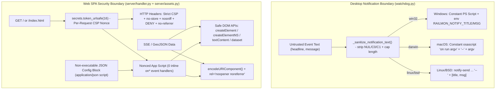

# Implementation Plan — P0-15: Arbitrary Command/Code Execution (RCE) in Desktop Notifications & DOM-Based XSS in Web SPA

> **Reference Review:** [`../../../architecture/codebase-architecture-review.md`](../../../architecture/codebase-architecture-review.md#L218-L231) (Finding **P0-2**)  
> **Target Modules:** [`../../../../watchdog.py`](../../../../watchdog.py), [`../../../../server/assets.py`](../../../../server/assets.py), [`../../../../server/handler.py`](../../../../server/handler.py), [`../../../../server/models.py`](../../../../server/models.py)  
> **Test Suites:** [`../../../../tests/test_watchdog.py`](../../../../tests/test_watchdog.py), [`../../../../tests/test_server_assets.py`](../../../../tests/test_server_assets.py), [`../../../../tests/test_server_daemon.py`](../../../../tests/test_server_daemon.py), [`../../../../tests/test_packaging.py`](../../../../tests/test_packaging.py)  
> **Relevant Rules & Skills:** [`../../../../.agents/rules/security-and-data-protection.md`](../../../../.agents/rules/security-and-data-protection.md), [`../../../../.agents/rules/misra-autosar-python.md`](../../../../.agents/rules/misra-autosar-python.md), [`../../../../.agents/skills/security-audit/SKILL.md`](../../../../.agents/skills/security-audit/SKILL.md), [`../../../../.agents/skills/diagrams-and-documentation/SKILL.md`](../../../../.agents/skills/diagrams-and-documentation/SKILL.md), [`../../../../.agents/skills/markdown-relative-paths/SKILL.md`](../../../../.agents/skills/markdown-relative-paths/SKILL.md)

---

## 1. Executive Summary & Threat Model

Untrusted upstream telemetry fields from `railway.gov.gr` (`id`, `train_number`, `service_type`, `train_type`, `corridor`, `destination`, `next_station`) and station/GeoJSON metadata currently cross security trust boundaries directly into **OS script interpreters** (`powershell`, `osascript`), **CLI option parsers** (`notify-send`), and **browser HTML/JavaScript execution sinks** (`innerHTML`, Leaflet `L.divIcon({html})`, `bindPopup()`, inline `onclick="..."`) without structural separation or a `Content-Security-Policy`.

| # | Vulnerability Class | Affected Component | Verified Exploit / Root Cause | Severity |
|---|---|---|---|---|
| **1** | **OS Command / Code Execution (Windows RCE)** | [`watchdog.py`](../../../../watchdog.py#L700-L718) (`dispatch_desktop_notification`) | Interpolates `title`/`message` into inline PowerShell `CreateTextNode('...')` after escaping only ASCII `'`. PowerShell's tokenizer treats Unicode smart single quotes (`U+2018` `‘`, `U+2019` `’`, `U+201A` `‚`, `U+201B` `‛`) as string delimiters; payload `\u2019)); <cmd>; #` executes arbitrary PowerShell (empirically verified on host). | **Critical (CWE-78 / CWE-94)** |
| **2** | **OS Code Execution (macOS RCE)** | [`watchdog.py`](../../../../watchdog.py#L689-L698) (`dispatch_desktop_notification`) | Interpolates `title`/`message` into inline AppleScript string literals after replacing `"` with `\"` without escaping `\` (or `\r`/`\n`). Payload `\" & (do shell script "...") & \"` becomes `\\"`, breaking out of the string literal and executing arbitrary shell commands. | **Critical (CWE-78 / CWE-94)** |
| **3** | **CLI Option Injection (Linux / BSD)** | [`watchdog.py`](../../../../watchdog.py#L681-L687) (`dispatch_desktop_notification`) | Invokes `notify-send` without an end-of-options `--` sentinel; titles or messages starting with `-` (e.g., `--icon=...`, `-u`, `-t`) are parsed by GLib `GOptionContext` as CLI flags. | **High (CWE-88)** |
| **4** | **DOM-Based XSS (Web SPA — 4 Dynamic Sinks)** | [`server/assets.py`](../../../../server/assets.py#L934-L944), [`#L968-L1001`](../../../../server/assets.py#L968-L1001), [`#L1088-L1124`](../../../../server/assets.py#L1088-L1124), [`#L1165-L1218`](../../../../server/assets.py#L1165-L1218) | Raw interpolation of upstream telemetry and station metadata into `roster.innerHTML`, `card.innerHTML`, Leaflet `L.divIcon({html})`, `layer.bindPopup()`, inline `onclick="selectTrain('${t.id}')"`, `onclick="centerOnTrain('${t.id}')"`, `onclick="toggleSingleTrail('${t.id}')"`, and unencoded `href="/cab?train=${t.id}"` / `href="https://railway.gov.gr/departures/${p.code}"`. | **Critical (CWE-79)** |
| **5** | **Missing CSP, Static Inline Handlers & Server-Side JS Interpolation** | [`server/handler.py`](../../../../server/handler.py#L115-L126), [`server/assets.py`](../../../../server/assets.py#L748-L799), [`#L826-L828`](../../../../server/assets.py#L826-L828), [`#L1379-L1381`](../../../../server/assets.py#L1379-L1381) | No `Content-Security-Policy`, `X-Content-Type-Options`, `X-Frame-Options`, or `Referrer-Policy` headers; 11 static inline HTML event handlers (`onclick`/`onchange`/`oninput`) block strict `script-src` without `'unsafe-inline'`; server-side `.replace()` injects strings directly into executable JS; external/new-tab links omit `rel="noopener noreferrer"`. | **High (CWE-693 / CWE-79)** |

### Companion Security & Safety Hygiene Included in Scope
1. **Control-character & NUL sanitization + length bounds on desktop notifications:** Strip `\x00` (prevents `ValueError: embedded null character` in Windows `CreateProcess` and C argv truncation on POSIX), strip disallowed C0/C1 control characters (prevents WinRT XML DOM exceptions and terminal/daemon corruption), and bound title (`256` chars) and body (`1024` chars).
2. **`watchdog.py` `PY-MISRA-03` compliance:** Narrow `dispatch_desktop_notification()` exception handling from broad `Exception` to `(OSError, ValueError, subprocess.SubprocessError)` and resolve the two `PY-MISRA-03` silent `except Exception: pass` warnings in adjacent `dispatch_terminal_bell()` ([`watchdog.py`](../../../../watchdog.py#L661-L671)), bringing `safety_ast_audit.py --strict watchdog.py` to 0 errors and 0 warnings.
3. **JSON/API MIME-sniffing protection:** Emit `X-Content-Type-Options: nosniff`, `X-Frame-Options: DENY`, `Referrer-Policy: no-referrer`, and `Content-Security-Policy: default-src 'none'; frame-ancestors 'none'` on JSON/GeoJSON/error/SSE responses in [`server/handler.py`](../../../../server/handler.py) (preventing MIME-sniffing of reflected `self.path` in 404 error bodies).

---

## 2. Attack Surface vs. Hardened Trust Boundaries

### A. Trust Boundary Architecture (ASCII)

```text
+------------------------------------------------------------------------------+
| CURRENT VULNERABLE FLOWS (DATA MIXED WITH CODE)                              |
+------------------------------------------------------------------------------+
| [A] Desktop Notifications (watchdog.py)                                      |
|   Untrusted Telemetry (train_number, destination)                            |
|       |--> Win32:  f"CreateTextNode('{title}')"  --> Smart-quote \u2019 RCE! |
|       |--> macOS:  f'display notification "{m}"' --> Backslash \" RCE!       |
|       +--> Linux:  ["notify-send", ..., title]   --> Leading '-' flag inject!|
|                                                                              |
| [B] Web Map SPA (server/assets.py + server/handler.py)                       |
|   Untrusted SSE JSON / GeoJSON / Server Config                               |
|       |--> roster.innerHTML / card.innerHTML / onclick="selectTrain('${id}')"|
|       |--> L.divIcon({html: `...${trainNum}...`}) / bindPopup(`...${p}...`)  |
|       +--> HTTP 200 text/html (NO CSP, NO nosniff, 11 inline on* handlers)   |
+------------------------------------------------------------------------------+

+------------------------------------------------------------------------------+
| REMEDIATED FLOWS (STRICT CODE/DATA SEPARATION + DEFENSE IN DEPTH — P0-15)    |
+------------------------------------------------------------------------------+
| [A] Desktop Notifications (watchdog.py)                                      |
|   Untrusted Text --> _sanitize_notification_text() (no NUL/C0, length cap)   |
|       |--> Win32:  Constant PS script + child env RAILMON_NOTIFY_TITLE / MSG |
|       |            CreateTextNode([string]$env:RAILMON_NOTIFY_*) -> 0 parser |
|       |--> macOS:  Constant AppleScript `on run argv` + "--" + [title, msg]  |
|       +--> Linux:  ["notify-send", "-a", "railmon", ..., "--", title, msg]   |
|                                                                              |
| [B] Web Map SPA (server/assets.py + server/handler.py)                       |
|   1. Per-request 128-bit CSPRNG nonce (secrets.token_urlsafe(16))            |
|      --> CSP: default-src 'none'; script-src 'nonce-<N>' leaflet.js; ...     |
|      --> Cache-Control: no-store + nosniff + X-Frame-Options: DENY           |
|   2. Config in non-executable <script type="application/json"> (HTML-escaped)|
|   3. ZERO inline on* handlers -> addEventListener + delegated dataset.trainId|
|   4. ZERO innerHTML -> createElement / createElementNS / textContent         |
|      (Leaflet L.divIcon({html: Element}) & layer.bindPopup(Element))         |
|   5. URL params via encodeURIComponent() + rel="noopener noreferrer"         |
+------------------------------------------------------------------------------+
```

### B. Hardened Data & Execution Flow (Mermaid)



---

## 3. Detailed Implementation Specification

### 3.1 `watchdog.py` — Out-of-Band Desktop Notification Dispatch & Sanitization

Target file: [`watchdog.py`](../../../../watchdog.py#L652-L724)

1. **Module-Level Security Constants (Zero Interpolation):**
   Add immutable constants directly above `dispatch_desktop_notification()`:
   ```python
   _MAX_NOTIFICATION_TITLE_LEN: int = 256
   _MAX_NOTIFICATION_BODY_LEN: int = 1024

   _DARWIN_NOTIFICATION_SCRIPT: Tuple[str, ...] = (
       "on run argv",
       '  display notification (item 2 of argv) with title (item 1 of argv) subtitle "railmon"',
       "end run",
   )

   _WINDOWS_TOAST_PS_SCRIPT: str = (
       "[Windows.UI.Notifications.ToastNotificationManager, Windows.UI.Notifications, "
       "ContentType = WindowsRuntime] > $null; "
       "$template = [Windows.UI.Notifications.ToastNotificationManager]::GetTemplateContent("
       "[Windows.UI.Notifications.ToastTemplateType]::ToastText02); "
       "$textNodes = $template.GetElementsByTagName('text'); "
       "$textNodes.Item(0).AppendChild("
       "$template.CreateTextNode([string]$env:RAILMON_NOTIFY_TITLE)) > $null; "
       "$textNodes.Item(1).AppendChild("
       "$template.CreateTextNode([string]$env:RAILMON_NOTIFY_MSG)) > $null; "
       "$notifier = [Windows.UI.Notifications.ToastNotificationManager]::CreateToastNotifier('railmon'); "
       "$notification = [Windows.UI.Notifications.ToastNotification]::new($template); "
       "$notifier.Show($notification);"
   )
   ```

2. **Input Sanitizer Helper `_sanitize_notification_text()`:**
   ```python
   def _sanitize_notification_text(
       text: Any,
       max_len: int,
       allow_newlines: bool = False,
   ) -> str:
       """Strip NUL and disallowed control characters and bound notification length."""
       raw = "" if text is None else str(text)
       normalized = raw.replace("\r\n", "\n").replace("\r", "\n")

       cleaned_chars: List[str] = []
       for ch in normalized:
           code = ord(ch)
           if code == 0 or code == 0x7F or (0x80 <= code <= 0x9F):
               continue
           if code < 0x20:
               if allow_newlines and ch in ("\n", "\t"):
                   cleaned_chars.append(ch)
               elif ch in ("\n", "\t"):
                   cleaned_chars.append(" ")
               continue
           cleaned_chars.append(ch)

       cleaned = "".join(cleaned_chars)
       if not allow_newlines:
           cleaned = " ".join(cleaned.split())
       else:
           cleaned = cleaned.strip()

       if len(cleaned) > max_len:
           return cleaned[: max(0, max_len - 3)] + "..."
       return cleaned
   ```
   - Preserves Greek UTF-8 characters (`Θεσσαλονίκη`, `Αθήνα`), punctuation, and quotes verbatim (data never enters any parser).
   - Eliminates `\x00` (prevents `ValueError` in `subprocess.Popen` on Windows and C-string truncation on POSIX) and invalid XML 1.0 control bytes.

3. **Hardened `dispatch_desktop_notification(title: str, message: str) -> bool`:**
   ```python
   def dispatch_desktop_notification(title: str, message: str) -> bool:
       """Dispatch a native desktop notification across Windows, macOS, or Linux.

       Zero third-party dependencies: passes notification text strictly out-of-band
       (argv after '--' on Linux/macOS, child environment variables on Windows) so
       untrusted telemetry can never be interpreted as code or CLI flags.
       """
       safe_title = _sanitize_notification_text(
           title, max_len=_MAX_NOTIFICATION_TITLE_LEN, allow_newlines=False
       )
       safe_msg = _sanitize_notification_text(
           message, max_len=_MAX_NOTIFICATION_BODY_LEN, allow_newlines=True
       )
       system = sys.platform

       try:
           if system.startswith("linux") or "bsd" in system:
               subprocess.Popen(
                   [
                       "notify-send",
                       "-a",
                       "railmon",
                       "-i",
                       "dialog-information",
                       "--",
                       safe_title,
                       safe_msg,
                   ],
                   stdin=subprocess.DEVNULL,
                   stdout=subprocess.DEVNULL,
                   stderr=subprocess.DEVNULL,
               )
               return True

           if system == "darwin":
               cmd: List[str] = ["osascript"]
               for stmt in _DARWIN_NOTIFICATION_SCRIPT:
                   cmd.extend(["-e", stmt])
               cmd.extend(["--", safe_title, safe_msg])
               subprocess.Popen(
                   cmd,
                   stdin=subprocess.DEVNULL,
                   stdout=subprocess.DEVNULL,
                   stderr=subprocess.DEVNULL,
               )
               return True

           if system == "win32":
               child_env = os.environ.copy()
               child_env["RAILMON_NOTIFY_TITLE"] = safe_title
               child_env["RAILMON_NOTIFY_MSG"] = safe_msg
               popen_kwargs: Dict[str, Any] = {
                   "env": child_env,
                   "stdin": subprocess.DEVNULL,
                   "stdout": subprocess.DEVNULL,
                   "stderr": subprocess.DEVNULL,
               }
               create_no_window = getattr(subprocess, "CREATE_NO_WINDOW", 0)
               if create_no_window:
                   popen_kwargs["creationflags"] = create_no_window
               subprocess.Popen(
                   [
                       "powershell",
                       "-NoProfile",
                       "-NonInteractive",
                       "-WindowStyle",
                       "Hidden",
                       "-Command",
                       _WINDOWS_TOAST_PS_SCRIPT,
                   ],
                   **popen_kwargs,
               )
               return True

       except (OSError, ValueError, subprocess.SubprocessError) as exc:
           logger.debug("Desktop notification dispatch failed: %s", exc)
       return False
   ```
   - **Empirical validation:** Verified directly against Windows PowerShell 5.1 (`CreateTextNode([string]$env:RAILMON_NOTIFY_*)`): adversarial smart-quote payload `IC52’)); Write-Output PWNED; # '"$(whoami)`, HTML/XML payload `<script>alert(1)</script> & Θεσσαλονίκη`, and empty strings `""` produce valid XML-escaped WinRT toast DOM with exit code `0` and zero code execution.
   - **Process hygiene:** `stdin=subprocess.DEVNULL` prevents child processes from contending with curses/terminal stdin; `os.environ.copy()` avoids thread-unsafe mutation of process-global environment variables.

4. **Companion `PY-MISRA-03` Fix in `dispatch_terminal_bell()` ([`watchdog.py`](../../../../watchdog.py#L656-L672)):**
   - Narrow `except Exception: pass` on `sys.stdout.write` / `flush` to `except (OSError, ValueError) as exc: logger.debug("Terminal bell write skipped: %s", exc)`.
   - Narrow `except Exception: pass` on `winsound.MessageBeep` to `except (ImportError, OSError, RuntimeError) as exc: logger.debug("Windows console beep unavailable: %s", exc)`.

---

### 3.2 `server/assets.py` — Zero-`innerHTML` Web SPA, Delegated Listeners & Nonce Support

Target file: [`server/assets.py`](../../../../server/assets.py#L176-L1383)

> [!IMPORTANT]
> Preserve zero new Python imports in `server/assets.py` so [`TC-AST-18`](../../../../tests/test_server_assets.py#L188-L211) (`allowed_stdlib = {"json", "logging", "pathlib", "threading", "typing"}`) continues passing unchanged.

1. **Nonce Validation & Safe JSON Config Serialization:**
   Add two focused helpers above `get_spa_html()`:
   ```python
   _CSP_NONCE_ALPHABET: frozenset[str] = frozenset(
       "ABCDEFGHIJKLMNOPQRSTUVWXYZabcdefghijklmnopqrstuvwxyz0123456789-_+/="
   )
   _CSP_NONCE_MIN_LEN: int = 16
   _CSP_NONCE_MAX_LEN: int = 128

   def _validate_csp_nonce(csp_nonce: str) -> str:
       """Validate CSP nonce characters and length to prevent header/attribute injection."""
       if not isinstance(csp_nonce, str):
           raise ValueError("CSP nonce must be a string")
       if not (_CSP_NONCE_MIN_LEN <= len(csp_nonce) <= _CSP_NONCE_MAX_LEN):
           raise ValueError(
               f"CSP nonce length must be between {_CSP_NONCE_MIN_LEN} and {_CSP_NONCE_MAX_LEN}"
           )
       if not all(ch in _CSP_NONCE_ALPHABET for ch in csp_nonce):
           raise ValueError("CSP nonce contains disallowed characters")
       return csp_nonce

   def _serialize_spa_config(cfg: ServerConfig) -> str:
       """Serialize tile provider configuration as HTML-safe JSON for inline data block."""
       payload = {
           "tileUrl": cfg.tile_provider.tile_url,
           "attribution": cfg.tile_provider.attribution,
           "tileProvider": cfg.tile_provider.value,
       }
       raw_json = json.dumps(payload, ensure_ascii=False)
       return (
           raw_json.replace("&", "\\u0026")
           .replace("<", "\\u003c")
           .replace(">", "\\u003e")
           .replace("\u2028", "\\u2028")
           .replace("\u2029", "\\u2029")
       )
   ```
   Update `get_spa_html()` signature (backward compatible):
   ```python
   def get_spa_html(
       config: Optional[ServerConfig] = None,
       csp_nonce: Optional[str] = None,
   ) -> str:
       """Generate complete standalone HTML5 single-page application."""
       cfg = config or ServerConfig()
       nonce_attr = ""
       if csp_nonce is not None:
           validated_nonce = _validate_csp_nonce(csp_nonce)
           nonce_attr = f' nonce="{validated_nonce}"'

       html = SPA_HTML_TEMPLATE.replace(
           "__RAILMON_CONFIG_JSON__", _serialize_spa_config(cfg)
       )
       html = html.replace("__SCRIPT_NONCE_ATTR__", nonce_attr)
       return html
   ```
   In `SPA_HTML_TEMPLATE`, replace lines 824–828 with:
   ```html
   <script id="railmonConfig" type="application/json">__RAILMON_CONFIG_JSON__</script>
   <script__SCRIPT_NONCE_ATTR__>
     // Parse server-injected runtime configuration from non-executable JSON block
     const RAILMON_CONFIG = JSON.parse(
       (document.getElementById('railmonConfig') || {}).textContent || '{}'
     );
     const INITIAL_TILE_URL = RAILMON_CONFIG.tileUrl || 'https://{s}.basemaps.cartocdn.com/dark_all/{z}/{x}/{y}{r}.png';
     const INITIAL_ATTRIBUTION = RAILMON_CONFIG.attribution || '&copy; CARTO';
     const INITIAL_TILE_PROVIDER = RAILMON_CONFIG.tileProvider || 'carto-dark';
   ```
   - Zero server-side string interpolation ever enters executable JavaScript.
   - Preserves `dark_all/{z}/{x}/{y}{r}.png`, `light_all`, `tile.openstreetmap.org/{z}/{x}/{y}.png`, `CARTO`, and `OpenStreetMap` assertions in `TC-AST-06` and `TC-AST-08`.

2. **Eliminate All 11 Static HTML Inline Event Handlers ([`server/assets.py`](../../../../server/assets.py#L748-L799)):**
   Remove every `onchange`, `onclick`, and `oninput` attribute from the HTML shell so strict `script-src` without `'unsafe-inline'` allows 100% of UI controls to operate:
   - `#tileSelect`: remove `onchange="switchTileProvider(this.value)"` -> bind `'change'` listener.
   - `#layerTracks`, `#layerStations`, `#layerInfra`, `#layerTrails`: remove `onchange="..."`, add `data-layer="tracks|stations|infra|trails"` -> bind `'change'` listeners.
   - `#conflictBanner` dismiss `<button>`: add `id="dismissConflictBtn" type="button"`, remove `onclick="dismissConflictBanner()"` -> bind `'click'` listener calling `dismissConflictBanner`.
   - `#sidebarToggle`: add `type="button"`, remove `onclick="toggleSidebar()"` -> bind `'click'` listener calling `toggleSidebar`.
   - `#searchInput`: remove `oninput="handleSearch(this.value)"` -> bind `'input'` listener.
   - `#sortBtnId`, `#sortBtnSpeed`, `#sortBtnDelay`: add `type="button" data-sort="id|speed|delay"`, remove `onclick="setSort(...)"` -> bind `'click'` listeners.

3. **Add Client-Side Sanitization Helpers inside `<script>`:**
   ```js
   const SVG_NS = 'http://www.w3.org/2000/svg';

   function escapeHtml(value) {
     return String(value ?? '')
       .replace(/&/g, '&amp;')
       .replace(/</g, '&lt;')
       .replace(/>/g, '&gt;')
       .replace(/"/g, '&quot;')
       .replace(/'/g, '&#39;');
   }

   function safeText(value, fallback = '') {
     if (value === null || value === undefined || value === '') return fallback;
     return String(value);
   }

   function safeFiniteNumber(value, fallback = 0) {
     const num = Number(value);
     return Number.isFinite(num) ? num : fallback;
   }
   ```

4. **Remediation of All 4 Dynamic DOM XSS Sinks (Zero `innerHTML`):**

   - **Sink 1 — Station Popups ([`server/assets.py`](../../../../server/assets.py#L934-L944)):**
     Construct `<div class="station-popup">` using `document.createElement` + `.textContent`:
     - `<h4>`: `nameEl + (nameEn ? ' (' + nameEn + ')' : '')` via `.textContent`.
     - Meta `<div class="meta">`: `Code: ` + `<strong>` (`p.code || '--'`) + ` | Corridor: ` + `p.corridor || 'Mainline'` via text nodes / `.textContent`.
     - Optional altitude `<div class="meta">`: only when `Number.isFinite(Number(p.altitude_m)) && Number(p.altitude_m) !== 0`, set `.textContent`.
     - External link `<a>`: `href = 'https://railway.gov.gr/departures/' + encodeURIComponent(safeText(p.code))`, `target = '_blank'`, `rel = 'noopener noreferrer'`, `textContent = 'View Live Departures \u2192'`.
     - Pass the `HTMLDivElement` directly to `layer.bindPopup(popupEl)` (Leaflet natively accepts `HTMLElement` without `innerHTML`).

   - **Sink 2 — SVG Locomotive Train Marker (`createTrainIcon`, [`server/assets.py`](../../../../server/assets.py#L968-L1001)):**
     Build the marker DOM subtree with `document.createElement` + `document.createElementNS(SVG_NS, ...)` and pass the root `Element` directly to `L.divIcon({ html: bodyEl, ... })` (Leaflet 1.9.4 `DivIcon.createIcon` checks `options.html instanceof Element` and uses `div.appendChild(options.html)` without calling `innerHTML`):
     - `bodyEl.className = 'train-marker-body ' + catClass + (isSelected ? ' marker-selected' : '') + (isDelayed ? ' marker-delayed' : '')` (`catClass` strictly from hardcoded allowlist).
     - `const heading = Math.round(safeFiniteNumber(t.heading, 0));`
     - `glyphWrap.setAttribute('style', 'transform: rotate(' + heading + 'deg);');` (guaranteed integer; preserves `TC-AST-09` `"transform: rotate"` check).
     - Construct `<svg class="loco-svg" viewBox="0 0 24 24">`, `<path class="loco-body" d="M12 2L4 19L12 15L20 19L12 2Z">`, `<circle cx="12" cy="11" r="2.5" fill="#0a0e17">` via `document.createElementNS(SVG_NS, ...)`.
     - `labelEl.className = 'marker-label'; labelEl.textContent = safeText(t.train_number || t.id, 'Unknown');`
     - If `speed > 0`, `speedEl.className = 'marker-speed'; speedEl.textContent = speed + 'k';`

   - **Sink 3 — Sidebar Train Roster (`renderRoster`, [`server/assets.py`](../../../../server/assets.py#L1058-L1124)):**
     - Guard search matching with `safeText(t.id).toLowerCase()` etc.
     - Build a `DocumentFragment` of `<li class="roster-item">` elements using `document.createElement` + `.textContent` for `train-num`, `service-badge`, `route-subtext` (`corridor + ' \u2192 ' + nextStation`), `speed-val` (`speed + ' '` + `<small>km/h</small>`), and `delay-val`.
     - Store train identifier strictly in `li.dataset.trainId = safeText(t.id)` — ZERO inline `onclick` attribute!
     - Commit atomically with `roster.replaceChildren(fragment)` (ZERO `innerHTML`).
     - Register a single delegated click listener on `#rosterList` during initialization:
       ```js
       document.getElementById('rosterList').addEventListener('click', function(ev) {
         const item = ev.target.closest('li.roster-item');
         if (item && item.dataset.trainId !== undefined) {
           selectTrain(item.dataset.trainId);
         }
       });
       ```

   - **Sink 4 — Selected Train Inspector & Sparkline (`renderInspector` & `generateSparkline`, [`server/assets.py`](../../../../server/assets.py#L1165-L1236)):**
     - Replace `card.innerHTML = ...` completely with `document.createElement` + `.textContent` + `card.replaceChildren(...)`.
     - Refactor `generateSparkline(points, width, height)` to construct and return an `SVGSVGElement` via `document.createElementNS(SVG_NS, 'svg')` + `document.createElementNS(SVG_NS, 'polyline')` (`stroke="#0ea5e9"`, `stroke-width="2"`, `fill="none"`), sanitizing every point with `Math.max(0, safeFiniteNumber(p, 0))`.
     - Build inspector action buttons (`Center`, `Trail`) with `type="button"`, `data-action="center|trail"`, `data-train-id = safeText(t.id)` — ZERO inline `onclick` attributes — handled by one delegated click listener on `#inspectorCard`.
     - Build Cab Stream link `<a>` with `href = '/cab?train=' + encodeURIComponent(safeText(t.id))`, `target = '_blank'`, `rel = 'noopener noreferrer'`, `textContent = 'Cab Stream \u2192'`.

   - **Additional DOM & SSE Hygiene:**
     - Switch remaining `.innerText` writes (`#mapCenterCoords`, `#activeCount`, `#delayCount`, `#conflictText`, `#connPill`, `#metricLatency`, `#metricClients`) to `.textContent`.
     - Guard `alert.distance_km` in `showConflictBanner()` with `Number.isFinite(Number(alert.distance_km))` before `.toFixed(1)`.
     - Validate SSE train items (`t && typeof t === 'object' && t.id != null`) and normalize `const tid = String(t.id)` before inserting into `trainsMap`.

---

### 3.3 `server/handler.py` & `server/models.py` — Strict Per-Request Nonce CSP & Security Headers

Target files: [`server/handler.py`](../../../../server/handler.py#L1-L130), [`#L289-L552`](../../../../server/handler.py#L289-L552); [`server/models.py`](../../../../server/models.py#L36-L42)

1. **Import `secrets` in [`server/handler.py`](../../../../server/handler.py#L1-L14)** (Python stdlib; update `TC-PKG-08` `allowed_stdlib` in [`tests/test_packaging.py`](../../../../tests/test_packaging.py#L99-L122) to include `"secrets"`).
2. **Add `build_spa_csp_header(csp_nonce: str) -> str`:**
   ```python
   _API_CSP_POLICY: str = "default-src 'none'; frame-ancestors 'none'"

   def build_spa_csp_header(csp_nonce: str) -> str:
       """Build a strict Content-Security-Policy header scoped to a per-request nonce."""
       return (
           "default-src 'none'; "
           f"script-src 'nonce-{csp_nonce}' https://unpkg.com/leaflet@1.9.4/dist/leaflet.js; "
           "style-src 'self' 'unsafe-inline' https://unpkg.com/leaflet@1.9.4/dist/leaflet.css; "
           "img-src 'self' data: https://*.basemaps.cartocdn.com "
           "https://*.tile.openstreetmap.org https://unpkg.com/leaflet@1.9.4/dist/images/; "
           "connect-src 'self'; "
           "font-src 'self'; "
           "object-src 'none'; "
           "base-uri 'none'; "
           "form-action 'none'; "
           "frame-ancestors 'none'"
       )
   ```
   - `script-src` omits `'unsafe-inline'` and `'unsafe-eval'`, pinning external script loading strictly to the exact Leaflet 1.9.4 bundle URL (already paired with Subresource Integrity `sha256-...`).
   - `style-src` retains `'unsafe-inline'` strictly for CSS because Leaflet dynamically applies inline `style` transforms on map panes, tiles, and markers (`style-src` cannot execute JS).
   - `img-src` allows only same-origin, `data:`, CartoDB tile CDN, OpenStreetMap tile CDN, and Leaflet 1.9.4 marker assets.
   - `connect-src 'self'` constrains `fetch()` and `EventSource('/api/stream')` strictly to the local daemon origin.
   - `object-src 'none'`, `base-uri 'none'`, `form-action 'none'`, `frame-ancestors 'none'` neutralize plugin, base-tag hijacking, form exfiltration, and clickjacking attacks.
3. **Add `_add_security_headers(self, csp_policy: Optional[str] = None) -> None` on `WebMapRequestHandler`:**
   ```python
   def _add_security_headers(self, csp_policy: Optional[str] = None) -> None:
       """Attach baseline HTTP security headers to responses."""
       self.send_header("X-Content-Type-Options", "nosniff")
       self.send_header("X-Frame-Options", "DENY")
       self.send_header("Referrer-Policy", "no-referrer")
       if csp_policy:
           self.send_header("Content-Security-Policy", csp_policy)
   ```
4. **Update `_handle_root()` ([`server/handler.py`](../../../../server/handler.py#L115-L127)):**
   - Generate fresh per-request `csp_nonce = secrets.token_urlsafe(16)` (128-bit CSPRNG entropy).
   - Render `html_content = get_spa_html(cfg, csp_nonce=csp_nonce).encode("utf-8")`.
   - Emit `Cache-Control: no-store` (prevents stale cached nonces across browser/proxy caches).
   - Call `self._add_security_headers(csp_policy=build_spa_csp_header(csp_nonce))`.
5. **Attach `_add_security_headers(csp_policy=_API_CSP_POLICY)` across non-HTML handlers:**
   - `_send_bytes_response()` (covers `/api/trains`, `/api/tracks`, `/api/stations`, `/api/infrastructure`, `/api/speed-limits`, `/api/conflicts`, `/api/health`, `/api/history/train/<id>`).
   - `_send_json_error()` (prevents MIME-sniffing of reflected `self.path` in 404/405/503 JSON error payloads).
   - `_handle_metrics()`, `_handle_gtfs_rt()`, `_handle_sse_stream()`, `_handle_sse_stream_head()`.
6. **External link hardening in [`server/models.py`](../../../../server/models.py#L36-L42):**
   - Update `TileProvider.attribution` anchor tags to include `target="_blank" rel="noopener noreferrer"`.

---

## 4. Adversarial Test Suite & Regression Matrix

| Test File | Tests to Add / Update | Defects Guarded Against |
|---|---|---|
| [`tests/test_watchdog.py`](../../../../tests/test_watchdog.py) | 1. **Windows RCE unit tests:** Feed smart quotes (`\u2018`, `\u2019`, `\u201A`, `\u201B`), ASCII `'`, `"`, `$(whoami)`, backticks, `;`, `|`, `<script>`, NUL `\x00`, C0/C1 controls, empty strings, and 5,000-char payloads into `dispatch_desktop_notification()` under mocked `win32`; assert `Popen` `argv` is strictly identical to constant `_WINDOWS_TOAST_PS_SCRIPT`, payload text never appears in `argv`, sanitized strings appear in `kwargs["env"]["RAILMON_NOTIFY_TITLE"]` / `RAILMON_NOTIFY_MSG`, `os.environ` is unmutated, and `stdin=subprocess.DEVNULL`.<br>2. **Windows real-PowerShell RCE regression test (`@unittest.skipUnless(sys.platform == "win32", ...)`):** Execute the WinRT XML builder snippet (without `.Show()`) against real `powershell` with a file-creation smart-quote breakout payload (`IC52\u2019)); New-Item -Path '<tmp>/pwned' -ItemType File; #`); assert sentinel file does NOT exist and XML `<text>` nodes contain the literal escaped payload.<br>3. **macOS AppleScript RCE tests:** Feed `\" & (do shell script "id") & \"`, multiline `\r\n`, `-e`, `-l` under mocked `darwin`; assert constant `-e` `on run argv` script, `"--"` immediately preceding `[safe_title, safe_msg]`, and zero payload characters in any `-e` argument.<br>4. **Linux `notify-send` option injection tests:** Feed `-u`, `--icon=/etc/passwd`, `--app-name=evil` under mocked `linux`/`freebsd`; assert `"--"` immediately precedes `[safe_title, safe_msg]`.<br>5. **Sanitizer & error-handling tests:** Verify `_sanitize_notification_text()` strips NUL/C0/C1, preserves Greek UTF-8, bounds length, and `dispatch_desktop_notification()` returns `False` on `FileNotFoundError`/`OSError`. | Windows PowerShell smart-quote RCE, macOS AppleScript backslash/newline RCE, Linux `notify-send` flag injection, NUL/control-char crashes, `os.environ` race. |
| [`tests/test_server_assets.py`](../../../../tests/test_server_assets.py) | 1. **Zero inline event handlers:** Regex-scan `get_spa_html()` to assert ZERO `on[a-z]+\s*=` attributes (`onclick`, `onchange`, `oninput`, `onerror`, `onload`).<br>2. **Zero `innerHTML` sinks:** Assert `.innerHTML` does NOT appear anywhere in `get_spa_html()`.<br>3. **Safe JSON config & nonce tests:** Extract `<script id="railmonConfig" type="application/json">` and verify `json.loads()` succeeds with expected `tileUrl`/`attribution`/`tileProvider` and zero unescaped `<`/`>` inside the block; verify `get_spa_html(csp_nonce=...)` emits `<script nonce="...">` and rejects invalid nonces (quotes, spaces, semicolons, `<script>`, too short) with `ValueError`.<br>4. **Safe URL encoding & external link hygiene:** Assert `encodeURIComponent` is applied to `/cab?train=` and `https://railway.gov.gr/departures/`, `rel = 'noopener noreferrer'` is set, and `dataset.trainId` + `addEventListener` replace inline `onclick`.<br>5. **Update `TC-AST-13`:** Assert safe SVG DOM construction (`generateSparkline`, `sparkline-svg`, `createElementNS`, `'polyline'`, `'#0ea5e9'`) rather than raw `<polyline` HTML string interpolation. | DOM XSS across roster, inspector, map markers, station popups; template JS breakout; CSP incompatibility of static inline handlers; tabnabbing. |
| [`tests/test_server_daemon.py`](../../../../tests/test_server_daemon.py) | 1. **Root HTML CSP & security headers test:** Verify `GET /`, `HEAD /`, and `GET /index.html` emit `Content-Security-Policy` (with `default-src 'none'`, `script-src 'nonce-...' https://unpkg.com/leaflet@1.9.4/dist/leaflet.js`, NO `'unsafe-inline'` in `script-src`, `object-src 'none'`, `base-uri 'none'`, `frame-ancestors 'none'`), `Cache-Control: no-store`, `X-Content-Type-Options: nosniff`, `X-Frame-Options: DENY`, and `Referrer-Policy: no-referrer`.<br>2. **Per-request nonce uniqueness & HTML matching:** Assert `<script nonce="<N>">` in body matches `script-src 'nonce-<N>'` in header, and two consecutive `GET /` requests receive distinct nonces.<br>3. **API & error header tests:** Verify `/api/trains`, `/api/health`, and 404 JSON error responses include `X-Content-Type-Options: nosniff`, `X-Frame-Options: DENY`, `Referrer-Policy: no-referrer`, and `Content-Security-Policy: default-src 'none'; frame-ancestors 'none'`.<br>4. **Adversarial telemetry JSON payload test:** Populate `TrainStateStore` with XSS payloads (`id="');alert(1);//"`, `train_number=""`, `next_station="<svg onload=alert(1)>"`), query `/api/trains` and `/api/stream` `init`, and verify clean JSON serialization with `nosniff`. | Missing/weak CSP, static/reused nonces, MIME-sniffing XSS on JSON error endpoints, broken `HEAD /` response headers. |
| [`tests/test_packaging.py`](../../../../tests/test_packaging.py) | Add `"secrets"` to `allowed_stdlib` in `test_server_runtime_zero_pypi_dependencies` (`TC-PKG-08`). | Preserves zero-PyPI runtime purity gate for `server/`. |

---

## 5. Safety & Static Analysis Compliance

All changes must satisfy [`misra-autosar-python.md`](../../../../.agents/rules/misra-autosar-python.md) and [`security-and-data-protection.md`](../../../../.agents/rules/security-and-data-protection.md):
- **PY-MISRA-01:** Zero `shell=True`, zero `eval()`/`exec()`, zero dynamic script interpolation in `watchdog.py` or server-side JS generation in `server/assets.py`.
- **PY-MISRA-03:** Explicit narrow exception tuples in `dispatch_desktop_notification()` and `dispatch_terminal_bell()` (resolves both existing `watchdog.py` `PY-MISRA-03` audit warnings).
- **PY-MISRA-04:** Explicit `return` statements on every branch of `_sanitize_notification_text()`, `dispatch_desktop_notification()`, `_validate_csp_nonce()`, `_serialize_spa_config()`, and `build_spa_csp_header()`.
- **PY-MISRA-05:** Immutable `Tuple[str, ...]` and `frozenset[str]` constants; no mutable defaults; `os.environ.copy()` avoids mutating shared environment state.
- **PY-MISRA-06:** 100% parameter and return type annotations on all new and modified functions.
- **PY-MISRA-08:** All touched functions stay well below McCabe complexity 15 and nesting depth 5.
- **PY-MISRA-10:** No recursion, no wildcard imports, no `assert` used for runtime validation (`_validate_csp_nonce` raises explicit `ValueError`).

---

## 6. Verification Plan & Acceptance Criteria

1. **Targeted Security & Regression Suites:**
   ```bash
   python -m unittest tests.test_watchdog tests.test_cli_watch tests.test_tui_watch tests.test_server_assets tests.test_server_daemon tests.test_server_models tests.test_packaging -v
   ```
   - **Pass criteria:** 100% pass, `0` failures, `0` errors (including the live Windows PowerShell smart-quote RCE regression test when executed on Windows).

2. **Full Automated Test Suite:**
   ```bash
   python -m unittest discover -s tests -q
   ```
   - **Pass criteria:** Zero regressions across the full 934+ test suite.

3. **Static Safety AST Gate:**
   ```bash
   python .agents/skills/static-safety-analyzer/scripts/safety_ast_audit.py --strict
   python .agents/skills/static-safety-analyzer/scripts/safety_ast_audit.py --strict watchdog.py server
   ```
   - **Pass criteria:** `RESULT: PASSED` (`0` errors, `0` warnings) on both default targets and `watchdog.py` + `server/`.

4. **Security Pattern & SPA Syntax Audit:**
   - Confirm zero `shell=True`, zero `innerHTML` in `server/assets.py`, zero inline `on*=` HTML event handlers in `get_spa_html()`, and zero unescaped template substitutions into `<script>`.
   - If Node.js is available on the runner, extract the inline `<script>` body from `get_spa_html()` and parse it via `node --check` to verify valid ES6 JavaScript syntax.
   - Launch `railmon serve --demo --port 0` (or test via live HTTP socket) and verify `GET /` response headers (`Content-Security-Policy`, `Cache-Control: no-store`, `X-Content-Type-Options: nosniff`, `X-Frame-Options: DENY`, `Referrer-Policy: no-referrer`) and matching per-request `<script nonce="...">`.
