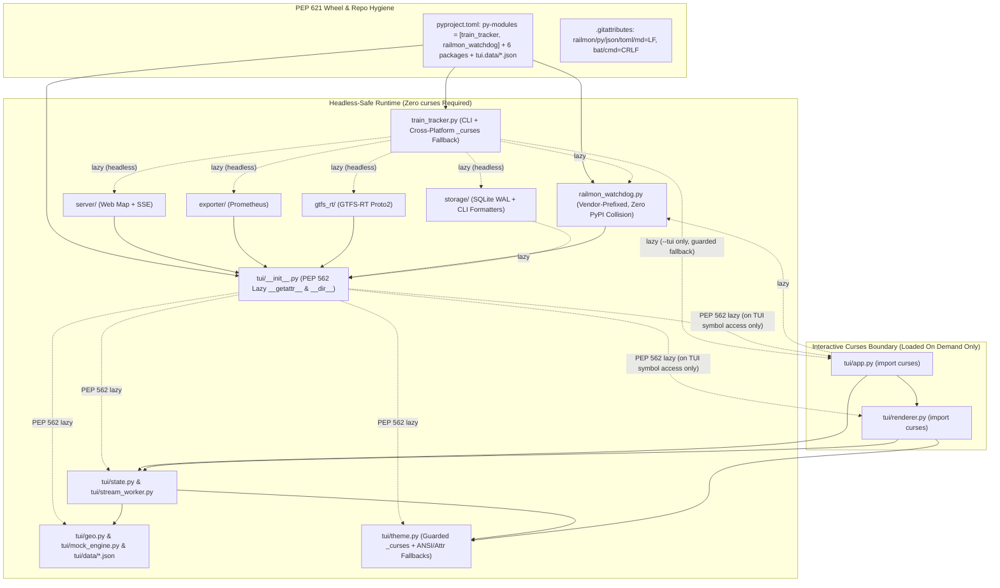

# Implementation Plan — P0-16: Broken Packaging (`watchdog.py` Omitted + PyPI Collision) & Headless `curses` Import Crash

> **Reference Review:** [`../../../architecture/codebase-architecture-review.md`](../../../architecture/codebase-architecture-review.md#L231-L241) (Finding **P0-3**)  
> **Target Modules:** [`../../../../pyproject.toml`](../../../../pyproject.toml), [`../../../../railmon_watchdog.py`](../../../../railmon_watchdog.py) (relocated from `watchdog.py`), [`../../../../tui/__init__.py`](../../../../tui/__init__.py), [`../../../../tui/theme.py`](../../../../tui/theme.py), [`../../../../tui/app.py`](../../../../tui/app.py), [`../../../../train_tracker.py`](../../../../train_tracker.py), [`../../../../.gitattributes`](../../../../.gitattributes), [`../../../../README.md`](../../../../README.md)  
> **Test Suites:** [`../../../../tests/test_packaging.py`](../../../../tests/test_packaging.py), [`../../../../tests/test_watchdog.py`](../../../../tests/test_watchdog.py), [`../../../../tests/test_cli_watch.py`](../../../../tests/test_cli_watch.py), [`../../../../tests/test_tui_watch.py`](../../../../tests/test_tui_watch.py), [`../../../../tests/test_cli.py`](../../../../tests/test_cli.py), [`../../../../tests/test_tui_theme.py`](../../../../tests/test_tui_theme.py)  
> **Relevant Rules & Skills:** [`../../../../.agents/rules/architecture.md`](../../../../.agents/rules/architecture.md), [`../../../../.agents/rules/release-and-versioning.md`](../../../../.agents/rules/release-and-versioning.md), [`../../../../.agents/rules/misra-autosar-python.md`](../../../../.agents/rules/misra-autosar-python.md), [`../../../../.agents/rules/resilience-and-fallbacks.md`](../../../../.agents/rules/resilience-and-fallbacks.md), [`../../../../.agents/skills/package-distribution-validator/SKILL.md`](../../../../.agents/skills/package-distribution-validator/SKILL.md), [`../../../../.agents/skills/diagrams-and-documentation/SKILL.md`](../../../../.agents/skills/diagrams-and-documentation/SKILL.md), [`../../../../.agents/skills/markdown-relative-paths/SKILL.md`](../../../../.agents/skills/markdown-relative-paths/SKILL.md)

---

## 1. Executive Summary & Empirically Verified Defects

Auditing `pyproject.toml`, the Python import graph across all 36 core production modules, and isolated headless execution (`sys.modules["curses"] = None; sys.modules["_curses"] = None`) confirms **four interconnected packaging and portability P0 blockers** that break wheel installations, third-party virtual environments, minimal Linux containers, and headless Windows servers:

| # | Defect Class | Affected Locations | Verified Failure Mode & Root Cause | Severity |
|---|---|---|---|---|
| **1** | **Unpackaged Module (`watchdog.py` Omitted)** | [`pyproject.toml`](../../../../pyproject.toml#L69-L71), [`#L110`](../../../../pyproject.toml#L110), [`#L131`](../../../../pyproject.toml#L131), [`train_tracker.py`](../../../../train_tracker.py#L4013), [`#L4043`](../../../../train_tracker.py#L4043), [`tui/app.py`](../../../../tui/app.py#L1341), [`#L1352`](../../../../tui/app.py#L1352), [`#L1753`](../../../../tui/app.py#L1753) | `py-modules = ["train_tracker"]` omitted `watchdog.py` (relocated to [`railmon_watchdog.py`](../../../../railmon_watchdog.py); also omitted from `[tool.ruff].src` and `[tool.coverage.run].source`). Any wheel/installed distribution crashed on `railmon watch` with `ModuleNotFoundError`, and pressing `a`/`A` in TUI triggered an unguarded `from watchdog import ...` in `_evaluate_in_tui_watch_alerts()` ([`tui/app.py#L1352`](../../../../tui/app.py#L1352)), crashing the interactive dashboard on the next frame. | **Critical** |
| **2** | **Top-Level PyPI Namespace Collision (`watchdog`)** | [`railmon_watchdog.py`](../../../../railmon_watchdog.py) (formerly `watchdog.py`) | Simply adding `"watchdog"` to `py-modules` fails in any environment where PyPI's ubiquitous `watchdog` filesystem library (used by Streamlit, MkDocs, Jupyter, pytest-watch, Flask/Werkzeug reloaders) is installed: Python's `FileFinder` resolves package directories (`site-packages/watchdog/__init__.py`) **ahead** of single-file modules (`site-packages/watchdog.py`), breaking `railmon` with `ImportError`; conversely, running third-party tools from a `railmon` checkout shadows PyPI `watchdog.observers`. | **Critical** |
| **3** | **Two-Layer Headless `curses` Import Crash** | [`tui/__init__.py`](../../../../tui/__init__.py#L3-L89), [`tui/state.py`](../../../../tui/state.py#L38), [`tui/theme.py`](../../../../tui/theme.py#L10), [`#L295-L301`](../../../../tui/theme.py#L295-L301), [`tui/app.py`](../../../../tui/app.py#L9), [`tui/renderer.py`](../../../../tui/renderer.py#L12) | Every headless daemon (`server`, `exporter`, `gtfs_rt`, `watchdog`, `storage.cli_formatters`) imports from `tui.*` (`tui.state`, `tui.geo`, `tui.mock_engine`, `tui.stream_worker`). Importing any submodule triggers **two** independent `curses` crashes when `_curses` is absent: **(a)** `tui/__init__.py` eagerly imports `tui.app`, `tui.renderer`, and `tui.theme`; and **(b)** even after `tui/__init__.py` becomes lazy, `tui/state.py:38` unconditionally imports `tui.theme`, which executes top-level `import curses` and builds `THEME_REGISTRY` using `curses.COLOR_*` / `curses.A_*`. | **Critical** |
| **4** | **POSIX Missing-`_curses` Crash & Launcher CRLF Corruption** | [`train_tracker.py`](../../../../train_tracker.py#L2806-L2834), [`railmon`](../../../../railmon), [`railmon.bat`](../../../../railmon.bat) (missing `.gitattributes`) | `run_tui_mode()` only catches missing `curses` when `sys.platform == "win32"`, crashing minimal Linux containers (Alpine / Debian-slim without `python3-curses`) instead of falling back to `run_plain_stream_mode()`. Separately, missing `.gitattributes` causes Windows Git to check out POSIX launcher `./railmon` with CRLF (`i/lf w/crlf`, breaking `#!/usr/bin/env python3\r` on WSL/Docker) and `railmon.bat` with LF. | **High** |

### Scope Boundary with Phase 3 Architectural Decomposition
- **In scope for `P0-16` (immediate Phase 0 unblock):** Eliminate the wheel omission, PyPI namespace collision, both layers of the headless `curses` import crash, the POSIX missing-`_curses` fallback gap, and launcher EOL corruption while preserving **100% backward compatibility** for all 79 symbols exported by `tui.__all__` and all existing CLI commands and tests.
- **Deferred to Phase 3 (`codebase-architecture-review.md` Section 2.3 & Section 9):** Consolidating all 6 top-level packages (`storage`, `tui`, `server`, `exporter`, `gtfs_rt`) plus `train_tracker.py` and `railmon_watchdog.py` under a single `railmon/` package namespace (which also requires relocating the root `./railmon` executable script file currently occupying that path).

---

## 2. Current Broken Flows vs. Remediated Architecture

### A. Packaging & Headless Import Boundary (ASCII)

```text
+------------------------------------------------------------------------------+
| CURRENT BROKEN STATE (HEAD = dd8a612)                                        |
+------------------------------------------------------------------------------+
| [A] Wheel & PyPI Collision                                                   |
|   pyproject.toml: py-modules = ["train_tracker"]   (watchdog.py OMITTED!)    |
|     --> pip install . --> railmon watch IC52 --> ModuleNotFoundError!        |
|     --> TUI hotkey 'a' --> tui/app.py:1352  --> CRASH on next frame!         |
|     --> site-packages/watchdog/ (PyPI) shadows any top-level watchdog.py!    |
|                                                                              |
| [B] Two-Layer Headless curses Import Crash (when _curses is absent)          |
|   server / exporter / gtfs_rt / watchdog / storage.cli_formatters            |
|     |--> from tui.{state,geo,mock_engine} import ...                         |
|     |--> Layer 1: tui/__init__.py:3  --> from tui.app import ... -> CRASH!   |
|     +--> Layer 2: tui/state.py:38    --> tui/theme.py:10 (curses)-> CRASH!   |
|                                                                              |
| [C] Launcher EOL & POSIX Fallback                                            |
|   No .gitattributes --> ./railmon checked out CRLF (breaks WSL/Docker)       |
|   run_tui_mode(): win32-only curses catch --> Linux without _curses CRASHES! |
+------------------------------------------------------------------------------+

+------------------------------------------------------------------------------+
| REMEDIATED STATE (P0-16)                                                     |
+------------------------------------------------------------------------------+
| [A] Vendor-Prefixed Packaging (Zero PyPI Collision, Complete Wheel)          |
|   git mv watchdog.py railmon_watchdog.py   (NO root watchdog.py shim!)       |
|   pyproject.toml: py-modules = ["train_tracker", "railmon_watchdog"]         |
|   tool.ruff.src + tool.coverage.run.source include railmon_watchdog          |
|   .gitattributes: railmon=LF, *.py/*.sh/*.json/*.toml/*.md=LF, *.bat=CRLF    |
|                                                                              |
| [B] Zero-curses Headless Import Graph                                        |
|   server / exporter / gtfs_rt / railmon_watchdog / storage.cli_formatters    |
|     |--> tui/__init__.py (PEP 562 lazy __getattr__ / __dir__, 0 eager imp.)  |
|     |--> tui.geo / tui.mock_engine / tui.stream_worker    (0 curses!)        |
|     +--> tui.state --> tui.theme (guarded _curses + ANSI/attr fallbacks)     |
|                                                                              |
|   Interactive TUI ONLY (railmon --tui / from tui import TUIApp, TUIRenderer) |
|     +--> lazy-loads tui.app / tui.renderer (imports curses on demand)        |
|     +--> run_tui_mode() catches missing curses/_curses on ALL OS -> fallback |
+------------------------------------------------------------------------------+
```

### B. Remediated Module & Packaging Dependency Graph (Mermaid)



---

## 3. Detailed Implementation Specification

### 3.1 Relocate `watchdog.py` to `railmon_watchdog.py` & Update All Callers

> [!IMPORTANT]
> Do **NOT** leave a compatibility shim at root `watchdog.py` (neither packaged nor unpackaged). Packaging a root `watchdog.py` shim reintroduces the PyPI `site-packages/watchdog` collision; leaving an unpackaged `watchdog.py` at repo root breaks third-party tools importing `watchdog.observers` from the workspace and masks accidental regressions to `from watchdog import ...` during local testing.

1. **Git Move (Preserving History):**
   ```bash
   git mv watchdog.py railmon_watchdog.py
   ```
   - Update module docstring line 1–15 if desired to note `railmon_watchdog` (no behavior change; `logger = logging.getLogger("railmon.watchdog")` at line 42 already uses the `railmon.*` hierarchy).
   - Confirm zero top-level imports of `train_tracker` or `curses` inside `railmon_watchdog.py` (it imports only Python stdlib + `tui.geo` + `tui.mock_engine`).

2. **Update All 5 Production Import Sites (Complete Repo Audit):**
   - [`train_tracker.py`](../../../../train_tracker.py#L4005) (`_emit_watch_events`):
     ```python
     from railmon_watchdog import (
         WatchTriggerType,
         dispatch_all_channels,
         format_watch_event_line,
     )
     ```
   - [`train_tracker.py`](../../../../train_tracker.py#L4031-L4038) (`run_watch_mode`):
     ```python
     from railmon_watchdog import (
         WatchConfig,
         WatchTriggerType,
         WatchdogEvaluator,
         WebhookFormat,
         format_watch_ticker,
         parse_notify_minutes,
     )
     ```
   - [`tui/app.py`](../../../../tui/app.py#L1341) (`toggle_watch_selected_train`):
     ```python
     from railmon_watchdog import dispatch_terminal_bell
     ```
   - [`tui/app.py`](../../../../tui/app.py#L1352-L1357) (`_evaluate_in_tui_watch_alerts`):
     ```python
     from railmon_watchdog import (
         WatchConfig,
         WatchdogEvaluator,
         dispatch_desktop_notification,
         dispatch_terminal_bell,
     )
     ```
   - [`tui/app.py`](../../../../tui/app.py#L1753) (`_check_audio_bell_triggers`):
     ```python
     from railmon_watchdog import dispatch_terminal_bell
     ```

3. **Update Documentation Reference:**
   - [`README.md`](../../../../README.md#L271): update ``[`watchdog.py`](./watchdog.py)`` to ``[`railmon_watchdog.py`](./railmon_watchdog.py)``.

---

### 3.2 Update `pyproject.toml` & Add `.gitattributes`

1. **Target file: [`pyproject.toml`](../../../../pyproject.toml#L69-L75), [`#L110`](../../../../pyproject.toml#L110), [`#L131`](../../../../pyproject.toml#L131)**
   - Register `railmon_watchdog` across packaging, linting, and coverage declarations:
     ```toml
     [tool.setuptools]
     py-modules = ["train_tracker", "railmon_watchdog"]
     packages = ["storage", "tui", "tui.data", "server", "exporter", "gtfs_rt"]

     [tool.setuptools.package-data]
     "tui.data" = ["*.json"]
     ```
     ```toml
     [tool.ruff]
     target-version = "py310"
     line-length = 100
     src = ["train_tracker.py", "railmon_watchdog.py", "storage", "tui", "server", "exporter", "gtfs_rt", "tests"]
     ```
     ```toml
     [tool.coverage.run]
     source = ["train_tracker", "railmon_watchdog", "storage", "tui", "server", "exporter", "gtfs_rt"]
     omit = ["tests/*"]
     ```
   - **Runtime dependency purity preserved:** `[project].dependencies` retains **only** `'windows-curses>=2.4.0; sys_platform == "win32"'` (zero PyPI dependencies on Linux/macOS, matching `TC-PKG-05` and [`package-distribution-validator/SKILL.md`](../../../../.agents/skills/package-distribution-validator/SKILL.md#L25-L27)).

2. **Create Root `.gitattributes`:**
   ```gitattributes
   # Enforce consistent cross-platform line endings for railmon
   * text=auto eol=lf

   # POSIX executable wrapper & scripts must always use LF (prevents python3\r on WSL/Docker)
   railmon text eol=lf
   *.py text eol=lf
   *.sh text eol=lf
   *.json text eol=lf
   *.toml text eol=lf
   *.md text eol=lf
   *.txt text eol=lf
   *.yml text eol=lf
   *.yaml text eol=lf

   # Windows batch scripts require CRLF
   *.bat text eol=crlf
   *.cmd text eol=crlf
   ```
   - After creating `.gitattributes`, renormalize the `./railmon` and `railmon.bat` working-tree line endings (`git add --renormalize railmon railmon.bat`) so `./railmon` immediately has LF (`i/lf w/lf`) and `railmon.bat` has CRLF on every checkout.

---

### 3.3 `tui/__init__.py` — PEP 562 Lazy `__getattr__` & `__dir__` Exports

Target file: [`tui/__init__.py`](../../../../tui/__init__.py#L1-L171)

Replace all 7 top-level `from tui.<submod> import ...` statements with PEP 562 lazy resolution (`importlib.import_module`), keeping a `TYPE_CHECKING` block so `mypy --strict` and IDE static analysis remain 100% intact:

```python
"""Terminal User Interface (TUI) package for Hellenic Railways live tracker.

Exports all public TUI and headless telemetry symbols lazily via PEP 562
(__getattr__ / __dir__) so headless daemons (server, exporter, gtfs_rt,
railmon_watchdog, storage) can import tui.state, tui.geo, tui.mock_engine,
tui.stream_worker, and tui.theme without triggering an eager curses import.
"""

import importlib
from typing import TYPE_CHECKING, Any, Dict, FrozenSet, List, Tuple

if TYPE_CHECKING:
    from tui.app import TUIApp, run_tui
    from tui.geo import (
        BoundingBox,
        BrailleCanvas,
        DEFAULT_OPEN_LINE_DROP_THRESHOLD_SEC,
        DEFAULT_SENSOR_FREEZE_MAX_PACKET_AGE_SEC,
        DEFAULT_SENSOR_FREEZE_MIN_SPEED_KMH,
        DEFAULT_SENSOR_FREEZE_THRESHOLD_SEC,
        GeoPoint,
        GeoProjector,
        InfrastructureFeature,
        InfrastructureType,
        OverspeedSeverity,
        PortalNode,
        SCALE_BAR_INTERVALS_KM,
        ScaleBarSpec,
        SensorHealthAssessment,
        SensorHealthState,
        SignalAspect,
        SlowOrder,
        SpeedEnforcementResult,
        SpeedLimitZoneType,
        Viewport,
        detect_train_tunnel,
        evaluate_sensor_health,
        evaluate_train_speed,
        find_nearest_station_aabb,
        haversine_distance_km,
        is_point_in_tunnel,
        parse_infrastructure_geojson,
        parse_speed_limits_json,
        project_point_to_segment,
    )
    from tui.mock_engine import (
        MockTelemetryEngine,
        SimulatedTrain,
        StationNode,
        TrackPolyline,
        calculate_bearing,
        haversine_distance,
        load_infrastructure,
        load_slow_orders,
        load_speed_limits,
        load_stations,
        load_tracks,
    )
    from tui.renderer import (
        PaneGeometry,
        StationBoardEntry,
        TUIRenderer,
        calculate_scroll_offset,
        compute_station_board_entries,
        extract_unit_suffix,
        format_corridor_display_name,
        format_disambiguated_train_label,
        format_next_station_eta,
        format_progress_bar,
        format_scale_bar,
        format_wgs84_coords,
        get_compass_bearing,
        get_delay_color_pair,
        get_heading_glyph,
        get_track_corridor_color_pair,
        normalize_station_key,
    )
    from tui.state import (
        BreadcrumbMode,
        ConnectionStatus,
        HistoricalBreadcrumb,
        InfrastructureLayerMode,
        InspectorMode,
        REPLAY_SPEED_MULTIPLIERS,
        RosterSortMode,
        StateSnapshot,
        StationLabelMode,
        TrackColorMode,
        TrainRecord,
        TrainStateStore,
    )
    from tui.stream_worker import ReplayWorker, StreamWorker
    from tui.theme import (
        ThemeProfile,
        ThemeSpec,
        get_next_theme,
        get_theme_spec,
        parse_theme_name,
    )

_LAZY_SUBMODULES: FrozenSet[str] = frozenset(
    {
        "app",
        "data",
        "geo",
        "mock_engine",
        "renderer",
        "state",
        "stream_worker",
        "theme",
    }
)

_LAZY_EXPORTS: Dict[str, Tuple[str, str]] = {
    # tui.app (curses-dependent; loaded strictly on demand)
    "TUIApp": ("tui.app", "TUIApp"),
    "run_tui": ("tui.app", "run_tui"),
    # tui.geo (headless-safe)
    "BoundingBox": ("tui.geo", "BoundingBox"),
    "BrailleCanvas": ("tui.geo", "BrailleCanvas"),
    "DEFAULT_OPEN_LINE_DROP_THRESHOLD_SEC": ("tui.geo", "DEFAULT_OPEN_LINE_DROP_THRESHOLD_SEC"),
    "DEFAULT_SENSOR_FREEZE_MAX_PACKET_AGE_SEC": ("tui.geo", "DEFAULT_SENSOR_FREEZE_MAX_PACKET_AGE_SEC"),
    "DEFAULT_SENSOR_FREEZE_MIN_SPEED_KMH": ("tui.geo", "DEFAULT_SENSOR_FREEZE_MIN_SPEED_KMH"),
    "DEFAULT_SENSOR_FREEZE_THRESHOLD_SEC": ("tui.geo", "DEFAULT_SENSOR_FREEZE_THRESHOLD_SEC"),
    "GeoPoint": ("tui.geo", "GeoPoint"),
    "GeoProjector": ("tui.geo", "GeoProjector"),
    "InfrastructureFeature": ("tui.geo", "InfrastructureFeature"),
    "InfrastructureType": ("tui.geo", "InfrastructureType"),
    "OverspeedSeverity": ("tui.geo", "OverspeedSeverity"),
    "PortalNode": ("tui.geo", "PortalNode"),
    "SCALE_BAR_INTERVALS_KM": ("tui.geo", "SCALE_BAR_INTERVALS_KM"),
    "ScaleBarSpec": ("tui.geo", "ScaleBarSpec"),
    "SensorHealthAssessment": ("tui.geo", "SensorHealthAssessment"),
    "SensorHealthState": ("tui.geo", "SensorHealthState"),
    "SignalAspect": ("tui.geo", "SignalAspect"),
    "SlowOrder": ("tui.geo", "SlowOrder"),
    "SpeedEnforcementResult": ("tui.geo", "SpeedEnforcementResult"),
    "SpeedLimitZoneType": ("tui.geo", "SpeedLimitZoneType"),
    "Viewport": ("tui.geo", "Viewport"),
    "detect_train_tunnel": ("tui.geo", "detect_train_tunnel"),
    "evaluate_sensor_health": ("tui.geo", "evaluate_sensor_health"),
    "evaluate_train_speed": ("tui.geo", "evaluate_train_speed"),
    "find_nearest_station_aabb": ("tui.geo", "find_nearest_station_aabb"),
    "haversine_distance_km": ("tui.geo", "haversine_distance_km"),
    "is_point_in_tunnel": ("tui.geo", "is_point_in_tunnel"),
    "parse_infrastructure_geojson": ("tui.geo", "parse_infrastructure_geojson"),
    "parse_speed_limits_json": ("tui.geo", "parse_speed_limits_json"),
    "project_point_to_segment": ("tui.geo", "project_point_to_segment"),
    # tui.mock_engine (headless-safe)
    "MockTelemetryEngine": ("tui.mock_engine", "MockTelemetryEngine"),
    "SimulatedTrain": ("tui.mock_engine", "SimulatedTrain"),
    "StationNode": ("tui.mock_engine", "StationNode"),
    "TrackPolyline": ("tui.mock_engine", "TrackPolyline"),
    "calculate_bearing": ("tui.mock_engine", "calculate_bearing"),
    "haversine_distance": ("tui.mock_engine", "haversine_distance"),
    "load_infrastructure": ("tui.mock_engine", "load_infrastructure"),
    "load_slow_orders": ("tui.mock_engine", "load_slow_orders"),
    "load_speed_limits": ("tui.mock_engine", "load_speed_limits"),
    "load_stations": ("tui.mock_engine", "load_stations"),
    "load_tracks": ("tui.mock_engine", "load_tracks"),
    # tui.renderer (curses-dependent; loaded strictly on demand)
    "PaneGeometry": ("tui.renderer", "PaneGeometry"),
    "StationBoardEntry": ("tui.renderer", "StationBoardEntry"),
    "TUIRenderer": ("tui.renderer", "TUIRenderer"),
    "calculate_scroll_offset": ("tui.renderer", "calculate_scroll_offset"),
    "compute_station_board_entries": ("tui.renderer", "compute_station_board_entries"),
    "extract_unit_suffix": ("tui.renderer", "extract_unit_suffix"),
    "format_corridor_display_name": ("tui.renderer", "format_corridor_display_name"),
    "format_disambiguated_train_label": ("tui.renderer", "format_disambiguated_train_label"),
    "format_next_station_eta": ("tui.renderer", "format_next_station_eta"),
    "format_progress_bar": ("tui.renderer", "format_progress_bar"),
    "format_scale_bar": ("tui.renderer", "format_scale_bar"),
    "format_wgs84_coords": ("tui.renderer", "format_wgs84_coords"),
    "get_compass_bearing": ("tui.renderer", "get_compass_bearing"),
    "get_delay_color_pair": ("tui.renderer", "get_delay_color_pair"),
    "get_heading_glyph": ("tui.renderer", "get_heading_glyph"),
    "get_track_corridor_color_pair": ("tui.renderer", "get_track_corridor_color_pair"),
    "normalize_station_key": ("tui.renderer", "normalize_station_key"),
    # tui.state (headless-safe)
    "BreadcrumbMode": ("tui.state", "BreadcrumbMode"),
    "ConnectionStatus": ("tui.state", "ConnectionStatus"),
    "HistoricalBreadcrumb": ("tui.state", "HistoricalBreadcrumb"),
    "InfrastructureLayerMode": ("tui.state", "InfrastructureLayerMode"),
    "InspectorMode": ("tui.state", "InspectorMode"),
    "REPLAY_SPEED_MULTIPLIERS": ("tui.state", "REPLAY_SPEED_MULTIPLIERS"),
    "RosterSortMode": ("tui.state", "RosterSortMode"),
    "StateSnapshot": ("tui.state", "StateSnapshot"),
    "StationLabelMode": ("tui.state", "StationLabelMode"),
    "TrackColorMode": ("tui.state", "TrackColorMode"),
    "TrainRecord": ("tui.state", "TrainRecord"),
    "TrainStateStore": ("tui.state", "TrainStateStore"),
    # tui.stream_worker (headless-safe)
    "ReplayWorker": ("tui.stream_worker", "ReplayWorker"),
    "StreamWorker": ("tui.stream_worker", "StreamWorker"),
    # tui.theme (headless-safe after Section 3.4)
    "ThemeProfile": ("tui.theme", "ThemeProfile"),
    "ThemeSpec": ("tui.theme", "ThemeSpec"),
    "get_next_theme": ("tui.theme", "get_next_theme"),
    "get_theme_spec": ("tui.theme", "get_theme_spec"),
    "parse_theme_name": ("tui.theme", "parse_theme_name"),
}

__all__: List[str] = list(_LAZY_EXPORTS.keys())


def __getattr__(name: str) -> Any:
    """Lazily resolve public TUI symbols and submodules on first attribute access (PEP 562)."""
    if name in _LAZY_EXPORTS:
        module_name, attr_name = _LAZY_EXPORTS[name]
        module = importlib.import_module(module_name)
        value = getattr(module, attr_name)
        globals()[name] = value
        return value
    if name in _LAZY_SUBMODULES:
        module = importlib.import_module(f"tui.{name}")
        globals()[name] = module
        return module
    raise AttributeError(f"module {__name__!r} has no attribute {name!r}")


def __dir__() -> List[str]:
    """Return sorted module attributes including lazily exported public symbols."""
    return sorted(set(globals().keys()) | set(__all__) | set(_LAZY_SUBMODULES))
```

- **Zero behavior regression:** All 79 symbols in `__all__` plus all 8 submodules resolve identically on access and cache in `globals()` for $O(1)$ subsequent lookups.
- **Zero `curses` side effect:** Importing `tui`, `tui.geo`, `tui.mock_engine`, `tui.state`, `tui.stream_worker`, `tui.theme`, or accessing any headless symbol from `tui` never loads `tui.app`, `tui.renderer`, or `curses`.

---

### 3.4 `tui/theme.py` — Eliminate Second-Layer Headless `curses` Crash

Target file: [`tui/theme.py`](../../../../tui/theme.py#L7-L302)

Why this is mandatory: [`tui/state.py#L38`](../../../../tui/state.py#L38) imports `from tui.theme import ThemeProfile, get_next_theme` at top level, and `server`, `exporter`, `gtfs_rt`, and `tui.stream_worker` all import `tui.state` at top level. Without decoupling `tui/theme.py` from unconditional `import curses`, converting `tui/__init__.py` alone still leaves `server`, `exporter`, `gtfs_rt`, `tui.state`, and `tui.stream_worker` crashing whenever `_curses` is absent.

1. **Guarded `_curses` Import & Platform-Exact Constant Resolution:**
   Replace line 10 (`import curses`) with:
   ```python
   try:
       import curses as _curses
   except (ImportError, ModuleNotFoundError):
       _curses = None  # type: ignore[assignment]

   # Standard ANSI 16-color indices and curses attribute bitmasks.
   # Uses exact platform ncurses/PDCurses constants when curses is available,
   # and portable integer fallbacks when imported in headless environments.
   _COLOR_BLACK: int = int(getattr(_curses, "COLOR_BLACK", 0))
   _COLOR_RED: int = int(getattr(_curses, "COLOR_RED", 1))
   _COLOR_GREEN: int = int(getattr(_curses, "COLOR_GREEN", 2))
   _COLOR_YELLOW: int = int(getattr(_curses, "COLOR_YELLOW", 3))
   _COLOR_BLUE: int = int(getattr(_curses, "COLOR_BLUE", 4))
   _COLOR_MAGENTA: int = int(getattr(_curses, "COLOR_MAGENTA", 5))
   _COLOR_CYAN: int = int(getattr(_curses, "COLOR_CYAN", 6))
   _COLOR_WHITE: int = int(getattr(_curses, "COLOR_WHITE", 7))

   _A_NORMAL: int = int(getattr(_curses, "A_NORMAL", 0))
   _A_UNDERLINE: int = int(getattr(_curses, "A_UNDERLINE", 1 << 17))
   _A_REVERSE: int = int(getattr(_curses, "A_REVERSE", 1 << 18))
   _A_DIM: int = int(getattr(_curses, "A_DIM", 1 << 20))
   _A_BOLD: int = int(getattr(_curses, "A_BOLD", 1 << 21))
   ```
2. **Replace `curses.COLOR_*` and `curses.A_*` References inside `build_*_theme()` ([`L67-L284`](../../../../tui/theme.py#L67-L284)):**
   - Substitute `_COLOR_BLACK`, `_COLOR_RED`, `_COLOR_GREEN`, `_COLOR_YELLOW`, `_COLOR_BLUE`, `_COLOR_MAGENTA`, `_COLOR_CYAN`, `_COLOR_WHITE`, `_A_NORMAL`, `_A_BOLD`, `_A_DIM`, `_A_UNDERLINE`, `_A_REVERSE`.
   - **Invariant preserved:** Whenever `curses` is installed (every environment capable of running `TUIRenderer`), `_curses` is the live `curses` module so every `ColorPairDef.fg_16`, `bg_16`, and `attr_override` matches the host curses binary bit-for-bit (`test_tui_theme.py` passes unchanged). When `_curses` is absent, `tui.theme` and `tui.state` import cleanly with zero error.

---

### 3.5 `train_tracker.py` — Cross-Platform Missing-`_curses` Fallback in `run_tui_mode()`

Target file: [`train_tracker.py`](../../../../train_tracker.py#L2806-L2834)

Generalize the Windows-only `if sys.platform == "win32"` guard so minimal Linux/BSD/macOS installations lacking `_curses` also fall back cleanly to `run_plain_stream_mode()` with a platform-accurate hint, while still re-raising unrelated import errors:

```python
    try:
        import curses
        from tui.app import run_tui
        from tui.geo import is_utf8_supported
        from tui.mock_engine import load_stations, load_tracks
        from tui.state import TrainStateStore
    except (ImportError, ModuleNotFoundError) as err:
        err_name = getattr(err, "name", None)
        is_curses_missing = err_name in ("curses", "_curses") or "curses" in str(err).lower()
        if is_curses_missing:
            if sys.platform == "win32":
                dep_label = "'windows-curses' on Windows"
                install_hint = "run: pip install windows-curses"
            else:
                dep_label = "Python 'curses' (_curses)"
                install_hint = "install your system python3-curses / ncurses package"
            logger.warning(
                "Curses runtime is unavailable (%s). Falling back to headless mode.",
                err,
            )
            print(
                f"\n[WARN] The interactive terminal dashboard (--tui) requires {dep_label}.\n"
                f"Falling back to plain-text stream mode. To enable TUI, {install_hint}\n",
                file=sys.stderr,
            )
            run_plain_stream_mode(
                source=source,
                reconnect_delay=reconnect_delay,
                recording=recording,
                db_path=db_path,
                deadband=deadband,
                retention_days=retention_days,
                archive_path=archive_path,
            )
            return
        raise
```

- Preserves the exact `"windows-curses"` stderr text and `run_plain_stream_mode(...)` invocation verified by [`test_run_tui_mode_windows_missing_curses`](../../../../tests/test_cli.py#L188-L210).
- Prevents unhandled `ModuleNotFoundError: No module named '_curses'` on headless/minimal Linux containers invoked with `--tui` on an allocated PTY.

---

## 4. Test Suite Remediation & Regression Matrix

| Test File | Tests to Add / Update | Defects Guarded Against |
|---|---|---|
| [`tests/test_watchdog.py`](../../../../tests/test_watchdog.py) | Update module docstring, top-level import from `watchdog` to `railmon_watchdog`, and `@patch("watchdog....")` decorators (`L495-L497`) to `@patch("railmon_watchdog....")`. | Ensures all existing watchdog & P0-15 RCE tests exercise relocated `railmon_watchdog.py`. |
| [`tests/test_cli_watch.py`](../../../../tests/test_cli_watch.py) | Update `from watchdog import WatchTriggerType` and `@patch("watchdog.dispatch_all_channels")` (`L11, L82, L143`) to `railmon_watchdog`. | Verifies `railmon watch` CLI binds to `railmon_watchdog`. |
| [`tests/test_tui_watch.py`](../../../../tests/test_tui_watch.py) | Update `@patch("watchdog.dispatch_desktop_notification")` and `@patch("watchdog.dispatch_terminal_bell")` (`L122-L123`) to `railmon_watchdog`. | Verifies in-TUI `a`/`A` watch hotkey binds to `railmon_watchdog`. |
| [`tests/test_cli.py`](../../../../tests/test_cli.py) | Add `test_run_tui_mode_linux_missing_curses` (patching `sys.platform` to `"linux"` and raising `ModuleNotFoundError("No module named '_curses'", name="_curses")`), asserting stderr warning mentions `curses` and `run_plain_stream_mode(...)` is invoked; add negative test asserting unrelated `ModuleNotFoundError("No module named 'nonexistent_dep'")` is re-raised. | Prevents POSIX missing-`_curses` crashes while ensuring real import bugs aren't masked. |
| [`tests/test_packaging.py`](../../../../tests/test_packaging.py) | 1. **`TC-PKG-06` update:** Verify all 4 GIS JSON files (`stations.json`, `tracks.json`, `infrastructure.json`, `speed_limits.json`) exist in `tui/data/`.<br>2. **`TC-PKG-13` (Watchdog Relocation & No PyPI Collision):** Parse `pyproject.toml` via `tomllib` to assert `"railmon_watchdog"` is in `[tool.setuptools].py-modules`, `[tool.ruff].src` (`"railmon_watchdog.py"`), and `[tool.coverage.run].source`; assert `(REPO_ROOT / "watchdog.py").exists()` is `False`; AST-scan all production `.py` files to assert zero `import watchdog` or `from watchdog import ...` statements remain.<br>3. **`TC-PKG-14` (Zero-PyPI Runtime Purity for `railmon_watchdog.py`):** AST-scan `railmon_watchdog.py` to assert all imports are Python stdlib (incl. `winsound`) or internal (`tui`), mirroring `TC-PKG-08`/`10`/`12`.<br>4. **`TC-PKG-15` (Complete Packaging & Real Wheel Archive Inspection):** (a) Zero-dependency `tomllib` audit confirming every production `.py` file under repo root (excluding `tests/`, `scripts/`, `.agents/`, `reference/`) is covered by `py-modules` or `packages` in `pyproject.toml`; (b) build a real wheel inside a clean `TemporaryDirectory` staging copy via `setuptools.build_meta.build_wheel` (guarded by `skipUnless` if `setuptools`/`wheel` absent, never polluting the repo working tree), inspect `zipfile.ZipFile` entries to verify `train_tracker.py`, `railmon_watchdog.py`, all 6 packages, and all 4 `tui/data/*.json` files are packed and top-level `watchdog.py` is absent.<br>5. **`TC-PKG-16` (Headless `_curses`-Absent Subprocess Matrix & Lazy `tui` Verification):** Spawn isolated Python subprocesses with `sys.modules["curses"] = None; sys.modules["_curses"] = None` importing all 13 headless targets (`train_tracker`, `railmon_watchdog`, `storage`, `storage.cli_formatters`, `server`, `exporter`, `gtfs_rt`, `tui`, `tui.geo`, `tui.mock_engine`, `tui.state`, `tui.stream_worker`, `tui.theme`) plus `from tui import TrainStateStore, GeoPoint, MockTelemetryEngine, StreamWorker, ThemeProfile`, asserting exit code `0` for all; verify accessing `tui.TUIApp` / `tui.TUIRenderer` raises `ModuleNotFoundError` when `curses` is blocked; verify every one of the 79 names in `tui.__all__` resolves cleanly and unknown names raise `AttributeError`.<br>6. **`TC-PKG-17` (PyPI `watchdog` Coexistence Test):** In an isolated subprocess, inject a dummy `watchdog` package (`types.ModuleType("watchdog")` with `__path__ = []` and `watchdog.observers`) into `sys.modules`, then import `railmon_watchdog` and `train_tracker` and instantiate `WatchdogEvaluator`, asserting zero shadowing or import errors.<br>7. **`TC-PKG-18` (`.gitattributes` & Launcher EOL Hygiene):** Verify `.gitattributes` exists with `railmon text eol=lf` and `*.bat text eol=crlf` rules, and `(REPO_ROOT / "railmon").read_bytes()` contains zero `\r\n` bytes. | Prevents module omission in wheels, prevents regression to PyPI-colliding `watchdog`, enforces zero-PyPI purity, guarantees headless imports work without `_curses`, proves coexistence with PyPI `watchdog`, and guards POSIX launcher LF hygiene. |

---

## 5. Safety & Static Analysis Compliance

All changes must satisfy [`misra-autosar-python.md`](../../../../.agents/rules/misra-autosar-python.md) and [`package-distribution-validator/SKILL.md`](../../../../.agents/skills/package-distribution-validator/SKILL.md):
- **PY-MISRA-01:** Zero `eval()`/`exec()`/`compile()`, zero `shell=True`; PEP 562 lazy loading uses a static, allowlisted dictionary `_LAZY_EXPORTS` + `importlib.import_module()` (no arbitrary user-supplied module names).
- **PY-MISRA-03:** Explicit narrow exception tuples `(ImportError, ModuleNotFoundError)` in `tui/theme.py` and `train_tracker.py` (no bare `except:` or silent `except Exception: pass`).
- **PY-MISRA-04:** Explicit `return` or `raise` on every control-flow branch in `tui/__init__.py` (`__getattr__`, `__dir__`) and `train_tracker.py` (`run_tui_mode`).
- **PY-MISRA-05:** Immutable `FrozenSet[str]` / `Tuple[str, str]` lookup tables; no mutable default arguments.
- **PY-MISRA-06:** 100% parameter and return type annotations on `__getattr__(name: str) -> Any`, `__dir__() -> List[str]`, and typed module constants in `tui/theme.py`.
- **PY-MISRA-08:** All touched functions remain well below McCabe complexity 15 and nesting depth 5.
- **PY-MISRA-10:** No recursion, no wildcard imports (`import *`), no runtime `assert` statements in production code.
- **Zero-Dependency Runtime Purity:** Zero new external PyPI runtime dependencies; Linux/macOS installs remain 100% Python 3.10+ stdlib.

---

## 6. Verification Plan & Acceptance Criteria

1. **Targeted Packaging, Watchdog, Theme & CLI Suites:**
   ```bash
   python -m unittest tests.test_packaging tests.test_watchdog tests.test_cli_watch tests.test_tui_watch tests.test_tui_theme tests.test_cli -v
   ```
   - **Pass criteria:** 100% pass, `0` failures, `0` errors (including `TC-PKG-13` through `TC-PKG-18` wheel archive, PyPI `watchdog` coexistence, and headless `_curses`-absent subprocess tests).

2. **Full Automated Test Suite:**
   ```bash
   python -m unittest discover -s tests -q
   ```
   - **Pass criteria:** Zero regressions across the full 950+ test suite.

3. **Isolated Wheel Build & Fresh Virtual Environment Installation Smoke Test:**
   ```bash
   python -m venv .test_venv
   # Build wheel into temporary dist directory and install with --no-deps to verify zero-dep headless runtime
   .test_venv/bin/pip install --no-deps --no-build-isolation .   # POSIX (or .test_venv\Scripts\pip on Windows)
   .test_venv/bin/railmon --version
   .test_venv/bin/railmon watch --help
   .test_venv/bin/railmon serve --help
   .test_venv/bin/railmon metrics --help
   .test_venv/bin/railmon export --help
   ```
   - Also execute a wheel-installed headless import test outside the repo directory (`cd /tmp` / `%TEMP%`) with `sys.modules["curses"] = None; sys.modules["_curses"] = None` importing `railmon_watchdog`, `server`, `exporter`, `gtfs_rt`, `storage.cli_formatters`, and `tui.state`, confirming exit code `0`.
   - Clean up `.test_venv`, `build/`, `*.egg-info` after verification (`git status` must be clean).

4. **Static Safety AST Gate & Symbol-Table Verification:**
   ```bash
   python .agents/skills/static-safety-analyzer/scripts/safety_ast_audit.py --strict
   python .agents/skills/static-safety-analyzer/scripts/safety_ast_audit.py --strict train_tracker.py railmon_watchdog.py tui
   ```
   - **Pass criteria:** `RESULT: PASSED` (`0` errors, `0` warnings) on both runs; `0` undefined globals via `symtable` across all production modules.

5. **Launcher & EOL Verification (`package-distribution-validator`):**
   - `git ls-files --eol railmon railmon.bat` reports `i/lf w/lf` for `railmon` and `eol=crlf` attribute for `railmon.bat`.
   - `python railmon --help` and `railmon.bat --help` both exit `0`.
