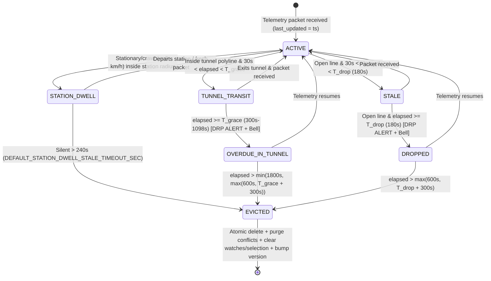

# Implementation Plan — P0-17: Three Systemic Safety-Watchdog Failures (Disabled Drop/Tunnel Alerts, Double-Track Misclassification & Dead Ghost Preemption)

> **Reference Review:** [`../../../architecture/codebase-architecture-review.md`](../../../architecture/codebase-architecture-review.md#L242-L254) (Finding **P0-4**)  
> **Related Historical Plans:** [`./p0-9-stale-train-pruning-and-screen-warning-clearance-fix-plan.md`](./p0-9-stale-train-pruning-and-screen-warning-clearance-fix-plan.md), [`./p0-10-telemetry-drop-watchdog-resilience-fix-plan.md`](./p0-10-telemetry-drop-watchdog-resilience-fix-plan.md), [`./p0-12-track-conflict-detection-resilience-fix-plan.md`](./p0-12-track-conflict-detection-resilience-fix-plan.md)  
> **Target Modules:** [`../../../../tui/state.py`](../../../../tui/state.py), [`../../../../tui/geo.py`](../../../../tui/geo.py), [`../../../../tui/__init__.py`](../../../../tui/__init__.py)  
> **Test Suites:** [`../../../../tests/test_tui_stale_prune_clearance.py`](../../../../tests/test_tui_stale_prune_clearance.py), [`../../../../tests/test_tui_state.py`](../../../../tests/test_tui_state.py), [`../../../../tests/test_tui_telemetry_drop_watchdog.py`](../../../../tests/test_tui_telemetry_drop_watchdog.py), [`../../../../tests/test_tui_conflict_watchdog_geo.py`](../../../../tests/test_tui_conflict_watchdog_geo.py), [`../../../../tests/test_tui_conflict_watchdog_state.py`](../../../../tests/test_tui_conflict_watchdog_state.py), [`../../../../tests/test_tui_speed_limits_geo.py`](../../../../tests/test_tui_speed_limits_geo.py)  
> **Relevant Rules & Skills:** [`../../../../.agents/rules/misra-autosar-python.md`](../../../../.agents/rules/misra-autosar-python.md), [`../../../../.agents/rules/resilience-and-fallbacks.md`](../../../../.agents/rules/resilience-and-fallbacks.md), [`../../../../.agents/rules/testing.md`](../../../../.agents/rules/testing.md), [`../../../../.agents/skills/diagrams-and-documentation/SKILL.md`](../../../../.agents/skills/diagrams-and-documentation/SKILL.md), [`../../../../.agents/skills/markdown-relative-paths/SKILL.md`](../../../../.agents/skills/markdown-relative-paths/SKILL.md), [`../../../../.agents/skills/ci-quality-gate/SKILL.md`](../../../../.agents/skills/ci-quality-gate/SKILL.md)

---

## 1. Executive Summary & Empirically Verified Defects

Auditing the live safety-watchdog pipeline across [`tui/state.py`](../../../../tui/state.py), [`tui/geo.py`](../../../../tui/geo.py), [`tui/mock_engine.py`](../../../../tui/mock_engine.py), and [`tui/data/`](../../../../tui/data) on `HEAD` (`d08f493`) confirms **three systemic P0 safety-watchdog failures** (plus one latent over-firing bug masked by Failure #3) introduced by conflicting assumptions across earlier fixes (`P0-9`, `P0-10`, and `P0-12`):

| # | Defect Class | Affected Locations | Empirically Verified Failure Mode & Root Cause | Severity |
|---|---|---|---|---|
| **1** | **Drop & Tunnel Watchdogs Dead by Default (`90s` Prune Kills `180s` / `300s–1,098s` Watchdogs)** | [`tui/state.py`](../../../../tui/state.py#L167), [`#L254-L256`](../../../../tui/state.py#L254-L256), [`#L580`](../../../../tui/state.py#L580), [`#L1146-L1220`](../../../../tui/state.py#L1146-L1220), [`#L1249-L1254`](../../../../tui/state.py#L1249-L1254) vs [`tui/geo.py`](../../../../tui/geo.py#L1765-L1767), [`#L1846-L1904`](../../../../tui/geo.py#L1846-L1904) | `P0-9` set `DEFAULT_LIVE_STALE_TIMEOUT_SEC = 90.0` (invoked every `5s` by [`StreamWorker._check_prune()`](../../../../tui/stream_worker.py#L110-L122) and [`TUIApp.run_loop()`](../../../../tui/app.py#L1783-L1787)), while `P0-10` subsequently raised `DEFAULT_OPEN_LINE_DROP_THRESHOLD_SEC` to `180.0s` and `DEFAULT_TUNNEL_DROP_MIN_SEC` to `300.0s` (scaling up to `549.1s` for 80 km/h freight and `1,098.1s` at the 40 km/h speed floor inside 9,038 m Kallidromo Tunnel). Every silent train is hard-evicted at `90s` — **90s before** `SensorHealthState.DROPPED` and **210s–1,008s before** `OVERDUE IN TUNNEL` can ever fire. Trains traversing Kallidromo and Othrys vanish mid-bore from TUI, Web Map, Prometheus, and GTFS-RT. | **Critical** |
| **2** | **Single-Track Corridors Routed to Double-Track Mainline & Speed Limits Doubled** | [`tui/geo.py`](../../../../tui/geo.py#L1468-L1495) (`_normalize_corridor_key`), [`#L1677-L1745`](../../../../tui/geo.py#L1677-L1745) (`evaluate_train_speed`), [`#L2477-L2528`](../../../../tui/geo.py#L2477-L2528) (`resolve_train_corridor`), [`#L2907-L2934`](../../../../tui/geo.py#L2907-L2934) (`evaluate_train_conflicts`); [`tui/state.py`](../../../../tui/state.py#L698-L705), [`#L1278-L1287`](../../../../tui/state.py#L1278-L1287) | `_normalize_corridor_key()` matches broad `"thess"` / `"athina"` **before** specific regional branches and eagerly collapses ambiguous macro families (`"PROASTIAKOS"` -> `proastiakos-airport-kiato`, `"THESSALY"` -> `pathe-mainline`, `"NORTHERN"` -> `northern-corridor`), short-circuiting geometric track snapping in `resolve_train_corridor()` and `evaluate_train_speed()`. Empirically, **4 of 11 mock fleet trains** and real upstream codes (`THESFLOR`, `ATHLIA`, `THESLAR`) are misclassified: single-track corridors (`THESSALY`, `thessaloniki_idomeni`, `Thessaloniki - Alexandroupoli`, `THESFLOR`, Chalkida tagged `PROASTIAKOS`) lose head-on collision detection (`is_single = False`) and receive up to **2× speed limits** (`80 -> 160 km/h`, `90 -> 120 km/h`). Furthermore, `evaluate_train_conflicts()` defaults unrecognized corridors to `is_single = False` (fail-unsafe). | **Critical** |
| **3** | **Dead Stale-Ghost Conflict Preemption (+ Latent Unguarded Advisory Over-Firing)** | [`tui/state.py`](../../../../tui/state.py#L1003-L1012) (`_recompute_conflicts`) vs [`tui/geo.py`](../../../../tui/geo.py#L2636-L2641), [`#L2666-L2685`](../../../../tui/geo.py#L2666-L2685), [`#L2788-L2807`](../../../../tui/geo.py#L2788-L2807) | `_recompute_conflicts()` passes `[rec.position for rec in self._trains.values()]` (`TrainPosition`), which has no `last_updated` or `last_updated_time` attribute (stored on `TrainRecord`). `t1_ts`/`t2_ts` are always `None` and `is_stale_ghost` is **always `False`** in production — verified empirically: a 120s-stale train triggers `CRITICAL OPPOSING CONFLICT` instead of `ADVISORY`. Masked by this dead code, lines `2666` (`STALE_OBSTRUCTION`) and `2788` (`STALE_HEADWAY`) fire inside the outer `20 km` `max_check_dist` **without** gating on `closing_spd > 5.0` (opposing) or `dist_km <= 2.5 km and is_active_motion` (headway), which would spam false advisories on diverging opposing trains and 2.5–20 km co-directional traffic as soon as `last_updated` is wired in. | **Critical** |

### 1.1 Empirical Evidence Tables (Verified on `d08f493`)

#### A. Tunnel Transit Grace Windows vs. Current `90.0s` Eviction Cutoff

| Tunnel (`infrastructure.json`) | Length ($L$) | Passenger (`160 km/h`) Grace | Moderate (`120 km/h`) Grace | Freight (`80 km/h`) Grace | Slow-Order Floor (`40 km/h`) Grace | Current Prune Cutoff |
|---|---:|---:|---:|---:|---:|---:|
| `tun-kallidromo` | `9,038 m` | `300.0 s` | `366.0 s` | `549.1 s` | `1,098.1 s` | **`90.0 s` (DEAD)** |
| `tun-othrys` | `7,026 m` | `300.0 s` | `300.0 s` | `426.8 s` | `853.7 s` | **`90.0 s` (DEAD)** |
| `tun-tempi-t2` | `5,500 m` | `300.0 s` | `300.0 s` | `334.1 s` | `668.2 s` | **`90.0 s` (DEAD)** |
| `tun-platamonas` | `3,500 m` | `300.0 s` | `300.0 s` | `300.0 s` | `425.2 s` | **`90.0 s` (DEAD)** |
| `tun-kakia-skala` | `2,400 m` | `300.0 s` | `300.0 s` | `300.0 s` | `300.0 s` | **`90.0 s` (DEAD)** |
| `tun-tempi-t1` | `2,000 m` | `300.0 s` | `300.0 s` | `300.0 s` | `300.0 s` | **`90.0 s` (DEAD)** |

> [!IMPORTANT]
> Raising `DEFAULT_LIVE_STALE_TIMEOUT_SEC` naively to a static `600.0s` alone is **insufficient**: freight/slow-order transits in Kallidromo (`549s–1,098s`), Othrys (`427s–854s`), and Tempi T2 (`334s–668s`) would still be evicted mid-bore or seconds after `OVERDUE IN TUNNEL` triggers. Eviction **must** be state-aware and share a single `compute_tunnel_grace_sec()` calculation with `_evaluate_tunnel_health()`.

#### B. Corridor Normalization & Speed/Track Misclassification Matrix

| Raw Input / Mock Train | True Physical Corridor & Track Type | Current Resolution (`d08f493`) | Current `is_single` / Limit | Remediated Resolution (`P0-17`) | Target `is_single` / Limit |
|---|---|---|---|---|---|
| `"THESSALY"` (`mock-reg-1731`, Larissa–Volos) | `thessaly-volos` (Single) | `pathe-mainline` (**Double**) | `False` / `160 km/h` | `thessaly-volos` (geo-snapped) | `True` / `80 km/h` |
| `"THESSALY"` (`mock-reg-884`, Paleofarsalos–Kalambaka) | `thessaly-kalambaka` (Single) | `pathe-mainline` (**Double**) | `False` / `160 km/h` | `thessaly-kalambaka` (geo-snapped) | `True` / `80 km/h` |
| `"PROASTIAKOS"` (`mock-pro-1314`, Chalkida) | `proastiakos-chalkida` (Single) | `proastiakos-airport-kiato` (**Double**) | `False` / `120 km/h` | `proastiakos-chalkida` (family geo-snapped) | `True` / `90 km/h` |
| `"NORTHERN"` (`mock-int-361`, Idomeni) | `thessaloniki-idomeni` (Single) | `northern-corridor` (Wrong branch) | `True` / `90 km/h` | `thessaloniki-idomeni` (family geo-snapped) | `True` / `120 km/h` |
| `"thessaloniki_idomeni"` / `"Thessaloniki - Idomeni"` | `thessaloniki-idomeni` (Single) | `pathe-mainline` (**Double**) | `False` / `160 km/h` | `thessaloniki-idomeni` | `True` / `120 km/h` |
| `"Thessaloniki - Alexandroupoli"` | `northern-corridor` (Single) | `pathe-mainline` (**Double**) | `False` / `160 km/h` | `northern-corridor` | `True` / `90 km/h` |
| `"THESFLOR"` / `"Thessaloniki - Edessa - Florina"` | `western-macedonia` (Single) | `"thesflor"` / `pathe-mainline` (**Double**) | `False` / `120–160 km/h` | `western-macedonia` | `True` / `70 km/h` |
| `"Athina - Chalkida"` | `proastiakos-chalkida` (Single) | `pathe-mainline` (**Double**) | `False` / `160 km/h` | `proastiakos-chalkida` | `True` / `90 km/h` |
| `"ATHLIA"` / `"THESLAR"` (live `railway.gov.gr`) | `pathe-mainline` (Double) | `"athlia"` / `"theslar"` (Unmapped) | `False` / `120 km/h` | `pathe-mainline` | `False` / `160 km/h` |
| Unrecognized regional corridor (e.g. `"custom-branch"`) | Unknown (Fail-Safe Single) | `"custom-branch"` (**Double**) | `False` / `120 km/h` | Geo-snap or fail-safe single | `True` / `120 km/h` |

### 1.2 Scope Boundary with `P1-15` & Phase 2/3 Refactorings
- **In scope for `P0-17` (resolves Review Finding `P0-4`):**
  1. Decouple `TrainStateStore` stale eviction from drop/tunnel thresholds via `DEFAULT_LIVE_STALE_TIMEOUT_SEC = 600.0`, shared `compute_tunnel_grace_sec()`, and state-aware eviction TTL (open-line floor, tunnel grace extension, and prompt `240.0s` terminated station-dwell eviction) while preserving explicit `max_age_sec` / custom `stale_timeout_sec` overrides and `P0-9` atomic warning/conflict clearance.
  2. Rewrite `_normalize_corridor_key()` with data-driven specific-first rules (no broad `"thess"` / `"athina"` hijack, full live `railway.gov.gr` code coverage), add family-restricted geometric track snapping with route-metadata tie-breaking in `resolve_train_corridor()` and `evaluate_train_speed()`, wire `tracks_data=self._tracks_data` into `TrainStateStore` speed checks, and make `evaluate_train_conflicts()` fail-safe single-track for unrecognized corridors.
  3. Wire `TrainRecord` (`last_updated`) into `evaluate_train_conflicts()` via `_unwrap_train_entry()` (supporting `TrainRecord`, `(pos, ts)` tuples, and legacy `TrainPosition` + optional `last_updated_by_id`), and gate `STALE_OBSTRUCTION` / `STALE_HEADWAY` strictly inside the kinematic conflict envelope.
- **Explicitly deferred to `P1-15` & Phase 2 (`codebase-architecture-review.md` Sections 4.3 & 9):**
  - Re-aligning GIS JSON polyline drift (`TSR-PATHE-SPERCHEIOS`, `northern-strymonas-gorge`, `tun-othrys`) and fixing `TERMINAL_STATION_IDS` (`"lian"`/`"kth"`).
  - Along-track chainage separation across shared trunk corridors (`SKA–Inoi`, `Thessaloniki–Kilkis`) for cross-corridor conflicts.
  - `FROZEN` sensor hysteresis, `(alert_id, severity)` bell-latch escalation, nearest-conflict tie-breaking, F-10.1 `DelayUpdate` ID precedence, `PAUSED` prune suspension, and `TrainStateStore` copy-on-write snapshot refactor (`P1-8`).

---

## 2. Current Broken Lifecycles vs. Remediated Architecture

### A. End-to-End Safety Watchdog Pipeline Comparison (ASCII)

```text
+------------------------------------------------------------------------------+
| CURRENT BROKEN WATCHDOG PIPELINE (HEAD = d08f493)                            |
+------------------------------------------------------------------------------+
| [1] Silence / Tunnel Lifecycle (tui/state.py + tui/geo.py)                   |
|   T=0s       T=30s          T=90s (PRUNED!)    T=180s          T=300s-1098s  |
|   RUN -----> STL / TUN -----> [DELETED!]   X   DROPPED (DEAD)  OVERDUE (DEAD)|
|                                                                              |
| [2] Corridor Classification (tui/geo.py)                                     |
|   "THESSALY" / "thessaloniki_idomeni" --["thess"]--> pathe-mainline (2x, 160)|
|   "PROASTIAKOS" (Chalkida train)      --["proast"]-> airport-kiato  (2x, 120)|
|   resolve_train_corridor() returns immediately (SKIPS geometric snapping!)   |
|   Unknown corridor (e.g. "THESFLOR")  --> is_single = False (HEAD-ON OFF!)   |
|                                                                              |
| [3] Stale-Ghost Conflict Preemption (tui/state.py -> tui/geo.py)             |
|   _recompute_conflicts() strips TrainRecord -> [rec.position] (NO timestamp) |
|   t1_ts = None, t2_ts = None -> is_stale_ghost = False ALWAYS (DEAD CODE!)   |
|   Latent bug: lines 2666 & 2788 omit closing_spd / 2.5km headway bounds!     |
+------------------------------------------------------------------------------+

+------------------------------------------------------------------------------+
| REMEDIATED WATCHDOG PIPELINE (P0-17)                                         |
+------------------------------------------------------------------------------+
| [1] State-Aware Eviction Lifecycle (shared compute_tunnel_grace_sec())       |
|   Station Dwell (non-alert): RUN -> DWL (<=240s) -> Evicted > 240s (clean)   |
|   Open Line:                 RUN -> STL (30-180s) -> DRP [ALERT] (180-600s)  |
|                                  -> Evicted > max(600s, T_drop + 300s)       |
|   Mountain Tunnel:           RUN -> TUN (30-T_grace) -> DRP OVERDUE [ALERT]  |
|                                  (T_grace .. min(1800s, T_grace + 300s))     |
|                                  -> Evicted cleanly; conflicts/bells cleared |
|                                                                              |
| [2] Specific-First + Family-Scoped Geometric Corridor Resolution             |
|   Specific branch token  --> Canonical ID (single-track checked FIRST!)      |
|   Macro family / empty   --> Family-scoped track snap (tracks.json)          |
|                              + Route-metadata tie-break (SKA / Kilkis)       |
|   Unknown corridor       --> Geo-snap -> Fail-safe is_single = True          |
|   Shared across BOTH evaluate_train_conflicts() AND evaluate_train_speed()   |
|                                                                              |
| [3] Live TrainRecord Timestamp Handoff + Envelope-Gated Stale Demotion       |
|   _recompute_conflicts() passes list(self._trains.values()) (TrainRecord)    |
|   _unwrap_train_entry() extracts (TrainPosition, last_updated) cleanly       |
|   Opposing:  closing_spd > 5 & d <= 20km -> if stale > 60s -> ADVISORY       |
|   Headway:   active_motion  & d <= 2.5km -> if stale > 60s -> ADVISORY       |
+------------------------------------------------------------------------------+
```

### B. State-Aware Eviction & Watchdog Lifecycle State Machine (Mermaid)



### C. Corridor Resolution & Stale-Aware Conflict Flow (Mermaid)

```mermaid
flowchart TD
    subgraph Resolution ["1. Unified Corridor Resolution (Conflicts & Speed Limits)"]
        TR["TrainRecord (position + last_updated)"]
        UNW["_unwrap_train_entry() -> (pos, last_updated_ts)"]
        NORM["_normalize_corridor_key(pos.corridor) - Specific-First Table"]
        CHK{"Canonical ID?"}
        FAM{"Ambiguous Family?<br/>(proastiakos / thessaly / northern)"}
        SNAP_FAM["Snap to Family Tracks (<= 1500m)<br/>+ Route Metadata Tie-Break"]
        SNAP_ALL["Snap to All Tracks (<= 1500m)<br/>+ Route Metadata Tie-Break"]
        SAFE["Fail-Safe Single-Track<br/>(unless in DEFAULT_DOUBLE_TRACK_CORRIDORS)"]

        TR --> UNW --> NORM --> CHK
        CHK -->|Yes: 1 of 8 canonical IDs| SAFE
        CHK -->|No| FAM
        FAM -->|Yes| SNAP_FAM --> SAFE
        FAM -->|No / Empty / Unknown| SNAP_ALL --> SAFE
    end

    subgraph ConflictEval ["2. Envelope-Gated Pairwise Conflict Evaluation"]
        PAIR["Same-Corridor Pair: (t1, ts1) vs (t2, ts2)"]
        STALE["is_stale_ghost = (eval_time - ts1 > 60s) or (eval_time - ts2 > 60s)"]
        OPP{"Opposing & Single-Track?<br/>closing_spd > 5 & dist <= 20km"}
        HDW{"Co-Directional Headway?<br/>active_motion & dist <= 2.5km"}
        G_OPP{"is_stale_ghost?"}
        G_HDW{"is_stale_ghost?"}
        ADV_O["ADVISORY: STALE_OBSTRUCTION (Bell Muted)"]
        LIVE_O["CRITICAL (<=10km) / WARNING (<=20km)"]
        ADV_H["ADVISORY: STALE_HEADWAY (Bell Muted)"]
        LIVE_H["CRITICAL (closing > 3 km/h) / WARNING"]

        SAFE --> PAIR --> STALE
        STALE --> OPP
        STALE --> HDW
        OPP -->|Yes (outside station meet)| G_OPP
        G_OPP -->|Yes| ADV_O
        G_OPP -->|No| LIVE_O
        HDW -->|Yes (non-coupled, outside station)| G_HDW
        G_HDW -->|Yes| ADV_H
        G_HDW -->|No| LIVE_H
    end
```

---

## 3. Detailed Implementation Specification

### 3.1 Fix 1 — Shared Tunnel Grace Formula & State-Aware Eviction TTL

#### A. Extract `compute_tunnel_grace_sec()` in [`tui/geo.py`](../../../../tui/geo.py#L1765-L1905)

1. Add immutable constants beside `DEFAULT_OPEN_LINE_DROP_THRESHOLD_SEC` ([`tui/geo.py#L1765-L1774`](../../../../tui/geo.py#L1765-L1774)):
   ```python
   DEFAULT_TUNNEL_MIN_ENTRY_SPEED_KMH: float = 40.0
   DEFAULT_TUNNEL_FALLBACK_LENGTH_M: float = 5000.0
   ```
2. Add pure, finite-guarded helper `compute_tunnel_grace_sec()` (`PY-MISRA-06` & `PY-MISRA-07` compliant):
   ```python
   def compute_tunnel_grace_sec(
       tunnel: Any,
       speed_kmh: Optional[float],
       min_grace_sec: float = DEFAULT_TUNNEL_DROP_MIN_SEC,
       margin_factor: float = DEFAULT_TUNNEL_MARGIN_FACTOR,
   ) -> float:
       """Compute tunnel transit deadband grace period in seconds before DROPPED escalation."""
       raw_len = getattr(tunnel, "length_m", None)
       if (
           isinstance(raw_len, (int, float))
           and not isinstance(raw_len, bool)
           and math.isfinite(raw_len)
           and raw_len > 0.0
       ):
           tun_len = float(raw_len)
       else:
           tun_len = DEFAULT_TUNNEL_FALLBACK_LENGTH_M

       if (
           isinstance(speed_kmh, (int, float))
           and not isinstance(speed_kmh, bool)
           and math.isfinite(speed_kmh)
           and speed_kmh > 0.0
       ):
           spd = float(speed_kmh)
       else:
           spd = 0.0

       entry_spd = max(spd, DEFAULT_TUNNEL_MIN_ENTRY_SPEED_KMH)
       nominal_transit_sec = tun_len / (entry_spd * (1000.0 / 3600.0))
       return max(float(min_grace_sec), nominal_transit_sec * float(margin_factor))
   ```
3. Refactor `_evaluate_tunnel_health()` ([`tui/geo.py#L1860-L1868`](../../../../tui/geo.py#L1860-L1868)) to call `grace_sec = compute_tunnel_grace_sec(tunnel, spd)` so health evaluation and eviction TTL share one exact formula.
4. Export `compute_tunnel_grace_sec` lazily in [`tui/__init__.py`](../../../../tui/__init__.py) (both `TYPE_CHECKING` and `_LAZY_EXPORTS`) so `TC-PKG-16` remains 100% in sync.

#### B. Raise `DEFAULT_LIVE_STALE_TIMEOUT_SEC` & Implement State-Aware Eviction in [`tui/state.py`](../../../../tui/state.py#L167-L169) & [`#L578-L1268`](../../../../tui/state.py#L578-L1268)

1. **Update Stale-Eviction Constants ([`tui/state.py#L167-L168`](../../../../tui/state.py#L167-L168)):**
   ```python
   DEFAULT_LIVE_STALE_TIMEOUT_SEC: float = 600.0
   DEFAULT_POST_DROP_RETENTION_SEC: float = 300.0
   DEFAULT_STATION_DWELL_STALE_TIMEOUT_SEC: float = 240.0
   DEFAULT_MAX_TUNNEL_EVICTION_TTL_SEC: float = 1800.0
   DEFAULT_REPLAY_STALE_TIMEOUT_SEC: float = 1800.0
   ```
   - Update `TrainRecord.is_stale()` docstring ([`tui/state.py#L254-L256`](../../../../tui/state.py#L254-L256)) to reflect the `600`-second default.

2. **Track Explicit Custom Overrides vs. Default Live Mode (`TrainStateStore.__init__` & `set_stale_timeout`):**
   - Change `__init__` parameter default to `stale_timeout_sec: Optional[float] = None`:
     ```python
     self._has_custom_stale_timeout: bool = stale_timeout_sec is not None
     self._stale_timeout_sec: float = (
         max(1.0, float(stale_timeout_sec))
         if stale_timeout_sec is not None
         else DEFAULT_LIVE_STALE_TIMEOUT_SEC
     )
     ```
   - In `set_stale_timeout(timeout_sec: float)`:
     - Update `self._stale_timeout_sec = max(1.0, float(timeout_sec))` and `self._has_custom_stale_timeout = True`.
     - If not in replay mode and `self._stale_timeout_sec <= self._telemetry_drop_threshold_sec`, emit a `logger.warning(...)` advising that a custom stale timeout below the open-line drop threshold may prune trains before `DROPPED` alerts can fire.
   - In `set_replay_status()` ([`tui/state.py#L1247-L1255`](../../../../tui/state.py#L1247-L1255)):
     - Toggle between `DEFAULT_LIVE_STALE_TIMEOUT_SEC` (`600.0`) and `DEFAULT_REPLAY_STALE_TIMEOUT_SEC` (`1800.0`) whenever `not self._has_custom_stale_timeout` (preserving custom overrides across replay transitions).

3. **Add State-Aware Eviction Helper `_compute_record_eviction_ttl()` in [`tui/state.py`](../../../../tui/state.py):**
   Import `DEFAULT_STATION_DWELL_RADIUS_M`, `DEFAULT_TERMINAL_DWELL_RADIUS_M`, `_resolve_station_candidate`, `compute_tunnel_grace_sec`, `detect_train_tunnel` from `tui.geo`.
   ```python
   def _compute_record_eviction_ttl(
       self,
       rec: TrainRecord,
       explicit_cutoff: Optional[float],
   ) -> float:
       """Compute effective eviction TTL in seconds for a train record (caller holds self._lock)."""
       if explicit_cutoff is not None:
           return float(explicit_cutoff)
       if self._is_replay or self._has_custom_stale_timeout:
           return self._stale_timeout_sec

       pt = GeoPoint(lat=rec.position.lat, lng=rec.position.lng)

       # 1. Tunnel transit: retain through full dynamic tunnel grace + post-drop alert window
       if self._tunnels:
           tunnel_info = detect_train_tunnel(pt, self._tunnels)
           if tunnel_info is not None:
               tunnel, _, _ = tunnel_info
               grace_sec = compute_tunnel_grace_sec(tunnel, rec.position.speed)
               tunnel_ttl = max(
                   self._stale_timeout_sec,
                   grace_sec + DEFAULT_POST_DROP_RETENTION_SEC,
               )
               return min(DEFAULT_MAX_TUNNEL_EVICTION_TTL_SEC, tunnel_ttl)

       # 2. Terminated / idle station dwell (non-alert): evict promptly after 240s
       spd = max(0.0, float(rec.position.speed)) if rec.position.speed is not None else 0.0
       if self._stations and (spd <= 5.0 or rec.station_dwell_start is not None):
           nearest_stn, _ = _resolve_station_candidate(
               point=pt,
               stations=self._stations,
               station_dwell_radius_m=DEFAULT_STATION_DWELL_RADIUS_M,
               terminal_dwell_radius_m=DEFAULT_TERMINAL_DWELL_RADIUS_M,
           )
           if nearest_stn is not None:
               return min(self._stale_timeout_sec, DEFAULT_STATION_DWELL_STALE_TIMEOUT_SEC)

       # 3. Open-line default: guaranteed above telemetry_drop_threshold + post-drop retention
       open_line_floor = self._telemetry_drop_threshold_sec + DEFAULT_POST_DROP_RETENTION_SEC
       return max(self._stale_timeout_sec, open_line_floor)
   ```

4. **Update `prune_stale_trains()` ([`tui/state.py#L1146-L1168`](../../../../tui/state.py#L1146-L1168)):**
   Replace the fixed single `cutoff` filter with:
   ```python
   explicit_cutoff = float(max_age_sec) if max_age_sec is not None else None
   stale_ids = [
       tid
       for tid, rec in self._trains.items()
       if (ref_now - rec.last_updated)
       > self._compute_record_eviction_ttl(rec, explicit_cutoff)
   ]
   ```
   - All existing `P0-9` atomic post-processing remains intact: deleting `stale_ids`, clearing `selected_id`/`follow_mode`/`watched_train_ids`, purging orphaned `_active_conflicts` & `_previous_conflict_keys`, calling `_recompute_conflicts(ref_now)`, incrementing `_version` & `_total_trains_pruned`.
   - **Invariant Verification:**
     - Open-line silence (`telemetry_drop_threshold_sec = 180s`): `STALE` (`30–180s`) -> `DROPPED` (`180–600s`, audio bell + crimson badge + Prometheus drop metric!) -> cleanly evicted at `> 600s`.
     - Custom raised threshold (`set_telemetry_drop_threshold(400s)`): open-line floor automatically rises to `700s` — impossible for eviction to undercut the drop threshold.
     - Kallidromo Tunnel (`9,038 m`) @ `160 km/h`: `TUN` (`30–300s`) -> `DROPPED [OVERDUE IN TUNNEL]` (`300–600s`) -> evicted at `> 600s`.
     - Kallidromo Tunnel @ `80 km/h` freight: `TUN` (`30–549s`) -> `DROPPED [OVERDUE IN TUNNEL]` (`549–849s`) -> evicted at `> 849s`.
     - Kallidromo Tunnel @ `40 km/h` floor: `TUN` (`30–1,098s`) -> `DROPPED [OVERDUE IN TUNNEL]` (`1,098–1,398s`) -> evicted at `> 1,398s` (capped at `1,800s`).
     - Terminated train parked at Athens Central (`ATH`): `STATION_DWELL` (`0–240s`, `is_alert=False`, preserves `TC-DRP-04`/`05`/`06`) -> cleanly evicted at `> 240s` (prevents 10-minute terminal roster clutter).
     - Explicit `prune_stale_trains(max_age_sec=...)` (used by `ReplayWorker` and unit tests) and explicit `TrainStateStore(stale_timeout_sec=...)` / `set_stale_timeout(...)`: honored verbatim.

---

### 3.2 Fix 2 — Specific-First Corridor Normalization, Family-Scoped Geometric Snapping & Fail-Safe Single-Track Defaults

#### A. Data-Driven Specific-First `_normalize_corridor_key()` in [`tui/geo.py`](../../../../tui/geo.py#L1468-L1495)

Replace the fragile `if`-chain with immutable, ordered lookup tables (`PY-MISRA-05` & `PY-MISRA-08` compliant — McCabe complexity `<= 8`):

```python
DEFAULT_DOUBLE_TRACK_CORRIDORS: FrozenSet[str] = frozenset({
    "pathe-mainline",
    "proastiakos-airport-kiato",
})

# Macro family tags that span multiple physical corridors and require geometric or
# route-metadata disambiguation rather than eager collapse to double-track defaults.
AMBIGUOUS_CORRIDOR_FAMILIES: Dict[str, FrozenSet[str]] = {
    "proastiakos": frozenset({"proastiakos-airport-kiato", "proastiakos-chalkida"}),
    "thessaly": frozenset({"thessaly-kalambaka", "thessaly-volos"}),
    "northern": frozenset({"northern-corridor", "thessaloniki-idomeni"}),
}

# Ordered SPECIFIC-FIRST keyword table (single-track branches checked BEFORE any mainline rules).
# Broad substrings like "thess" or "athina" are intentionally excluded from mainline matching.
_SPECIFIC_CORRIDOR_KEYWORDS: Tuple[Tuple[str, Tuple[str, ...]], ...] = (
    # 1. Single-track corridors (most specific first)
    ("proastiakos-chalkida", ("chalk", "χαλκ", "athhal", "inoichalk", "oinoichalk")),
    ("thessaloniki-idomeni", ("idomeni", "ειδομεν", "polykastro", "πολυκαστρ")),
    (
        "thessaly-kalambaka",
        ("kalambaka", "kalampaka", "καλαμπακ", "farsala", "paleofarsal", "palaiofarsal", "karditsa", "καρδιτσ", "trikala", "τρικαλ"),
    ),
    ("thessaly-volos", ("volos", "βολ", "velestin", "βελεστιν")),
    (
        "western-macedonia",
        ("thesflor", "edessa", "εδεσσ", "florina", "φλωριν", "veria", "veroia", "βεροι", "amyntaio", "αμυνται", "westmacedonia", "westernmacedonia"),
    ),
    (
        "northern-corridor",
        ("alexandroupol", "αλεξανδρουπολ", "alexor", "ormenio", "ορμεν", "dikea", "δικαι", "pythio", "πυθι", "komotini", "κομοτην", "xanthi", "ξανθ", "drama", "δραμ", "serres", "σερρ", "thrace", "θρακ", "strymon", "στρυμον", "easternmacedonia", "northerncorridor"),
    ),
    # 2. Unambiguous double-track corridors
    (
        "proastiakos-airport-kiato",
        ("airport", "aerodromio", "αεροδρομ", "kiato", "κιατ", "pirair", "korinth", "corinth", "κορινθ", "megara", "μεγαρ"),
    ),
    (
        "pathe-mainline",
        ("pathe", "e85", "mainline", "athlia", "theslar"),
    ),
)

_AMBIGUOUS_FAMILY_KEYWORDS: Tuple[Tuple[str, Tuple[str, ...]], ...] = (
    ("thessaly", ("thessaly", "θεσσαλ")),
    ("proastiakos", ("proast", "προαστ", "suburban")),
    ("northern", ("northern", "northgreece")),
)
```

```python
def _normalize_corridor_key(corridor_id: Optional[str]) -> Optional[str]:
    """Normalize Hellenic Railways corridor strings and aliases to canonical corridor IDs.

    Specific single-track corridors are matched before double-track mainlines, and broad
    ambiguous prefixes ('thess', 'athina') never hijack regional corridors to pathe-mainline.
    Macro family labels ('PROASTIAKOS', 'THESSALY', 'NORTHERN') normalize to their family
    key so callers with coordinates can disambiguate geometrically via tracks.json.
    """
    if not corridor_id:
        return None
    raw = corridor_id.strip().lower()
    if not raw:
        return None
    if raw in DEFAULT_CORRIDOR_SPEED_RULES:
        return raw

    clean = raw.replace("-", "").replace("_", "").replace(" ", "")
    for canonical_id, keywords in _SPECIFIC_CORRIDOR_KEYWORDS:
        if any(k in clean for k in keywords):
            return canonical_id

    if clean == "macedonia":
        return "western-macedonia"

    # Explicit Athens/Piraeus <-> Thessaloniki/Larissa mainline strings (only after all
    # specific regional branches have already been checked above)
    has_south_hub = any(k in clean for k in ("athina", "athens", "piraeus", "πειραι", "αθην"))
    has_pathe_north = any(k in clean for k in ("thessaloniki", "θεσσαλονικ", "larissa", "λαρισ", "lianoklad", "domok"))
    if (has_south_hub and has_pathe_north) or clean in ("athina", "athens", "thessaloniki"):
        return "pathe-mainline"

    for family_key, keywords in _AMBIGUOUS_FAMILY_KEYWORDS:
        if any(k in clean for k in keywords):
            return family_key

    return raw
```

#### B. Cached Track Loader, Family-Scoped Geometric Snapping & Route-Metadata Tie-Breaking (`resolve_train_corridor` & `evaluate_train_speed`)

1. **Thread-Safe Default Track Cache in [`tui/geo.py`](../../../../tui/geo.py):**
   Add `_DEFAULT_TRACKS_CACHE_LOCK = threading.Lock()` and `_DEFAULT_TRACKS_CACHE: Optional[Dict[str, Any]] = None` with helper `_get_default_tracks_data() -> Optional[Dict[str, Any]]` (catching narrow `(OSError, ValueError, KeyError, TypeError, ImportError)` with `logger.debug`, eliminating per-train disk reads of `tracks.json` when callers omit `tracks_data`).
2. **Candidate-Scoped Track Snapping + Shared-Trunk Tie-Breaking:**
   Add pure helpers:
   - `_find_nearest_track_corridor_candidates(pt: GeoPoint, tracks_data: Dict[str, Any], allowed_corridors: Optional[FrozenSet[str]] = None, max_snap_distance_m: float = 1500.0, tie_epsilon_m: float = 50.0) -> Tuple[Optional[str], float, Tuple[str, ...]]`
     Returns `(best_cid, best_dist_m, tied_cids)` where `tied_cids` contains all matched corridors within `best_dist_m + tie_epsilon_m` (handles shared-trunk coordinates like `SKA` hub or `Kilkis` station where two tracks share `0.0 m` vertices).
   - `_disambiguate_corridor_by_route_metadata(train: Any, candidates: Sequence[str]) -> Optional[str]`
     Inspects `origin`, `destination`, and `next_station` on `train` against `_SPECIFIC_CORRIDOR_KEYWORDS` restricted to `candidates`.
3. **Update `resolve_train_corridor()` ([`tui/geo.py#L2477-L2528`](../../../../tui/geo.py#L2477-L2528)):**
   - If `raw_cid` normalizes to a **canonical corridor ID** (`norm in DEFAULT_CORRIDOR_SPEED_RULES`): return `norm` immediately.
   - If `raw_cid` normalizes to an **ambiguous macro family** (`family_candidates = AMBIGUOUS_CORRIDOR_FAMILIES.get(norm)`):
     1. Snap `pt` against `tracks_data` (or cached default tracks) **restricted to `family_candidates`** within `max_snap_distance_m` (breaking geometric ties via `_disambiguate_corridor_by_route_metadata`).
     2. If not matched geometrically (e.g. `tracks_data={}` or off-grid), disambiguate via `_disambiguate_corridor_by_route_metadata(train, tuple(family_candidates))`.
     3. If still unresolved, snap against all tracks in `tracks_data` within `max_snap_distance_m`.
     4. Final fallback: return the family key `norm` (never `pathe-mainline` or `proastiakos-airport-kiato`!).
   - If `raw_cid` is **absent/empty**:
     1. Snap `pt` across all tracks within `max_snap_distance_m` (breaking shared-trunk ties via route metadata).
     2. If no track within threshold, return `"unassigned"` (preserves `TC-CNF-04`).
   - If `raw_cid` is **unrecognized** (neither canonical nor macro family):
     1. Attempt geometric snap across all tracks within `max_snap_distance_m` first.
     2. If off-grid or no tracks available, return `norm`.
4. **Update `evaluate_train_speed()` ([`tui/geo.py#L1677-L1745`](../../../../tui/geo.py#L1677-L1745)) & `TrainStateStore` ([`tui/state.py#L698-L705`](../../../../tui/state.py#L698-L705), [`#L1278-L1287`](../../../../tui/state.py#L1278-L1287)):**
   - Add optional backward-compatible keyword parameter `tracks_data: Optional[Dict[str, Any]] = None` (and optional `route_hint_train: Optional[Any] = None`) to `evaluate_train_speed()`.
   - When `corr_key` is `None`, in `AMBIGUOUS_CORRIDOR_FAMILIES`, or not in `speed_rules`:
     - Attempt geometric snapping via `tracks_data` (or `_get_default_tracks_data()` when `tracks_data is None`), scoped to `AMBIGUOUS_CORRIDOR_FAMILIES[corr_key]` if `corr_key` is a macro family.
     - If `corr_key` is a macro family and the point is off-grid (no track within `1500m`), resolve the **conservative minimum** `CorridorSpeedRule` across its family members (e.g., `80.0 km/h` for `"thessaly"`, `90.0 km/h` for `"northern"`, `90.0 km/h` for `"proastiakos"` — never doubling to `160.0` or `120.0 km/h`!).
   - Forward `tracks_data=self._tracks_data` from both `TrainStateStore._upsert_train_position()` and `TrainStateStore.set_speed_rules()`.
5. **Fail-Safe Single-Track Default in `evaluate_train_conflicts()` ([`tui/geo.py#L2927-L2934`](../../../../tui/geo.py#L2927-L2934)):**
   ```python
   if cid in cfg.single_line_working_corridors:
       is_single = True
   elif cid in double_track_map:
       is_single = not double_track_map[cid]
   elif cid in DEFAULT_SINGLE_TRACK_CORRIDORS:
       is_single = True
   elif cid in DEFAULT_DOUBLE_TRACK_CORRIDORS:
       is_single = False
   else:
       # Fail-safe railway safety principle: unknown/macro corridors default to single-track
       is_single = True
   ```
   - Also include `"thessaly"` and `"northern"` in `DEFAULT_SINGLE_TRACK_CORRIDORS` so even in synthetic `tracks_data={}` calls they are explicitly single-track.

---

### 3.3 Fix 3 — Wire `TrainRecord.last_updated` into Conflict Watchdog & Gate Stale Demotion Envelope

#### A. Clean Wrapper Unwrapping in [`tui/geo.py`](../../../../tui/geo.py)

Add two tiny, finite-guarded, immutable-friendly helpers (`PY-MISRA-06` & `PY-MISRA-07` compliant — also future-proof when `TrainPosition` becomes `@dataclass(frozen=True)` in `P1-8`):

```python
def _coerce_finite_epoch(raw_ts: Any) -> Optional[float]:
    """Convert raw numeric timestamp to finite float epoch, rejecting bool/NaN/Inf."""
    if isinstance(raw_ts, bool) or raw_ts is None:
        return None
    if isinstance(raw_ts, (int, float)):
        val = float(raw_ts)
        return val if math.isfinite(val) else None
    return None


def _unwrap_train_entry(entry: Any) -> Tuple[Any, Optional[float]]:
    """Extract (position_obj, last_updated_epoch) from TrainRecord, (pos, ts) tuple, or TrainPosition."""
    if isinstance(entry, tuple) and len(entry) == 2:
        pos_obj, raw_ts = entry
        return pos_obj, _coerce_finite_epoch(raw_ts)

    nested_pos = getattr(entry, "position", None)
    if nested_pos is not None:
        raw_ts = getattr(entry, "last_updated", getattr(entry, "last_updated_time", None))
        return nested_pos, _coerce_finite_epoch(raw_ts)

    raw_ts = getattr(entry, "last_updated", getattr(entry, "last_updated_time", None))
    return entry, _coerce_finite_epoch(raw_ts)
```

> [!NOTE]
> `_unwrap_train_entry()` intentionally does **not** fall back to parsing `TrainPosition.timestamp` (an ISO-8601 string) when `last_updated` is absent. Many unit tests construct fixture positions with historical ISO timestamps while calling `evaluate_train_conflicts(active_trains=[t1, t2])` with `now=None` (wall clock); only explicit epoch observation timestamps (`TrainRecord.last_updated`, `(pos, ts)`, `last_updated_by_id`, or explicit `.last_updated` attribute) activate stale-ghost demotion.

#### B. Update `evaluate_train_conflicts()` & `_evaluate_corridor_pair_conflict()` ([`tui/geo.py#L2596-L2956`](../../../../tui/geo.py#L2596-L2956))

1. Extend `evaluate_train_conflicts()` with an optional backward-compatible `last_updated_by_id: Optional[Mapping[str, float]] = None` parameter:
   - Unwrap every element of `active_trains` via `pos, obs_ts = _unwrap_train_entry(item)`.
   - If `obs_ts is None` and `last_updated_by_id is not None`: look up `_coerce_finite_epoch(last_updated_by_id.get(str(getattr(pos, "id", ""))))`.
   - Resolve corridor on `pos` via `resolve_train_corridor(pos, tracks_data=tracks_data, max_snap_distance_m=cfg.max_corridor_snap_distance_m)` (no redundant second `_normalize_corridor_key()` call needed).
   - Store `(pos, obs_ts)` tuples in `corridor_buckets[cid]` and pass `t1_ts` / `t2_ts` explicitly into `_evaluate_corridor_pair_conflict(...)`.
2. **Gate `is_stale_ghost` Strictly Inside the Real Kinematic Conflict Envelope** (fixes the latent over-firing bug masked by dead code!):
   - Extract focused helpers `_evaluate_opposing_conflict(...)` and `_evaluate_headway_conflict(...)` so `_evaluate_corridor_pair_conflict()` drops well below the `PY-MISRA-08` McCabe ceiling (`<= 15`) and nesting depth ceiling (`<= 5`).
   - **Opposing branch (`_evaluate_opposing_conflict`):**
     1. Station passing meet (`meet_stn is not None`) -> `STATION_MEET` (`ADVISORY`).
     2. Kinematic gate: `if closing_spd > 5.0 and dist_km <= cfg.opposing_warning_distance_km:`
        - `if is_stale_ghost:` -> `STALE_OBSTRUCTION` (`ConflictType.OPPOSING_COLLISION`, `ConflictSeverity.ADVISORY`, `time_to_collision_sec=None`, muted bell).
        - `if dist_km <= cfg.opposing_critical_distance_km:` -> `OPPOSING_COLLISION` (`CRITICAL`).
        - Else -> `OPPOSING_COLLISION` (`WARNING`).
     - Diverging opposing trains (`closing_spd <= 5.0`) or distant pairs (`dist_km > 20.0 km`) emit `None` even when one train is stale.
   - **Headway branch (`_evaluate_headway_conflict`):**
     1. Coupled multiple-unit consist (`is_coupled_consist`) -> `COUPLED_CONSIST` (`ADVISORY`).
     2. Station platform/siding alignment (`meet_stn is not None`) -> `STATION_HEADWAY` (`ConflictType.STATION_MEET`, `ADVISORY`).
     3. Kinematic gate: `if dist_km <= cfg.headway_warning_distance_km and is_active_motion:`
        - `if is_stale_ghost:` -> `STALE_HEADWAY` (`ConflictType.HEADWAY_VIOLATION`, `ConflictSeverity.ADVISORY`, `time_to_collision_sec=None`, muted bell).
        - `if dist_km <= crit_dist:` -> `CRITICAL` (if `closing_spd > cfg.headway_closing_speed_threshold_kmh`) else `WARNING`.
        - Else -> `WARNING`.
     - Co-directional trains separated by `2.5–20.0 km` (or stationary pairs) emit `None` even when one train is stale or inside a tunnel.

#### C. Pass `TrainRecord`s in `TrainStateStore._recompute_conflicts()` ([`tui/state.py#L1003-L1012`](../../../../tui/state.py#L1003-L1012))

```python
def _recompute_conflicts(self, now: float) -> None:
    """Evaluate and cache pairwise conflicts across all active trains (caller holds self._lock)."""
    active_records = list(self._trains.values())
    alerts = evaluate_train_conflicts(
        active_trains=active_records,
        tracks_data=self._tracks_data,
        stations=self._stations,
        config=self._conflict_config,
        now=now,
    )
```

---

## 4. Test Suite Remediation & Regression Matrix

### 4.1 Required Updates to Existing Stale-Timeout Assertions

Two existing test files hardcode the old broken `90.0s` `P0-9` cutoff on open-line moving trains and must be updated to reflect the `P0-17` state-aware contract:

| Test File | Tests to Update | Rationale |
|---|---|---|
| [`tests/test_tui_state.py`](../../../../tests/test_tui_state.py#L137-L154) | `test_default_stale_timeout_30_minutes` | Assert `DEFAULT_LIVE_STALE_TIMEOUT_SEC == 600.0`, `rec.is_stale()` False at `590.0s` and True at `605.0s`, and replay default `1800.0`. |
| [`tests/test_tui_stale_prune_clearance.py`](../../../../tests/test_tui_stale_prune_clearance.py#L74-L218) | `TC-PRN-01`, `TC-PRN-02`, `TC-PRN-03`, `TC-PRN-04`, `TC-PRN-06` | Update live default assertions from `90.0s` to `600.0s` (`590s` retained, `605s` evicted); in `TC-PRN-03`, additionally assert that at `t0 + 100s` (stale > `60s`, before eviction) the conflict is demoted to `ADVISORY` (`critical_conflict_count == 0`, `advisory_conflict_count == 1`), and at `t0 + 605s` pruning evicts `T-1` and clears all conflicts to `0`; in `TC-PRN-04`, verify that at `t0 + 190s` the open-line train actually reaches `DROPPED` (`dropped_count == 1` — previously unreachable!) and is then cleanly evicted at `t0 + 605s` (`dropped_count == 0`). |

> [!NOTE]
> [`tests/test_multiplexed_sse.py`](../../../../tests/test_multiplexed_sse.py#L347), [`#L523`](../../../../tests/test_multiplexed_sse.py#L523) pass explicit `stale_timeout_sec=90.0`, and [`tests/test_tui_controls.py`](../../../../tests/test_tui_controls.py#L572) / [`tests/test_tui_state.py`](../../../../tests/test_tui_state.py#L777) age trains by `2000.0s` — all remain 100% passing without modification.

### 4.2 New High-Assurance Regression Tests (`TC-WDG-01` – `TC-WDG-18`)

| Test Case ID | Target Test File | Scenario & Verification Criteria |
|---|---|---|
| **TC-WDG-01** | [`tests/test_tui_telemetry_drop_watchdog.py`](../../../../tests/test_tui_telemetry_drop_watchdog.py) | **Open-Line Drop Reachable Under Periodic 5s Pruning:** Ingest open-line train into default `TrainStateStore()`, run `prune_stale_trains(now=t0 + dt)` every `5s` from `t0` to `t0 + 610s`. Assert train survives past `90s`, enters `STALE` at `35s`, enters `DROPPED` (`is_alert=True`, `dropped_count == 1`) at `185s`, remains alerting through `595s`, and is evicted at `605s` (`dropped_count == 0`). |
| **TC-WDG-02** | [`tests/test_tui_telemetry_drop_watchdog.py`](../../../../tests/test_tui_telemetry_drop_watchdog.py) | **Kallidromo Passenger Tunnel Lifecycle (`160 km/h`, `grace=300s`) Under 5s Pruning:** Train inside `tun-kallidromo` survives periodic pruning through `TUNNEL_TRANSIT` (`35s–295s`), escalates to `DROPPED [OVERDUE IN TUNNEL]` (`is_alert=True`) at `305s`, stays visible through `595s`, and is evicted at `605s`. |
| **TC-WDG-03** | [`tests/test_tui_telemetry_drop_watchdog.py`](../../../../tests/test_tui_telemetry_drop_watchdog.py) | **Kallidromo Freight/Slow Tunnel Extension (`80 km/h`, `grace=549.1s` & `40 km/h`, `grace=1,098.1s`):** Under periodic 5s pruning, an `80 km/h` freight train inside `tun-kallidromo` stays `TUNNEL_TRANSIT` at `540s` (NOT pruned at `600s`!), escalates to `OVERDUE IN TUNNEL` at `555s`, stays alerting through `845s`, and is evicted at `855s`; a `40 km/h` train escalates at `1,105s` and is evicted at `1,405s` (<= `1,800s` cap). |
| **TC-WDG-04** | [`tests/test_tui_telemetry_drop_watchdog.py`](../../../../tests/test_tui_telemetry_drop_watchdog.py) | **Terminated Station Dwell Prompt Eviction (`240s`):** Stationary train at Athens Central (`ATH`) remains `STATION_DWELL` (`is_alert=False`, `dropped_count == 0`) through `235s` under periodic pruning and is cleanly evicted at `245s` (no 10-minute terminal roster clutter). |
| **TC-WDG-05** | [`tests/test_tui_telemetry_drop_watchdog.py`](../../../../tests/test_tui_telemetry_drop_watchdog.py) | **Dynamic Drop-Threshold Floor Safety:** Calling `store.set_telemetry_drop_threshold(400.0)` automatically extends open-line eviction TTL to `700.0s` (`400 + 300`), verifying `DROPPED` is still reachable at `405s` under periodic pruning. |
| **TC-WDG-06** | [`tests/test_tui_telemetry_drop_watchdog.py`](../../../../tests/test_tui_telemetry_drop_watchdog.py) | **Explicit Custom Override & `compute_tunnel_grace_sec()` NaN/Inf Hygiene:** `TrainStateStore(stale_timeout_sec=30.0)` and `prune_stale_trains(max_age_sec=15.0)` honor explicit overrides; `compute_tunnel_grace_sec()` handles `None`, `0`, `-5`, `NaN`, `Inf`, and `bool` length/speed safely without raising. |
| **TC-WDG-07** | [`tests/test_tui_conflict_watchdog_geo.py`](../../../../tests/test_tui_conflict_watchdog_geo.py) | **`_normalize_corridor_key()` Anti-Hijack Matrix:** Parametrized test across all 25+ Greek/English/API/underscore/space variants (`"THESSALY"`, `"thessaly_volos"`, `"Thessaly Kalambaka"`, `"thessaloniki_idomeni"`, `"Thessaloniki - Idomeni"`, `"Thessaloniki - Alexandroupoli"`, `"THESFLOR"`, `"Thessaloniki - Edessa - Florina"`, `"Athina - Chalkida"`, `"PROASTIAKOS"`, `"PROASTIAKOS_ATH"`, `"NORTHERN"`, `"ATHLIA"`, `"THESLAR"`, `"ALEXOR"`, `"E85"`, `"PIRAIR"`, `"KIATO"`, `"MACEDONIA"`), asserting zero single-track corridors map to `pathe-mainline` or `proastiakos-airport-kiato`. |
| **TC-WDG-08** | [`tests/test_tui_conflict_watchdog_geo.py`](../../../../tests/test_tui_conflict_watchdog_geo.py) | **All 11 `MockTelemetryEngine` Trains Resolve to Exact Physical Track:** Step `MockTelemetryEngine()` and assert `resolve_train_corridor(pos, tracks_data=tracks) == tr.track.corridor_id` for **11/11** trains (specifically fixing `mock-pro-1314`, `mock-reg-1731`, `mock-reg-884`, `mock-int-361`). |
| **TC-WDG-09** | [`tests/test_tui_conflict_watchdog_geo.py`](../../../../tests/test_tui_conflict_watchdog_geo.py) | **Single-Track Head-On Collision Restored on Misclassified Corridors:** Opposing trains tagged `"THESSALY"` (Volos branch), `"thessaloniki_idomeni"`, `"Thessaloniki - Alexandroupoli"`, `"THESFLOR"`, and `"PROASTIAKOS"` (on Chalkida branch north of Inoi) all trigger `ConflictSeverity.CRITICAL` `OPPOSING_COLLISION` (`is_single_track=True`), whereas opposing trains tagged `"PROASTIAKOS"` on Airport–Kiato remain suppressed (`0` alerts). |
| **TC-WDG-10** | [`tests/test_tui_conflict_watchdog_geo.py`](../../../../tests/test_tui_conflict_watchdog_geo.py) | **Shared-Trunk Geometric Tie-Breaking (`SKA` & `Kilkis`):** Trains positioned at exact shared vertices (`SKA` hub `38.0744, 23.7381` and `Kilkis` `40.9917, 22.8750`) with macro tags (`"PROASTIAKOS"`, `"NORTHERN"`) or `corridor=None` resolve accurately via `origin`/`destination`/`next_station` metadata. |
| **TC-WDG-11** | [`tests/test_tui_conflict_watchdog_geo.py`](../../../../tests/test_tui_conflict_watchdog_geo.py) | **Fail-Safe Single-Track Default for Unknown Corridors:** Two opposing trains with unrecognized `"unknown-regional-spur"` and off-grid coordinates (`tracks_data={}`) evaluate with `is_single_track=True` and raise `CRITICAL` `OPPOSING_COLLISION`. |
| **TC-WDG-12** | [`tests/test_tui_speed_limits_geo.py`](../../../../tests/test_tui_speed_limits_geo.py) | **Speed Limits Fixed for Macro-Tagged & Untagged Regional Trains:** Verify `evaluate_train_speed()` enforces `80 km/h` on `THESSALY` (Volos & Kalambaka), `90 km/h` on `PROASTIAKOS` Chalkida branch, `120 km/h` on `PROASTIAKOS` Megara/Kiato, `70 km/h` on `THESFLOR`, `90 km/h` on `"Thessaloniki - Alexandroupoli"`, `160 km/h` on `"ATHLIA"`/`"THESLAR"`, and exact regional limits when `corridor_id=None` on real track coordinates (while preserving `120 km/h` fallback for off-grid `"unknown-corridor"`). |
| **TC-WDG-13** | [`tests/test_tui_conflict_watchdog_state.py`](../../../../tests/test_tui_conflict_watchdog_state.py) | **End-to-End `TrainStateStore` Stale-Ghost Preemption (Real `TrainPosition`, No Monkey-Patching):** Ingest two opposing Chalkida trains into `TrainStateStore` at `t0` -> verify `CRITICAL` + bell latch; update only `T1` at `t0 + 120s` (leaving `T2` silent `120s > 60s` with real unmodified `TrainPosition`) -> assert `snap.critical_conflict_count == 0`, `snap.advisory_conflict_count == 1`, `alert.alert_id.endswith("_STALE_OBSTRUCTION")`, and `store.consume_conflict_bell()` is `False`. |
| **TC-WDG-14** | [`tests/test_tui_conflict_watchdog_state.py`](../../../../tests/test_tui_conflict_watchdog_state.py) | **End-to-End `TrainStateStore` Stale Headway Demotion & Recovery:** Co-directional pair `0.4 km` apart where lead train becomes silent `75s` -> demoted to `ADVISORY` (`_STALE_HEADWAY`, bell muted); when lead train sends fresh telemetry at `t0 + 80s` -> immediately re-evaluates to live `CRITICAL` / `WARNING`. |
| **TC-WDG-15** | [`tests/test_tui_conflict_watchdog_geo.py`](../../../../tests/test_tui_conflict_watchdog_geo.py) | **Stale-Ghost Envelope Guard — Zero False Advisories on Distant Co-Directional Trains (`15 km`):** Co-directional pair `15 km` apart on `pathe-mainline` where one train is `90s` stale (e.g. in tunnel) -> assert `0` alerts (NOT `STALE_HEADWAY`!). |
| **TC-WDG-16** | [`tests/test_tui_conflict_watchdog_geo.py`](../../../../tests/test_tui_conflict_watchdog_geo.py) | **Stale-Ghost Envelope Guard — Zero False Advisories on Diverging Opposing Trains:** Opposing pair `8 km` apart on `proastiakos-chalkida` moving away from each other (`closing_spd < 0`) where one train is `90s` stale -> assert `0` alerts (NOT `STALE_OBSTRUCTION`!). |
| **TC-WDG-17** | [`tests/test_tui_conflict_watchdog_geo.py`](../../../../tests/test_tui_conflict_watchdog_geo.py) | **`evaluate_train_conflicts()` Input Contract Matrix:** Verify identical stale-ghost behavior across all 4 supported input shapes: `Sequence[TrainRecord]`, `Sequence[Tuple[TrainPosition, float]]`, `Sequence[TrainPosition]` + `last_updated_by_id={...}`, and legacy duck-typed `.last_updated` (plus NaN/Inf/`bool` timestamp rejection). |
| **TC-WDG-18** | [`tests/test_tui_conflict_watchdog_state.py`](../../../../tests/test_tui_conflict_watchdog_state.py) | **F-10.1 `apply_delay_updates()` Preserves Conflict Staleness:** Applying a `DelayUpdate` to a silent train at `t0 + 90s` must NOT refresh `rec.last_updated`, so stale-ghost conflict demotion remains active until a real GPS `TrainPosition` arrives. |

---

## 5. Safety & Static Analysis Compliance

All changes must satisfy [`misra-autosar-python.md`](../../../../.agents/rules/misra-autosar-python.md) and preserve the `P0-16` headless `_curses`-absent guarantee:
- **PY-MISRA-01:** Pure deterministic lookup tables and coordinate math; zero `eval`/`exec`/dynamic code execution.
- **PY-MISRA-03:** Narrow exception tuple `(OSError, ValueError, KeyError, TypeError, ImportError)` with `logger.debug(...)` in `_get_default_tracks_data()` (zero bare `except:` or silent `except Exception: pass`).
- **PY-MISRA-04:** Explicit `return` on every branch of `compute_tunnel_grace_sec()`, `_compute_record_eviction_ttl()`, `_normalize_corridor_key()`, `_unwrap_train_entry()`, `_evaluate_opposing_conflict()`, and `_evaluate_headway_conflict()`.
- **PY-MISRA-05:** All keyword tables and corridor sets use immutable `Tuple` / `FrozenSet`; zero mutable default arguments.
- **PY-MISRA-06:** 100% parameter and return type annotations on every added and modified function.
- **PY-MISRA-07:** Explicit `math.isfinite()` and `not isinstance(..., bool)` guards on tunnel lengths, speeds, coordinates, and epoch timestamps; zero exact float equality checks (`== 0.0`).
- **PY-MISRA-08:** Table-driven `_normalize_corridor_key()` and split `_evaluate_opposing_conflict()` / `_evaluate_headway_conflict()` helpers keep every touched function at McCabe complexity `<= 15` and nesting depth `<= 5`.
- **PY-MISRA-10:** Zero recursion, zero wildcard imports, zero runtime `assert` statements in production modules.
- **Headless & Zero-Dependency Purity (`P0-16`):** Zero new third-party dependencies and zero `curses` imports added to `tui/geo.py`, `tui/state.py`, or `tui/__init__.py`.

---

## 6. Verification Plan & Acceptance Criteria

1. **Targeted Watchdog, State, Speed & Conflict Suites:**
   ```bash
   python -m unittest \
     tests.test_tui_stale_prune_clearance \
     tests.test_tui_telemetry_drop_watchdog \
     tests.test_tui_sensor_health_geo \
     tests.test_tui_sensor_health_state \
     tests.test_tui_sensor_freeze_watchdog \
     tests.test_tui_conflict_watchdog_geo \
     tests.test_tui_conflict_watchdog_state \
     tests.test_tui_conflict_watchdog_renderer \
     tests.test_tui_speed_limits_geo \
     tests.test_tui_speed_limits_renderer \
     tests.test_tui_state \
     tests.test_multiplexed_sse \
     tests.test_packaging -v
   ```
   - **Pass criteria:** 100% pass, `0` failures, `0` errors (including all `TC-WDG-01` through `TC-WDG-18` regression tests and `TC-PKG-16` lazy `tui.__all__` export check).

2. **Full Automated Test Suite:**
   ```bash
   python -m unittest discover -s tests -q
   ```
   - **Pass criteria:** Zero regressions across the entire `970+` test suite.

3. **Static Safety AST Audit & Symbol-Table Verification:**
   ```bash
   python .agents/skills/static-safety-analyzer/scripts/safety_ast_audit.py --strict
   python .agents/skills/static-safety-analyzer/scripts/safety_ast_audit.py --strict tui/geo.py tui/state.py tui/__init__.py
   ```
   - **Pass criteria:** `RESULT: PASSED` (`0` errors, `0` warnings on all touched files) and `0` undefined globals via `symtable`.

4. **Documentation & Relative-Link Compliance Check:**
   - Run the relative-path validation scan defined in [`markdown-relative-paths/SKILL.md`](../../../../.agents/skills/markdown-relative-paths/SKILL.md#L55-L60) across `docs/plans/fixes/p0/p0-17-safety-watchdog-failures-fix-plan.md`, `docs/architecture/codebase-architecture-review.md`, and `docs/README.md`.
   - **Pass criteria:** Zero matches (exit code `1`), zero broken document-relative links, and balanced Markdown/Mermaid fences.
