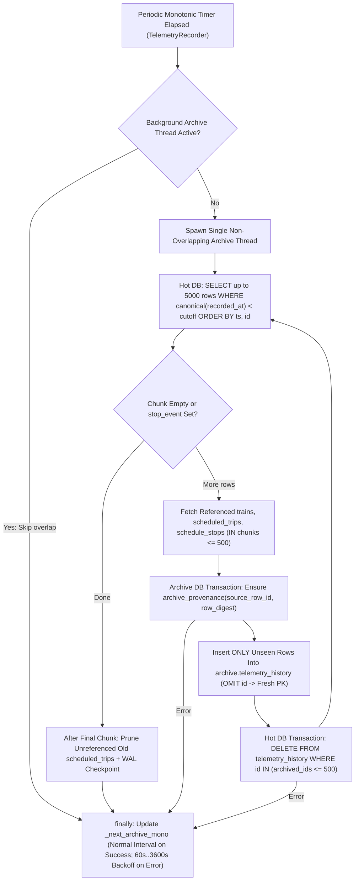
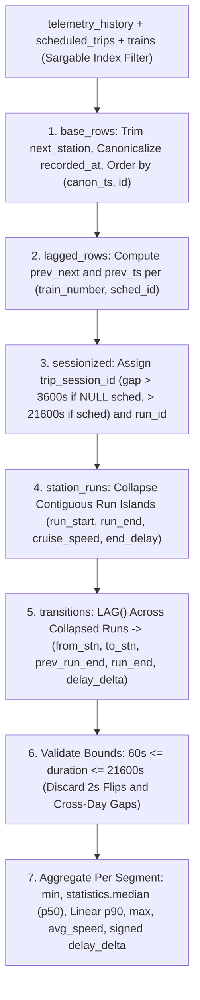

# Implementation Plan — P0-18: Five Storage Durability, Data-Loss & Analytics Failures

> **Reference Review:** [`../../../architecture/codebase-architecture-review.md`](../../../architecture/codebase-architecture-review.md#L254-L268) (Finding **P0-5**)  
> **Related Historical Plans:** [`./p0-1-station-dwell-multi-trip-fix-plan.md`](./p0-1-station-dwell-multi-trip-fix-plan.md), [`./p0-5-sqlite-connection-churn-memory-sharing-fix-plan.md`](./p0-5-sqlite-connection-churn-memory-sharing-fix-plan.md), [`./p0-6-unbounded-storage-disk-circuit-breaker-fix-plan.md`](./p0-6-unbounded-storage-disk-circuit-breaker-fix-plan.md), [`../../features/f-9-2-empirical-segment-transit-time-and-eta-engine-plan.md`](../../features/f-9-2-empirical-segment-transit-time-and-eta-engine-plan.md)  
> **Target Modules:** [`../../../../storage/models.py`](../../../../storage/models.py), [`../../../../storage/db.py`](../../../../storage/db.py), [`../../../../storage/filter.py`](../../../../storage/filter.py), [`../../../../storage/recorder.py`](../../../../storage/recorder.py), [`../../../../storage/repository.py`](../../../../storage/repository.py), [`../../../../storage/__init__.py`](../../../../storage/__init__.py), [`../../../../train_tracker.py`](../../../../train_tracker.py)  
> **Test Suites:** [`../../../../tests/test_eta_engine.py`](../../../../tests/test_eta_engine.py), [`../../../../tests/test_storage_repository.py`](../../../../tests/test_storage_repository.py), [`../../../../tests/test_storage_recorder.py`](../../../../tests/test_storage_recorder.py), [`../../../../tests/test_storage_filter.py`](../../../../tests/test_storage_filter.py), [`../../../../tests/test_storage_models.py`](../../../../tests/test_storage_models.py), [`../../../../tests/test_storage_db.py`](../../../../tests/test_storage_db.py), [`../../../../tests/test_gtfs_exporter.py`](../../../../tests/test_gtfs_exporter.py)  
> **Relevant Rules & Skills:** [`../../../../.agents/rules/misra-autosar-python.md`](../../../../.agents/rules/misra-autosar-python.md), [`../../../../.agents/rules/concurrency-and-sqlite.md`](../../../../.agents/rules/concurrency-and-sqlite.md), [`../../../../.agents/rules/resilience-and-fallbacks.md`](../../../../.agents/rules/resilience-and-fallbacks.md), [`../../../../.agents/rules/testing.md`](../../../../.agents/rules/testing.md), [`../../../../.agents/skills/diagrams-and-documentation/SKILL.md`](../../../../.agents/skills/diagrams-and-documentation/SKILL.md), [`../../../../.agents/skills/markdown-relative-paths/SKILL.md`](../../../../.agents/skills/markdown-relative-paths/SKILL.md), [`../../../../.agents/skills/database-backup-and-migration-validator/SKILL.md`](../../../../.agents/skills/database-backup-and-migration-validator/SKILL.md), [`../../../../.agents/skills/storage-benchmark-gate/SKILL.md`](../../../../.agents/skills/storage-benchmark-gate/SKILL.md), [`../../../../.agents/skills/ci-quality-gate/SKILL.md`](../../../../.agents/skills/ci-quality-gate/SKILL.md)

---

## 1. Executive Summary & Empirically Verified Defects

Auditing the SQLite persistence, retention archival, deadband filtering, DVR replay, and F-9.2 analytics pipeline across [`storage/`](../../../../storage) on `HEAD` (`19764a8`) empirically confirms **five critical P0 storage durability, silent data-loss, and analytics failures**:

| # | Defect Class | Affected Locations | Empirically Verified Failure Mode & Root Cause | Severity |
|---|---|---|---|---|
| **1** | **F-9.2 Segment Transit Engine Measures ~2s Polling Ticks, Not ~30m Transit Times** | [`storage/repository.py`](../../../../storage/repository.py#L1354-L1582) (`_extract_segment_transition_samples`, `get_segment_transit_times`) | `LAG(next_station)` + `WHERE prev_next != current_next` retains only the single station-flip row whose `prev_recorded_at` is the prior SSE tick (`~2s` earlier). On a realistic 35-minute `Larissa -> Katerini` run (`10:00:00Z` to `10:35:00Z`), F-9.2 reports `p50 = 2.0s` (off by `1,050x`), `avg_speed = 15.0 km/h` (departure crawl instead of `100–142 km/h` cruise), and `delay_delta = 0.0` (`MIN == MAX` on one row), while `GROUP BY (train_number, sched_id, corr, prev_next, current_next)` collapses multi-day and loop trips whenever `schedule_id IS NULL`. [`tests/test_eta_engine.py`](../../../../tests/test_eta_engine.py#L120-L121) masked this by inserting only 2 rows total per train. | **Critical** |
| **2** | **`archive_before()` Dual Silent Permanent Data Loss (TOCTOU + PK Collision)** | [`storage/repository.py`](../../../../storage/repository.py#L2021-L2270) (`_collect_archive_payload`, `archive_before`) | **(a) TOCTOU Delete-by-Timestamp:** Step 1 selects `WHERE recorded_at < ?`, Step 2 writes to archive DB, and Step 3 deletes `WHERE recorded_at < ?` from the hot DB—permanently deleting any late-arriving `< cutoff` rows inserted between read and delete without archiving them. **(b) Primary-Key Collision Data Loss:** Step 2 copies hot `AUTOINCREMENT id` via `INSERT OR IGNORE INTO telemetry_history (id, ...)`. After any hot-DB recreation/rotation (restarting `id = 1`), `INSERT OR IGNORE` silently drops **100%** of colliding rows (`arch_ic52 = 0`), then Step 3 deletes them from the hot DB (`hot_ic52_remaining = 0`). | **Critical** |
| **3** | **Unnormalized ISO-8601 `TEXT` Timestamps Break SQLite Range Queries & Drop `end_date`** | [`storage/models.py`](../../../../storage/models.py#L13-L15), [`#L127-L182`](../../../../storage/models.py#L127-L182), [`storage/db.py`](../../../../storage/db.py#L25-L39), [`storage/repository.py`](../../../../storage/repository.py#L127-L158), [`#L607-L718`](../../../../storage/repository.py#L607-L718), [`#L780-L821`](../../../../storage/repository.py#L780-L821), [`#L880-L941`](../../../../storage/repository.py#L880-L941), [`#L1106-L1107`](../../../../storage/repository.py#L1106-L1107), [`#L1482-L1483`](../../../../storage/repository.py#L1482-L1483) | In ASCII, `'+'` (`43`) < `'.'` (`46`) < `'Z'` (`90`). Python's default `isoformat()` omits `.000000` on whole seconds (`...10:00:00Z`), so `'2026-11-20T10:00:00.500000Z' < '2026-11-20T10:00:00Z'` evaluates `TRUE` in SQLite `TEXT` comparisons. Empirically: `get_replay_observations("...10:00:00Z", "...10:00:01Z", include_start=False)` silently **drops** `10:00:00.500000Z`; `--from-db --at` GTFS-RT snapshots drop lower-boundary subseconds and include future upper-boundary subseconds; `archive_before()` evicts rows *after* a whole-second cutoff; and `get_corridor_punctuality()` compares `recorded_at <= 'YYYY-MM-DD'`, excluding **100%** of the `end_date` day. | **Critical** |
| **4** | **Infinite Tight Archival Retry Storm & Synchronous Hot-Path Stalls** | [`storage/recorder.py`](../../../../storage/recorder.py#L138-L166), [`#L323-L329`](../../../../storage/recorder.py#L323-L329) (`_run_retention_archive`, `_worker_loop`) | `_run_retention_archive()` updates `self._last_archive_time = time.time()` **only inside the `try` success path**. Any archival failure (read-only archive mount, permissions error, transient lock, missing parent directory) leaves `_last_archive_time` stale, re-triggering archival on every `_worker_loop()` iteration (`~10x/sec` idle, `>100x/sec` under traffic). Furthermore, successful large-table archival runs synchronously on the ingestion thread, stalling live queue draining until `self._queue` overflows. | **Critical** |
| **5** | **Unrecoverable Batch Loss + Deadband State Poisoning on Transient SQLite Lock** | [`storage/filter.py`](../../../../storage/filter.py#L97-L194), [`storage/recorder.py`](../../../../storage/recorder.py#L318-L321), [`#L361-L489`](../../../../storage/recorder.py#L361-L489) (`DeadbandFilter.should_record`, `_worker_loop`, `_flush_buffer`) | `_flush_buffer()` mutates `DeadbandFilter._states` and filter counters **before** `self.db.transaction()` commits. On any transient `sqlite3.OperationalError: database is locked`, `_flush_buffer()` returns `0` and `_worker_loop()` unconditionally calls `buffer.clear()`, **permanently losing the entire batch** while the poisoned deadband cache suppresses subsequent frames matching the unpersisted status/station/delay transition for up to `60s`. | **Critical** |

### 1.1 Empirical Evidence Tables (Verified on `19764a8`, SQLite `3.50.4`, Python `3.13.14`)

#### A. F-9.2 Segment Transit Engine — Realistic Multi-Breadcrumb Run vs. Broken Output

Input sequence for `IC50` (`schedule_id='S1'`, `PATHE`): `Larissa` at `09:59:58Z` (`0 km/h`, delay `0`) and `10:00:00Z` (`5 km/h`, delay `0`); `Katerini` at `10:00:02Z` (`15 km/h`, delay `0`), `10:15:00Z` (`140 km/h`, delay `2`), `10:30:00Z` (`145 km/h`, delay `4`), `10:35:00Z` (`0 km/h`, delay `5`); trailing departure flip `Platy` at `10:35:02Z` (`20 km/h`, delay `5`):

| Segment | True Physical Transit | Current F-9.2 Output (`19764a8`) | Remediated F-9.2 Output (`P0-18`) |
|---|---|---|---|
| `Larissa -> Katerini` | `2,100.0 s` (`35m 00s`), cruise `100.0 km/h`, delay `+5.0 m` | **`2.0 s`**, **`15.0 km/h`**, **`+0.0 m`** (WRONG) | **`2,100.0 s`**, **`100.0 km/h`**, **`+5.0 m`** |
| `Katerini -> Platy` (2s incomplete flip) | Incomplete transit (discarded, `< 60 s`) | **`2.0 s`**, `20.0 km/h`, `0.0 m` (POLLUTES ETA) | **Discarded** (`< MIN_SEGMENT_TRANSIT_SEC`) |
| `SUB1` (`schedule_id=None`, 2 loops Day 1 + 1 Day 2) | `3` samples (`720s / +2m`, `900s / -2m`, `660s / +1m`); `0` cross-day edges | Collapses all 3 into `1` corrupt 24h sample | **`3` independent samples**, exact signed deltas, **`0` cross-day edges** |

#### B. ISO-8601 `TEXT` Comparison & Legacy-DB Compatibility Matrix

| Query / Comparison | Stored Row Value | Current Result (`19764a8`) | Naive `.000000Z` Bound Trap | Remediated Result (`P0-18`: Canonical Write + Index-Backed Canonical Filter) |
|---|---|---|---|---|
| `recorded_at > '2026-11-20T10:00:00Z'` | `'2026-11-20T10:00:00.500000Z'` | **`FALSE` (DROPPED!)** | Fixed only for canonical rows | **`TRUE`** (uses `idx_telemetry_time` range + canonical check) |
| `recorded_at <= '2026-11-20T10:00:00Z'` (`--at`) | `'2026-11-20T10:00:00.500000Z'` | **`TRUE` (FUTURE ROW LEAKED!)** | Fixed only for canonical rows | **`FALSE`** (strictly excludes post-`--at` rows) |
| `recorded_at <= '2026-11-20T10:02:00.000000Z'` | Legacy `'2026-11-20T10:02:00Z'` | N/A | **`FALSE` (DROPS LEGACY ROWS!)** | **`TRUE`** (legacy `'...Z'` canonicalized via `_CANON_TS_SQL`) |
| `recorded_at > '2026-11-20T10:00:00.000000Z'` | Legacy `'2026-11-20T10:00:00Z'` | N/A | **`TRUE` (DUPLICATES START ROW!)** | **`FALSE`** (exact exclusion preserved on legacy DBs) |
| `get_corridor_punctuality(start_date='2026-11-20', end_date='2026-11-20')` | `'2026-11-20T10:00:00Z'` | **`[]` (100% OF DAY DROPPED!)** | Fixed if `end_date` -> `T23:59:59.999999Z` | **Full day `[00:00:00.000000Z, 23:59:59.999999Z]` included** |

> [!IMPORTANT]
> **Legacy Database Compatibility Requirement:** Many existing user SQLite files and read-only `--replay` / `--from-db` invocations (`auto_migrate=False`) already contain whole-second `'...Z'`, 3-digit JS `'....500Z'`, or `'+00:00'` strings. Naively changing query parameters to `'...000000Z'` without canonicalizing legacy rows on read would **silently drop** whole-second rows on `<=` bounds (`'Z' > '.'`) and **duplicate** them on `>` bounds. `P0-18` combines **canonical 27-char writes** with a **sargable B-tree envelope + exact SQLite canonical expression** (`SEARCH ... USING INDEX`) so both newly written and legacy databases are 100% exact with zero full table scans.

#### C. `archive_before()` Dual Permanent Data-Loss Reproduction

| Scenario | Hot DB Before | Archive DB Before | Current Result (`19764a8`) | Remediated Result (`P0-18`) |
|---|---|---|---|---|
| **Hot DB Rotated/Recreated** (`id=1` reused for `IC52` after `IC50` `id=1` archived) | `1` row (`IC52`, `id=1`) | `1` row (`IC50`, `id=1`) | `c2=1`, `hot_ic52=0`, **`arch_ic52=0` (100% LOST)** | `c2=1`, `hot_ic52=0`, **`arch_ic50=1`, `arch_ic52=1` (`id=2`)** |
| **Late-Arriving Row During Archive** (`< cutoff` inserted between Step 1 read and Step 3 delete) | `N` aged + `1` late row | `0` rows | **`N + 1` deleted from hot DB; late row LOST** | Only exact `archived_ids` (`N`) deleted; **late row preserved** |
| **Crash Between Archive Commit & Hot Delete** (same hot chunk retried on restart) | `N` aged rows (`id=1..N`) | `N` rows already committed | Relied on fragile hot `id` reuse | **`archive_provenance (source_row_id, row_digest)` prevents duplicates**; hot rows cleaned up |

### 1.2 Scope Boundary with `P1-11`, `P1-18`, `P1-5` & Schema V2

- **In scope for `P0-18` (resolves Review Finding `P0-5`):**
  1. Canonical fixed-width UTC ISO-8601 (`YYYY-MM-DDTHH:MM:SS.ffffffZ`, 27 chars) across all write paths (`storage/models.py`, `storage/recorder.py`, `storage/repository.py`, `train_tracker.py`), Python 3.10+ fractional-second parser hardening (`storage/models.py`, `storage/db.py`), full-day `end_date` expansion (`T23:59:59.999999Z`), and sargable B-tree index-envelope + canonical SQLite range predicates across all time-bounded repository queries.
  2. Complete rewrite of F-9.2 `_extract_segment_transition_samples()` and `get_segment_transit_times()` using contiguous `next_station` run islands, trip-gap sessionization for null `schedule_id` multi-day/loop runs, cruise-speed averaging, signed delay deltas, realistic transit duration bounds (`60s–21,600s`), and exact `statistics.median` / interpolated `p90`.
  3. Complete hardening of `HistoricalRepository.archive_before()`: bounded chunking (`chunk_size=5000`), chunked `IN (...)` parameter batching (`<= 500`, eliminating `SQLITE_MAX_VARIABLE_NUMBER` limits), archive-local `archive_provenance (source_row_id, row_digest)` crash-recovery deduplication without copying hot PKs, strict `DELETE WHERE id IN (...)` eviction of archived IDs only, cooperative `stop_event` interruption, and post-archive WAL checkpointing.
  4. `TelemetryRecorder` retention archival scheduler rewrite: monotonic clocks, unconditional `finally` retry timer with capped exponential backoff (`60s -> 120s -> ... -> 3600s`), and single non-overlapping background maintenance thread so archival never stalls live ingestion.
  5. Two-phase `DeadbandFilter` (`evaluate_batch()` pure staging + post-commit `commit_batch()`) and transient `SQLITE_BUSY`/`SQLITE_LOCKED` in-flush retry + bounded buffer retention (`max_pending_buffer_size = 5000`) in `TelemetryRecorder`.
- **Explicitly deferred to sibling Phase 1 plans (`codebase-architecture-review.md` Sections 4 & 9):**
  - **`P1-11` (`storage/db.py` / `storage/schema.py`):** Thread-local 64 MB connection leak eviction, `isolation_level=None` + `SAVEPOINT` nesting, `uri=True`, `os.umask()` lock/replacement, `read_only=True`, and deferring per-open `PRAGMA integrity_check`.
  - **`P1-18` (Schema V2 + F-9.1 + GeoJSON):** Schema V2 migration (`PRAGMA user_version = 2` adding numeric `recorded_epoch` and `vehicle_id`), F-9.1 `get_corridor_bottlenecks` `dwell_events`-based percentiles & OOM elimination, `export_trip_geojson` RFC 7946 1-point/3D fixes, and `train_tracker.py:3165` `"suppressed_count"` key fix.
  - **`P1-5`:** CSV formula injection neutralization (`CWE-1236`) and streaming `iter_train_history()` CSV export.

---

## 2. Current Broken Data Flows vs. Remediated Durable Architecture

### A. End-to-End Storage Durability & Analytics Pipeline Comparison (ASCII)

```text
+------------------------------------------------------------------------------+
| CURRENT BROKEN STORAGE & ANALYTICS PIPELINE (HEAD = 19764a8)                 |
+------------------------------------------------------------------------------+
| [1] F-9.2 Segment Transit Engine (storage/repository.py)                     |
|   LAG(next_station) + WHERE prev_next != current_next                        |
|   -> Keeps ONLY 1 flip row (~2s tick)! p50=2.0s, speed=15km/h, delta=0.0     |
|   -> GROUP BY (train, sched, prev, curr) collapses multi-day/loop runs!      |
|                                                                              |
| [2] Retention Archival (storage/repository.py + storage/recorder.py)         |
|   SELECT (< cutoff) -> INSERT OR IGNORE (id, ...) -> DELETE (< cutoff)       |
|   -> TOCTOU deletes late-arriving < cutoff rows WITHOUT archiving!           |
|   -> Hot DB rotation reuses id=1 -> INSERT OR IGNORE drops 100%, then DEL!   |
|   -> Any error skips _last_archive_time update -> 10x/sec retry storm!       |
|                                                                              |
| [3] Timestamp Ordering (storage/models.py + storage/repository.py)           |
|   Mixed '...10:00:00Z' (90) vs '...10:00:00.500000Z' (46)                    |
|   -> Replay drops .500000Z; --at leaks future .500000Z; end_date drops day!  |
|                                                                              |
| [4] Recorder Flush & Deadband (storage/recorder.py + storage/filter.py)      |
|   should_record() MUTATES _states -> DB LOCKED -> return 0 -> buffer.clear() |
|   -> ENTIRE BATCH LOST + deadband suppresses next 60s of same transition!    |
+------------------------------------------------------------------------------+

+------------------------------------------------------------------------------+
| REMEDIATED DURABLE STORAGE & ANALYTICS PIPELINE (P0-18)                      |
+------------------------------------------------------------------------------+
| [1] F-9.2 Contiguous Station-Run Islands                                     |
|   Canonical ts -> Trip-Gap Session (>3600s if NULL sched) -> Run Islands     |
|   -> LAG() over collapsed runs -> [60s..21600s] filter -> median & p90       |
|   -> Accurate 2,100s transit, cruise avg speed, signed delay delta!          |
|                                                                              |
| [2] Chunked, Provenance-Deduplicated, Non-Blocking Archival                  |
|   SELECT (< cutoff LIMIT 5000) -> archive_provenance(src_id, sha256)         |
|   -> INSERT INTO telemetry_history (NO id: fresh archive PK!)                |
|   -> DELETE hot WHERE id IN (chunk <= 500) -> ONLY archived IDs deleted!     |
|   -> Background thread + finally exponential backoff (60s..3600s cap)        |
|                                                                              |
| [3] Canonical 27-Char UTC ISO-8601 + Index-Backed Legacy Query Filter        |
|   Write: YYYY-MM-DDTHH:MM:SS.ffffffZ everywhere (Python 3.10+ safe)          |
|   Read:  Coarse B-tree envelope (idx_telemetry_time) + _CANON_TS_SQL exact   |
|   Dates: start_date -> T00:00:00.000000Z, end_date -> T23:59:59.999999Z      |
|                                                                              |
| [4] Two-Phase Commit-Safe Deadband + Transient Lock Retry                    |
|   evaluate_batch() (PURE, zero mutation) -> DB transaction (3x busy retry)   |
|   -> COMMIT OK: commit_batch() + buffer.clear()                              |
|   -> BUSY FAIL: _states UNTOUCHED + buffer retained (cap 5000) for retry!    |
+------------------------------------------------------------------------------+
```

### B. Two-Phase Deadband Evaluation, Transactional Flush & Retry Sequence (Mermaid)

```mermaid
sequenceDiagram
    autonumber
    participant W as TelemetryRecorder._worker_loop
    participant F as DeadbandFilter
    participant D as SQLite WAL (Database)

    W->>F: evaluate_batch(buffer) [PURE - zero mutation]
    F-->>W: DeadbandBatchEvaluation(admitted, staged_states, counts)

    alt admitted is empty (all suppressed)
        W->>F: commit_batch(evaluation)
        W->>W: buffer.clear()
    else admitted has rows
        loop attempt = 1..write_retry_max_attempts (3)
            W->>D: BEGIN IMMEDIATE; upsert trains/trips + insert telemetry; COMMIT
            alt COMMIT succeeds
                D-->>W: OK
                W->>F: commit_batch(evaluation) [post-commit promotion]
                W->>W: buffer.clear() & update written/batch counters
            else Transient SQLITE_BUSY / SQLITE_LOCKED
                D-->>W: OperationalError("database is locked")
                W->>W: Bounded sleep (0.05s, 0.10s, ...) and retry
            else Non-transient error or disk-full tripped
                D-->>W: Error
                W->>W: Leave DeadbandFilter._states UNMODIFIED; clear poison buffer
            end
        end
        opt All attempts failed with transient lock
            W->>W: Leave DeadbandFilter._states UNMODIFIED
            W->>W: Retain buffer (bounded <= max_pending_buffer_size) for next flush cycle
        end
    end
```

### C. Crash-Safe Chunked Archival & Provenance-Deduplicated Eviction Flow (Mermaid)



### D. Contiguous `next_station` Run-Island F-9.2 Analytics Pipeline (Mermaid)



---

## 3. Detailed Implementation Specification

Implementation follows strict dependency order: **Fix 3 (Canonical Timestamps)** lands first so Fixes 1, 2, 4, and 5 all operate on a single uniform 27-character UTC ISO-8601 contract.

---

### 3.1 Fix 3 — Canonical Fixed-Width UTC Timestamps & Index-Friendly Legacy Query Compatibility

#### A. Canonical Timestamp Utilities in [`storage/models.py`](../../../../storage/models.py#L1-L20)

Add pure, zero-dependency, Python 3.10–3.14 safe UTC timestamp helpers at the top of [`storage/models.py`](../../../../storage/models.py):

```python
_ISO_TS_PATTERN = re.compile(
    r"^(?P<date>\d{4}-\d{2}-\d{2})"
    r"(?:[Tt ](?P<time>\d{2}:\d{2}:\d{2})(?:\.(?P<frac>\d+))?"
    r"(?P<tz>[Zz]|[+-]\d{2}:?\d{2})?)?$"
)
_ISO_DATE_ONLY_PATTERN = re.compile(r"^\d{4}-\d{2}-\d{2}$")


def format_utc_iso(dt: datetime) -> str:
    """Format any datetime as fixed-width 27-char UTC ISO-8601 (YYYY-MM-DDTHH:MM:SS.ffffffZ)."""
    utc_dt = dt.replace(tzinfo=timezone.utc) if dt.tzinfo is None else dt.astimezone(timezone.utc)
    return utc_dt.strftime("%Y-%m-%dT%H:%M:%S.%fZ")


def iso_utc_now() -> str:
    """Return current UTC timestamp in canonical fixed-width microsecond ISO-8601 format."""
    return format_utc_iso(datetime.now(timezone.utc))


def parse_iso_utc_datetime(val: Any) -> Optional[datetime]:
    """Parse datetime, numeric epoch, or ISO-8601 string (1-9 fractional digits, Z/z/offset) into UTC datetime."""
    if val is None or isinstance(val, bool):
        return None
    if isinstance(val, datetime):
        return val.replace(tzinfo=timezone.utc) if val.tzinfo is None else val.astimezone(timezone.utc)
    if isinstance(val, (int, float)):
        fval = float(val)
        if not math.isfinite(fval):
            return None
        try:
            return datetime.fromtimestamp(fval, tz=timezone.utc)
        except (ValueError, OSError, OverflowError):
            return None

    raw = str(val).strip()
    if not raw:
        return None
    match = _ISO_TS_PATTERN.match(raw)
    if match is None:
        return None

    date_part = match.group("date")
    time_part = match.group("time") or "00:00:00"
    frac_raw = match.group("frac") or ""
    frac_norm = (frac_raw + "000000")[:6]
    tz_raw = match.group("tz") or "Z"
    if tz_raw in ("Z", "z"):
        tz_norm = "+00:00"
    elif len(tz_raw) == 5:
        tz_norm = f"{tz_raw[:3]}:{tz_raw[3:]}"
    else:
        tz_norm = tz_raw

    try:
        parsed = datetime.fromisoformat(f"{date_part}T{time_part}.{frac_norm}{tz_norm}")
    except ValueError:
        return None
    return parsed.astimezone(timezone.utc)


def canonicalize_iso_utc(val: Any, fallback: Optional[str] = None) -> str:
    """Normalize a timestamp value to canonical 27-char UTC ISO-8601 (YYYY-MM-DDTHH:MM:SS.ffffffZ)."""
    parsed = parse_iso_utc_datetime(val)
    if parsed is not None:
        return format_utc_iso(parsed)
    if fallback is not None:
        return fallback
    return str(val).strip() if val is not None else ""


def normalize_start_bound(bound: Optional[str]) -> Optional[str]:
    """Normalize an optional ISO date or timestamp lower bound to canonical 27-char UTC ISO-8601."""
    if bound is None:
        return None
    cleaned = str(bound).strip()
    if not cleaned:
        return None
    if _ISO_DATE_ONLY_PATTERN.match(cleaned):
        parsed = parse_iso_utc_datetime(f"{cleaned}T00:00:00.000000Z")
        return format_utc_iso(parsed) if parsed is not None else cleaned
    return canonicalize_iso_utc(cleaned)


def normalize_end_bound(bound: Optional[str]) -> Optional[str]:
    """Normalize an optional ISO date or timestamp upper bound (expanding YYYY-MM-DD to 23:59:59.999999Z)."""
    if bound is None:
        return None
    cleaned = str(bound).strip()
    if not cleaned:
        return None
    if _ISO_DATE_ONLY_PATTERN.match(cleaned):
        parsed = parse_iso_utc_datetime(f"{cleaned}T23:59:59.999999Z")
        return format_utc_iso(parsed) if parsed is not None else cleaned
    return canonicalize_iso_utc(cleaned)
```

1. **Update all `storage/models.py` DTO factory methods:**
   - `TelemetryHistoryRow.from_train_position()`:
     `raw_ts = recorded_at or pos.timestamp`
     `timestamp = canonicalize_iso_utc(raw_ts, fallback=iso_utc_now()) if raw_ts else iso_utc_now()`
   - `TelemetryHistoryRow.from_db_row()`, `RecordingSessionDB.from_db_row()`, `TripSummary.from_db_row()`, `StationDwellRecord.from_db_row()`, `SpeedProfilePoint.from_db_row()`: format timestamps via `canonicalize_iso_utc(...)` (preserving `None` for optional `ended_at`).
2. **Update [`storage/db.py#L25-L36`](../../../../storage/db.py#L25-L36) (`_convert_timestamp`):**
   - Delegate to `parse_iso_utc_datetime(s)` (falling back to raw string `s` if unparseable) so Python 3.10 never raises on 1–5 or >6 fractional digits or lowercase `'z'`.
3. **Update [`storage/repository.py#L127-L158`](../../../../storage/repository.py#L127-L158) (`_epoch_to_iso_utc`, `parse_iso_to_epoch`, `_iso_or_str`, `_iso_or_raw`):**
   - `_epoch_to_iso_utc(epoch_sec)` -> `format_utc_iso(datetime.fromtimestamp(float(epoch_sec), tz=timezone.utc))` with finite guard and `iso_utc_now()` fallback.
   - `parse_iso_to_epoch(val)` -> uses `parse_iso_utc_datetime(val)` (rejecting `bool`/`NaN`/`Inf` safely and returning `0.0` on invalid strings).
   - `_iso_or_str(val)` -> `canonicalize_iso_utc(val)`.
   - `_iso_or_raw(val)` -> `canonicalize_iso_utc(val)` if `val is not None` else `None`.
4. **Update [`storage/recorder.py`](../../../../storage/recorder.py) & [`train_tracker.py#L3398-L3399`](../../../../train_tracker.py#L3398-L3399):**
   - In `TelemetryRecorder._flush_buffer()`: canonicalize `p.timestamp` via `canonicalize_iso_utc(p.timestamp, fallback=now_iso)` for `train_rows` (`first_observed_at`, `last_observed_at`) and derive `service_date = ts_canon[:10]` for `trip_rows`.
   - In `TelemetryRecorder._run_retention_archive()` and `train_tracker.py:3399`: format `cutoff_dt` via `format_utc_iso(cutoff_dt)`.

#### B. Sargable Index-Backed Canonical Range Predicates in [`storage/repository.py`](../../../../storage/repository.py)

Add two focused helpers on [`storage/repository.py`](../../../../storage/repository.py) so **every** time-bounded query uses SQLite's B-tree indexes (`idx_telemetry_time`, `idx_telemetry_train_time`, `idx_telemetry_corridor_time`) AND remains 100% microsecond-exact on both canonical and legacy mixed-format databases:

```python
def _canon_ts_sql(col: str) -> str:
    """Return a SQLite expression normalizing legacy/canonical ISO-8601 UTC TEXT to 27-char .ffffffZ."""
    return (
        f"CASE "
        f"WHEN LENGTH({col}) = 27 AND SUBSTR({col}, 20, 1) = '.' AND SUBSTR({col}, 27, 1) = 'Z' "
        f"  THEN {col} "
        f"WHEN LENGTH({col}) = 20 AND SUBSTR({col}, 20, 1) = 'Z' "
        f"  THEN SUBSTR({col}, 1, 19) || '.000000Z' "
        f"WHEN SUBSTR({col}, 20, 1) = '.' AND SUBSTR({col}, -1, 1) = 'Z' AND LENGTH({col}) BETWEEN 22 AND 26 "
        f"  THEN SUBSTR(SUBSTR({col}, 1, LENGTH({col}) - 1) || '000000', 1, 26) || 'Z' "
        f"ELSE COALESCE(STRFTIME('%Y-%m-%dT%H:%M:%f', {col}) || '000Z', {col}) "
        f"END"
    )


def _append_recorded_at_filters(
    clauses: List[str],
    params: List[Any],
    col: str,
    start_bound: Optional[str],
    end_bound: Optional[str],
    include_start: bool = True,
    include_end: bool = True,
) -> None:
    """Append sargable coarse B-tree envelope + exact canonical timestamp predicates."""
    canon_expr = _canon_ts_sql(col)
    if start_bound is not None:
        start_canon = normalize_start_bound(start_bound)
        if start_canon:
            # Coarse B-tree floor (19-char second prefix) covers '+00:00', '.fffZ', '.ffffffZ', and 'Z'
            clauses.append(f"{col} >= ?")
            params.append(start_canon[:19])
            op = ">=" if include_start else ">"
            clauses.append(f"({canon_expr}) {op} ?")
            params.append(start_canon)
    if end_bound is not None:
        end_canon = normalize_end_bound(end_bound)
        if end_canon:
            # Coarse B-tree ceiling ('YYYY-MM-DDTHH:MM:SSZ') is ASCII >= all subsecond/offset forms of that second
            clauses.append(f"{col} <= ?")
            params.append(f"{end_canon[:19]}Z")
            op = "<=" if include_end else "<"
            clauses.append(f"({canon_expr}) {op} ?")
            params.append(end_canon)
```

Apply `_append_recorded_at_filters()` and `ORDER BY ({canon_expr}) ASC/DESC, id ASC/DESC` consistently across:
1. `get_train_history()` & `iter_train_history()`
2. `get_replay_bounds()` — compute `MIN({canon_expr}) AS min_ts, MAX({canon_expr}) AS max_ts` with dynamic sargable bounds (removing `(? IS NULL OR ...)`)
3. `get_replay_observations()` — uses `(include_start=include_start, include_end=True)`
4. `get_replay_snapshot_at()` & `get_gtfs_snapshot()` — automatically inherit exact microsecond bounds via `_epoch_to_iso_utc()` -> `get_replay_observations()`
5. `get_corridor_punctuality()` — **fixes the `end_date` bug** (`start_date` -> `T00:00:00.000000Z`, `end_date` -> `T23:59:59.999999Z`) and builds dynamic sargable `WHERE` clauses (replacing `(? IS NULL OR ...)`)
6. `get_speed_profile()` & `get_station_dwell_times()` — dynamic bounds + canonical ordering
7. `get_corridor_bottlenecks()` & `get_segment_transit_times()` — replace `T23:59:59Z` string hack with `normalize_start_bound()` / `normalize_end_bound()` (`T23:59:59.999999Z`) + `_append_recorded_at_filters()`
8. `get_database_stats()` — compute `MIN({canon_expr}), MAX({canon_expr})` and format via `_iso_or_raw()`
9. `archive_before()` — uses `_append_recorded_at_filters(..., start_bound=None, end_bound=cutoff_canon, include_end=False)` so whole-second cutoffs never evict post-cutoff subsecond rows and mid-second cutoffs never miss legacy whole-second rows.

---

### 3.2 Fix 1 — Contiguous Station-Run Island F-9.2 Segment Transit Engine

Rewrite `_extract_segment_transition_samples()` and statistical aggregation in [`storage/repository.py#L1354-L1582`](../../../../storage/repository.py#L1354-L1582):

1. **Module Constants (`storage/repository.py`):**
   ```python
   MIN_SEGMENT_TRANSIT_SEC: float = 60.0       # Discard 2s flip ticks, trailing flips, and GPS bounces
   MAX_SEGMENT_TRANSIT_SEC: float = 21600.0    # 6h upper sanity ceiling (discard corrupted cross-day gaps)
   NULL_SCHEDULE_TRIP_GAP_SEC: float = 3600.0  # 1h silence splits separate trips when schedule_id IS NULL
   SEGMENT_CRUISE_MIN_SPEED_KMH: float = 2.0   # Exclude platform dwell 0 km/h rows from segment avg speed
   ```
2. **Verified Contiguous Run-Island SQL CTE Pipeline (SQLite 3.25+ compatible, zero nested window functions):**
   ```sql
   WITH base_rows AS (
       SELECT
           th.id,
           th.train_number,
           COALESCE(th.schedule_id, '') AS sched_id,
           COALESCE(NULLIF(st.corridor, ''), NULLIF(th.corridor, ''), 'UNKNOWN') AS corr,
           TRIM(th.next_station) AS current_next,
           ({canon_expr}) AS canon_ts,
           th.speed,
           COALESCE(th.delay_min, 0) AS delay
       FROM telemetry_history th
       LEFT JOIN scheduled_trips st ON th.schedule_id = st.schedule_id
       LEFT JOIN trains t ON th.train_number = t.train_number
       WHERE {dynamic_where_clause}
         AND th.next_station IS NOT NULL
         AND TRIM(th.next_station) != ''
   ),
   lagged_rows AS (
       SELECT
           id, train_number, sched_id, corr, current_next, canon_ts, speed, delay,
           LAG(current_next) OVER (
               PARTITION BY train_number, sched_id
               ORDER BY canon_ts ASC, id ASC
           ) AS prev_next,
           LAG(canon_ts) OVER (
               PARTITION BY train_number, sched_id
               ORDER BY canon_ts ASC, id ASC
           ) AS prev_ts
       FROM base_rows
   ),
   sessionized AS (
       SELECT
           id, train_number, sched_id, corr, current_next, canon_ts, speed, delay,
           SUM(
               CASE
                   WHEN prev_ts IS NULL THEN 1
                   WHEN sched_id = ''
                     AND (JULIANDAY(canon_ts) - JULIANDAY(prev_ts)) * 86400.0 > ?
                       THEN 1
                   WHEN sched_id != ''
                     AND (JULIANDAY(canon_ts) - JULIANDAY(prev_ts)) * 86400.0 > ?
                       THEN 1
                   ELSE 0
               END
           ) OVER (
               PARTITION BY train_number, sched_id
               ORDER BY canon_ts ASC, id ASC
           ) AS trip_session_id,
           SUM(
               CASE
                   WHEN prev_ts IS NULL
                     OR prev_next IS NOT current_next
                     OR (sched_id = '' AND (JULIANDAY(canon_ts) - JULIANDAY(prev_ts)) * 86400.0 > ?)
                     OR (sched_id != '' AND (JULIANDAY(canon_ts) - JULIANDAY(prev_ts)) * 86400.0 > ?)
                   THEN 1
                   ELSE 0
               END
           ) OVER (
               PARTITION BY train_number, sched_id
               ORDER BY canon_ts ASC, id ASC
           ) AS run_id
       FROM lagged_rows
   ),
   run_annotated AS (
       SELECT
           train_number, sched_id, trip_session_id, run_id, corr,
           current_next AS station_name, canon_ts, speed,
           FIRST_VALUE(delay) OVER (
               PARTITION BY train_number, sched_id, trip_session_id, run_id
               ORDER BY canon_ts DESC, id DESC
           ) AS end_delay
       FROM sessionized
   ),
   station_runs AS (
       SELECT
           train_number, sched_id, trip_session_id, run_id,
           MAX(corr) AS corr,
           station_name,
           MIN(canon_ts) AS run_start,
           MAX(canon_ts) AS run_end,
           COALESCE(AVG(CASE WHEN speed > ? THEN speed END), AVG(speed)) AS cruise_speed,
           MIN(end_delay) AS run_end_delay
       FROM run_annotated
       GROUP BY train_number, sched_id, trip_session_id, run_id, station_name
   ),
   transitions AS (
       SELECT
           LAG(station_name) OVER (
               PARTITION BY train_number, sched_id, trip_session_id
               ORDER BY run_id ASC
           ) AS from_stn,
           station_name AS to_stn,
           corr,
           LAG(run_end) OVER (
               PARTITION BY train_number, sched_id, trip_session_id
               ORDER BY run_id ASC
           ) AS transit_start,
           run_end AS transit_end,
           cruise_speed AS segment_speed,
           LAG(run_end_delay) OVER (
               PARTITION BY train_number, sched_id, trip_session_id
               ORDER BY run_id ASC
           ) AS start_delay,
           run_end_delay AS end_delay
       FROM station_runs
   )
   SELECT
       from_stn, to_stn, corr, transit_start, transit_end,
       segment_speed, start_delay, end_delay
   FROM transitions
   WHERE from_stn IS NOT NULL
     AND from_stn != to_stn
   ORDER BY from_stn ASC, to_stn ASC;
   ```
3. **Python Sample Validation & Statistical Percentiles (`storage/repository.py`):**
   - Parse `transit_start` and `transit_end` via `parse_iso_utc_datetime()`.
   - Compute `duration_sec = (t2 - t1).total_seconds()`.
   - **Discard** invalid/incomplete/anomalous rows: `if not math.isfinite(duration_sec) or duration_sec < MIN_SEGMENT_TRANSIT_SEC or duration_sec > MAX_SEGMENT_TRANSIT_SEC: continue` (completely removing the broken `max(60.0, ...)` fabrication!).
   - Preserve signed `delay_delta = d_end - d_start` (captures both positive delay growth and negative delay recovery!).
   - Replace naive index slicing (`durations[n_dur // 2]`, `durations[int(n_dur * 0.90)]`) with `statistics.median(durations)` and pure linear-interpolated `_compute_percentile(durations, 0.90)` helper:
     ```python
     def _compute_percentile(sorted_values: Sequence[float], fraction: float) -> float:
         """Compute linear-interpolated percentile on a non-empty sorted numeric sequence."""
         n = len(sorted_values)
         if n == 0:
             return 0.0
         if n == 1:
             return float(sorted_values[0])
         pos = max(0.0, min(float(n - 1), float(fraction) * float(n - 1)))
         lo = int(math.floor(pos))
         hi = int(math.ceil(pos))
         if lo == hi:
             return float(sorted_values[lo])
         weight = pos - float(lo)
         return float(sorted_values[lo]) + weight * (float(sorted_values[hi]) - float(sorted_values[lo]))
     ```
   - Improve `total_trips` count in `get_segment_transit_times()` to `COUNT(DISTINCT th.train_number || '_' || COALESCE(NULLIF(th.schedule_id, ''), SUBSTR(th.recorded_at, 1, 10)))` so multi-day runs with `schedule_id IS NULL` are counted per calendar service day instead of collapsing to `1`.

---

### 3.3 Fix 2 — Zero-Data-Loss Chunked `archive_before()` with Strict ID Deletion & Provenance Deduplication

Refactor [`storage/repository.py#L2021-L2270`](../../../../storage/repository.py#L2021-L2270) into clean, focused helpers (`PY-MISRA-08` compliant):

1. **Constants & Chunk Helper (`storage/repository.py`):**
   ```python
   DEFAULT_ARCHIVE_CHUNK_SIZE: int = 5000
   SQLITE_IN_CLAUSE_CHUNK_SIZE: int = 500  # Strictly below SQLITE_MAX_VARIABLE_NUMBER (999)
   ```
   Add pure iterator `_iter_chunks(items: Sequence[Any], chunk_size: int = SQLITE_IN_CLAUSE_CHUNK_SIZE) -> Generator[Sequence[Any], None, None]`.
   - Use `_iter_chunks()` inside `_fetch_trains_for_archive()`, `_fetch_schedules_for_archive()`, `_delete_archived_ids()`, and `_fetch_gtfs_schedules()`.
2. **Archive Provenance Table (Archive DB Only — Zero Impact on Hot V1 Schema):**
   Inside `archive_db.transaction()`, create archive-local provenance table if absent:
   ```sql
   CREATE TABLE IF NOT EXISTS archive_provenance (
       source_row_id INTEGER NOT NULL,
       row_digest TEXT NOT NULL,
       PRIMARY KEY (source_row_id, row_digest)
   );
   ```
   Compute deterministic `row_digest` via `hashlib.sha256` over canonical JSON serialization of the 16 non-`id` fields (`train_number`, `schedule_id`, canonical `recorded_at`, `lat`, `lng`, `speed`, `course`, `track_heading`, `altitude`, `delay_min`, `status`, `progress`, `chainage_m`, `dist_to_dest_m`, `next_station`, `corridor`).
   - Why `(source_row_id, row_digest)` solves **both** failure modes cleanly:
     - **Hot DB rotation/recreation (`id=1` reused for a different row):** `(1, digest_IC52) != (1, digest_IC50)` -> inserted into `archive_provenance` and inserted into `archive.telemetry_history` **without specifying `id`** so SQLite assigns a fresh `AUTOINCREMENT id = 2`. **Zero PK-collision data loss.**
     - **Crash after archive commit before hot delete (retry of identical chunk):** `(1, digest_IC50)` already exists in `archive_provenance` -> skipped on archive insert, then safely deleted by `id` from hot DB. **100% crash-recovery idempotent, zero duplicates.**
     - **Two legitimately identical rows in the same hot DB (`id=1` and `id=2`):** distinct `source_row_id`s -> both preserved.
3. **Chunked Archive Loop & Strict ID Eviction (`archive_before`):**
   Extend signature backward-compatibly:
   ```python
   def archive_before(
       self,
       cutoff_iso: str,
       archive_path: Optional[str] = None,
       chunk_size: int = DEFAULT_ARCHIVE_CHUNK_SIZE,
       stop_event: Optional[threading.Event] = None,
   ) -> int:
   ```
   - Validate `cutoff_iso` via `parse_iso_utc_datetime()` (reject empty/invalid timestamps with `ValueError`) and canonicalize to `cutoff_canon = format_utc_iso(cutoff_dt)`, `cutoff_date = cutoff_canon[:10]`.
   - Validate `chunk_size > 0`.
   - Open `archive_db = Database(target_archive_path)` once in a `try ... finally: archive_db.close()` block.
   - Loop bounded by `while True:` with explicit break when `stop_event is not None and stop_event.is_set()` or chunk is empty (`PY-MISRA-02`):
     1. **Read one bounded chunk from hot DB:**
        Select `LIMIT ?` (`chunk_size`) rows matching `_append_recorded_at_filters(..., end_bound=cutoff_canon, include_end=False)` ordered by `({_canon_ts_sql('recorded_at')}) ASC, id ASC`.
        Extract `archived_ids = [int(r[0]) for r in telemetry_rows]` and fetch referenced `trains`, `scheduled_trips`, `schedule_stops` (using `_iter_chunks()`).
     2. **Commit chunk to `archive_db`:**
        - Upsert `trains` (canonicalizing `first_observed_at` / `last_observed_at` so `MIN`/`MAX` operate on canonical strings).
        - Upsert `scheduled_trips` and `INSERT OR IGNORE` `schedule_stops`.
        - For each row `(src_id, *payload_16)` in chunk: attempt `INSERT OR IGNORE INTO archive_provenance (source_row_id, row_digest) VALUES (?, ?)` (or pre-check + batch insert); collect `new_rows_16` where provenance row was newly inserted.
        - `executemany` `INSERT INTO telemetry_history (train_number, schedule_id, recorded_at, ..., corridor) VALUES (?, ..., ?)` (**16 columns — `id` omitted!**) for `new_rows_16`.
     3. **Evict strictly `archived_ids` from hot DB:**
        ```python
        with self.db.transaction() as hot_cur:
            chunk_deleted = 0
            for id_slice in _iter_chunks(archived_ids, SQLITE_IN_CLAUSE_CHUNK_SIZE):
                placeholders = ",".join("?" for _ in id_slice)
                hot_cur.execute(
                    f"DELETE FROM telemetry_history WHERE id IN ({placeholders});",
                    tuple(id_slice),
                )
                if hot_cur.rowcount is not None and hot_cur.rowcount > 0:
                    chunk_deleted += hot_cur.rowcount
        ```
        - **Guarantee:** Late-arriving `< cutoff` rows inserted concurrently into the hot DB have newer `id`s NOT in `archived_ids`, so they are **never deleted unarchived** (they remain safely in the hot DB until the next chunk or next archival cycle).
     4. Accumulate `total_deleted += chunk_deleted`. If `len(telemetry_rows) < chunk_size`: break (all aged telemetry drained).
   - **After loop completes cleanly (not interrupted by `stop_event`):**
     - Archive any remaining unreferenced old `scheduled_trips` (`service_date < cutoff_date`) + their `trains`/`schedule_stops`, then delete from hot DB strictly where `service_date < ? AND NOT EXISTS (SELECT 1 FROM telemetry_history WHERE telemetry_history.schedule_id = scheduled_trips.schedule_id)`.
   - **WAL Checkpoints:**
     - `archive_db.checkpoint_wal("TRUNCATE")` before closing `archive_db`.
     - `if total_deleted > 0: self.db.checkpoint_wal("PASSIVE")` (best-effort; catches `(sqlite3.Error, OSError)` with `logger.warning`).

---

### 3.4 Fix 4 — Backoff-Guarded, Non-Blocking Background Retention Archival

Harden [`storage/recorder.py`](../../../../storage/recorder.py#L25-L81), [`#L138-L260`](../../../../storage/recorder.py#L138-L260), and [`#L293-L360`](../../../../storage/recorder.py#L293-L360):

1. **Extend `RecorderConfig` (Backward-Compatible Frozen Defaults):**
   ```python
   archive_chunk_size: int = 5000
   archive_retry_base_sec: float = 60.0
   archive_retry_max_sec: float = 3600.0
   archive_background: bool = True
   write_retry_max_attempts: int = 3
   max_pending_buffer_size: int = 5000
   ```
   Validate positive bounds in `TelemetryRecorder.__init__()` (`archive_chunk_size > 0`, `archive_retry_base_sec > 0`, `archive_retry_max_sec >= archive_retry_base_sec`, `write_retry_max_attempts >= 1`, `max_pending_buffer_size >= 1`).

2. **Monotonic Timers & Backoff State (`TelemetryRecorder.__init__`):**
   - Replace scheduling comparisons from `time.time()` with `time.monotonic()`:
     - `self._last_flush_mono: float = 0.0`
     - `self._next_archive_mono: float = 0.0`
     - `self._last_filter_prune_mono: float = 0.0`
   - Track archival fault & thread state:
     - `self._archive_consecutive_failures: int = 0`
     - `self._total_archive_failures: int = 0`
     - `self._archive_lock = threading.Lock()`
     - `self._archive_thread: Optional[threading.Thread] = None`
     - `self._archive_in_progress: bool = False`

3. **Unconditional `finally` Backoff Scheduling in `_run_retention_archive()`:**
   ```python
   def _run_retention_archive(self) -> int:
       """Archive aged telemetry with capped exponential retry backoff on failure."""
       if self.config.retention_days is None or self._disk_full_tripped:
           return 0
       if not self._has_sufficient_disk_space():
           return 0

       from storage.repository import HistoricalRepository

       cutoff_dt = datetime.now(timezone.utc) - timedelta(days=self.config.retention_days)
       cutoff_iso = format_utc_iso(cutoff_dt)
       next_delay = self.config.archive_retry_base_sec

       try:
           repo = HistoricalRepository(self.db)
           target_archive = repo.resolve_archive_path(self.config.archive_path)
           archived = repo.archive_before(
               cutoff_iso,
               archive_path=target_archive,
               chunk_size=self.config.archive_chunk_size,
               stop_event=self._stop_event,
           )
           with self._archive_lock:
               self._total_records_archived += archived
               self._archive_consecutive_failures = 0
               self._last_archive_time = time.time()
           next_delay = self.config.retention_archive_interval_sec
           if archived > 0:
               logger.info(
                   "Retention policy (--retention-days=%d) archived %d telemetry rows older than %s to '%s'.",
                   self.config.retention_days,
                   archived,
                   cutoff_iso,
                   target_archive,
               )
           return archived
       except (sqlite3.Error, OSError, ValueError, PermissionError) as exc:
           with self._archive_lock:
               self._archive_consecutive_failures += 1
               self._total_archive_failures += 1
               fail_count = self._archive_consecutive_failures
           exp = min(fail_count - 1, 10)
           next_delay = min(
               self.config.archive_retry_max_sec,
               self.config.archive_retry_base_sec * float(2 ** exp),
           )
           logger.error(
               "Retention archival failed before %s (consecutive failures: %d; retrying in %.1fs): %s",
               cutoff_iso,
               fail_count,
               next_delay,
               exc,
           )
           return 0
       finally:
           with self._archive_lock:
               self._next_archive_mono = time.monotonic() + max(0.0, float(next_delay))
               self._archive_in_progress = False
   ```
   - **Guaranteed Invariant:** `_next_archive_mono` ALWAYS advances in `finally`—whether archival succeeds, raises a handled exception, or encounters an unexpected error. Tight retry storms are structurally impossible.

4. **Non-Overlapping Background Maintenance Dispatch & Clean Teardown:**
   - In `_worker_loop()`: when `now_mono >= self._next_archive_mono`:
     - If `self.config.archive_background` is `True`: call `_trigger_background_archive()`, which checks `self._archive_in_progress` under `self._archive_lock`; if idle, sets `_archive_in_progress = True` and starts a single daemon thread (`name="TelemetryArchiveThread"`) targeting `_run_retention_archive()`. Live telemetry ingestion continues flushing immediately without blocking!
     - If `self.config.archive_background` is `False` (deterministic test opt-out): call `_run_retention_archive()` inline.
   - In `start()`: keep synchronous initial `_run_retention_archive()` before launching `_worker_loop()` (preserving startup archival contract tested by `test_recorder_retention_days_archives_aged_telemetry_on_start`), setting `_next_archive_mono = time.monotonic() + retention_archive_interval_sec` (or backoff delay if startup archival failed!).
   - In `stop(timeout_sec=5.0)`: after setting `_stop_event` (which signals any running chunked archive to exit cleanly at the next chunk boundary), join BOTH `self._thread` AND `self._archive_thread` (bounded by `timeout_sec`) before finalizing `recording_sessions` and calling `checkpoint_wal("TRUNCATE")`.

---

### 3.5 Fix 5 — Two-Phase Commit-Safe `DeadbandFilter` & Transient Lock Retry

#### A. Pure Staging + Post-Commit Promotion in [`storage/filter.py`](../../../../storage/filter.py)

1. **Clamp Haversine Argument (`PY-MISRA-07`):**
   In `DeadbandFilter.haversine_distance()` ([`storage/filter.py#L90-L95`](../../../../storage/filter.py#L90-L95)):
   `a = min(1.0, max(0.0, a))` before `math.sqrt(a)` and `math.sqrt(1.0 - a)`.
2. **Add Frozen Batch Evaluation DTO:**
   ```python
   @dataclass(frozen=True)
   class DeadbandBatchEvaluation:
       """Immutable result of pure deadband evaluation prior to database commit."""

       admitted: Tuple[TrainPosition, ...]
       staged_states: Tuple[Tuple[str, _LastRecordedState], ...]
       inspected_count: int
       admitted_count: int
       suppressed_count: int
   ```
3. **Extract Single Pure Evaluation Function `_evaluate_position_against_state()`:**
   Evaluates all 7 deadband rules (`initial`, `status`, `station`, `schedule`, `delay`, `distance`, `speed`, `heartbeat`) against a supplied `last: Optional[_LastRecordedState]` without touching `self._states` or any counter.
4. **Add Two-Phase Batch Methods (`evaluate_batch()` + `commit_batch()`):**
   ```python
   def evaluate_batch(
       self,
       positions: Sequence[TrainPosition],
       now_epoch: Optional[float] = None,
   ) -> DeadbandBatchEvaluation:
       """Purely evaluate a batch without mutating filter state or counters."""
       current_time = now_epoch if now_epoch is not None else time.time()
       with self._lock:
           # Snapshot only relevant train states (zero mutation to self._states)
           working_states: Dict[str, _LastRecordedState] = {
               p.train_number: self._states[p.train_number]
               for p in positions
               if p.train_number in self._states
           }

       admitted: List[TrainPosition] = []
       staged_updates: Dict[str, _LastRecordedState] = {}
       suppressed_count = 0

       for pos in positions:
           train_id = pos.train_number
           last = working_states.get(train_id)
           should_save, _ = self._evaluate_position_against_state(pos, last, current_time)
           if should_save:
               new_state = _LastRecordedState(
                   timestamp=current_time,
                   lat=pos.lat,
                   lng=pos.lng,
                   speed=pos.speed,
                   delay=pos.delay,
                   status=pos.status,
                   next_station=pos.next_station,
                   schedule_id=pos.schedule_id,
               )
               working_states[train_id] = new_state
               staged_updates[train_id] = new_state
               admitted.append(pos)
           else:
               suppressed_count += 1

       return DeadbandBatchEvaluation(
           admitted=tuple(admitted),
           staged_states=tuple(staged_updates.items()),
           inspected_count=len(positions),
           admitted_count=len(admitted),
           suppressed_count=suppressed_count,
       )

   def commit_batch(
       self,
       evaluation: DeadbandBatchEvaluation,
       now_epoch: Optional[float] = None,
   ) -> None:
       """Promote staged deadband state and counters strictly AFTER SQLite commit succeeds."""
       current_time = now_epoch if now_epoch is not None else time.time()
       with self._lock:
           self._prune_stale_locked(current_time)
           for train_id, new_state in evaluation.staged_states:
               self._states[train_id] = new_state
           self._total_inspected += evaluation.inspected_count
           self._total_admitted += evaluation.admitted_count
           self._total_suppressed += evaluation.suppressed_count
   ```
5. **Preserve 100% Backward Compatibility for `should_record()` & `filter_batch()`:**
   Refactor `should_record()` to call `_prune_stale_locked(current_time)` + `_evaluate_position_against_state()` under `self._lock` and immediately `_admit_locked()` when admitted, preserving every existing unit test and benchmark unchanged.

#### B. Transactional Commit-Before-Promote & Bounded Retry in [`storage/recorder.py`](../../../../storage/recorder.py#L318-L490)

1. **Transient SQLite Lock Classifier:**
   ```python
   def _is_transient_sqlite_error(exc: BaseException) -> bool:
       """Return True if exc is a transient SQLITE_BUSY / SQLITE_LOCKED operational error."""
       if not isinstance(exc, sqlite3.OperationalError):
           return False
       msg = str(exc).lower()
       return "locked" in msg or "busy" in msg
   ```
2. **Refactor `_flush_buffer_with_status(items: List[TrainPosition]) -> Tuple[int, bool, bool]`:**
   Returns `(rows_written, persisted, retryable)`:
   - If `self.filter is not None`:
     `evaluation = self.filter.evaluate_batch(items)` (ZERO mutation!)
     `admitted = list(evaluation.admitted)`
     - If `not admitted`: `self.filter.commit_batch(evaluation)` and return `(0, True, False)` (all items legitimately suppressed; counters updated!).
   - Else: `evaluation = None`, `admitted = items`.
   - Check `self._has_sufficient_disk_space()`: if `False`, return `(0, False, False)` (deadband untouched!).
   - Build `train_rows`, `trip_rows`, `history_rows` with canonical 27-char UTC timestamps.
   - Bounded retry loop (`for attempt in range(1, self.config.write_retry_max_attempts + 1):`):
     - Execute `with self.db.transaction() as cur:` (4 DML statements).
     - **Post-commit step (runs ONLY if `transaction()` committed cleanly):**
       - If `evaluation is not None`: `self.filter.commit_batch(evaluation)`.
       - `self._total_records_written += len(history_rows)`
       - `self._total_batches_flushed += 1`
       - Return `(len(history_rows), True, False)`.
     - On `sqlite3.OperationalError as exc`:
       - If `_is_transient_sqlite_error(exc)`:
         - If `attempt < self.config.write_retry_max_attempts`:
           - Back off `min(0.5, 0.05 * float(2 ** (attempt - 1)))` (`time.sleep` or `self._stop_event.wait` during non-drain), log `WARNING`, continue loop.
         - Exhausted attempts -> increment `self._total_flush_failures += 1`, log `ERROR`, return `(0, False, True)` (`retryable=True`; deadband untouched!).
       - Non-transient `OperationalError` -> increment `self._total_flush_failures += 1`, log `ERROR`, return `(0, False, False)` (deadband untouched!).
     - On `(sqlite3.Error, ValueError, TypeError, OSError) as exc`:
       - Increment `self._total_flush_failures += 1`, log `ERROR`, return `(0, False, False)` (deadband untouched!).
   - Keep public/helper `_flush_buffer(self, items: List[TrainPosition]) -> int` delegating to `_flush_buffer_with_status(items)[0]` for full backward compatibility.
3. **Update `_worker_loop()` Buffer Lifecycle:**
   ```python
   if buffer and (reached_size or reached_time):
       _, persisted, retryable = self._flush_buffer_with_status(buffer)
       if persisted or not retryable:
           buffer.clear()
       elif len(buffer) > self.config.max_pending_buffer_size:
           dropped = len(buffer) - self.config.max_pending_buffer_size
           del buffer[:dropped]
           logger.warning(
               "Pending telemetry retry buffer exceeded %d items; dropped %d oldest items.",
               self.config.max_pending_buffer_size,
               dropped,
           )
       self._last_flush_mono = time.monotonic()
   ```
   - Export `canonicalize_iso_utc`, `format_utc_iso`, and `DeadbandBatchEvaluation` in [`storage/__init__.py`](../../../../storage/__init__.py).
   - Expose `total_flush_failures`, `total_archive_failures`, and `archive_consecutive_failures` in `TelemetryRecorder.get_stats()`.

---

## 4. Test Suite Remediation & Regression Matrix

### 4.1 Required Updates to Existing Unnormalized-Timestamp Assertions

Because `P0-18` canonicalizes all persisted and returned UTC timestamps to fixed-width 27-character `YYYY-MM-DDTHH:MM:SS.ffffffZ` (so SQLite and Python string comparisons are always chronologically exact), three existing test files containing hardcoded whole-second / 3-digit fractional equality checks must be updated:

| Test File | Lines / Tests to Update | Rationale |
|---|---|---|
| [`tests/test_storage_models.py`](../../../../tests/test_storage_models.py#L123-L142) | `test_telemetry_history_row_from_train_position` | Update `"2026-11-18T12:00:00.000Z"` -> `"2026-11-18T12:00:00.000000Z"` (verifies 3-digit JS millisecond input is padded to canonical 6-digit microseconds). |
| [`tests/test_storage_recorder.py`](../../../../tests/test_storage_recorder.py#L495-L505) | `test_recorder_retention_days_archives_aged_telemetry_on_start` | Update `"2026-11-18T12:00:00Z"`, `"2020-01-01T08:00:00Z"`, `"2020-01-01T08:05:00Z"` -> canonical `.000000Z` strings. |
| [`tests/test_storage_repository.py`](../../../../tests/test_storage_repository.py#L124-L146), [`#L254-L262`](../../../../tests/test_storage_repository.py#L254-L262), [`#L546-L547`](../../../../tests/test_storage_repository.py#L546-L547), [`#L829-L865`](../../../../tests/test_storage_repository.py#L829-L865) | `test_get_train_history_*`, `test_station_dwell_times_multiple_visits_same_station`, `test_archive_before_moves_expired_rows_and_metadata_to_archive_db`, `test_get_replay_bounds_and_observations_and_snapshot_at` | Update exact string equality assertions from whole-second `"....Z"` to canonical `"....000000Z"` (note: the seed SQL in `_populate_seed_data()` intentionally stays whole-second `'...Z'` so the entire existing test suite continuously exercises legacy unnormalized DB read compatibility!). |

### 4.2 New High-Assurance Regression Tests (`TC-STO-01` – `TC-STO-20`)

| Test Case ID | Target Test File | Scenario & Verification Criteria |
|---|---|---|
| **TC-STO-01** | [`tests/test_eta_engine.py`](../../../../tests/test_eta_engine.py) | **F-9.2 Realistic Dense Multi-Breadcrumb Run (`Larissa -> Katerini`):** Seed 3 trains with 2s/15m realistic breadcrumbs (`10:00:00Z` departure, `15 -> 140 -> 145 -> 0 km/h` across 35 minutes, delay climbing `0 -> +5m`, trailing 2s `Platy` flip). Assert `p50_duration_seconds == 2100.0` (NOT `2.0s`!), `avg_speed_kmh >= 95.0` (NOT `15.0`!), `avg_delay_delta_minutes == 5.0` (NOT `0.0`!), and trailing 2s `Katerini -> Platy` flip is discarded. |
| **TC-STO-02** | [`tests/test_eta_engine.py`](../../../../tests/test_eta_engine.py) | **F-9.2 Multi-Day & Same-Day Loop Isolation (`schedule_id IS NULL`):** Seed 1 train with `schedule_id=None` executing 2 loops on Day 1 + 1 loop on Day 2 (23h gap). Assert `sample_count == 3` distinct durations (NOT collapsed into 1), `0` bogus cross-day segments (`SKA -> ATH` 23h absent), and exact `total_trips_analyzed >= 2`. |
| **TC-STO-03** | [`tests/test_eta_engine.py`](../../../../tests/test_eta_engine.py) | **F-9.2 Signed Delay Recovery & GPS-Bounce Suppression:** Seed a run where delay *decreases* (`10m -> 6m`) and a 4-second single-tick `next_station` bounce (`Larissa -> Katerini (4s) -> Larissa`). Assert negative `avg_delay_delta_minutes == -4.0` is preserved and `< 60s` bounce segments are discarded without fabricating `60.0s`. |
| **TC-STO-04** | [`tests/test_eta_engine.py`](../../../../tests/test_eta_engine.py) | **F-9.2 Exact Median & Linear `p90` Percentiles + `end_date` Inclusion:** Seed 4 runs (`600s, 900s, 1200s, 1800s`) on `2026-11-20` including a late `23:59:59.500000Z` row; query with `start_date="2026-11-20", end_date="2026-11-20"`. Assert `p50 == 1050.0`, interpolated `p90 == 1620.0`, and all rows through `23:59:59.999999Z` are included. |
| **TC-STO-05** | [`tests/test_storage_repository.py`](../../../../tests/test_storage_repository.py) | **`archive_before()` TOCTOU Late-Arriving Row Preservation:** Inject a concurrent late-arriving `< cutoff` telemetry row into the hot DB *between* `_collect_archive_payload` and hot-DB deletion (via wrapped hook/subclass). Assert the originally collected rows are archived and deleted, while the late-arriving row **remains intact in the hot DB** (`0` rows lost!). |
| **TC-STO-06** | [`tests/test_storage_repository.py`](../../../../tests/test_storage_repository.py) | **`archive_before()` Hot-DB Rotation / Recreation PK-Collision Zero-Loss:** Archive `IC50` (`id=1..5`) from hot DB #1 to `arch.db`; delete/recreate hot DB #2 (`AUTOINCREMENT` resets to `id=1..5`) with `IC52`; archive hot DB #2 into the same `arch.db`. Assert `arch.db` contains **all 10 rows** (`5` `IC50` + `5` `IC52` with unique archive IDs) and hot DB #2 has `0` rows remaining. |
| **TC-STO-07** | [`tests/test_storage_repository.py`](../../../../tests/test_storage_repository.py) | **`archive_before()` Crash-Recovery Idempotency (`archive_provenance`):** Simulate crash right after archive commit before hot delete (re-run `archive_before()` against same hot rows). Assert archive DB contains **exact count with zero duplicate rows**, and hot DB is cleanly evicted on retry. |
| **TC-STO-08** | [`tests/test_storage_repository.py`](../../../../tests/test_storage_repository.py) | **`archive_before()` Large-Scale Chunking (`> 1,200` Rows) & Cooperative `stop_event`:** Seed `1,250` aged rows across `600` distinct trips (`> SQLITE_MAX_VARIABLE_NUMBER=999` if unchunked); archive with `chunk_size=300`. Assert all `1,250` rows move cleanly with zero `too many SQL variables` errors; also test pre-set / mid-run `stop_event` stops cleanly between chunks with zero lost rows. |
| **TC-STO-09** | [`tests/test_storage_models.py`](../../../../tests/test_storage_models.py) | **Canonical UTC Parser Matrix (Python 3.10+ Safety):** Verify `canonicalize_iso_utc()` / `parse_iso_utc_datetime()` across `Z`, lowercase `z`, `+00:00`, `+02:00`, `-05:30`, space separator, 1/2/3/6/9 fractional digits, `datetime`, epoch `float`, and invalid/`bool`/`NaN`/`Inf` rejection. Assert every valid output is exactly 27 chars matching `YYYY-MM-DDTHH:MM:SS.ffffffZ`. |
| **TC-STO-10** | [`tests/test_storage_repository.py`](../../../../tests/test_storage_repository.py) | **DVR Replay Sub-Second Range Query Integrity (`get_replay_observations`):** Seed mixed legacy & canonical rows at `10:00:00Z`, `10:00:00.000001Z`, `10:00:00.500Z`, `10:00:00.500000Z`, and `10:00:01Z`. Assert `(10:00:00Z, 10:00:01Z]` (`include_start=False`) returns all 4 rows (`000001Z`, `500000Z`, `500000Z`, `01.000000Z`) and excludes `10:00:00Z`, and `[10:00:00Z, 10:00:00Z]` (`include_start=True`) returns ONLY `10:00:00Z` (not `.500000Z`!). |
| **TC-STO-11** | [`tests/test_gtfs_exporter.py`](../../../../tests/test_gtfs_exporter.py) | **GTFS-RT `--from-db --at` Sub-Second Snapshot Precision:** Seed rows at `09:58:00.500000Z`, `10:00:00.000000Z`, and `10:00:00.500000Z`. Call `get_gtfs_snapshot(at_time="2026-11-20T10:00:00Z", window_sec=120)`. Assert `09:58:00.500000Z` and `10:00:00.000000Z` are included, while future row `10:00:00.500000Z` is strictly excluded. |
| **TC-STO-12** | [`tests/test_storage_repository.py`](../../../../tests/test_storage_repository.py) | **`get_corridor_punctuality()` Same-Day `end_date` Inclusion & Sub-Second `archive_before()` Cutoff:** Seed rows on `2026-11-20` (`00:00:00.000000Z`, `10:00:00Z`, `23:59:59.999999Z`) and `2026-11-21T00:00:00.000000Z`. Assert `get_corridor_punctuality(start_date="2026-11-20", end_date="2026-11-20")` returns all 3 rows from `2026-11-20` and `0` from `2026-11-21`. Assert `archive_before("2026-11-20T10:00:00Z")` does NOT evict `2026-11-20T10:00:00.500000Z`. |
| **TC-STO-13** | [`tests/test_storage_repository.py`](../../../../tests/test_storage_repository.py) | **`EXPLAIN QUERY PLAN` Index Usage Verification:** Assert `get_replay_observations`, `get_train_history`, `get_corridor_punctuality`, and `archive_before` selection queries use `SEARCH telemetry_history USING INDEX` (`idx_telemetry_time` / `idx_telemetry_train_time` / `idx_telemetry_corridor_time`) with zero `SCAN telemetry_history` regressions. |
| **TC-STO-14** | [`tests/test_storage_recorder.py`](../../../../tests/test_storage_recorder.py) | **No Archival Retry Storm + Exponential Backoff & Reset:** Configure short `retention_archive_interval_sec=0.05`, `archive_retry_base_sec=0.4`, `archive_retry_max_sec=1.6`, mock `archive_before` to raise `PermissionError` twice then succeed. Run worker loop and verify call count stays bounded (`<= 2` calls in `0.5s`, NOT `50+` spin calls!), backoff doubles on consecutive errors, `total_archive_failures == 2`, and `archive_consecutive_failures` resets to `0` upon recovery. |
| **TC-STO-15** | [`tests/test_storage_recorder.py`](../../../../tests/test_storage_recorder.py) | **Non-Blocking Background Archival Under Active Ingestion:** Mock `archive_before` to block `0.35s` on a barrier while live telemetry batches are enqueued into `TelemetryRecorder(archive_background=True)`. Assert live rows commit to SQLite *while* archival is still running (proving hot ingestion is never stalled). |
| **TC-STO-16** | [`tests/test_storage_recorder.py`](../../../../tests/test_storage_recorder.py) | **Graceful `stop()` Joins Background Archive Thread Before WAL Truncate:** Start a slow background archive, call `recorder.stop(timeout_sec=3.0)`, assert `_stop_event` cancels cleanly, `_archive_thread.is_alive()` is `False` before `checkpoint_wal("TRUNCATE")` runs, and zero database errors occur. |
| **TC-STO-17** | [`tests/test_storage_filter.py`](../../../../tests/test_storage_filter.py) | **Pure `DeadbandFilter.evaluate_batch()` Zero Pre-Commit Mutation & Intra-Batch Staging:** Pass 5 sequential positions for `IC52` (`0m`, `+5m` suppress, `+30m` admit, `+35m` suppress, `status='Στάση'` admit) to `evaluate_batch()`. Assert `admitted_count == 3`, `suppressed_count == 2`, AND `filter._states` + `filter.stats` remain **completely unchanged** until `commit_batch()` is invoked. |
| **TC-STO-18** | [`tests/test_storage_recorder.py`](../../../../tests/test_storage_recorder.py) | **Transient `database is locked` In-Flush Retry Recovers Zero-Loss:** Patch `db.transaction` to raise `sqlite3.OperationalError("database is locked")` on attempts 1 and 2, then succeed on attempt 3. Enqueue a batch with `enable_deadband=True`; assert 100% of admitted rows persist in SQLite and `DeadbandFilter._states` matches committed rows. |
| **TC-STO-19** | [`tests/test_storage_recorder.py`](../../../../tests/test_storage_recorder.py) | **Sustained Lock Failure Retains Buffer & Prevents Deadband Poisoning:** Patch `db.transaction` to fail all 3 in-flush attempts with `OperationalError("database is locked")` on Cycle 1 (status transition `Κανονική -> Στάση`, station `Λάρισα -> Κατερίνη`, delay `0 -> 15`), then succeed on Cycle 2. Assert `DeadbandFilter._states` is **NOT poisoned** after Cycle 1 failure, retained batch commits cleanly on Cycle 2, and identical subsequent telemetry is only suppressed *after* real persistence. |
| **TC-STO-20** | [`tests/test_storage_recorder.py`](../../../../tests/test_storage_recorder.py) | **Bounded Retry Buffer Cap (`max_pending_buffer_size`) & Non-Transient Error Hygiene:** Under sustained lock outage, enqueue `> max_pending_buffer_size` items and assert pending buffer never exceeds cap; on non-transient `sqlite3.IntegrityError`, assert bad batch does not wedge the loop and does NOT poison `DeadbandFilter._states`. |

---

## 5. Safety & Static Analysis Compliance

All changes must satisfy [`misra-autosar-python.md`](../../../../.agents/rules/misra-autosar-python.md) and [`concurrency-and-sqlite.md`](../../../../.agents/rules/concurrency-and-sqlite.md):

- **PY-MISRA-01:** Zero `eval`/`exec`/`pickle`; canonical SQL expressions use strictly static string templates with `?` parameter bindings (zero dynamic user SQL interpolation).
- **PY-MISRA-02:** Bounded chunked archival loop (`stop_event` check + shrinking row set), bounded in-flush retry loop (`write_retry_max_attempts`), bounded pending retry buffer (`max_pending_buffer_size`), capped backoff exponent (`min(fail_count - 1, 10)`), and bounded `queue.Queue(maxsize=...)`.
- **PY-MISRA-03:** Narrow exception tuples (`(sqlite3.Error, OSError, ValueError, PermissionError)`, `(ValueError, TypeError, OSError, OverflowError)`) with explicit structured logging (zero bare `except:` or silent `except Exception: pass`).
- **PY-MISRA-04:** Explicit `return` on every exit branch of all added and modified functions (`parse_iso_utc_datetime`, `canonicalize_iso_utc`, `normalize_start_bound`, `normalize_end_bound`, `_compute_percentile`, `_is_transient_sqlite_error`, `_flush_buffer_with_status`, `archive_before`).
- **PY-MISRA-05:** Frozen `@dataclass(frozen=True)` for `DeadbandBatchEvaluation` and `RecorderConfig`; immutable `Tuple` return fields; zero mutable default arguments.
- **PY-MISRA-06:** 100% parameter and return type annotations on every added and modified function across `storage/` and `train_tracker.py`.
- **PY-MISRA-07:** Explicit `math.isfinite()` and `not isinstance(..., bool)` guards in `parse_iso_utc_datetime()`, `_epoch_to_iso_utc()`, and F-9.2 duration validation; `a = min(1.0, max(0.0, a))` clamp in `DeadbandFilter.haversine_distance()`; zero exact float equality checks.
- **PY-MISRA-08:** Decompose `archive_before()`, `_flush_buffer_with_status()`, and `_extract_segment_transition_samples()` into focused helpers maintaining McCabe cyclomatic complexity `<= 15` and nesting depth `<= 5`.
- **PY-MISRA-09:** Deterministic `try ... finally` cleanup for `archive_db.close()`, cursors, `self._archive_lock`, and bounded `self._archive_thread.join(timeout=timeout_sec)` on shutdown.
- **PY-MISRA-10:** Zero recursion, zero wildcard imports, zero runtime `assert` statements in production modules.
- **Zero-Dependency & WAL Isolation Purity:** Pure Python 3.10+ stdlib (`re`, `hashlib`, `statistics`, `math`, `sqlite3`, `threading`); thread-isolated SQLite connections in WAL mode (`PRAGMA busy_timeout = 5000`, `BEGIN IMMEDIATE`).

---

## 6. Verification Plan & Acceptance Criteria

1. **Targeted Storage, Analytics, Recorder, Filter & GTFS-RT Suites:**
   ```bash
   python -m unittest \
     tests.test_storage_models \
     tests.test_storage_db \
     tests.test_storage_schema \
     tests.test_storage_filter \
     tests.test_storage_recorder \
     tests.test_storage_repository \
     tests.test_storage_integration \
     tests.test_storage_benchmarks \
     tests.test_cli_storage \
     tests.test_eta_engine \
     tests.test_bottlenecks \
     tests.test_gtfs_exporter -v
   ```
   - **Pass criteria:** 100% pass, `0` failures, `0` errors (including all `TC-STO-01` through `TC-STO-20` regression tests and zero Windows `WinError 32` file-handle leaks).

2. **Full Automated Test Suite:**
   ```bash
   python -m unittest discover -s tests -q
   ```
   - **Pass criteria:** Zero regressions across the entire `990+` test suite.

3. **Online Hot Backup & Migration Validator ([`database-backup-and-migration-validator`](../../../../.agents/skills/database-backup-and-migration-validator/SKILL.md)):**
   - Execute the concurrent WAL hot online backup probe and idempotent double-init schema probe.
   - **Pass criteria:** `PRAGMA integrity_check == 'ok'`, `PRAGMA foreign_key_check == []`, `PRAGMA user_version == 1`.

4. **Storage Benchmark Gate ([`storage-benchmark-gate`](../../../../.agents/skills/storage-benchmark-gate/SKILL.md)):**
   ```bash
   python scripts/benchmark_storage.py --records 5000
   ```
   - **Pass criteria:** Write throughput `>= 5,000 rows/sec` (critical floor `>= 2,500 rows/sec`), deadband stationary suppression `>= 85%`, query latencies within target budgets, and zero WAL corruption.

5. **Static Safety AST Audit & Symbol-Table Verification:**
   ```bash
   python .agents/skills/static-safety-analyzer/scripts/safety_ast_audit.py --strict
   python .agents/skills/static-safety-analyzer/scripts/safety_ast_audit.py --strict storage train_tracker.py
   ```
   - **Pass criteria:** `RESULT: PASSED` (`0` errors, `0` warnings across all touched files) and `0` undefined globals via `symtable`.

6. **Documentation & Relative-Link Compliance Check:**
   - Run the relative-path validation scan defined in [`markdown-relative-paths/SKILL.md`](../../../../.agents/skills/markdown-relative-paths/SKILL.md#L55-L60) across `docs/plans/fixes/p0/p0-18-storage-durability-data-loss-and-analytics-fix-plan.md`, `docs/architecture/codebase-architecture-review.md`, and `docs/README.md`.
   - **Pass criteria:** Zero matches (exit code `1`), zero broken document-relative links, and balanced Markdown/Mermaid fences.
