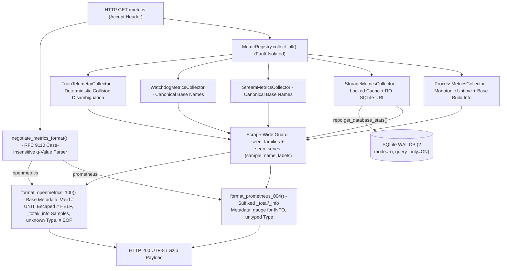

# Implementation Plan — P0-19: OpenMetrics 1.0.0 Hard Scrape Failures, Duplicate Label Collisions & Broken `StorageMetricsCollector`

> **Reference Review:** [`../../../architecture/codebase-architecture-review.md`](../../../architecture/codebase-architecture-review.md#L270-L281) (Finding **P0-6**)  
> **Related Plans:** [`../../features/f-8-2-phase-1-metric-primitives-and-serialization-engine-plan.md`](../../features/f-8-2-phase-1-metric-primitives-and-serialization-engine-plan.md), [`./p0-13-duplicate-train-numbers-disambiguation-fix-plan.md`](./p0-13-duplicate-train-numbers-disambiguation-fix-plan.md), [`./p0-18-storage-durability-data-loss-and-analytics-fix-plan.md`](./p0-18-storage-durability-data-loss-and-analytics-fix-plan.md)  
> **Target Modules:** [`../../../../storage/db.py`](../../../../storage/db.py), [`../../../../exporter/models.py`](../../../../exporter/models.py), [`../../../../exporter/formatter.py`](../../../../exporter/formatter.py), [`../../../../exporter/collector.py`](../../../../exporter/collector.py), [`../../../../exporter/__init__.py`](../../../../exporter/__init__.py)  
> **Test Suites:** [`../../../../tests/test_exporter_models.py`](../../../../tests/test_exporter_models.py), [`../../../../tests/test_exporter_formatter.py`](../../../../tests/test_exporter_formatter.py), [`../../../../tests/test_exporter_collector.py`](../../../../tests/test_exporter_collector.py), [`../../../../tests/test_exporter_server.py`](../../../../tests/test_exporter_server.py), [`../../../../tests/test_cli_metrics.py`](../../../../tests/test_cli_metrics.py), [`../../../../tests/test_multiplexed_sse.py`](../../../../tests/test_multiplexed_sse.py), [`../../../../tests/test_storage_db.py`](../../../../tests/test_storage_db.py)  
> **Relevant Rules & Skills:** [`../../../../.agents/rules/misra-autosar-python.md`](../../../../.agents/rules/misra-autosar-python.md), [`../../../../.agents/rules/concurrency-and-sqlite.md`](../../../../.agents/rules/concurrency-and-sqlite.md), [`../../../../.agents/rules/resilience-and-fallbacks.md`](../../../../.agents/rules/resilience-and-fallbacks.md), [`../../../../.agents/rules/testing.md`](../../../../.agents/rules/testing.md), [`../../../../.agents/skills/diagrams-and-documentation/SKILL.md`](../../../../.agents/skills/diagrams-and-documentation/SKILL.md), [`../../../../.agents/skills/markdown-relative-paths/SKILL.md`](../../../../.agents/skills/markdown-relative-paths/SKILL.md), [`../../../../.agents/skills/static-safety-analyzer/SKILL.md`](../../../../.agents/skills/static-safety-analyzer/SKILL.md), [`../../../../.agents/skills/ci-quality-gate/SKILL.md`](../../../../.agents/skills/ci-quality-gate/SKILL.md)

---

## 1. Executive Summary & Empirically Verified Defects

Auditing the Prometheus and OpenMetrics exposition subsystem across [`exporter/`](../../../../exporter) and [`storage/db.py`](../../../../storage/db.py) on `HEAD` (`c5e7a57`) empirically confirms **three critical P0 production scrape failures** (resolving the final open P0 blocker in [`codebase-architecture-review.md`](../../../architecture/codebase-architecture-review.md)):

| # | Defect Class | Affected Locations | Empirically Verified Failure Mode & Root Cause | Severity |
|---|---|---|---|---|
| **1** | **OpenMetrics 1.0.0 Hard Scrape Rejections (28 Violations Across 18 of 27 Families)** | [`exporter/models.py`](../../../../exporter/models.py#L12-L86), [`exporter/formatter.py`](../../../../exporter/formatter.py#L9-L105), [`exporter/collector.py`](../../../../exporter/collector.py#L79-L604) | Prometheus v2.25+ negotiates `application/openmetrics-text; version=1.0.0` by default and **hard-fails the entire `/metrics` scrape** on: **(a)** illegal `/` in `# UNIT railmon_train_speed_kmh km/h` and `# UNIT railmon_train_max_speed_kmh km/h` (OpenMetrics ABNF restricts `unit` to ASCII `[a-zA-Z0-9_]+`); **(b)** 15 `# UNIT` declarations whose unit string is not a `_<unit>` suffix of the MetricFamily name (`_alerts`, `_sensors`, `_drops`, `_exceedances`, `_boolean`, `_messages`, `_events`, `_rows`, `_sessions`, `_scrapes`, `_trains` on `_total`); **(c)** `_total` and `_info` suffixes illegally retained on `# HELP`/`# TYPE`/`# UNIT` metadata for all 8 suffixed `COUNTER` families and `INFO` family `railmon_exporter_build_info`; **(d)** `GAUGE` metric `railmon_trains_delayed_total` illegally ending in `_total`; **(e)** `MetricType.UNTYPED` serialized verbatim as `untyped` instead of OpenMetrics `unknown`; **(f)** unescaped `"` in OpenMetrics `# HELP` strings; **(g)** `negotiate_metrics_format()` ignoring RFC 9110 `q=` weights (`q=0` still picks OpenMetrics); and **(h)** `ProcessMetricsCollector` computing `COUNTER` uptime via wall-clock `time.time()` (can become negative on NTP step). | **Critical** |
| **2** | **Duplicate Label Set Collisions Crash Scrapes on Coupled Consists & Switchers** | [`exporter/collector.py`](../../../../exporter/collector.py#L126-L148), [`exporter/formatter.py`](../../../../exporter/formatter.py#L63-L105) | `TrainTelemetryCollector` labels `railmon_train_delay_minutes`, `railmon_train_speed_kmh`, and `railmon_train_max_speed_kmh` exclusively by `train_number` (omitting `pos.locomotive_number` and `pos.id`). Whenever coupled EMUs (*Διπλή Έλξη*, e.g. two Desiro 460 units running service `2232`), multiple yard switchers (`"0"` / `"Unknown"`), or modem session handovers coexist in `TrainStateStore`, identical `(sample_name, labels)` tuples are emitted in the same scrape—causing Prometheus ingestion failure. Neither `TrainTelemetryCollector` nor `MetricsFormatter` guards against duplicate series or duplicate/interleaved MetricFamilies. | **Critical** |
| **3** | **`StorageMetricsCollector` Permanently Dead in Production + Non-Read-Only DB Open + Final `PY-MISRA-03` Violation** | [`exporter/collector.py`](../../../../exporter/collector.py#L402-L541), [`storage/db.py`](../../../../storage/db.py#L44-L196) | Line 527 calls nonexistent `repo.get_stats()` instead of [`HistoricalRepository.get_database_stats()`](../../../../storage/repository.py#L2186-L2231). The `AttributeError` is silently swallowed at `logger.debug` (line 533), so `railmon_db_records_total` (standalone mode) and `railmon_db_sessions_total` are **never exported**—even against a live populated SQLite DB (`1` session / `1` telemetry row empirically produces **0** samples!). In addition, line 525 opens `Database(self.db_path, auto_migrate=False)` **read-write** (triggering `PRAGMA journal_mode = WAL`, `os.umask()`, `os.chmod()`, and a 64 MB page cache on read-only scrapes), the stats cache is unlocked and poisoned with `{}` for 60s on transient lock errors, and line 539 (`except Exception: pass`) is the **single remaining warning** blocking a 100% clean full-repo `safety_ast_audit.py --strict` pass across all 36 production files. | **Critical** |

---

### 1.1 Empirical Reproduction Evidence (Verified on `c5e7a57`, Python `3.13.14`, SQLite `3.50.4`)

Running all 5 registered collectors (`TrainTelemetryCollector`, `WatchdogMetricsCollector`, `StreamMetricsCollector`, `StorageMetricsCollector(db_path=real_db)`, `ProcessMetricsCollector`) against a live `TrainStateStore` containing a coupled consist (`2232` with `460103` & `460108`), two `"Unknown"` yard switchers (`id-c` & `id-d`), and a real populated SQLite WAL database (`1` session, `1` telemetry row) reproduces all 3 failures simultaneously:

```text
# FAILURE 1a — Illegal '/' character in # UNIT (OpenMetrics lexer error):
# UNIT railmon_train_speed_kmh km/h
# UNIT railmon_train_max_speed_kmh km/h

# FAILURE 1b — # UNIT value is NOT a _<unit> suffix of the MetricFamily name:
# UNIT railmon_trains_delayed_total trains
# UNIT railmon_watchdog_conflicts_active alerts
# UNIT railmon_watchdog_conflicts_total alerts
# UNIT railmon_speed_exceedances_active exceedances
# UNIT railmon_stream_connected boolean
# UNIT railmon_stream_messages_total messages
# UNIT railmon_stream_reconnects_total events
# UNIT railmon_stream_events_total events
# UNIT railmon_exporter_scrapes_total scrapes

# FAILURE 1c & 1d — _total / _info retained on # TYPE / # HELP; GAUGE ending in _total:
# TYPE railmon_trains_delayed_total gauge
# TYPE railmon_watchdog_conflicts_total counter
# TYPE railmon_exporter_build_info info

# FAILURE 2 — Duplicate (metric_name, labels) tuples emitted in the SAME scrape:
railmon_train_speed_kmh{corridor="PROASTIAKOS",train_number="2232",type="DES"} 116
railmon_train_speed_kmh{corridor="PROASTIAKOS",train_number="2232",type="DES"} 115
railmon_train_speed_kmh{corridor="PATHE",train_number="Unknown",type="SHUNT"} 0
railmon_train_speed_kmh{corridor="PATHE",train_number="Unknown",type="SHUNT"} 5

# FAILURE 3 — Real DB had total_telemetry_rows=1, total_sessions=1, yet ZERO samples emitted:
# (railmon_db_records_total and railmon_db_sessions_total COMPLETELY ABSENT due to AttributeError:
#  'HistoricalRepository' object has no attribute 'get_stats')
```

And full-repository static safety audit on `c5e7a57`:

```text
$ python .agents/skills/static-safety-analyzer/scripts/safety_ast_audit.py --strict \
    train_tracker.py railmon_watchdog.py storage tui server exporter gtfs_rt
Files Audited : 36 | Errors : 0 | Warnings : 1
exporter\collector.py:539:17: [WARNING] PY-MISRA-03 (except Exception: pass)
RESULT: FAILED
```

---

### 1.2 Complete 27-Family Canonical Naming, Type & Unit Specification Matrix

Every `MetricFamily` across all 5 collectors stores a **canonical base name** (no `_total` on `COUNTER`, no `_info` on `INFO`) and sets `unit` **strictly** on physical/measurement families whose base name ends with `_<unit>` (with `unit` matching `^[a-zA-Z0-9_]+$`). Dimensionless item counts, booleans, and `INFO` metadata leave `unit=None` per the OpenMetrics 1.0.0 specification. Both wire formats emit **identical PromQL sample names**, ensuring zero dashboard/alert drift when Prometheus switches between OpenMetrics 1.0.0 and Prometheus 0.0.4:

| # | Collector | Old `MetricFamily.name` | New Canonical Base Name | `MetricType` | Old `unit` | New `unit` | OpenMetrics 1.0.0 Header (`# TYPE` / `# UNIT`) | OpenMetrics 1.0.0 & Prom 0.0.4 Sample Name |
|---|---|---|---|---|---|---|---|---|
| 1 | `TrainTelemetry` | `railmon_active_trains` | `railmon_active_trains` | `GAUGE` | `"trains"` | `None` | `gauge` / *(none)* | `railmon_active_trains` |
| 2 | `TrainTelemetry` | `railmon_train_delay_minutes` | `railmon_train_delay_minutes` | `GAUGE` | `"minutes"` | `"minutes"` | `gauge` / `minutes` | `railmon_train_delay_minutes` |
| 3 | `TrainTelemetry` | `railmon_train_speed_kmh` | `railmon_train_speed_kmh` | `GAUGE` | `"km/h"` | `"kmh"` | `gauge` / `kmh` | `railmon_train_speed_kmh` |
| 4 | `TrainTelemetry` | `railmon_train_max_speed_kmh` | `railmon_train_max_speed_kmh` | `GAUGE` | `"km/h"` | `"kmh"` | `gauge` / `kmh` | `railmon_train_max_speed_kmh` |
| 5 | `TrainTelemetry` | `railmon_trains_delayed_total` | **`railmon_trains_delayed`** | `GAUGE` | `"trains"` | `None` | `gauge` / *(none)* | **`railmon_trains_delayed`** |
| 6 | `TrainTelemetry` | `railmon_corridor_punctuality_ratio` | `railmon_corridor_punctuality_ratio` | `GAUGE` | `"ratio"` | `"ratio"` | `gauge` / `ratio` | `railmon_corridor_punctuality_ratio` |
| 7 | `TrainTelemetry` | `railmon_corridor_average_delay_minutes` | `railmon_corridor_average_delay_minutes` | `GAUGE` | `"minutes"` | `"minutes"` | `gauge` / `minutes` | `railmon_corridor_average_delay_minutes` |
| 8 | `TrainTelemetry` | `railmon_ghost_trains` | `railmon_ghost_trains` | `GAUGE` | `"trains"` | `None` | `gauge` / *(none)* | `railmon_ghost_trains` |
| 9 | `Watchdog` | `railmon_watchdog_conflicts_active` | `railmon_watchdog_conflicts_active` | `GAUGE` | `"alerts"` | `None` | `gauge` / *(none)* | `railmon_watchdog_conflicts_active` |
| 10 | `Watchdog` | `railmon_watchdog_conflicts_total` | **`railmon_watchdog_conflicts`** | `COUNTER` | `"alerts"` | `None` | `counter` / *(none)* | `railmon_watchdog_conflicts_total` |
| 11 | `Watchdog` | `railmon_sensor_freezes_active` | `railmon_sensor_freezes_active` | `GAUGE` | `"sensors"` | `None` | `gauge` / *(none)* | `railmon_sensor_freezes_active` |
| 12 | `Watchdog` | `railmon_telemetry_drops_active` | `railmon_telemetry_drops_active` | `GAUGE` | `"drops"` | `None` | `gauge` / *(none)* | `railmon_telemetry_drops_active` |
| 13 | `Watchdog` | `railmon_speed_exceedances_active` | `railmon_speed_exceedances_active` | `GAUGE` | `"exceedances"` | `None` | `gauge` / *(none)* | `railmon_speed_exceedances_active` |
| 14 | `Stream` | `railmon_stream_connected` | `railmon_stream_connected` | `GAUGE` | `"boolean"` | `None` | `gauge` / *(none)* | `railmon_stream_connected` |
| 15 | `Stream` | `railmon_stream_messages_total` | **`railmon_stream_messages`** | `COUNTER` | `"messages"` | `None` | `counter` / *(none)* | `railmon_stream_messages_total` |
| 16 | `Stream` | `railmon_stream_reconnects_total` | **`railmon_stream_reconnects`** | `COUNTER` | `"events"` | `None` | `counter` / *(none)* | `railmon_stream_reconnects_total` |
| 17 | `Stream` | `railmon_stream_latency_seconds` | `railmon_stream_latency_seconds` | `GAUGE` | `"seconds"` | `"seconds"` | `gauge` / `seconds` | `railmon_stream_latency_seconds` |
| 18 | `Stream` | `railmon_stream_events_total` | **`railmon_stream_events`** | `COUNTER` | `"events"` | `None` | `counter` / *(none)* | `railmon_stream_events_total` |
| 19 | `Storage` | `railmon_db_records_total` | **`railmon_db_records`** | `COUNTER` | `"rows"` | `None` | `counter` / *(none)* | `railmon_db_records_total` |
| 20 | `Storage` | `railmon_db_file_size_bytes` | `railmon_db_file_size_bytes` | `GAUGE` | `"bytes"` | `"bytes"` | `gauge` / `bytes` | `railmon_db_file_size_bytes` |
| 21 | `Storage` | `railmon_db_sessions_total` | **`railmon_db_sessions`** | `COUNTER` | `"sessions"` | `None` | `counter` / *(none)* | `railmon_db_sessions_total` |
| 22 | `Storage` | `railmon_db_write_queue_depth` | `railmon_db_write_queue_depth` | `GAUGE` | `"rows"` | `None` | `gauge` / *(none)* | `railmon_db_write_queue_depth` |
| 23 | `Storage` | `railmon_db_deadband_suppressed_total` | **`railmon_db_deadband_suppressed`** | `COUNTER` | `"rows"` | `None` | `counter` / *(none)* | `railmon_db_deadband_suppressed_total` |
| 24 | `Process` | `railmon_exporter_build_info` | **`railmon_exporter_build`** | `INFO` | `None` | `None` | `info` / *(none)* | `railmon_exporter_build_info` |
| 25 | `Process` | `railmon_exporter_uptime_seconds` | `railmon_exporter_uptime_seconds` | `COUNTER` | `"seconds"` | `"seconds"` | `counter` / `seconds` | `railmon_exporter_uptime_seconds_total` |
| 26 | `Process` | `railmon_exporter_scrapes_total` | **`railmon_exporter_scrapes`** | `COUNTER` | `"scrapes"` | `None` | `counter` / *(none)* | `railmon_exporter_scrapes_total` |
| 27 | `Process` | `railmon_exporter_scrape_duration_seconds` | `railmon_exporter_scrape_duration_seconds` | `GAUGE` | `"seconds"` | `"seconds"` | `gauge` / `seconds` | `railmon_exporter_scrape_duration_seconds` |

> [!NOTE]
> **Wire Compatibility Impact:** Only **two** PromQL time-series names change on the wire:
> 1. `railmon_trains_delayed_total` (`GAUGE`) -> `railmon_trains_delayed` (mandatory because `_total` on a `GAUGE` is an OpenMetrics / `promtool` specification violation).
> 2. `railmon_exporter_uptime_seconds` (`COUNTER`) in Prometheus 0.0.4 now emits `railmon_exporter_uptime_seconds_total` (aligning Prometheus 0.0.4 with OpenMetrics 1.0.0, which already emitted `railmon_exporter_uptime_seconds_total`).
> All other 25 wire sample names (`railmon_stream_messages_total`, `railmon_exporter_build_info`, `railmon_db_records_total`, etc.) remain **100% identical** for PromQL queries!

---

### 1.3 Scope Boundary with Sibling P1 / P2 Findings

- **In scope for `P0-19` (resolves Review Finding `P0-6`):**
  1. Strict `read_only: bool = False` SQLite URI mode (`?mode=ro`, `PRAGMA query_only = ON`, no write pragmas / no `os.umask()` / no `os.chmod()`, 4 MB cache) in [`storage/db.py`](../../../../storage/db.py).
  2. Strict OpenMetrics 1.0.0 unit/type/suffix validation in [`exporter/models.py`](../../../../exporter/models.py) (`RE_UNIT`, `MetricType.UNKNOWN`, gauge reserved-suffix guard, info/untyped unit guard).
  3. Spec-compliant canonical serialization, `# HELP` quote escaping, `untyped` -> `unknown` mapping, RFC 9110 `q=` content negotiation, counter monotonicity/non-negativity guards, and scrape-wide duplicate family/series deduplication in [`exporter/formatter.py`](../../../../exporter/formatter.py).
  4. Canonical base names and suffix-matched units across all 5 collectors, deterministic duplicate-train label disambiguation + finite-value guards in `TrainTelemetryCollector`, monotonic uptime in `ProcessMetricsCollector`, and real read-only `repo.get_database_stats()` + thread-safe non-poisoning cache + `PY-MISRA-03` resolution in `StorageMetricsCollector` ([`exporter/collector.py`](../../../../exporter/collector.py)).
  5. Zero-dependency strict OpenMetrics 1.0.0 ABNF & semantic test validator + 18 regression/integration tests (`TC-OMX-01` – `TC-OMX-18`) exercising real SQLite databases, coupled consists, switchers, modem handovers, and live HTTP scrapes on both `MetricsServer` and `WebMapServer`.
- **Explicitly deferred to Phase 1/2 plans ([`codebase-architecture-review.md`](../../../architecture/codebase-architecture-review.md) Sections 4, 5 & 9):**
  - **`P1-1`, `P1-2`, `P1-6`, `P1-10`:** Shared bounded HTTP daemon base (Slowloris semaphore, socket timeouts, `cors_enabled`, `Host` validation, `Vary` / `405` keep-alive / `HEAD` errors, shutdown deadlock guards).
  - **`P1-8`, `P1-12`:** Copy-on-write `TrainStateStore` snapshot sharing across collectors and moving `WatchdogMetricsCollector` / `StreamMetricsCollector` cumulative counters into `TrainStateStore`.
  - **`P1-11`:** Thread-local connection pool weakref eviction, `isolation_level=None` + `SAVEPOINT` nesting, `file::memory:` `uri=True`, `os.open(..., 0o600)`, and explicit integrity check deferral in `storage/db.py`.
  - **`P1-20`:** Expanding `DEFAULT_PRODUCTION_TARGETS` in `safety_ast_audit.py` and closing AST analyzer blind spots (note: `P0-19` eliminates the last actual `PY-MISRA-03` warning in `exporter/collector.py`, so `P1-20` will pass immediately upon expanding targets!).
  - **P2 Exporter items:** Per-train cardinality caps, `Sample.timestamp` emission, `format_float` 15-digit precision, HTTP 500 error redaction, and `registry._collectors` accessor locking in `exporter/server.py`.

---

## 2. Current Broken Exposition Pipeline vs. Remediated Compliant Architecture

### A. End-to-End Exporter & Storage Metrics Comparison (ASCII)

```text
+------------------------------------------------------------------------------+
| CURRENT BROKEN EXPORTER PIPELINE (HEAD = c5e7a57)                            |
+------------------------------------------------------------------------------+
| [1] Collectors (exporter/collector.py)                                       |
|   - Emit 'km/h' (illegal '/'), mismatched units (alerts/boolean/rows/...),   |
|     '_total'/'_info' in MetricFamily.name, and GAUGE '..._delayed_total'     |
|   - TrainTelemetryCollector keys samples ONLY by train_number:               |
|     2x coupled '2232' or 2x 'Unknown' -> DUPLICATE (name, labels) CRASH!     |
|   - StorageMetricsCollector calls nonexistent repo.get_stats() on RW DB      |
|     -> AttributeError swallowed silently (0 DB row/session metrics!)         |
|     -> Line 539 'except Exception: pass' fails full-repo PY-MISRA-03 audit   |
|                                                                              |
| [2] Formatter (exporter/formatter.py)                                        |
|   - Emits '# TYPE ..._total counter', '# TYPE ..._info info', 'untyped',     |
|     unescaped '"' in # HELP, and invalid '# UNIT' lines verbatim             |
|   - negotiate_metrics_format() ignores q=0 weights                           |
|   - Zero duplicate-family or duplicate-series safety net                     |
|                                                                              |
| [3] Real Prometheus v2.25+ / v3.x Scraper                                    |
|   ---> HARD SCRAPE REJECTION (entire target marked DOWN) <---                |
+------------------------------------------------------------------------------+

+------------------------------------------------------------------------------+
| REMEDIATED COMPLIANT EXPORTER PIPELINE (P0-19)                               |
+------------------------------------------------------------------------------+
| [1] Models (exporter/models.py)                                              |
|   - Validates RE_UNIT (^[a-zA-Z0-9_]+$), base_name.endswith('_' + unit),     |
|     forbids GAUGE ending in _total/_info/..., forbids unit on INFO/UNKNOWN   |
|                                                                              |
| [2] Collectors (exporter/collector.py + storage/db.py read_only=True)        |
|   - All 27 families use canonical base names & 9 suffix-matched SI/phys units|
|   - TrainTelemetryCollector disambiguates ONLY colliding train_number groups |
|     deterministically: 2232/460103, 2232/460108, Unknown/id-c, 2232/103#old  |
|   - ProcessMetricsCollector uses time.monotonic() for uptime COUNTER         |
|   - StorageMetricsCollector opens Database(..., auto_migrate=False,          |
|     read_only=True) via Path.as_uri() + '?mode=ro' + PRAGMA query_only=ON,   |
|     calls repo.get_database_stats(), caches under Lock without error         |
|     poisoning, and eliminates the final PY-MISRA-03 catch (0/36 warnings!)   |
|                                                                              |
| [3] Formatter (exporter/formatter.py)                                        |
|   - OpenMetrics 1.0.0: base metadata + _total/_info samples + unknown type   |
|     + escaped \" in # HELP + valid # UNIT + counter>=0 guard + # EOF\n       |
|   - Prometheus 0.0.4: matching _total/_info metadata + gauge for INFO        |
|   - RFC 9110 Accept q-value negotiation + scrape-wide dedup safety net       |
|                                                                              |
| [4] Prometheus v2.25+/v3.x & Strict OpenMetrics 1.0.0 Validator              |
|   ---> 100% CLEAN INGESTION (Zero Syntax, Suffix, Duplicate, or DB Errors)   |
+------------------------------------------------------------------------------+
```

### B. Scrape, Format Normalization & Deduplication Flow (Mermaid)



### C. Read-Only `StorageMetricsCollector` Scrape & Non-Poisoning Cache Sequence (Mermaid)

```mermaid
sequenceDiagram
    autonumber
    participant H as MetricsRequestHandler / WebMapRequestHandler
    participant S as StorageMetricsCollector
    participant D as Database (read_only=True)
    participant R as HistoricalRepository

    H->>S: collect()
    S->>S: Measure db_path and db_path-wal sizes via os.path.getsize()
    S->>S: Acquire _lock; check TTL (now - _last_stats_fetch >= ttl)
    alt Cache fresh
        S-->>H: Emit cached railmon_db_records & railmon_db_sessions
    else Cache expired or uninitialized
        S->>S: Validate 16-byte SQLite header ("SQLite format 3\0")
        alt Valid SQLite file
            S->>D: Database(db_path, auto_migrate=False, read_only=True)
            Note over D: URI ?mode=ro, PRAGMA query_only=ON, cache_size=-4000 (no WAL write, umask, or chmod)
            S->>R: HistoricalRepository(db).get_database_stats()
            alt Query succeeds
                R-->>S: DatabaseStats(total_telemetry_rows, total_sessions)
                S->>D: db.close() (narrowed sqlite3.Error / OSError logging)
                S->>S: Under _lock: update _cached_db_stats & _last_stats_fetch
            else Transient sqlite3.Error / OSError
                R-->>S: Error logged at DEBUG/WARNING
                S->>D: db.close()
                S->>S: Under _lock: PRESERVE prior _cached_db_stats; apply short retry cooldown
            end
        else Missing / 0-byte / corrupt file
            S->>S: Return None (skip DB row/session samples cleanly)
        end
        S-->>H: Return [fam_records, fam_file_size, fam_sessions, fam_queue, fam_deadband]
    end
```

---

## 3. Detailed Implementation Specification

Implementation proceeds in strict bottom-up dependency order so every layer validates and reinforces the layer above it: **Step 1 (`storage/db.py` read-only mode)** -> **Step 2 (`exporter/models.py` strict invariants)** -> **Step 3 (`exporter/formatter.py` OpenMetrics 1.0.0 & Prometheus 0.0.4 serializer + dedup + `q=` negotiation)** -> **Step 4 (`exporter/collector.py` all 5 collectors, duplicate-train disambiguation & read-only storage stats)**.

---

### 3.1 Step 1 — True Read-Only SQLite Mode in [`storage/db.py`](../../../../storage/db.py#L44-L219)

Add an opt-in `read_only: bool = False` keyword parameter to `Database.__init__()` without altering any existing write-mode behavior:

1. **Constructor Validation ([`storage/db.py`](../../../../storage/db.py#L44-L67)):**
   ```python
   def __init__(
       self,
       db_path: str = "railway_history.db",
       auto_migrate: bool = True,
       read_only: bool = False,
   ) -> None:
       self.db_path = db_path
       self.read_only = bool(read_only)
       self._is_memory = (db_path == ":memory:") or db_path.startswith("file::memory:")

       if self.read_only and self._is_memory:
           raise ValueError("Cannot open an in-memory SQLite database in read-only mode")
       if self.read_only and auto_migrate:
           raise ValueError("auto_migrate=True is incompatible with read_only=True")
   ```
   - Skip `self._ensure_secure_permissions()` when `self.read_only` is `True` (a read-only observer must never `chmod` target files).

2. **URI Builder & Read-Only Connection Setup ([`storage/db.py`](../../../../storage/db.py#L99-L149)):**
   - Import `Path` from `pathlib`.
   - Add pure helper `_build_readonly_sqlite_uri(db_path: str) -> str`:
     ```python
     def _build_readonly_sqlite_uri(db_path: str) -> str:
         """Build a percent-encoded RFC 3986 SQLite read-only URI for local filesystem paths."""
         return f"{Path(os.path.abspath(db_path)).as_uri()}?mode=ro"
     ```
     - Empirically verified on Windows + Python 3.13 / SQLite 3.50.4 to safely percent-encode spaces, `#`, `%`, and Windows drive paths via RFC 3986 URI `?mode=ro`, read live WAL databases under concurrent writes without creating `-wal`/`-shm` locks, work on `0444` / `S_IREAD` files, and fail fast instead of creating nonexistent files.
   - In `_create_connection()`:
     - When `self.read_only` is `True`:
       - Call `sqlite3.connect(_build_readonly_sqlite_uri(self.db_path), uri=True, timeout=2.0, detect_types=sqlite3.PARSE_DECLTYPES | sqlite3.PARSE_COLNAMES, check_same_thread=False)` (NO `os.makedirs`, NO `os.umask`, NO `_ensure_secure_permissions`).
       - Execute ONLY read-safe pragmas:
         ```python
         cursor.execute("PRAGMA query_only = ON;")
         cursor.execute("PRAGMA busy_timeout = 2000;")
         cursor.execute("PRAGMA temp_store = MEMORY;")
         cursor.execute("PRAGMA cache_size = -4000;")  # Lightweight 4 MB read cache
         ```
       - Do **NOT** execute `PRAGMA journal_mode = WAL;` or `PRAGMA synchronous = NORMAL;` (those attempt writes and fail on `mode=ro`).

3. **Explicit Write Guards on Read-Only Handles ([`storage/db.py`](../../../../storage/db.py#L84-L219)):**
   - In `init_schema()`, `transaction()`, `optimize()`, and `checkpoint_wal()`:
     If `self.read_only`, raise `sqlite3.OperationalError("Database handle is opened in read-only mode")` immediately before touching a cursor.

---

### 3.2 Step 2 — Strict OpenMetrics Primitives & Validation in [`exporter/models.py`](../../../../exporter/models.py#L1-L88)

Harden [`exporter/models.py`](../../../../exporter/models.py) so invalid OpenMetrics 1.0.0 names, types, and unit declarations are caught immediately at model construction time:

1. **Unit Regex, Reserved Suffixes & `MetricType.UNKNOWN`:**
   ```python
   RE_METRIC_NAME = re.compile(r"^[a-zA-Z_:][a-zA-Z0-9_:]*$")
   RE_LABEL_NAME = re.compile(r"^[a-zA-Z_][a-zA-Z0-9_]*$")
   RE_UNIT = re.compile(r"^[a-zA-Z0-9_]+$")

   RESERVED_GAUGE_SUFFIXES: Tuple[str, ...] = (
       "_total",
       "_created",
       "_info",
       "_bucket",
       "_sum",
       "_count",
       "_gsum",
       "_gcount",
   )


   class MetricType(str, Enum):
       """Prometheus & OpenMetrics metric representation types."""

       GAUGE = "gauge"
       COUNTER = "counter"
       INFO = "info"
       SUMMARY = "summary"
       UNTYPED = "untyped"
       UNKNOWN = "unknown"
   ```

2. **Canonical Base Name Helper (Shared by Models & Formatter):**
   ```python
   def canonical_family_base_name(name: str, metric_type: MetricType) -> str:
       """Strip OpenMetrics type-generated suffixes (_total, _info) to obtain canonical family name."""
       if metric_type == MetricType.COUNTER and name.endswith("_total") and len(name) > 6:
           return name[:-6]
       if metric_type == MetricType.INFO and name.endswith("_info") and len(name) > 5:
           return name[:-5]
       return name
   ```
   - Export `RE_UNIT`, `RESERVED_GAUGE_SUFFIXES`, and `canonical_family_base_name` from [`exporter/models.py`](../../../../exporter/models.py) and [`exporter/__init__.py`](../../../../exporter/__init__.py).

3. **Strict `MetricFamily.__post_init__()` Invariants ([`exporter/models.py`](../../../../exporter/models.py#L58-L64)):**
   - Validate `RE_METRIC_NAME.match(self.name)` (existing).
   - For `MetricType.GAUGE`: reject any name ending with a suffix in `RESERVED_GAUGE_SUFFIXES` (catches `railmon_trains_delayed_total` immediately with a clear `ValueError`).
   - Normalize empty string `self.unit == ""` to `None`.
   - When `self.unit is not None`:
     1. Reject non-empty `unit` on `MetricType.INFO`, `MetricType.UNTYPED`, or `MetricType.UNKNOWN` (`ValueError`: OpenMetrics 1.0.0 prohibits units on Info/Unknown families).
     2. Validate `RE_UNIT.match(self.unit)` (`ValueError`: rejects `"km/h"`, spaces, punctuation).
     3. Validate suffix match against `base_name = canonical_family_base_name(self.name, self.metric_type)`:
        if `not base_name.endswith(f"_{self.unit}")`, raise `ValueError(f"OpenMetrics unit '{self.unit}' must match '_{self.unit}' suffix of metric family '{base_name}'")`.
   - Validate `Sample` labels have **no duplicate label keys** inside a single `Sample` tuple (`len({k for k, _ in self.labels}) == len(self.labels)` -> `ValueError`).

---

### 3.3 Step 3 — Spec-Compliant `MetricsFormatter` & Content Negotiation in [`exporter/formatter.py`](../../../../exporter/formatter.py#L1-L105)

Overhaul [`exporter/formatter.py`](../../../../exporter/formatter.py) so every serialized byte stream conforms strictly to OpenMetrics 1.0.0 and Prometheus 0.0.4:

1. **Escaping Hygiene (`escape_help_string` & `escape_label_value`):**
   ```python
   def escape_help_string(doc: str, *, escape_quotes: bool = False) -> str:
       """Escape backslashes, line breaks, and optionally double quotes in # HELP strings."""
       normalized = doc.replace("\r\n", "\n").replace("\r", "\n")
       escaped = normalized.replace("\\", "\\\\").replace("\n", "\\n")
       if escape_quotes:
           escaped = escaped.replace('"', '\\"')
       return escaped


   def escape_label_value(val: str) -> str:
       """Escape backslashes, double quotes, and line breaks in label values."""
       normalized = val.replace("\r\n", "\n").replace("\r", "\n")
       return normalized.replace("\\", "\\\\").replace('"', '\\"').replace("\n", "\\n")
   ```
   - `format_openmetrics_100()` calls `escape_help_string(fam.documentation, escape_quotes=True)` to satisfy OpenMetrics 1.0.0 ABNF `ESCAPED_STRING` while keeping default `escape_help_string(doc)` backward-compatible for Prometheus 0.0.4 and `TC-FMT-01`.

2. **RFC 9110 `Accept` Header Content Negotiation (`negotiate_metrics_format`):**
   Replace the naive substring check `"application/openmetrics-text" in accept_header` with a bounded, zero-dependency media-range parser:
   - Split `accept_header` on `","` (case-insensitive media type matching).
   - For each media-range, extract the MIME type (before first `";"`) and optional `q=` parameter (default `1.0`, valid range `[0.0, 1.0]`, ignore malformed `q` values safely per `TC-EXP-EDGE-01`).
   - Track highest quality weight `q_openmetrics` for `"application/openmetrics-text"` and `q_prometheus` for `"text/plain"`.
   - Select `("application/openmetrics-text; version=1.0.0; charset=utf-8", "openmetrics")` if and only if `q_openmetrics > 0.0` AND `q_openmetrics >= q_prometheus` (matching real Prometheus v2.25+/v3.x headers like `application/openmetrics-text;version=1.0.0;escaping=allow-utf-8;q=0.6,application/openmetrics-text;version=0.0.1;q=0.4,text/plain;version=0.0.4;q=0.3,*/*;q=0.1` while rejecting `application/openmetrics-text; q=0` and preferring Prometheus when `text/plain; q=0.9, application/openmetrics-text; q=0.1`).
   - Default to `("text/plain; version=0.0.4; charset=utf-8", "prometheus")` otherwise.

3. **Canonical Family & Sample Resolution Helpers:**
   ```python
   def _resolve_openmetrics_type(metric_type: MetricType) -> str:
       """Map internal MetricType to strict OpenMetrics 1.0.0 # TYPE token."""
       if metric_type in (MetricType.UNTYPED, MetricType.UNKNOWN):
           return "unknown"
       return metric_type.value


   def _resolve_prometheus_type(metric_type: MetricType) -> str:
       """Map internal MetricType to strict Prometheus 0.0.4 # TYPE token."""
       if metric_type == MetricType.INFO:
           return "gauge"
       if metric_type in (MetricType.UNTYPED, MetricType.UNKNOWN):
           return "untyped"
       return metric_type.value


   def _resolve_sample_name(
       sample_name: str,
       fam_name: str,
       base_name: str,
       metric_type: MetricType,
   ) -> str:
       """Resolve canonical wire sample name consistently for OpenMetrics 1.0.0 and Prometheus 0.0.4."""
       if metric_type == MetricType.COUNTER:
           if sample_name.endswith("_created"):
               return f"{base_name}_created"
           if sample_name == fam_name or sample_name == base_name:
               return f"{base_name}_total"
           if sample_name.endswith("_total"):
               return sample_name
           return f"{sample_name}_total"
       if metric_type == MetricType.INFO:
           return f"{base_name}_info"
       return sample_name
   ```

4. **Defensive `# UNIT` Guard & Sample-Value / Deduplication Safety Nets:**
   - Helper `_is_valid_openmetrics_unit(base_name: str, unit: Optional[str], metric_type: MetricType) -> bool`:
     Returns `True` iff `unit` is non-empty, `metric_type not in (MetricType.INFO, MetricType.UNTYPED, MetricType.UNKNOWN)`, `RE_UNIT.match(unit)` matches, and `base_name.endswith(f"_{unit}")`. Prevents malformed `# UNIT` emission even if a caller mutates `fam.unit` after construction.
   - Helper `_sanitize_sample_value(value: float, metric_type: MetricType, sample_name: str) -> Optional[float]`:
     - For `MetricType.COUNTER`: if `math.isnan(value)` or `value < 0.0`, log a `WARNING` and return `None` (skip invalid negative/NaN counter sample rather than failing the entire OpenMetrics scrape).
     - For `MetricType.INFO`: if not `math.isclose(value, 1.0, abs_tol=1e-9)`, log a `WARNING` and normalize to `1.0` (OpenMetrics 1.0.0 mandates Info values MUST equal `1`).
     - Otherwise return `value`.
   - **Scrape-Wide Deduplication (`seen_families` & `seen_series`) in BOTH `format_openmetrics_100` and `format_prometheus_004`:**
     - Maintain `seen_families: Set[str] = set()` and `seen_series: Set[Tuple[str, Tuple[Tuple[str, str], ...]]] = set()`.
     - Before emitting a family header, compute its rendered family identifier (`base_name` for OpenMetrics; `f"{base_name}_total"` for Prometheus `COUNTER`, `f"{base_name}_info"` for Prometheus `INFO`, `base_name` otherwise).
     - If `rendered_family_name in seen_families`, log a `WARNING` and skip duplicate family metadata (preventing OpenMetrics interleaved/duplicate MetricFamily rejections).
     - Collect validated, deduplicated sample lines for the family first (skipping any `(resolved_sample_name, sample.labels)` already in `seen_series` with a `WARNING`, and skipping any sample rejected by `_sanitize_sample_value`).
     - Emit the family header (`# HELP`, `# TYPE`, and optional valid `# UNIT` in OpenMetrics) **only if** at least one valid sample survives—guaranteeing zero empty/orphaned metadata blocks!
     - `format_openmetrics_100()` emits `# EOF\n` as the final line (`lines.append("# EOF\n")` -> `"\n".join(lines).encode("utf-8")`).

---

### 3.4 Step 4 — Collector Overhaul, Duplicate-Train Disambiguation & Read-Only Storage Stats in [`exporter/collector.py`](../../../../exporter/collector.py#L70-L604)

#### A. `TrainTelemetryCollector` ([`exporter/collector.py`](../../../../exporter/collector.py#L70-L208))

1. **Apply Canonical Names & Units (Rows 1–8 of Section 1.2):**
   - `railmon_active_trains` (`GAUGE`, `unit=None`)
   - `railmon_train_delay_minutes` (`GAUGE`, `unit="minutes"`)
   - `railmon_train_speed_kmh` (`GAUGE`, `unit="kmh"`) — eliminates illegal `"km/h"`!
   - `railmon_train_max_speed_kmh` (`GAUGE`, `unit="kmh"`) — eliminates illegal `"km/h"`!
   - `railmon_trains_delayed` (`GAUGE`, `unit=None`) — eliminates illegal `GAUGE` `_total` suffix & mismatched `unit="trains"`!
   - `railmon_corridor_punctuality_ratio` (`GAUGE`, `unit="ratio"`)
   - `railmon_corridor_average_delay_minutes` (`GAUGE`, `unit="minutes"`)
   - `railmon_ghost_trains` (`GAUGE`, `unit=None`)

2. **Deterministic Collision-Aware Train Label Disambiguation (`_resolve_disambiguated_train_numbers`):**
   Add a pure, deterministic helper function operating on `snap.trains`:
   ```python
   def _clean_label_token(raw: Optional[str]) -> str:
       """Return stripped identifier token or empty string."""
       if raw is None:
           return ""
       return str(raw).strip()


   def _build_disambiguated_train_labels(
       trains: Dict[str, Any],
   ) -> List[Tuple[str, Any]]:
       """Return deterministically sorted (effective_train_number, TrainRecord) pairs.

       - Single-unit trains with a unique base train_number keep their exact commercial
         train_number (e.g., 'IC52'), preserving full PromQL backward compatibility and
         avoiding volatile session-ID cardinality churn.
       - Colliding train_number groups (coupled consists '2232', multiple 'Unknown'/'0'
         switchers, or modem session handovers) are deterministically disambiguated:
           1. '<base>/<locomotive_number>' when locomotive_number is present and unique
              within the colliding group (stable across reconnects for coupled EMUs).
           2. '<base>/<locomotive_number>#<pos.id>' when two sessions share both
              train_number and locomotive_number (modem handover of same loco).
           3. '<base>/<pos.id>' when locomotive_number is absent (e.g., yard switchers).
           4. Final globally-unique ordinal '#<n>' fallback if any candidate still collides.
       """
   ```
   - **Step-by-step algorithm (pure, $O(N \log N)$, zero mutation):**
     1. Collect entries `(base_tn, loco, pos_id, store_key, record)` for every `(store_key, record)` in `trains.items()`, where:
        - `raw_tn = _clean_label_token(pos.train_number)`
        - `pos_id = _clean_label_token(pos.id) or _clean_label_token(store_key) or "UNKNOWN"`
        - `base_tn = raw_tn if raw_tn else pos_id`
        - `loco = _clean_label_token(getattr(pos, "locomotive_number", None))`
     2. Sort entries deterministically by `(base_tn, loco, pos_id, str(store_key))`.
     3. Count frequencies `base_counts[base_tn]` and per-group `loco_counts[(base_tn, loco)]`.
     4. Reserve all unique `base_tn` values (`count == 1`) in `used_labels: Set[str]` first so no disambiguated candidate can ever collide with an existing unique train number.
     5. For each entry in sorted order:
        - If `base_counts[base_tn] == 1`: `effective_tn = base_tn`.
        - Else (collision group):
          - If `loco` and `loco_counts[(base_tn, loco)] == 1`: `candidate = f"{base_tn}/{loco}"`
          - Else if `loco`: `candidate = f"{base_tn}/{loco}#{pos_id}"`
          - Else: `candidate = f"{base_tn}/{pos_id}"`
          - While `candidate in used_labels` (bounded by `len(entries) + 1`): append/increment `#{ordinal}` (`ordinal = 2, 3, ...`) until unique.
          - Add `candidate` to `used_labels`; `effective_tn = candidate`.
     6. Return `List[Tuple[str, Any]]`.
   - **Concrete Outputs Verified Against All 4 Real-World Collision Cases:**
     - Single train `IC52`: `"IC52"` (100% unchanged!)
     - Coupled consist `2232` (`460103` & `460108`): `"2232/460103"` and `"2232/460108"`
     - Two `"Unknown"` switchers (`loco=None`, `id-c` & `id-d`): `"Unknown/id-c"` and `"Unknown/id-d"`
     - Modem handover (`2232`, same `460103`, `sess-old` & `sess-new`): `"2232/460103#sess-old"` and `"2232/460103#sess-new"`
     - Also guarantees zero collisions on `fam_max_speed` (`labels={"train_number": effective_tn, "corridor": corr}`) even when two colliding units have different `train_type`!

3. **Finite Numeric Guards (`PY-MISRA-07`):**
   - Guard `pos.delay`, `pos.speed`, and trail breadcrumb `b.speed` with `math.isfinite()` (and `not isinstance(..., bool)`):
     - Non-finite or `None` `delay` -> `0.0` (prevents a single corrupt `NaN`/`Inf` delay from poisoning `railmon_corridor_average_delay_minutes`).
     - Non-finite or `None` `speed` -> `0.0`; clamp `max(0.0, spd)`.
     - Only fold finite trail speeds (`b.speed is not None and not isinstance(b.speed, bool) and math.isfinite(float(b.speed))`) into `peak_spd`.

#### B. `WatchdogMetricsCollector` & `StreamMetricsCollector` ([`exporter/collector.py`](../../../../exporter/collector.py#L210-L400))

- Update all 5 `WatchdogMetricsCollector` and 5 `StreamMetricsCollector` `MetricFamily` definitions to match Rows 9–18 of Section 1.2:
  - `railmon_watchdog_conflicts_active` (`GAUGE`, `unit=None`)
  - `railmon_watchdog_conflicts` (`COUNTER`, `unit=None`)
  - `railmon_sensor_freezes_active` (`GAUGE`, `unit=None`)
  - `railmon_telemetry_drops_active` (`GAUGE`, `unit=None`)
  - `railmon_speed_exceedances_active` (`GAUGE`, `unit=None`)
  - `railmon_stream_connected` (`GAUGE`, `unit=None`)
  - `railmon_stream_messages` (`COUNTER`, `unit=None`)
  - `railmon_stream_reconnects` (`COUNTER`, `unit=None`)
  - `railmon_stream_latency_seconds` (`GAUGE`, `unit="seconds"`)
  - `railmon_stream_events` (`COUNTER`, `unit=None`)

#### C. `StorageMetricsCollector` ([`exporter/collector.py`](../../../../exporter/collector.py#L402-L541))

1. **Apply Canonical Names & Units (Rows 19–23 of Section 1.2):**
   - `railmon_db_records` (`COUNTER`, `unit=None`)
   - `railmon_db_file_size_bytes` (`GAUGE`, `unit="bytes"`)
   - `railmon_db_sessions` (`COUNTER`, `unit=None`)
   - `railmon_db_write_queue_depth` (`GAUGE`, `unit=None`)
   - `railmon_db_deadband_suppressed` (`COUNTER`, `unit=None`)

2. **Thread-Safe Non-Poisoning Cache & Real Read-Only `get_database_stats()`:**
   - Add `self._lock = threading.Lock()` and `self._error_retry_cooldown_seconds: float = min(5.0, max(0.5, stats_cache_ttl_seconds))` in `__init__()`.
   - Track `self._last_stats_fetch: Optional[float] = None` (initialized to `None` so first scrape always fetches even when `time.monotonic() < stats_cache_ttl_seconds` on freshly booted systems!).
   - Rewrite `_fetch_db_stats(self) -> Optional[Dict[str, int]]`:
     ```python
     def _fetch_db_stats(self) -> Optional[Dict[str, int]]:
         """Safely fetch historical database metrics over a read-only SQLite connection."""
         if not self.db_path or not os.path.exists(self.db_path):
             return None
         try:
             with open(self.db_path, "rb") as fh:
                 header = fh.read(16)
             if not header.startswith(b"SQLite format 3\x00"):
                 return None
         except OSError as exc:
             logger.debug("Could not read SQLite header for '%s': %s", self.db_path, exc)
             return None

         db: Optional[Any] = None
         try:
             from storage.db import Database
             from storage.repository import HistoricalRepository

             db = Database(self.db_path, auto_migrate=False, read_only=True)
             repo = HistoricalRepository(db)
             stats = repo.get_database_stats()
             return {
                 "total_telemetry_rows": int(stats.total_telemetry_rows),
                 "total_sessions": int(stats.total_sessions),
             }
         except (sqlite3.Error, OSError, ValueError, TypeError) as exc:
             logger.debug("Could not query HistoricalRepository stats: %s", exc)
             return None
         finally:
             if db is not None:
                 try:
                     db.close()
                 except (sqlite3.Error, OSError) as close_exc:
                     logger.debug("Error closing read-only stats DB handle: %s", close_exc)
     ```
   - Notice:
     - **Calls the REAL `repo.get_database_stats()`** instead of nonexistent `repo.get_stats()`!
     - **Opens strictly `read_only=True`** (`?mode=ro`, `PRAGMA query_only = ON`, no WAL write lock, no `os.umask`/`os.chmod`, 4 MB cache)!
     - **Eliminates line 539 `except Exception: pass`** (the sole remaining `PY-MISRA-03` warning across all 36 production files)!
     - **Non-poisoning cache update under `self._lock`:**
       - If `fetched is not None`: update `self._cached_db_stats = fetched` and `self._last_stats_fetch = now`.
       - If `fetched is None`: preserve any prior `self._cached_db_stats` and schedule next retry after `self._error_retry_cooldown_seconds` (`self._last_stats_fetch = now - self.stats_cache_ttl_seconds + self._error_retry_cooldown_seconds`), preventing both tight retry storms and 60-second cache blanking on transient SQLite contention!
       - Also check `if self._cached_db_stats is not None:` (not truthiness) so a valid empty initialized DB (`{"total_telemetry_rows": 0, "total_sessions": 0}`) accurately exports `0` rows and `0` sessions!
   - Narrow recorder stats extraction exception handler (line 470) from broad `except Exception` to `(AttributeError, KeyError, TypeError, ValueError, RuntimeError)` with `logger.debug(...)`.

#### D. `ProcessMetricsCollector` ([`exporter/collector.py`](../../../../exporter/collector.py#L543-L604))

- Apply Canonical Names & Units (Rows 24–27 of Section 1.2):
  - `railmon_exporter_build` (`INFO`, `unit=None`)
  - `railmon_exporter_uptime_seconds` (`COUNTER`, `unit="seconds"`)
  - `railmon_exporter_scrapes` (`COUNTER`, `unit=None`)
  - `railmon_exporter_scrape_duration_seconds` (`GAUGE`, `unit="seconds"`)
- Switch `self._start_time = time.time()` to `self._start_mono = time.monotonic()` and emit `max(0.0, time.monotonic() - self._start_mono)` so an NTP clock jump backward can never emit a negative OpenMetrics counter value.

---

## 4. Test Suite Remediation & Regression Matrix

### 4.1 Required Updates to Existing Legacy Assertions

Because `P0-19` aligns internal `MetricFamily.name` attributes with canonical OpenMetrics 1.0.0 base names (stripping `_total` / `_info` from family names, renaming the illegal `GAUGE` `railmon_trains_delayed_total` -> `railmon_trains_delayed`, and removing mismatched `# UNIT` metadata), four existing test files asserting legacy non-compliant metadata must be updated:

| Test File | Lines / Tests to Update | Rationale |
|---|---|---|
| [`tests/test_exporter_collector.py`](../../../../tests/test_exporter_collector.py#L201-L544) | `test_populated_store_metrics` (`L201`), `test_safety_conflicts_and_cumulative_counters` (`L278`, `L287`, `L315`), `test_connection_states_and_reconnect_counting` (`L393`), `test_message_counter_and_latency` (`L411`), `test_recorder_metrics` (`L467`, `L471`), `test_process_metrics` (`L488`, `L499`), `test_end_to_end_pipeline` (`L542`) | Update internal `fam.name` lookups to canonical base names (`railmon_trains_delayed`, `railmon_watchdog_conflicts`, `railmon_stream_reconnects`, `railmon_stream_messages`, `railmon_db_records`, `railmon_db_deadband_suppressed`, `railmon_exporter_build`, `railmon_exporter_scrapes`) and assert valid suffixed `# UNIT` lines (`# UNIT railmon_train_delay_minutes minutes`, `# UNIT railmon_train_speed_kmh kmh`, `# UNIT railmon_exporter_uptime_seconds seconds`) instead of `# UNIT railmon_active_trains trains` — while continuing to verify `_total` and `_info` suffixes on serialized wire samples. |
| [`tests/test_exporter_server.py`](../../../../tests/test_exporter_server.py#L31-L46), [`#L125`](../../../../tests/test_exporter_server.py#L125), [`#L307-L308`](../../../../tests/test_exporter_server.py#L307-L308) | `SyntheticDummyCollector`, `test_tc_srv_02_metrics_openmetrics_negotiation`, `test_tc_srv_14_scrape_metrics_recording` | Remove invalid mismatched `unit="units"` / `unit="events"` from `railmon_test_gauge` / `railmon_test_counter` and add `railmon_test_duration_seconds` (`unit="seconds"`) so the test server itself emits 100% valid OpenMetrics 1.0.0; update `fam_map["railmon_exporter_scrapes"]` lookup in `TC-SRV-14`. |
| [`tests/test_multiplexed_sse.py`](../../../../tests/test_multiplexed_sse.py#L796-L821) | `test_tc_f101_21_prometheus_ghost_gauge_and_multiplexed_event_counter` | Update `s_fams["railmon_stream_events"]` internal family-name lookup and also assert serialized OpenMetrics / Prometheus wire output emits `railmon_stream_events_total{event_type="trainHistory"} 1`. |
| [`tests/test_exporter_formatter.py`](../../../../tests/test_exporter_formatter.py#L129-L153) | `test_tc_fmt_11_format_openmetrics_100_counter_total_suffix` | Keep existing sample assertions and add explicit assertion that `# TYPE railmon_reconnects counter` omits `_total` while sample `railmon_reconnects_total 3` retains `_total`. |

> [!NOTE]
> `TC-MOD-07` (`MetricFamily("railmon_active_trains", ..., unit="trains")`), `TC-FMT-08` (`MetricFamily("railmon_build_info", ..., MetricType.INFO)` -> Prometheus 0.0.4 `# TYPE railmon_build_info gauge`), and all `tests/test_cli_metrics.py` tests remain **100% green without breaking changes**.

---

### 4.2 Zero-Dependency Strict OpenMetrics 1.0.0 Validator (`validate_openmetrics_100`)

Add an independent, zero-dependency strict OpenMetrics 1.0.0 ABNF & semantic validator helper (e.g., in [`tests/test_exporter_formatter.py`](../../../../tests/test_exporter_formatter.py) and reused by `test_exporter_collector.py`, `test_exporter_server.py`, and `test_cli_metrics.py`) that enforces **every mandatory OpenMetrics 1.0.0 rule**:

1. Valid UTF-8 with LF-only (`\n`) line endings (rejects any `\r`).
2. Mandatory terminal `# EOF\n` line with no trailing content and no blank/comment lines.
3. Valid `# TYPE <name> <type>` (`type` in `counter`, `gauge`, `histogram`, `gaugehistogram`, `stateset`, `info`, `summary`, `unknown` — rejects `untyped`).
4. Valid `# HELP <name> <escaped-string>` (rejects unescaped `"`, unescaped `\`, or invalid escape sequences).
5. Valid `# UNIT <name> <unit>`: `RE_UNIT` (`^[a-zA-Z0-9_]+$`), mandatory suffix `name.endswith("_" + unit)`, prohibited on `info`/`stateset`/`unknown`.
6. No duplicate `# TYPE`/`# HELP`/`# UNIT` declarations and no duplicate or interleaved MetricFamilies.
7. Type-specific family/sample constraints:
   - `counter`: family name MUST NOT end in `_total`; sample names MUST be `<family>_total` or `<family>_created`; values MUST be finite/non-NaN and `>= 0`.
   - `info`: family name MUST NOT end in `_info`; sample names MUST be `<family>_info`; values MUST equal `1`.
   - `gauge`: family name MUST NOT end in `_total`, `_created`, `_info`, `_bucket`, `_sum`, `_count`, `_gsum`, `_gcount`; sample names MUST equal `<family>`.
8. Strict sample syntax, label syntax, label-value escaping, no duplicate label keys on a sample, and **global scrape-wide uniqueness of `(sample_name, frozenset(labels))`** (zero duplicate label sets!).

---

### 4.3 New High-Assurance Regression & Integration Tests (`TC-OMX-01` – `TC-OMX-18`)

| Test Case ID | Target Test File | Scenario & Verification Criteria |
|---|---|---|
| **TC-OMX-01** | [`tests/test_exporter_models.py`](../../../../tests/test_exporter_models.py) | **`MetricFamily` Rejects Illegal Unit Syntax & Suffix Mismatches:** Assert `ValueError` for `unit="km/h"`, `unit="alerts"` on `railmon_watchdog_conflicts_active`, `unit="boolean"` on `railmon_stream_connected`, `unit="seconds"` on `MetricType.INFO`, `unit="seconds"` on `MetricType.UNTYPED`, and `GAUGE` named `railmon_trains_delayed_total`. Assert valid suffixed units (`kmh` on `..._kmh`, `seconds` on `..._seconds`, `minutes` on `..._minutes`, `bytes` on `..._bytes`, `ratio` on `..._ratio`) succeed. |
| **TC-OMX-02** | [`tests/test_exporter_models.py`](../../../../tests/test_exporter_models.py) | **`Sample` Rejects Duplicate Label Keys & `MetricType.UNKNOWN` Support:** Assert `Sample(name="foo", labels=(("a", "1"), ("a", "2")))` raises `ValueError` and `MetricType.UNKNOWN.value == "unknown"`. |
| **TC-OMX-03** | [`tests/test_exporter_formatter.py`](../../../../tests/test_exporter_formatter.py) | **OpenMetrics 1.0.0 Counter & Info Canonical Metadata vs. Prometheus 0.0.4 Parity:** Verify `COUNTER` family `railmon_stream_messages` emits `# TYPE railmon_stream_messages counter` + `railmon_stream_messages_total` in OpenMetrics 1.0.0 AND `# TYPE railmon_stream_messages_total counter` + `railmon_stream_messages_total` in Prometheus 0.0.4; verify `INFO` family `railmon_exporter_build` emits `# TYPE railmon_exporter_build info` + `railmon_exporter_build_info{...} 1` in OpenMetrics 1.0.0 AND `# TYPE railmon_exporter_build_info gauge` + `railmon_exporter_build_info{...} 1` in Prometheus 0.0.4 (including backward-compat inputs already suffixed with `_total` / `_info`). |
| **TC-OMX-04** | [`tests/test_exporter_formatter.py`](../../../../tests/test_exporter_formatter.py) | **OpenMetrics `UNTYPED -> unknown`, `# HELP` Quote Escaping & CRLF Normalization:** Verify `MetricType.UNTYPED` emits `# TYPE ... unknown` in OpenMetrics 1.0.0 (`untyped` in Prometheus 0.0.4); verify `# HELP` with `"` and `\r\n` escapes to `\"` and `\n` in OpenMetrics 1.0.0 with zero `\r` bytes; passes `validate_openmetrics_100()`. |
| **TC-OMX-05** | [`tests/test_exporter_formatter.py`](../../../../tests/test_exporter_formatter.py) | **RFC 9110 `Accept` Header Negotiation Matrix (Real Prometheus 2.25+/3.x & `q=0`):** Verify real Prometheus header `application/openmetrics-text;version=1.0.0;escaping=allow-utf-8;q=0.6,application/openmetrics-text;version=0.0.1;q=0.4,text/plain;version=0.0.4;q=0.3,*/*;q=0.1` selects OpenMetrics; verify `application/openmetrics-text; q=0, text/plain; q=1.0` and `text/plain; q=0.9, application/openmetrics-text; q=0.2` select Prometheus 0.0.4; verify uppercase `APPLICATION/OPENMETRICS-TEXT` selects OpenMetrics. |
| **TC-OMX-06** | [`tests/test_exporter_formatter.py`](../../../../tests/test_exporter_formatter.py) | **Scrape-Wide Deduplication & Invalid Counter/Info Value Guards:** Pass duplicate `MetricFamily` instances, duplicate `(name, labels)` samples within a family, negative/NaN `COUNTER` samples, and `INFO` sample with value `2.0`. Assert `format_openmetrics_100()` emits zero duplicate families, zero duplicate series, skips negative/NaN counters, normalizes `INFO` to `1`, and passes `validate_openmetrics_100()`. |
| **TC-OMX-07** | [`tests/test_exporter_formatter.py`](../../../../tests/test_exporter_formatter.py) | **Self-Test of `validate_openmetrics_100()` Negative Cases:** Confirm the validator explicitly **rejects** every historical P0-6 violation (`km/h` unit, mismatched `_alerts`/`_boolean` unit, `# TYPE ..._total counter`, `# TYPE ..._info info`, `GAUGE` ending in `_total`, `untyped` type, unescaped `"` in `# HELP`, duplicate sample lines, missing `# EOF`). |
| **TC-OMX-08** | [`tests/test_exporter_collector.py`](../../../../tests/test_exporter_collector.py) | **Coupled Multiple-Unit Consist Disambiguation (`2232` x 2):** Seed two Desiro 460 units (`id-a`, `loco=460103`, `116 km/h` and `id-b`, `loco=460108`, `115 km/h`) sharing `train_number="2232"`. Assert `TrainTelemetryCollector` emits distinct `2232/460103` and `2232/460108` across `delay`, `speed`, and `max_speed`, zero duplicate series, and OpenMetrics output passes `validate_openmetrics_100()`. |
| **TC-OMX-09** | [`tests/test_exporter_collector.py`](../../../../tests/test_exporter_collector.py) | **Multiple `"Unknown"` / `"0"` Switchers & Modem Session Handover Disambiguation:** Seed two `"Unknown"` switchers (`loco=None`, `id-c` & `id-d`) AND two modem handover sessions sharing `train_number="IC52"` + identical `locomotive_number="120-001"` (`sess-old` & `sess-new`) plus a normal unique train `IC54`. Assert `IC54` stays `"IC54"`, switchers emit `"Unknown/id-c"` & `"Unknown/id-d"`, handover sessions emit `"IC52/120-001#sess-old"` & `"IC52/120-001#sess-new"`, and `validate_openmetrics_100()` passes with 0 errors. |
| **TC-OMX-10** | [`tests/test_exporter_collector.py`](../../../../tests/test_exporter_collector.py) | **`fam_max_speed` Cross-Type Collision & Non-Finite Delay/Speed Isolation:** Seed two trains sharing `train_number="50"` + `corridor="PATHE"` with different `train_type` (`"IC"` vs `"PR"`) and a third train with `delay=float("nan")`, `speed=float("inf")`. Assert `fam_max_speed` has zero duplicate `(train_number, corridor)` labels and `railmon_corridor_average_delay_minutes` remains finite (`not math.isnan(...)`). |
| **TC-OMX-11** | [`tests/test_exporter_collector.py`](../../../../tests/test_exporter_collector.py) | **Real-SQLite `StorageMetricsCollector` End-to-End Integration (Non-Mocked!):** Create a real SQLite WAL DB via `Database` + `HistoricalRepository` / `TelemetryRecorder`, insert `2` recording sessions and `5` telemetry rows, instantiate `StorageMetricsCollector(db_path=db_path)` (with `recorder=None`), and assert `railmon_db_records` emits `5.0`, `railmon_db_sessions` emits `2.0`, `railmon_db_file_size_bytes` emits `main > 0`, and serialized OpenMetrics passes `validate_openmetrics_100()`. |
| **TC-OMX-12** | [`tests/test_exporter_collector.py`](../../../../tests/test_exporter_collector.py) | **`StorageMetricsCollector` Concurrent Active WAL Writer + Read-Only File Permission:** While a live `Database` writer holds an open WAL transaction on `db_path` (including spaces & `#` in path!), collect via `StorageMetricsCollector(db_path=db_path)` and assert accurate counts without deadlocking; then close writer, `chmod` DB file read-only (`S_IREAD`), and assert `StorageMetricsCollector` still reads stats cleanly with zero file mutation or `OperationalError`. |
| **TC-OMX-13** | [`tests/test_exporter_collector.py`](../../../../tests/test_exporter_collector.py) | **`StorageMetricsCollector` Non-Poisoning Cache & Thread-Safety Under Transient Error:** Seed real DB (`3` rows), run initial `collect()` (cached = `3`), patch `_fetch_db_stats` to return `None` on TTL expiry, assert prior cached stats (`3` rows) are preserved (NOT blanked to empty for 60s!), and verify concurrent `collect()` across 8 threads completes without races or exceptions. |
| **TC-OMX-14** | [`tests/test_storage_db.py`](../../../../tests/test_storage_db.py) | **`Database(..., auto_migrate=False, read_only=True)` Contract Verification:** Verify read-only `Database` reads populated WAL DBs (including paths with spaces, `#`, `%`), rejects writes in `transaction()`, rejects `checkpoint_wal()`, rejects `auto_migrate=True`, rejects `:memory:`, fails cleanly on nonexistent paths without creating files, and does not mutate permissions. |
| **TC-OMX-15** | [`tests/test_exporter_collector.py`](../../../../tests/test_exporter_collector.py) | **Full 5-Collector Kitchen-Sink Scrape Validated Against `validate_openmetrics_100()`:** Populate ALL 27 MetricFamilies simultaneously (live trains + coupled consist + switchers + ghosts + active conflicts + sensor freezes + telemetry drops + speed exceedances + multiplexed SSE events + real SQLite DB + active recorder stats + `ProcessMetricsCollector`), serialize BOTH OpenMetrics 1.0.0 and Prometheus 0.0.4, assert **0** validator errors, assert **every** OpenMetrics sample name matches its Prometheus 0.0.4 counterpart, and assert `railmon_exporter_uptime_seconds_total >= 0` even if `time.time()` jumps backward. |
| **TC-OMX-16** | [`tests/test_exporter_server.py`](../../../../tests/test_exporter_server.py) | **Live HTTP `MetricsServer` Scrape Validated with Real Prometheus `Accept` Header:** Spin up `MetricsServer` with all 5 real collectors + real SQLite DB + coupled consist, send Prometheus v2.25+ `Accept` header over TCP, and assert HTTP `200`, `Content-Type: application/openmetrics-text; version=1.0.0; charset=utf-8`, and `validate_openmetrics_100(body) == []`. |
| **TC-OMX-17** | [`tests/test_cli_metrics.py`](../../../../tests/test_cli_metrics.py) | **Live HTTP `WebMapServer` `/metrics` Cross-Exposed Scrape OpenMetrics Validation:** Request `/metrics` on `WebMapServer` with Prometheus OpenMetrics `Accept` header (with coupled consist + DB enabled) and assert `validate_openmetrics_100(body) == []`. |
| **TC-OMX-18** | [`tests/test_exporter_collector.py`](../../../../tests/test_exporter_collector.py) | **Valid Empty Initialized SQLite DB Reports `0` Rows / `0` Sessions (Distinct from Corrupt File):** Initialize an empty schema DB (`0` sessions, `0` telemetry rows), assert `StorageMetricsCollector` emits `railmon_db_records_total == 0` and `railmon_db_sessions_total == 0` (while a 0-byte non-SQLite file still emits 0 samples cleanly per `TC-EXP-EDGE-10`). |

---

## 5. Safety & Static Analysis Compliance

All changes must satisfy [`misra-autosar-python.md`](../../../../.agents/rules/misra-autosar-python.md) and [`concurrency-and-sqlite.md`](../../../../.agents/rules/concurrency-and-sqlite.md):

- **PY-MISRA-01:** Zero `eval`/`exec`/`pickle`; URI construction strictly uses stdlib `pathlib.Path.as_uri()` (no shell/string interpolation).
- **PY-MISRA-02:** Bounded disambiguation collision fallback (`while candidate in used_labels` bounded by `len(trains) + 1`); bounded media-range parsing over `Accept` header tokens; zero unbounded loops.
- **PY-MISRA-03:** Eliminates the **final** `PY-MISRA-03` silent `except Exception: pass` across all 36 production files ([`exporter/collector.py#L539`](../../../../exporter/collector.py#L539)); narrows all added/modified handlers to explicit tuples (`(sqlite3.Error, OSError, ValueError, TypeError)`, `(AttributeError, KeyError, TypeError, ValueError, RuntimeError)`) with diagnostic logging.
- **PY-MISRA-04:** Explicit `return` on every exit branch of all added/modified helpers (`_build_readonly_sqlite_uri`, `canonical_family_base_name`, `_resolve_sample_name`, `_is_valid_openmetrics_unit`, `_sanitize_sample_value`, `_build_disambiguated_train_labels`, `_fetch_db_stats`).
- **PY-MISRA-05:** Frozen `@dataclass(frozen=True)` for `Sample` and `ExporterConfig`; immutable `Tuple` constants (`RESERVED_GAUGE_SUFFIXES`); zero mutable default arguments.
- **PY-MISRA-06:** 100% parameter and return type annotations on every added and modified function across `exporter/` and `storage/db.py`.
- **PY-MISRA-07:** Explicit `math.isfinite()` and `not isinstance(..., bool)` guards on train delay, speed, trail speeds, `q=` parsing, and counter/info values; `math.isclose()` instead of exact float equality (`val == 1.0`).
- **PY-MISRA-08:** Decompose `format_openmetrics_100()`, `format_prometheus_004()`, `negotiate_metrics_format()`, and `_build_disambiguated_train_labels()` into small, single-purpose helpers keeping McCabe cyclomatic complexity `<= 15` and nesting depth `<= 5`.
- **PY-MISRA-09:** Deterministic `try ... finally` closure of read-only `Database` handles and `with self._lock:` scoped cache access; explicit `timeout=2.0` on read-only `sqlite3.connect()`.
- **PY-MISRA-10:** Zero recursion, zero wildcard imports, zero runtime `assert` statements in production modules.
- **Zero-Dependency Purity:** Uses strictly Python 3.10+ stdlib (`pathlib`, `re`, `math`, `sqlite3`, `threading`, `time`).

---

## 6. Verification Plan & Acceptance Criteria

1. **Targeted Exporter, CLI Metrics, Web Cross-Expose, Multiplexed SSE & Storage DB Suites:**
   ```bash
   python -m unittest \
     tests.test_exporter_models \
     tests.test_exporter_formatter \
     tests.test_exporter_collector \
     tests.test_exporter_server \
     tests.test_cli_metrics \
     tests.test_multiplexed_sse \
     tests.test_storage_db -v
   ```
   - **Pass criteria:** 100% pass, `0` failures, `0` errors (including all `TC-OMX-01` through `TC-OMX-18` and zero Windows `WinError 32` SQLite handle leaks).

2. **Full Automated Test Suite:**
   ```bash
   python -m unittest discover -s tests -q
   ```
   - **Pass criteria:** Zero regressions across the entire `1,000+` test suite.

3. **Full-Repository Static Safety AST Audit & Symbol-Table Verification:**
   ```bash
   python .agents/skills/static-safety-analyzer/scripts/safety_ast_audit.py --strict
   python .agents/skills/static-safety-analyzer/scripts/safety_ast_audit.py --strict \
     train_tracker.py railmon_watchdog.py storage tui server exporter gtfs_rt
   ```
   - **Pass criteria:** **BOTH commands return `RESULT: PASSED` (`0` errors, `0` warnings across all 36 production files!)**, and `0` undefined globals via `symtable`.

4. **Strict OpenMetrics 1.0.0 Compliance Verification (Embedded Validator + Optional `promtool`):**
   - Embedded validator `validate_openmetrics_100()` passes with `0` errors on full 5-collector live scrapes (standalone `MetricsServer` and cross-exposed `WebMapServer`).
   - *(Optional where Prometheus `promtool` is installed):*
     ```bash
     curl -s -H "Accept: application/openmetrics-text; version=1.0.0" http://127.0.0.1:9100/metrics | promtool check metrics
     ```
     **Pass criteria:** Zero parse failures, zero duplicate-series errors, zero unit-suffix errors, zero `_total`-on-gauge errors.

5. **Packaging & Headless Portability Smoke Check:**
   ```bash
   python -m unittest tests.test_packaging -v
   ```
   - **Pass criteria:** `exporter` and `storage` remain 100% zero-dependency stdlib-only and import cleanly without `_curses`.

6. **Documentation & Relative-Link Compliance Check:**
   - Run the relative-path validation scan defined in [`markdown-relative-paths/SKILL.md`](../../../../.agents/skills/markdown-relative-paths/SKILL.md#L55-L60) across `docs/plans/fixes/p0/p0-19-openmetrics-compliance-label-collisions-and-storage-collector-fix-plan.md`, `docs/architecture/codebase-architecture-review.md`, and `docs/README.md`.
   - **Pass criteria:** Zero matches (exit code `1`), zero broken document-relative links, and balanced Markdown/Mermaid fences.
