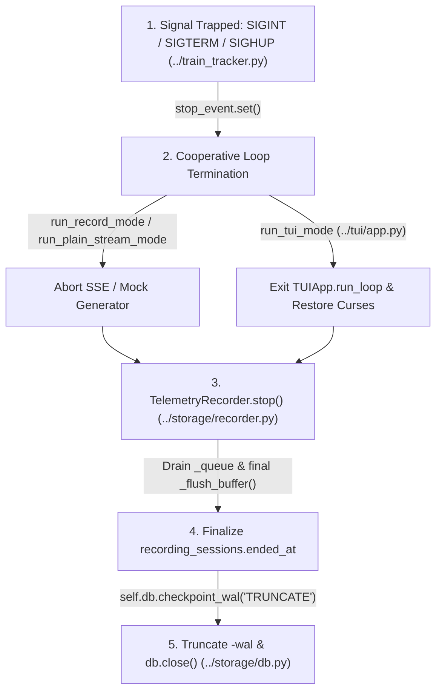

# Implementation Plan — P0-3: Missing `SIGTERM` / `SIGHUP` Handlers & Uncheckpointed WAL Teardown

> **Reference:** [Production Readiness & Architecture Review (`P0-3`)](../../../architecture/production-readiness-review.md#p0-3-missing-sigterm--sighup-handlers--uncheckpointed-wal-teardown)  
> **Target Modules:** [`../../../../train_tracker.py`](../../../../train_tracker.py#L374-L659) (`install_signal_handlers`, `run_record_mode`, `run_plain_stream_mode`, `run_tui_mode`), [`../../../../storage/recorder.py`](../../../../storage/recorder.py#L108-L145) (`TelemetryRecorder.stop`), [`../../../../tui/mock_engine.py`](../../../../tui/mock_engine.py#L721-L731) (`MockTelemetryEngine.stream_positions`), [`../../../../tui/stream_worker.py`](../../../../tui/stream_worker.py#L141-L152), [`../../../../tui/app.py`](../../../../tui/app.py#L51-L77) (`TUIApp`, `run_tui`)  
> **Test Suites:** [`../../../../tests/test_storage_recorder.py`](../../../../tests/test_storage_recorder.py), [`../../../../tests/test_cli.py`](../../../../tests/test_cli.py), [`../../../../tests/test_cli_storage.py`](../../../../tests/test_cli_storage.py)

---

## 1. Root-Cause Bug Analysis

### A. Defect Mechanism
1. **Unregistered Process Signals (`SIGINT`, `SIGTERM`, `SIGHUP`):**
   - `import signal` is present in [`../../../../train_tracker.py`](../../../../train_tracker.py#L11) and [`../../../../tui/app.py`](../../../../tui/app.py#L12), but `signal.signal(...)` is never invoked anywhere in the codebase.
   - When `railmon record`, `railmon` (plain stream), or `railmon --tui` runs under an init supervisor (`systemd`, Docker `stop`, Kubernetes pod eviction) or receives `SIGTERM` / `SIGHUP` (when a controlling SSH terminal disconnects on POSIX), the default OS signal handler terminates the Python interpreter immediately without unwinding the stack or executing `finally:` blocks.
   - As a result, buffered telemetry frames inside `TelemetryRecorder._queue` are dropped, `recording_sessions.ended_at` remains permanently `NULL` in SQLite, and curses terminal state is not restored on `SIGTERM`/`SIGHUP`.
2. **Uninterruptible Sleeps & Missing `stop_event` Plumbing in CLI Loops:**
   - In [`../../../../train_tracker.py`](../../../../train_tracker.py#L504,L614), `run_plain_stream_mode()` and `run_record_mode()` call `client.stream_train_positions(reconnect_delay=reconnect_delay)` without passing a shared `stop_event: threading.Event`, and `run_plain_stream_mode()` calls an uninterruptible `time.sleep(1)` ([`../../../../train_tracker.py`](../../../../train_tracker.py#L540)) on every batch.
   - Similarly, [`MockTelemetryEngine.stream_positions()`](../../../../tui/mock_engine.py#L721-L731) loops over `while True:` and blocks on `time.sleep(interval_sec)` without accepting a `stop_event`.
3. **Uncheckpointed WAL File on Recorder Shutdown:**
   - [`TelemetryRecorder.stop()`](../../../../storage/recorder.py#L108-L145) drains `self._queue`, flushes remaining buffered positions, and updates `recording_sessions.ended_at`, but **never calls** `self.db.checkpoint_wal("TRUNCATE")` or `self.db.close()`.
   - Consequently, committed frames remain in the companion `<db_path>-wal` file after daemon exit instead of being checkpointed and truncated back into the primary SQLite database file, violating [`../../../../.agents/rules/lifecycle-and-signal-handling.md`](../../../../.agents/rules/lifecycle-and-signal-handling.md#L40-L45) and [`../../../../.agents/rules/concurrency-and-sqlite.md`](../../../../.agents/rules/concurrency-and-sqlite.md#L22-L27).
   - Furthermore, in [`run_record_mode()`](../../../../train_tracker.py#L647), `os.path.getsize(db_path)` is queried immediately after `recorder.stop()` to report final database size; without a `TRUNCATE` WAL checkpoint, the reported size undercounts or misses all pages still residing in `-wal`.

### B. Visual Comparison (ASCII & Mermaid)

```text
BEFORE (Uncaught SIGTERM/SIGHUP & Uncheckpointed WAL):
OS / systemd / Docker          Python Process (railmon)             SQLite WAL Storage
         |                                |                                 |
         |-- SIGTERM / SIGHUP ----------->| (Default OS handler kills PID)  |
         |                                |   x finally: block skipped      |
         |                                |   x _queue buffer lost          |
         |                                |                                 |-- ended_at stays NULL
         |                                |                                 |-- .db-wal unmerged / non-zero

AFTER (Unified Signal Handler, Shared stop_event & TRUNCATE WAL Checkpoint):
OS / systemd / Docker          Signal Handler & CLI Loop            TelemetryRecorder / Database
         |                                |                                 |
         |-- SIGINT / SIGTERM / SIGHUP -->|                                 |
         |                                |-- stop_event.set()              |
         |                                |-- Abort SSE / mock wait loop    |
         |                                |-- Enter finally: recorder.stop()|
         |                                |-------------------------------->|-- Drain _queue & _flush_buffer()
         |                                |                                 |-- UPDATE recording_sessions (ended_at)
         |                                |                                 |-- PRAGMA wal_checkpoint(TRUNCATE)
         |                                |                                 |-- db.close() (-wal truncated to 0 B)
```

```mermaid
sequenceDiagram
    autonumber
    participant OS as OS / Supervisor (systemd / Docker)
    participant Sig as Signal Handler (../train_tracker.py)
    participant Loop as Active Mode Loop (Record / Stream / TUI)
    participant Rec as TelemetryRecorder (../storage/recorder.py)
    participant DB as Database SQLite WAL (../storage/db.py)

    OS->>Sig: SIGTERM / SIGINT / SIGHUP
    Sig->>Loop: stop_event.set()
    Loop->>Loop: Wake from stop_event.wait() / abort stream generator
    Loop->>Rec: recorder.stop(timeout_sec=5.0)
    Rec->>Rec: Set _stop_event & push None sentinel to _queue
    Rec->>DB: Drain remaining queue & _flush_buffer()
    Rec->>DB: UPDATE recording_sessions SET ended_at = ?, total_records_written = ?
    Rec->>DB: db.checkpoint_wal("TRUNCATE")
    Loop->>DB: db.close()
```

### C. Architectural Implications
- **Unified Signal Trapping Context Manager (`signal_ lifecycle` / `install_signal_handlers`):**
  - Registering `signal.SIGINT`, `signal.SIGTERM`, and conditionally `getattr(signal, "SIGHUP", None)` (on POSIX where `sys.platform != "win32"`) to set a shared `stop_event: threading.Event` guarantees that every execution mode exits its main loop cleanly without raising an unhandled signal termination or interrupting mid-transaction SQLite commits.
  - Restoring previous signal handlers in a `finally:` block ensures that test suites and nested invocations do not leak signal callbacks across runs.
- **Deterministic 4-Stage Teardown Pipeline:**
  Following [`../../../../.agents/rules/lifecycle-and-signal-handling.md`](../../../../.agents/rules/lifecycle-and-signal-handling.md#L40-L45):
  1. **Signal Stream Disconnect:** `stop_event.set()` immediately aborts `RailwayGovClient.stream_train_positions()`, `MockTelemetryEngine.stream_positions()`, or `TUIApp.run_loop()`.
  2. **Drain Writer Queue:** `TelemetryRecorder.stop()` pushes the `None` sentinel, joins `TelemetryRecorderThread` within `timeout_sec`, and flushes all residual frames in `self._queue`.
  3. **Finalize Audit & Checkpoint WAL:** `TelemetryRecorder.stop()` commits `recording_sessions.ended_at` and executes `self.db.checkpoint_wal("TRUNCATE")` (guarded by `try...except Exception:` with `logger.warning` so checkpoint errors never mask clean shutdown).
  4. **Close Database & Restore Terminal:** `db.close()` releases any persistent connections and `curses.wrapper` restores terminal state (`curs_set(1)`, `endwin()`).

---

## 2. Shutdown & Checkpoint Lifecycle Architecture

### A. Unified Shutdown Pipeline (ASCII)

```text
+-------------------------------------------------------------------------+
| 1. Signal Reception (../train_tracker.py: install_signal_handlers)      |
|    - Traps SIGINT, SIGTERM, and SIGHUP (when hasattr(signal, "SIGHUP")) |
|    - Handler logs signal name at INFO and calls stop_event.set()        |
+-------------------------------------------------------------------------+
                                    |
                                    v
+-------------------------------------------------------------------------+
| 2. Cooperative Loop Exit                                                |
|    - Plain Stream / Record Mode: stream generator & stop_event.wait()   |
|      exit immediately upon stop_event.is_set()                          |
|    - TUI Mode: TUIApp.run_loop() checks stop_event.is_set() each frame  |
|      and exits curses.wrapper cleanly                                   |
+-------------------------------------------------------------------------+
                                    |
                                    v
+-------------------------------------------------------------------------+
| 3. Recorder Queue Drain & Session Audit (../storage/recorder.py)        |
|    - TelemetryRecorder.stop() sets _stop_event & enqueues None sentinel |
|    - Worker thread drains _queue and commits final _flush_buffer()      |
|    - Updates recording_sessions.ended_at and total_records_written      |
+-------------------------------------------------------------------------+
                                    |
                                    v
+-------------------------------------------------------------------------+
| 4. WAL Checkpoint & Resource Cleanup (../storage/db.py)                 |
|    - TelemetryRecorder.stop() invokes self.db.checkpoint_wal("TRUNCATE")|
|    - Merges WAL frames into main .db file and truncates -wal to 0 bytes |
|    - Caller invokes db.close() in finally: block                        |
+-------------------------------------------------------------------------+
```

### B. Unified Shutdown Pipeline (Mermaid)



---

## 3. Proposed Code Changes

### A. [`../../../../train_tracker.py`](../../../../train_tracker.py#L374-L659) — Signal Handling Helper & Mode Loop Integration
1. Add a context manager `install_signal_handlers(stop_event: Optional[threading.Event] = None)` in [`../../../../train_tracker.py`](../../../../train_tracker.py) that:
   - Creates or accepts a `threading.Event`.
   - Registers a handler for `signal.SIGINT`, `signal.SIGTERM`, and (if present on `signal` and `sys.platform != "win32"`) `signal.SIGHUP` that sets `stop_event.set()`.
   - Safely skips registration if not called from the main interpreter thread (`threading.current_thread() is not threading.main_thread()`).
   - Restores the original signal handlers in a `finally:` block on exit.

```python
@contextlib.contextmanager
def install_signal_handlers(
    stop_event: Optional[threading.Event] = None,
) -> Generator[threading.Event, None, None]:
    """Register SIGINT, SIGTERM, and POSIX SIGHUP handlers to set a shared stop_event."""
    event = stop_event or threading.Event()

    if threading.current_thread() is not threading.main_thread():
        yield event
        return

    signals_to_trap: List[int] = [signal.SIGINT, signal.SIGTERM]
    if sys.platform != "win32" and hasattr(signal, "SIGHUP"):
        signals_to_trap.append(getattr(signal, "SIGHUP"))

    previous_handlers: Dict[int, Any] = {}

    def _handle_signal(signum: int, _frame: Any) -> None:
        try:
            sig_name = signal.Signals(signum).name
        except ValueError:
            sig_name = str(signum)
        logger.info("Received signal %s (%d); initiating graceful shutdown...", sig_name, signum)
        event.set()

    for sig in signals_to_trap:
        try:
            previous_handlers[sig] = signal.getsignal(sig)
            signal.signal(sig, _handle_signal)
        except (OSError, ValueError):
            pass

    try:
        yield event
    finally:
        for sig, prev in previous_handlers.items():
            try:
                signal.signal(sig, prev)
            except (OSError, ValueError):
                pass
```

2. Update [`run_record_mode()`](../../../../train_tracker.py#L548-L658):
   - Wrap the recording lifecycle in `with install_signal_handlers() as stop_event:`.
   - Pass `stop_event=stop_event` to `engine.stream_positions(interval_sec=1.0, stop_event=stop_event)` in demo mode and `client.stream_train_positions(reconnect_delay=reconnect_delay, stop_event=stop_event)` in live mode.
   - Check `if stop_event.is_set(): break` inside the `for batch in stream:` loop.
   - In the `finally:` block, call `recorder.stop(timeout_sec=5.0)` (which checkpoints the WAL) and `db.close()` before computing the final `db_size`.

3. Update [`run_plain_stream_mode()`](../../../../train_tracker.py#L464-L546):
   - Wrap execution in `with install_signal_handlers() as stop_event:`.
   - Pass `stop_event=stop_event` to both `engine.stream_positions(interval_sec=1.0, stop_event=stop_event)` and `client.stream_train_positions(reconnect_delay=reconnect_delay, stop_event=stop_event)`.
   - Replace `time.sleep(1)` at line 540 with `if stop_event.wait(timeout=1.0): break` so `SIGINT`/`SIGTERM`/`SIGHUP` wakes the loop immediately without waiting for the 1-second sleep to expire.
   - When `stop_event.is_set()` triggers exit, print `"\nMonitoring stopped."`.
   - In the `finally:` block, call `recorder.stop()` and `db.close()` if `record` was enabled.

4. Update [`run_tui_mode()`](../../../../train_tracker.py#L374-L462):
   - Wrap execution in `with install_signal_handlers() as stop_event:`.
   - Pass `stop_event=stop_event` to `run_tui(..., stop_event=stop_event)`.
   - In the `finally:` block, ensure `worker.stop()`, `recorder.stop()`, and `db.close()` execute in order.

### B. [`../../../../tui/mock_engine.py`](../../../../tui/mock_engine.py#L721-L731) & [`../../../../tui/stream_worker.py`](../../../../tui/stream_worker.py#L141-L152) — Cooperative `stop_event` in `MockTelemetryEngine`
1. Update `MockTelemetryEngine.stream_positions` in [`../../../../tui/mock_engine.py`](../../../../tui/mock_engine.py#L721-L731) to accept `stop_event: Optional[threading.Event] = None` and use `stop_event.wait(timeout=interval_sec)` instead of an uninterruptible `time.sleep(interval_sec)`:

```python
    def stream_positions(
        self,
        interval_sec: float = 1.0,
        stop_event: Optional[threading.Event] = None,
    ) -> Generator[List[TrainPosition], None, None]:
        """Streaming generator yielding updated TrainPosition batches.

        Drop-in replacement for RailwayGovClient.stream_train_positions().
        """
        while stop_event is None or not stop_event.is_set():
            yield self.step(interval_sec)
            if stop_event is not None:
                if stop_event.wait(timeout=interval_sec):
                    return
            else:
                time.sleep(interval_sec)
```

2. Update `StreamWorker._get_stream_generator` in [`../../../../tui/stream_worker.py`](../../../../tui/stream_worker.py#L145-L146) to pass `stop_event=self._stop_event` to `self.mock_engine.stream_positions(interval_sec=1.0, stop_event=self._stop_event)`.

### C. [`../../../../tui/app.py`](../../../../tui/app.py#L51-L77,L412-L522) — Cooperative Signal Exit in `TUIApp`
Update `TUIApp.__init__` and `run_tui` in [`../../../../tui/app.py`](../../../../tui/app.py) to accept `stop_event: Optional[threading.Event] = None`, and check `if self.stop_event is not None and self.stop_event.is_set():` at the top of `TUIApp.run_loop()` so `SIGTERM`/`SIGHUP` cleanly exits the curses loop and restores terminal state via `curses.wrapper`.

### D. [`../../../../storage/recorder.py`](../../../../storage/recorder.py#L18,L108-L145) — WAL Checkpoint on Recorder Teardown
1. Update the module logger at line 18 to `logger = logging.getLogger("railmon." + __name__)`.
2. In `TelemetryRecorder.stop()`, after updating `recording_sessions` (`SET ended_at = ?, total_records_written = ?`), invoke `self.db.checkpoint_wal("TRUNCATE")`:

```python
        # Finalize session audit and checkpoint WAL
        with self._lock:
            ended_at = datetime.utcnow().isoformat() + "Z"
            if self._session_id is not None:
                try:
                    with self.db.transaction() as cur:
                        cur.execute(
                            """
                            UPDATE recording_sessions
                            SET ended_at = ?, total_records_written = ?
                            WHERE session_id = ?
                            """,
                            (ended_at, self._total_records_written, self._session_id),
                        )
                except Exception as exc:
                    logger.error("Failed to finalize recording session %s: %s", self._session_id, exc)

            try:
                self.db.checkpoint_wal("TRUNCATE")
            except Exception as exc:
                logger.warning("WAL checkpoint on recorder stop encountered an error: %s", exc)

            logger.info(
                "TelemetryRecorder stopped. Session %s ended. Total rows written: %d",
                self._session_id,
                self._total_records_written,
            )
```

---

## 4. Test Plan (TDD Red-Green-Refactor)

Following [`../../../../.agents/rules/testing.md`](../../../../.agents/rules/testing.md), write failing unit tests first before implementing the production changes:

### A. [`../../../../tests/test_storage_recorder.py`](../../../../tests/test_storage_recorder.py)
1. `test_stop_invokes_wal_checkpoint_truncate`:
   - Start `TelemetryRecorder`, enqueue a batch of `TrainPosition` records, and call `self.recorder.stop()`.
   - Verify via `unittest.mock.patch.object(self.db, "checkpoint_wal", wraps=self.db.checkpoint_wal)` that `self.db.checkpoint_wal("TRUNCATE")` is called once during `stop()`.
   - Assert that the companion `<db_path>-wal` file is either `0` bytes or absent after `stop()` and `self.db.close()`, and that all records are persisted in the main `.db` file with `ended_at IS NOT NULL` in `recording_sessions`.

### B. [`../../../../tests/test_cli_storage.py`](../../../../tests/test_cli_storage.py) & [`../../../../tests/test_cli.py`](../../../../tests/test_cli.py)
1. `test_install_signal_handlers_traps_sigterm_and_sigint`:
   - Enter `with install_signal_handlers() as stop_event:`.
   - Invoke the registered `SIGTERM` handler (or `signal.raise_signal(signal.SIGTERM)`) and assert `stop_event.is_set() is True`.
   - Verify that original signal handlers for `SIGINT` and `SIGTERM` (and `SIGHUP` when present on POSIX) are restored upon exiting the `with` block.
2. `test_run_record_mode_graceful_shutdown_on_sigterm`:
   - Run `run_record_mode(db_path=temp_db, demo=True, batch_size=50, flush_interval_sec=10.0, quiet=True)` while scheduling a `SIGTERM` signal after the first batch is enqueued.
   - Verify `run_record_mode` exits cleanly with return code `0`, drains the pending batch to `telemetry_history` despite `batch_size=50` not being reached, sets `recording_sessions.ended_at IS NOT NULL`, and truncates the `-wal` file.
3. `test_run_plain_stream_mode_graceful_shutdown_on_sigterm`:
   - Run `run_plain_stream_mode(demo=True, record=True, db_path=temp_db)` and trigger `SIGTERM` after the first batch is printed.
   - Verify `run_plain_stream_mode` exits without raising an unhandled exception, prints `"Monitoring stopped."`, and finalizes the SQLite recording session cleanly.

---

## 5. Verification & Quality Gates

1. **Targeted Recorder & CLI Signal Lifecycle Tests:**
   ```bash
   python -m unittest tests/test_storage_recorder.py tests/test_cli.py tests/test_cli_storage.py -v
   ```
2. **Full Unit & Integration Test Suite:**
   ```bash
   python -m unittest discover tests -v
   ```
3. **Markdown Relative Path & Diagram Audit ([`../../../../.agents/skills/markdown-relative-paths/SKILL.md`](../../../../.agents/skills/markdown-relative-paths/SKILL.md), [`../../../../.agents/skills/diagrams-and-documentation/SKILL.md`](../../../../.agents/skills/diagrams-and-documentation/SKILL.md)):**
   Confirm zero non-relative links or absolute workstation paths exist in [`./p0-3-sigterm-sighup-wal-teardown-fix-plan.md`](./p0-3-sigterm-sighup-wal-teardown-fix-plan.md) and [`../../../architecture/production-readiness-review.md`](../../../architecture/production-readiness-review.md).
