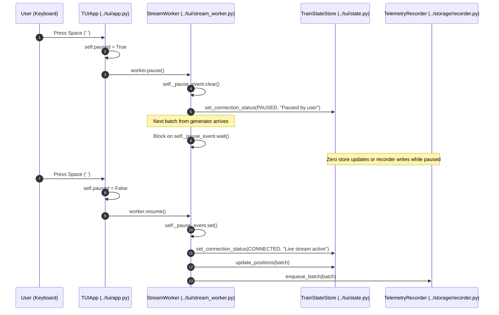
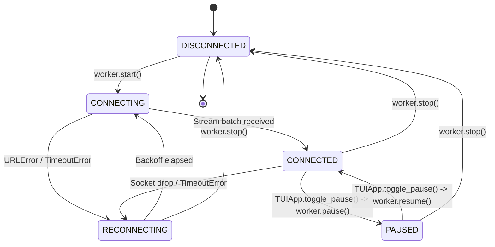

# Implementation Plan — P0-4: TUI Pause Control Fails to Pause `StreamWorker`

> **Reference:** [Production Readiness & Architecture Review (`P0-4`)](../../../architecture/production-readiness-review.md#p0-4-tui-pause-control-fails-to-pause-streamworker)  
> **Target Modules:** [`../../../../tui/app.py`](../../../../tui/app.py#L269-L275) (`TUIApp.toggle_pause`), [`../../../../tui/stream_worker.py`](../../../../tui/stream_worker.py#L49-L139) (`StreamWorker.pause`, `StreamWorker.resume`, `StreamWorker._run_loop`)  
> **Test Suites:** [`../../../../tests/test_tui_controls.py`](../../../../tests/test_tui_controls.py#L396-L406), [`../../../../tests/test_tui_state.py`](../../../../tests/test_tui_state.py#L399-L429), [`../../../../tests/test_tui_integration.py`](../../../../tests/test_tui_integration.py)

---

## 1. Root-Cause Bug Analysis

### A. Defect Mechanism
1. **Unwired `StreamWorker` Pause/Resume in `TUIApp.toggle_pause()`:**
   - In [`../../../../tui/app.py`](../../../../tui/app.py#L269-L275), pressing `Space` in normal navigation mode invokes `TUIApp.toggle_pause()`:
     ```python
     def toggle_pause(self) -> None:
         """Toggle paused state for telemetry ingestion."""
         self.paused = not self.paused
         if self.paused:
             self.store.set_connection_status(ConnectionStatus.PAUSED, "Paused by user")
         else:
             self.store.set_connection_status(ConnectionStatus.CONNECTED, "Live stream active")
     ```
   - Although `StreamWorker` implements thread-safe `pause()` and `resume()` methods backed by `self._pause_event = threading.Event()` ([`../../../../tui/stream_worker.py`](../../../../tui/stream_worker.py#L46-L47,L75-L83)), `TUIApp.toggle_pause()` **never calls `self.worker.pause()` or `self.worker.resume()`**.
2. **Continuous Background Ingestion, State Mutation & Status Clobbering While Paused:**
   - Because `self.worker._pause_event` remains set (`True`), `StreamWorker._run_loop()` ([`../../../../tui/stream_worker.py`](../../../../tui/stream_worker.py#L91,L105)) never blocks at `self._pause_event.wait()`.
   - When the next SSE frame or mock simulation tick arrives (typically within 1 second):
     1. **Status Overwrite:** Line 109 of [`../../../../tui/stream_worker.py`](../../../../tui/stream_worker.py#L109-L110) evaluates `if self.store.get_snapshot().connection_status != ConnectionStatus.CONNECTED:` (which is `True` because `TUIApp` just set it to `ConnectionStatus.PAUSED`) and immediately resets `ConnectionStatus` back to `CONNECTED` (`"Live stream active"`).
     2. **Live Store Mutation:** Line 114 calls `self.store.update_positions(batch)`, mutating train coordinates, speeds, breadcrumb trails, and `snapshot.version` while the user is inspecting a supposedly frozen map and roster.
     3. **Unpaused Telemetry Recording:** Line 116 calls `self.recorder.enqueue_batch(batch)`, continuing to enqueue batches into `TelemetryRecorder` despite ingestion being paused in the UI.
3. **In-Flight Socket Error Race While Paused:**
   - In [`StreamWorker._run_loop()`](../../../../tui/stream_worker.py#L100-L138), if `StreamWorker` is blocked inside `for batch in stream:` waiting on an HTTP SSE read when the user pauses (`_pause_event.clear()`), and the socket subsequently times out or drops while paused, execution jumps to `except Exception as exc:` ([`../../../../tui/stream_worker.py`](../../../../tui/stream_worker.py#L122-L137)).
   - Without waiting on `self._pause_event` inside the exception handler before transitioning to `ConnectionStatus.RECONNECTING`, an in-flight socket timeout clobbers `ConnectionStatus.PAUSED` with `ConnectionStatus.RECONNECTING` while the user still has the dashboard paused.

### B. Visual Comparison (ASCII & Mermaid)

```text
BEFORE (Broken UI-Only Pause Toggle — Worker Continues Ingesting):
User (Spacebar)         TUIApp (../tui/app.py)      StreamWorker (../tui/stream_worker.py)     TrainStateStore
       |                          |                                    |                              |
       |-- Press ' ' ------------>|                                    |                              |
       |                          |-- self.paused = True               | (_pause_event still SET!)    |
       |                          |-- set_connection_status(PAUSED) ---+----------------------------->| (Status = PAUSED)
       |                          |                                    |                              |
       |                          |                              [Next SSE/Mock Batch Arrives]        |
       |                          |                                    |-- _pause_event.wait() (No-op)|
       |                          |                                    |-- status != CONNECTED! ------|-- Clobbers PAUSED
       |                          |                                    |-- set_status(CONNECTED) ---->|   back to CONNECTED!
       |                          |                                    |-- update_positions(batch) -->| (Trains keep moving!)
       |                          |                                    |-- recorder.enqueue_batch()   |

AFTER (Synchronized TUIApp <-> StreamWorker Pause/Resume Lifecycle):
User (Spacebar)         TUIApp (../tui/app.py)      StreamWorker (../tui/stream_worker.py)     TrainStateStore
       |                          |                                    |                              |
       |-- Press ' ' ------------>|                                    |                              |
       |                          |-- self.paused = True               |                              |
       |                          |-- self.worker.pause() ------------>|-- _pause_event.clear()       |
       |                          |                                    |-- set_status(PAUSED) ------->| (Status = PAUSED)
       |                          |                                    |                              |
       |                          |                              [Next SSE/Mock Batch Arrives]        |
       |                          |                                    |-- Blocks at _pause_event.wait()
       |                          |                                    |   (No store or recorder writes)
       |                          |                                    |                              |
       |-- Press ' ' ------------>|                                    |                              |
       |                          |-- self.paused = False              |                              |
       |                          |-- self.worker.resume() ----------->|-- _pause_event.set() (Wakes) |
       |                          |                                    |-- set_status(CONNECTED) ---->| (Status = CONNECTED)
```



---

## 2. State Machine & Concurrency Architecture

### A. Connection & Pause State Machine (ASCII)

```text
                       start()
                  +---------------+
                  | DISCONNECTED  |
                  +---------------+
                          |
                          v
                  +---------------+
         +------->|  CONNECTING   |<-------+
         |        +---------------+        |
         |                |                |
  backoff|    handshake   |     socket     |
  elapsed|    / batch ok  v     error      |
         |        +---------------+        |
         +--------|   CONNECTED   |--------+
         |        +---------------+        |
         |           |         ^           |
         v           | pause() | resume()  |
+---------------+    v         |           |
| RECONNECTING  | +---------------+        |
+---------------+ |    PAUSED     |--------+
                  +---------------+  (if error occurred before pause,
                                      wait until resume() to reconnect)
```

### B. Connection & Pause State Machine (Mermaid)



---

## 3. Proposed Code Changes

### A. [`../../../../tui/app.py`](../../../../tui/app.py#L269-L275) — Wire `TUIApp.toggle_pause()` to `StreamWorker`
Update `TUIApp.toggle_pause()` to delegate directly to `self.worker.pause()` and `self.worker.resume()`, while also updating `self.store.set_connection_status(...)` so both live `StreamWorker` instances and unit test `MagicMock(spec=StreamWorker)` fixtures maintain deterministic store state:

```python
    def toggle_pause(self) -> None:
        """Toggle paused state for telemetry ingestion."""
        self.paused = not self.paused
        if self.paused:
            self.worker.pause()
            self.store.set_connection_status(ConnectionStatus.PAUSED, "Paused by user")
        else:
            self.worker.resume()
            self.store.set_connection_status(ConnectionStatus.CONNECTED, "Live stream active")
```

### B. [`../../../../tui/stream_worker.py`](../../../../tui/stream_worker.py#L49-L139) — Harden `StreamWorker` Pause/Resume & Exception Handling
1. Add an `is_paused` property to `StreamWorker` so callers and tests can inspect pause state cleanly without accessing the private `_pause_event`:
   ```python
   @property
   def is_paused(self) -> bool:
       """Check if stream ingestion is currently paused."""
       return not self._pause_event.is_set()
   ```
2. Standardize status messages in `StreamWorker.pause()` (`"Paused by user"`) and `StreamWorker.resume()` (`"Live stream active"`):
   ```python
   def pause(self) -> None:
       """Temporarily pause stream ingestion."""
       self._pause_event.clear()
       self.store.set_connection_status(ConnectionStatus.PAUSED, "Paused by user")

   def resume(self) -> None:
       """Resume stream ingestion from paused state."""
       self._pause_event.set()
       self.store.set_connection_status(ConnectionStatus.CONNECTED, "Live stream active")
   ```
3. Guard the `except Exception as exc:` block in `StreamWorker._run_loop()` ([`../../../../tui/stream_worker.py`](../../../../tui/stream_worker.py#L122-L138)) so that if an in-flight stream read raises an exception while the worker is paused, the worker waits on `self._pause_event.wait()` before transitioning to `ConnectionStatus.RECONNECTING`:
   ```python
            except Exception as exc:
                if self._stop_event.is_set():
                    break

                # If paused while an in-flight socket read failed, preserve PAUSED state until resumed
                if not self._pause_event.is_set():
                    self._pause_event.wait()
                    if self._stop_event.is_set():
                        break

                # Apply exponential backoff with jitter
                jitter = random.uniform(0.8, 1.2)
                sleep_time = min(backoff * jitter, self.max_backoff_sec)
                msg = f"Connection error: {exc}. Reconnecting in {sleep_time:.1f}s..."
                logger.warning(msg)
                self.store.set_connection_status(ConnectionStatus.RECONNECTING, msg)
   ```

---

## 4. Test Plan (TDD Red-Green-Refactor)

Following [`../../../../.agents/rules/testing.md`](../../../../.agents/rules/testing.md), write failing unit and integration tests first before applying the production fix:

### A. [`../../../../tests/test_tui_controls.py`](../../../../tests/test_tui_controls.py#L396-L406)
1. Enhance `test_pause_telemetry_toggle`:
   - Press `Space` (`self.app.process_input(ord(" "))`):
     - Assert `self.app.paused is True`.
     - Assert `self.worker.pause.assert_called_once()`.
     - Assert `self.store.get_snapshot().connection_status == ConnectionStatus.PAUSED`.
   - Press `Space` again (`self.app.process_input(ord(" "))`):
     - Assert `self.app.paused is False`.
     - Assert `self.worker.resume.assert_called_once()`.
     - Assert `self.store.get_snapshot().connection_status == ConnectionStatus.CONNECTED`.

### B. [`../../../../tests/test_tui_integration.py`](../../../../tests/test_tui_integration.py)
1. Add `test_tui_spacebar_pauses_and_resumes_live_stream_worker`:
   - Instantiate a real `TrainStateStore`, a high-frequency generator stream yielding `TrainPosition` batches every `20ms`, an attached mock `recorder` (`is_running = True`), a real `StreamWorker`, and a `TUIApp` instance.
   - Start `worker.start()` and wait until `store.get_snapshot().total_messages_received >= 1`.
   - Dispatch `app.process_input(ord(" "))` to pause via the TUI controller:
     - Verify `app.paused is True` and `worker.is_paused is True`.
     - Record `paused_msg_count = store.get_snapshot().total_messages_received` and `paused_rec_calls = recorder.enqueue_batch.call_count`.
     - Sleep `80ms` (4 stream intervals) and assert that:
       - `store.get_snapshot().connection_status == ConnectionStatus.PAUSED` (never overwritten to `CONNECTED`).
       - `store.get_snapshot().total_messages_received == paused_msg_count` (zero batches ingested while paused).
       - `recorder.enqueue_batch.call_count == paused_rec_calls` (zero batches sent to `TelemetryRecorder` while paused).
   - Dispatch `app.process_input(ord(" "))` to resume via the TUI controller:
     - Verify `app.paused is False` and `worker.is_paused is False`.
     - Wait until `store.get_snapshot().total_messages_received > paused_msg_count` and assert `store.get_snapshot().connection_status == ConnectionStatus.CONNECTED`.
   - Stop `worker.stop()` cleanly.

### C. [`../../../../tests/test_tui_state.py`](../../../../tests/test_tui_state.py#L399-L429)
1. Add `test_stream_worker_error_while_paused_preserves_paused_status`:
   - Create a stream generator that yields one batch and then raises `ConnectionResetError` after `worker.pause()` is called.
   - Verify that while `worker.is_paused` is `True`, `store.get_snapshot().connection_status` remains `ConnectionStatus.PAUSED` (not overwritten by `ConnectionStatus.RECONNECTING`), and cleanly exits when `worker.stop()` is called.

---

## 5. Verification & Quality Gates

1. **Targeted TUI Controls, State & Integration Tests:**
   ```bash
   python -m unittest tests/test_tui_controls.py tests/test_tui_state.py tests/test_tui_integration.py -v
   ```
2. **Full Unit & Integration Test Suite:**
   ```bash
   python -m unittest discover tests -v
   ```
