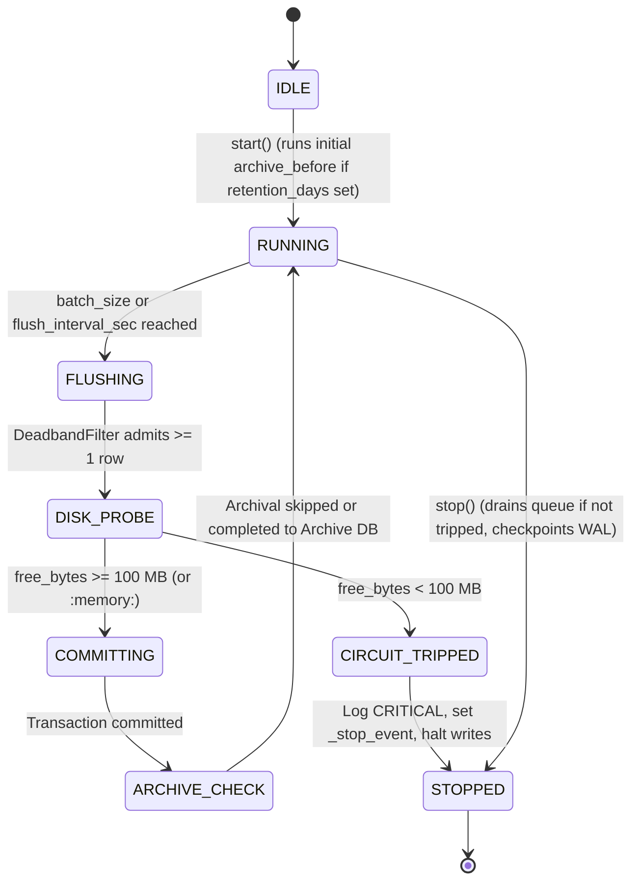

# Implementation Plan — P0-6: Unbounded Storage Growth & Missing Disk-Full Circuit Breaker (Zero-Data-Loss Archival Strategy)

> **Reference:** [Production Readiness & Architecture Review (`P0-6`)](../../../architecture/production-readiness-review.md#p0-6-unbounded-storage-growth--missing-disk-full-circuit-breaker)  
> **Target Modules:** [`../../../../storage/recorder.py`](../../../../storage/recorder.py#L21-L364) (`RecorderConfig`, `TelemetryRecorder`), [`../../../../storage/repository.py`](../../../../storage/repository.py#L708-L772) (`HistoricalRepository.archive_before`), [`../../../../train_tracker.py`](../../../../train_tracker.py#L265-L952) (`build_parser`, `run_record_mode`, `run_plain_stream_mode`, `run_tui_mode`, `main`)  
> **Test Suites:** [`../../../../tests/test_storage_recorder.py`](../../../../tests/test_storage_recorder.py), [`../../../../tests/test_storage_repository.py`](../../../../tests/test_storage_repository.py), [`../../../../tests/test_cli_storage.py`](../../../../tests/test_cli_storage.py)

---

## 1. Root-Cause Bug Analysis

### A. Defect Mechanism
1. **Missing Pre-Commit Disk Free Space Circuit Breaker:**
   - In [`../../../../storage/recorder.py`](../../../../storage/recorder.py#L238-L363), `TelemetryRecorder._flush_buffer()` executes multi-statement batch writes (`INSERT INTO trains`, `INSERT INTO scheduled_trips`, `INSERT INTO telemetry_history`, `UPDATE recording_sessions`) without checking available filesystem capacity on the SQLite database's parent directory via `shutil.disk_usage()`.
   - When an unattended recording daemon runs out of disk space, SQLite fails mid-transaction or during WAL append/checkpoint with `sqlite3.OperationalError: database or disk is full` (`SQLITE_FULL`), repeatedly attempting and failing batch flushes while risking uncheckpointed WAL bloat or filesystem exhaustion.
   - This violates [`../../../../.agents/rules/resilience-and-fallbacks.md`](../../../../.agents/rules/resilience-and-fallbacks.md#L26-L29) (*"Before batch commits, check remaining storage capacity where supported (`shutil.disk_usage`). If free disk space falls below 100 MB, halt recording with a `CRITICAL` log and do not corrupt the database file."*).
2. **Unbounded Active Database Growth & Missing Zero-Data-Loss Archival Policy:**
   - [`HistoricalRepository`](../../../../storage/repository.py) provides read and export methods (`get_train_history`, `get_active_trips`, `get_corridor_punctuality`, `get_station_dwell_times`, `export_trip_geojson`, `export_csv`) but lacks a zero-data-loss rolling archival method (`archive_before(cutoff_iso: str, archive_path: Optional[str] = None) -> int`) to move aged telemetry records out of the hot WAL database into a standalone archive SQLite database (with the identical V1 schema) before removing them from the primary table.
   - Neither [`RecorderConfig`](../../../../storage/recorder.py#L21-L32) nor the CLI parser in [`../../../../train_tracker.py`](../../../../train_tracker.py#L265-L414) exposes `--retention-days` (and `--archive-db` / `archive_dir`) to automatically archive records older than the retention window on daemon startup and periodically during multi-week operation.

### B. Visual Comparison (ASCII & Mermaid)

```text
BEFORE (Unbounded Active DB Growth & Unchecked Disk Exhaustion):
StreamWorker / CLI Loop          TelemetryRecorder (_flush_buffer)           Filesystem / SQLite WAL
          |                                      |                                      |
          |-- enqueue_batch(positions) --------->|                                      |
          |                                      |-- No shutil.disk_usage() check ----->| (Free space < 100 MB)
          |                                      |-- No retention archival ------------>| (Hot DB grows forever)
          |                                      |-- with db.transaction(): ----------->| x SQLITE_FULL / I/O error
          |                                      |-- Loop continues accepting batches ->| (Repeated disk errors)

AFTER (100 MB Disk-Full Circuit Breaker & Zero-Data-Loss Rolling Archival):
StreamWorker / CLI Loop          TelemetryRecorder (_flush_buffer)           Hot SQLite WAL & Archive DB
          |                                      |                                      |
          |-- start() (if retention_days > 0) -->|-- repo.archive_before(cutoff_iso) -->| 1. Copy rows < cutoff_iso
          |                                      |                                      |    + trains + trips + stops
          |                                      |                                      |    into archive SQLite DB
          |                                      |                                      | 2. Delete archived rows
          |                                      |                                      |    from hot telemetry_history
          |-- enqueue_batch(positions) --------->|                                      |
          |                                      |-- _has_sufficient_disk_space() ----->| shutil.disk_usage(dir).free
          |                                      |   +-> If free < 100 MB:              |
          |                                      |       1. logger.critical(...)        |
          |                                      |       2. _disk_full_tripped = True   |
          |                                      |       3. _stop_event.set() (Halt!)   | (Zero corrupt writes!)
          |                                      |   +-> If free >= 100 MB:             |
          |                                      |       1. BEGIN IMMEDIATE & commit -->| (Safe batch persistence)
          |                                      |       2. Periodic retention archive->| (Every archive_interval_sec)
```

```mermaid
sequenceDiagram
    autonumber
    participant P as Producer (StreamWorker / CLI)
    participant R as TelemetryRecorder (../storage/recorder.py)
    participant Repo as HistoricalRepository (../storage/repository.py)
    participant FS as Filesystem (shutil.disk_usage)
    participant HotDB as Hot Database SQLite WAL (../storage/db.py)
    participant ArchDB as Archive Database SQLite (../storage/db.py)

    P->>R: recorder.start()
    opt config.retention_days is not None
        R->>Repo: archive_before(cutoff_iso, archive_path)
        Repo->>HotDB: SELECT trains, scheduled_trips, schedule_stops, telemetry_history (< cutoff_iso)
        Repo->>ArchDB: BEGIN IMMEDIATE; Upsert trains/trips/stops & INSERT telemetry_history; COMMIT
        Repo->>HotDB: BEGIN IMMEDIATE; DELETE archived telemetry_history & unreferenced old trips; COMMIT
    end
    loop Batch Flush Cycle
        P->>R: enqueue_batch(positions)
        R->>FS: shutil.disk_usage(parent_dir).free
        alt free < min_free_disk_bytes (100 MB)
            FS-->>R: Low Disk Space (< 104,857,600 B)
            R->>R: logger.critical(...) & trip circuit breaker
            R->>R: _stop_event.set() & clear pending queue
        else free >= min_free_disk_bytes (100 MB)
            FS-->>R: Sufficient Disk Space
            R->>HotDB: BEGIN IMMEDIATE; executemany(...); COMMIT
            opt retention_days active & archive interval elapsed
                R->>Repo: archive_before(cutoff_iso, archive_path)
            end
        end
    end
```

---

## 2. Circuit Breaker & Zero-Data-Loss Archival Architecture

### A. Storage Safeguard & Archival Pipeline (ASCII)

```text
+-----------------------------------------------------------------------------------+
|                        TelemetryRecorder (../storage/recorder.py)                 |
|  Config:                                                                          |
|   - min_free_disk_bytes: int = 100 * 1024 * 1024 (100 MB)                         |
|   - retention_days: Optional[int] = None (e.g., --retention-days 30)              |
|   - archive_path: Optional[str] = None (defaults to <db_stem>_archive.db)         |
|   - retention_archive_interval_sec: float = 3600.0 (1 hour)                       |
+-----------------------------------------------------------------------------------+
                                         |
                    +--------------------+--------------------+
                    |                                         |
          1. Pre-Flush Circuit Breaker             2. Rolling Retention Archival
        (_has_sufficient_disk_space)               (_run_retention_archive)
                    |                                         |
                    v                                         v
+----------------------------------------+   +--------------------------------------+
| - Skip if db._is_memory == True        |   | - Computes UTC cutoff timestamp:     |
| - Probe shutil.disk_usage(parent_dir)  |   |   now_utc - timedelta(days=N)        |
| - If usage.free < min_free_disk_bytes: |   | - Calls HistoricalRepository         |
|   * Log CRITICAL with free & threshold |   |   .archive_before(cutoff, arch_path) |
|   * Set self._disk_full_tripped = True |   | - Phase 1 (Write to Archive DB):     |
|   * Set self._stop_event.set()         |   |   * Init V1 Schema on Archive DB     |
|   * Reject future enqueue() calls      |   |   * Copy parent trains, trips, stops |
|   * Skip transaction to prevent        |   |   * Copy telemetry_history (< cutoff)|
|     SQLite WAL / DB corruption         |   |   * Checkpoint & close Archive DB    |
|                                        |   | - Phase 2 (Prune Hot DB after commit)|
|                                        |   |   * DELETE FROM telemetry_history    |
|                                        |   |     WHERE recorded_at < ?            |
|                                        |   |   * DELETE old unreferenced trips    |
+----------------------------------------+   +--------------------------------------+
```

### B. Storage Safeguard & Archival State Machine (Mermaid)



### C. Why Two-Phase Archive-Then-Delete via `Database` Instead of `ATTACH DATABASE`?
1. **100% Parameterized SQL Compliance ([`../../../../.agents/rules/security-and-data-protection.md`](../../../../.agents/rules/security-and-data-protection.md#L10-L12)):**
   - Using two standard `Database` instances (source hot DB and target archive DB) executes 100% parameterized queries (`?` placeholders) using standard Python cursors and `executemany()`, avoiding dynamic schema prefix interpolation.
2. **Full Query Compatibility on Archive Databases:**
   - Because the archive file is initialized with `Database(resolved_archive_path)` (`SchemaManager.initialize_schema`), it is a first-class `railmon` SQLite database containing `trains`, `scheduled_trips`, `schedule_stops`, `telemetry_history`, and all V1 indexes.
   - Operators can inspect any archive directly using existing CLI commands (`railmon history trips --db railway_history_archive.db`, `railmon history train IC50 --db railway_history_archive.db`, `railmon history export ...`).
3. **Crash-Safe Zero-Data-Loss Ordering:**
   - Rows are committed and durability-flushed to the archive database **before** the hot database executes `DELETE FROM telemetry_history WHERE recorded_at < ?`. If writing to the archive database fails (e.g., I/O error), the hot database transaction is never executed and zero historical records are lost.
   - Because `telemetry_history` in the archive database preserves the original `id` primary key (`INSERT OR IGNORE INTO telemetry_history (id, train_number, ...)`), any retried archival run is strictly idempotent and never duplicates rows.

---

## 3. Proposed Code Changes

### A. [`../../../../storage/repository.py`](../../../../storage/repository.py#L704-L772) — Add `HistoricalRepository.archive_before(cutoff_iso: str, archive_path: Optional[str] = None) -> int`
1. Under Section `6. Audit & System Health` in [`../../../../storage/repository.py`](../../../../storage/repository.py), add `resolve_archive_path(self, archive_path: Optional[str] = None) -> str` and `archive_before(self, cutoff_iso: str, archive_path: Optional[str] = None) -> int`:
   - **Validation & Path Resolution:**
     - Validate that `cutoff_iso` is a non-empty string (raising `ValueError` if empty or whitespace-only).
     - If `archive_path` is `None`:
       - When `self.db._is_memory` is `True`, raise `ValueError("archive_path must be specified when archiving from an in-memory database")` (or default to a companion path when file-backed).
       - For file-backed databases (e.g., `railway_history.db`), derive `<stem>_archive<ext>` in the same directory (e.g., `railway_history_archive.db`).
     - Validate that `os.path.abspath(resolved_archive_path) != os.path.abspath(self.db.db_path)` (when not `:memory:`) to prevent archiving a database into itself.
   - **Step 1 — Read Expired Telemetry & Referenced Metadata from Hot DB (Chunked / Bounded):**
     - Query `telemetry_history` rows where `recorded_at < ?` ordered by `recorded_at ASC, id ASC`. If no rows match, return `0` immediately without creating an empty archive file.
     - Collect the referenced `train_number` and `schedule_id` values from the matched telemetry rows (plus any `scheduled_trips` with `service_date < cutoff_iso[:10]` that have no newer telemetry remaining) and fetch their parent rows from `trains`, `scheduled_trips`, and `schedule_stops`.
   - **Step 2 — Atomic Persist into Archive Database (`Database(resolved_archive_path)`):**
     - Open `archive_db = Database(resolved_archive_path)`.
     - Inside `with archive_db.transaction() as arch_cur:`:
       1. Upsert parent `trains` (`INSERT INTO trains ... ON CONFLICT(train_number) DO UPDATE SET first_observed_at = MIN(trains.first_observed_at, excluded.first_observed_at), last_observed_at = MAX(trains.last_observed_at, excluded.last_observed_at)`).
       2. Upsert parent `scheduled_trips` (`INSERT OR IGNORE INTO scheduled_trips ...`).
       3. Upsert parent `schedule_stops` (`INSERT OR IGNORE INTO schedule_stops ...`).
       4. Insert the archived `telemetry_history` rows preserving their original `(id, train_number, schedule_id, recorded_at, ...)` via `INSERT OR IGNORE INTO telemetry_history (id, ...) VALUES (?, ...)`.
     - Checkpoint and close `archive_db` (`archive_db.checkpoint_wal("TRUNCATE")`, `archive_db.close()`).
   - **Step 3 — Atomic Eviction of Archived Rows from Hot DB:**
     - Only after `archive_db` commits cleanly, open `with self.db.transaction() as hot_cur:` on the hot database:
       1. Execute `DELETE FROM telemetry_history WHERE recorded_at < ?;` with `(cutoff_clean,)` and record `archived_count = hot_cur.rowcount`.
       2. Clean up old `scheduled_trips` (`service_date < cutoff_date`) that are no longer referenced by any remaining active row in `telemetry_history`:
          ```sql
          DELETE FROM scheduled_trips
          WHERE service_date < ?
            AND NOT EXISTS (
                SELECT 1 FROM telemetry_history
                WHERE telemetry_history.schedule_id = scheduled_trips.schedule_id
            );
          ```
     - Return `archived_count`.

```python
    def resolve_archive_path(self, archive_path: Optional[str] = None) -> str:
        """Resolve and validate target SQLite archive database path."""
        if archive_path is not None and archive_path.strip():
            resolved = archive_path.strip()
        elif self.db._is_memory:
            raise ValueError("archive_path must be explicitly provided for in-memory databases")
        else:
            base, ext = os.path.splitext(self.db.db_path)
            resolved = f"{base}_archive{ext or '.db'}"

        if not self.db._is_memory and not resolved.startswith("file::memory:") and resolved != ":memory:":
            if os.path.abspath(resolved) == os.path.abspath(self.db.db_path):
                raise ValueError("archive_path cannot be identical to the active database path")
        return resolved
```

### B. [`../../../../storage/recorder.py`](../../../../storage/recorder.py#L5-L375) — Disk-Full Circuit Breaker (`shutil.disk_usage`) & Rolling Archival Execution
1. **Imports & Constants:**
   - Import `os`, `shutil`, and `timedelta`, `timezone` from `datetime`.
   - Define `MIN_FREE_DISK_BYTES: int = 100 * 1024 * 1024` (`104,857,600` bytes = 100 MB).
2. **Extend `RecorderConfig` ([`../../../../storage/recorder.py`](../../../../storage/recorder.py#L21-L32)):**
   - Add configuration fields with backwards-compatible defaults:
     - `retention_days: Optional[int] = None`
     - `archive_path: Optional[str] = None`
     - `min_free_disk_bytes: int = MIN_FREE_DISK_BYTES`
     - `retention_archive_interval_sec: float = 3600.0`
3. **Track Circuit Breaker & Archival State in `TelemetryRecorder.__init__`:**
   - Validate `if self.config.retention_days is not None and self.config.retention_days <= 0: raise ValueError("retention_days must be a positive integer")`.
   - Initialize:
     - `self._disk_full_tripped: bool = False`
     - `self._last_archive_time: float = 0.0`
     - `self._total_records_archived: int = 0`
   - Expose `@property def disk_full_tripped(self) -> bool:` returning `self._disk_full_tripped`.
4. **Disk Free Probing Helper (`TelemetryRecorder._has_sufficient_disk_space`):**
   - Check `if self.db._is_memory or self.config.min_free_disk_bytes <= 0: return True`.
   - Resolve the target directory: `parent_dir = os.path.dirname(os.path.abspath(self.db.db_path)) or "."`.
   - Also check the archive destination directory if `self.config.archive_path` is set on a different mount.
   - Call `usage = shutil.disk_usage(parent_dir)`.
   - If `usage.free < self.config.min_free_disk_bytes`:
     - Set `self._disk_full_tripped = True` and `self._stop_event.set()`.
     - Log at `CRITICAL`:
       ```python
       logger.critical(
           "Disk space critically low on '%s' (%d bytes free < %d bytes required). "
           "Halting TelemetryRecorder to prevent database corruption.",
           parent_dir,
           usage.free,
           self.config.min_free_disk_bytes,
       )
       ```
     - Drain and discard any remaining items in `self._queue` so producer threads do not stay blocked or continue buffering.
     - Return `False`.
   - Return `True`.
5. **Enforce Circuit Breaker in `_flush_buffer`, `_worker_loop`, `enqueue`, and `enqueue_batch`:**
   - In `enqueue()` and `enqueue_batch()`, check `if not self.is_running or self._disk_full_tripped or self._stop_event.is_set():` and return `False` / `0` immediately.
   - In `_flush_buffer()`, after deadband filtering confirms `admitted` is non-empty (right before opening `with self.db.transaction() as cur:`), call `if not self._has_sufficient_disk_space(): return 0`.
   - In `_worker_loop()`, during the shutdown draining phase, skip draining/flushing to disk if `self._disk_full_tripped` is `True` so stopping a tripped recorder never writes to a full disk.
   - In `stop()`, if `self._disk_full_tripped` is `True`, skip `UPDATE recording_sessions` and `checkpoint_wal` disk writes so `stop()` never corrupts the database when halted by the circuit breaker.
6. **Rolling Retention Archival (`TelemetryRecorder._run_retention_archive`):**
   - Add `_run_retention_archive(self) -> int`:
     ```python
     def _run_retention_archive(self) -> int:
         """Archive historical telemetry older than configured retention_days into archive SQLite DB."""
         if self.config.retention_days is None or self._disk_full_tripped:
             return 0
         if not self._has_sufficient_disk_space():
             return 0
         from storage.repository import HistoricalRepository

         cutoff_dt = datetime.now(timezone.utc) - timedelta(days=self.config.retention_days)
         cutoff_iso = cutoff_dt.isoformat().replace("+00:00", "Z")
         try:
             repo = HistoricalRepository(self.db)
             target_archive = repo.resolve_archive_path(self.config.archive_path)
             archived = repo.archive_before(cutoff_iso, archive_path=target_archive)
             self._total_records_archived += archived
             self._last_archive_time = time.time()
             if archived > 0:
                 logger.info(
                     "Retention policy (--retention-days=%d) archived %d telemetry rows older than %s to '%s'.",
                     self.config.retention_days,
                     archived,
                     cutoff_iso,
                     target_archive,
                 )
             return archived
         except Exception as exc:
             logger.error("Failed to execute retention archival before %s: %s", cutoff_iso, exc)
             return 0
     ```
   - Invoke `self._run_retention_archive()` during `TelemetryRecorder.start()` and periodically inside `_worker_loop()` whenever `self.config.retention_days is not None and (now - self._last_archive_time) >= self.config.retention_archive_interval_sec`.
   - Include `"disk_full_tripped": self._disk_full_tripped` and `"total_records_archived": self._total_records_archived` in `TelemetryRecorder.get_stats()`.

### C. [`../../../../train_tracker.py`](../../../../train_tracker.py#L265-L952) — Expose `--retention-days` & `--archive-db` on CLI
1. **CLI Argument Parser (`build_parser`):**
   - Add a positive-integer validator `_positive_int(val: str) -> int` for `--retention-days` so `--retention-days 0` or negative values raise `argparse.ArgumentTypeError`.
   - Add `--retention-days` and `--archive-db` to the top-level parser ([`../../../../train_tracker.py`](../../../../train_tracker.py#L318)) and to the `record` subparser `p_rec` ([`../../../../train_tracker.py`](../../../../train_tracker.py#L355-L360)):
     ```python
     parser.add_argument(
         "--retention-days",
         type=_positive_int,
         default=None,
         help="Rolling retention window in days; archives older telemetry rows to an archive SQLite DB.",
     )
     parser.add_argument(
         "--archive-db",
         type=str,
         default=None,
         help="Path to archive SQLite database for aged telemetry (default: <db_stem>_archive.db).",
     )
     ```
     and on `p_rec`:
     ```python
     p_rec.add_argument(
         "--retention-days",
         type=_positive_int,
         default=argparse.SUPPRESS,
         help="Rolling retention window in days; archives older telemetry rows to an archive SQLite DB.",
     )
     p_rec.add_argument(
         "--archive-db",
         type=str,
         default=argparse.SUPPRESS,
         help="Path to archive SQLite database for aged telemetry (default: <db_stem>_archive.db).",
     )
     ```
   - Also add `railmon history archive` subcommand under `hist_subs` (`--before <ISO>` or `--retention-days <N>`, `--archive-db <path>`) so operators can trigger on-demand archival of an existing database from the CLI.
2. **Recording Mode Signatures & Dispatch (`run_record_mode`, `run_plain_stream_mode`, `run_tui_mode`, `main`):**
   - Add `retention_days: Optional[int] = None` and `archive_path: Optional[str] = None` (with default `None`) to:
     - `run_record_mode(..., retention_days: Optional[int] = None, archive_path: Optional[str] = None)`
     - `run_plain_stream_mode(..., retention_days: Optional[int] = None, archive_path: Optional[str] = None)`
     - `run_tui_mode(..., retention_days: Optional[int] = None, archive_path: Optional[str] = None)`
   - Pass `retention_days=retention_days` and `archive_path=archive_path` into `RecorderConfig(...)` in all three functions.
   - In `run_record_mode()`, check `if recorder.disk_full_tripped:` in the batch ingestion loop to set `stop_event.set()` and exit cleanly when the disk-full circuit breaker trips.
   - In `main()`, only pass `retention_days` / `archive_path` keyword arguments when non-`None` (or keep default signature compatibility) so existing unit test mock assertions in [`../../../../tests/test_cli.py`](../../../../tests/test_cli.py) and [`../../../../tests/test_cli_storage.py`](../../../../tests/test_cli_storage.py#L164-L212) continue to pass without modification.

### D. [`../../../architecture/production-readiness-review.md`](../../../architecture/production-readiness-review.md#L322-L329) — Update P0-6 Remediation Description
- Update P0-6 in [`../../../architecture/production-readiness-review.md`](../../../architecture/production-readiness-review.md#L322-L329) and the Phase 1 roadmap table to reflect `HistoricalRepository.archive_before(cutoff_iso, archive_path)` (zero-data-loss rolling archival to an archive SQLite database) instead of destructive row purging.

---

## 4. Test Plan (TDD Red-Green-Refactor)

Following [`../../../../.agents/rules/testing.md`](../../../../.agents/rules/testing.md), write failing unit and integration tests first, verify they fail (Red), implement the changes (Green), and refactor:

### A. [`../../../../tests/test_storage_repository.py`](../../../../tests/test_storage_repository.py)
1. `test_archive_before_moves_expired_rows_and_metadata_to_archive_db`:
   - Seed `trains`, `scheduled_trips`, `schedule_stops`, and `telemetry_history` across two dates: `2026-10-01` (aged) and `2026-11-18` (active).
   - Call `archived_count = self.repo.archive_before("2026-11-01T00:00:00Z", archive_path=archive_db_path)`.
   - Assert `archived_count` equals the exact number of `2026-10-01` telemetry rows.
   - Open `Database(archive_db_path)` and `HistoricalRepository(archive_db)` and verify:
     - All `2026-10-01` telemetry rows, parent `trains`, `scheduled_trips`, and `schedule_stops` exist and are queryable via `archive_repo.get_train_history(...)` and `archive_repo.get_active_trips(...)`.
   - Verify on the hot database (`self.repo`) that:
     - Zero `2026-10-01` telemetry rows remain in the hot `telemetry_history` table.
     - Unreferenced `2026-10-01` `scheduled_trips` are removed from the hot database while all `2026-11-18` telemetry rows and active trips remain intact.
2. `test_archive_before_is_idempotent_and_preserves_existing_archive_rows`:
   - Run `archive_before` across two sequential cutoff windows (`2026-10-15T00:00:00Z`, then `2026-11-01T00:00:00Z`) targeting the same `archive_db_path`.
   - Verify the archive database accumulates both windows cleanly without primary key collisions or data loss.
3. `test_archive_before_validates_cutoff_and_same_db_path`:
   - Verify empty `cutoff_iso` or `archive_path == self.db.db_path` raises `ValueError`.

### B. [`../../../../tests/test_storage_recorder.py`](../../../../tests/test_storage_recorder.py)
1. `test_disk_full_circuit_breaker_halts_recording_below_100mb`:
   - Mock `shutil.disk_usage` to return `free = 50 * 1024 * 1024` (50 MB, below the 100 MB threshold).
   - Start `TelemetryRecorder(self.db, RecorderConfig(batch_size=2, flush_interval_sec=0.1, enable_deadband=False))`.
   - Enqueue 2 `TrainPosition` records and verify with `self.assertLogs("railmon.storage.recorder", level="CRITICAL")` that a `CRITICAL` log message is emitted, `self.recorder.disk_full_tripped` is `True`, zero telemetry rows are committed to `telemetry_history`, and subsequent `enqueue()` calls return `False`.
2. `test_disk_full_circuit_breaker_allows_writes_above_100mb`:
   - Mock `shutil.disk_usage` with `free = 500 * 1024 * 1024` (500 MB).
   - Verify batch commits succeed normally, `self.recorder.disk_full_tripped` is `False`, and all rows are persisted.
3. `test_recorder_retention_days_archives_aged_telemetry_on_start`:
   - Pre-insert aged telemetry rows (`recorded_at = '2026-01-01T00:00:00Z'`) and recent telemetry rows into `self.db`.
   - Start `TelemetryRecorder(self.db, RecorderConfig(retention_days=30, archive_path=archive_db_path, enable_deadband=False))`.
   - Verify the `2026-01-01` rows are moved to `archive_db_path` (zero data loss) and removed from the hot `self.db`, while recent rows and newly enqueued positions remain in the hot `self.db`.

### C. [`../../../../tests/test_cli_storage.py`](../../../../tests/test_cli_storage.py)
1. `test_record_subcommand_retention_days_and_archive_db_options`:
   - Parse `["record", "--retention-days", "30", "--archive-db", "archive.db"]` and `["--record", "--retention-days", "14"]`.
   - Assert `args.retention_days == 30`, `args.archive_db == "archive.db"`, and verify invalid values (`--retention-days 0` or `-5`) exit with code `2`.
2. `test_main_passes_retention_days_and_archive_path_to_run_record_mode`:
   - Verify `main(["record", "--demo", "--retention-days", "30", "--archive-db", "arch.db"])` passes `retention_days=30` and `archive_path="arch.db"` to `run_record_mode`.

---

## 5. Verification & Quality Gates

1. **Targeted Storage & CLI Tests:**
   ```bash
   python -m unittest tests/test_storage_repository.py tests/test_storage_recorder.py tests/test_cli_storage.py tests/test_cli.py -v
   ```
2. **Storage Benchmark Gate ([`../../../../.agents/skills/storage-benchmark-gate/SKILL.md`](../../../../.agents/skills/storage-benchmark-gate/SKILL.md)):**
   ```bash
   python -m unittest tests/test_storage_benchmarks.py -v
   python scripts/benchmark_storage.py --records 5000
   ```
3. **Full Test Suite:**
   ```bash
   python -m unittest discover tests -v
   ```
4. **Documentation & Relative Path Audit ([`../../../../.agents/skills/markdown-relative-paths/SKILL.md`](../../../../.agents/skills/markdown-relative-paths/SKILL.md), [`../../../../.agents/skills/diagrams-and-documentation/SKILL.md`](../../../../.agents/skills/diagrams-and-documentation/SKILL.md)):**
   Confirm zero non-relative links or absolute workstation paths exist in [`./p0-6-unbounded-storage-disk-circuit-breaker-fix-plan.md`](./p0-6-unbounded-storage-disk-circuit-breaker-fix-plan.md) and [`../../../architecture/production-readiness-review.md`](../../../architecture/production-readiness-review.md).
