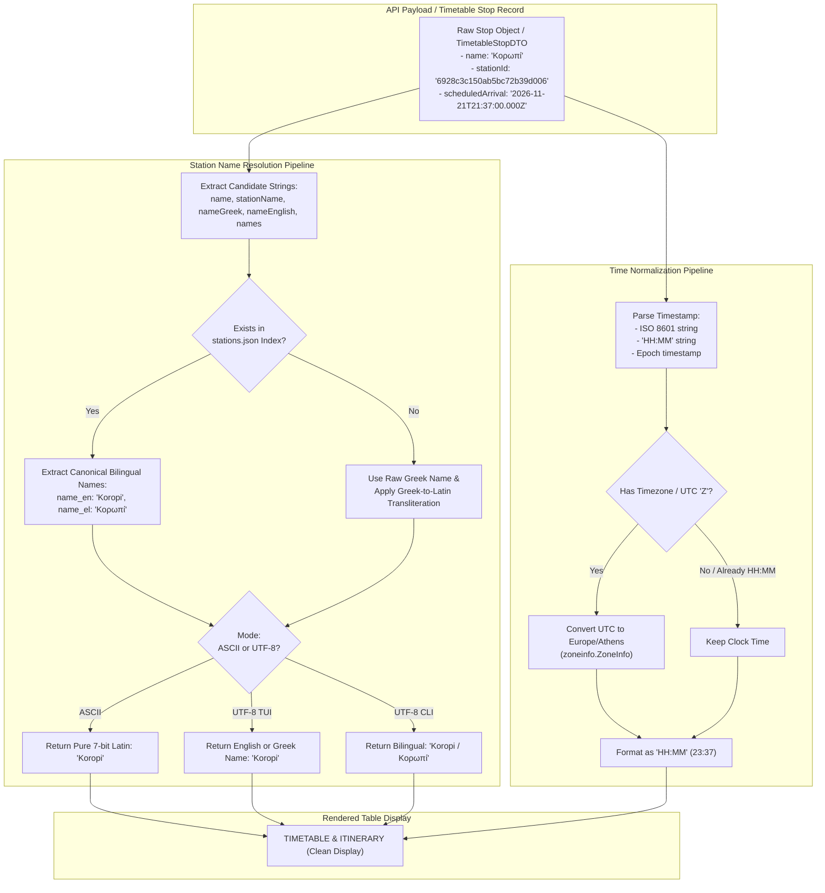

# Implementation Plan — P0-7: Train Timetable & Itinerary Schema Alignment, Station Name Resolution, and Athens Timezone Normalization

> **Reference Investigation:** [`../../../investigations/train-itinerary-schema-and-time-display-issue.md`](../../../investigations/train-itinerary-schema-and-time-display-issue.md)  
> **Target Modules:** [`../../../../storage/cli_formatters.py`](../../../../storage/cli_formatters.py), [`../../../../tui/renderer.py`](../../../../tui/renderer.py), [`../../../../tui/mock_engine.py`](../../../../tui/mock_engine.py), [`../../../../train_tracker.py`](../../../../train_tracker.py)  
> **Test Suites:** [`../../../../tests/test_cli_schedule.py`](../../../../tests/test_cli_schedule.py), [`../../../../tests/test_tui_timetable.py`](../../../../tests/test_tui_timetable.py)  
> **Relevant Rules & Skills:** [`../../../../.agents/rules/diagrams-and-visual-documentation.md`](../../../../.agents/rules/diagrams-and-visual-documentation.md), [`../../../../.agents/rules/markdown-relative-paths.md`](../../../../.agents/rules/markdown-relative-paths.md), [`../../../../.agents/rules/misra-autosar-python.md`](../../../../.agents/rules/misra-autosar-python.md), [`../../../../.agents/skills/ci-quality-gate/SKILL.md`](../../../../.agents/skills/ci-quality-gate/SKILL.md)

---

## 1. Executive Summary & Defect Overview

When operators query live train itineraries (via Curses TUI modal key `i` / `I` or CLI `railmon schedule <train_num>`), the application exhibits three critical defects caused by discrepancies between synthetic mock generators and the production Hellenic Railways (`railway.gov.gr`) API schema:

1. **Station Column Displays Hexadecimal Hash:** The API stop record stores the station name in `"name"` (e.g. `"name": "Κορωπί"`), while `"stationId"` contains a MongoDB ObjectId hex string (`"6928c3c150ab5bc72b39d006"`). Existing formatters searched only for `stationNameEnglish`, `stationNameGreek`, and `stationName`, completely omitting `name` and falling back to `stationId`.
2. **Timestamps Display Year `2026-`:** Live API times are ISO 8601 strings (`"2026-11-21T21:37:00.000Z"`). The TUI modal performed a naive string slice `sched_arr[:5]`, extracting `"2026-"` instead of the scheduled time.
3. **Timezone Neglect (UTC vs. Greek Local Time):** The CLI parser stripped the date and printed raw UTC time (`21:37`), creating a 2-hour or 3-hour discrepancy against operational Greek railway timetables (`Europe/Athens`, where train 1239 departs at `23:32` local time).
4. **Missing Route Endpoints:** Modal headers omitted origin and destination because they only checked `nameEnglish`, whereas the live API returns `name` and `nameGreek`.

---

## 2. Technical Architecture & Transformation Pipeline

### 2.1 Before vs. After Pipeline Comparison

```text
BEFORE (Defective Extraction):
+------------------------------------+      +-----------------------------------------+
| Live API Stop Record               |      | Formatter (CLI & TUI)                   |
|  - name: "Κορωπί"                  | ---> |  - stn_name = stop.get("stationName")  | -> Falls back to "6928c3c150ab5bc72b39d006"
|  - stationId: "6928c3c1...006"     |      |               or stop.get("stationId")  |
|  - schedArr: "2026-11-21T21:37...Z"|      |  - sched_arr[:5]                        | -> Slices "2026-" (Year string)
+------------------------------------+      +-----------------------------------------+

AFTER (Normalized Multi-Layer Resolution):
+------------------------------------+      +-----------------------------------------+      +-------------------------------+
| Live API Stop Record               |      | resolve_timetable_station_name()        | ---> | English: "Koropi"             |
|  - name: "Κορωπί"                  | ---> |  1. Check name / stationName / names    |      | Greek:   "Κορωπί"             |
|  - stationId: "6928c3c1...006"     |      |  2. Cross-reference stations.json index |      | Display: "Koropi / Κορωπί"    |
|  - schedArr: "2026-11-21T21:37...Z"|      |  3. ASCII fallback transliteration      |      |          (or "Koropi" ASCII)  |
+------------------------------------+      +-----------------------------------------+      +-------------------------------+
                                            | format_timetable_time()                 | ---> | Local Time: "23:37"           |
                                            |  1. Parse ISO 8601 / HH:MM / Epoch      |      | (Europe/Athens EET/EEST)      |
                                            |  2. Convert UTC -> Europe/Athens        |      +-------------------------------+
                                            +-----------------------------------------+
```



---

## 3. Detailed Implementation Steps

### Phase 1: Standard Time Parsing & Europe/Athens Conversion Utility

Create `format_timetable_time(raw_time: Any, empty_dash: str = "--:--") -> str` in [`storage/cli_formatters.py`](../../../../storage/cli_formatters.py) and expose it for [`tui/renderer.py`](../../../../tui/renderer.py):

```python
import zoneinfo
from datetime import datetime, timezone

ATHENS_TZ = zoneinfo.ZoneInfo("Europe/Athens")

def format_timetable_time(raw_time: Any, empty_dash: str = "--:--") -> str:
    """Parse raw timestamp or clock string and format into 'HH:MM' in Europe/Athens time.

    Supports:
    - ISO 8601 strings (e.g. '2026-11-21T21:37:00.000Z', '2026-11-21T21:37:00+00:00')
    - Simple time strings (e.g. '14:30', '14:30:00')
    - Unix epoch timestamps (int / float)

    Args:
        raw_time: Input time representation or None.
        empty_dash: Fallback string for missing/null values.

    Returns:
        Formatted 'HH:MM' string in Europe/Athens local time.
    """
    if not raw_time or str(raw_time).lower() in ("none", "null", ""):
        return empty_dash

    s = str(raw_time).strip()

    # 1. If already 'HH:MM'
    if len(s) == 5 and s[2] == ":" and s[:2].isdigit() and s[3:].isdigit():
        return s

    # 2. If 'HH:MM:SS'
    if len(s) == 8 and s[2] == ":" and s[5] == ":" and s[:2].isdigit():
        return s[:5]

    # 3. Parse ISO 8601 string
    try:
        clean_s = s.replace("Z", "+00:00")
        if "T" in clean_s or " " in clean_s:
            dt = datetime.fromisoformat(clean_s)
            if dt.tzinfo is not None:
                dt_athens = dt.astimezone(ATHENS_TZ)
            else:
                # Naive datetime: treat as UTC and convert to Athens
                dt_athens = dt.replace(tzinfo=timezone.utc).astimezone(ATHENS_TZ)
            return dt_athens.strftime("%H:%M")
    except (ValueError, TypeError, OSError):
        pass

    # 4. Fallback for strings containing 'T' if datetime.fromisoformat failed
    if "T" in s:
        part = s.split("T")[-1].replace("Z", "").strip()
        if len(part) >= 5 and part[2] == ":":
            return part[:5]

    return empty_dash
```

---

### Phase 2: Greek-to-Latin Transliteration for ASCII Purity

Implement a fast, zero-dependency Greek-to-Latin transliteration helper adhering to ISO 843 / ELOT 743 rules for railway station names:

```python
_GREEK_TO_LATIN_MAP = {
    "α": "a", "β": "v", "γ": "g", "δ": "d", "ε": "e", "ζ": "z", "η": "i",
    "θ": "th", "ι": "i", "κ": "k", "λ": "l", "μ": "m", "ν": "n", "ξ": "x",
    "ο": "o", "π": "p", "ρ": "r", "σ": "s", "ς": "s", "τ": "t", "υ": "y",
    "φ": "f", "χ": "ch", "ψ": "ps", "ω": "o",
    "ά": "a", "έ": "e", "ή": "i", "ί": "i", "ό": "o", "ύ": "y", "ώ": "o",
    "ϊ": "i", "ϋ": "y", "ΐ": "i", "ΰ": "y",
    "Α": "A", "Β": "V", "Γ": "G", "Δ": "D", "Ε": "E", "Ζ": "Z", "Η": "I",
    "Θ": "Th", "Ι": "I", "Κ": "K", "Λ": "L", "Μ": "M", "Ν": "N", "Ξ": "X",
    "Ο": "O", "Π": "P", "Ρ": "R", "Σ": "S", "Τ": "T", "Υ": "Y", "Φ": "F",
    "Χ": "Ch", "Ψ": "Ps", "Ω": "O",
    "Ά": "A", "Έ": "E", "Ή": "I", "Ί": "I", "Ό": "O", "Ύ": "Y", "Ώ": "O",
}

def transliterate_greek_to_latin(text: str) -> str:
    """Convert Greek text to clean 7-bit ASCII Latin characters."""
    if not text:
        return ""
    result = []
    i = 0
    n = len(text)
    while i < n:
        # Digraph handling
        if i + 1 < n:
            pair = text[i:i+2].lower()
            if pair in ("ου", "ού"):
                result.append("Ou" if text[i].isupper() else "ou")
                i += 2
                continue
            if pair in ("μπ", "ντ", "γκ"):
                pass  # Standard char-by-char or special mapping
        ch = text[i]
        result.append(_GREEK_TO_LATIN_MAP.get(ch, ch))
        i += 1
    # Strip any remaining non-ASCII combining characters
    decomposed = unicodedata.normalize("NFD", "".join(result))
    return "".join(c for c in decomposed if ord(c) < 128)
```

---

### Phase 3: Robust Station Name & Endpoint Resolution

Implement `resolve_stop_station_names()` and `resolve_endpoint_display_name()`:

1. **Extraction Order:**
   * `stop.get("name")` (Live API primary key)
   * `stop.get("stationNameEnglish")` / `stop.get("stationNameGreek")` (Mock generator keys)
   * `stop.get("station_name_en")` / `stop.get("station_name_el")` (DTO keys)
   * `stop.get("stationName")` / `stop.get("station_name")`
   * `stop.get("station", {}).get("name")`
   * `stop.get("stationId")` (Only if populated object or known station mnemonic)
2. **Index Cross-Referencing:**
   * Build/reuse station index from `load_stations()`.
   * If a station name in Greek is found (e.g. `"Κορωπί"`), lookup in index to retrieve canonical English name (`"Koropi"`).
   * If not found in index, apply `transliterate_greek_to_latin()` to synthesize the English/Latin name.
3. **Route Endpoints (Origin / Destination):**
   * Support `{ "name": "...", "nameGreek": "..." }` dictionaries returned by `/api/public/schedules/{id}`.
   * Format header as: `TRAIN 1239 (Athens / Αθήνα → Thessaloniki / Θεσσαλονίκη)` (or ASCII equivalent).

---

### Phase 4: Integration into TUI Renderer (`tui/renderer.py`)

Update `TUIRenderer.render_timetable_modal()`:

1. **Title Header:**
   * Use resolved origin and destination instead of raw empty strings.
2. **Stop Rows:**
   * Station column: use `name_en` (which fits comfortably within the 20-character width and avoids curses double-width cell shifting).
   * Time columns:
     ```python
     sched_arr = format_timetable_time(stop.get("scheduledArrival"), time_dash)
     act_arr   = format_timetable_time(stop.get("actualArrival"), time_dash)
     sched_dep = format_timetable_time(stop.get("scheduledDeparture"), time_dash)
     act_dep   = format_timetable_time(stop.get("actualDeparture"), time_dash)
     ```
   * Replace naive `[:5]` slices with pre-formatted `HH:MM`.

---

### Phase 5: Integration into CLI Formatter (`storage/cli_formatters.py`)

Update `format_train_schedule_table()`:

1. Update `_extract_stop_station_name()` to return `f"{en} / {el}"` in UTF-8 mode, or `en` in ASCII mode, properly resolving `"name": "Κορωπί"`.
2. Update `_extract_stop_time_field()` to call `format_timetable_time()`.
3. Update `_format_schedule_header_title()` to support `{"name": "...", "nameGreek": "..."}`.

---

## 4. Verification & Testing Strategy

### 4.1 Unit Test Specifications

| Test Case ID | Test Target | Description | Expected Result |
|---|---|---|---|
| **TC-SCH-LIVE-01** | `format_timetable_time` | ISO 8601 UTC timestamp conversion (`"2026-11-21T21:37:00.000Z"`) | Returns `"23:37"` in Europe/Athens local time |
| **TC-SCH-LIVE-02** | `format_timetable_time` | Existing clock strings (`"14:30"`, `"14:30:00"`) | Returns `"14:30"` unchanged |
| **TC-SCH-LIVE-03** | `_extract_stop_station_name` | Live API stop schema with `"name": "Κορωπί"` and ObjectId `"stationId"` | Returns `"Koropi / Κορωπί"` (UTF-8) and `"Koropi"` (ASCII) — never the ObjectId |
| **TC-SCH-LIVE-04** | `_format_schedule_header_title` | Live API origin/destination objects with `name` and `nameGreek` | Formats route endpoints (e.g. `Αεροδρόμιο → Ταύρος`) |
| **TC-SCH-LIVE-05** | `render_timetable_modal` | TUI modal rendering against simulated live API payload | Table columns display `"23:37"` and `"Koropi"`, with zero occurrences of `"2026-"` or hex strings |
| **TC-SCH-LIVE-06** | `format_train_schedule_table` | ASCII purity check with live API stop payloads | Table passes `all(ord(c) < 128 for c in output)` with transliterated station names |

### 4.2 Quality Gates
1. Run AST Static Safety Gate:
   ```bash
   python .agents/skills/static-safety-analyzer/scripts/safety_ast_audit.py
   ```
2. Run Full Test Suite:
   ```bash
   python -m unittest discover tests
   ```
3. Live CLI Validation:
   ```bash
   python train_tracker.py schedule 1239
   python train_tracker.py schedule 1239 --ascii
   ```
