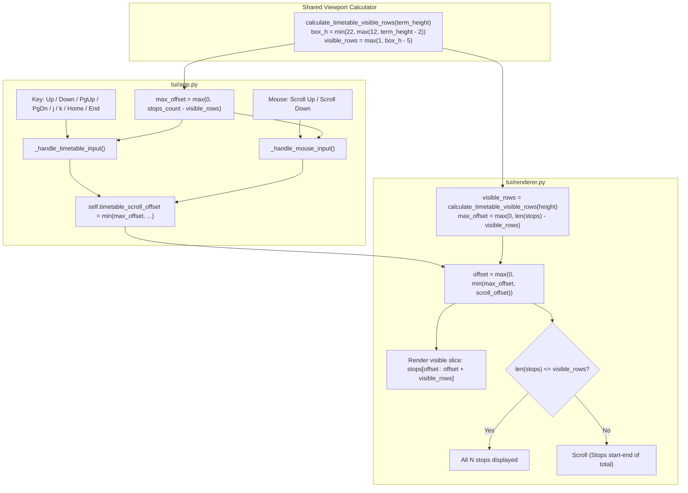

# Implementation Plan — P0-8: TUI Train Timetable Modal Viewport Synchronization, Progressive Range Display, and Scroll Resilience

> **Reference Investigation:** [`../../../investigations/tui-timetable-modal-scrolling-issue.md`](../../../investigations/tui-timetable-modal-scrolling-issue.md)  
> **Target Modules:** [`../../../../tui/renderer.py`](../../../../tui/renderer.py), [`../../../../tui/app.py`](../../../../tui/app.py)  
> **Test Suite:** [`../../../../tests/test_tui_timetable.py`](../../../../tests/test_tui_timetable.py)  
> **Relevant Rules & Skills:** [`../../../../.agents/rules/diagrams-and-visual-documentation.md`](../../../../.agents/rules/diagrams-and-visual-documentation.md), [`../../../../.agents/rules/markdown-relative-paths.md`](../../../../.agents/rules/markdown-relative-paths.md), [`../../../../.agents/rules/misra-autosar-python.md`](../../../../.agents/rules/misra-autosar-python.md), [`../../../../.agents/skills/ci-quality-gate/SKILL.md`](../../../../.agents/skills/ci-quality-gate/SKILL.md)

---

## 1. Executive Summary & Defect Overview

When operators navigate intermediate stops in the Train Timetable & Itinerary modal (`i` / `I`), scrolling fails to behave predictably:
1. **Viewport Calculation Mismatch:** [`tui/renderer.py`](../../../../tui/renderer.py) dynamically allocates rows using `visible_rows = max(1, box_h - 5)` (yielding 17 rows on standard 24-row terminals), whereas [`tui/app.py`](../../../../tui/app.py) hardcoded `max_offset = max(0, stops_count - 10)` for keyboard input and `stops_count - 8` for mouse input. This mismatch causes ghost scrolling (dead keystrokes) on trains with $\le 17$ stops, and truncates the final calling points on compact screens ($\le 18$ rows).
2. **Ambiguous Footer Notation:** The footer renders `Scroll (offset + 1 / len(stops))`, misleading users when all stops are visible (e.g. `Scroll (1/14)`) or when scrolled to the end of a long journey (e.g. `Scroll (9/25)`).
3. **Async Race Condition:** Background network fetch threads unconditionally trigger `_auto_scroll_to_current_stop()`, overwriting user scroll adjustments made while data was loading.
4. **Missing Live Telemetry Station Matching:** In live commercial operations, stops do not have `status: "APPROACH"` or `is_current: True`, so auto-centering always remains anchored at index 0.

---

## 2. Technical Architecture & Transformation Pipeline

### 2.1 Before vs. After Scrolling Model

```text
BEFORE (Desynchronized Offsets & Ambiguous Range):
+-------------------------------------------------+     +----------------------------------------------------+
| Controller (app.py)                             |     | View (renderer.py)                                 |
|  - Keyboard max_offset: max(0, stops - 10)      |     |  - box_h = min(22, max(12, height - 2))            |
|  - Mouse max_offset:    max(0, stops - 8)       |     |  - visible_rows = max(1, box_h - 5)                |
|                                                 |     |  - Clamps offset to max(0, stops - visible_rows)   |
| -> For 14 stops: app offset reaches 4           |     | -> Clamped to 0 (Screen does not move!)            |
| -> Footer renders: "Scroll (1/14)"              |     |                                                    |
+-------------------------------------------------+     +----------------------------------------------------+

AFTER (Synchronized Model-View Controller):
+------------------------------------------------------------------------------------------------------------+
| calculate_timetable_visible_rows(term_height) -> Standardized Viewport Function                           |
|  - box_h = min(22, max(12, term_height - 2))                                                               |
|  - visible_rows = max(1, box_h - 5)                                                                        |
+------------------------------------------------------------------------------------------------------------+
       |                                                               |
       v                                                               v
+-----------------------------------------------+     +------------------------------------------------------+
| Controller (app.py)                           |     | View (renderer.py)                                   |
|  - max_offset = max(0, stops - visible_rows)  |     |  - max_offset = max(0, stops - visible_rows)        |
|  - Applied identically to keys and mouse      |     |  - offset = max(0, min(max_offset, scroll_offset))   |
|  - User scroll preserved during async fetch   |     |  - Footer: "All 14 stops displayed"                  |
|  - next_station matched to auto-center        |     |    or "Scroll (Stops 1-17 of 25)"                    |
+-----------------------------------------------+     +------------------------------------------------------+
```



---

## 3. Detailed Implementation Steps

### Phase 1: Shared Viewport Calculation Helper

Export `calculate_timetable_visible_rows(term_height: int) -> int` in [`tui/renderer.py`](../../../../tui/renderer.py):

```python
def calculate_timetable_visible_rows(term_height: int) -> int:
    """Calculate the number of stop rows visible in the centered timetable modal dialog.

    Args:
        term_height: Available terminal height in rows.

    Returns:
        Integer count of visible stop rows (minimum 1).
    """
    box_h = min(22, max(12, term_height - 2))
    return max(1, box_h - 5)
```

---

### Phase 2: Synchronize Controller Input Bounds in `tui/app.py`

1. **In `_handle_timetable_input(self, key: int) -> bool`:**
   ```python
   term_h = self.geometry.term_height if (hasattr(self, "geometry") and self.geometry) else 24
   visible_rows = calculate_timetable_visible_rows(term_h)
   max_offset = max(0, stops_count - visible_rows)
   ```
   Apply `max_offset` to:
   * `KEY_DOWN`, `j`, `J`
   * `KEY_NPAGE` (Page Down: advance by `min(max_offset, offset + max(1, visible_rows - 2))`)
   * `KEY_END`
2. **In `_handle_mouse_input(self) -> bool`:**
   Replace hardcoded `stops_count - 8` with:
   ```python
   term_h = self.geometry.term_height if (hasattr(self, "geometry") and self.geometry) else 24
   visible_rows = calculate_timetable_visible_rows(term_h)
   max_offset = max(0, stops_count - visible_rows)
   self.timetable_scroll_offset = min(max_offset, self.timetable_scroll_offset + 2)
   ```
3. **Window Resize Re-clamping:**
   When `rebuild_windows()` is triggered during modal display, clamp `self.timetable_scroll_offset = max(0, min(max_offset, self.timetable_scroll_offset))`.

---

### Phase 3: Enhance Footer Range & Progress Notation

In [`tui/renderer.py`](../../../../tui/renderer.py), update footer text calculation:

```python
last_visible = min(len(stops), offset + visible_rows)
if len(stops) <= visible_rows:
    scroll_info = f"All {len(stops)} stops displayed"
else:
    scroll_info = f"[▲ / ▼, j / k] Scroll (Stops {offset + 1}-{last_visible} of {len(stops)})"

footer_txt = f" [Esc / i] Close    {scroll_info} "[: box_w - 4]
safe_addstr(win, start_y + box_h - 2, start_x + 2, footer_txt, footer_attr, ascii_mode=self.ascii_mode)
```

---

### Phase 4: Wire Live `next_station` Telemetry into Auto-Centering & Stop Progress

1. Update `_auto_scroll_to_current_stop(self)` in [`tui/app.py`](../../../../tui/app.py):
   * Inspect `snapshot.selected_train.position.next_station`.
   * Cross-reference normalized station name against stop candidate names.
   * Calculate centering offset:
     ```python
     term_h = self.geometry.term_height if (hasattr(self, "geometry") and self.geometry) else 24
     visible_rows = calculate_timetable_visible_rows(term_h)
     max_offset = max(0, len(stops) - visible_rows)
     target_offset = max(0, min(max_offset, current_idx - (visible_rows // 2)))
     self.timetable_scroll_offset = target_offset
     ```
2. In [`tui/renderer.py`](../../../../tui/renderer.py):
   * Pass `next_station` into `render_timetable_modal()`.
   * For live trains, mark stops before the approaching station with `is_passed = True` (`[X]`), and the approaching stop with `is_current = True` (`►`).

---

### Phase 5: Preserve User Scroll Adjustments During Asynchronous Fetch

In [`tui/app.py`](../../../../tui/app.py):
* Track `self._timetable_user_scrolled: bool = False`.
* Set `self._timetable_user_scrolled = True` whenever the user presses scroll keys or rolls the mouse wheel while the modal is open.
* In the async fetch worker callback:
  ```python
  if not self._timetable_user_scrolled:
      self._auto_scroll_to_current_stop()
  ```

---

## 4. Verification & Testing Strategy

### 4.1 Unit Test Specifications

| Test Case ID | Test Target | Description | Expected Result |
|---|---|---|---|
| **TC-TUI-SCR-01** | `calculate_timetable_visible_rows` | Computes visible stop capacity across terminal heights (14, 24, 30, 60) | Returns 7, 17, 17, 17 respectively |
| **TC-TUI-SCR-02** | `_handle_timetable_input` | Scroll down on train with 14 stops on 24-row terminal (`visible_rows = 17`) | `timetable_scroll_offset` remains 0 (no ghost scrolls) |
| **TC-TUI-SCR-03** | `_handle_timetable_input` | Scroll down on train with 25 stops on 24-row terminal | Scrolls from 0 to `max_offset = 8` without truncation |
| **TC-TUI-SCR-04** | `_handle_mouse_input` | Mouse wheel scrolling boundaries match keyboard boundaries | Clamps at identical `max_offset` |
| **TC-TUI-SCR-05** | `render_timetable_modal` | Footer range display when all stops fit | Renders `"All 14 stops displayed"` |
| **TC-TUI-SCR-06** | `render_timetable_modal` | Footer range display when stops exceed viewport | Renders `"Stops 1-17 of 25"` at offset 0, `"Stops 9-25 of 25"` at end |
| **TC-TUI-SCR-07** | `_auto_scroll_to_current_stop` | Live train with `next_station = 'Doukissis Plakentias'` | Centers on stop matching station name |

### 4.2 Quality Gates
1. Run Static Safety Audit:
   ```bash
   python .agents/skills/static-safety-analyzer/scripts/safety_ast_audit.py
   ```
2. Run Timetable Unit Suite:
   ```bash
   python -m unittest tests/test_tui_timetable.py
   ```
3. Run Full Project Test Suite:
   ```bash
   python -m unittest discover tests
   ```
