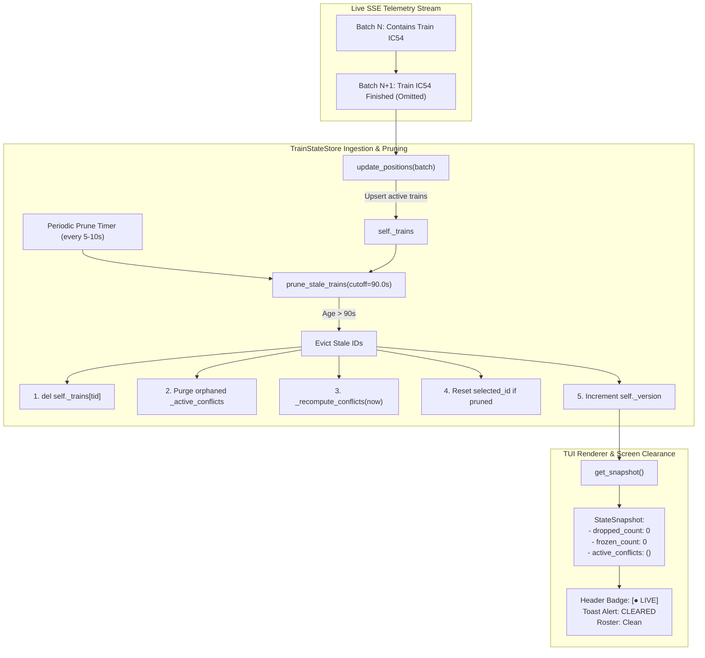

# Implementation Plan — P0-9: Stale Train Pruning, Live Stream Eviction & Screen Warning Clearance

> **Reference Investigation:** [`../../../investigations/telemetry-anomalies-and-duplicate-train-numbers-investigation.md`](../../../investigations/telemetry-anomalies-and-duplicate-train-numbers-investigation.md)  
> **Target Modules:** [`../../../../tui/state.py`](../../../../tui/state.py), [`../../../../tui/stream_worker.py`](../../../../tui/stream_worker.py), [`../../../../tui/geo.py`](../../../../tui/geo.py), [`../../../../tui/renderer.py`](../../../../tui/renderer.py), [`../../../../tui/app.py`](../../../../tui/app.py)  
> **Test Suites:** [`../../../../tests/test_tui_state.py`](../../../../tests/test_tui_state.py), [`../../../../tests/test_tui_sensor_health_state.py`](../../../../tests/test_tui_sensor_health_state.py), [`../../../../tests/test_tui_conflict_watchdog_state.py`](../../../../tests/test_tui_conflict_watchdog_state.py)  
> **Relevant Rules & Skills:** [`../../../../.agents/skills/diagrams-and-documentation/SKILL.md`](../../../../.agents/skills/diagrams-and-documentation/SKILL.md), [`../../../../.agents/skills/markdown-relative-paths/SKILL.md`](../../../../.agents/skills/markdown-relative-paths/SKILL.md), [`../../../../.agents/rules/misra-autosar-python.md`](../../../../.agents/rules/misra-autosar-python.md), [`../../../../.agents/skills/ci-quality-gate/SKILL.md`](../../../../.agents/skills/ci-quality-gate/SKILL.md)

---

## 1. Executive Summary & Problem Overview

In live monitoring operations, `railmon` displays critical warnings—specifically `TELEMETRY DROPPED` (`DRP`), `SENSOR FREEZE` (`FRZ`), and `CRITICAL CONFLICT`—that fail to clear from the screen when trains arrive at their destination and complete their run. Instead, warnings remain locked in the status bar and header toasts for up to **30 minutes**.

### Root Causes
1. **Excessive Stale Train Retention (`stale_timeout_sec = 1800.0`):** In [`tui/state.py`](../../../../tui/state.py#L408-L413), `TrainStateStore` defaults to an eviction cutoff of 30 minutes ($1,800\text{ seconds}$). When a train finishes service and is omitted from the upstream SSE batch, `railmon` retains its record in memory for half an hour.
2. **Escalation of Absent Trains:** During this 30-minute retention window, `evaluate_sensor_health()` continuously evaluates the absent train against current clock time. At $+30\text{s}$ it is marked `STALE`; at $+45\text{s}$ (if last speed was $>0$) it is marked `FROZEN`; at $+120\text{s}$ it is marked `DROPPED`. The header badge locks onto `[! 1 DROPPED]` or `[! 1 FROZEN]` and triggers terminal bell audio.
3. **Ghost Conflicts Against Arrived Trains:** Incoming active trains approaching the same station or corridor are continuously pairwise-evaluated against the stationary lingering record, generating persistent `[! CRITICAL CONFLICT]` or `[! HEADWAY BREACH]` warnings against non-existent obstacles.
4. **Missing Conflict Cleanup in Prune Routine:** When `prune_stale_trains()` ([`tui/state.py:680`](../../../../tui/state.py#L680)) eventually deletes stale trains from `self._trains`, it does not explicitly recompute conflicts or purge orphaned entries from `self._active_conflicts` and `self._previous_conflict_keys`.

---

## 2. Technical Architecture & Transformation Pipeline

### 2.1 Before vs. After Lifecycle Comparison

```text
BEFORE (30-Minute Zombie Train & Alert Lock):
+------------------------------------+      +-------------------------------------------+      +-------------------------------+
| Train Finishes Service             |      | TrainStateStore (stale_timeout = 1800s)   |      | Curses UI (tui/renderer.py)   |
| (Omitted from SSE positions batch) | ---> |  - Retained in memory for 30 minutes      | ---> |  [+00:30s] STALE (STL)        |
|                                    |      |  - Continuous sensor health degradation   |      |  [+00:45s] SENSOR FREEZE (FRZ)|
|                                    |      |  - Conflict watchdog pairs with ghost rec |      |  [+02:00m] TELEMETRY DROP(DRP)|
+------------------------------------+      +-------------------------------------------+      |  [+05:00m] CRITICAL CONFLICT  |
                                                                                               |  ALERTS LOCKED FOR 28+ MINS   |
                                                                                               +-------------------------------+

AFTER (Clean 90-Second Eviction & Instant Warning Clearance):
+------------------------------------+      +-------------------------------------------+      +-------------------------------+
| Train Finishes Service             |      | TrainStateStore (live_stale_timeout = 90s)|      | Curses UI (tui/renderer.py)   |
| (Omitted from SSE positions batch) | ---> |  - [+00:30s] Marked STALE (STL)           | ---> |  [+00:30s] Subtle STL status  |
|                                    |      |  - [+00:60s] Station Dwell/Terminus grace |      |            (No panic bells)   |
|                                    |      |  - [+00:90s] prune_stale_trains() triggers|      |  [+00:90s] Train clean evicted|
+------------------------------------+      +-------------------------------------------+      |            Alert counts -> 0  |
                                                           |                                   |            Banner clears      |
                                                           v                                   |            Header -> [● LIVE] |
                                            +-------------------------------------------+      +-------------------------------+
                                            | Atomic Prune Post-Processing:             |
                                            |  1. del self._trains[stale_id]            |
                                            |  2. Purge matching _active_conflicts      |
                                            |  3. Recompute remaining conflicts         |
                                            |  4. Increment store version (dirty flag)  |
                                            +-------------------------------------------+
```



---

## 3. Detailed Implementation Steps

### Phase 1: Configurable Live vs. Replay Stale Timeouts in `TrainStateStore`

In [`tui/state.py`](../../../../tui/state.py#L408-L413):
1. Update `TrainStateStore.__init__` to adopt a default `stale_timeout_sec: float = 90.0` (1.5 minutes) for live operations, while allowing overrides for historical DVR playback (`replay_stale_timeout_sec: float = 1800.0`).
2. Provide explicit accessors to tune stale timeouts dynamically:
   - `set_stale_timeout(timeout_sec: float) -> None`
   - `get_stale_timeout() -> float`

```python
# In tui/state.py:
DEFAULT_LIVE_STALE_TIMEOUT_SEC: float = 90.0
DEFAULT_REPLAY_STALE_TIMEOUT_SEC: float = 1800.0

class TrainStateStore:
    def __init__(
        self,
        stale_timeout_sec: float = DEFAULT_LIVE_STALE_TIMEOUT_SEC,
        max_trail_len: int = 15,
        initial_theme: Optional[ThemeProfile] = None,
    ) -> None:
        self._lock = threading.RLock()
        self._stale_timeout_sec = float(stale_timeout_sec)
        ...
```

3. Update `set_replay_status()` in [`tui/state.py:728`](../../../../tui/state.py#L728):
   - When switching to `is_replay=True`, automatically switch `self._stale_timeout_sec` to `DEFAULT_REPLAY_STALE_TIMEOUT_SEC` (or lookback window).
   - When switching back to `is_replay=False`, restore `DEFAULT_LIVE_STALE_TIMEOUT_SEC`.

---

### Phase 2: Atomic Pruning, Conflict Eviction & Latch Reset

Enhance `prune_stale_trains()` in [`tui/state.py:680-712`](../../../../tui/state.py#L680-L712) to ensure that when a train is purged, its anomalies and conflicts are eradicated immediately rather than waiting for subsequent frame loops:

```python
def prune_stale_trains(
    self,
    max_age_sec: Optional[float] = None,
    now: Optional[float] = None,
) -> int:
    """
    Remove trains that have not received telemetry updates within max_age_sec.
    Atomically clears associated conflicts, resets orphaned selections,
    and returns the number of pruned trains.
    """
    cutoff = max_age_sec if max_age_sec is not None else self._stale_timeout_sec
    with self._lock:
        if now is not None:
            ref_now = float(now)
        elif self._is_replay and self._replay_virtual_time is not None:
            ref_now = self._replay_virtual_time
        else:
            ref_now = time.time()

        stale_ids = [
            tid for tid, rec in self._trains.items()
            if (ref_now - rec.last_updated) > cutoff
        ]
        if not stale_ids:
            self._last_prune_ts = ref_now
            return 0

        stale_set = set(stale_ids)
        for tid in stale_ids:
            del self._trains[tid]
            if self._selected_id == tid:
                self._selected_id = None
                self._follow_mode = False

        # 1. Clean up watched IDs for pruned trains
        self._watched_train_ids.difference_update(stale_set)

        # 2. Immediately purge active conflicts referencing any pruned train
        orphaned_conflict_keys = [
            cid for cid, c in self._active_conflicts.items()
            if c.train_id_1 in stale_set or c.train_id_2 in stale_set
        ]
        for cid in orphaned_conflict_keys:
            del self._active_conflicts[cid]
            self._previous_conflict_keys.discard(cid)

        # 3. Re-evaluate conflicts across remaining active trains
        self._recompute_conflicts(ref_now)

        self._version += 1
        self._total_trains_pruned += len(stale_ids)
        self._last_prune_ts = ref_now
        return len(stale_ids)
```

---

### Phase 3: Prune Frequency & StreamWorker Synchronization

In [`tui/stream_worker.py`](../../../../tui/stream_worker.py#L102-L115) and [`tui/app.py`](../../../../tui/app.py#L1713-L1719):
1. Lower `prune_interval_sec` in `StreamWorker` and `TUIApp` from $10.0\text{s}$ to **$5.0\text{s}$**.
2. Ensure `StreamWorker._check_prune()` executes immediately upon receiving an empty or reduced batch.
3. In `TUIApp._run_event_loop()`, ensure that when `pruned > 0`, `is_dirty = True` is immediately asserted so curses renders the cleared state on the very next 60ms frame cycle.

---

### Phase 4: Station Siding Dwell Preemption in Sensor Health Evaluation

In [`tui/geo.py:1873-1960`](../../../../tui/geo.py#L1873-L1960):
Update `evaluate_sensor_health()` so stationary trains ($spd < 1.0\text{ km/h}$) located within an authorized station boundary ($250\text{m}$) are classified as `STATION_DWELL` (`DWL`) rather than escalating to `TELEMETRY DROPPED` (`DRP`):

```python
# In tui/geo.py:
# Check station proximity for stationary trains before raising complete drop alarm
is_stationary = spd < 1.0
nearest_stn, stn_dist = (None, None)
if is_stationary and stations:
    nearest_stn, stn_dist = find_nearest_station_aabb(
        point, stations, max_radius_m=station_dwell_radius_m
    )

if elapsed >= telemetry_drop_threshold_sec:
    if nearest_stn is not None and stn_dist is not None:
        # Train is parked or terminated at a station platform: retain DWELL status with stale note
        stn_name = getattr(nearest_stn, "name_en", getattr(nearest_stn, "name_el", "Station"))
        dwell_sec = max(0.0, ref_now - (station_dwell_start or ref_now))
        assessment = SensorHealthAssessment(
            state=SensorHealthState.STATION_DWELL,
            elapsed_sec=elapsed,
            static_duration_sec=max(0.0, ref_now - last_moved_time),
            displacement_m=0.0,
            current_speed_kmh=spd,
            nearest_station=stn_name,
            station_distance_m=stn_dist,
            dwell_duration_sec=dwell_sec,
            is_alert=False,  # Suppress panic bell and crimson warning
            short_code="DWL",
            description=f"STATION DWELL [TERMINATED/IDLE] ({stn_name})",
        )
        return assessment, last_moved_pt, last_moved_time, station_dwell_start
    else:
        # Open track signal drop: raise genuine DRP alert
        ...
```

---

### Phase 5: UI Status Bar & Alert Banner Clean-up Verification

In [`tui/renderer.py`](../../../../tui/renderer.py#L2325-L2352):
Verify that when all active trains are healthy or pruned:
1. `overspeed_cnt == 0`, `frozen_cnt == 0`, `dropped_cnt == 0`, `crit_conflicts == 0`, `warn_conflicts == 0`.
2. `alert_items` list evaluates to empty.
3. The renderer returns `badge_live` with standard `PAIR_CONNECTED` (green/cyan) instead of `alert_attr` (crimson).
4. In `_render_header_status_bar()`, the conflict banner block ([`tui/renderer.py:2456`](../../../../tui/renderer.py#L2456)) automatically un-renders because `snapshot.critical_conflict_count == 0` and `snapshot.active_conflicts` is empty.

---

## 4. Test Specifications & Verification Plan

### 4.1 Unit Test Suite (`tests/test_tui_stale_prune_clearance.py`)

Create a dedicated unit test suite validating the eviction lifecycle and warning clearance:

| Test Case ID | Test Method | Scenario & Validation Criteria |
| :--- | :--- | :--- |
| **TC-PRN-01** | `test_live_stale_timeout_default_90s` | Verify `TrainStateStore` initializes with `stale_timeout_sec == 90.0` in live mode and switches to `1800.0` in replay mode. |
| **TC-PRN-02** | `test_prune_evicts_departed_train` | Ingest train at $T=0$. Advance clock to $T=91\text{s}$. Assert `prune_stale_trains()` returns 1, `get_train()` is None, and `total_trains_pruned == 1`. |
| **TC-PRN-03** | `test_prune_clears_active_conflict_immediately` | Create two trains in conflicting headway. Verify conflict alert generated. Advance clock for one train past 90s and prune. Assert `active_conflicts` is empty and `critical_conflict_count == 0` without waiting for another update. |
| **TC-PRN-04** | `test_prune_clears_dropped_and_frozen_snapshot_counts` | Let train age to 120s (`DROPPED`). Verify `snapshot.dropped_count == 1`. Run `prune_stale_trains()`. Assert `snapshot.dropped_count == 0` and `snapshot.frozen_count == 0`. |
| **TC-PRN-05** | `test_station_dwell_suppresses_drop_alarm` | Place stationary train within 100m of station node. Advance clock by 150s. Assert state is `STATION_DWELL`, `is_alert == False`, and `short_code == 'DWL'`. |
| **TC-PRN-06** | `test_prune_resets_selected_train_and_watch_state` | Select and watch train ID `T-1`. Prune `T-1`. Assert `selected_train` is None, `follow_mode == False`, and `T-1` removed from `watched_train_ids`. |

### 4.2 Automated Quality Gate Execution

Execute the full project quality gate to verify zero regressions across existing test suites:
```bash
python3 -m unittest discover tests
```
Ensure 100% pass rate across `test_tui_state.py`, `test_tui_conflict_watchdog_state.py`, `test_tui_sensor_health_state.py`, and the new test suite.
