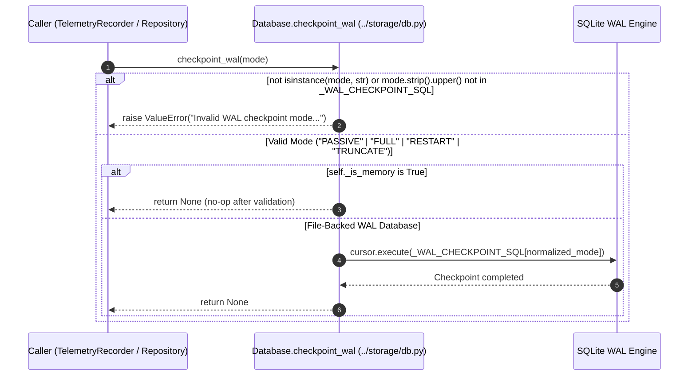
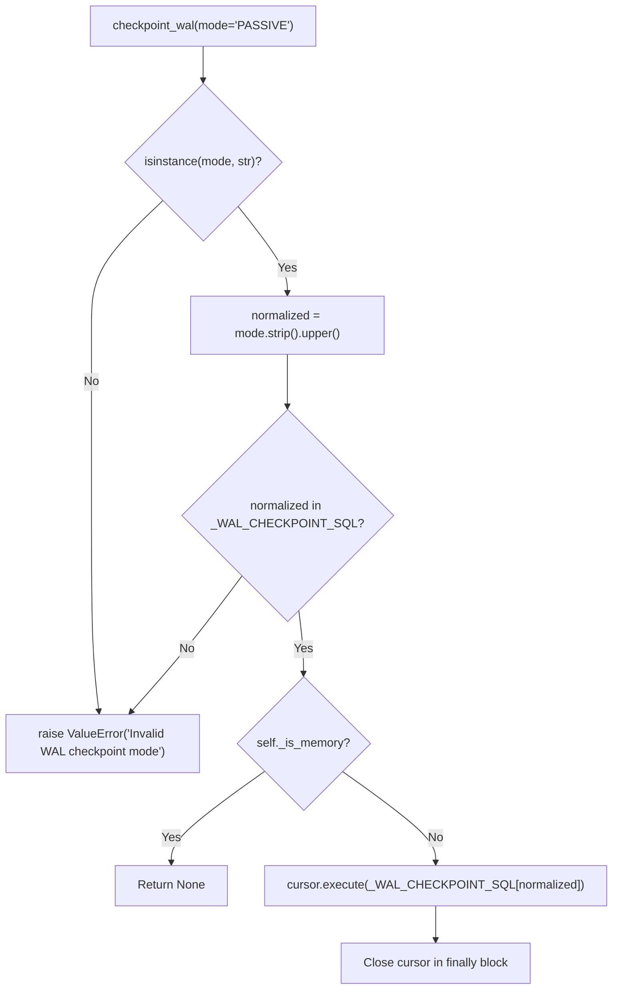

# Implementation Plan — P1-1: Unparameterized f-String in `PRAGMA wal_checkpoint`

> **Reference:** [Production Readiness & Architecture Review (`P1-1`)](../../../architecture/production-readiness-review.md#p1-1-unparameterized-f-string-in-pragma-wal_checkpoint)  
> **Target Module:** [`../../../../storage/db.py`](../../../../storage/db.py#L136-L146) (`Database.checkpoint_wal`)  
> **Test Suite:** [`../../../../tests/test_storage_db.py`](../../../../tests/test_storage_db.py)

---

## 1. Root-Cause Bug Analysis

### A. Defect Mechanism
1. **Unvalidated f-String SQL Interpolation in `Database.checkpoint_wal()`:**
   - In [`../../../../storage/db.py`](../../../../storage/db.py#L136-L146), `Database.checkpoint_wal(self, mode: str = "PASSIVE")` directly interpolates the caller-supplied `mode` parameter into an f-string passed to `cursor.execute()`:
     ```python
     def checkpoint_wal(self, mode: str = "PASSIVE") -> None:
         """Trigger WAL checkpoint to write changes to base file (PASSIVE, FULL, RESTART, TRUNCATE)."""
         if self._is_memory:
             return
         with self.connection() as conn:
             cursor = conn.cursor()
             try:
                 cursor.execute(f"PRAGMA wal_checkpoint({mode});")
             finally:
                 cursor.close()
     ```
2. **SQLite Grammar Constraint & Security Audit Failure:**
   - SQLite `PRAGMA wal_checkpoint(MODE);` parses `MODE` as a grammar keyword rather than a bindable expression parameter (`?`).
   - Because `mode` is neither validated against an explicit allowlist (`{"PASSIVE", "FULL", "RESTART", "TRUNCATE"}`) nor mapped to static SQL literals:
     - Any arbitrary or malformed string passed to `checkpoint_wal(mode)` is interpolated directly into the SQL command string, violating [`../../../../.agents/rules/security-and-data-protection.md`](../../../../.agents/rules/security-and-data-protection.md#L10-L12) (*"String interpolation, format strings, or manual concatenation are strictly prohibited for database queries. Where table names or sort orders are dynamic, validate them against an explicit set of allowed enum values before execution."*).
     - The repository security audit scan in [`../../../../.agents/skills/security-audit/SKILL.md`](../../../../.agents/skills/security-audit/SKILL.md#L36-L39) (`grep -En "execute\([f\"'].*\{" storage/*.py`) fails with 1 match at [`../../../../storage/db.py`](../../../../storage/db.py#L143).

### B. Visual Comparison (ASCII & Mermaid)

```text
BEFORE (Unvalidated f-String Interpolation in cursor.execute):
Caller                        Database.checkpoint_wal(mode)                  SQLite Engine
  |                                         |                                      |
  |-- checkpoint_wal(mode) ---------------->|                                      |
  |                                         |-- No allowlist check on `mode`       |
  |                                         |-- cursor.execute(                    |
  |                                         |     f"PRAGMA wal_checkpoint({mode});"|
  |                                         |   ) -------------------------------->| x Injection sink &
  |                                         |                                      |   Security Audit FAIL

AFTER (Allowlist Validation + Static SQL Literal Dispatch):
Caller                        Database.checkpoint_wal(mode)                  SQLite Engine
  |                                         |                                      |
  |-- checkpoint_wal(mode) ---------------->|                                      |
  |                                         |-- Normalize: mode.strip().upper()    |
  |                                         |-- Lookup in _WAL_CHECKPOINT_SQL:     |
  |                                         |   {"PASSIVE", "FULL",                |
  |                                         |    "RESTART", "TRUNCATE"}            |
  |                                         |   +-> If invalid / not str:          |
  |                                         |       raise ValueError(...)          | (Rejected pre-DB)
  |                                         |   +-> If valid:                      |
  |                                         |       cursor.execute(static_sql) --->| (Zero f-strings;
  |                                         |                                      |  Audit Scan PASS)
```



---

## 2. Allowlist & Static SQL Dispatch Architecture

### A. Static Lookup Pipeline (ASCII)

```text
+-------------------------------------------------------------------------+
|                    Database.checkpoint_wal(mode)                        |
|                        (../storage/db.py)                               |
+-------------------------------------------------------------------------+
                                    |
                                    v
+-------------------------------------------------------------------------+
| 1. Type & Allowlist Guard                                               |
|    - Check isinstance(mode, str)                                        |
|    - normalized = mode.strip().upper()                                  |
|    - Lookup sql = _WAL_CHECKPOINT_SQL.get(normalized)                   |
|    - Allowed keys: {"PASSIVE", "FULL", "RESTART", "TRUNCATE"}           |
|    - If sql is None -> raise ValueError(...)                            |
+-------------------------------------------------------------------------+
                                    |
                                    v
+-------------------------------------------------------------------------+
| 2. Memory Guard                                                         |
|    - If self._is_memory: return (validates mode even in :memory: tests) |
+-------------------------------------------------------------------------+
                                    |
                                    v
+-------------------------------------------------------------------------+
| 3. Constant-String Execution                                            |
|    - cursor.execute(sql)                                                |
|    - Zero f-string interpolation -> passes security-audit grep & Bandit |
+-------------------------------------------------------------------------+
```

### B. Validation Decision Flow (Mermaid)



---

## 3. Proposed Code Changes

### A. [`../../../../storage/db.py`](../../../../storage/db.py#L10-L146) — Enforce Allowlist & Static SQL Mapping in `Database.checkpoint_wal`

1. **Define Immutable Checkpoint SQL Mapping on `Database` (or Module Level):**
   - Import `Dict` from `typing` in [`../../../../storage/db.py`](../../../../storage/db.py#L10).
   - Define `VALID_WAL_CHECKPOINT_MODES` / `_WAL_CHECKPOINT_SQL`:
     ```python
     _WAL_CHECKPOINT_SQL: Dict[str, str] = {
         "PASSIVE": "PRAGMA wal_checkpoint(PASSIVE);",
         "FULL": "PRAGMA wal_checkpoint(FULL);",
         "RESTART": "PRAGMA wal_checkpoint(RESTART);",
         "TRUNCATE": "PRAGMA wal_checkpoint(TRUNCATE);",
     }
     ```
2. **Validate `mode` Before Checking `self._is_memory` or Opening a Cursor (`Database.checkpoint_wal`):**
   - Validate `mode` upfront so invalid modes fail fast with `ValueError` on both file-backed and `:memory:` databases:
     ```python
     def checkpoint_wal(self, mode: str = "PASSIVE") -> None:
         """Trigger WAL checkpoint to write changes to base file (PASSIVE, FULL, RESTART, TRUNCATE)."""
         if not isinstance(mode, str):
             raise ValueError(f"Invalid WAL checkpoint mode: {mode!r}")

         normalized_mode = mode.strip().upper()
         sql = _WAL_CHECKPOINT_SQL.get(normalized_mode)
         if sql is None:
             allowed = ", ".join(sorted(_WAL_CHECKPOINT_SQL.keys()))
             raise ValueError(
                 f"Invalid WAL checkpoint mode {mode!r}. Allowed modes: {allowed}"
             )

         if self._is_memory:
             return
         with self.connection() as conn:
             cursor = conn.cursor()
             try:
                 cursor.execute(sql)
             finally:
                 cursor.close()
     ```
   - Mapping `normalized_mode` to a static SQL statement dictionary both enforces `normalized_mode in {"PASSIVE", "FULL", "RESTART", "TRUNCATE"}` and eliminates the `cursor.execute(f"...")` pattern flagged by [`../../../../.agents/skills/security-audit/SKILL.md`](../../../../.agents/skills/security-audit/SKILL.md#L38) and Bandit `B608`.

---

## 4. Test Plan (TDD Red-Green-Refactor)

Following [`../../../../.agents/rules/testing.md`](../../../../.agents/rules/testing.md), add unit tests to [`../../../../tests/test_storage_db.py`](../../../../tests/test_storage_db.py) first, confirm they fail against the unvalidated implementation (Red), apply the fix in [`../../../../storage/db.py`](../../../../storage/db.py) (Green), and verify the full test suite and security scan:

### A. [`../../../../tests/test_storage_db.py`](../../../../tests/test_storage_db.py)
1. `test_checkpoint_wal_accepts_all_valid_modes_case_insensitively`:
   - Create a temporary file-backed `Database(db_path)`.
   - Verify `db.checkpoint_wal(mode)` succeeds for `"PASSIVE"`, `"FULL"`, `"RESTART"`, `"TRUNCATE"`, and lowercase/whitespace variants (`"passive"`, `" truncate "`).
2. `test_checkpoint_wal_rejects_invalid_or_injected_modes`:
   - Verify `db.checkpoint_wal("INVALID")`, `db.checkpoint_wal("")`, `db.checkpoint_wal("PASSIVE); DROP TABLE trains; --")`, and `db.checkpoint_wal(None)` (type mismatch) all raise `ValueError` on both file-backed and `:memory:` databases.
   - Verify the `trains` table remains intact after the rejected injection payload.

---

## 5. Verification & Quality Gates

1. **Targeted Database Unit Tests:**
   ```bash
   python -m unittest tests/test_storage_db.py -v
   ```
2. **Security Audit SQL Injection Scan ([`../../../../.agents/skills/security-audit/SKILL.md`](../../../../.agents/skills/security-audit/SKILL.md#L34-L39)):**
   ```bash
   grep -En "execute\([f\"'].*\{" storage/*.py
   ```
   **Pass Criteria:** Zero matches (exit code `1`).
3. **Full Test Suite:**
   ```bash
   python -m unittest discover tests -v
   ```
4. **Markdown Relative Path & Diagram Audit ([`../../../../.agents/skills/markdown-relative-paths/SKILL.md`](../../../../.agents/skills/markdown-relative-paths/SKILL.md), [`../../../../.agents/skills/diagrams-and-documentation/SKILL.md`](../../../../.agents/skills/diagrams-and-documentation/SKILL.md)):**
   Confirm zero non-relative links or absolute workstation paths exist in [`./p1-1-pragma-wal-checkpoint-allowlist-fix-plan.md`](./p1-1-pragma-wal-checkpoint-allowlist-fix-plan.md).
