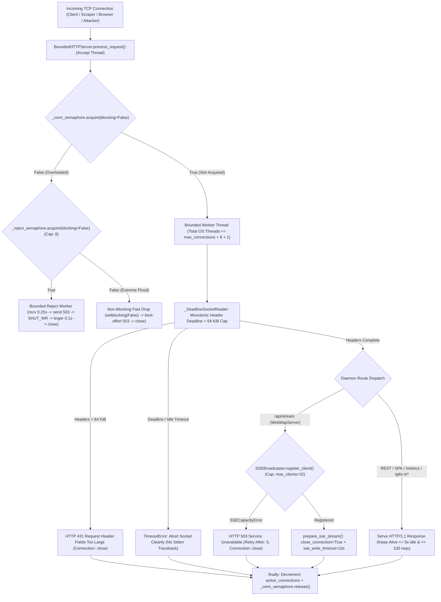

# Implementation Plan — P1-10: Slowloris & Unbounded Thread/Connection Exhaustion Across All 3 HTTP Daemons

> **Reference Review:** [`../../../architecture/codebase-architecture-review.md`](../../../architecture/codebase-architecture-review.md#L290) (Finding **P1-1**)  
> **Related Plans:** [`../../features/f-8-1-phase-2-web-server-daemon-and-http-handler-plan.md`](../../features/f-8-1-phase-2-web-server-daemon-and-http-handler-plan.md), [`../../features/f-8-2-phase-3-http-server-daemon-and-content-negotiation-plan.md`](../../features/f-8-2-phase-3-http-server-daemon-and-content-negotiation-plan.md), [`../../features/f-8-3-gtfs-realtime-protocol-buffer-feed-exporter-plan.md`](../../features/f-8-3-gtfs-realtime-protocol-buffer-feed-exporter-plan.md), [`../p0/p0-15-desktop-notification-rce-and-web-spa-xss-fix-plan.md`](../p0/p0-15-desktop-notification-rce-and-web-spa-xss-fix-plan.md), [`../p0/p0-16-packaging-watchdog-namespace-and-headless-curses-fix-plan.md`](../p0/p0-16-packaging-watchdog-namespace-and-headless-curses-fix-plan.md), [`../p0/p0-19-openmetrics-compliance-label-collisions-and-storage-collector-fix-plan.md`](../p0/p0-19-openmetrics-compliance-label-collisions-and-storage-collector-fix-plan.md)  
> **Target Modules:** `railmon_http.py` *(new zero-dependency leaf)*, [`../../../../server/daemon.py`](../../../../server/daemon.py), [`../../../../server/handler.py`](../../../../server/handler.py), [`../../../../server/sse.py`](../../../../server/sse.py), [`../../../../server/models.py`](../../../../server/models.py), [`../../../../server/__init__.py`](../../../../server/__init__.py), [`../../../../exporter/server.py`](../../../../exporter/server.py), [`../../../../exporter/models.py`](../../../../exporter/models.py), [`../../../../gtfs_rt/server.py`](../../../../gtfs_rt/server.py), [`../../../../gtfs_rt/models.py`](../../../../gtfs_rt/models.py), [`../../../../train_tracker.py`](../../../../train_tracker.py), [`../../../../pyproject.toml`](../../../../pyproject.toml)  
> **Test Suites:** `tests/test_http_bounds.py` *(new)*, [`../../../../tests/test_server_daemon.py`](../../../../tests/test_server_daemon.py), [`../../../../tests/test_server_sse.py`](../../../../tests/test_server_sse.py), [`../../../../tests/test_server_models.py`](../../../../tests/test_server_models.py), [`../../../../tests/test_exporter_server.py`](../../../../tests/test_exporter_server.py), [`../../../../tests/test_exporter_models.py`](../../../../tests/test_exporter_models.py), [`../../../../tests/test_gtfs_server.py`](../../../../tests/test_gtfs_server.py), [`../../../../tests/test_cli_serve.py`](../../../../tests/test_cli_serve.py), [`../../../../tests/test_cli_metrics.py`](../../../../tests/test_cli_metrics.py), [`../../../../tests/test_packaging.py`](../../../../tests/test_packaging.py)  
> **Relevant Rules & Skills:** [`../../../../.agents/rules/security-and-data-protection.md`](../../../../.agents/rules/security-and-data-protection.md), [`../../../../.agents/rules/performance-and-resource-bounds.md`](../../../../.agents/rules/performance-and-resource-bounds.md), [`../../../../.agents/rules/misra-autosar-python.md`](../../../../.agents/rules/misra-autosar-python.md), [`../../../../.agents/rules/lifecycle-and-signal-handling.md`](../../../../.agents/rules/lifecycle-and-signal-handling.md), [`../../../../.agents/rules/testing.md`](../../../../.agents/rules/testing.md), [`../../../../.agents/skills/diagrams-and-documentation/SKILL.md`](../../../../.agents/skills/diagrams-and-documentation/SKILL.md), [`../../../../.agents/skills/markdown-relative-paths/SKILL.md`](../../../../.agents/skills/markdown-relative-paths/SKILL.md), [`../../../../.agents/skills/static-safety-analyzer/SKILL.md`](../../../../.agents/skills/static-safety-analyzer/SKILL.md), [`../../../../.agents/skills/ci-quality-gate/SKILL.md`](../../../../.agents/skills/ci-quality-gate/SKILL.md)

---

## 1. Executive Summary & Empirically Verified Vulnerabilities

Auditing all three embedded HTTP daemons — `WebMapServer` ([`server/daemon.py`](../../../../server/daemon.py)), `MetricsServer` ([`exporter/server.py`](../../../../exporter/server.py)), and `GtfsRtServer` ([`gtfs_rt/server.py`](../../../../gtfs_rt/server.py)) — on `HEAD` (`9dfa314`) confirms **six coupled Denial-of-Service (DoS) and resource-exhaustion defects** that allow a single unauthenticated peer on the bound interface (especially under `--host 0.0.0.0`) to permanently exhaust OS threads, file descriptors, and memory:

| # | Vulnerability Class | Affected Locations | Empirically Verified Failure Mode & Root Cause | Severity |
|---|---|---|---|---|
| **1** | **Unbounded OS Thread & FD Spawning** | [`server/daemon.py`](../../../../server/daemon.py#L22-L26), [`exporter/server.py`](../../../../exporter/server.py#L230-L235), [`gtfs_rt/server.py`](../../../../gtfs_rt/server.py#L290-L295) | All 3 daemons inherit directly from `http.server.ThreadingHTTPServer` with zero concurrency cap (`ThreadingMixIn.process_request()` spawns a new OS thread per accepted TCP socket unconditionally). Under a connection burst or flood, Python spawns unbounded threads until FD exhaustion (`EMFILE`), virtual memory exhaustion, or `RuntimeError: can't start new thread`. Additionally, stdlib `TCPServer.request_queue_size` remains at the tiny default `5`, causing legitimate bursts to suffer spurious `ECONNREFUSED`. | **High** |
| **2** | **Infinite Blocking Socket Reads & Writes (`timeout = None`) + Slowloris Header Trickle** | [`server/handler.py`](../../../../server/handler.py#L58-L62), [`exporter/server.py`](../../../../exporter/server.py#L23-L27), [`gtfs_rt/server.py`](../../../../gtfs_rt/server.py#L75-L79) | All 3 handlers enable `protocol_version = "HTTP/1.1"` keep-alive while inheriting `StreamRequestHandler.timeout = None`. Silent connections, incomplete requests, and idle HTTP/1.1 keep-alive connections block `self.rfile.readline(65537)` **forever**, permanently pinning worker threads and FDs. Even a naive per-`recv()` `sock.settimeout(10.0)` is trivially bypassed by a Slowloris attacker trickling 1 byte every 9 seconds (`BufferedReader.readline()` calls `recv_into()` repeatedly, resetting the per-op timeout on every byte, up to 100 headers × 64 KiB = **6.4 MiB**). | **High** |
| **3** | **Dead `ExporterConfig.scrape_timeout_seconds` Configuration** | [`exporter/models.py`](../../../../exporter/models.py#L157), [`exporter/server.py`](../../../../exporter/server.py#L281-L287), [`train_tracker.py`](../../../../train_tracker.py#L2421-L2425), [`#L4646`](../../../../train_tracker.py#L4646) | `ExporterConfig.scrape_timeout_seconds` (and CLI `--scrape-timeout`) is validated and logged at startup (`"timeout=%.1fs"`), yet **never wired to any socket timeout or deadline check**. Even with `scrape_timeout_seconds=0.2`, 25 incomplete requests remain pinned indefinitely with 0 timeouts. | **High** |
| **4** | **Unbounded `SSEBroadcaster` Subscriber Cap & HTTP Slot Starvation** | [`server/sse.py`](../../../../server/sse.py#L20-L48), [`server/handler.py`](../../../../server/handler.py#L439-L488) | `SSEBroadcaster.register_client()` accepts an unlimited number of subscribers (`200/200` registered with zero rejection), each allocating a 100-frame `Queue` and a dedicated worker thread. Without a distinct `max_clients` cap strictly below `max_connections`, persistent `/api/stream` connections can monopolize 100% of HTTP slots and starve `/`, `/api/trains`, `/api/health`, `/metrics`, and `/gtfs-rt/*`. | **High** |
| **5** | **Stalled Zero-Window SSE Consumer Write Hang & Keep-Alive Re-Entry** | [`server/handler.py`](../../../../server/handler.py#L439-L488), [`#L521-L535`](../../../../server/handler.py#L521-L535) | `_handle_sse_stream()` writes frames and `:ping` heartbeats via `self.wfile.write()` + `self.wfile.flush()` with `timeout = None`. A stalled browser or malicious zero-window TCP peer fills the kernel send buffer and blocks `wfile.write()` **indefinitely**, permanently locking both a worker thread and an SSE subscriber slot. Furthermore, `_handle_sse_stream()` never sets `self.close_connection = True`, allowing `BaseHTTPRequestHandler.handle()` to re-enter `handle_one_request()` after stream exit. | **High** |
| **6** | **Inconsistent `handle_error()` & `TimeoutError` Traceback Noise** | [`server/daemon.py`](../../../../server/daemon.py#L22-L164), [`exporter/server.py`](../../../../exporter/server.py#L236-L243), [`gtfs_rt/server.py`](../../../../gtfs_rt/server.py#L296-L303) | `WebMapServer` lacks any `handle_error()` override (dumping raw tracebacks to `stderr` on client drops), while `MetricsServer` and `GtfsRtServer` suppress broken pipe/reset errors but not `TimeoutError`/`socket.timeout`. | **Medium** |

---

### 1.1 Empirical Reproduction Evidence (Verified on `9dfa314`, Python `3.13.14`, Windows)

Executing an empirical audit script against all three unmodified daemons on `9dfa314` reproduces the unbounded thread spawning, missing timeouts, dead `scrape_timeout_seconds`, and unbounded SSE registration directly:

```text
WebMapRequestHandler.timeout      = None
MetricsRequestHandler.timeout     = None
GtfsRtHandler.timeout             = None
WebMapServer.request_queue_size   = 5
MetricsServer.request_queue_size  = 5
GtfsRtServer.request_queue_size   = 5

MetricsServer(scrape_timeout=0.2s) after 0.5s with 25 incomplete Slowloris sockets:
  base_threads=2, peak_threads=27 (+25), pinned_slowloris=25/25

SSEBroadcaster accepted 200/200 clients with zero cap!
```

Additionally, empirical verification on Windows loopback sockets revealed two critical real-world subtleties that directly shape our remediation design:

1. **Windows TCP RST on Immediate Overflow `close()` (`WinError 10053`):** If the accept loop writes a raw `503 Service Unavailable` and calls `conn.close()` immediately before the client's in-flight `GET /...` arrives or before the client reads the `503`, the Windows TCP stack emits a `RST` that wipes the client's unread `503` buffer (`ConnectionAbortedError: [WinError 10053]`). Implementing an **RFC 9112 §9.6 lingering-close bounded rejector** (capped at `max_reject_workers = 8` daemon threads, draining one in-flight `recv(4096)` -> `sendall(503)` -> `shutdown(SHUT_WR)` -> `recv(1024)` FIN wait up to `100 ms`, with zero-blocking non-blocking `503` fallback when all 8 rejector slots are busy) achieved **25/25 clean HTTP `503` deliveries** across `urllib.request`, `http.client`, and delayed-send raw sockets with `0` `WinError 10053` errors and `0 ms` accept-loop blocking.
2. **Per-Op `settimeout()` Bypass by 1-Byte Trickle Slowloris:** Standard `sock.settimeout(5.0)` resets on every single byte read by `BufferedReader.readline()`. Wrapping the socket in a monotonic deadline `io.RawIOBase` (`_DeadlineSocketReader`) that shrinks `sock.settimeout(min(op_timeout, deadline - time.monotonic()))` before every `recv_into()` call empirically terminated a 1-byte-per-40ms trickle attacker in **`0.362s`** against a `0.35s` deadline even with `op_timeout = 5.0s`.

---

### 1.2 Architectural Placement & Cycle-Free Module Topology

A critical dependency trap exists if the shared HTTP base were placed inside `server/`:
- [`server/__init__.py`](../../../../server/__init__.py) eagerly imports [`server/handler.py`](../../../../server/handler.py), which eagerly imports [`exporter/formatter.py`](../../../../exporter/formatter.py) and [`gtfs_rt/server.py`](../../../../gtfs_rt/server.py).
- Placing the shared base inside `server/` would therefore create **immediate circular `ImportError` crashes** when `exporter/server.py` or `gtfs_rt/server.py` imports it — AND would introduce bidirectional package cycles (`server <-> exporter`, `server <-> gtfs_rt`), worsening structural debt ahead of Phase 3.

**Solution:** Introduce a dedicated, vendor-prefixed, pure-stdlib leaf module **`railmon_http.py`** at the repository root (mirroring the `railmon_watchdog.py` convention established in [`P0-16`](../p0/p0-16-packaging-watchdog-namespace-and-headless-curses-fix-plan.md)):
- **Zero internal imports** (never imports `train_tracker`, `tui`, `storage`, `server`, `exporter`, `gtfs_rt`, or `curses`).
- **Zero third-party dependencies** (Python 3.10+ stdlib only: `dataclasses`, `http`, `io`, `json`, `logging`, `math`, `socket`, `socketserver`, `sys`, `threading`, `time`, `typing`).
- **Zero PyPI or stdlib namespace collision** (`railmon_http` vs stdlib `http`).
- **Strictly acyclic downward dependency:** `server/`, `exporter/`, and `gtfs_rt/` all depend downward on `railmon_http.py`.
- **Forward-compatible shared foundation:** Subsequent Phase 2 HTTP hardening plans (`P1-2` `Host` validation & opt-in CORS, `P1-6` RFC 9110 `Vary`/ETag/`405`/`HEAD`, and `P1-10` deadlock-free `stop()`/signals) will plug directly into `railmon_http.py` once instead of duplicating 3×, before relocating cleanly to `railmon/http/base.py` in Phase 3.

---

### 1.3 Scope Boundary with Sibling P1 / P2 Findings

- **In scope for `P1-10` (resolves Review Finding `P1-1`):**
  1. New pure-stdlib leaf module `railmon_http.py`: `HttpLimitsConfig`, `HeaderLimitExceededError`, `_DeadlineSocketReader`, `BoundedHTTPRequestHandler`, and `BoundedHTTPServer` (`BoundedSemaphore` connection cap, RFC 9112 bounded `503` lingering-close rejector + zero-blocking fallback, monotonic header-read deadline, total header-byte cap -> `431`, keep-alive idle timeout + `max_keepalive_requests` cap, SSE write timeout helper, unified `handle_error()`, `request_queue_size = 64`, `block_on_close = False`).
  2. Migrating `WebMapServer` / `WebMapRequestHandler`, `MetricsServer` / `MetricsRequestHandler`, and `GtfsRtServer` / `GtfsRtHandler` onto `BoundedHTTPServer` / `BoundedHTTPRequestHandler`.
  3. Wiring `ExporterConfig.scrape_timeout_seconds` live into `MetricsServer` socket timeouts, header deadline, keep-alive timeout, and overtime scrape `504` guard.
  4. Adding `max_clients` cap (`MAX_SSE_CLIENTS = 32`, `SSECapacityError` -> HTTP `503 Service Unavailable`) to `SSEBroadcaster`, and `prepare_sse_stream()` (`close_connection = True` + `sse_write_timeout_sec`) in `WebMapRequestHandler._handle_sse_stream()`.
  5. Extending `ServerConfig`, `ExporterConfig`, and `GtfsRtConfig` with validated connection/timeout bounds (fixing `ServerConfig.replay_speed` `NaN`/`Inf` bypass as well) and adding optional CLI tuning flags (`--max-connections`, `--max-sse-clients`, `--request-timeout`) plus `--scrape-timeout` finite/positive CLI validation.
  6. Packaging registration in [`pyproject.toml`](../../../../pyproject.toml) + stdlib/wheel/headless coverage in [`tests/test_packaging.py`](../../../../tests/test_packaging.py) + 16 DoS, Slowloris, keep-alive, SSE saturation, and concurrency tests (`TC-HTTP-01` – `TC-HTTP-16`).
- **Explicitly deferred to sibling Phase 1/2 plans ([`codebase-architecture-review.md`](../../../architecture/codebase-architecture-review.md) Section 4):**
  - **`P1-2`:** Opt-in `cors_enabled: bool = False` on `ExporterConfig` and loopback `Host` header validation (`421`/`403`) against DNS rebinding.
  - **`P1-6`:** RFC 9110 `Vary: Accept, Accept-Encoding`, encoding-scoped/weak ETags, `304` without `Content-Length: 0`, `405` `Allow` + `Connection: close`, zero-body `HEAD` errors, case/`q=` `Accept-Encoding` parser, and `If-None-Match` in `WebMapServer` CORS.
  - **`P1-9`:** Fixing inverted `SSEBroadcaster.broadcast()` / `cleanup_stale_clients()` `touch()` semantics and shutdown close sentinel push on `ClientConnection.queue`.
  - **Review `P1-10` (Shutdown & Signal Deadlocks):** Guarding `BaseServer.shutdown()` with `_serving_started` + thread-identity checks, removing duplicate deadlocking signal helpers, and async-signal-safe `train_tracker.py` signal handlers.
  - **`P1-20`:** Expanding `DEFAULT_PRODUCTION_TARGETS` in `safety_ast_audit.py` (our verification still explicitly audits all 37 production files including `railmon_http.py`).

---

## 2. Current Vulnerable Architecture vs. Hardened Bounded Architecture

### A. Current Unbounded Daemons vs. Hardened `railmon_http.py` Base (ASCII)

```text
+------------------------------------------------------------------------------+
| CURRENT VULNERABLE HTTP DAEMONS (HEAD = 9dfa314)                             |
+------------------------------------------------------------------------------+
| WebMapServer         MetricsServer          GtfsRtServer                     |
| (server/daemon.py)   (exporter/server.py)   (gtfs_rt/server.py)              |
|        \                   |                    /                            |
|         v                  v                   v                             |
|    http.server.ThreadingHTTPServer (request_queue_size=5, NO thread cap)     |
|    http.server.BaseHTTPRequestHandler (HTTP/1.1 keep-alive, timeout=None!)   |
|                                                                              |
|  Attack Surface:                                                             |
|  [!] N silent TCP sockets        -> N OS threads pinned FOREVER (OOM/EMFILE) |
|  [!] 1 byte / 9s trickle headers -> holds slot for hours (up to 6.4 MiB)     |
|  [!] Idle HTTP/1.1 keep-alive    -> pins worker thread FOREVER after req #1  |
|  [!] scrape_timeout_seconds=10.0 -> LOGGED ONLY, NEVER ENFORCED              |
|  [!] SSEBroadcaster              -> NO max_clients cap + infinite wfile hang |
+------------------------------------------------------------------------------+

+------------------------------------------------------------------------------+
| REMEDIATED HARDENED ARCHITECTURE (P1-10)                                     |
+------------------------------------------------------------------------------+
| WebMapServer         MetricsServer          GtfsRtServer                     |
| (server/daemon.py)   (exporter/server.py)   (gtfs_rt/server.py)              |
|        \                   |                    /                            |
|         +------------------+-------------------+                             |
|                            v  (Strictly Acyclic Downward Dependency)         |
|  +------------------------------------------------------------------------+  |
|  | railmon_http.py  (Pure Python 3.10+ Stdlib Leaf; 0 Internal Imports)   |  |
|  |                                                                        |  |
|  |  BoundedHTTPServer(ThreadingHTTPServer):                               |  |
|  |   - request_queue_size = listen_backlog (64), block_on_close = False   |  |
|  |   - _conn_semaphore = BoundedSemaphore(max_connections=64)             |  |
|  |   - Overflow -> _reject_semaphore (max 8): RFC 9112 lingering 503      |  |
|  |     (or instant non-blocking 503 + close if rejector lane full)        |  |
|  |   - Unified handle_error() suppressing BrokenPipe/Reset/TimeoutError   |  |
|  |                                                                        |  |
|  |  BoundedHTTPRequestHandler(BaseHTTPRequestHandler):                    |  |
|  |   - _DeadlineSocketReader(io.RawIOBase) wrapping rfile:                |  |
|  |       * Monotonic header deadline (defeats 1-byte/sec Slowloris!)      |  |
|  |       * Total header byte cap (64 KiB -> HTTP 431 + Connection: close) |  |
|  |       * Keep-alive idle timeout (5.0s) & max_keepalive_requests (100)  |  |
|  |   - Socket op timeout (10.0s; MetricsServer wires scrape_timeout_sec)  |  |
|  |   - prepare_sse_stream(): close_connection=True + sse_write_timeout    |  |
|  +------------------------------------------------------------------------+  |
|                                                                              |
|  SSEBroadcaster (server/sse.py):                                             |
|   - max_clients = 32 (< max_connections = 64; reserves REST/metrics slots)   |
|   - Overflow -> SSECapacityError -> HTTP 503 (Retry-After: 5, close)         |
+------------------------------------------------------------------------------+
```

### B. Acyclic Module Topology & Bounded Connection Admission Flow (Mermaid)



### C. Slowloris Trickle Cutoff, Overflow `503` Lingering Close & Stalled SSE Eviction (Mermaid)

```mermaid
sequenceDiagram
    autonumber
    participant A as Slowloris / Flood Client
    participant S as BoundedHTTPServer (Accept Loop)
    participant W as Worker / Rejector Thread
    participant B as SSEBroadcaster

    Note over A,W: Case 1 — 1-Byte Trickle Slowloris Attack
    A->>S: TCP Connect (Slot Acquired: 1/64)
    S->>W: Spawn Bounded Worker Thread
    W->>W: begin_request_headers(deadline = now + header_timeout_sec)
    loop Every 0.5s without CRLFCRLF
        A->>W: Send 1 byte ("X")
        W->>W: remaining = deadline - monotonic(); sock.settimeout(remaining)
    end
    W-->>A: remaining <= 0.0 -> TimeoutError -> Close Socket
    W->>S: finally: _conn_semaphore.release() (Slot Freed: 0/64)

    Note over A,W: Case 2 — Connection Cap Saturated (64/64 Active)
    A->>S: 65th TCP Connect
    S->>S: _conn_semaphore.acquire(False) -> False (rejected_connections += 1)
    S->>W: _reject_semaphore.acquire(False) -> True (Reject Slot 1/8)
    A->>W: GET /metrics HTTP/1.1 ...
    W->>W: recv(4096, timeout=0.25s) drains in-flight request (prevents TCP RST!)
    W-->>A: HTTP/1.1 503 Service Unavailable (Retry-After: 5, Connection: close)
    W->>A: shutdown(SHUT_WR) + 0.1s FIN linger + close()
    W->>S: finally: _reject_semaphore.release()

    Note over A,B: Case 3 — Stalled Zero-Window SSE Consumer
    A->>W: GET /api/stream HTTP/1.1
    W->>B: register_client() (Checks len(_clients) < max_clients=32)
    W->>W: prepare_sse_stream(): close_connection=True, sock.settimeout(sse_write_timeout)
    W-->>A: 200 text/event-stream + init frame
    A--xW: Stops reading TCP (Zero Receive Window)
    W->>A: wfile.write(frame) blocks until sse_write_timeout -> TimeoutError
    W->>B: finally: unregister_client(client_id)
    W->>S: finally: _conn_semaphore.release()
```

---

## 3. Detailed Implementation Specification

Implementation proceeds strictly bottom-up so every layer compiles, type-checks, and passes unit tests before wiring the next layer:
**Step 1 (`railmon_http.py` pure-stdlib leaf)** -> **Step 2 (`server/sse.py`, `server/models.py`, `server/daemon.py`, `server/handler.py`, `server/__init__.py`)** -> **Step 3 (`exporter/models.py`, `exporter/server.py`)** -> **Step 4 (`gtfs_rt/models.py`, `gtfs_rt/server.py`)** -> **Step 5 (`train_tracker.py` CLI wiring & `pyproject.toml` packaging)**.

---

### 3.1 Step 1 — Create Pure-Stdlib Bounded HTTP Base (`railmon_http.py`)

Create `railmon_http.py` at repository root with **zero internal imports** and **zero third-party dependencies**:

1. **Module Constants & Exceptions:**
   ```python
   DEFAULT_MAX_CONNECTIONS: int = 64
   DEFAULT_MAX_REJECT_WORKERS: int = 8
   DEFAULT_REQUEST_TIMEOUT_SEC: float = 10.0
   DEFAULT_HEADER_TIMEOUT_SEC: float = 10.0
   DEFAULT_KEEPALIVE_TIMEOUT_SEC: float = 5.0
   DEFAULT_MAX_KEEPALIVE_REQUESTS: int = 100
   DEFAULT_SSE_WRITE_TIMEOUT_SEC: float = 10.0
   DEFAULT_LISTEN_BACKLOG: int = 64
   DEFAULT_OVERLOAD_RETRY_AFTER_SEC: int = 5
   DEFAULT_REJECT_RECV_TIMEOUT_SEC: float = 0.25
   DEFAULT_REJECT_LINGER_TIMEOUT_SEC: float = 0.10
   MAX_HTTP_HEADER_BYTES: int = 65536


   class HeaderLimitExceededError(Exception):
       """Raised when incoming HTTP request-line + headers exceed max_header_bytes."""
   ```

2. **Immutable Validation Helpers & `HttpLimitsConfig`:**
   - Pure helper `_validate_positive_int(name: str, value: int, *, minimum: int = 1) -> None` (rejects `isinstance(value, bool)`, non-`int`, or `< minimum` with `ValueError`).
   - Pure helper `_validate_positive_finite_float(name: str, value: float) -> None` (rejects `isinstance(value, bool)`, non-`(int, float)`, `not math.isfinite(value)`, or `<= 0.0` with `ValueError`).
   - Frozen `@dataclass(frozen=True) class HttpLimitsConfig`:
     - Fields: `max_connections`, `request_timeout_sec`, `header_timeout_sec`, `keepalive_timeout_sec`, `max_keepalive_requests`, `sse_write_timeout_sec`, `max_reject_workers`, `listen_backlog`, `overload_retry_after_sec`, `max_header_bytes` (with the `DEFAULT_*` values above).
     - `__post_init__()` validates every field via `_validate_positive_int` / `_validate_positive_finite_float` (`max_header_bytes >= 1024`).
     - Factory helper `HttpLimitsConfig.for_request_timeout(request_timeout_sec: float, *, max_connections: int = DEFAULT_MAX_CONNECTIONS, sse_write_timeout_sec: Optional[float] = None) -> "HttpLimitsConfig"`:
       Automatically clamps `header_timeout_sec = min(DEFAULT_HEADER_TIMEOUT_SEC, request_timeout_sec)` and `keepalive_timeout_sec = min(DEFAULT_KEEPALIVE_TIMEOUT_SEC, request_timeout_sec)` (and `sse_write_timeout_sec` defaulting to `request_timeout_sec` if omitted), guaranteeing that short daemon timeouts (e.g., `ExporterConfig(scrape_timeout_seconds=0.5)`) strictly bound header reads and keep-alive idle waits too!

3. **Prebuilt HTTP `503 Service Unavailable` Overload Payload (`_build_overload_503_response`):**
   - Pure helper generating exact UTF-8 HTTP/1.1 bytes with accurate `Content-Length`, `Content-Type: application/json; charset=utf-8`, `Retry-After: <N>`, `Connection: close`, `Cache-Control: no-store`, `X-Content-Type-Options: nosniff`, `X-Frame-Options: DENY`, `Referrer-Policy: no-referrer`, and JSON body `{"error": "Service Unavailable: maximum concurrent connections reached", "status": 503}`.

4. **Monotonic Deadline Socket Reader (`_DeadlineSocketReader(io.RawIOBase)`):**
   - Wraps `sock: socket.socket` with `op_timeout: float`, monotonic `_deadline: Optional[float]`, `_first_byte_timeout: Optional[float]`, `_header_timeout_sec: float`, `_got_first_byte: bool`, `_header_bytes_read: int`, and `_max_header_bytes: Optional[int]`.
   - `begin_request_headers(*, first_byte_timeout: float, header_timeout: float, max_header_bytes: int, start_deadline_immediately: bool) -> None`:
     - On request #1 of a TCP connection (`start_deadline_immediately=True`): sets `_deadline = time.monotonic() + header_timeout` immediately so even silent 0-byte clients expire at `header_timeout`.
     - On keep-alive request #2+ (`start_deadline_immediately=False`): waits up to `keepalive_timeout_sec` for the first byte; as soon as byte #1 arrives, sets `_got_first_byte = True` and starts `_deadline = time.monotonic() + header_timeout`.
   - `end_request_headers() -> None`: clears `_deadline`, `_first_byte_timeout`, `_max_header_bytes`, and restores `self._sock.settimeout(self._op_timeout)` for body/response writes.
   - `readinto(self, b: Any) -> int`: enforces remaining deadline (`remaining = self._deadline - time.monotonic(); if remaining <= 0.0: raise TimeoutError(...)`), calls `self._sock.settimeout(min(self._op_timeout, remaining))`, performs `self._sock.recv_into(b)`, and increments `_header_bytes_read` (raising `HeaderLimitExceededError` if `> _max_header_bytes`).
   - `close(self) -> None`: calls `super().close()` **without** closing `self._sock` (socket ownership stays exclusively with `TCPServer.shutdown_request()`).

5. **Hardened Handler Base (`BoundedHTTPRequestHandler(BaseHTTPRequestHandler)`):**
   - Class defaults: `protocol_version: str = "HTTP/1.1"`, `timeout: Optional[float] = DEFAULT_REQUEST_TIMEOUT_SEC`, `rbufsize: int = 8192`, `wbufsize: int = 0`.
   - `setup(self) -> None`:
     - Reads `limits = getattr(self.server, "http_limits", None) or HttpLimitsConfig()`.
     - Initializes `self._http_limits`, `self._requests_handled = 0`, `self._force_close_header = False`, `self._connection_header_written = False`.
     - Applies `self.connection.settimeout(limits.request_timeout_sec)` and optional `TCP_NODELAY`.
     - Installs `self._deadline_reader = _DeadlineSocketReader(self.connection, op_timeout=limits.request_timeout_sec)` and `self.rfile = io.BufferedReader(self._deadline_reader, buffer_size=self.rbufsize)`.
     - Installs `self.wfile` identically to stdlib `StreamRequestHandler.setup()`.
   - `send_header(self, keyword: str, value: str) -> None`:
     - Tracks `if keyword.lower() == "connection": self._connection_header_written = True`, delegates to `super().send_header(keyword, value)`.
   - `end_headers(self) -> None`:
     - If `self._force_close_header and not self._connection_header_written`, emits `super().send_header("Connection", "close")` before calling `super().end_headers()`, ensuring clients on the `max_keepalive_requests`-th request cleanly see `Connection: close` without breaking existing responses.
   - `parse_request(self) -> bool`:
     - Calls `ok = super().parse_request()` inside `try ... finally: self._deadline_reader.end_request_headers()`.
     - If `ok` and `self._requests_handled + 1 >= self._http_limits.max_keepalive_requests`: sets `self.close_connection = True` and `self._force_close_header = True`.
     - Returns `ok`.
   - `handle_one_request(self) -> None`:
     - Resets `self._force_close_header = False` and `self._connection_header_written = False`.
     - Calls `self._deadline_reader.begin_request_headers(...)` (request #1 vs keep-alive #2+).
     - Runs `super().handle_one_request()` inside `try ... except`:
       - `except HeaderLimitExceededError:` -> sets `self.close_connection = True`, `self._force_close_header = True`, sends HTTP `431 Request Header Fields Too Large` JSON error with `Connection: close` + baseline security headers (`X-Content-Type-Options: nosniff`, `X-Frame-Options: DENY`, `Referrer-Policy: no-referrer`), and records rejection safely.
       - Note on `TimeoutError`: `BaseHTTPRequestHandler.handle_one_request()` catches `TimeoutError` internally and invokes `self.log_error("Request timed out: %r", e)` and sets `self.close_connection = True`. Override `handle_one_request()` carefully (or override `log_error()` / detect timeout cleanly) so:
         - Active Slowloris / first-request / mid-header timeouts call `self.server.record_timeout()` (if present on `self.server`) and log at `DEBUG`;
         - Clean keep-alive idle expiration between completed requests (`self._requests_handled > 0 and not self._deadline_reader.got_first_byte`) closes silently at `DEBUG` without incrementing `timed_out_connections` or logging error noise!
       - Wait — let's double-check how cleanly we can detect whether `TimeoutError` occurred during `super().handle_one_request()` without duplicating stdlib `handle_one_request()`!
         - Simply call `self._handle_one_request_bounded()` OR check `self._deadline_reader.timed_out` flag (set right before raising `TimeoutError` inside `_DeadlineSocketReader.readinto()` or caught when `sock.recv_into()` raises `TimeoutError`!)!
         - Look how clean that is: inside `_DeadlineSocketReader.readinto()`, catch `TimeoutError` -> set `self._timed_out = True` -> `raise`; then right after `super().handle_one_request()` returns, if `self._deadline_reader.timed_out`: distinguish `keepalive_idle = (not is_first_request and not self._deadline_reader.got_first_byte)` and call `record_timeout()` only when `not keepalive_idle`! Zero stdlib code duplication!
     - On normal request completion (when `self.command` was parsed), increments `self._requests_handled += 1`.
   - `prepare_sse_stream(self) -> None`:
     - Sets `self.close_connection = True` and `self._force_close_header = True`.
     - Calls `self._deadline_reader.end_request_headers()`.
     - Calls `self.connection.settimeout(self._http_limits.sse_write_timeout_sec)`.

6. **Hardened Server Base (`BoundedHTTPServer(ThreadingHTTPServer)`):**
   - Class attributes: `daemon_threads: bool = True`, `allow_reuse_address: bool = True`, `block_on_close: bool = False`, `request_queue_size: int = DEFAULT_LISTEN_BACKLOG`.
   - `__init__(self, server_address: Tuple[str, int], RequestHandlerClass: Any, *, http_limits: Optional[HttpLimitsConfig] = None, bind_and_activate: bool = True) -> None`:
     - Stores `self.http_limits = http_limits or HttpLimitsConfig()`.
     - Sets `self.request_queue_size = self.http_limits.listen_backlog` BEFORE `super().__init__(...)`.
     - Initializes `_conn_semaphore = threading.BoundedSemaphore(self.http_limits.max_connections)`, `_reject_semaphore = threading.BoundedSemaphore(self.http_limits.max_reject_workers)`, `_stats_lock = threading.Lock()`, counters (`_active_connections`, `_peak_connections`, `_rejected_connections`, `_timed_out_connections`), and `_overload_503_payload`.
   - `process_request(self, request: Any, client_address: Any) -> None`:
     - Non-blocking `self._conn_semaphore.acquire(blocking=False)`.
     - If `False`: increment `_rejected_connections`, log warning, invoke `self._reject_overloaded_socket(request, client_address)`, return.
     - If `True`: increment `_active_connections` / update `_peak_connections`, start daemon thread targeting `self.process_request_thread`. If `t.start()` raises `(RuntimeError, OSError)`, rollback `_active_connections`, release `_conn_semaphore`, call `self.shutdown_request(request)`, and log error.
   - `process_request_thread(self, request: Any, client_address: Any) -> None`:
     - Executes `super().process_request_thread(request, client_address)` inside `try ... finally` that ALWAYS decrements `_active_connections` and calls `self._conn_semaphore.release()`.
   - `_reject_overloaded_socket(self, request: Any, client_address: Any) -> None`:
     - Non-blocking `self._reject_semaphore.acquire(blocking=False)`.
     - If `True`: spawn daemon thread running `_reject_socket_worker(request)` (capped strictly at `max_reject_workers = 8` threads):
       1. `request.settimeout(DEFAULT_REJECT_RECV_TIMEOUT_SEC)` -> best-effort `request.recv(4096)` (drains in-flight request bytes to prevent Windows/POSIX TCP `RST`!).
       2. `request.sendall(self._overload_503_payload)` + `request.shutdown(socket.SHUT_WR)`.
       3. `request.settimeout(DEFAULT_REJECT_LINGER_TIMEOUT_SEC)` -> best-effort `request.recv(1024)` (RFC 9112 §9.6 FIN linger).
       4. `finally`: `self.close_request(request)` + `self._reject_semaphore.release()`.
       *(If rejector thread `start()` fails, release `_reject_semaphore` and fall through to fast drop.)*
     - If `False` (all 8 rejector workers busy under extreme flood): perform zero-blocking best-effort reject on the accept thread (`request.setblocking(False)`, `try: request.send(self._overload_503_payload)`, `self.shutdown_request(request)`) — guaranteed `0 ms` accept-loop stall!
   - `handle_error(self, request: Any, client_address: Any) -> None`:
     - Inspects `sys.exc_info()`. Suppresses `(BrokenPipeError, ConnectionResetError, ConnectionAbortedError, TimeoutError, socket.timeout)` cleanly at `logger.debug(...)`; logs any unexpected exception cleanly at `logger.warning(..., exc_info=True)`.
   - Thread-safe read-only properties: `max_connections`, `active_connections`, `peak_connections`, `rejected_connections`, `timed_out_connections`, and `record_timeout() -> None`.

---

### 3.2 Step 2 — Harden `WebMapServer`, `WebMapRequestHandler` & `SSEBroadcaster`

1. **[`server/sse.py`](../../../../server/sse.py):**
   - Add `MAX_SSE_CLIENTS: int = 32` and `class SSECapacityError(RuntimeError):`.
   - Extend `SSEBroadcaster.__init__(self, max_queue_depth: int = MAX_CLIENT_QUEUE_DEPTH, max_clients: int = MAX_SSE_CLIENTS) -> None`:
     - Validate `max_queue_depth >= 1` and `max_clients >= 1` (reject `bool` or `<= 0` with `ValueError`).
     - Add `self._max_clients = max_clients` and `self._total_clients_rejected: int = 0`.
   - In `register_client()`: inside `with self._lock:`, if `len(self._clients) >= self._max_clients`, increment `self._total_clients_rejected += 1`, log a `WARNING`, and raise `SSECapacityError(f"Maximum SSE client capacity reached ({self._max_clients})")`.
   - Expose read-only `max_clients` and `total_clients_rejected` properties; populate `max_clients` and `total_clients_rejected` in `get_health_metrics()`.

2. **[`server/models.py`](../../../../server/models.py):**
   - Import `DEFAULT_MAX_CONNECTIONS`, `DEFAULT_REQUEST_TIMEOUT_SEC`, `DEFAULT_SSE_WRITE_TIMEOUT_SEC` from `railmon_http` (strictly acyclic downward import!).
   - Extend `ServerConfig` with defaulted trailing fields:
     - `max_connections: int = DEFAULT_MAX_CONNECTIONS`
     - `max_sse_clients: int = 32`
     - `request_timeout_sec: float = DEFAULT_REQUEST_TIMEOUT_SEC`
     - `sse_write_timeout_sec: float = DEFAULT_SSE_WRITE_TIMEOUT_SEC`
   - Harden `ServerConfig.__post_init__()`: validate finite positive `replay_speed`, `request_timeout_sec`, `sse_write_timeout_sec` (fixing `NaN`/`Inf` bypass!), and non-bool positive ints for `port`, `max_connections`, `max_sse_clients`. Include the new fields in `to_dict()`.
   - Extend `ServerHealthMetrics` with defaulted trailing fields `max_clients: int = 0` and `total_clients_rejected: int = 0` (preserving full backward compatibility with positional 6-argument test instantiations in [`tests/test_server_models.py`](../../../../tests/test_server_models.py#L123-L130)) and include them in `to_dict()`.

3. **[`server/daemon.py`](../../../../server/daemon.py):**
   - Change `class WebMapServer(BoundedHTTPServer):`.
   - Build `http_limits = HttpLimitsConfig.for_request_timeout(self.config.request_timeout_sec, max_connections=self.config.max_connections, sse_write_timeout_sec=self.config.sse_write_timeout_sec)` and pass `http_limits=http_limits` to `super().__init__(server_address, WebMapRequestHandler, http_limits=http_limits)`.
   - Log `max_conn=%d, timeout=%.1fs` in initialization banner.

4. **[`server/handler.py`](../../../../server/handler.py):**
   - Change `class WebMapRequestHandler(BoundedHTTPRequestHandler):`.
   - In `_handle_sse_stream()`:
     - Wrap `self.server.broadcaster.register_client(remote_addr=remote_ip)` in `try ... except SSECapacityError:`: emit HTTP `503 Service Unavailable` via a clean helper `_send_json_error(503, "Service Unavailable: maximum SSE subscribers reached", retry_after=self._http_limits.overload_retry_after_sec)` (setting `Connection: close`, `Retry-After`, security headers, CORS headers) and return immediately.
     - Right after registering: call `self.prepare_sse_stream()` (sets `self.close_connection = True` and applies `sse_write_timeout_sec` on `self.connection`).
     - In `except (BrokenPipeError, ConnectionResetError, ConnectionAbortedError, TimeoutError, socket.timeout):` log stalled/disconnected SSE client cleanly (calling `self.server.record_timeout()` on `TimeoutError`) and unregister in `finally`.
   - In `_handle_health()`: include `"active_http_connections"`, `"max_http_connections"`, and `"rejected_http_connections"` from `self.server`.

5. **[`server/__init__.py`](../../../../server/__init__.py):**
   - Export `MAX_SSE_CLIENTS` and `SSECapacityError` in `__all__`.

---

### 3.3 Step 3 — Harden `MetricsServer`, `MetricsRequestHandler` & Wire `scrape_timeout_seconds` Live

1. **[`exporter/models.py`](../../../../exporter/models.py):**
   - Import `DEFAULT_MAX_CONNECTIONS` from `railmon_http`.
   - Extend `ExporterConfig` with trailing defaulted field `max_connections: int = DEFAULT_MAX_CONNECTIONS`.
   - Validate `max_connections` (non-bool int `>= 1`) and reject `bool` on `port` / `scrape_timeout_seconds` in `__post_init__()`.

2. **[`exporter/server.py`](../../../../exporter/server.py):**
   - Change `class MetricsRequestHandler(BoundedHTTPRequestHandler):` and `class MetricsServer(BoundedHTTPServer):`.
   - Remove the duplicated `handle_error()` method on `MetricsServer` (now inherited cleanly from `BoundedHTTPServer`).
   - In `MetricsServer.__init__()`: wire `self.config.scrape_timeout_seconds` LIVE into `HttpLimitsConfig`:
     ```python
     http_limits = HttpLimitsConfig.for_request_timeout(
         self.config.scrape_timeout_seconds,
         max_connections=self.config.max_connections,
     )
     super().__init__(server_address, MetricsRequestHandler, http_limits=http_limits)
     ```
     *(Update startup log to report `max_conn=%d, timeout=%.1fs`.)*
   - In `MetricsRequestHandler._handle_metrics()`:
     - After `families = self.server.registry.collect_all()`, check whether `time.perf_counter() - t_start > self.server.config.scrape_timeout_seconds`: if exceeded, set `status_code = 504`, `self.close_connection = True`, and emit HTTP `504 Gateway Timeout` JSON error (`Connection: close`) before writing `200` headers!
     - Extend the socket disconnect `except` tuple to `(BrokenPipeError, ConnectionResetError, ConnectionAbortedError, TimeoutError)` (setting `self.close_connection = True` and `status_code = 499` on mid-write timeout/disconnect, and recording timeout via `self.server.record_timeout()` on `TimeoutError`).
   - In `MetricsRequestHandler._handle_health()`: add `"active_http_connections"`, `"max_http_connections"`, and `"rejected_http_connections"` diagnostics alongside existing fields.

---

### 3.4 Step 4 — Harden `GtfsRtServer` & `GtfsRtHandler`

1. **[`gtfs_rt/models.py`](../../../../gtfs_rt/models.py):**
   - Import `DEFAULT_MAX_CONNECTIONS`, `DEFAULT_REQUEST_TIMEOUT_SEC` from `railmon_http`.
   - Extend `GtfsRtConfig` with trailing defaulted fields:
     - `max_connections: int = DEFAULT_MAX_CONNECTIONS`
     - `request_timeout_sec: float = DEFAULT_REQUEST_TIMEOUT_SEC`
   - Validate both in `GtfsRtConfig.__post_init__()` (non-bool positive int / finite positive float).

2. **[`gtfs_rt/server.py`](../../../../gtfs_rt/server.py):**
   - Change `class GtfsRtHandler(BoundedHTTPRequestHandler):` and `class GtfsRtServer(BoundedHTTPServer):`.
   - Remove the duplicated `handle_error()` method on `GtfsRtServer` (now inherited cleanly from `BoundedHTTPServer`).
   - In `GtfsRtServer.__init__()`: construct `http_limits = HttpLimitsConfig.for_request_timeout(self.config.request_timeout_sec, max_connections=self.config.max_connections)` and pass `http_limits=http_limits` to `super().__init__(server_address, GtfsRtHandler, http_limits=http_limits)`.
   - Extend socket disconnect `except` tuples in `GtfsRtHandler._dispatch()` and `_send_err()` to include `TimeoutError` (setting `self.close_connection = True`).
   - In `GtfsRtHandler._handle_health()`: include `"active_http_connections"`, `"max_http_connections"`, and `"rejected_http_connections"` diagnostics alongside existing fields.

---

### 3.5 Step 5 — CLI Wiring ([`train_tracker.py`](../../../../train_tracker.py)) & Packaging ([`pyproject.toml`](../../../../pyproject.toml))

1. **CLI Options & Input Validation ([`train_tracker.py`](../../../../train_tracker.py)):**
   - On `serve` subparser (`#L2300-L2359`): add optional `--max-connections` (int, default `64`), `--max-sse-clients` (int, default `32`), `--request-timeout` (float, default `10.0`). Validate in `run_serve_mode()` (exit code `2` on invalid values); wire `SSEBroadcaster(max_clients=min(max_sse_clients, max_connections))` and pass limits into `ServerConfig`.
   - On `metrics` subparser (`#L2361-L2426`): add optional `--max-connections` (int, default `64`) and validate both `--max-connections` and existing `--scrape-timeout` (`math.isfinite` and `> 0.0`, exit code `2` on invalid values) in `run_metrics_mode()`; pass `max_connections` into `ExporterConfig`.
   - On `export` subparser (`#L2433-L2540`): add optional `--max-connections` (int, default `64`) and `--request-timeout` (float, default `10.0`), validated cleanly in `_build_gtfs_config()` / `_export_serve_mode()` and passed into `GtfsRtConfig`.

2. **Packaging Manifest ([`pyproject.toml`](../../../../pyproject.toml)) & Packaging Suite ([`tests/test_packaging.py`](../../../../tests/test_packaging.py)):**
   - Register `railmon_http` in [`pyproject.toml`](../../../../pyproject.toml):
     - `[tool.setuptools] py-modules = ["train_tracker", "railmon_watchdog", "railmon_http"]`
     - `[tool.ruff] src = [..., "railmon_http.py", ...]`
     - `[tool.coverage.run] source = [..., "railmon_http", ...]`
   - Update [`tests/test_packaging.py`](../../../../tests/test_packaging.py):
     - Add `"railmon_http"` to `allowed_internal` in `TC-PKG-08` (`server`), `TC-PKG-10` (`exporter`), `TC-PKG-12` (`gtfs_rt`).
     - Include `"railmon_http.py"` in `TC-PKG-15b` built-wheel staging list and `"railmon_http"` in `TC-PKG-16` headless `_curses`-blocked targets.
     - Add `TC-PKG-19`: verify `railmon_http.py` imports exclusively from Python stdlib (zero PyPI AND zero internal imports — enforcing the acyclic leaf invariant permanently!).

---

## 4. Test Suite & Adversarial DoS Verification Matrix (`TC-HTTP-01` – `TC-HTTP-16`)

Add a dedicated integration & adversarial DoS test module `tests/test_http_bounds.py` plus targeted unit assertions in `tests/test_server_sse.py`, `tests/test_server_models.py`, `tests/test_exporter_models.py`, and `tests/test_packaging.py`:

| Test Case ID | Target Test File | Scenario & Verification Criteria |
|---|---|---|
| **TC-HTTP-01** | `tests/test_http_bounds.py` | **`HttpLimitsConfig` & Daemon Config Validation:** Verify `HttpLimitsConfig`, `ServerConfig`, `ExporterConfig`, and `GtfsRtConfig` reject `0`, negative ints, `bool` values (`True`/`False`), `0.0`, negative floats, `NaN`, and `±Inf` with `ValueError` (also verifying `ServerConfig(replay_speed=float("nan"))` is rejected). |
| **TC-HTTP-02** | `tests/test_http_bounds.py` | **Connection Cap Enforcement (`503` + `Retry-After`) Across All 3 Daemons:** Configure `WebMapServer`, `MetricsServer`, and `GtfsRtServer` with `max_connections=3`. Hold 3 live connections open; send 6 additional HTTP requests via both `urllib.request` and `http.client`. Assert **every** overflow request receives HTTP `503 Service Unavailable` with `Retry-After: 5`, `Connection: close`, `X-Content-Type-Options: nosniff`, valid JSON body, `server.active_connections <= 3`, `server.peak_connections <= 3`, `server.rejected_connections >= 6`, and **zero** `WinError 10053` resets. |
| **TC-HTTP-03** | `tests/test_http_bounds.py` | **Semaphore Slot Recovery After Overflow & Disconnect:** Following `TC-HTTP-02`, close the 3 held connections and immediately issue legitimate `GET` requests (`/api/health`, `/metrics`, `/gtfs-rt/feed.pb`). Assert all return HTTP `200`, `server.active_connections` returns to `0`, and zero semaphore slots leaked. |
| **TC-HTTP-04** | `tests/test_http_bounds.py` | **Extreme Flood Rejector Saturation Fallback (Zero Accept-Loop Stall):** With `max_connections=2` and `max_reject_workers=2`, saturate both worker slots AND flood 20 simultaneous raw silent sockets without closing them. Assert total active Python threads never exceed `baseline + max_connections + max_reject_workers + 2`, the accept loop never stalls, and closing the 2 worker sockets immediately restores HTTP `200` service within `< 0.5s`. |
| **TC-HTTP-05** | `tests/test_http_bounds.py` | **Silent 0-Byte Slowloris Timeout Across All 3 Daemons:** Configure `request_timeout_sec=0.35` (`scrape_timeout_seconds=0.35` on `MetricsServer`). Open 3 TCP sockets sending 0 bytes. Assert all 3 daemons terminate the sockets within `[0.3s, 1.2s]`, release all semaphore slots (`active_connections == 0`), increment `timed_out_connections >= 3`, and keep serving `200 OK` cleanly. |
| **TC-HTTP-06** | `tests/test_http_bounds.py` | **1-Byte-Per-50ms Header-Trickle Slowloris Defeated by Monotonic Deadline:** Configure `request_timeout_sec=0.4` (`header_timeout_sec=0.4`). Send `GET /health HTTP/1.1\r\n` followed by 1 byte of `X-Slow: ...` every `0.05s` (never terminating headers). Assert `_DeadlineSocketReader` cuts the connection strictly around `0.4s` (NOT extending indefinitely on each byte!) across all 3 daemons and releases the worker slot cleanly. |
| **TC-HTTP-07** | `tests/test_http_bounds.py` | **Oversized Header Flood Rejected with HTTP `431` (`MAX_HTTP_HEADER_BYTES`):** Configure `max_header_bytes=2048` (and verify default `65536`). Send multiple valid-length header lines summing to `> 2048` bytes. Assert HTTP `431 Request Header Fields Too Large`, `Connection: close`, `X-Content-Type-Options: nosniff`, and immediate slot release. |
| **TC-HTTP-08** | `tests/test_http_bounds.py` | **HTTP/1.1 Keep-Alive Idle Expiration & Slot Release:** Configure `keepalive_timeout_sec=0.3` (via `request_timeout_sec=0.3`). Complete 1 valid HTTP/1.1 `GET /health` over `http.client.HTTPConnection`, then leave the socket idle without closing it. Assert the server closes the idle socket within `< 1.0s`, releases the connection slot (`active_connections == 0`), and does **NOT** falsely count the clean idle close as a Slowloris timeout (`timed_out_connections == 0`). |
| **TC-HTTP-09** | `tests/test_http_bounds.py` | **Keep-Alive `max_keepalive_requests` Cap:** Configure `max_keepalive_requests=3` on `BoundedHTTPServer`. Send 3 sequential requests over one persistent TCP socket. Assert responses #1 and #2 keep the socket open (`200 OK`), response #3 emits `Connection: close` and closes the socket cleanly afterward. |
| **TC-HTTP-10** | `tests/test_http_bounds.py` | **Live `ExporterConfig.scrape_timeout_seconds` Enforcement & Overtime `504`:** Register a slow test collector sleeping `0.4s` on `MetricsServer(ExporterConfig(scrape_timeout_seconds=0.2))`. Assert `GET /metrics` returns HTTP **`504 Gateway Timeout`** with `Connection: close`, records status `504` in `ProcessMetricsCollector`, and does not leak threads or slots. |
| **TC-HTTP-11** | [`tests/test_server_sse.py`](../../../../tests/test_server_sse.py) | **`SSEBroadcaster(max_clients=3)` Hard Cap & Counter Accounting:** Register 3 subscribers successfully; assert 4th `register_client()` raises `SSECapacityError`, leaves `client_count == 3`, increments `total_clients_rejected == 1`, and exposes `max_clients == 3` & `total_clients_rejected == 1` in `get_health_metrics()`. Unregistering 1 subscriber allows a new client to register cleanly. |
| **TC-HTTP-12** | `tests/test_http_bounds.py` | **`WebMapServer` SSE Capacity Isolation Preserves REST, `/metrics` & `/gtfs-rt/*`:** Configure `WebMapServer` with `max_connections=6` and `SSEBroadcaster(max_clients=2)`. Open 2 persistent `/api/stream` connections. Assert: **(a)** a 3rd `/api/stream` request immediately receives HTTP **`503 Service Unavailable`** with `Retry-After: 5` and `Connection: close`; **(b)** `/api/trains`, `/api/health`, `/metrics`, and `/gtfs-rt/feed.pb` ALL continue returning HTTP **`200 OK`** without starvation! |
| **TC-HTTP-13** | `tests/test_http_bounds.py` | **Stalled Zero-Window SSE Consumer Evicted by `sse_write_timeout_sec`:** Configure `WebMapServer` with `ServerConfig(sse_write_timeout_sec=0.35)`. Open `/api/stream`, read the `init` frame, then stop reading from the socket while broadcasting large frames to fill the kernel send buffer (or verify `sock.gettimeout() == 0.35` + simulated `TimeoutError` on `wfile.write`). Assert the handler exits promptly, unregisters from `SSEBroadcaster` (`client_count == 0`), sets `close_connection = True`, and frees its HTTP semaphore slot (`active_connections == 0`). |
| **TC-HTTP-14** | `tests/test_http_bounds.py` | **Unified `handle_error()` Suppresses Noisy Stderr Tracebacks:** Trigger abrupt TCP RST (`SO_LINGER=0`) and Slowloris timeout on all 3 daemons (`WebMapServer`, `MetricsServer`, `GtfsRtServer`) while capturing `sys.stderr`. Assert zero Python tracebacks are dumped to `stderr`. |
| **TC-HTTP-15** | [`tests/test_cli_serve.py`](../../../../tests/test_cli_serve.py) & [`tests/test_cli_metrics.py`](../../../../tests/test_cli_metrics.py) | **CLI Argument Parsing & Invalid Limit Rejection:** Verify `--max-connections`, `--max-sse-clients`, `--request-timeout`, and `--scrape-timeout` parse cleanly and reject `0`, `-1`, `nan`, `inf` with exit code `2` and actionable `stderr` diagnostics. |
| **TC-HTTP-16** | [`tests/test_packaging.py`](../../../../tests/test_packaging.py) | **Packaging, Built-Wheel, Headless (`_curses`-Absent) & Acyclic Pure-Stdlib Leaf Purity (`TC-PKG-19`):** Verify `railmon_http.py` is registered in `pyproject.toml`, packaged inside built wheels (`TC-PKG-15a`/`15b`), imports cleanly without `_curses` (`TC-PKG-16`), and imports **strictly** Python stdlib modules with **zero** internal or third-party imports (preventing any circular dependency across `server/`, `exporter/`, and `gtfs_rt/`). |

---

## 5. Safety & Static Analysis Compliance

All changes must satisfy [`misra-autosar-python.md`](../../../../.agents/rules/misra-autosar-python.md), [`security-and-data-protection.md`](../../../../.agents/rules/security-and-data-protection.md), and [`performance-and-resource-bounds.md`](../../../../.agents/rules/performance-and-resource-bounds.md):

- **PY-MISRA-01:** Zero `eval`/`exec`/`pickle`; overload `503` and `431` JSON payloads built strictly with `json.dumps()`.
- **PY-MISRA-02:** Bounded connection concurrency (`BoundedSemaphore(max_connections)`), bounded rejection workers (`BoundedSemaphore(max_reject_workers)`), bounded SSE clients (`max_clients`), bounded keep-alive loop (`max_keepalive_requests`), and bounded header byte reads (`max_header_bytes`).
- **PY-MISRA-03:** Zero bare `except:` and zero silent `except Exception: pass`; narrow all socket/I/O error handlers to explicit tuples (`(BrokenPipeError, ConnectionResetError, ConnectionAbortedError, TimeoutError, OSError)` / `(RuntimeError, OSError)`) with structured logging.
- **PY-MISRA-04:** Explicit `return` on every exit branch of all helpers (`_DeadlineSocketReader.readinto`, `BoundedHTTPRequestHandler.parse_request`, `BoundedHTTPServer.process_request`, `_reject_overloaded_socket`).
- **PY-MISRA-05:** Frozen `@dataclass(frozen=True)` for `HttpLimitsConfig`, `ServerConfig`, `ExporterConfig`, `GtfsRtConfig`, and `ServerHealthMetrics`; zero mutable default arguments.
- **PY-MISRA-06:** 100% parameter and return type annotations across `railmon_http.py` and all modified modules (passes `mypy --strict`).
- **PY-MISRA-07:** Explicit `math.isfinite()` and `not isinstance(..., bool)` validation on every timeout and numeric limit (`request_timeout_sec`, `header_timeout_sec`, `keepalive_timeout_sec`, `sse_write_timeout_sec`, `scrape_timeout_seconds`, `replay_speed`).
- **PY-MISRA-08:** Decompose `railmon_http.py` into cohesive, shallow helpers (`<= 15` McCabe complexity, `<= 5` nesting depth).
- **PY-MISRA-09:** Deterministic `try ... finally` release of `_conn_semaphore`, `_reject_semaphore`, active connection counters, and socket descriptors on every normal, timeout, and exception path; explicit socket timeouts on all network I/O (`timeout` is never `None`).
- **PY-MISRA-10:** Zero recursion, zero wildcard imports, zero runtime `assert` statements in production code.
- **Zero-Dependency Purity:** `railmon_http.py` imports strictly Python 3.10+ stdlib only.

---

## 6. Verification Plan & Acceptance Criteria

1. **Targeted HTTP Hardening, Daemon, SSE, CLI & Packaging Suites:**
   ```bash
   python -m unittest \
     tests.test_http_bounds \
     tests.test_server_models \
     tests.test_server_sse \
     tests.test_server_daemon \
     tests.test_exporter_models \
     tests.test_exporter_server \
     tests.test_gtfs_server \
     tests.test_cli_serve \
     tests.test_cli_metrics \
     tests.test_packaging -v
   ```
   - **Pass criteria:** 100% pass, `0` failures, `0` errors (including all `TC-HTTP-01` – `TC-HTTP-16` and `TC-PKG-19`).

2. **Full Automated Test Suite:**
   ```bash
   python -m unittest discover -s tests -q
   ```
   - **Pass criteria:** Zero regressions across the entire `1,025+` test suite.

3. **Full-Repository Static Safety AST Audit & Symbol-Table Verification:**
   ```bash
   python .agents/skills/static-safety-analyzer/scripts/safety_ast_audit.py --strict \
     train_tracker.py railmon_watchdog.py railmon_http.py storage tui server exporter gtfs_rt
   ```
   - **Pass criteria:** `RESULT: PASSED` (`0` errors, `0` warnings across all **37** production files), and `0` undefined globals via `symtable`.

4. **Strict Type Checking & Linting (when dev tools are installed):**
   ```bash
   mypy --strict railmon_http.py server exporter gtfs_rt
   ruff check railmon_http.py server exporter gtfs_rt
   bandit -q railmon_http.py server/daemon.py server/handler.py server/sse.py exporter/server.py gtfs_rt/server.py
   ```
   - **Pass criteria:** Zero errors, zero security findings.

5. **Documentation & Relative-Link Compliance Check:**
   - Run the relative-path verification scan from [`markdown-relative-paths/SKILL.md`](../../../../.agents/skills/markdown-relative-paths/SKILL.md#L55-L60) across `docs/plans/fixes/p1/p1-10-slowloris-and-http-connection-exhaustion-fix-plan.md`, `docs/architecture/codebase-architecture-review.md`, and `docs/README.md`.
   - **Pass criteria:** Zero matches (exit code `1`), zero broken document-relative links, valid dual-format ASCII + Mermaid diagrams, and balanced fences.
