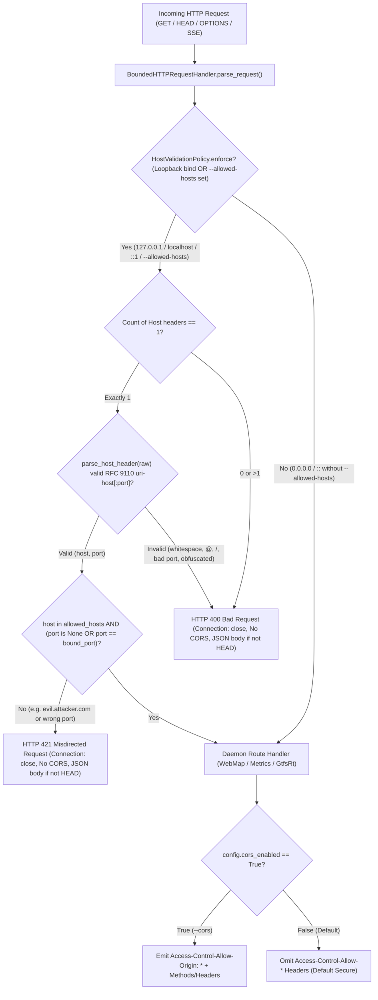

# Implementation Plan — P1-11: Opt-In Exporter/GTFS-RT CORS & Loopback `Host` Header Validation (DNS Rebinding Defense)

> **Reference Review:** [`../../../architecture/codebase-architecture-review.md`](../../../architecture/codebase-architecture-review.md#L296) (Finding **P1-2**)  
> **Related Plans:** [`./p1-10-slowloris-and-http-connection-exhaustion-fix-plan.md`](./p1-10-slowloris-and-http-connection-exhaustion-fix-plan.md), [`../p0/p0-15-desktop-notification-rce-and-web-spa-xss-fix-plan.md`](../p0/p0-15-desktop-notification-rce-and-web-spa-xss-fix-plan.md), [`../p0/p0-19-openmetrics-compliance-label-collisions-and-storage-collector-fix-plan.md`](../p0/p0-19-openmetrics-compliance-label-collisions-and-storage-collector-fix-plan.md), [`../../features/f-8-1-phase-2-web-server-daemon-and-http-handler-plan.md`](../../features/f-8-1-phase-2-web-server-daemon-and-http-handler-plan.md), [`../../features/f-8-2-phase-3-http-server-daemon-and-content-negotiation-plan.md`](../../features/f-8-2-phase-3-http-server-daemon-and-content-negotiation-plan.md), [`../../features/f-8-3-gtfs-realtime-protocol-buffer-feed-exporter-plan.md`](../../features/f-8-3-gtfs-realtime-protocol-buffer-feed-exporter-plan.md)  
> **Target Modules:** [`../../../../railmon_http.py`](../../../../railmon_http.py), [`../../../../exporter/models.py`](../../../../exporter/models.py), [`../../../../exporter/server.py`](../../../../exporter/server.py), [`../../../../gtfs_rt/models.py`](../../../../gtfs_rt/models.py), [`../../../../gtfs_rt/server.py`](../../../../gtfs_rt/server.py), [`../../../../server/models.py`](../../../../server/models.py), [`../../../../server/daemon.py`](../../../../server/daemon.py), [`../../../../train_tracker.py`](../../../../train_tracker.py)  
> **Test Suites:** `tests/test_http_host_cors.py` *(new)*, [`../../../../tests/test_exporter_server.py`](../../../../tests/test_exporter_server.py), [`../../../../tests/test_exporter_models.py`](../../../../tests/test_exporter_models.py), [`../../../../tests/test_gtfs_server.py`](../../../../tests/test_gtfs_server.py), [`../../../../tests/test_gtfs_models.py`](../../../../tests/test_gtfs_models.py), [`../../../../tests/test_server_models.py`](../../../../tests/test_server_models.py), [`../../../../tests/test_cli_metrics.py`](../../../../tests/test_cli_metrics.py), [`../../../../tests/test_cli_serve.py`](../../../../tests/test_cli_serve.py), [`../../../../tests/test_cli_export.py`](../../../../tests/test_cli_export.py)  
> **Relevant Rules & Skills:** [`../../../../.agents/rules/security-and-data-protection.md`](../../../../.agents/rules/security-and-data-protection.md), [`../../../../.agents/rules/misra-autosar-python.md`](../../../../.agents/rules/misra-autosar-python.md), [`../../../../.agents/rules/testing.md`](../../../../.agents/rules/testing.md), [`../../../../.agents/skills/diagrams-and-documentation/SKILL.md`](../../../../.agents/skills/diagrams-and-documentation/SKILL.md), [`../../../../.agents/skills/markdown-relative-paths/SKILL.md`](../../../../.agents/skills/markdown-relative-paths/SKILL.md), [`../../../../.agents/skills/static-safety-analyzer/SKILL.md`](../../../../.agents/skills/static-safety-analyzer/SKILL.md), [`../../../../.agents/skills/ci-quality-gate/SKILL.md`](../../../../.agents/skills/ci-quality-gate/SKILL.md)

---

## 1. Executive Summary & Empirically Verified Vulnerabilities

Auditing all three embedded HTTP daemons — `WebMapServer` ([`server/daemon.py`](../../../../server/daemon.py)), `MetricsServer` ([`exporter/server.py`](../../../../exporter/server.py)), and `GtfsRtServer` ([`gtfs_rt/server.py`](../../../../gtfs_rt/server.py)) — plus their shared pure-stdlib base [`railmon_http.py`](../../../../railmon_http.py) on `HEAD` (`d343085`) confirms **four coupled cross-origin and DNS-rebinding security defects**:

| # | Vulnerability Class | Affected Locations | Empirically Verified Failure Mode & Root Cause | Severity |
|---|---|---|---|---|
| **1** | **Unconditional Wildcard CORS on `MetricsServer`** | [`exporter/server.py`](../../../../exporter/server.py#L69-L73), [`exporter/models.py`](../../../../exporter/models.py#L155-L172), [`train_tracker.py`](../../../../train_tracker.py#L2379-L2450) | `MetricsRequestHandler._add_cors_headers()` unconditionally emits `Access-Control-Allow-Origin: *`, `Access-Control-Allow-Methods: GET, HEAD, OPTIONS`, and `Access-Control-Allow-Headers` on every response (`/metrics`, `/health`, `/`, `OPTIONS`, and errors). `ExporterConfig` has no `cors_enabled` field and `railmon metrics` has no `--cors` CLI flag. Any untrusted website visited by an operator running `railmon metrics` on `127.0.0.1:9100` can read live operational metrics, SQLite storage telemetry, and health probes cross-origin via `fetch()`. | **High** |
| **2** | **Insecure Programmatic `cors_enabled=True` Default on `GtfsRtConfig`** | [`gtfs_rt/models.py`](../../../../gtfs_rt/models.py#L221), [`gtfs_rt/server.py`](../../../../gtfs_rt/server.py#L121-L129) | Although CLI `railmon export gtfs-rt --serve` defaults `--cors` to `False` ([`train_tracker.py`](../../../../train_tracker.py#L4790)), programmatic `GtfsRtConfig()` defaults `cors_enabled: bool = True` and `GtfsRtHandler._add_cors()` falls back to `getattr(self.server.config, "cors_enabled", True)`. This violates secure-by-default parity with `ServerConfig(cors_enabled=False)` and exposes local GTFS-RT feeds cross-origin whenever instantiated via library API. | **Medium** |
| **3** | **Missing `Host` Header Validation (DNS Rebinding) Across All 3 Daemons** | [`railmon_http.py`](../../../../railmon_http.py#L326-L336), [`server/handler.py`](../../../../server/handler.py#L59-L135), [`exporter/server.py`](../../../../exporter/server.py#L26-L95), [`gtfs_rt/server.py`](../../../../gtfs_rt/server.py#L78-L156) | None of the 3 HTTP daemons validates the incoming HTTP `Host` header when bound to loopback (`127.0.0.1`, `localhost`, `::1`, or `127.0.0.0/8`). A malicious site at `http://evil.attacker.com:8080` (or `:9100` / `:8085`) can perform a DNS rebinding attack (TTL `0s` flip from attacker IP to `127.0.0.1`) and issue same-origin `fetch()` / `EventSource` requests with `Host: evil.attacker.com:<port>`. Because browsers treat the request as **same-origin**, disabling CORS (`cors_enabled=False`) provides **zero** defense against DNS rebinding. | **High** |
| **4** | **Unvalidated Missing, Duplicate, or Malformed `Host` Headers (RFC 9112 §3.2)** | [`railmon_http.py`](../../../../railmon_http.py#L326-L336) | Stdlib `BaseHTTPRequestHandler.parse_request()` does not enforce RFC 9112 §3.2 (`Host` required on HTTP/1.1, exactly one `Host` header, valid `uri-host [ ":" port ]` grammar). Duplicate `Host` headers, userinfo (`@`), path/whitespace injection, obfuscated integer/octal IPs, or mismatched ports (`Host: localhost:9999` sent to port `8080`) are silently accepted. | **Medium** |

---

### 1.1 Scope Boundary with Sibling P1 / P2 Findings

- **In scope for `P1-11` (resolves Review Finding `P1-2`):**
  1. Centralized, RFC 9110 §7.2 / RFC 9112 §3.2 `Host` header validation inside the shared pure-stdlib leaf [`railmon_http.py`](../../../../railmon_http.py):
     - `is_loopback_bind_host()` (using stdlib `ipaddress` for `127.0.0.0/8`, `::1`, `::ffff:127.0.0.0/104`, and `localhost`).
     - `normalize_allowed_host()` and `validate_allowed_hosts()` for operator allowlists.
     - `parse_host_header()` strict RFC 9110 `uri-host [ ":" port ]` parser (IPv4, bracketed canonical IPv6, reg-name; rejecting whitespace, control chars, `@`, `/`, `?`, `#`, `\`, invalid ports, and obfuscated IPs).
     - `HostValidationPolicy` frozen dataclass attached to `BoundedHTTPServer` (auto-enforced when bound to loopback; opt-in via `allowed_hosts` when bound to wildcard/LAN interfaces such as `0.0.0.0` or `::`).
     - Choke-point enforcement inside `BoundedHTTPRequestHandler.parse_request()` **before** any `do_*` method executes (`GET`, `HEAD`, `OPTIONS`, `POST`, `PUT`, `DELETE`, SSE `/api/stream`), returning `400 Bad Request` on missing/duplicate/malformed `Host` and `421 Misdirected Request` on untrusted `Host` or port mismatch — with `Connection: close`, baseline security headers, zero CORS headers, zero attacker-controlled reflection, zero body on `HEAD`, sanitized warning logs, and a `rejected_host_requests` metric counter.
  2. Uniform secure-by-default opt-in CORS (`cors_enabled: bool = False`) across all 3 daemons:
     - Add `cors_enabled: bool = False` and `allowed_hosts: Tuple[str, ...] = ()` to `ExporterConfig` ([`exporter/models.py`](../../../../exporter/models.py)) and gate `MetricsRequestHandler._add_cors_headers()` ([`exporter/server.py`](../../../../exporter/server.py)) on `self.server.config.cors_enabled`.
     - Align `GtfsRtConfig.cors_enabled` default to `False` ([`gtfs_rt/models.py`](../../../../gtfs_rt/models.py)), fix `GtfsRtHandler._add_cors()` fallback to `False` ([`gtfs_rt/server.py`](../../../../gtfs_rt/server.py)), and add `allowed_hosts: Tuple[str, ...] = ()`.
     - Add `allowed_hosts: Tuple[str, ...] = ()` to `ServerConfig` ([`server/models.py`](../../../../server/models.py)) and wire it into `WebMapServer` ([`server/daemon.py`](../../../../server/daemon.py)).
  3. CLI surface parity in [`train_tracker.py`](../../../../train_tracker.py):
     - Add `--cors` (default `False`) to `railmon metrics` subparser and wire it to `ExporterConfig` + startup banner.
     - Add `--allowed-hosts` (comma-separated hostnames/IPs, default `None`) to `serve`, `metrics`, and `export` (`--serve`) subparsers with strict CLI validation (exit code `2` on invalid entries).
  4. Comprehensive unit and live-socket regression tests (`TC-HOST-01` – `TC-HOST-16`) covering DNS rebinding, IPv4/IPv6/port-mismatch/duplicate/malformed `Host` headers, wildcard-bind pass-through + explicit `--allowed-hosts`, and opt-in CORS toggles across all 3 daemons.
- **Explicitly deferred to sibling Phase 1/2 plans ([`codebase-architecture-review.md`](../../../architecture/codebase-architecture-review.md) Section 4):**
  - **`P1-3`:** Webhook secret log redaction, SSRF scheme/IP validation, and Telegram HTML/Markdown escaping in `railmon_watchdog.py`.
  - **`P1-6`:** RFC 9110 `Vary: Accept, Accept-Encoding`, encoding-scoped/weak ETags, `304` without `Content-Length: 0`, `405` `Allow` + `Connection: close`, zero-body `HEAD` errors, proper `q=` `Accept-Encoding` parsing, and `If-None-Match` in `WebMapServer` CORS headers.
  - **`P1-9`:** `SSEBroadcaster` `touch()` inversion and shutdown sentinel.
  - **Review `P1-10`:** Deadlock-free `stop()` / async-signal-safe shutdown handlers.
  - **`P3` Security Headers on `exporter/` and `gtfs_rt/`:** Baseline `X-Content-Type-Options`/`X-Frame-Options`/`Referrer-Policy` are emitted on all `railmon_http.py` error responses (`400`/`421`/`431`/`503`); full header unification across 200 responses on `exporter/` and `gtfs_rt/` remains tracked under P3 / `P1-6`.

---

## 2. Threat Model & Hardened Request Admission Architecture

### A. DNS Rebinding & Cross-Origin Attack Flow vs. Hardened Guard (ASCII)

```text
+------------------------------------------------------------------------------+
| CURRENT VULNERABLE FLOW (HEAD = d343085)                                     |
+------------------------------------------------------------------------------+
|  1. Cross-Origin Read (Exporter):                                            |
|     evil.com JS -> fetch("http://127.0.0.1:9100/metrics")                    |
|     MetricsServer -> 200 OK + Access-Control-Allow-Origin: * (ALWAYS ON!)    |
|                                                                              |
|  2. DNS Rebinding (ALL 3 Daemons — bypasses cors_enabled=False!):            |
|     Victim opens http://evil.attacker.com:8080 (DNS flips -> 127.0.0.1)      |
|     Browser sends same-origin:                                               |
|       GET /api/trains HTTP/1.1                                               |
|       Host: evil.attacker.com:8080                                           |
|     WebMapServer / MetricsServer / GtfsRtServer:                             |
|       -> NO Host header check! -> 200 OK -> attacker reads local telemetry!  |
+------------------------------------------------------------------------------+

+------------------------------------------------------------------------------+
| HARDENED ARCHITECTURE (P1-11 — SINGLE CHOKE POINT IN railmon_http.py)        |
+------------------------------------------------------------------------------+
|  Incoming TCP Socket -> BoundedHTTPServer (Semaphore + Slowloris Deadline)   |
|                                |                                             |
|                                v                                             |
|            BoundedHTTPRequestHandler.parse_request()                         |
|              1. super().parse_request() + disarm header deadline             |
|              2. Validate Host header (when HostValidationPolicy.enforce):    |
|                 - 0 or >1 Host headers         -> 400 Bad Request (close)    |
|                 - Malformed Host syntax        -> 400 Bad Request (close)    |
|                 - Host not in allowlist        -> 421 Misdirected (close)    |
|                 - Explicit port != bound_port  -> 421 Misdirected (close)    |
|                 (Zero CORS headers; zero reflection; HEAD sends 0 body)      |
|                                | (Valid Host)                                |
|                                v                                             |
|            Route Dispatch (WebMapServer / MetricsServer / GtfsRtServer)      |
|              - cors_enabled == False (DEFAULT on all 3 daemons):             |
|                  -> NO Access-Control-Allow-Origin header emitted            |
|              - cors_enabled == True (explicit --cors / config opt-in):       |
|                  -> Access-Control-Allow-Origin: * emitted                   |
+------------------------------------------------------------------------------+
```

### B. Centralized `Host` Validation & CORS Decision Flow (Mermaid)



---

## 3. Detailed Implementation Specification

### Phase 1: Centralized `Host` Header Validation in [`railmon_http.py`](../../../../railmon_http.py)

#### 1.1 Pure-Stdlib Host Parsing & Normalization Helpers
Add `ipaddress` and `re` to [`railmon_http.py`](../../../../railmon_http.py) (zero internal or third-party dependencies; preserving leaf purity verified by `TC-PKG-19`).

1. **`DEFAULT_LOOPBACK_HOSTS: Tuple[str, ...] = ("localhost", "127.0.0.1", "::1")`**
2. **`is_loopback_bind_host(host: str) -> bool`:**
   - Normalize `cleaned = str(host or "").strip().lower()`. Strip surrounding `[...]` if bracketed IPv6.
   - Return `True` if `cleaned == "localhost"` or `cleaned.endswith(".localhost")`.
   - Attempt `ip = ipaddress.ip_address(cleaned)`:
     - Return `True` if `ip.is_loopback` is `True`.
     - If `isinstance(ip, ipaddress.IPv6Address)` and `ip.ipv4_mapped is not None`, return `ip.ipv4_mapped.is_loopback`.
   - Return `False` on `ValueError` or non-loopback addresses (`0.0.0.0`, `::`, `""`, LAN IPs).
3. **`normalize_allowed_host(raw_host: str) -> str`:**
   - Reject non-string, empty, whitespace, control characters (`ord(c) < 0x20` or `ord(c) == 0x7F`), `@`, `/`, `?`, `#`, `\`, or `*` (wildcards are explicitly prohibited in `allowed_hosts` to prevent accidental allow-all bypasses).
   - If bracketed IPv6 `[...]`: parse via `ipaddress.IPv6Address` and return canonical compressed lowercase string (e.g., `"::1"`).
   - If bare IPv6 (contains `:`): parse via `ipaddress.IPv6Address` and return canonical compressed string (rejects host:port forms — `allowed_hosts` stores hostnames/IPs only, port is enforced from `server_port`).
   - Otherwise: try `ipaddress.IPv4Address(cleaned)` (returns canonical dotted-quad) or validate RFC 1123 / RFC 3986 hostname charset (`^[a-z0-9](?:[a-z0-9-]{0,61}[a-z0-9])?(?:\.[a-z0-9](?:[a-z0-9-]{0,61}[a-z0-9])?)*$` after lowercase and stripping at most one trailing dot if len > 1).
   - Raise `ValueError` with a clear diagnostic on any invalid entry.
4. **`validate_allowed_hosts(hosts: Sequence[str]) -> Tuple[str, ...]`:**
   - Reject bare `str`/`bytes` (must be an iterable of strings, not a single string iterated char-by-char).
   - Normalize and deduplicate preserving order, returning an immutable `Tuple[str, ...]`.
5. **`parse_host_header(raw_host: str) -> Optional[Tuple[str, Optional[int]]]`:**
   - Strict RFC 9110 §7.2 parser:
     - Reject `None`, empty string, leading/trailing whitespace, any whitespace/control char, or any of `@`, `/`, `?`, `#`, `\`.
     - **Bracketed IPv6 (`[...]` or `[...]:port`):**
       - Split at `]`; interior must parse cleanly with `ipaddress.IPv6Address` (no zone-id `%` smuggling).
       - Remainder must be either `""` (port `None`) or `:<digits>` where `port_str.isascii() and port_str.isdigit()` and `1 <= int(port_str) <= 65535`.
       - Return `(str(ipv6), port)`.
     - **IPv4 or reg-name (`host` or `host:port`):**
       - Reject if `raw_host.count(":") > 1` (unbracketed IPv6 is illegal in HTTP `Host`).
       - If `":" in raw_host`, split into `host_part, port_str`; require non-empty `port_str`, `port_str.isascii() and port_str.isdigit()`, `1 <= int(port_str) <= 65535`.
       - Lowercase `host_part`; reject empty `host_part` or invalid characters (must match strict reg-name/IPv4 pattern; if all-numeric/octal/hex-looking IPv4 obfuscation like `0177.0.0.1` or `2130706433`, it will fail `ipaddress.IPv4Address` and will never match `"127.0.0.1"`).
       - Strip a single trailing FQDN dot only if `host_part.endswith(".")` and `len(host_part) > 1` (e.g., `localhost.` -> `localhost`).
       - Return `(host_part, port)`.
   - Return `None` on any syntax violation.

#### 1.2 `HostValidationPolicy` Frozen Dataclass
```python
@dataclass(frozen=True)
class HostValidationPolicy:
    """Immutable HTTP Host header validation policy defending against DNS rebinding."""

    enforce: bool = True
    allowed_hosts: FrozenSet[str] = frozenset(DEFAULT_LOOPBACK_HOSTS)
    bound_port: Optional[int] = None

    @classmethod
    def for_bind_address(
        cls,
        bind_host: str,
        bound_port: Optional[int],
        *,
        extra_allowed_hosts: Tuple[str, ...] = (),
    ) -> "HostValidationPolicy":
        """Build policy: auto-enforced on loopback binds, opt-in on wildcard/LAN binds."""
        normalized_extra = validate_allowed_hosts(extra_allowed_hosts)
        is_loopback = is_loopback_bind_host(bind_host)

        if not is_loopback and not normalized_extra:
            return cls(enforce=False, allowed_hosts=frozenset(), bound_port=bound_port)

        allowed: set[str] = set(normalized_extra)
        if is_loopback:
            allowed.update(DEFAULT_LOOPBACK_HOSTS)
            try:
                allowed.add(normalize_allowed_host(bind_host))
            except ValueError:
                pass
        return cls(
            enforce=True,
            allowed_hosts=frozenset(allowed),
            bound_port=bound_port if (bound_port and bound_port > 0) else None,
        )
```

**Why this matrix is operationally ergonomic AND airtight:**

| Bind Address (`--host`) | `--allowed-hosts` | `enforce` | Accepted `Host` Values | Rejected `Host` Values |
|---|---|---|---|---|
| `127.0.0.1` (default) | *(omitted)* | `True` | `127.0.0.1[:port]`, `localhost[:port]`, `[::1][:port]` | `evil.attacker.com[:port]`, `127.0.0.1:9999`, missing/dup/malformed |
| `::1` or `127.0.0.2` | *(omitted)* | `True` | `localhost`, `127.0.0.1`, `::1`, `127.0.0.2` (each with `None` or `bound_port`) | Any other host or wrong port |
| `127.0.0.1` | `railmon.local` | `True` | Loopback hosts + `railmon.local[:port]` | Any other host or wrong port |
| `0.0.0.0` or `::` | *(omitted)* | `False` | All valid requests (reverse-proxy / Docker / LAN compatible) | *(None — operator opted into public bind)* |
| `0.0.0.0` or `::` | `railmon.internal,192.168.1.50` | `True` | Strictly `railmon.internal[:port]`, `192.168.1.50[:port]` | Any other host or wrong port |

#### 1.3 `BoundedHTTPServer` & `BoundedHTTPRequestHandler` Integration
1. **`BoundedHTTPServer.__init__`:**
   - Accept optional keyword parameter `allowed_hosts: Tuple[str, ...] = ()`.
   - Validate `allowed_hosts` via `validate_allowed_hosts(allowed_hosts)`.
   - Initialize `self._rejected_host_requests: int = 0` and expose `@property def rejected_host_requests(self) -> int` + `def record_host_rejection(self) -> None` (under `self._stats_lock`).
   - After `super().__init__(server_address, ...)` binds the socket (so `self.server_port` reflects the real OS-assigned port even when `port=0`!), construct:
     ```python
     self.host_policy: HostValidationPolicy = HostValidationPolicy.for_bind_address(
         bind_host=str(self.server_address[0]),
         bound_port=int(self.server_port),
         extra_allowed_hosts=validated_hosts,
     )
     ```
2. **`BoundedHTTPRequestHandler.parse_request()`:**
   - After `parsed = super().parse_request()` (and disarming `_deadline_reader` in `finally`), if `parsed` is `True`:
     - Call `if not self._validate_host_header(): return False`.
   - **`_validate_host_header(self) -> bool`:**
     - Fetch `policy = getattr(self.server, "host_policy", None)`. If not `isinstance(policy, HostValidationPolicy)` or not `policy.enforce`, return `True`.
     - Retrieve `host_headers = self.headers.get_all("Host") or []`.
     - If `len(host_headers) == 0`:
       - Log warning (sanitized), record rejection, call `self._send_host_rejection(400, "Bad Request: missing Host header")`, return `False`.
     - If `len(host_headers) > 1`:
       - Log warning (sanitized), record rejection, call `self._send_host_rejection(400, "Bad Request: duplicate Host headers")`, return `False`.
     - Parse `parsed_host = parse_host_header(host_headers[0])`. If `parsed_host is None`:
       - Log warning with `_sanitize_host_for_log(host_headers[0])`, record rejection, call `self._send_host_rejection(400, "Bad Request: malformed Host header")`, return `False`.
     - Unpack `hostname, port = parsed_host`.
     - If `hostname not in policy.allowed_hosts` or `(port is not None and policy.bound_port is not None and port != policy.bound_port)`:
       - Log warning with `_sanitize_host_for_log(host_headers[0])`, record rejection, call `self._send_host_rejection(421, "Misdirected Request: untrusted Host header")`, return `False`.
     - Return `True`.
   - **`_send_host_rejection(self, status_code: int, message: str) -> None`:**
     - Set `self.close_connection = True`, `self._force_close_header = True`.
     - Build static JSON body `{"error": message, "status": status_code}` (never reflecting the attacker's raw `Host` header).
     - Send `status_code`, `Content-Type: application/json; charset=utf-8`, `Content-Length: <len>`, `Connection: close`, `Cache-Control: no-store`, `X-Content-Type-Options: nosniff`, `X-Frame-Options: DENY`, `Referrer-Policy: no-referrer` — **NO `Access-Control-Allow-*` headers**.
     - Write body **only if** `self.command != "HEAD"` (RFC 9110 §9.3.2 compliance).
   - **`_sanitize_host_for_log(raw_host: str) -> str`:**
     - Replace C0/C1 control chars (`\r`, `\n`, `\t`, etc.) with spaces and truncate to 128 chars to prevent CRLF log forging.

---

### Phase 2: Uniform Opt-In CORS & `allowed_hosts` Wiring Across All 3 Daemons

1. **Prometheus Exporter ([`exporter/models.py`](../../../../exporter/models.py) & [`exporter/server.py`](../../../../exporter/server.py)):**
   - Add fields to `ExporterConfig`:
     - `cors_enabled: bool = False`
     - `allowed_hosts: Tuple[str, ...] = ()`
   - Validate `allowed_hosts` in `ExporterConfig.__post_init__()` via `validate_allowed_hosts(self.allowed_hosts)` (and reject non-bool `cors_enabled` or coerce cleanly; best: `if not isinstance(self.cors_enabled, bool): raise ValueError(...)`).
   - Update `MetricsRequestHandler._add_cors_headers()` ([`exporter/server.py`](../../../../exporter/server.py#L69-L73)):
     ```python
     def _add_cors_headers(self) -> None:
         """Inject permissive CORS headers only when explicitly enabled in ExporterConfig."""
         cfg = getattr(self.server, "config", None)
         if cfg is not None and getattr(cfg, "cors_enabled", False):
             self.send_header("Access-Control-Allow-Origin", "*")
             self.send_header("Access-Control-Allow-Methods", "GET, HEAD, OPTIONS")
             self.send_header("Access-Control-Allow-Headers", "Accept, Accept-Encoding, Content-Type")
     ```
   - Pass `allowed_hosts=self.config.allowed_hosts` to `super().__init__(...)` in `MetricsServer.__init__()` and include `CORS=%s` in the startup log line.
2. **GTFS-RT Server ([`gtfs_rt/models.py`](../../../../gtfs_rt/models.py) & [`gtfs_rt/server.py`](../../../../gtfs_rt/server.py)):**
   - Change `GtfsRtConfig.cors_enabled` default from `True` to `False` ([`gtfs_rt/models.py`](../../../../gtfs_rt/models.py#L221)).
   - Add `allowed_hosts: Tuple[str, ...] = ()` to `GtfsRtConfig` and validate in `__post_init__()`.
   - Change `GtfsRtHandler._add_cors()` fallback from `getattr(self.server.config, "cors_enabled", True)` to `False` ([`gtfs_rt/server.py`](../../../../gtfs_rt/server.py#L123)).
   - Pass `allowed_hosts=self.config.allowed_hosts` to `super().__init__(...)` in `GtfsRtServer.__init__()` and log `CORS=%s`.
3. **Web Map Server ([`server/models.py`](../../../../server/models.py) & [`server/daemon.py`](../../../../server/daemon.py)):**
   - Add `allowed_hosts: Tuple[str, ...] = ()` to `ServerConfig` (validated in `__post_init__()` and serialized as `list(self.allowed_hosts)` in `to_dict()`).
   - Pass `allowed_hosts=self.config.allowed_hosts` to `super().__init__(...)` in `WebMapServer.__init__()`.

---

### Phase 3: CLI Surface Parity & Validation in [`train_tracker.py`](../../../../train_tracker.py)

1. **Shared CLI parser helper `_parse_allowed_hosts_arg(raw_value: Optional[str]) -> Optional[Tuple[str, ...]]`:**
   - If `raw_value is None` or `raw_value.strip() == ""`: return `()`.
   - Split on `,`, strip each item, reject empty tokens (e.g., `"a,,b"`), and validate via `railmon_http.validate_allowed_hosts(...)`.
   - On `ValueError`, print clear `[ERROR]` message to `sys.stderr` and return `None` (causing CLI entrypoint to return exit code `2`).
2. **`metrics` subparser ([`train_tracker.py`](../../../../train_tracker.py#L2379-L2450)):**
   - Add `--cors` (`action="store_true"`, `default=False`, matching `serve` and `export`).
   - Add `--allowed-hosts` (`type=str`, `default=None`, help describing comma-separated Host allowlist for reverse-proxy / DNS-rebinding policy).
   - Wire `cors_enabled=bool(getattr(args, "cors", False))` and `allowed_hosts=allowed_hosts` into `ExporterConfig` in `run_metrics_mode()`.
   - Print `CORS Enabled       : {server.config.cors_enabled}` in `_print_metrics_banner()`.
3. **`serve` & `export` subparsers ([`train_tracker.py`](../../../../train_tracker.py#L2322-L2377), [`#L2617-L2647`](../../../../train_tracker.py#L2617-L2647)):**
   - Add `--allowed-hosts` (`type=str`, `default=None`) to both `p_serve` and `p_export`.
   - Wire parsed `allowed_hosts` into `ServerConfig` in `run_serve_mode()` and `GtfsRtConfig` in `_build_gtfs_config()`.

---

## 4. Verification & Test Matrix

### 4.1 New Dedicated Test Suite: `tests/test_http_host_cors.py`

| Test ID | Scenario & Assertion |
|---|---|
| `TC-HOST-01` | Unit tests for `is_loopback_bind_host()` (`127.0.0.1`, `127.0.0.2`, `localhost`, `::1`, `::ffff:127.0.0.1` -> `True`; `0.0.0.0`, `::`, `""`, `192.168.1.10`, `example.com` -> `False`). |
| `TC-HOST-02` | Unit tests for `parse_host_header()` covering valid IPv4, `localhost`, `localhost.`, `[::1]`, `[0:0:0:0:0:0:0:1]:8080`, and rejecting empty, whitespace, CR/LF, `@` userinfo, `/path`, `?q`, `#frag`, unbracketed IPv6, out-of-range port (`0`, `65536`, `-1`, `abc`), and trailing junk. |
| `TC-HOST-03` | Unit tests for `validate_allowed_hosts()` rejecting wildcards (`*`, `*.example.com`), bare `str`, ports (`host:8080`), whitespace/control chars, and deduplicating canonical IPv4/IPv6/hostnames. |
| `TC-HOST-04` | **DNS Rebinding Attack — `MetricsServer` (`127.0.0.1`):** Raw socket sending `GET /metrics HTTP/1.1` with `Host: evil.attacker.com:<port>` returns `421 Misdirected Request`, `Connection: close`, zero `Access-Control-Allow-Origin`, does not echo `evil.attacker.com`, and increments `rejected_host_requests`. |
| `TC-HOST-05` | **DNS Rebinding Attack — `WebMapServer` (`127.0.0.1`):** Raw socket sending `GET /api/trains`, `GET /api/stream`, and `OPTIONS /api/trains` with `Host: evil.attacker.com:<port>` all return `421` before route dispatch (zero SSE clients registered!). |
| `TC-HOST-06` | **DNS Rebinding Attack — `GtfsRtServer` (`127.0.0.1`):** Raw socket sending `GET /gtfs-rt/feed.json` and `GET /gtfs-rt/feed.pb` with `Host: evil.attacker.com:<port>` returns `421`. |
| `TC-HOST-07` | **Missing & Duplicate `Host` Headers (RFC 9112 §3.2):** Requests with 0 `Host` headers or 2 `Host` headers (`Host: 127.0.0.1` + `Host: evil.com`) return `400 Bad Request` + `Connection: close` across all 3 daemons. |
| `TC-HOST-08` | **Malformed & Obfuscated `Host` Headers:** `Host: 127.0.0.1@evil.com`, `Host: 127.0.0.1/metrics`, `Host: 0177.0.0.1`, `Host: 2130706433` return `400` or `421` (never `200`). |
| `TC-HOST-09` | **Port Mismatch & Valid Loopback Variants:** `Host: 127.0.0.1:<wrong_port>` returns `421`; `Host: 127.0.0.1`, `Host: 127.0.0.1:<bound_port>`, `Host: localhost:<bound_port>`, `Host: [::1]:<bound_port>`, and `Host: LOCALHOST.` all return `200`. |
| `TC-HOST-10` | **`HEAD` Rejection Zero Body:** `HEAD /metrics` with `Host: evil.attacker.com` returns `421` with `Content-Length > 0` and **0 response body bytes** on the wire. |
| `TC-HOST-11` | **Explicit `allowed_hosts` on Loopback & Wildcard Bind:** `allowed_hosts=("railmon.internal",)` accepts `Host: railmon.internal:<port>` (`200`) and rejects `Host: evil.com:<port>` (`421`) even when bound to `0.0.0.0` (verified via policy & live socket). |
| `TC-HOST-12` | **Wildcard Bind Default Pass-Through:** `HostValidationPolicy.for_bind_address("0.0.0.0", 9100)` has `enforce=False` so LAN/Docker/K8s scrapers work out of the box when `--allowed-hosts` is omitted. |
| `TC-HOST-13` | **`MetricsServer` Opt-In CORS Toggle:** Default `ExporterConfig()` (`cors_enabled=False`) emits **no** `Access-Control-Allow-Origin` on `GET /metrics`, `GET /health`, `GET /`, `OPTIONS /metrics`, and `404`; `ExporterConfig(cors_enabled=True)` emits `Access-Control-Allow-Origin: *`. |
| `TC-HOST-14` | **`GtfsRtServer` Opt-In CORS Default:** Default `GtfsRtConfig()` (`cors_enabled=False`) omits `Access-Control-Allow-Origin` on `GET /gtfs-rt/feed.json` and `OPTIONS`; `GtfsRtConfig(cors_enabled=True)` emits `Access-Control-Allow-Origin: *`. |
| `TC-HOST-15` | **CLI Flags & Validation:** `railmon metrics --cors --allowed-hosts railmon.local,192.168.1.50`, `railmon serve --allowed-hosts ...`, and `railmon export gtfs-rt --serve --allowed-hosts ...` parse cleanly; invalid `--allowed-hosts "*.evil.com"` returns exit code `2`. |
| `TC-HOST-16` | **Zero-Dependency Leaf Purity:** Re-verify `railmon_http.py` has zero internal or third-party imports (`ipaddress` and `re` are Python stdlib). |

### 4.2 Existing Tests to Update
- [`tests/test_exporter_server.py`](../../../../tests/test_exporter_server.py): Update `test_tc_srv_09_cors_options_preflight` to verify both default `cors_enabled=False` (no `Access-Control-Allow-Origin`) and opt-in `cors_enabled=True` (`Access-Control-Allow-Origin: *`).
- [`tests/test_exporter_models.py`](../../../../tests/test_exporter_models.py) & [`tests/test_gtfs_models.py`](../../../../tests/test_gtfs_models.py) & [`tests/test_server_models.py`](../../../../tests/test_server_models.py): Assert `cors_enabled is False` and `allowed_hosts == ()` defaults plus invalid `allowed_hosts` rejection.
- [`tests/test_cli_metrics.py`](../../../../tests/test_cli_metrics.py), [`tests/test_cli_serve.py`](../../../../tests/test_cli_serve.py), [`tests/test_cli_export.py`](../../../../tests/test_cli_export.py): Verify `--cors` on `metrics` and `--allowed-hosts` parsing/validation across all 3 subcommands.

### 4.3 Mandatory Quality Gates
1. `python -m unittest discover -s tests` — `0` failures, `0` errors.
2. Full-repo `safety_ast_audit.py --strict` across all 37 production files (`train_tracker.py`, `railmon_watchdog.py`, `railmon_http.py`, `storage/`, `tui/`, `server/`, `exporter/`, `gtfs_rt/`) — `0` errors, `0` warnings.
3. Symbol-table undefined-global verification (`symtable`) across all 37 production files — `0` undefined globals.
4. `tests/test_packaging.py` (including `TC-PKG-19` pure-stdlib leaf check and headless `_curses`-absent check) — `100%` passing.

---

## 5. Acceptance Criteria (Definition of Done)

- [x] `ExporterConfig` and `GtfsRtConfig` default `cors_enabled = False`, matching `ServerConfig`; `MetricsRequestHandler` and `GtfsRtHandler` emit `Access-Control-Allow-*` headers **only** when `cors_enabled=True`.
- [x] `railmon metrics` exposes `--cors` (default `False`), and `serve`, `metrics`, and `export` expose validated `--allowed-hosts`.
- [x] `BoundedHTTPServer` / `BoundedHTTPRequestHandler` in [`railmon_http.py`](../../../../railmon_http.py) automatically enforce RFC 9110/9112 `Host` header validation whenever bound to loopback (or whenever `allowed_hosts` is configured), blocking DNS rebinding (`421`), port mismatch (`421`), and missing/duplicate/malformed `Host` headers (`400`) across all 3 HTTP daemons before route dispatch.
- [x] All `TC-HOST-01` – `TC-HOST-16` tests and the full `unittest` suite (`1,042` tests, `0` failures, `0` errors) pass with `0` AST audit warnings across all 37 production files.
- [x] [`codebase-architecture-review.md`](../../../architecture/codebase-architecture-review.md) marks `P1-2` resolved with updated test count (`1,042`).
