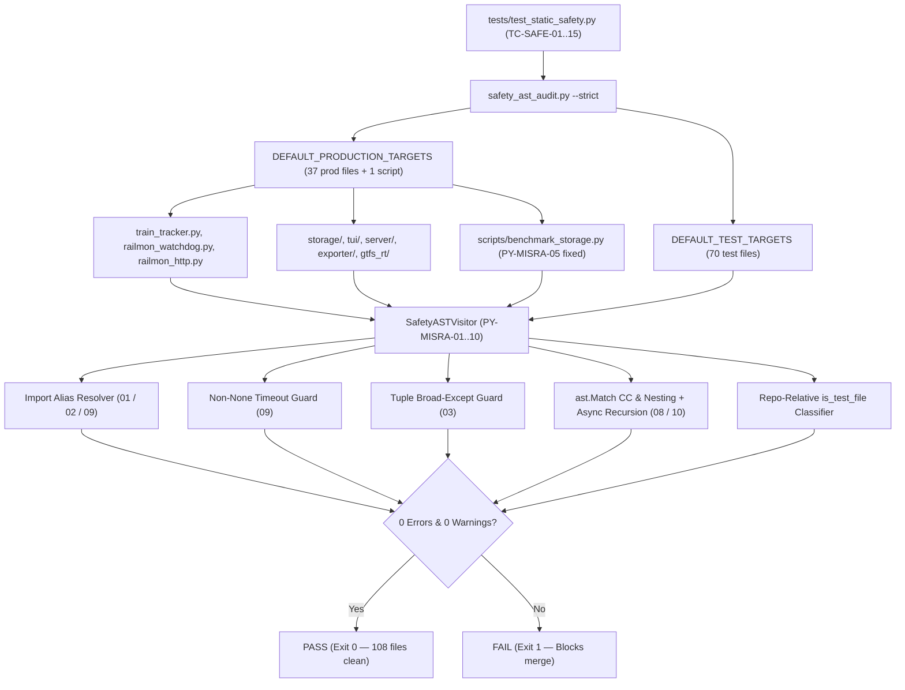

# Implementation Plan — P1-12: Phase 0 Closure — `run_record_mode` Deadband Summary Key & Full-Repo Static Safety AST Gate (`P1-20`)

> **Reference Review:** [`../../../architecture/codebase-architecture-review.md`](../../../architecture/codebase-architecture-review.md#L393-L396) (Phase 0 — Immediate Hotfixes & Finding **P1-20** / **P1-18** record-summary nit)  
> **Related Phase 0 Plans (Resolved):** [`../p0/p0-14-shipping-cli-crashes-and-gtfs-from-db-out-dir-fix-plan.md`](../p0/p0-14-shipping-cli-crashes-and-gtfs-from-db-out-dir-fix-plan.md) (`8635eae`), [`../p0/p0-16-packaging-watchdog-namespace-and-headless-curses-fix-plan.md`](../p0/p0-16-packaging-watchdog-namespace-and-headless-curses-fix-plan.md) (`d08f493`), [`../p0/p0-19-openmetrics-compliance-label-collisions-and-storage-collector-fix-plan.md`](../p0/p0-19-openmetrics-compliance-label-collisions-and-storage-collector-fix-plan.md) (`9dfa314`)  
> **Target Modules:** [`../../../../train_tracker.py`](../../../../train_tracker.py), [`../../../../.agents/skills/static-safety-analyzer/scripts/safety_ast_audit.py`](../../../../.agents/skills/static-safety-analyzer/scripts/safety_ast_audit.py), [`../../../../scripts/benchmark_storage.py`](../../../../scripts/benchmark_storage.py), [`../../../../.agents/skills/static-safety-analyzer/SKILL.md`](../../../../.agents/skills/static-safety-analyzer/SKILL.md)  
> **Test Suites:** [`../../../../tests/test_static_safety.py`](../../../../tests/test_static_safety.py), [`../../../../tests/test_cli_storage.py`](../../../../tests/test_cli_storage.py)  
> **Relevant Rules & Skills:** [`../../../../.agents/rules/misra-autosar-python.md`](../../../../.agents/rules/misra-autosar-python.md), [`../../../../.agents/rules/testing.md`](../../../../.agents/rules/testing.md), [`../../../../.agents/skills/static-safety-analyzer/SKILL.md`](../../../../.agents/skills/static-safety-analyzer/SKILL.md), [`../../../../.agents/skills/diagrams-and-documentation/SKILL.md`](../../../../.agents/skills/diagrams-and-documentation/SKILL.md), [`../../../../.agents/skills/markdown-relative-paths/SKILL.md`](../../../../.agents/skills/markdown-relative-paths/SKILL.md), [`../../../../.agents/skills/ci-quality-gate/SKILL.md`](../../../../.agents/skills/ci-quality-gate/SKILL.md)

---

## 1. Executive Summary & Phase 0 Status Ledger

Phase 0 ("Immediate Hotfixes — 1–2 Days, Unblock `master` & Packaging") in [`codebase-architecture-review.md`](../../../architecture/codebase-architecture-review.md#L393-L396) is **~90% complete** on `HEAD` (`830b80e`). This plan scopes the **final two remaining items** required to close Phase 0 at **100%** with zero unaudited production modules and zero broken CLI reporting paths:

| Phase 0 Item | Original Scope | Current Status (`HEAD 830b80e`) | Remaining Work in This Plan (`P1-12`) |
|---|---|---|---|
| **Item 1 — Shipping CLI Bugs** | `history bottlenecks` / `segments` `NameError`, `history trips` `service_date` `TypeError`, `export --gtfs-rt --from-db --out-dir` empty files, `run_record_mode` `total_suppressed` key | **4/5 Resolved** in `8635eae` ([`P0-14`](../p0/p0-14-shipping-cli-crashes-and-gtfs-from-db-out-dir-fix-plan.md)) | **Workstream A:** Fix `run_record_mode()` shutdown summary reading `"suppressed_count"` instead of `int(filter_stats.get("total_suppressed", 0))` in [`train_tracker.py`](../../../../train_tracker.py#L3223-L3234). |
| **Item 2 — OpenMetrics, Test Teardown & AST Gate** | OpenMetrics 1.0.0 compliance, duplicate labels, `StorageMetricsCollector`, final `PY-MISRA-03` warning, `test_bottlenecks.py` / `test_eta_engine.py` `db.close()`, expand `DEFAULT_PRODUCTION_TARGETS` (`P1-20`) | **5/6 Resolved** in `8635eae` + `9dfa314` ([`P0-19`](../p0/p0-19-openmetrics-compliance-label-collisions-and-storage-collector-fix-plan.md)) | **Workstream B:** Expand `DEFAULT_PRODUCTION_TARGETS` in [`safety_ast_audit.py`](../../../../.agents/skills/static-safety-analyzer/scripts/safety_ast_audit.py#L26) to all 37 production files + `scripts/` (108 files total), fix exposed `PY-MISRA-05` in [`scripts/benchmark_storage.py`](../../../../scripts/benchmark_storage.py#L70), and close 6 verified AST rule blind spots. |
| **Item 3 — Packaging & Headless `curses`** | `watchdog.py` -> `railmon_watchdog.py`, `pyproject.toml`, `.gitattributes`, PEP 562 `tui/__init__.py`, guarded `tui/theme.py`, POSIX `run_tui_mode()` fallback | **100% Resolved** in `d08f493` ([`P0-16`](../p0/p0-16-packaging-watchdog-namespace-and-headless-curses-fix-plan.md)) | None (re-verified via `test_packaging.py` 20/20 passing). |

---

## 2. Empirically Verified Defects Remaining in Phase 0

| # | Defect | Location | Empirically Verified Root Cause & Impact |
|---|---|---|---|
| **1** | **`run_record_mode()` Always Reports `0` Deadband-Filtered Positions (+ Latent Float-Format Crash)** | [`train_tracker.py`](../../../../train_tracker.py#L3224-L3234) & [`storage/filter.py`](../../../../storage/filter.py#L273-L289) | `DeadbandFilter.stats` returns `{"total_suppressed": float(self._total_suppressed), ...}` (`storage/filter.py:285`). `run_record_mode()` looks up `filter_stats.get("suppressed_count", 0)` (`train_tracker.py:3225`), so the shutdown summary **always prints `0`**. Furthermore, because `total_suppressed` is a `float` (e.g. `42.0`), naively swapping the key without `int(...)` causes `ValueError: Unknown format code 'd' for object of type 'float'` on line 3233 (`{suppressed:,d}`). |
| **2** | **Default AST Gate Skips 19 Production Files & 1 Script (`FALSE PASS`)** | [`safety_ast_audit.py`](../../../../.agents/skills/static-safety-analyzer/scripts/safety_ast_audit.py#L26) | `DEFAULT_PRODUCTION_TARGETS = ("train_tracker.py", "storage", "tui")` audits only **88 files** (18 production + 70 tests), silently skipping `railmon_watchdog.py`, `railmon_http.py`, `server/` (6 files), `exporter/` (5 files), `gtfs_rt/` (6 files), and `scripts/` (1 file). Because [`tests/test_static_safety.py`](../../../../tests/test_static_safety.py#L43-L46) (`TC-SAFE-01`) invokes `auditor.main(["--strict"])` with no arguments, regressions in those 20 files never fail the test suite. |
| **3** | **Hidden `PY-MISRA-05` Violation in `scripts/benchmark_storage.py`** | [`scripts/benchmark_storage.py`](../../../../scripts/benchmark_storage.py#L68-L71) | Running `safety_ast_audit.py --strict scripts` empirically fails with `scripts/benchmark_storage.py:70:30: [ERROR] PY-MISRA-05 (run_write_benchmark): Mutable default argument (list/dict/set literal)` (`batch_sizes: List[int] = [10, 50, 100, 500]`). |
| **4** | **Six AST Rule Blind Spots in `safety_ast_audit.py`** | [`safety_ast_audit.py`](../../../../.agents/skills/static-safety-analyzer/scripts/safety_ast_audit.py#L338-L650) | (a) **Import aliases** (`import pickle as p; p.loads(...)`, `from subprocess import run as r; r(..., shell=True)`, `from queue import Queue as Q`, `from urllib.request import urlopen as u`, `from sqlite3 import connect as c`) bypass `PY-MISRA-01`, `02`, and `09`; (b) **`timeout=None`** (keyword or positional) satisfies `has_timeout` in `PY-MISRA-09`; (c) **Tuple broad catches** (`except (Exception, ValueError): pass` or `except (BaseException,): pass`) bypass `PY-MISRA-03`; (d) **`ast.Match` / `match_case`** (Python 3.10+) is ignored by `_compute_mccabe_complexity()` and `_compute_max_nesting_depth()` (`PY-MISRA-08`); (e) **`AsyncFunctionDef`** skips direct recursion detection (`PY-MISRA-10`); (f) **`"tests" in filepath.parts`** silently marks **every production file as a test file** (disabling `PY-MISRA-02`, `03` warnings, `04`, `06`, `07`, `08`, `09`, `10` `assert`) whenever the repository is cloned under an ancestor path containing a directory named `tests` (e.g. `/ci/tests/railmon/`). |

---

## 3. Architecture: Default Safety Gate Coverage Before vs. After

### A. Default AST Gate & Test-Suite Enforcement Topology (ASCII)

```text
+------------------------------------------------------------------------------+
| BEFORE (HEAD 830b80e — FALSE PASS ON 88 FILES)                               |
+------------------------------------------------------------------------------+
|  tests/test_static_safety.py (TC-SAFE-01) -> safety_ast_audit.py --strict    |
|    DEFAULT_PRODUCTION_TARGETS = ("train_tracker.py", "storage", "tui")       |
|                                                                              |
|    AUDITED (88 files):  train_tracker.py (1) + storage/ (7) + tui/ (10)      |
|                         + tests/ (70)                                        |
|    SKIPPED (20 files):  railmon_watchdog.py (1), railmon_http.py (1),        |
|                         server/ (6), exporter/ (5), gtfs_rt/ (6),            |
|                         scripts/ (1 -> HIDDEN PY-MISRA-05 ERROR!)            |
+------------------------------------------------------------------------------+

+------------------------------------------------------------------------------+
| AFTER (P1-12 — FULL-REPO STRICT GATE ON 108 FILES + HARDENED AST RULES)      |
+------------------------------------------------------------------------------+
|  tests/test_static_safety.py (TC-SAFE-01) -> safety_ast_audit.py --strict    |
|    DEFAULT_PRODUCTION_TARGETS = (                                            |
|      "train_tracker.py", "railmon_watchdog.py", "railmon_http.py",           |
|      "storage", "tui", "server", "exporter", "gtfs_rt", "scripts",           |
|    )                                                                         |
|                                                                              |
|    AUDITED (108 files): ALL 37 production files + 1 script + 70 tests        |
|    SKIPPED (0 files):   100% repo Python coverage on every unittest run      |
|    HARDENED RULES:      Import-alias tracking, timeout=None rejection,       |
|                         tuple broad-except detection, ast.Match CC/nesting,  |
|                         AsyncFunctionDef recursion, repo-relative is_test    |
+------------------------------------------------------------------------------+
```

### B. Full-Repo Static Safety Pipeline (Mermaid)



---

## 4. Detailed Implementation Design

### Workstream A: Fix `run_record_mode()` Deadband Summary Key & Integer Formatting

#### Target: [`train_tracker.py`](../../../../train_tracker.py#L3223-L3234)
1. Replace line 3225:
   ```python
   # Before (broken: key does not exist -> always 0):
   suppressed = filter_stats.get("suppressed_count", 0)

   # After (reads canonical DeadbandFilter.stats key and casts float -> int safely):
   raw_suppressed = filter_stats.get("total_suppressed", 0)
   suppressed = int(raw_suppressed) if isinstance(raw_suppressed, (int, float)) else 0
   ```
2. Preserve exact output formatting on line 3233:
   ```python
   print(f"  - Positions Filtered (Deadband): {suppressed:,d} ({ratio:.1f}% compression ratio)")
   ```
3. Verify no other call sites in the repository reference `"suppressed_count"` against `DeadbandFilter.stats` (note: `BatchFilterEvaluation.suppressed_count` in [`storage/filter.py`](../../../../storage/filter.py#L51) is an attribute on the staging dataclass, not a dict key on `.stats`, and must remain untouched).

---

### Workstream B: Expand & Harden `safety_ast_audit.py` (`P1-20`)

#### B.1 Expand `DEFAULT_PRODUCTION_TARGETS` & Fix `scripts/benchmark_storage.py`
1. In [`safety_ast_audit.py`](../../../../.agents/skills/static-safety-analyzer/scripts/safety_ast_audit.py#L26):
   ```python
   DEFAULT_PRODUCTION_TARGETS: Tuple[str, ...] = (
       "train_tracker.py",
       "railmon_watchdog.py",
       "railmon_http.py",
       "storage",
       "tui",
       "server",
       "exporter",
       "gtfs_rt",
       "scripts",
   )
   ```
2. Update CLI help string in `main()` ([`safety_ast_audit.py`](../../../../.agents/skills/static-safety-analyzer/scripts/safety_ast_audit.py#L622-L626)) to reflect the expanded default targets.
3. In [`scripts/benchmark_storage.py`](../../../../scripts/benchmark_storage.py#L68-L75):
   - Change mutable default `batch_sizes: List[int] = [10, 50, 100, 500]` to immutable `batch_sizes: Sequence[int] = (10, 50, 100, 500)` (importing `Sequence` from `typing`).
   - Verify `safety_ast_audit.py --strict scripts` passes with `0` errors and `0` warnings.

#### B.2 Close the 6 Verified AST Rule Blind Spots in `safety_ast_audit.py`
All enhancements must remain **100% Python 3.10+ stdlib** and pass `safety_ast_audit.py --strict` on the auditor script itself:

1. **Import Alias Resolution (`PY-MISRA-01`, `PY-MISRA-02`, `PY-MISRA-09`):**
   - Track module-level & function-level import aliases in `SafetyASTVisitor` via `self._import_aliases: Dict[str, str]` populated in `visit_Import` (`import pickle as p` -> `"p": "pickle"`, `import urllib.request as ur` -> `"ur": "urllib.request"`) and `visit_ImportFrom` (`from subprocess import run as r` -> `"r": "subprocess.run"`, `from queue import Queue as Q` -> `"Q": "queue.Queue"`).
   - Add `_resolve_call_name(call_name: str) -> str` that resolves either the full dotted name or its root segment against `self._import_aliases` (e.g., `p.loads` -> `pickle.loads`, `ur.urlopen` -> `urllib.request.urlopen`, `Q` -> `queue.Queue`, `r` -> `subprocess.run`).
   - Check both raw `call_name` and resolved `canonical_name` in `visit_Call` for `FORBIDDEN_CALLS`, `subprocess` `shell=True`, `QUEUE_CONSTRUCTORS`, and `TIMEOUT_REQUIRED_CALLS`.
2. **Reject `timeout=None` (`PY-MISRA-09`):**
   - Add helper `_is_none_constant(node: ast.AST) -> bool` returning `isinstance(node, ast.Constant) and node.value is None`.
   - For `timeout=...` keyword argument: only treat as valid if `not _is_none_constant(kw.value)`.
   - For positional timeout (`urlopen(url, data, timeout)` at `args[2]`, `sqlite3.connect(db, timeout)` at `args[1]`): only treat as valid if `not _is_none_constant(pos_arg)`.
3. **Detect Tuple Broad Silent Exceptions (`PY-MISRA-03`):**
   - Extract `_extract_broad_exception_name(exc_type: ast.expr) -> Optional[str]`:
     - Matches `ast.Name` in `("Exception", "BaseException")`.
     - Matches `ast.Tuple` if any element is an `ast.Name` in `("Exception", "BaseException")` (e.g., `except (Exception, ValueError): pass`).
4. **Python 3.10+ `ast.Match` Support (`PY-MISRA-08`):**
   - In `_compute_mccabe_complexity()`: add `len(child.cases)` (excluding wildcard-only catch-all `case _:` without guard, or counting each branching `match_case` per McCabe convention) when `isinstance(child, ast.Match)`.
   - In `_compute_max_nesting_depth()`: include `ast.Match` in branch nodes so nested `match` blocks increment nesting depth accurately.
5. **`AsyncFunctionDef` Direct Recursion (`PY-MISRA-10`):**
   - Generalize `_is_direct_recursive(func_node: ast.FunctionDef | ast.AsyncFunctionDef, in_class: bool) -> bool` and invoke it for both `ast.FunctionDef` and `ast.AsyncFunctionDef` inside `_check_function()`.
6. **Repo-Relative `is_test_file` Classification:**
   - Fix [`audit_file()`](../../../../.agents/skills/static-safety-analyzer/scripts/safety_ast_audit.py#L586): instead of `"tests" in filepath.parts` (which breaks whenever any ancestor directory above the repository is named `tests`), compute the path relative to `base_dir` (defaulting to `Path.cwd()` / repo root when `filepath` is inside it) and check whether the **relative** path's first component is `"tests"` (or `filepath.name.startswith("test_")` for standalone temp snippets).
   - Provide an explicit optional `is_test_file: Optional[bool] = None` parameter on `audit_file()` for deterministic testing.

#### B.3 Complexity Advisory Mode (`--advisory`) & Skill Documentation Sync
- **Empirical baseline check on `HEAD 830b80e`:** Running `safety_ast_audit.py --warn-complexity 15` across all 37 production files currently reports **0 errors** and **34 advisory warnings** (McCabe CC `16`–`24` across legacy god-functions such as `WatchdogEvaluator.evaluate_position`, `run_serve_mode`, `run_history_mode`, `TUIApp._handle_normal_input`, and `TUIApp.run_loop`), which are scheduled for decomposition in **Phase 3**.
- **Design decision:** Keep `--warn-complexity` default at `25` so `--strict` remains a hard, zero-noise CI gate (`0` errors, `0` warnings across all 108 files) without blocking Phase 1/2 merges on Phase 3 refactors, **and** add an explicit `--advisory` CLI flag (shorthand for `--warn-complexity 15`) so engineers and CI reports can run the advisory CC > 15 audit cleanly.
- Update [`.agents/skills/static-safety-analyzer/SKILL.md`](../../../../.agents/skills/static-safety-analyzer/SKILL.md) so its listed target packages and `mypy`/`ruff`/`flake8`/`bandit` commands include all 8 production targets (`train_tracker.py`, `railmon_watchdog.py`, `railmon_http.py`, `storage/`, `tui/`, `server/`, `exporter/`, `gtfs_rt/`, `scripts/`, `tests/`).

---

## 5. Verification & Regression Test Plan

### 5.1 New & Updated Automated Tests

| Test ID | File | Scenario & Assertions |
|---|---|---|
| **`TC-REC-01`** | [`tests/test_cli_storage.py`](../../../../tests/test_cli_storage.py) | `run_record_mode()` with `DeadbandFilterMode.ENABLED` and mocked/live suppressed positions prints exact integer count `Positions Filtered (Deadband): <N> (<ratio>% compression ratio)` where `<N> > 0` (verifying both `"total_suppressed"` lookup and `float -> int` cast without `ValueError`). |
| **`TC-SAFE-01`** | [`tests/test_static_safety.py`](../../../../tests/test_static_safety.py) | Existing strict gate test now automatically audits all **108 files** (`DEFAULT_PRODUCTION_TARGETS` + `DEFAULT_TEST_TARGETS`) and passes with exit code `0`. |
| **`TC-SAFE-08`** | [`tests/test_static_safety.py`](../../../../tests/test_static_safety.py) | Assert `DEFAULT_PRODUCTION_TARGETS` covers every top-level production module and package (`train_tracker.py`, `railmon_watchdog.py`, `railmon_http.py`, `storage`, `tui`, `server`, `exporter`, `gtfs_rt`, `scripts`) and `collect_python_files` returns `>= 38` non-test files. |
| **`TC-SAFE-09`** | [`tests/test_static_safety.py`](../../../../tests/test_static_safety.py) | Import-alias evasion detection: `import pickle as p; p.loads(b"")`, `from subprocess import run as r; r("ls", shell=True)`, `from queue import Queue as Q; Q()`, `from urllib.request import urlopen as u; u("https://x")`, `from sqlite3 import connect as c; c(":memory:")` all trigger their expected `PY-MISRA-01`/`02`/`09` errors. |
| **`TC-SAFE-10`** | [`tests/test_static_safety.py`](../../../../tests/test_static_safety.py) | `PY-MISRA-09` rejects `urlopen("https://x", timeout=None)`, `urlopen("https://x", None, None)`, and `sqlite3.connect(":memory:", timeout=None)` / `sqlite3.connect(":memory:", None)`. |
| **`TC-SAFE-11`** | [`tests/test_static_safety.py`](../../../../tests/test_static_safety.py) | `PY-MISRA-03` flags silent tuple broad catches `except (Exception, ValueError): pass` and `except (BaseException,): pass`. |
| **`TC-SAFE-12`** | [`tests/test_static_safety.py`](../../../../tests/test_static_safety.py) | `PY-MISRA-08` counts `ast.Match` cases toward McCabe complexity and nesting depth. |
| **`TC-SAFE-13`** | [`tests/test_static_safety.py`](../../../../tests/test_static_safety.py) | `PY-MISRA-10` flags direct recursion inside `async def` (`AsyncFunctionDef`). |
| **`TC-SAFE-14`** | [`tests/test_static_safety.py`](../../../../tests/test_static_safety.py) | Path-ancestor regression: auditing a production file located at `<tmpdir>/tests/repo/prod_mod.py` with `base_dir=<tmpdir>/tests/repo` still enforces production-only rules (`PY-MISRA-06`, `PY-MISRA-07`, `PY-MISRA-10` `assert`). |
| **`TC-SAFE-15`** | [`tests/test_static_safety.py`](../../../../tests/test_static_safety.py) | `safety_ast_audit.py` itself passes `audit_file(AUDITOR_PATH)` with `0` errors and `0` warnings. |

### 5.2 Gate Commands to Run Before Commit

```bash
# 1. Full unit & integration test suite (must pass 100%, 0 failures, 0 errors):
python -m unittest discover -s tests

# 2. Default strict AST safety gate (must report 108 files audited, 0 errors, 0 warnings):
python .agents/skills/static-safety-analyzer/scripts/safety_ast_audit.py --strict

# 3. Audit the auditor script itself:
python .agents/skills/static-safety-analyzer/scripts/safety_ast_audit.py --strict .agents/skills/static-safety-analyzer/scripts/safety_ast_audit.py

# 4. Verify advisory complexity report runs cleanly (non-strict):
python .agents/skills/static-safety-analyzer/scripts/safety_ast_audit.py --advisory
```

---

## 6. Post-Implementation Documentation Sync

Upon completing implementation:
1. Mark **Phase 0** 100% `[RESOLVED]` in [`docs/architecture/codebase-architecture-review.md`](../../../architecture/codebase-architecture-review.md) (Executive Summary, `P1-20` row, Scorecard, and Section 9 Roadmap).
2. Update [`docs/README.md`](../../../README.md) entry for `P1-12` if scope details change.
3. Verify zero absolute workstation paths or local file URIs in all modified Markdown files per [`markdown-relative-paths`](../../../../.agents/skills/markdown-relative-paths/SKILL.md).
