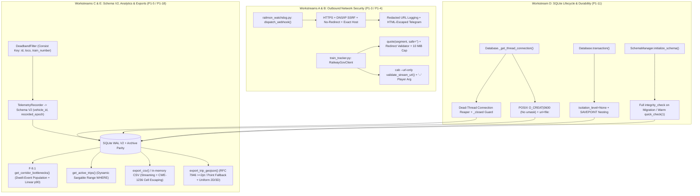

# Implementation Plan — P1-13: Phase 1 — Security & Data Durability Hardening (`P1-3`, `P1-4`, `P1-5`, `P1-11`, `P1-18`)

> **Reference Review:** [`../../../architecture/codebase-architecture-review.md`](../../../architecture/codebase-architecture-review.md#L398-L401) (Phase 1 — Security & Data Durability Hardening; Findings **P1-3**, **P1-4**, **P1-5**, **P1-11**, **P1-18**)  
> **Related Phase 1 Plans (Resolved):** [`../p0/p0-15-desktop-notification-rce-and-web-spa-xss-fix-plan.md`](../p0/p0-15-desktop-notification-rce-and-web-spa-xss-fix-plan.md) (`dd8a612`), [`../p0/p0-18-storage-durability-data-loss-and-analytics-fix-plan.md`](../p0/p0-18-storage-durability-data-loss-and-analytics-fix-plan.md) (`c5e7a57`), [`../p0/p0-19-openmetrics-compliance-label-collisions-and-storage-collector-fix-plan.md`](../p0/p0-19-openmetrics-compliance-label-collisions-and-storage-collector-fix-plan.md) (`9dfa314`)  
> **Target Modules:** [`../../../../railmon_watchdog.py`](../../../../railmon_watchdog.py), [`../../../../train_tracker.py`](../../../../train_tracker.py), [`../../../../storage/db.py`](../../../../storage/db.py), [`../../../../storage/schema.py`](../../../../storage/schema.py), [`../../../../storage/models.py`](../../../../storage/models.py), [`../../../../storage/filter.py`](../../../../storage/filter.py), [`../../../../storage/recorder.py`](../../../../storage/recorder.py), [`../../../../storage/repository.py`](../../../../storage/repository.py)  
> **Test Suites:** [`../../../../tests/test_watchdog.py`](../../../../tests/test_watchdog.py), [`../../../../tests/test_railway_client.py`](../../../../tests/test_railway_client.py), [`../../../../tests/test_cab_stream.py`](../../../../tests/test_cab_stream.py), [`../../../../tests/test_storage_db.py`](../../../../tests/test_storage_db.py), [`../../../../tests/test_storage_schema.py`](../../../../tests/test_storage_schema.py), [`../../../../tests/test_storage_filter.py`](../../../../tests/test_storage_filter.py), [`../../../../tests/test_storage_repository.py`](../../../../tests/test_storage_repository.py), [`../../../../tests/test_bottlenecks.py`](../../../../tests/test_bottlenecks.py)  
> **Relevant Rules & Skills:** [`../../../../.agents/rules/misra-autosar-python.md`](../../../../.agents/rules/misra-autosar-python.md), [`../../../../.agents/rules/testing.md`](../../../../.agents/rules/testing.md), [`../../../../.agents/skills/security-audit/SKILL.md`](../../../../.agents/skills/security-audit/SKILL.md), [`../../../../.agents/skills/database-backup-and-migration-validator/SKILL.md`](../../../../.agents/skills/database-backup-and-migration-validator/SKILL.md), [`../../../../.agents/skills/storage-benchmark-gate/SKILL.md`](../../../../.agents/skills/storage-benchmark-gate/SKILL.md), [`../../../../.agents/skills/static-safety-analyzer/SKILL.md`](../../../../.agents/skills/static-safety-analyzer/SKILL.md), [`../../../../.agents/skills/ci-quality-gate/SKILL.md`](../../../../.agents/skills/ci-quality-gate/SKILL.md)

---

## 1. Executive Summary & Phase 1 Status Ledger

Phase 1 ("Security & Data Durability Hardening — 3–5 Days") in [`codebase-architecture-review.md`](../../../architecture/codebase-architecture-review.md#L398-L401) already has its P0 security and storage foundations resolved on `HEAD` (`a55e602`). This plan scopes the **five remaining P1 workstreams** required to close Phase 1 at **100%** while maintaining zero external runtime dependencies and `0` AST warnings across all `108+` repository Python files:

| Phase 1 Roadmap Item | Already Resolved on `HEAD a55e602` | Remaining Workstreams in This Plan (`P1-13`) |
|---|---|---|
| **Item 1 — Security Hardening** | Desktop notification RCE & Web SPA DOM XSS + CSP ([`P0-15`](../p0/p0-15-desktop-notification-rce-and-web-spa-xss-fix-plan.md), `dd8a612`) | **Workstream A (`P1-3`):** Webhook secret redaction, SSRF/redirect defense, exact host dialect matching, Telegram HTML escaping, `RAILMON_WEBHOOK_*` env vars.<br>**Workstream B (`P1-4`):** `RailwayGovClient` URL path encoding (`safe=""`), dead `HTTPError` 404 fix, redirect re-validation, REST response size cap, cab `--url-only` & `"--"` hardening.<br>**Workstream C (`P1-5`):** CSV formula injection defense (CWE-1236) across all CSV exporters + streaming `iter_train_history()` export. |
| **Item 2 — SQLite Durability & Lifecycle** | `archive_before()` TOCTOU/PK-collision fix, canonical UTC ISO-8601 timestamps, `TelemetryRecorder` archival backoff + post-commit deadband ([`P0-18`](../p0/p0-18-storage-durability-data-loss-and-analytics-fix-plan.md), `c5e7a57`); strict `Database(..., read_only=True)` ([`P0-19`](../p0/p0-19-openmetrics-compliance-label-collisions-and-storage-collector-fix-plan.md), `9dfa314`) | **Workstream D (`P1-11`):** Evict dead-thread SQLite connections (64 MB cache + WAL lock leak), `isolation_level=None` + `SAVEPOINT` nested transactions, race-free `O_CREAT \| 0o600` POSIX creation (removing `os.umask`), `uri=True` for `file::memory:`, post-migration/explicit full `integrity_check` (warm `quick_check(1)`), and `wal_checkpoint` busy-flag inspection. |
| **Item 3 — Storage Analytics, Schema V2 & Export Integrity** | F-9.2 contiguous station-run transit SQL ([`P0-18`](../p0/p0-18-storage-durability-data-loss-and-analytics-fix-plan.md), `c5e7a57`); `run_record_mode` `total_suppressed` summary key ([`P1-12`](./p1-12-phase-0-closure-record-stats-and-safety-ast-gate-fix-plan.md), `a55e602`) | **Workstream E (`P1-18`):** Schema V2 migration (`recorded_epoch`, `vehicle_id`, indexes + archive parity), consist-aware `DeadbandFilter` keying, dwell-event-population F-9.1 `get_corridor_bottlenecks()` percentiles (eliminating OOM + `median > max`), sargable `get_active_trips()` range `WHERE`, and RFC 7946 GeoJSON compliance (`>= 2` pts, uniform 2D/3D, `allow_nan=False`). |

---

## 2. Empirically Verified Defects Remaining in Phase 1

| ID | Defect | Target Location(s) | Empirically Verified Root Cause & Impact |
|---|---|---|---|
| **P1-3** | **Webhook Secret Log Leakage, SSRF, Plaintext Token Exposure & Telegram Markdown Errors** | [`railmon_watchdog.py`](../../../../railmon_watchdog.py#L816-L897), [`train_tracker.py`](../../../../train_tracker.py#L2063-L2085), [`train_tracker.py`](../../../../train_tracker.py#L4125-L4155) | Line 895 logs raw `url` on failure, persisting Telegram bot tokens and Discord/Slack webhook secrets in `~/.railmon/logs/`. `urllib.request.urlopen()` accepts `file:`/`ftp:` schemes, private/link-local SSRF targets (`169.254.169.254`), cleartext HTTP with `Authorization: Bearer`, and follows 3xx redirects. `_resolve_webhook_format()` uses substring checks (`"api.telegram.org" in url`), spoofable via query/path. Telegram `"Markdown"` breaks on unescaped `_`, `*`, `[`, `` ` `` in station names or train IDs. Secrets can only be passed via CLI flags (visible in process listings). |
| **P1-4** | **Unencoded URL Path Segments, Dead 404 Handler, Redirect SSRF & Unbounded REST Reads** | [`train_tracker.py`](../../../../train_tracker.py#L847-L902), [`#L996-L1153`](../../../../train_tracker.py#L996-L1153), [`#L3698-L3705`](../../../../train_tracker.py#L3698-L3705) | `get_schedule_by_id`, `get_schedule_by_train_number`, `get_station`, `get_station_departures`, and `get_station_arrivals` interpolate raw strings into URL paths (`"IC 52"` crashes with `http.client.InvalidURL`; `"../"` causes path traversal). `get_cab_stream_url()` uses `quote(...)` with default `safe="/"`, and its `except urllib.error.HTTPError` 404 branch is dead code because `_get()` wraps all `HTTPError`s in `RailwayAPIError`. Default `urlopen()` follows 3xx redirects off `railway.gov.gr`, `_get()` reads unbounded response bodies, `run_cab_stream_mode()` `--url-only` prints unvalidated URLs, and `build_player_command()` omits `"--"` before `playlist_url`. |
| **P1-5** | **CSV Formula Injection (CWE-1236) & Unbounded Export OOM** | [`storage/repository.py`](../../../../storage/repository.py#L494-L567), [`#L1957-L2080`](../../../../storage/repository.py#L1957-L2080) | Upstream string cells beginning with `=`, `+`, `-`, `@`, `\t`, or `\r` are written raw to CSV in both `export_csv()` (all 4 query types) and `export_in_memory_csv()`, enabling spreadsheet formula execution. `_write_csv_data("telemetry")` calls `get_train_history()` (`fetchall()` into RAM) instead of streaming via `iter_train_history()`. `export_csv()` and `export_in_memory_csv()` reject `pathlib.Path` objects (`isinstance(target, str)`). |
| **P1-11** | **SQLite `Database` Connection Leak, `transaction()` Silent Commit, `os.umask()` Race, Broken `file::memory:` & Per-Open Integrity Scan** | [`storage/db.py`](../../../../storage/db.py#L50-L319), [`storage/schema.py`](../../../../storage/schema.py#L118-L163) | `_open_connections` retains strong references to dead worker threads' connections (each holding 64 MB `cache_size` + WAL read locks) until `Database.close()`. `transaction()` checks `if conn.in_transaction: conn.commit()`, silently committing an outer transaction instead of nesting via `SAVEPOINT`. `_create_connection()` mutates process-wide `os.umask(0o077)` without synchronization. `file::memory:?cache=shared` omits `uri=True` in `sqlite3.connect()`. Every `Database()` instantiation runs full-DB `PRAGMA integrity_check` + `foreign_key_check` (executing twice during `railmon record`). `checkpoint_wal()` discards the `(busy, log, checkpointed)` return row. |
| **P1-18** | **Schema V2 Missing `vehicle_id`/`recorded_epoch`, F-9.1 OOM & Statistical Skew, Non-Sargable `get_active_trips`, Consist Collisions & RFC 7946 Violations** | [`storage/schema.py`](../../../../storage/schema.py#L11-L163), [`storage/filter.py`](../../../../storage/filter.py#L168-L260), [`storage/recorder.py`](../../../../storage/recorder.py#L481-L570), [`storage/repository.py`](../../../../storage/repository.py#L956-L985), [`#L1314-L1499`](../../../../storage/repository.py#L1314-L1499), [`#L1867-L1955`](../../../../storage/repository.py#L1867-L1955) | `get_corridor_bottlenecks()` executes a second unbounded `SELECT ... FROM telemetry_history` `fetchall()` into RAM (OOM risk) and computes `median`/`p90` over raw 2s breadcrumbs while `avg`/`max` come from `dwell_events` (allowing `median_delay > max_delay` and `p90 == max` for `n <= 10`). `get_active_trips()` uses `(? IS NULL OR DATE(th.recorded_at) = ?)`, forcing full table scans. `DeadbandFilter` keys `_states` solely on `pos.train_number`, collapsing coupled consists sharing a commercial train number; `telemetry_history` lacks `vehicle_id` and numeric `recorded_epoch`. `export_trip_geojson()` emits 1-point `LineString`s (violating RFC 7946 §3.1.4) and mixes 2D `[lng, lat]` with 3D `[lng, lat, alt]` coordinates. |

---

## 3. Architecture & Hardened Dataflow

### A. Phase 1 Hardened Security & Storage Pipeline (ASCII)

```text
+------------------------------------------------------------------------------+
|  OUTBOUND HTTP & ALERT TRUST BOUNDARIES (Workstreams A & B: P1-3, P1-4)      |
+------------------------------------------------------------------------------+
|  Watchdog Event ---> _validate_webhook_url() [https://, exact host, no SSRF, |
|                      no 3xx redirects] ---> HTML-escaped payload             |
|                      + _redact_webhook_url() in logs + RAILMON_WEBHOOK_* env |
|                                                                              |
|  CLI / Worker -----> RailwayGovClient._get() [quote(seg, safe=""),           |
|                      _ValidatedRedirectHandler, MAX_REST_RESPONSE_BYTES]     |
|                      + cab --url-only validate_stream_url() + "--" delimiter |
+------------------------------------------------------------------------------+

+------------------------------------------------------------------------------+
|  DURABLE SQLITE V2 ENGINE & ANALYTICS (Workstreams C, D, E: P1-5, 11, 18)    |
+------------------------------------------------------------------------------+
|  TrainPosition ---> DeadbandFilter [key=(id, loco, train_number)]            |
|                          | (post-commit promotion)                           |
|                          v                                                   |
|  TelemetryRecorder -> Database (isolation_level=None, SAVEPOINT nesting,     |
|                       dead-thread conn reaper, O_CREAT|0600, uri=file:,      |
|                       post-migration integrity_check / warm quick_check)     |
|                          |                                                   |
|                          v                                                   |
|  SQLite WAL (Schema V2: +vehicle_id, +recorded_epoch, +composite indexes)    |
|     |                    |                            |                      |
|     v                    v                            v                      |
|  get_active_trips()   get_corridor_bottlenecks()   Exports                   |
|  [dynamic sargable    [single dwell_events CTE     - CSV: iter_train_history |
|   range WHERE]         -> median/linear p90]         + CWE-1236 cell guard   |
|                                                    - GeoJSON: RFC 7946 >=2pt |
|                                                      & uniform 2D/3D coords  |
+------------------------------------------------------------------------------+
```

### B. Phase 1 Hardened Component Flow (Mermaid)



---

## 4. Detailed Implementation Design

### Workstream A (`P1-3`): Outbound Webhook Hardening

#### Targets: [`railmon_watchdog.py`](../../../../railmon_watchdog.py#L816-L897), [`train_tracker.py`](../../../../train_tracker.py#L2063-L2085), [`train_tracker.py`](../../../../train_tracker.py#L4125-L4155)

1. **Redacted URL Helper (`_redact_webhook_url(url: str) -> str`):**
   - Parse with `urllib.parse.urlsplit(url)`; return `f"{parsed.scheme}://{parsed.hostname or '<unknown>'}{f':{parsed.port}' if parsed.port else ''}/<redacted>"` (falling back to `"<redacted-url>"` if unparseable).
   - Never log raw `url`, query parameters, or `Authorization` headers in `dispatch_webhook()`.
2. **Exact Hostname Dialect Detection (`_resolve_webhook_format`):**
   - Replace substring checks (`"api.telegram.org" in url`) with exact lowercased `hostname = (urllib.parse.urlsplit(url).hostname or "").lower()`:
     - `hostname == "api.telegram.org"` -> `WebhookFormat.TELEGRAM`
     - `hostname in ("discord.com", "discordapp.com")` -> `WebhookFormat.DISCORD`
     - `hostname == "hooks.slack.com"` -> `WebhookFormat.SLACK`
     - Otherwise -> `WebhookFormat.GENERIC`
3. **SSRF, Scheme, Cleartext-Token & Redirect Defense (`_validate_webhook_url` + `_NoRedirectHandler`):**
   - Require `parsed.scheme == "https"` and non-empty `parsed.hostname` (reject `file:`, `ftp:`, `http:`, `gopher:`, etc. — preventing both non-HTTP SSRF and cleartext `Bearer` token transmission).
   - Reject embedded credentials (`parsed.username` or `parsed.password`).
   - Resolve target hostname via `socket.getaddrinfo(hostname, port, type=socket.SOCK_STREAM)` and reject any resolved `ipaddress.ip_address(...)` that is `is_private`, `is_loopback`, `is_link_local`, `is_multicast`, `is_reserved`, or `is_unspecified` (blocking `169.254.169.254`, `127.0.0.1`, `10.0.0.0/8`, `172.16.0.0/12`, `192.168.0.0/16`, `::1`, `fe80::/10`, `fc00::/7`).
   - Dispatch through a custom `urllib.request.build_opener(_NoRedirectHandler())` where `redirect_request()` raises `urllib.error.HTTPError(..., 3xx, "Redirects disabled for webhooks", ...)` so 3xx responses cannot pivot into internal metadata services or leak `Authorization: Bearer`.
   - Enforce explicit `timeout=5.0` and narrow exception catch `(urllib.error.URLError, TimeoutError, OSError, ValueError)` (preserving `PY-MISRA-03` & `PY-MISRA-09` compliance).
4. **Telegram HTML-Mode Escaping:**
   - Switch Telegram payload `parse_mode` from `"Markdown"` to `"HTML"` and escape `event.headline` and `event.message` with `html.escape(..., quote=False)`:
     ```python
     safe_headline = html.escape(event.headline, quote=False)
     safe_message = html.escape(event.message, quote=False)
     text = (
         f"🚆 <b>railmon watch: {safe_headline}</b>\n\n"
         f"{safe_message}\n"
         f"<code>Speed: {speed_str} km/h | Delay: {delay_str}m</code>"
     )
     payload = {"text": text, "parse_mode": "HTML"}
     ```
5. **Environment Variable Credential Support (`train_tracker.py`):**
   - In `run_watch_mode()` ([`train_tracker.py`](../../../../train_tracker.py#L4125-L4135)), fall back to `os.environ.get("RAILMON_WEBHOOK_URL")`, `os.environ.get("RAILMON_WEBHOOK_TOKEN")`, and `os.environ.get("RAILMON_WEBHOOK_CHAT_ID")` when `--webhook`, `--webhook-token`, or `--webhook-chat-id` are not supplied on the CLI. Document these env vars in `--webhook*` CLI help strings.

---

### Workstream B (`P1-4`): `RailwayGovClient` URL Encoding, Redirect Validation, Bounded Reads & Cab Stream Hardening

#### Target: [`train_tracker.py`](../../../../train_tracker.py#L847-L902), [`#L989-L1153`](../../../../train_tracker.py#L989-L1153), [`#L3698-L3705`](../../../../train_tracker.py#L3698-L3705)

1. **Strict Path Segment Encoding (`_quote_path_segment(value: str) -> str`):**
   - Define helper `urllib.parse.quote(str(value).strip(), safe="")` and apply it in:
     - `get_schedule_by_id(schedule_id)`
     - `get_schedule_by_train_number(train_number)` (fixes `"IC 52"` `InvalidURL` crash)
     - `get_station(station_id)`
     - `get_station_departures(station_id, limit)`
     - `get_station_arrivals(station_id, limit)`
     - `get_cab_stream_url(train_id_or_number)` (fixes `safe="/"` path traversal)
   - Reject empty strings after `.strip()` with `ValueError`.
2. **Fix Dead 404 Handler in `get_cab_stream_url()`:**
   - Replace dead `except urllib.error.HTTPError as exc:` with `except RailwayAPIError as exc:`:
     - If `exc.status_code == 404`, return `CabStreamInfo.unavailable(train_id_or_number, f"No forward cab camera installed or stream active for train {train_id_or_number}.")`.
     - Otherwise return `CabStreamInfo(..., status="ERROR", error_message=str(exc))`.
   - Narrow the fallback catch to `(ValueError, OSError, TimeoutError)` (staying `PY-MISRA-03` clean).
3. **Validated Redirect Handler & Bounded REST Body Reads:**
   - Add `MAX_REST_RESPONSE_BYTES: int = 10 * 1024 * 1024` (10 MiB).
   - Implement `_SameOriginRedirectHandler(urllib.request.HTTPRedirectHandler)` initialized with `allowed_origin = (parsed_base.scheme, parsed_base.hostname, parsed_base.port)`:
     - On `redirect_request()`, resolve `newurl` via `urllib.parse.urljoin(req.full_url, newurl)`, verify `validate_base_url(target_origin)` and exact `(scheme, hostname, port)` match against `allowed_origin`; otherwise raise `urllib.error.HTTPError(req.full_url, code, "Disallowed cross-origin redirect", hdrs, fp)`.
   - Build `self._opener = urllib.request.build_opener(urllib.request.HTTPSHandler(context=self.ssl_ctx), _SameOriginRedirectHandler(self.base_url))` in `RailwayGovClient.__init__()` and use `self._opener.open(req, timeout=15)` in `_get()` (keeping `urllib.request.urlopen` mock-compatibility note: verify `tests/test_railway_client.py` patching patterns before choosing opener vs direct `urlopen` wrapper!).
   - In `_get()`, read `raw = resp.read(MAX_REST_RESPONSE_BYTES + 1)`; if `len(raw) > MAX_REST_RESPONSE_BYTES`, raise `RailwayAPIError(f"Response from {path} exceeded {MAX_REST_RESPONSE_BYTES} bytes")`.
4. **Cab Stream `--url-only` & Player Delimiter Hardening:**
   - In `run_cab_stream_mode()` (`url_only` branch, [`train_tracker.py`](../../../../train_tracker.py#L3698-L3705)), validate `stream_info.playlist_url` with `validate_stream_url()` before printing; on `ValueError`, print error to `stderr` and return `1`.
   - In `build_player_command()` ([`train_tracker.py`](../../../../train_tracker.py#L847-L902)), insert `"--"` before `playlist_url` for `mpv`, `vlc`, and generic players (and `-i` before `playlist_url` for `ffplay`, which uses `-i` rather than `--`, verified against `tests/test_cab_stream.py`).

---

### Workstream C (`P1-5`): CSV Formula Injection Defense (CWE-1236) & Streaming Export

#### Target: [`storage/repository.py`](../../../../storage/repository.py#L494-L567), [`#L1957-L2095`](../../../../storage/repository.py#L1957-L2095)

1. **Formula Injection Neutralizer (`_sanitize_csv_cell` / `_sanitize_csv_row`):**
   - Define module-level constant `_CSV_FORMULA_PREFIXES: Tuple[str, ...] = ("=", "+", "-", "@", "\t", "\r")`.
   - Implement `_sanitize_csv_cell(value: Any) -> Any`:
     - If `not isinstance(value, str)` or `not value`: return `value` unchanged (preserves numeric `int`/`float` like `-2` or `37.98` and `None`).
     - Strip leading horizontal/vertical whitespace (`stripped = value.lstrip(" \t\r\n")`).
     - If `value[0] in _CSV_FORMULA_PREFIXES` or `(stripped and stripped[0] in ("=", "+", "-", "@"))`: return `"'" + value`.
     - Return `value`.
   - Apply `[_sanitize_csv_cell(v) for v in row]` to every data row in:
     - `_write_in_memory_csv_stream()`
     - `_write_csv_data("telemetry")`
     - `_write_csv_data("trips")`
     - `_write_csv_data("punctuality")`
     - `_write_csv_data("dwell")`
2. **Accept `os.PathLike` Targets:**
   - Update `export_csv()` and `export_in_memory_csv()` target type annotations to `Union[str, os.PathLike[str], TextIO]` and check `isinstance(target, (str, os.PathLike))` -> `os.fspath(target)` before `validate_export_path(...)`.
3. **Eliminate Unbounded Telemetry Export OOM:**
   - In `_write_csv_data("telemetry")` ([`storage/repository.py`](../../../../storage/repository.py#L1994-L2043)), replace `self.get_train_history(...)` with `self.iter_train_history(train_number=str(train_number), start_time=params.get("start_time"), end_time=params.get("end_time"), order=params.get("order", "ASC"))` and enforce optional `limit` via `itertools.islice` or explicit counter break so memory stays $O(\text{chunk\_size})$ regardless of history size.

---

### Workstream D (`P1-11`): SQLite `Database` Lifecycle, `SAVEPOINT` Nesting, Race-Free Permissions & Integrity Check

#### Targets: [`storage/db.py`](../../../../storage/db.py#L50-L319), [`storage/schema.py`](../../../../storage/schema.py#L118-L163)

1. **Dead-Thread Connection Reaper & `_closed` Guard (`storage/db.py`):**
   - Replace `self._open_connections: Set[sqlite3.Connection]` with `self._thread_conns: Dict[int, Tuple[weakref.ref[threading.Thread], sqlite3.Connection]]` (or keep `_open_connections` synchronized with `_thread_conns`) plus `self._closed: bool = False`.
   - In `_get_thread_connection()`:
     - Under `self._conn_lock`, raise `sqlite3.ProgrammingError("Cannot operate on a closed Database instance.")` if `self._closed`.
     - Reap any entries in `_thread_conns` whose thread weakref returns `None` or `not thread.is_alive()`: remove from dict and collect dead connections to `.close()` outside the lock (releasing 64 MB caches and WAL read marks promptly).
     - Return existing live connection for `threading.get_ident()`, or create and register `(weakref.ref(threading.current_thread()), conn)`.
   - In `connection()`, also check `self._closed` before yielding `_shared_memory_conn`.
   - In `close()`, set `self._closed = True` under `_conn_lock` and close all tracked connections cleanly.
2. **True Nested `transaction()` via `SAVEPOINT` (`isolation_level=None`):**
   - Pass `isolation_level=None` to `sqlite3.connect(...)` in `_create_connection()` so Python's `sqlite3` module never issues implicit DML transactions behind our back.
   - Track per-thread nesting depth on `self._local.tx_depth` (and `self._memory_tx_depth` for `_is_memory`).
   - In `transaction()`:
     - When `depth == 0`: execute `BEGIN IMMEDIATE;`, yield cursor, `COMMIT;` on success, `ROLLBACK;` on exception.
     - When `depth > 0`: generate `sp_name = f"railmon_sp_{depth}"`, execute `SAVEPOINT {sp_name};`, yield cursor, `RELEASE SAVEPOINT {sp_name};` on success, `ROLLBACK TO SAVEPOINT {sp_name}; RELEASE SAVEPOINT {sp_name};` on exception.
     - Decrement depth in `finally`. Outer transactions are never silently committed by inner calls, and inner exceptions roll back cleanly without aborting outer work if caught by the caller.
3. **Race-Free POSIX `0o600` File Creation (Remove `os.umask()`):**
   - Remove `old_umask = os.umask(0o077)` / `finally: os.umask(old_umask)` from `_create_connection()`.
   - When `not self._is_memory and os.name != "nt"`:
     - Ensure parent directory exists (`os.makedirs(parent, exist_ok=True)`).
     - Atomically pre-create the file if missing with `fd = os.open(abs_path, os.O_CREAT | os.O_RDWR, 0o600)` followed immediately by `os.close(fd)` (respecting `O_CREAT` mode without mutating process-wide `umask`), and run `_ensure_secure_permissions()` for `-wal`/`-shm` companions.
4. **URI Support for `file::memory:`:**
   - Compute `use_uri = self.db_path.startswith("file:")` and pass `uri=use_uri` to `sqlite3.connect(...)` in `_create_connection()`.
   - For `file::memory:?cache=shared`, ensure `self._is_memory` treats it accurately and preserves `uri=True` without calling `os.makedirs` on a URI string.
5. **Post-Migration / Explicit Full Integrity Check (`storage/schema.py`, `storage/db.py`):**
   - Extend `SchemaManager.initialize_schema(conn, verify_integrity: Optional[bool] = None) -> int`:
     - If a schema creation or migration ran (`migrated = True`), or if `verify_integrity is True`: run full `cls.verify_integrity(conn)` (`PRAGMA integrity_check` + `PRAGMA foreign_key_check`).
     - If already at `CURRENT_SCHEMA_VERSION` and `verify_integrity is None` (warm open): run lightweight `PRAGMA quick_check(1);` (catches corrupt headers/B-tree roots in $O(1)$ without scanning gigabytes of telemetry twice during `railmon record`).
     - If `verify_integrity is False`: skip integrity check.
   - Keep `Database.verify_integrity()` explicitly available for `railmon history verify` / backup gates / tests.
6. **Inspect `wal_checkpoint` Busy Flag (`storage/db.py`):**
   - In `checkpoint_wal(mode: str = "PASSIVE") -> Tuple[int, int, int]`:
     - Fetch `row = cursor.fetchone()` (`(busy, log, checkpointed)`).
     - If `row` and `int(row[0]) != 0`: log a `WARNING` indicating WAL checkpoint was blocked by active readers (`busy=%d, log=%d, checkpointed=%d`).
     - Return `(int(row[0]), int(row[1]), int(row[2]))` (or `(0, 0, 0)` for `:memory:`).

---

### Workstream E (`P1-18`): Schema V2, Consist-Aware Deadband, F-9.1 Bottlenecks, Sargable Queries & RFC 7946 GeoJSON

#### Targets: [`storage/schema.py`](../../../../storage/schema.py#L11-L163), [`storage/models.py`](../../../../storage/models.py), [`storage/filter.py`](../../../../storage/filter.py#L168-L260), [`storage/recorder.py`](../../../../storage/recorder.py#L481-L570), [`storage/repository.py`](../../../../storage/repository.py#L956-L985), [`#L1314-L1499`](../../../../storage/repository.py#L1314-L1499), [`#L1867-L1955`](../../../../storage/repository.py#L1867-L1955)

1. **Idempotent Schema V2 Migration (`storage/schema.py`):**
   - Bump `CURRENT_SCHEMA_VERSION = 2`.
   - Keep `SCHEMA_V1_STATEMENTS` intact (for V1 migration tests) and define `SCHEMA_V2_MIGRATION_STATEMENTS` + column-existence helper `_column_exists(cursor, table, col)`:
     - Add `vehicle_id TEXT` to `telemetry_history` if absent.
     - Add `recorded_epoch REAL` to `telemetry_history` if absent.
     - Backfill `recorded_epoch` for legacy V1 rows where `recorded_epoch IS NULL`:
       ```sql
       UPDATE telemetry_history
       SET recorded_epoch = (JULIANDAY(recorded_at) - 2440587.5) * 86400.0
       WHERE recorded_epoch IS NULL AND recorded_at IS NOT NULL;
       ```
     - Create indexes:
       - `CREATE INDEX IF NOT EXISTS idx_telemetry_vehicle_time ON telemetry_history (vehicle_id, recorded_at);`
       - `CREATE INDEX IF NOT EXISTS idx_telemetry_epoch ON telemetry_history (recorded_epoch);`
       - `CREATE INDEX IF NOT EXISTS idx_trips_train ON scheduled_trips (train_number);` (eliminates full scan on `ON DELETE CASCADE`).
     - Record `(2, "V2 schema: add vehicle_id, recorded_epoch, and cascade/epoch indexes")` in `schema_migrations` and execute `PRAGMA user_version = 2;`.
   - Ensure `TelemetryRow` in `storage/models.py` includes optional `vehicle_id: Optional[str] = None` and `recorded_epoch: Optional[float] = None` with backwards-compatible defaults.
   - Update `TelemetryRecorder._build_flush_rows()` and `INSERT INTO telemetry_history` in [`storage/recorder.py`](../../../../storage/recorder.py#L481-L575) to persist `vehicle_id = pos.id or pos.locomotive_number or pos.train_number` and `recorded_epoch = parse_iso_utc_datetime(obs_ts).timestamp()`.
   - Update `HistoricalRepository.archive_before()` (`_collect_archive_payload` / `_write_archive_chunk`) in [`storage/repository.py`](../../../../storage/repository.py#L2264-L2500) to carry `vehicle_id` and `recorded_epoch` cleanly across hot -> archive DBs (preserving V1 archive DB compatibility via `SchemaManager.initialize_schema`).
2. **Consist-Aware `DeadbandFilter` (`storage/filter.py`):**
   - Add static helper `_state_key(pos: TrainPosition) -> str`:
     - Build deterministic composite key `f"{pos.train_number}|{pos.id or ''}|{pos.locomotive_number or ''}"` when `pos.id` or `pos.locomotive_number` is present, falling back to `pos.train_number`.
   - Use `_state_key(pos)` consistently in `evaluate_batch()` and `should_record()` so coupled consists or duplicate commercial numbers track independent spatial/speed/delay baselines without overwriting each other.
3. **F-9.1 `get_corridor_bottlenecks()` Population & Percentile Fix (`storage/repository.py`):**
   - Remove the second unbounded `delay_sample_query` (`SELECT th.next_station, COALESCE(th.delay_min, 0) FROM telemetry_history ...` `fetchall()`) at [`L1406-L1422`](../../../../storage/repository.py#L1406-L1422).
   - Change the `dwell_events` CTE final `SELECT` to return per-dwell-event rows `(station_name, dwell_seconds, dep_delay, delay_added)` (bounded by distinct station stops, orders of magnitude smaller than raw 2s breadcrumbs).
   - Group by `station_name` in Python, filter `len(events) >= min_trips`, and compute over the **exact same dwell-event population**:
     - `avg_dwell = sum(dwells) / n`
     - `avg_delay_added = sum(deltas) / n`
     - `max_delay = max(dep_delays)`
     - `median_delay = statistics.median(dep_delays)`
     - `p90_delay = _compute_percentile(dep_delays, 0.90)` (reusing the exact linear-interpolation helper added in `P0-18`!)
   - Guarantee mathematically that `min(dep_delays) <= median_delay <= p90_delay <= max_delay` for every station node.
4. **Sargable `get_active_trips()` (`storage/repository.py`):**
   - Rewrite [`get_active_trips()`](../../../../storage/repository.py#L956-L985) to build dynamic `WHERE` predicates instead of `(? IS NULL OR DATE(th.recorded_at) = ?) AND (? IS NULL OR th.corridor = ?)`:
     - When `service_date` is provided: expand via `normalize_start_bound(service_date)` / `normalize_end_bound(service_date)` into sargable range predicates on `th.recorded_at` (using the same index-backed envelope + `_canon_ts_sql` pattern proven in `P0-18`).
     - When `corridor` is provided: append `th.corridor = ?`.
     - Verify `EXPLAIN QUERY PLAN` uses `SEARCH th USING INDEX` instead of `SCAN th`.
5. **RFC 7946 GeoJSON Compliance (`storage/repository.py`):**
   - Add helper `_build_geojson_coords(rows, is_linestring)` used by both `export_trip_geojson()` and `export_in_memory_geojson()`:
     - Filter out any rows with non-finite `lat`/`lng` (`not math.isfinite(...)`).
     - Determine dimensionality uniformly: emit 3D `[lng, lat, alt]` **only** if *all* points have a finite numeric `altitude` (`alt is not None and math.isfinite(alt)`); otherwise emit 2D `[lng, lat]` for all points (never mixing 2D and 3D in one `LineString`).
     - When `feature_type == "LineString"` and only `1` valid point exists: fall back to a valid RFC 7946 `Point` geometry (`{"type": "Point", "coordinates": coords[0]}`) with `properties["geometry_note"] = "single_point_fallback"` (avoiding invalid 1-vertex `LineString` per RFC 7946 §3.1.4).
     - Guard numeric summary properties (`max_speed_kmh`, `avg_speed_kmh`) against `NaN`/`Inf` so `json.dumps(collection, allow_nan=False)` always succeeds.

---

## 5. Recommended Execution Sequence & Commit Breakdown

Execute Phase 1 in **4 atomic, independently testable commits** (each passing `unittest`, `safety_ast_audit.py --strict`, and relevant benchmarks):

| Step | Commit Scope | Findings Closed | Primary Files |
|---|---|---|---|
| **1** | `fix(security): harden webhooks, RailwayGovClient URLs, and cab streams` | **P1-3**, **P1-4** | `railmon_watchdog.py`, `train_tracker.py`, `tests/test_watchdog.py`, `tests/test_railway_client.py`, `tests/test_cab_stream.py` |
| **2** | `fix(storage): neutralize CSV formula injection and stream telemetry exports` | **P1-5** | `storage/repository.py`, `tests/test_storage_repository.py` |
| **3** | `fix(storage): fix Database connection leak, SAVEPOINT nesting, umask race, and integrity checks` | **P1-11** | `storage/db.py`, `storage/schema.py`, `tests/test_storage_db.py`, `tests/test_storage_schema.py` |
| **4** | `fix(storage): add Schema V2, consist deadband, dwell-event F-9.1 math, sargable trips, and RFC 7946 GeoJSON` | **P1-18** | `storage/schema.py`, `storage/models.py`, `storage/filter.py`, `storage/recorder.py`, `storage/repository.py`, `tests/test_storage_schema.py`, `tests/test_storage_filter.py`, `tests/test_storage_repository.py`, `tests/test_bottlenecks.py` |

---

## 6. Verification & Test Matrix

### A. New Automated Regression Tests

| Test ID | Target Suite | Verification Scenario |
|---|---|---|
| `TC-SEC-01` | `tests/test_watchdog.py` | `dispatch_webhook()` rejects `file://`, `ftp://`, `http://` (with/without Bearer token), `http://169.254.169.254`, and DNS-resolved private/loopback IPs without making network calls. |
| `TC-SEC-02` | `tests/test_watchdog.py` | `dispatch_webhook()` refuses 3xx redirects, logs only redacted `scheme://host/<redacted>` on failure (zero token/path leak), and matches dialects by exact hostname (spoofed `https://evil.example/api.telegram.org` resolves to `GENERIC`). |
| `TC-SEC-03` | `tests/test_watchdog.py` | Telegram webhook uses `parse_mode="HTML"` and escapes `<`, `>`, `&`, `_`, `*`, `[` in headline/message; `run_watch_mode()` reads `RAILMON_WEBHOOK_URL`, `RAILMON_WEBHOOK_TOKEN`, `RAILMON_WEBHOOK_CHAT_ID` env fallbacks. |
| `TC-SEC-04` | `tests/test_railway_client.py` | `get_schedule_by_train_number("IC 52")` and `get_cab_stream_url("../admin/1")` percent-encode path segments with `safe=""` (no `InvalidURL`, no path traversal). |
| `TC-SEC-05` | `tests/test_railway_client.py` | `get_cab_stream_url()` handles `RailwayAPIError(status_code=404)` as `CabStreamInfo.unavailable`; `_get()` rejects cross-origin 3xx redirects and responses exceeding `MAX_REST_RESPONSE_BYTES`. |
| `TC-SEC-06` | `tests/test_cab_stream.py` | `run_cab_stream_mode --url-only` rejects invalid/non-HTTP(S) stream URLs; `build_player_command()` inserts `"--"` before `playlist_url` for `mpv`/`vlc`/generic players. |
| `TC-SEC-07` | `tests/test_storage_repository.py` | `export_csv()` (all 4 types) and `export_in_memory_csv()` prefix `=`, `+`, `-`, `@`, `\t`, `\r`, and whitespace-prefixed formulas with `"'"`, while preserving numeric `-2` / floats and accepting `pathlib.Path`. |
| `TC-SEC-08` | `tests/test_storage_repository.py` | `export_csv("telemetry")` streams via `iter_train_history()` (verified by spying/asserting `get_train_history` is not called and `limit` is honored). |
| `TC-DB-01` | `tests/test_storage_db.py` | Spawning 20 short-lived worker threads against `Database` reaps dead threads' connections so `len(_thread_conns)` stays bounded at live threads; post-`close()` access raises `sqlite3.ProgrammingError`. |
| `TC-DB-02` | `tests/test_storage_db.py` | Nested `with db.transaction():` uses `SAVEPOINT`: inner exception rolled back cleanly while outer transaction can still commit (or outer rollback reverts both). |
| `TC-DB-03` | `tests/test_storage_db.py` | `_create_connection()` never calls `os.umask()` (verified by mock/audit); `file::memory:?cache=shared` opens cleanly with `uri=True`; `checkpoint_wal()` returns `(busy, log, checkpointed)` and warns when `busy != 0`. |
| `TC-DB-04` | `tests/test_storage_schema.py` | V1 -> V2 migration is idempotent, backfills `recorded_epoch`, adds `vehicle_id` and V2 indexes, sets `PRAGMA user_version = 2`, runs full `integrity_check` on migration and fast `quick_check(1)` on warm re-open. |
| `TC-STO-21` | `tests/test_storage_filter.py` | `DeadbandFilter` tracks coupled consists sharing `train_number` (`id="a"/loco="460103"` vs `id="b"/loco="460108"`) independently without baseline overwrite. |
| `TC-STO-22` | `tests/test_bottlenecks.py` | `get_corridor_bottlenecks()` computes `median_delay` and linear `p90_delay` strictly over `dwell_events` (guaranteeing `min <= median <= p90 <= max` and distinct linear `p90 < max` for small `n`) without executing a full raw-telemetry `fetchall()`. |
| `TC-STO-23` | `tests/test_storage_repository.py` | `EXPLAIN QUERY PLAN` for `get_active_trips(service_date=..., corridor=...)` uses index `SEARCH` (no `SCAN th`); `archive_before()` preserves V2 `vehicle_id` and `recorded_epoch`. |
| `TC-STO-24` | `tests/test_storage_repository.py` | `export_trip_geojson()` emits valid RFC 7946 `Point` fallback for 1-point `LineString` requests, uniform 2D/3D coordinate dimensionality when `altitude` is partially `None`, and passes `json.dumps(..., allow_nan=False)`. |

### B. Full Quality Gate Commands

```powershell
# 1. Full unit & integration test suite (must pass with 0 failures / 0 errors)
python -m unittest discover -s tests

# 2. Full-repo strict static safety AST gate (must pass with 0 errors / 0 warnings)
python .agents/skills/static-safety-analyzer/scripts/safety_ast_audit.py --strict

# 3. Storage performance & WAL hot-backup benchmark gate
python scripts/benchmark_storage.py

# 4. Documentation relative-path check (must return 0 matches)
Select-String -Path docs\architecture\codebase-architecture-review.md, docs\plans\fixes\p1\p1-13-phase-1-security-and-data-durability-hardening-plan.md -Pattern "file://|/home/|/Users/|[A-Za-z]:\\\\"
```
