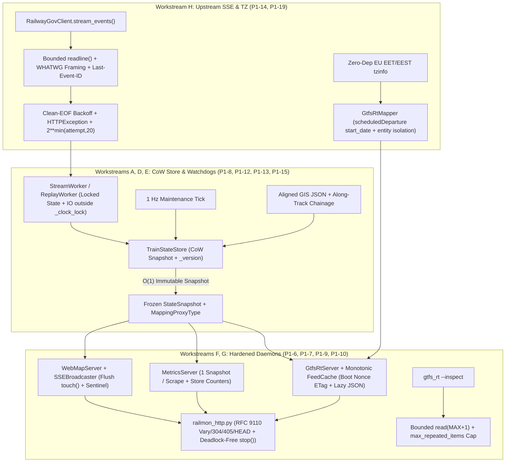

# Implementation Plan — P1-14: Phase 2 — Safety Watchdogs, Concurrency & Protocol Compliance (`P1-6`, `P1-7`, `P1-8`, `P1-9`, `P1-10`, `P1-12`, `P1-13`, `P1-14`, `P1-15`, `P1-16`, `P1-17`, `P1-19`)

> **Reference Review:** [`../../../architecture/codebase-architecture-review.md`](../../../architecture/codebase-architecture-review.md#L403-L406) (Phase 2 — Safety Watchdogs, Concurrency & Protocol Compliance; all 12 remaining P1 findings)  
> **Related Phase 2 Foundations (Resolved):** [`../p0/p0-17-safety-watchdog-failures-fix-plan.md`](../p0/p0-17-safety-watchdog-failures-fix-plan.md) (`19764a8`), [`../p0/p0-19-openmetrics-compliance-label-collisions-and-storage-collector-fix-plan.md`](../p0/p0-19-openmetrics-compliance-label-collisions-and-storage-collector-fix-plan.md) (`9dfa314`), [`./p1-10-slowloris-and-http-connection-exhaustion-fix-plan.md`](./p1-10-slowloris-and-http-connection-exhaustion-fix-plan.md) (`d343085`), [`./p1-11-exporter-cors-and-host-header-dns-rebinding-fix-plan.md`](./p1-11-exporter-cors-and-host-header-dns-rebinding-fix-plan.md) (`830b80e`)  
> **Target Modules:** [`../../../../tui/geo.py`](../../../../tui/geo.py), [`../../../../tui/state.py`](../../../../tui/state.py), [`../../../../tui/stream_worker.py`](../../../../tui/stream_worker.py), [`../../../../tui/mock_engine.py`](../../../../tui/mock_engine.py), [`../../../../tui/renderer.py`](../../../../tui/renderer.py), [`../../../../tui/app.py`](../../../../tui/app.py), [`../../../../tui/data/speed_limits.json`](../../../../tui/data/speed_limits.json), [`../../../../tui/data/infrastructure.json`](../../../../tui/data/infrastructure.json), [`../../../../railmon_watchdog.py`](../../../../railmon_watchdog.py), [`../../../../railmon_http.py`](../../../../railmon_http.py), [`../../../../train_tracker.py`](../../../../train_tracker.py), [`../../../../storage/recorder.py`](../../../../storage/recorder.py), [`../../../../server/sse.py`](../../../../server/sse.py), [`../../../../server/handler.py`](../../../../server/handler.py), [`../../../../server/daemon.py`](../../../../server/daemon.py), [`../../../../exporter/collector.py`](../../../../exporter/collector.py), [`../../../../exporter/server.py`](../../../../exporter/server.py), [`../../../../gtfs_rt/server.py`](../../../../gtfs_rt/server.py), [`../../../../gtfs_rt/mapper.py`](../../../../gtfs_rt/mapper.py), [`../../../../gtfs_rt/models.py`](../../../../gtfs_rt/models.py), [`../../../../gtfs_rt/exporter.py`](../../../../gtfs_rt/exporter.py)  
> **Relevant Rules & Skills:** [`../../../../.agents/rules/misra-autosar-python.md`](../../../../.agents/rules/misra-autosar-python.md), [`../../../../.agents/rules/testing.md`](../../../../.agents/rules/testing.md), [`../../../../.agents/skills/stream-resilience-tester/SKILL.md`](../../../../.agents/skills/stream-resilience-tester/SKILL.md), [`../../../../.agents/skills/tui-compatibility-tester/SKILL.md`](../../../../.agents/skills/tui-compatibility-tester/SKILL.md), [`../../../../.agents/skills/memory-leak-profiler/SKILL.md`](../../../../.agents/skills/memory-leak-profiler/SKILL.md), [`../../../../.agents/skills/static-safety-analyzer/SKILL.md`](../../../../.agents/skills/static-safety-analyzer/SKILL.md), [`../../../../.agents/skills/ci-quality-gate/SKILL.md`](../../../../.agents/skills/ci-quality-gate/SKILL.md)

---

## 1. Executive Summary & Phase 2 Status Ledger

With **Phase 0** (`a55e602`) and **Phase 1** (`0c7ea57`) 100% resolved (`1,067` passing tests, `0` AST errors/warnings across all `108` repo Python files), **Phase 2** closes **all 12 remaining P1 findings** in [`codebase-architecture-review.md`](../../../architecture/codebase-architecture-review.md) across three cohesive sub-phases while preserving zero external runtime dependencies and strict AST safety compliance:

| Phase 2 Roadmap Pillar | Already Resolved on `HEAD 0c7ea57` | Remaining Workstreams in This Plan (`P1-14`) |
|---|---|---|
| **Pillar 1 — Safety Watchdogs, GIS Geometry & Operational CLI** | State-aware eviction TTL (drop/tunnel alerts), specific-first corridor normalization + family geo-snapping, `TrainRecord.last_updated` ghost preemption ([`P0-17`](../p0/p0-17-safety-watchdog-failures-fix-plan.md), `19764a8`) | **Workstream A (`P1-15`):** GIS JSON polyline alignment + CI geometry test, along-track shared-trunk chainage conflicts, `TERMINAL_STATION_IDS` fix, `FROZEN` hysteresis, `(alert_id, severity)` bell escalation, nearest CRITICAL conflict, F-10.1 strict ID precedence, pause-aware pruning.<br>**Workstream B (`P1-16`):** Conformal `get_km_per_cell()` `cos` fix, southbound `SimulatedTrain` heading flip, Liang-Barsky `BrailleCanvas` clipping + track cache, `safe_addstr()` ASCII fallback.<br>**Workstream C (`P1-17`):** Live SSE/DB ingestion in `sensor-health`/`conflicts`, `run_watch_mode` ticker + stalled-stream timeout tick, exact `matches_train_number()`. |
| **Pillar 2 — Concurrency, Copy-on-Write State Store & Lifecycle** | Bounded HTTP connection semaphore/rejector, Slowloris deadlines, SSE client caps & write timeouts ([`P1-10`](./p1-10-slowloris-and-http-connection-exhaustion-fix-plan.md), `d343085`); `Database` dead-thread connection reaper (`0c7ea57`) | **Workstream D (`P1-8`):** Copy-on-write immutable `TrainStateStore` snapshots + 1 Hz maintenance tick (bumping `_version`), $O(1)$ `get_connection_status()`, shared per-scrape snapshot in `/metrics`.<br>**Workstream E (`P1-12`, `P1-13`):** Store-backed conflict/reconnect counters (eliminating collector races & `_seen_conflict_ids` leak), monotonic `FeedCache` + boot-nonce ETag + lazy JSON, `StreamWorker`/`ReplayWorker`/`TelemetryRecorder`/`TUIApp` race fixes.<br>**Workstream F (`P1-9`, `P1-10`):** `SSEBroadcaster` consumer-side `touch()` + shutdown sentinel + `Connection: close`, deadlock-free daemon `stop()`, async-signal-safe `install_signal_handlers()`. |
| **Pillar 3 — Protocol Compliance (HTTP/1.1, Upstream SSE & GTFS-RT)** | OpenMetrics 1.0.0 & Prometheus 0.0.4 compliance + RFC 9110 `q=` negotiation ([`P0-19`](../p0/p0-19-openmetrics-compliance-label-collisions-and-storage-collector-fix-plan.md), `9dfa314`); RFC 9110/9112 `Host` validation & opt-in CORS ([`P1-11`](./p1-11-exporter-cors-and-host-header-dns-rebinding-fix-plan.md), `830b80e`) | **Workstream G (`P1-6`, `P1-7`):** RFC 9110 `Vary`, encoding-scoped ETags, bodyless `304`/`HEAD`, `Allow` + `close_connection` on `405`, `Accept-Encoding` `q=` parsing, `If-None-Match` CORS; bounded `gtfs_rt --inspect` read + protobuf repeated-item caps.<br>**Workstream H (`P1-14`, `P1-19`):** Upstream SSE clean-EOF backoff, `HTTPException` catch, `2 ** min(attempt, 20)`, bounded `readline()`, WHATWG framing + `Last-Event-ID`; zero-dep EU EET/EEST fallback, overnight `start_date`/`trip_id`, per-entity error isolation, `mkstemp` + Windows `os.replace()` retry. |

---

## 2. Empirically Verified Defects Remaining in Phase 2

| ID | Defect | Target Location(s) | Empirically Verified Root Cause & Impact |
|---|---|---|---|
| **P1-6** | **HTTP/1.1 Protocol & Caching Violations (`304`, `405`, `Vary`, ETag, `HEAD`)** | [`railmon_http.py`](../../../../railmon_http.py#L487-L750), [`gtfs_rt/server.py`](../../../../gtfs_rt/server.py#L169-L287), [`server/handler.py`](../../../../server/handler.py#L74-L92), [`#L359-L388`](../../../../server/handler.py#L359-L388), [`exporter/server.py`](../../../../exporter/server.py#L41-L117) | Same strong `ETag` shared across plain & gzip bodies without `Vary: Accept, Accept-Encoding`; `304` sends `Content-Length: 0`; `405` on `POST`/`PUT` leaves unread body in keep-alive stream (missing `Connection: close` and `Allow`, causing intermittent Windows `WinError 10053`); `HEAD` errors write response bodies; `"gzip" in accept` ignores case and `gzip;q=0`; `WebMapServer` CORS omits `If-None-Match`. |
| **P1-7** | **Memory-Amplification DoS & TOCTOU Read in `gtfs_rt --inspect`** | [`gtfs_rt/exporter.py`](../../../../gtfs_rt/exporter.py#L160-L195), [`gtfs_rt/models.py`](../../../../gtfs_rt/models.py#L1156-L1188) | `os.path.getsize()` check followed by unbounded `fh.read()` (TOCTOU); repeated protobuf fields in `from_proto()` have no element cap (16 MiB crafted `.pb` expands to ~3.35M frozen objects / >1.5 GiB RAM). |
| **P1-8** | **`TrainStateStore.get_snapshot()` Heavy Mutation Under Coarse `RLock` & Silent Version Drift** | [`tui/state.py`](../../../../tui/state.py#L1471-L1601), [`tui/stream_worker.py`](../../../../tui/stream_worker.py#L140-L165), [`exporter/collector.py`](../../../../exporter/collector.py#L180-L490) | Every `get_snapshot()` holds `self._lock` to run $O(N \cdot S + N^2)$ sensor-health + conflict recomputation and mutates records without incrementing `_version` (serving stale GTFS-RT ETags). Called on every SSE frame in `StreamWorker`, 15×/sec in idle `TUIApp`, and 3× per `/metrics` scrape. `get_train()`/`get_selected_train()` leak live mutable `TrainRecord`s. |
| **P1-9** | **Inverted SSE Stale-Client Eviction & Shutdown Socket Leak** | [`server/sse.py`](../../../../server/sse.py#L98-L181), [`server/handler.py`](../../../../server/handler.py#L443-L504) | `broadcast()` calls `conn.touch()` on enqueue (even on queue overflow), so dead consumers are never evicted while traffic flows; conversely, `_handle_sse_stream()` writes `:ping` without calling `conn.touch()`, evicting healthy browsers after 60s of quiet traffic. On shutdown, `close_connection` remains `False` under HTTP/1.1, pinning threads on `rfile.readline()`. |
| **P1-10** | **Shutdown & Signal-Handler Deadlocks + Non-Async-Signal-Safe Logging** | [`railmon_http.py`](../../../../railmon_http.py#L753-L973), [`server/daemon.py`](../../../../server/daemon.py#L140-L173), [`exporter/server.py`](../../../../exporter/server.py#L335-L375), [`gtfs_rt/server.py`](../../../../gtfs_rt/server.py#L366-L398), [`train_tracker.py`](../../../../train_tracker.py#L192-L230) | `server.stop()` calls `BaseServer.shutdown()` unconditionally, deadlocking permanently if invoked on the serving thread or before `serve_forever()` enters its poll loop. `install_signal_handlers()` calls `logger.info()` inside `_handle_signal()` *before* `event.set()`, risking `RuntimeError: reentrant call` that drops shutdown signals, while PEP 475 restarts blocking retry sleeps. |
| **P1-12** | **Collector Data Races, Unbounded Conflict Set & `FeedCache` Version Rollback / ETag Collision** | [`exporter/collector.py`](../../../../exporter/collector.py#L310-L490), [`gtfs_rt/mapper.py`](../../../../gtfs_rt/mapper.py#L996-L1040) | `WatchdogMetricsCollector` & `StreamMetricsCollector` mutate shared dicts/sets across scrape threads unlocked, leak `_seen_conflict_ids` forever, and miss between-scrape events. `FeedCache.get_or_build()` rolls `_active_version` backwards on concurrent builds (`!=` instead of `>`), reuses `version=1` ETags across restarts, and eagerly serializes ProtoJSON on `.pb` requests. |
| **P1-13** | **`StreamWorker`, `ReplayWorker`, `TelemetryRecorder` & `TUIApp` Multi-Threading Races** | [`tui/stream_worker.py`](../../../../tui/stream_worker.py#L32-L565), [`storage/recorder.py`](../../../../storage/recorder.py#L307-L394), [`tui/app.py`](../../../../tui/app.py#L689-L711), [`#L1149-L1188`](../../../../tui/app.py#L1149-L1188) | `StreamWorker` pause/resume races, clean-EOF spin, and unpruned stale trains during quiet keepalives; `ReplayWorker` EOF-pause race, SQLite I/O under `_clock_lock`, and silent death on `OperationalError`; `TelemetryRecorder.stop()` ignores `join()` timeout before `db.close()` & `enqueue_batch()` bypasses `queue_maxsize`; `TUIApp` timetable/cab daemon threads mutate UI/toast state unlocked with ABA overwrite risk. |
| **P1-14** | **SSE Clean-EOF Storm, Uncaught `IncompleteRead`, `2 ** attempt` Overflow, Single-Line OOM & WHATWG Framing** | [`train_tracker.py`](../../../../train_tracker.py#L1455-L1631) | Clean EOF loops with 0s sleep; `http.client.IncompleteRead`/`BadStatusLine` aren't subclasses of `OSError`/`URLError`; `2 ** attempt` raises `OverflowError` at `attempt=1024`; `for raw_line in resp:` buffers unbounded newline-free lines before checking `MAX_SSE_FRAME_BYTES`; multi-line `data:` joined with `""` instead of `"\n"`, `.strip()` breaks whitespace, UTF-8 BOM breaks first event. |
| **P1-15** | **GIS Geometry Drift (up to 3.2 km), Shared-Trunk Conflict Blind Spots & Watchdog State-Machine Bugs** | [`tui/geo.py`](../../../../tui/geo.py#L2115-L2410), [`#L3333-L3421`](../../../../tui/geo.py#L3333-L3421), [`tui/state.py`](../../../../tui/state.py#L999-L1069), [`#L1226-L1301`](../../../../tui/state.py#L1226-L1301), [`tui/data/speed_limits.json`](../../../../tui/data/speed_limits.json), [`tui/data/infrastructure.json`](../../../../tui/data/infrastructure.json) | `TSR-PATHE-SPERCHEIOS` (558–1,061m off), `northern-strymonas-gorge` (3,238m off), and `tun-othrys` (1,014m off, `max_dist_m=45m`) miss mainline trains; `TERMINAL_STATION_IDS` contains nonexistent `"lian"`/`"kth"`; chord conflicts miss S-curves & shared trunks (`SKA–Inoi`, `Thessaloniki–Kilkis`) and false-alarm Chalkida on double track; `FROZEN` flaps every 20s; `WARNING->CRITICAL` shares `alert_id` (no escalation bell); farthest `CRITICAL` overwrites nearest; F-10.1 `apply_delay_updates()` falls through on mismatched `train_id`; `PAUSED` prunes trains. |
| **P1-16** | **Scale Bar (+29.74% Error), Backwards Southbound Mock Arrows, Unclipped Bresenham & Strict ASCII Crash** | [`tui/geo.py`](../../../../tui/geo.py#L555-L568), [`#L720-L751`](../../../../tui/geo.py#L720-L751), [`tui/mock_engine.py`](../../../../tui/mock_engine.py#L1031-L1147), [`tui/renderer.py`](../../../../tui/renderer.py#L1171-L1215) | `get_km_per_cell()` omits $\cos(\phi)$ (+29.74% error); `SimulatedTrain.step()` leaves `track_heading` unflipped for `direction == -1`; `BrailleCanvas.draw_line()` steps off-screen pixels without clipping + re-snaps tracks every frame; `safe_addstr()` doesn't catch `UnicodeEncodeError` on `LANG=C`. |
| **P1-17** | **CLI Operational Bugs: Mock-Only `sensor-health`/`conflicts`, Broken `watch` Loop & Cross-Train Matching** | [`train_tracker.py`](../../../../train_tracker.py#L4029-L4326), [`railmon_watchdog.py`](../../../../railmon_watchdog.py#L215-L246) | `run_sensor_health_mode()` ignores `--demo` and runs `MockTelemetryEngine` with `now == last_updated`; `run_conflicts_mode()` always runs mock data; `run_watch_mode()` assigns `matching_pos` after `if not events: continue` and never runs `evaluate_timeout()` during stream stalls; `matches_train_number("IC52")` matches `"5"`, `"2"`, `"IC520"`, `"R52"`. |
| **P1-19** | **GTFS-RT Conformance & Windows Portability: EEST DST Drift, Midnight Flip, `None`/`Inf` Crash & Atomic Replace** | [`gtfs_rt/mapper.py`](../../../../gtfs_rt/mapper.py#L81-L89), [`#L309-L636`](../../../../gtfs_rt/mapper.py#L309-L636), [`gtfs_rt/exporter.py`](../../../../gtfs_rt/exporter.py#L36-L56) | Windows without `tzdata` falls back to fixed `UTC+2` (1 hour off during EEST `UTC+3`); overnight trains flip `start_date`/`trip_id` at midnight; `delay=None`/`distance=inf`/`chainage=inf` crash entire fleet feed; `write_atomic_bytes()` uses predictable `.tmp.<pid>.<tid>` (CWE-377) and crashes `--watch` on Windows `PermissionError`. |

---

## 3. Target Architecture & Hardened Concurrency / Protocol Flows

### A. Phase 2 Hardened Dataflow & Lifecycle (ASCII)

```text
+------------------------------------------------------------------------------+
|  UPSTREAM SSE & WATCHDOG PIPELINE (Workstreams A, B, C, H: P1-14..17)        |
+------------------------------------------------------------------------------+
|  railway.gov.gr SSE ---> RailwayGovClient._iter_sse_frames()                 |
|                          [bounded readline(), WHATWG BOM/data:\n,            |
|                           Last-Event-ID, HTTPException, clean-EOF backoff,   |
|                           2 ** min(attempt, 20)]                             |
|                                  |                                           |
|                                  v                                           |
|  StreamWorker / CLI ---> TrainStateStore (CoW Immutable Snapshot)            |
|  [O(1) get_connection_   + 1 Hz Maintenance Tick (bumping _version)          |
|   status(), PAUSED       + Aligned GIS JSON (tracks/speed/infra CI test)     |
|   pruning guard]         + Along-Track Shared-Trunk Chainage Conflicts       |
|                          + FROZEN Hysteresis + (alert_id, sev) Bell Latch    |
|                          + Store-Backed Conflict / Reconnect Counters        |
+------------------------------------------------------------------------------+
                                   |
           +-----------------------+-----------------------+
           v                       v                       v
+---------------------+ +---------------------+ +------------------------------+
| WebMapServer        | | MetricsServer       | | GtfsRtServer / Exporter      |
| (server/)           | | (exporter/)         | | (gtfs_rt/)                   |
| - SSE consumer-side | | - 1 shared snapshot | | - Monotonic FeedCache +      |
|   touch() on flush  | |   per /metrics      | |   boot-nonce ETag + lazy JSON|
| - Shutdown sentinel | | - Lock-free store   | | - Zero-dep EU EET/EEST tz    |
| - Connection: close | |   counters          | | - Scheduled-departure date   |
+----------+----------+ +----------+----------+ +--------------+---------------+
           |                       |                           |
           +-----------------------+---------------------------+
                                   v
+------------------------------------------------------------------------------+
|  SHARED HARDENED HTTP BASE (railmon_http.py — Workstreams F, G: P1-6, P1-10) |
|  - RFC 9110: Vary, encoding-scoped ETags, bodyless 304/HEAD, Allow+close 405 |
|  - Proper Accept-Encoding q= parser; WebMap CORS Allow-Headers If-None-Match |
|  - Deadlock-free stop() (_serving_started + thread-id guard)                 |
|  - Async-signal-safe install_signal_handlers() (event.set() only)            |
+------------------------------------------------------------------------------+
```

### B. Phase 2 Concurrency & Protocol Architecture (Mermaid)



---

## 4. Detailed Implementation Design

### Workstream A (`P1-15`): GIS Geometry Alignment, Along-Track Shared-Trunk Conflicts & Watchdog State-Machine Fixes

#### Targets: [`tui/data/speed_limits.json`](../../../../tui/data/speed_limits.json), [`tui/data/infrastructure.json`](../../../../tui/data/infrastructure.json), [`tui/geo.py`](../../../../tui/geo.py#L2115-L2410), [`#L3333-L3421`](../../../../tui/geo.py#L3333-L3421), [`tui/state.py`](../../../../tui/state.py#L999-L1069), [`#L1226-L1301`](../../../../tui/state.py#L1226-L1301)

1. **GIS JSON Polyline Alignment + CI Geometry Gate:**
   - Re-project `TSR-PATHE-SPERCHEIOS` and `northern-strymonas-gorge` in [`tui/data/speed_limits.json`](../../../../tui/data/speed_limits.json) and `tun-othrys` in [`tui/data/infrastructure.json`](../../../../tui/data/infrastructure.json) onto the exact corresponding segments in [`tui/data/tracks.json`](../../../../tui/data/tracks.json) so perpendicular snap distance is `< 30 m` (within the 45 m tunnel envelope and TSR corridor envelope).
   - Add automated CI regression test `TC-WDG-19` that loads `tracks.json`, `speed_limits.json`, `infrastructure.json`, and `stations.json`, verifying every TSR polyline vertex and every tunnel portal/midpoint lies within strict distance bounds of its declared corridor track polyline, and that every ID in `TERMINAL_STATION_IDS` exists in `stations.json`.
2. **Fix `TERMINAL_STATION_IDS` (`tui/geo.py`):**
   - Replace nonexistent `"lian"` and `"kth"` with verified station IDs from [`tui/data/stations.json`](../../../../tui/data/stations.json) (e.g., `"lianokladi"`, `"korinthos"` / exact canonical `id` fields).
3. **Along-Track Chainage Separation on Shared Trunks (`tui/geo.py`):**
   - Add helper `project_point_to_polyline_chainage(lat, lng, polyline) -> Optional[Tuple[float, float]]` returning `(chainage_km, lateral_dist_m)`.
   - In `evaluate_train_conflicts()`:
     - When two trains resolve to the same physical corridor or share a defined trunk section (`SKA–Inoi` shared by `athens-thessaloniki` & `athens-chalkida`; `Thessaloniki–Kilkis` shared by `thessaloniki-alexandroupoli` & `thessaloniki-florina`), compute along-track separation `abs(chainage_a - chainage_b)` and signed closing velocity along the polyline tangent rather than pure Euclidean chord distance.
     - Preserve double-track suppression when *both* trains are on a confirmed double-track trunk segment (e.g., Chalkida train on `SKA–Inoi` double-track mainline), while flagging opposing trains once either enters the single-track branch (`Inoi–Chalkida`).
4. **Watchdog State-Machine & F-10.1 Fixes (`tui/geo.py`, `tui/state.py`):**
   - **`FROZEN` Hysteresis:** Require a sustained movement delta (`>= 50 m` or speed change after fresh coordinate update) before clearing `FROZEN`, preventing 20s flapping on noisy GPS jitter.
   - **Alert Bell Escalation & Nearest Conflict Priority:** Key the alert bell latch in `TrainStateStore` on `(alert_id, severity)` so `WARNING -> CRITICAL` escalations ring the bell. When indexing active conflicts per train, retain the **highest-severity, then nearest-distance** conflict rather than letting a farther `CRITICAL` overwrite a closer one.
   - **F-10.1 `apply_delay_updates()` Strict ID Precedence:** When a `DelayUpdate` carries a non-empty `train_id`, match **only** by `train_id` (do not fall through to `train_number` on mismatch, which corrupts coupled consists or superseded ghost trains).
   - **Pause-Aware Pruning:** In `TrainStateStore.prune_stale_trains()`, return `0` immediately when `self._status == ConnectionStatus.PAUSED` so pressing `Space` to inspect the TUI does not evict the fleet after timeout.

---

### Workstream B (`P1-16`): Conformal Scale Bar, Southbound Mock Heading, Bresenham Clipping & Strict ASCII Safety

#### Targets: [`tui/geo.py`](../../../../tui/geo.py#L555-L568), [`#L720-L751`](../../../../tui/geo.py#L720-L751), [`tui/mock_engine.py`](../../../../tui/mock_engine.py#L1031-L1147), [`tui/renderer.py`](../../../../tui/renderer.py#L1171-L1215)

1. **Conformal Scale Bar Correction (`tui/geo.py`):**
   - In `get_km_per_cell()`, multiply the horizontal degree-to-km factor by `math.cos(math.radians(center_lat)) / cos_phi0` (matching the equirectangular projection scale at `center_lat`), eliminating the `+29.74%` horizontal scale over-reporting (`11.57 km` vs `8.92 km`).
2. **Southbound Mock Heading Flip (`tui/mock_engine.py`):**
   - In `SimulatedTrain.step()`, when `self.direction == -1`, flip `track_heading = (segment_bearing + 180.0) % 360.0` so southbound mock trains point South (`▼`) instead of North (`▲`).
3. **Liang-Barsky Clipping & Viewport Track-Canvas Caching (`tui/geo.py`, `tui/renderer.py`):**
   - Add pure-stdlib `_clip_line_liang_barsky(x0, y0, x1, y1, width, height)` in `BrailleCanvas.draw_line()` so wildly off-screen coordinates at high zoom clip in $O(1)$ before Bresenham stepping (preventing CPU freezes).
   - Cache the static rendered track layer keyed by `(width, height, viewport_bounds, layer_flags)` in `TUIRenderer` and pre-snap breadcrumbs on ingestion rather than re-snapping up to 225k segments/frame.
4. **Strict ASCII Locale Safety (`tui/renderer.py`):**
   - In `safe_addstr()`, catch `UnicodeEncodeError` alongside `curses.error` and retry with ASCII transliteration (`text.encode("ascii", errors="replace").decode("ascii")`) so `LANG=C` / non-UTF-8 terminals never crash.

---

### Workstream C (`P1-17`): Operational CLI Watchdogs (`sensor-health`, `conflicts`, `watch`) & Exact Train Matching

#### Targets: [`train_tracker.py`](../../../../train_tracker.py#L4029-L4326), [`railmon_watchdog.py`](../../../../railmon_watchdog.py#L215-L246)

1. **Wire Live SSE / DB Ingestion into `sensor-health` & `conflicts` (`train_tracker.py`):**
   - Update `run_sensor_health_mode()` and `run_conflicts_mode()`:
     - Default to live `RailwayGovClient` snapshot/stream (or `--from-db <db>` when provided) instead of unconditionally running `MockTelemetryEngine`.
     - Only instantiate `MockTelemetryEngine` when `--demo` is explicitly passed, and in `--demo` mode advance simulated timestamps across multiple steps so `FROZEN`/`DROPPED`/`STALE` states are genuinely demonstrable.
2. **Fix `run_watch_mode()` Ticker Update & Stalled-Stream Timeout Tick (`train_tracker.py`):**
   - Assign `matching_pos` *before* `if not events: continue` so the live status ticker updates on every position frame even when no alert fires.
   - Decouple `WatchdogEvaluator.evaluate_timeout(now)` from incoming SSE frames using a background reader queue + bounded `queue.get(timeout=1.0)` loop so `TELEMETRY_LOST` triggers reliably during complete upstream stalls.
3. **Exact/Anchored `matches_train_number()` (`railmon_watchdog.py`):**
   - Replace substring matching (`target in candidate or candidate in target`) with exact normalized equality (`norm_target == norm_candidate`) plus an explicit alphanumeric prefix match only when the user passes bare digits (e.g., `"52"` matches `"IC52"` / `"52"` via regex `r"^(?:[A-Z]+)?0*52$"`, never `"5"`, `"2"`, `"IC520"`, or `"R52"` when `"IC52"` was requested).

---

### Workstream D (`P1-8`): `TrainStateStore` Copy-on-Write Immutable Snapshots & 1 Hz Maintenance Tick

#### Targets: [`tui/state.py`](../../../../tui/state.py#L586-L1601), [`tui/stream_worker.py`](../../../../tui/stream_worker.py#L140-L165), [`exporter/collector.py`](../../../../exporter/collector.py#L180-L490)

1. **Copy-on-Write Immutable `StateSnapshot` Publication (`tui/state.py`):**
   - Maintain `self._published_snapshot: Optional[StateSnapshot]` protected by `self._lock`.
   - Rebuild the snapshot **only** when state mutates (`update_positions`, `apply_delay_updates`, `apply_schedule_cards`, UI navigation, or `run_maintenance_tick()`), incrementing `self._version` whenever telemetry or watchdog state changes.
   - Wrap snapshot mappings in `types.MappingProxyType` and expose immutable tuples for collections so callers cannot mutate store internals; return defensive copies/frozen views from `get_train()` and `get_selected_train()`.
   - Make `get_snapshot()` an $O(1)$ lock-minimal read returning `self._published_snapshot` with zero mutation and zero $O(N \cdot S + N^2)$ recomputation on the read path.
2. **1 Hz Maintenance Tick (`run_maintenance_tick(now: Optional[float] = None)`):**
   - Run sensor-health staleness transitions, conflict recomputation, and `prune_stale_trains()` inside `run_maintenance_tick()` (invoked periodically by `StreamWorker` / `TUIApp` / daemon loop at `~1 Hz`, and explicitly callable in unit tests).
   - If any train's health status, conflict set, or pruned roster changed, increment `self._version` and publish a fresh immutable `StateSnapshot` — ensuring GTFS-RT `FeedCache` ETags reflect watchdog transitions immediately.
3. **Eliminate Redundant Snapshots (`tui/stream_worker.py`, `exporter/collector.py`):**
   - Add $O(1)$ `TrainStateStore.get_connection_status() -> ConnectionStatus` and call it in `StreamWorker` instead of `get_snapshot()` on every SSE frame.
   - In `exporter/collector.py` / `MetricRegistry`, capture **one** `StateSnapshot` per `/metrics` scrape and pass it to `TrainTelemetryCollector`, `WatchdogMetricsCollector`, and `StreamMetricsCollector` (cutting scrape lock acquisitions by 3× and guaranteeing cross-collector consistency).

---

### Workstream E (`P1-12`, `P1-13`): Thread-Safe Collectors, Monotonic `FeedCache` & Worker/Recorder/TUI Concurrency

#### Targets: [`exporter/collector.py`](../../../../exporter/collector.py#L310-L490), [`gtfs_rt/mapper.py`](../../../../gtfs_rt/mapper.py#L996-L1040), [`tui/stream_worker.py`](../../../../tui/stream_worker.py#L32-L565), [`storage/recorder.py`](../../../../storage/recorder.py#L307-L394), [`tui/app.py`](../../../../tui/app.py#L689-L711), [`#L1149-L1188`](../../../../tui/app.py#L1149-L1188)

1. **Store-Backed Cumulative Counters (`tui/state.py`, `exporter/collector.py`):**
   - Track cumulative `total_conflicts_by_type`, `total_sensor_alerts_by_status`, and `total_reconnects` directly inside `TrainStateStore` on state transitions (under `self._lock`), exposing immutable totals on `StateSnapshot`.
   - Remove unlocked mutable dicts and the unbounded `_seen_conflict_ids` set from `WatchdogMetricsCollector` and `StreamMetricsCollector`, making both collectors pure, lock-free readers of `StateSnapshot` that never leak memory and never miss between-scrape events.
2. **Monotonic `FeedCache` with Boot-Nonce ETag & Lazy JSON (`gtfs_rt/mapper.py`):**
   - Generate a per-process 8-hex-char `_boot_nonce = secrets.token_hex(4)` in `FeedCache.__init__()`.
   - In `FeedCache.get_or_build()`, replace `if snapshot.version != self._active_version:` with strict monotonic advancement:
     - Only replace `_active_version` and clear `_entries` when `snapshot.version > self._active_version`.
     - If `snapshot.version < self._active_version`, return the freshly built `CachedFeed` without mutating `_active_version` or evicting newer entries.
   - Compute `json_bytes` lazily on demand (via a cached helper or `include_json: bool = False`) so `.pb` scrapes never pay `json.dumps()` serialization overhead.
   - Include `_boot_nonce` (and/or SHA-256 prefix of payload) in `etag_pb` / `etag_json` so daemon restarts never collide with stale browser/proxy `version=1` ETags.
3. **Worker, Recorder & TUI Concurrency Hardening:**
   - **`StreamWorker` (`tui/stream_worker.py`):** Guard pause/resume transitions with a dedicated `self._state_lock`, add bounded backoff on clean-EOF exits, and invoke `store.run_maintenance_tick()` during quiet keepalive intervals so stale trains still prune on schedule.
   - **`ReplayWorker` (`tui/stream_worker.py`):** Release `self._clock_lock` before executing SQLite queries, fix the EOF-pause race under `_clock_lock`, and catch `sqlite3.OperationalError` with structured logging + graceful status reporting instead of silent thread death.
   - **`TelemetryRecorder` (`storage/recorder.py`):** Track queued *item* count (not just batch count) in `enqueue_batch()` so `queue_maxsize` cannot be bypassed by 50–200×; in `stop()`, inspect `self._worker_thread.is_alive()` after `join(timeout=...)` and log/abort `db.close()` if the worker is still running (preventing use-after-close crashes).
   - **`TUIApp` (`tui/app.py`):** Route background timetable and cab-stream lookup completions through a thread-safe `queue.Queue` tagged with a monotonic `request_id`, drained on the main curses UI thread so stale responses cannot overwrite newer selections (eliminating ABA races and unlocked UI mutation).

---

### Workstream F (`P1-9`, `P1-10`): SSE Broadcaster Staleness/Shutdown & Deadlock-Free Daemon Lifecycle / Signal Safety

#### Targets: [`server/sse.py`](../../../../server/sse.py#L98-L181), [`server/handler.py`](../../../../server/handler.py#L443-L504), [`railmon_http.py`](../../../../railmon_http.py#L753-L973), [`server/daemon.py`](../../../../server/daemon.py#L140-L173), [`exporter/server.py`](../../../../exporter/server.py#L335-L375), [`gtfs_rt/server.py`](../../../../gtfs_rt/server.py#L366-L398), [`train_tracker.py`](../../../../train_tracker.py#L192-L230)

1. **Fix Inverted SSE Stale-Client Eviction & Shutdown Sentinel (`server/sse.py`, `server/handler.py`):**
   - Remove `conn.touch()` from `SSEBroadcaster.broadcast()` (enqueueing must never mark a blocked/dead consumer as alive).
   - Call `conn.touch()` exclusively inside `WebMapRequestHandler._handle_sse_stream()` immediately after a successful `self.wfile.flush()` for both data frames and `:ping` keepalives.
   - Add `SSEBroadcaster.shutdown()` and update `unregister_client()` to push a `None` sentinel (evicting one stale frame if full) into `conn.queue` so blocked handler threads wake immediately on eviction or server shutdown.
   - Explicitly set `self.close_connection = True` and send `Connection: close` on SSE responses so HTTP/1.1 keep-alive never pins the handler thread on `rfile.readline()` after stream exit.
2. **Deadlock-Free `stop()` Across All 3 HTTP Daemons (`railmon_http.py`, `server/daemon.py`, `exporter/server.py`, `gtfs_rt/server.py`):**
   - Add `_serving_started: threading.Event` and `_serve_thread_id: Optional[int]` to `BoundedHTTPServer` (set at the top of `serve_forever()`).
   - Provide `BoundedHTTPServer.safe_shutdown(timeout: float = 5.0)`:
     - If `_serving_started` is not set, set `_BaseServer__shutdown_request = True` (or close socket) without blocking in `BaseServer.shutdown()`.
     - If `threading.get_ident() == self._serve_thread_id`, spawn a tiny daemon helper or set shutdown request flag instead of self-deadlocking inside `BaseServer.shutdown()`.
     - Otherwise invoke `self.shutdown()` safely.
   - Delegate `WebMapServer.stop()`, `MetricsServer.stop()`, and `GtfsRtServer.stop()` through `safe_shutdown()`, removing duplicate deadlocking signal helpers.
3. **Async-Signal-Safe `install_signal_handlers()` (`train_tracker.py`):**
   - Inside `_handle_signal(signum, _frame)`: **never** call `logger.info()` or any lock-acquiring I/O. Only execute `event.set()` (and on a second `SIGINT` while `event.is_set()`, restore default handler / raise `KeyboardInterrupt` so a wedged process can always be interrupted).
   - Replace any uninterruptible `time.sleep(retry_after)` in retry loops with `if stop_event is not None and stop_event.wait(timeout=wait_time): return`.

---

### Workstream G (`P1-6`, `P1-7`): RFC 9110 HTTP/1.1 Framing & Bounded Protobuf Inspection

#### Targets: [`railmon_http.py`](../../../../railmon_http.py#L487-L750), [`server/handler.py`](../../../../server/handler.py#L74-L92), [`#L359-L388`](../../../../server/handler.py#L359-L388), [`exporter/server.py`](../../../../exporter/server.py#L41-L117), [`gtfs_rt/server.py`](../../../../gtfs_rt/server.py#L169-L287), [`gtfs_rt/exporter.py`](../../../../gtfs_rt/exporter.py#L160-L195), [`gtfs_rt/models.py`](../../../../gtfs_rt/models.py#L1156-L1188)

1. **Centralized RFC 9110 Helpers in `railmon_http.py`:**
   - Add `accepts_gzip(accept_encoding_header: Optional[str]) -> bool`: parse comma-separated coding tokens case-insensitively with `q=` weights; return `True` only when `gzip` (or `*` if `gzip` not explicitly `q=0`) has `q > 0.0` (rejecting `gzip;q=0`).
   - Add `format_representation_etag(base_etag: str, gzip_encoded: bool) -> str` and `etag_matches_if_none_match(if_none_match: Optional[str], current_etag: str) -> bool`: scope gzip vs identity ETags (`"-gz"` suffix) and support weak comparison per RFC 9110 §8.8.3.2 so plain and gzip representations never collide.
   - Add `send_not_modified(etag, vary)` emitting `304 Not Modified`, `ETag`, `Vary`, and **no** `Content-Length` or body (RFC 9110 §15.4.5).
   - Add `send_method_not_allowed(allowed: str = "GET, HEAD")` emitting `405 Method Not Allowed`, `Allow: GET, HEAD`, `Connection: close`, and setting `self.close_connection = True` (preventing unread `POST`/`PUT` bodies from desynchronizing keep-alive streams and fixing the Windows `WinError 10053` test flake).
   - Guard all error responses across `server/`, `exporter/`, and `gtfs_rt/` so `HEAD` requests send headers only (`head_only=True`, zero response body).
   - Emit `Vary: Accept, Accept-Encoding` on negotiable/compressible responses across all 3 daemons, and include `If-None-Match` in `WebMapServer` `Access-Control-Allow-Headers`.
2. **Bounded `gtfs_rt --inspect` Read & Protobuf Repeated-Item Caps (`gtfs_rt/exporter.py`, `gtfs_rt/models.py`):**
   - In `inspect_pb_file()`, replace `os.path.getsize()` + `fh.read()` with a single atomic bounded read `raw = fh.read(MAX_INSPECT_BYTES + 1)`; raise `ValueError` if `len(raw) > MAX_INSPECT_BYTES` (eliminating TOCTOU).
   - Add `MAX_PROTO_ENTITIES: int = 50_000` and `MAX_PROTO_REPEATED_ITEMS: int = 10_000` in `gtfs_rt/models.py`, enforced in `FeedMessage.from_proto()` and nested repeated-field decoders (`TripUpdate.stop_time_update`, `Alert.informed_entity`, `TranslatedString.translation`), raising `WireDecodeError` before memory amplification occurs.

---

### Workstream H (`P1-14`, `P1-19`): Upstream WHATWG SSE Resilience & GTFS-RT Cross-Platform Conformance

#### Targets: [`train_tracker.py`](../../../../train_tracker.py#L1455-L1631), [`gtfs_rt/mapper.py`](../../../../gtfs_rt/mapper.py#L81-L89), [`#L309-L636`](../../../../gtfs_rt/mapper.py#L309-L636), [`gtfs_rt/exporter.py`](../../../../gtfs_rt/exporter.py#L36-L56)

1. **Upstream SSE Resilience & WHATWG Framing (`train_tracker.py`):**
   - **Clean-EOF Backoff:** When `_iter_sse_frames()` returns normally (server closed connection cleanly) and `reconnect_delay > 0` and `not stop_event.is_set()`, treat EOF as a reconnectable disconnect with exponential backoff (`_compute_sse_reconnect_wait`) instead of tight-looping at 0s sleep.
   - **Catch `http.client.HTTPException`:** Expand the `except` tuple in `stream_events()` to `(urllib.error.URLError, http.client.HTTPException, TimeoutError, OSError)` so `IncompleteRead` and `BadStatusLine` trigger clean reconnects instead of crashing daemons.
   - **Prevent `OverflowError`:** Cap exponent via `2 ** min(attempt, 20)` in `_compute_sse_reconnect_wait()`.
   - **Bounded Line Read (Zero Single-Line OOM):** Replace `for raw_line in resp:` with a `while True:` loop calling `raw_line = resp.readline(MAX_SSE_FRAME_BYTES + 1)`. If `len(raw_line) > MAX_SSE_FRAME_BYTES` without a trailing newline, mark `oversized_frame = True` and discard chunks until the next `\n` or EOF without buffering unbounded memory.
   - **WHATWG SSE Spec Framing + `Last-Event-ID`:**
     - Strip UTF-8 BOM (`\ufeff`) on the first line of the stream.
     - Strip line endings (`\r\n`, `\n`, `\r`) only — do **not** `.strip()` significant whitespace.
     - Parse `field:value` per WHATWG §9.2.6 (strip at most **one** leading ASCII space `0x20` after `:`).
     - Join multi-line `data:` chunks with `"\n"` (not `""`).
     - Track `id:` (ignoring values containing NUL `\x00`) in `last_event_id` and send `Last-Event-ID: <id>` on reconnect requests.
2. **Zero-Dependency EU EET/EEST (`Europe/Athens`) Fallback (`gtfs_rt/mapper.py`, shared helper):**
   - Implement a stdlib `datetime.tzinfo` subclass `_AthensFallbackTZ` computing EU DST rules exactly (last Sunday of March `01:00 UTC` -> `UTC+3` EEST; last Sunday of October `01:00 UTC` -> `UTC+2` EET) whenever `ZoneInfo("Europe/Athens")` raises `ZoneInfoNotFoundError` (clean Windows installs without `tzdata`).
   - Reuse this fallback consistently in `gtfs_rt/mapper.py` (and wire `tui/renderer.py` / `storage/cli_formatters.py` to the same rule) so summer EEST timestamps are never off by 1 hour.
3. **GTFS-RT Overnight `start_date`, Numeric Sanitization & Per-Entity Isolation (`gtfs_rt/mapper.py`):**
   - Derive `TripDescriptor.start_date` and fallback `trip_id` from the trip's `scheduledDeparture` (or first stop's scheduled time in Athens TZ) when available, falling back to `now` only when no schedule exists — preventing midnight flips on overnight trains (`IC 600`/`601`).
   - Guard all numeric fields (`delay`, `distance`, `chainage`, `speed`, `lat`, `lng`) with `None` and `math.isfinite()` checks, and wrap per-train entity construction in narrowed fault isolation so one malformed vehicle record logs a warning and is skipped rather than aborting the entire fleet feed.
4. **Secure & Windows-Safe `write_atomic_bytes()` (`gtfs_rt/exporter.py`):**
   - Replace predictable `.tmp.<pid>.<tid>` with `tempfile.mkstemp(dir=target.parent, prefix=f".{target.name}.", suffix=".tmp")` (eliminating CWE-377).
   - Wrap `os.replace(tmp_path, target)` in a bounded retry loop (e.g., up to 5 attempts with 10–80 ms backoff on `PermissionError` on `sys.platform == "win32"`) with guaranteed `os.unlink(tmp_path)` cleanup on failure.

---

## 5. Recommended Execution Sequence & Commit Breakdown

Execute Phase 2 in **6 atomic, independently testable commits** (each passing `unittest`, `safety_ast_audit.py --strict`, and relevant verification gates):

| Step | Commit Scope | Findings Closed | Primary Files |
|---|---|---|---|
| **1** | `fix(geo,watchdogs): align GIS polylines, add along-track shared-trunk conflicts, and harden watchdog state machine` | **P1-15** | `tui/data/speed_limits.json`, `tui/data/infrastructure.json`, `tui/geo.py`, `tui/state.py`, `tests/test_tui_conflict_watchdog_geo.py`, `tests/test_tui_sensor_health.py` |
| **2** | `fix(tui,cli): fix scale bar cos factor, southbound mock heading, Bresenham clipping, ASCII safety, and live CLI watchdogs` | **P1-16**, **P1-17** | `tui/geo.py`, `tui/mock_engine.py`, `tui/renderer.py`, `train_tracker.py`, `railmon_watchdog.py`, `tests/test_tui_geo.py`, `tests/test_tui_renderer.py`, `tests/test_watchdog.py` |
| **3** | `perf(state): refactor TrainStateStore to copy-on-write snapshots with 1 Hz maintenance tick` | **P1-8** | `tui/state.py`, `tui/stream_worker.py`, `exporter/collector.py`, `tests/test_tui_state.py`, `tests/test_exporter_collector.py` |
| **4** | `fix(concurrency): eliminate collector races, monotonic FeedCache, and worker/recorder/TUI threading races` | **P1-12**, **P1-13** | `tui/state.py`, `exporter/collector.py`, `gtfs_rt/mapper.py`, `tui/stream_worker.py`, `storage/recorder.py`, `tui/app.py`, `tests/test_gtfs_mapper.py`, `tests/test_storage_recorder.py`, `tests/test_tui_stream_worker.py` |
| **5** | `fix(http,sse): fix SSE staleness/shutdown sentinel, deadlock-free daemon stop, async-signal safety, RFC 9110 framing, and bounded pb inspect` | **P1-6**, **P1-7**, **P1-9**, **P1-10** | `railmon_http.py`, `server/sse.py`, `server/handler.py`, `server/daemon.py`, `exporter/server.py`, `gtfs_rt/server.py`, `gtfs_rt/exporter.py`, `gtfs_rt/models.py`, `train_tracker.py`, `tests/test_http_hardening.py`, `tests/test_server_sse.py`, `tests/test_gtfs_server.py`, `tests/test_gtfs_models.py` |
| **6** | `fix(sse,gtfs-rt): harden upstream WHATWG SSE framing/EOF backoff and GTFS-RT EEST DST, midnight trips, and Windows atomic replace` | **P1-14**, **P1-19** | `train_tracker.py`, `gtfs_rt/mapper.py`, `gtfs_rt/exporter.py`, `tests/test_tracker.py`, `tests/test_gtfs_mapper.py`, `tests/test_gtfs_exporter.py` |

---

## 6. Verification & Test Matrix

### A. New Automated Regression Tests

| Test ID | Target Suite | Verification Scenario |
|---|---|---|
| `TC-WDG-19` | `tests/test_tui_conflict_watchdog_geo.py` | CI geometry check: every TSR in `speed_limits.json` (`TSR-PATHE-SPERCHEIOS`, `northern-strymonas-gorge`) and tunnel in `infrastructure.json` (`tun-othrys`) snaps within tolerance of `tracks.json`; all `TERMINAL_STATION_IDS` exist in `stations.json`. |
| `TC-WDG-20` | `tests/test_tui_conflict_watchdog_geo.py` | Along-track chainage detects S-curve opposing conflict on single track, detects shared-trunk conflict on `Thessaloniki–Kilkis`, and does **not** false-alarm Chalkida train on `SKA–Inoi` double-track mainline. |
| `TC-WDG-21` | `tests/test_tui_sensor_health.py` | `FROZEN` hysteresis suppresses 20s flapping on sub-threshold jitter; `(alert_id, severity)` bell latch re-triggers on `WARNING -> CRITICAL`; nearest `CRITICAL` conflict wins; F-10.1 `apply_delay_updates()` rejects mismatched `train_id`; `PAUSED` suspends stale pruning. |
| `TC-TUI-16` | `tests/test_tui_geo.py` | `get_km_per_cell()` at `38.0°N` matches geodesic `haversine` distance within 1%; `SimulatedTrain.step()` flips `track_heading` by 180° when `direction == -1`; `BrailleCanvas.draw_line()` clips `-10_000_000..10_000_000` in `< 5 ms`. |
| `TC-TUI-17` | `tests/test_tui_renderer.py` | `safe_addstr()` catches `UnicodeEncodeError` on simulated ASCII (`LANG=C`) locale and degrades cleanly without raising. |
| `TC-CLI-10` | `tests/test_watchdog.py` | `matches_train_number("IC52")` matches `"IC52"` / `"ic 52"` and rejects `"5"`, `"2"`, `"IC520"`, `"R52"`; `run_watch_mode()` updates ticker on non-event frames and fires `TELEMETRY_LOST` on stalled streams; `sensor-health`/`conflicts` use live source by default and `--demo` only when requested. |
| `TC-CON-01` | `tests/test_tui_state.py` | `get_snapshot()` performs zero mutations and returns the same immutable `StateSnapshot` object (`is`) across repeated reads; `run_maintenance_tick()` bumps `_version` on watchdog transition; `MappingProxyType` blocks external dict mutation. |
| `TC-CON-02` | `tests/test_exporter_collector.py` | Concurrent `/metrics` scrapes share 1 snapshot per scrape, exhibit zero data races on `WatchdogMetricsCollector`/`StreamMetricsCollector`, and keep memory bounded across 10,000 conflict cycles (no `_seen_conflict_ids` leak). |
| `TC-CON-03` | `tests/test_gtfs_mapper.py` | Concurrent `FeedCache.get_or_build()` never rolls `_active_version` backwards, includes a boot nonce in ETag (distinct across instances), and skips JSON serialization on `.pb`-only requests. |
| `TC-CON-04` | `tests/test_storage_recorder.py` | `TelemetryRecorder.enqueue_batch()` enforces `queue_maxsize` by total item count; `stop()` checks worker thread liveness before `db.close()`. |
| `TC-CON-05` | `tests/test_server_sse.py` | `SSEBroadcaster.broadcast()` does not call `conn.touch()` (stalled consumers get evicted even under heavy traffic); `:ping` flushes keep healthy browsers alive; `shutdown()`/`unregister_client()` immediately wakes blocked readers via sentinel with `Connection: close`. |
| `TC-CON-06` | `tests/test_http_hardening.py` | `stop()` called before `serve_forever()` or from serving thread never deadlocks across `WebMapServer`, `MetricsServer`, and `GtfsRtServer`; `_handle_signal()` invokes zero logging calls and sets `stop_event` immediately. |
| `TC-PROTO-01` | `tests/test_http_hardening.py` | RFC 9110 compliance across all 3 daemons: `Vary: Accept, Accept-Encoding`, encoding-scoped ETags (`gzip` vs identity), `304` omits `Content-Length`, `POST` `405` emits `Allow: GET, HEAD` + `Connection: close` (zero `WinError 10053`), `HEAD` errors emit zero body, `Accept-Encoding: gzip;q=0` returns uncompressed identity, `WebMapServer` CORS allows `If-None-Match`. |
| `TC-PROTO-02` | `tests/test_gtfs_models.py` | `inspect_pb_file()` enforces `MAX_INSPECT_BYTES` without TOCTOU; `FeedMessage.from_proto()` rejects crafted payloads exceeding `MAX_PROTO_ENTITIES` / `MAX_PROTO_REPEATED_ITEMS` with `WireDecodeError`. |
| `TC-PROTO-03` | `tests/test_tracker.py` | `RailwayGovClient.stream_events()` backs off on clean EOF, recovers from `http.client.IncompleteRead`/`BadStatusLine`, caps `2 ** min(attempt, 20)` at `attempt=2000`, drops >`MAX_SSE_FRAME_BYTES` newline-free streams via bounded `readline()`, joins multi-line `data:` with `"\n"`, strips UTF-8 BOM, and replays `Last-Event-ID`. |
| `TC-GTFS-20` | `tests/test_gtfs_mapper.py` | `_AthensFallbackTZ` produces exact `UTC+2` (winter) and `UTC+3` (summer EEST) transitions when `ZoneInfo` is unavailable; overnight train retains `scheduledDeparture` `start_date` across midnight; `delay=None`/`distance=inf` isolates or sanitizes without aborting the fleet feed. |
| `TC-GTFS-21` | `tests/test_gtfs_exporter.py` | `write_atomic_bytes()` uses unpredictable `mkstemp` filenames and retries transient Windows `PermissionError` on `os.replace()` cleanly without leaving orphan temp files. |

### B. Full Quality Gate Commands

```powershell
# 1. Full unit & integration test suite (must pass with 0 failures / 0 errors)
python -m unittest discover -s tests

# 2. Full-repo strict static safety AST gate (must pass with 0 errors / 0 warnings)
python .agents/skills/static-safety-analyzer/scripts/safety_ast_audit.py --strict

# 3. TUI compatibility & stream resilience verification
python -m unittest tests/test_tui_renderer.py tests/test_tui_geo.py tests/test_http_hardening.py tests/test_server_sse.py

# 4. Documentation relative-path check (must return 0 matches)
Select-String -Path docs\architecture\codebase-architecture-review.md, docs\plans\fixes\p1\p1-14-phase-2-safety-watchdogs-concurrency-and-protocol-compliance-plan.md, docs\README.md -Pattern "file://|/home/|/Users/|[A-Za-z]:\\\\"
```
