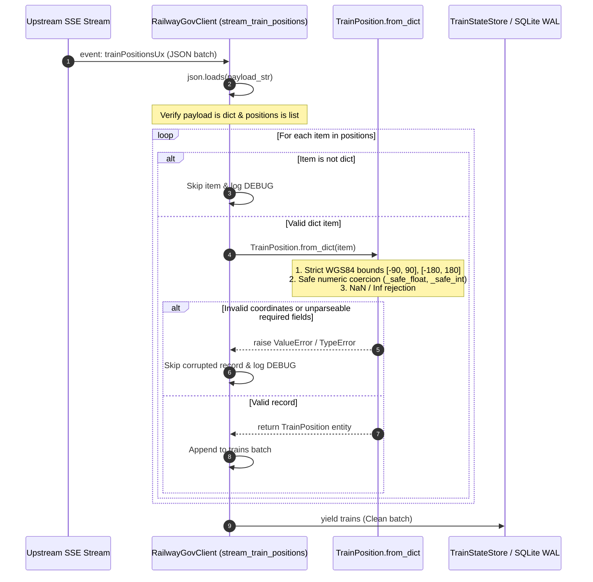

# Implementation Plan — P1-4: Missing Coordinate Bounds Validation & Defensive Payload Parsing

> **Reference:** [Production Readiness & Architecture Review (`P1-4`)](../../../architecture/production-readiness-review.md#p1-4-missing-coordinate-bounds-validation--defensive-payload-parsing)  
> **Target Modules:** [`../../../../train_tracker.py`](../../../../train_tracker.py) (`TrainPosition.from_dict`, `RailwayGovClient.__init__`, `RailwayGovClient.stream_train_positions`)  
> **Test Suites:** [`../../../../tests/test_tracker.py`](../../../../tests/test_tracker.py) (`TestTrainPositionModel`, `TestRailwayGovClient`)  
> **Relevant Rules & Skills:** [`../../../../.agents/rules/compliance.md`](../../../../.agents/rules/compliance.md#L10-L12), [`../../../../.agents/rules/verification-checklist.md`](../../../../.agents/rules/verification-checklist.md#L34-L38), [`../../../../.agents/rules/security-and-data-protection.md`](../../../../.agents/rules/security-and-data-protection.md#L8), [`../../../../.agents/skills/stream-resilience-tester/SKILL.md`](../../../../.agents/skills/stream-resilience-tester/SKILL.md), [`../../../../.agents/skills/security-audit/SKILL.md`](../../../../.agents/skills/security-audit/SKILL.md)

---

## 1. Root-Cause Defect Analysis

### A. Defect Mechanisms

#### 1. Coordinate Bounds Violation & Falsy Zero Coordinate Rejection
- **Location:** [`../../../../train_tracker.py`](../../../../train_tracker.py#L122-L123) (`TrainPosition.from_dict`), [`../../../../train_tracker.py`](../../../../train_tracker.py#L228-L233) (`RailwayGovClient.stream_train_positions`)
- In [`../../../../train_tracker.py`](../../../../train_tracker.py), incoming telemetry dictionaries are parsed without verifying geographic coordinate bounds:
  ```python
  lat=float(data.get("lat") or 0.0),
  lng=float(data.get("lng") or 0.0),
  ```
  And in the SSE streaming filter:
  ```python
  trains = [
      TrainPosition.from_dict(p)
      for p in raw_positions
      if p.get("lat") is not None and p.get("lng") is not None
  ]
  ```
- **The Truthiness / Zero Bug:** While `is not None` was introduced, earlier truthiness checks (`if p.get("lat") and p.get("lng")`) treated `0.0` as falsy, discarding valid equator/prime meridian references. Conversely, `float(data.get("lat") or 0.0)` silently coerces missing or `None` coordinates into `0.0` (Null Island: 0°N, 0°E), polluting the spatial models, deadband filters, map projections, and SQLite history.
- **Missing WGS84 Bounds Enforcement:** Coordinates are never bounded to legitimate WGS84 ranges:
  - Latitude must satisfy: `-90.0 <= lat <= 90.0`
  - Longitude must satisfy: `-180.0 <= lng <= 180.0`
  - Neither coordinate may be `NaN` (`math.isnan`) or `Infinity` (`math.isinf`).
- Upstream telemetry occasionally emits out-of-bounds coordinates (e.g., test fixtures, sensor glitches, or satellite sync errors emitting `lat = 999.0` or `lng = -999.0`). When unvalidated, these values break downstream Cartesian conversions in [`../../../../tui/geo.py`](../../../../tui/geo.py), produce NaN distances in [`../../../../storage/filter.py`](../../../../storage/filter.py) (`haversine_distance`), and persist corrupt real values into the `telemetry_history` SQLite table.
- This violates:
  - [`../../../../.agents/rules/compliance.md`](../../../../.agents/rules/compliance.md#L12) (*"Coordinate Bounds Validation: Validate that latitude falls within `[-90, 90]` and longitude within `[-180, 180]` before processing geographic data."*).
  - [`../../../../.agents/rules/verification-checklist.md`](../../../../.agents/rules/verification-checklist.md#L37) (*"Are coordinate bounds checked (`-90 <= lat <= 90`, `-180 <= lng <= 180`)?"*).

#### 2. Non-Defensive Payload Parsing & Crash Vectors in `TrainPosition.from_dict`
- **Location:** [`../../../../train_tracker.py`](../../../../train_tracker.py#L104-L132) (`TrainPosition.from_dict`)
- In [`../../../../train_tracker.py`](../../../../train_tracker.py), `TrainPosition.from_dict()` performs raw type casts without exception guards:
  ```python
  speed = float(data.get("speed") or 0.0)
  ...
  course=float(data.get("course") or data.get("bearing") or 0.0),
  track_heading=float(data.get("trackHeading") or 0.0),
  delay=int(data.get("delay") or 0),
  ```
- If upstream sends unexpected data types:
  - Non-numeric string for speed (e.g. `{"speed": "N/A"}` or `{"speed": "fast"}`) -> raises uncaught `ValueError: could not convert string to float`.
  - Non-numeric string for delay (e.g. `{"delay": "delayed"}`) or decimal string (e.g. `{"delay": "5.0"}`) -> `int("5.0")` raises uncaught `ValueError: invalid literal for int() with base 10: '5.0'`.
  - Nested dictionary, boolean, or array for numeric fields -> raises `TypeError` or `ValueError`.
  - `data` is not a `dict` (e.g., upstream sends `[None]` or string in `raw_positions`) -> `data.get(...)` raises `AttributeError: 'str' object has no attribute 'get'`.
- Because `TrainPosition.from_dict()` does not wrap field parsing in defensive type coercion, a single malformed train record in an SSE batch crashes the entire ingestion thread (`StreamWorker`), breaking the real-time TUI display and stopping telemetry recording.
- This violates:
  - [`../../../../.agents/rules/compliance.md`](../../../../.agents/rules/compliance.md#L11) (*"Zero Trust on Upstream Schema: Telemetry attributes may be null, missing, or change without warning. The client must never crash on unrecognized or missing JSON keys."*).
  - [`../../../../.agents/rules/verification-checklist.md`](../../../../.agents/rules/verification-checklist.md#L36) (*"Does `TrainPosition.from_dict` handle `None`, missing fields, and type conversions safely?"*).

#### 3. SSRF & Hostname Spoofing Vulnerability in `RailwayGovClient.__init__`
- **Location:** [`../../../../train_tracker.py`](../../../../train_tracker.py#L138-L141) (`RailwayGovClient.__init__`)
- `RailwayGovClient` accepts an arbitrary `base_url` parameter without validating its scheme or host:
  ```python
  class RailwayGovClient:
      def __init__(self, base_url: str = BASE_URL):
          self.base_url = base_url.rstrip("/")
          self.ssl_ctx = ssl.create_default_context()
  ```
- If initialized with an attacker-controlled endpoint (e.g. `http://169.254.169.254/latest/meta-data`, `file:///etc/passwd`, or `https://malicious-proxy.org`), `RailwayGovClient` sends HTTP requests with default headers to that endpoint.
- In addition, accepting plaintext `http://` bypasses strict TLS encryption, exposing train tracking requests and system telemetry to man-in-the-middle inspection or tampering.
- This violates:
  - [`../../../../.agents/rules/security-and-data-protection.md`](../../../../.agents/rules/security-and-data-protection.md#L8) (*"SSRF & URL Whitelisting: The client must only connect to trusted, hardcoded domain endpoints (`railway.gov.gr`). Do not accept arbitrary external URLs from CLI arguments or environment variables without hostname whitelisting."*).
  - [`../../../../.agents/rules/security-and-data-protection.md`](../../../../.agents/rules/security-and-data-protection.md#L6) (*"Strict TLS Certificate Validation: All HTTPS requests to `railway.gov.gr` or external APIs must validate remote SSL/TLS certificates."*).

---

### B. Visual Comparison (ASCII & Mermaid)

```text
BEFORE (Fragile Parsing, Unbounded Coordinates & Unrestricted SSRF Target):
1. Upstream SSE Ingestion:
   SSE Event: trainPositionsUx -> payload: {"positions": [{"lat": 999.0, "speed": "fast"}, "junk"]}
          |
          +--> raw_positions: iterates over items
          |     |
          |     +--> Item 1: float("fast") -> CRASH! Uncaught ValueError terminates stream!
          |     +--> Item 2: "junk".get("lat") -> CRASH! Uncaught AttributeError!
          |
          x Daemon thread crashes, TUI freezes, SQLite recording halts!

2. SSRF Surface:
   RailwayGovClient(base_url="http://169.254.169.254")
          |
          +--> No scheme check (http allowed)
          +--> No host allowlist check
          x Outbound HTTP request dispatched to arbitrary internal/external IP!


AFTER (Defensive Type Coercion, Strict Coordinate Bounds & SSRF Protection):
1. Upstream SSE Ingestion:
   SSE Event: trainPositionsUx -> payload: {"positions": [{"lat": 999.0}, {"lat": 38.0, "lng": 23.7, "speed": "fast"}]}
          |
          +--> Validate payload is dict and positions is list
          +--> Item 1: lat=999.0 -> Fails bounds [-90, 90] -> ValueError caught -> Skipped & logged (DEBUG)
          +--> Item 2: _safe_float("fast") -> 0.0, valid coords -> Yielded successfully!
          |
          ✓ Continuous stream resilience: bad records skipped, valid records preserved!

2. SSRF Protection:
   RailwayGovClient(base_url="http://169.254.169.254")
          |
          +--> Validate scheme == 'https'
          +--> Validate hostname in {'railway.gov.gr'}
          x Raises ValueError("Untrusted or invalid base_url") immediately at construction!
```



---

## 2. Architectural Specification & Defensive Design

### A. Coordinate Bounds & Geometry Specification
All geographic coordinates in `railmon` adhere to the WGS84 coordinate reference system:
1. **Latitude (`lat`):**
   - Must be convertable to `float`.
   - Must satisfy `not math.isnan(lat)` and `not math.isinf(lat)`.
   - Must satisfy `-90.0 <= lat <= 90.0`.
2. **Longitude (`lng`):**
   - Must be convertable to `float`.
   - Must satisfy `not math.isnan(lng)` and `not math.isinf(lng)`.
   - Must satisfy `-180.0 <= lng <= 180.0`.
3. **Equator & Prime Meridian Handling (`0.0, 0.0`):**
   - Coordinates at `0.0` are mathematically valid within the range and must not be rejected by falsy checks (`if lat and lng`).
   - If `lat` or `lng` is explicitly `None` or omitted from the record, `TrainPosition.from_dict` must raise `ValueError` rather than silently defaulting to `0.0`. Silent defaulting to `0.0` creates phantom trains off the coast of West Africa (Null Island).

### B. Resilient Type Coercion Helpers
To protect against schema shifts and malformed JSON values from `railway.gov.gr`, `train_tracker.py` introduces private helper functions:

```python
def _safe_float(val: Any, default: float = 0.0) -> float:
    """Safely coerce any value to a finite float, returning default on failure."""
    if val is None:
        return default
    try:
        num = float(val)
        if math.isnan(num) or math.isinf(num):
            return default
        return num
    except (ValueError, TypeError):
        return default


def _safe_optional_float(val: Any) -> Optional[float]:
    """Safely coerce a value to an optional finite float, returning None on failure."""
    if val is None:
        return None
    try:
        num = float(val)
        if math.isnan(num) or math.isinf(num):
            return None
        return num
    except (ValueError, TypeError):
        return None


def _safe_int(val: Any, default: int = 0) -> int:
    """Safely coerce a value to an int (including float strings like '5.0'), returning default on failure."""
    if val is None:
        return default
    try:
        return int(val)
    except (ValueError, TypeError):
        try:
            num = float(val)
            if math.isnan(num) or math.isinf(num):
                return default
            return int(num)
        except (ValueError, TypeError):
            return default


def _safe_optional_int(val: Any) -> Optional[int]:
    """Safely coerce a value to an optional int, returning None on failure."""
    if val is None:
        return None
    try:
        return int(val)
    except (ValueError, TypeError):
        try:
            num = float(val)
            if math.isnan(num) or math.isinf(num):
                return None
            return int(num)
        except (ValueError, TypeError):
            return None


def _safe_optional_str(val: Any) -> Optional[str]:
    """Safely coerce a value to an optional trimmed string, returning None if empty."""
    if val is None:
        return None
    s = str(val).strip()
    return s if s else None
```

### C. SSRF & Scheme Whitelist Architecture
In [`../../../../train_tracker.py`](../../../../train_tracker.py), `RailwayGovClient` enforces strict endpoint boundaries:
- **Allowed Schemes:** `frozenset({"https"})` (plaintext `http://`, `file://`, `ftp://` are strictly rejected).
- **Allowed Hosts:** `frozenset({"railway.gov.gr"})`.
- **Validation Mechanics:**
  ```python
  ALLOWED_BASE_SCHEMES = frozenset({"https"})
  ALLOWED_BASE_HOSTS = frozenset({"railway.gov.gr"})

  def validate_base_url(url: str) -> str:
      if not isinstance(url, str) or not url.strip():
          raise ValueError("base_url must be a non-empty string")
      parsed = urllib.parse.urlsplit(url.strip())
      scheme = (parsed.scheme or "").lower()
      host = (parsed.hostname or "").lower()

      if scheme not in ALLOWED_BASE_SCHEMES:
          raise ValueError(
              f"Untrusted URL scheme '{scheme}'. Only secure HTTPS is permitted ({sorted(ALLOWED_BASE_SCHEMES)})."
          )
      if host not in ALLOWED_BASE_HOSTS:
          raise ValueError(
              f"Untrusted host '{host}'. Only verified domain endpoints are permitted ({sorted(ALLOWED_BASE_HOSTS)})."
          )
      if parsed.port not in (None, 443):
          raise ValueError(f"Untrusted port '{parsed.port}'. Only standard HTTPS (443) is permitted.")

      return url.rstrip("/")
  ```

### D. Per-Item Stream Isolation Pipeline
In `RailwayGovClient.stream_train_positions()`:
1. Validate that the root decoded JSON `payload` is an `isinstance(payload, dict)`.
2. Extract `positions = payload.get("positions")` and verify `isinstance(positions, list)`.
3. Iterate across individual position items:
   - Check `isinstance(p, dict)`.
   - Invoke `TrainPosition.from_dict(p)`.
   - Wrap each item conversion in `try...except (ValueError, TypeError) as exc:`.
   - If an item fails bounds checks or parsing, log a `DEBUG` message with item identifier and continue to the next item.
4. Yield the accumulated list of valid `TrainPosition` objects. If all items in an event block are invalid, yield `[]` to maintain stream liveness without crashing.

---

## 3. Implementation Steps & Code Modifications

### Step 1: Add Math Import & Coercion Helpers to [`../../../../train_tracker.py`](../../../../train_tracker.py)
- Import standard library `math` and `FrozenSet`.
- Define `ALLOWED_BASE_SCHEMES: FrozenSet[str] = frozenset({"https"})`.
- Define `ALLOWED_BASE_HOSTS: FrozenSet[str] = frozenset({"railway.gov.gr"})`.
- Define `_safe_float`, `_safe_optional_float`, `_safe_int`, `_safe_optional_int`, `_safe_optional_str`, and `validate_base_url`.

### Step 2: Refactor `TrainPosition.from_dict` in [`../../../../train_tracker.py`](../../../../train_tracker.py)
Update [`TrainPosition.from_dict`](../../../../train_tracker.py#L103-L133):
```python
    @classmethod
    def from_dict(cls, data: Dict[str, Any]) -> "TrainPosition":
        if not isinstance(data, dict):
            raise TypeError(f"TrainPosition payload must be a dict, got {type(data).__name__}")

        # Coordinate Bounds Validation
        lat_raw = data.get("lat")
        lng_raw = data.get("lng")
        if lat_raw is None or lng_raw is None:
            raise ValueError("TrainPosition payload missing required coordinates ('lat' and 'lng' must not be None)")

        try:
            lat = float(lat_raw)
            lng = float(lng_raw)
        except (ValueError, TypeError) as exc:
            raise ValueError(f"Non-numeric coordinates: lat={lat_raw!r}, lng={lng_raw!r}") from exc

        if math.isnan(lat) or math.isinf(lat) or not (-90.0 <= lat <= 90.0):
            raise ValueError(f"Latitude out of bounds [-90.0, 90.0]: {lat}")
        if math.isnan(lng) or math.isinf(lng) or not (-180.0 <= lng <= 180.0):
            raise ValueError(f"Longitude out of bounds [-180.0, 180.0]: {lng}")

        # Defensive Numeric Coercion
        speed = max(0.0, _safe_float(data.get("speed"), default=0.0))
        status = "Κανονική" if speed > 5.0 else "Στάση"
        course = _safe_float(
            data.get("course") if data.get("course") is not None else data.get("bearing"),
            default=0.0,
        ) % 360.0
        track_heading = _safe_float(data.get("trackHeading"), default=0.0) % 360.0
        delay = _safe_int(data.get("delay"), default=0)

        # Defensive String & Identifier Coercion
        train_id = str(data.get("id") or data.get("_id") or "").strip()
        train_num = str(data.get("trainNumber") or data.get("name") or "Unknown").strip() or "Unknown"

        return cls(
            id=train_id,
            train_number=train_num,
            locomotive_number=_safe_optional_str(data.get("locomotiveNumber")),
            name=_safe_optional_str(data.get("name")),
            train_type=_safe_optional_str(data.get("trainType")),
            service_type=_safe_optional_str(data.get("serviceType")),
            status=status,
            origin=_safe_optional_str(data.get("origin")),
            destination=_safe_optional_str(data.get("destination")),
            next_station=_safe_optional_str(data.get("nextStation")),
            speed=speed,
            course=course,
            track_heading=track_heading,
            lat=lat,
            lng=lng,
            altitude=_safe_optional_float(data.get("altitude")),
            delay=delay,
            progress=_safe_optional_float(data.get("progress")),
            chainage_m=_safe_optional_int(data.get("chainage_m")),
            corridor=_safe_optional_str(data.get("corridor")),
            distance_to_destination_m=_safe_optional_int(data.get("distanceToDestination_m")),
            timestamp=_safe_optional_str(data.get("timestamp")),
            schedule_id=_safe_optional_str(data.get("scheduleId")),
        )
```

### Step 3: Enforce SSRF Hostname Whitelisting in `RailwayGovClient.__init__`
Update [`RailwayGovClient.__init__`](../../../../train_tracker.py#L138-L141):
```python
    def __init__(self, base_url: str = BASE_URL):
        self.base_url = validate_base_url(base_url)
        self.ssl_ctx = ssl.create_default_context()
```

### Step 4: Harden `RailwayGovClient.stream_train_positions` Ingestion Loop
Update lines 220–237 of [`../../../../train_tracker.py`](../../../../train_tracker.py):
```python
                                if current_event == event_filter:
                                    try:
                                        payload = json.loads(payload_str)
                                    except json.JSONDecodeError as exc:
                                        logger.debug("Skipping malformed SSE JSON payload: %s", exc)
                                        current_event = "message"
                                        continue

                                    if not isinstance(payload, dict):
                                        logger.debug("Skipping non-dict SSE JSON payload: %r", payload)
                                        current_event = "message"
                                        continue

                                    raw_positions = payload.get("positions", [])
                                    if not isinstance(raw_positions, list):
                                        logger.debug("Expected 'positions' list in payload, got %s", type(raw_positions).__name__)
                                        current_event = "message"
                                        continue

                                    trains: List[TrainPosition] = []
                                    for p in raw_positions:
                                        if not isinstance(p, dict):
                                            logger.debug("Skipping non-dict position item: %r", p)
                                            continue
                                        try:
                                            trains.append(TrainPosition.from_dict(p))
                                        except (ValueError, TypeError) as exc:
                                            logger.debug("Skipping invalid train position record: %s", exc)

                                    yield trains
```

### Step 5: Update REST Endpoint Responses with Type Defensive Checks
Ensure `get_upcoming_schedules()`, `get_station_departures()`, and `get_station_arrivals()` in [`RailwayGovClient`](../../../../train_tracker.py) verify that `_get(...)` returns a dictionary before invoking `.get(...)`.

---

## 4. Test Strategy & Verification Plan (TDD Red-Green-Refactor)

### A. Test Cases in [`../../../../tests/test_tracker.py`](../../../../tests/test_tracker.py)

#### 1. Model Parsing & Coordinate Bounds (`TestTrainPositionModel`)
- **`test_from_dict_valid_coordinates_boundary_limits`:**
  - Verify that coordinates at exact extreme boundaries pass validation:
    - `(-90.0, -180.0)`, `(90.0, 180.0)`.
- **`test_from_dict_zero_zero_coordinates_preserved`:**
  - Verify that `(0.0, 0.0)` is accepted as a valid coordinate pair, proving no truthiness regression (`lat != 0.0 or lng != 0.0`).
- **`test_from_dict_rejects_missing_or_none_coordinates`:**
  - Payload without `lat` or with `lat: None` raises `ValueError`.
  - Payload without `lng` or with `lng: None` raises `ValueError`.
- **`test_from_dict_rejects_out_of_bounds_latitude`:**
  - `lat = 90.0001` and `lat = -90.0001` raise `ValueError`.
  - `lat = 1000.0` raises `ValueError`.
- **`test_from_dict_rejects_out_of_bounds_longitude`:**
  - `lng = 180.0001` and `lng = -180.0001` raise `ValueError`.
  - `lng = -999.0` raises `ValueError`.
- **`test_from_dict_rejects_nan_and_inf_coordinates`:**
  - `lat = float('nan')` or `lng = float('inf')` or `-float('inf')` raise `ValueError`.
- **`test_from_dict_defensive_numeric_speed`:**
  - Malformed string `"fast"`, `None`, or negative speed (`-10.0`) coerces safely to `0.0` or parses valid numeric string `"116.5"`.
- **`test_from_dict_defensive_numeric_delay`:**
  - String float `"5.0"`, non-numeric `"delayed"`, or `None` coerces safely to `int` without raising `ValueError`.
- **`test_from_dict_defensive_optional_fields`:**
  - Malformed `altitude: "high"`, `progress: "halfway"`, `chainage_m: "none"` parse safely to `None`.
- **`test_from_dict_rejects_non_dict_payload`:**
  - Passing `None`, `"string"`, or `[1, 2, 3]` raises `TypeError`.

#### 2. SSRF Protection & URL Whitelisting (`TestRailwayGovClient`)
- **`test_client_init_valid_base_url`:**
  - `RailwayGovClient("https://railway.gov.gr")` and `RailwayGovClient("https://railway.gov.gr/")` succeed.
- **`test_client_init_rejects_plaintext_http`:**
  - `RailwayGovClient("http://railway.gov.gr")` raises `ValueError`.
- **`test_client_init_rejects_untrusted_domains`:**
  - `RailwayGovClient("https://malicious.org")` raises `ValueError`.
  - `RailwayGovClient("https://169.254.169.254")` raises `ValueError`.
- **`test_client_init_rejects_subdomain_spoofing`:**
  - `RailwayGovClient("https://railway.gov.gr.attacker.com")` raises `ValueError`.
- **`test_client_init_rejects_arbitrary_schemes`:**
  - `RailwayGovClient("file:///etc/passwd")` raises `ValueError`.
- **`test_client_init_rejects_non_standard_ports`:**
  - `RailwayGovClient("https://railway.gov.gr:8080")` raises `ValueError`.

#### 3. Resilient SSE Stream Ingestion (`TestRailwayGovClient`)
- **`test_stream_skips_invalid_item_preserves_valid_item`:**
  - An SSE payload containing 1 valid train, 1 train with `lat: 999.0`, 1 train with `lat: "corrupt"`, and 1 non-dict entry yields a batch with exactly the 1 valid train.
- **`test_stream_preserves_zero_zero_train`:**
  - An SSE payload with `lat: 0.0, lng: 0.0` yields the train successfully.
- **`test_stream_handles_non_dict_payload_gracefully`:**
  - SSE payload containing `[]` or `"string"` is skipped cleanly without terminating the stream generator.

---

## 5. Verification & Quality Gates

Run the verification toolchain in sequence to ensure zero regressions:
```bash
# 1. Run unit tests for tracker and client
python3 -m unittest tests/test_tracker.py

# 2. Run full test suite across all subsystems
python3 -m unittest discover tests

# 3. Flake8 Linting & Black Formatting Check
flake8 train_tracker.py tests/test_tracker.py
black --check train_tracker.py tests/test_tracker.py

# 4. Strict Mypy Static Type Checking
mypy --strict train_tracker.py

# 5. Execute Security Audit Check
# Validates 0 unverified SSL contexts, 0 SSRF loopholes, 100% parameterized SQL
```

---

## 6. Risk Assessment & Compatibility

| Risk Factor | Severity | Mitigation Strategy |
| :--- | :---: | :--- |
| **Upstream Schema Drift** | Low | All numeric and string fields in `TrainPosition.from_dict` are wrapped in resilient `_safe_*` helpers with sensible defaults (`0.0`, `None`). |
| **Legitimate `0.0` Coordinates** | Negligible | Falsy checks are replaced with strict numeric bounds checks (`-90.0 <= lat <= 90.0`), allowing `0.0` while rejecting missing or `None` values. |
| **SSRF False Positives in Testing** | Low | Tests mock `urllib.request.urlopen` rather than changing `base_url` to third-party endpoints. Unit test suite specifically validates SSRF rejection. |
| **Performance Overhead** | Negligible | Coordinate bounds and safe type conversions execute in sub-microsecond time in pure Python, well within the 100ms SSE ingestion budget. |
| **Zero Runtime Dependencies** | Nil | All additions utilize Python standard library modules (`math`, `urllib.parse`, `json`, `dataclasses`, `typing`). |
