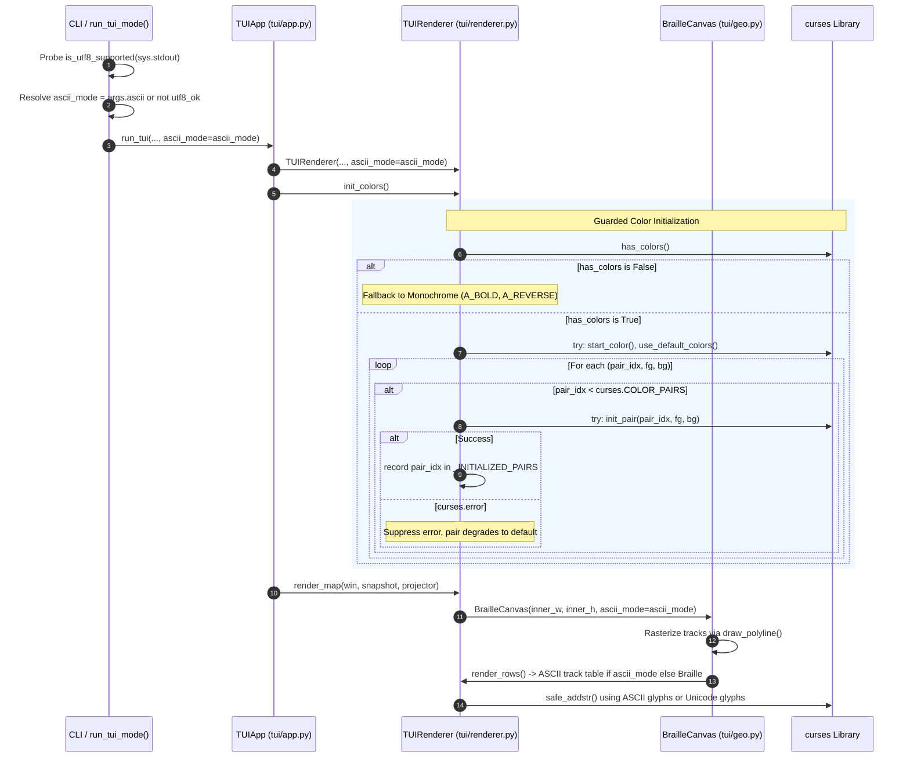

# Implementation Plan — P1-7: Missing ASCII Fallback for Non-UTF-8 Terminals & Unsafe `init_pair`

> **Reference:** [Production Readiness & Architecture Review (`P1-7`)](../../../architecture/production-readiness-review.md#p1-7-missing-ascii-fallback-for-non-utf-8-terminals--unsafe-init_pair)  
> **Target Modules:** [`../../../../tui/geo.py`](../../../../tui/geo.py) (`BrailleCanvas`, `is_utf8_supported`), [`../../../../tui/renderer.py`](../../../../tui/renderer.py) (`TUIRenderer`, `safe_color_pair`, `init_colors`), [`../../../../tui/app.py`](../../../../tui/app.py) (`TUIApp`, `run_tui`), [`../../../../train_tracker.py`](../../../../train_tracker.py) (`build_parser`, `run_tui_mode`)  
> **Test Suites:** [`../../../../tests/test_tui_geo.py`](../../../../tests/test_tui_geo.py), [`../../../../tests/test_tui_renderer.py`](../../../../tests/test_tui_renderer.py), [`../../../../tests/test_cli.py`](../../../../tests/test_cli.py)  
> **Relevant Rules & Skills:** [`../../../../.agents/rules/terminal-and-rendering-compatibility.md`](../../../../.agents/rules/terminal-and-rendering-compatibility.md), [`../../../../.agents/rules/resilience-and-fallbacks.md`](../../../../.agents/rules/resilience-and-fallbacks.md), [`../../../../.agents/rules/diagrams-and-visual-documentation.md`](../../../../.agents/rules/diagrams-and-visual-documentation.md), [`../../../../.agents/rules/markdown-relative-paths.md`](../../../../.agents/rules/markdown-relative-paths.md), [`../../../../.agents/skills/tui-compatibility-tester/SKILL.md`](../../../../.agents/skills/tui-compatibility-tester/SKILL.md), [`../../../../.agents/skills/ci-quality-gate/SKILL.md`](../../../../.agents/skills/ci-quality-gate/SKILL.md)

---

## 1. Executive Summary & Defect Overview

`railmon` features a full-screen curses dashboard displaying real-time geospatial railway topology, active locomotive movements, train schedules, and analytical status telemetry. Its primary visual differentiator is a 2×4 subpixel Braille dot rasterizer ([`BrailleCanvas`](../../../../tui/geo.py#L248)) alongside Unicode compass heading markers, station glyphs, and semantic badges ([`TUIRenderer`](../../../../tui/renderer.py#L417)).

In heterogeneous deployment environments (e.g., legacy Linux virtual consoles, minimal container shells, Windows cmd/PowerShell with legacy code pages like CP437, headless CI runners, or serial SSH consoles with `LANG=C` or `LC_ALL=C`), the TUI presentation layer suffers from two critical compatibility defects identified in [`../../../architecture/production-readiness-review.md`](../../../architecture/production-readiness-review.md#p1-7-missing-ascii-fallback-for-non-utf-8-terminals--unsafe-init_pair):

1. **Missing Non-UTF-8 Encoding Detection & ASCII Fallback:**
   - [`BrailleCanvas.render_rows`](../../../../tui/geo.py#L401-L415) unconditionally yields Unicode Braille patterns (`\u2800` through `\u28FF`).
   - [`TUIRenderer`](../../../../tui/renderer.py) hardcodes multi-byte Unicode characters across every UI pane: compass headings (`▲`, `◥`, `►`, `◢`, `▼`, `◣`, `◄`, `◤`), station hubs (`◉`), breadcrumbs (`·`), degree symbols (`°`), status badges (`❚❚`, `●`, `○`, `⟳`, `✕`), cursor blocks (`█`), warning emoji (`⚠️`), and ellipsis (`…`).
   - If `sys.stdout.encoding` or `locale.getpreferredencoding()` is `US-ASCII`, `ISO-8859-1`, or any non-UTF-8 character set, writing these characters throws `UnicodeEncodeError: 'ascii' codec can't encode character...` or causes curses `addstr()` to return `ERR`, crashing the TUI or emitting broken mojibake.
   - Violates [`../../../../.agents/rules/terminal-and-rendering-compatibility.md`](../../../../.agents/rules/terminal-and-rendering-compatibility.md#L14-L22).

2. **Unsafe `curses.init_pair` & Unguarded Color Initialization:**
   - [`TUIRenderer.init_colors`](../../../../tui/renderer.py#L434-L463) invokes 16 consecutive `curses.init_pair(...)` calls without checking `curses.COLOR_PAIRS` bounds or enclosing individual calls in `try...except curses.error:`.
   - On restricted consoles (e.g., 8-color terminals, monochrome serial consoles, or terminal emulators where `curses.has_colors()` returns `True` but pair allocation is constrained or fails), an unhandled `curses.error: init_pair() returned ERR` is raised, terminating the entire application on startup.
   - [`safe_color_pair`](../../../../tui/renderer.py#L399-L415) only checks `curses.has_colors()`, lacking knowledge of which color pairs were successfully allocated.
   - Violates [`../../../../.agents/rules/terminal-and-rendering-compatibility.md`](../../../../.agents/rules/terminal-and-rendering-compatibility.md#L23-L33).

This implementation plan specifies the complete technical design to detect terminal encoding capabilities automatically, provide a deterministic 7-bit ASCII fallback matrix for all Braille and Unicode visual elements, expose a top-level `--ascii` CLI flag, and guard color pair allocations with resilient monochrome attribute degradation.

---

## 2. Root-Cause Defect Analysis

### A. Non-UTF-8 Character Set Deficiencies

#### 1. Unchecked Braille Codepoint Emission in `BrailleCanvas`
- **Location:** [`../../../../tui/geo.py`](../../../../tui/geo.py#L408-L415)
- **Current Implementation:**
  ```python
  for r in range(self.height_cells):
      row_chars: List[str] = []
      row_offset = r * self.width_cells
      for c in range(self.width_cells):
          cell_bits = self.buffer[row_offset + c]
          row_chars.append(chr(BRAILLE_BASE + cell_bits))  # BRAILLE_BASE = 0x2800
      rows.append("".join(row_chars))
  ```
- **Defect:** `BRAILLE_BASE` ($10240_{10} = \text{0x2800}$) produces characters in the Unicode Braille Patterns block (`\u2800`–`\u28FF`). In an environment where stdout is configured for 7-bit ASCII, CP437, or ISO-8859, `chr(BRAILLE_BASE + cell_bits)` fails during string encoding with `UnicodeEncodeError`. There is no mechanism to map 2×4 subpixel dot patterns into standard ASCII track segments (`.`, `-`, `|`, `+`, `/`, `\`).

#### 2. Hardcoded Unicode Glyphs Across All TUI Panes
- **Location:** [`../../../../tui/renderer.py`](../../../../tui/renderer.py)
- **Defects by Component:**
  - **Compass Headings:** [`HEADING_GLYPHS = ("▲", "◥", "►", "◢", "▼", "◣", "◄", "◤")`](../../../../tui/renderer.py#L44). No 7-bit ASCII alternatives (`^`, `>`, `v`, `<`) exist.
  - **Station Markers:** [`glyph = "◉"`](../../../../tui/renderer.py#L622). Station hubs are rendered as Unicode bullseyes rather than `#` or `+`.
  - **Trail Breadcrumbs:** [`win.addch(1 + row, 1 + col, ord("·"), trail_attr)`](../../../../tui/renderer.py#L607). Middle dot `\u00b7` fails when passed to `ord()` in single-byte non-Latin-1 contexts.
  - **Status Badges:** [`badge = " ❚❚ PAUSED "`](../../../../tui/renderer.py#L901), [`badge = f" ● LIVE ({msg_rate:3.1f} msg/s) "`](../../../../tui/renderer.py#L906), [`badge = " ⟳ RECONNECTING... "`](../../../../tui/renderer.py#L912), [`badge = " ✕ CONN ERROR "`](../../../../tui/renderer.py#L915).
  - **Search & Inspection:** [`prompt_text = f" Search filter: {search_buffer}█"`](../../../../tui/renderer.py#L887), [`tag = f" ◄ [{tn}] ({spd_str}, {dly_str})"`](../tui/renderer.py#L682).
  - **Advisory Banners & Tooltips:** [`("⚠️  TERMINAL WINDOW TOO SMALL", alert_attr)`](../../../../tui/renderer.py#L482), [`empty_msg2 = "Use [Tab] or [↑/↓] to select a train."`](../tui/renderer.py#L800), [`truncate_to_display_width(..., ellipsis="…")`](../../../../tui/renderer.py#L189,L390).

---

### B. Unsafe `curses.init_pair` Allocation Deficiencies

#### 1. Unbounded and Unguarded `init_pair` Execution
- **Location:** [`../../../../tui/renderer.py`](../../../../tui/renderer.py#L434-L463)
- **Current Implementation:**
  ```python
  def init_colors(self) -> None:
      if not curses.has_colors():
          return

      curses.start_color()
      try:
          curses.use_default_colors()
          bg = -1
      except curses.error:
          bg = curses.COLOR_BLACK

      # 16 un-trapped init_pair invocations:
      curses.init_pair(PAIR_DEFAULT, curses.COLOR_WHITE, bg)
      curses.init_pair(PAIR_HEADER, curses.COLOR_CYAN, bg)
      ...
      curses.init_pair(PAIR_CONNECTED, curses.COLOR_GREEN, bg)
  ```
- **Defect:** 
  1. `curses.start_color()` itself can raise `curses.error` on terminals where terminfo describes color capability but the underlying driver fails initialization.
  2. The function attempts to initialize 16 color pairs unconditionally. If the host terminal supports fewer pairs than requested (`curses.COLOR_PAIRS < 16`), or if the terminal driver rejects pair reassignment, `curses.init_pair` throws `curses.error`. Because there is no `try...except curses.error:` around the calls, the entire application terminates on startup.
  3. Violates [`../../../../.agents/rules/terminal-and-rendering-compatibility.md`](../../../../.agents/rules/terminal-and-rendering-compatibility.md#L25-L31).

#### 2. Incomplete Fallback in `safe_color_pair`
- **Location:** [`../../../../tui/renderer.py`](../../../../tui/renderer.py#L399-L415)
- **Current Implementation:**
  ```python
  def safe_color_pair(pair_idx: int, fallback_attr: int = curses.A_NORMAL) -> int:
      try:
          if curses.has_colors():
              return curses.color_pair(pair_idx)
      except curses.error:
          pass
      return fallback_attr
  ```
- **Defect:** If `init_pair` failed for `pair_idx` during startup, calling `curses.color_pair(pair_idx)` returns either raw uninitialized memory, 0, or throws an error. The renderer lacks an explicit set of successfully allocated color pairs to verify pair readiness before requesting it from curses.

---

## 3. Architecture & Control Flow

### A. Dual-Mode Rendering Pipeline (ASCII)

```text
+-----------------------------------------------------------------------------------+
|                        Terminal & Environment Discovery                           |
|       - Inspect sys.stdout.encoding & locale.getpreferredencoding()               |
|       - Probe test encoding capability: "\u2801\u25c9\u25b2"                      |
|       - Check CLI override flag: args.ascii                                       |
+-----------------------------------------------------------------------------------+
                                          |
                                          v
                         +---------------------------------+
                         |  is_utf8_supported() & !ascii?  |
                         +---------------------------------+
                                    /           \
                            YES    /             \  NO (or --ascii)
                                  v               v
            +---------------------------+   +---------------------------+
            |      UTF-8 Full Mode      |   |   7-Bit ASCII Fallback    |
            | - Braille dots (\u2800+)  |   | - Subpixel matrix (.-|+/) |
            | - Directional (▲►▼◄)      |   | - Directional (^>v<)      |
            | - Station hubs (◉)        |   | - Station hubs (#/+)      |
            | - Status badges (●, ⟳, ✕) |   | - Status badges (*, >>, X)|
            | - Breadcrumbs (·)         |   | - Breadcrumbs (.)         |
            +---------------------------+   +---------------------------+
                                  \               /
                                   \             /
                                    v           v
+-----------------------------------------------------------------------------------+
|                       Color Subsystem & Palette Resilience                        |
|       1. Probe curses.has_colors()                                                |
|       2. Guard curses.start_color() & curses.use_default_colors()                  |
|       3. Iterate pair configurations guarding pair_idx < curses.COLOR_PAIRS        |
|       4. Wrap every curses.init_pair() in individual try...except curses.error    |
|       5. Track successful pair indices in _INITIALIZED_PAIRS set                  |
|       6. Degrade missing pairs to curses.A_BOLD / curses.A_REVERSE                |
+-----------------------------------------------------------------------------------+
                                          |
                                          v
+-----------------------------------------------------------------------------------+
|                           Curses Frame Presentation                               |
|        - safe_color_pair(pair_idx) verifies pair in _INITIALIZED_PAIRS            |
|        - Text status badges ([OK], [+12m], [STOP]) ensure clarity on monochrome    |
|        - Render map, roster, inspector, status bar with selected glyph set        |
+-----------------------------------------------------------------------------------+
```

### B. Initialization & Rendering Sequence (Mermaid)



---

## 4. Target Component & Technical Specifications

### A. Terminal Encoding Discovery Helper ([`../../../../tui/geo.py`](../../../../tui/geo.py))

Implement a reusable function `is_utf8_supported()` in [`../../../../tui/geo.py`](../../../../tui/geo.py) and export it to [`../../../../tui/app.py`](../../../../tui/app.py) and [`../../../../train_tracker.py`](../../../../train_tracker.py):

```python
def is_utf8_supported(stream: Optional[Any] = None) -> bool:
    """Determine whether the output stream and runtime environment support UTF-8 encoding.

    Inspects stream.encoding (defaulting to sys.stdout), locale.getpreferredencoding(),
    and validates actual encoding capabilities by attempting to encode representative
    Unicode Braille and directional glyphs.

    Args:
        stream: Optional stream object to probe. Defaults to sys.stdout.

    Returns:
        bool: True if the environment safely encodes UTF-8 characters;
              False if restricted to 7-bit ASCII, legacy code pages, or encoding fails.
    """
    # 1. Respect explicit user environment overrides
    env_force_ascii = os.environ.get("RAILMON_ASCII", "").strip().lower()
    if env_force_ascii in {"1", "true", "yes"}:
        return False

    term = os.environ.get("TERM", "").strip().lower()
    if term in {"dumb", "ascii", "vt100"}:
        return False

    # 2. Query target stream encoding and locale
    target_stream = stream if stream is not None else sys.stdout
    encoding = getattr(target_stream, "encoding", None)
    if not encoding:
        try:
            encoding = locale.getpreferredencoding(False)
        except Exception:
            encoding = "ascii"

    if not encoding:
        return False

    norm_enc = encoding.lower().replace("-", "").replace("_", "")
    if "utf8" not in norm_enc:
        return False

    # 3. Defensive probe: verify encoding sample Unicode characters
    test_chars = "\u2801\u25c9\u25b2\u00b7\u2500"  # Braille, station, heading, middle dot, box
    try:
        test_chars.encode(encoding)
        return True
    except (UnicodeEncodeError, LookupError, ValueError):
        return False
```

---

### B. Deterministic 7-Bit ASCII Fallback Table for `BrailleCanvas` ([`../../../../tui/geo.py`](../../../../tui/geo.py))

`BrailleCanvas` cells contain an 8-bit mask representing dots in a 2-column by 4-row matrix:
$$\text{col}_0: [\text{bit}_0, \text{bit}_1, \text{bit}_2, \text{bit}_6], \quad \text{col}_1: [\text{bit}_3, \text{bit}_4, \text{bit}_5, \text{bit}_7]$$

Construct a precomputed 256-element lookup tuple `ASCII_BRAILLE_TABLE` mapping every bitmask permutation ($0 \le \text{mask} \le 255$) to a single ASCII character:

```python
def _generate_ascii_braille_table() -> Tuple[str, ...]:
    """Generate 256-entry lookup table mapping 2x4 subpixel bitmasks to ASCII characters."""
    table: List[str] = []
    for mask in range(256):
        if mask == 0:
            table.append(" ")
            continue

        # Extract active dots in column 0 and column 1
        col0_dots = [bool(mask & (1 << b)) for b in (0, 1, 2, 6)]
        col1_dots = [bool(mask & (1 << b)) for b in (3, 4, 5, 7)]
        total_dots = sum(col0_dots) + sum(col1_dots)

        c0_has = any(col0_dots)
        c1_has = any(col1_dots)

        if total_dots == 1:
            table.append(".")
        elif c0_has and not c1_has:
            table.append("|")
        elif c1_has and not c0_has:
            table.append("|")
        else:
            # Both columns have active dots: test horizontal vs diagonal vs intersection
            # Check for horizontal pairs at identical row heights: (0,3), (1,4), (2,5), (6,7)
            horiz_pairs = sum(1 for r in range(4) if col0_dots[r] and col1_dots[r])
            if horiz_pairs > 0 and total_dots <= 3:
                table.append("-")
            elif col0_dots[0] and col1_dots[3] and total_dots == 2:
                table.append("\\")
            elif col0_dots[3] and col1_dots[0] and total_dots == 2:
                table.append("/")
            elif total_dots >= 3:
                table.append("+")
            else:
                table.append("-")

    return tuple(table)

ASCII_BRAILLE_TABLE: Tuple[str, ...] = _generate_ascii_braille_table()
```

Update `BrailleCanvas`:
```python
class BrailleCanvas:
    def __init__(
        self,
        width_cells: int,
        height_cells: int,
        ascii_mode: bool = False,
    ):
        ...
        self.ascii_mode: bool = ascii_mode

    def render_rows(self, ascii_mode: Optional[bool] = None) -> List[str]:
        use_ascii = self.ascii_mode if ascii_mode is None else ascii_mode
        rows: List[str] = []
        for r in range(self.height_cells):
            row_chars: List[str] = []
            row_offset = r * self.width_cells
            for c in range(self.width_cells):
                cell_bits = self.buffer[row_offset + c]
                if use_ascii:
                    row_chars.append(ASCII_BRAILLE_TABLE[cell_bits])
                else:
                    row_chars.append(chr(BRAILLE_BASE + cell_bits))
            rows.append("".join(row_chars))
        return rows
```

---

### C. Safe `init_pair` & Resilient Color Management ([`../../../../tui/renderer.py`](../../../../tui/renderer.py))

#### 1. Color Pair Tracking & Safe Retrieval
Maintain a module-level set `_INITIALIZED_COLOR_PAIRS: Set[int] = set()` recording pairs that curses successfully allocated:

```python
_INITIALIZED_COLOR_PAIRS: Set[int] = set()


def safe_color_pair(pair_idx: int, fallback_attr: int = curses.A_NORMAL) -> int:
    """Safely return curses color pair attribute or fallback if pair uninitialized or unsupported.

    Args:
        pair_idx: Curses color pair index.
        fallback_attr: Curses attribute to return if colors unavailable or pair unallocated.

    Returns:
        int: Curses attribute with color pair, or fallback_attr if colors fail.
    """
    global _INITIALIZED_COLOR_PAIRS
    try:
        if curses.has_colors() and pair_idx in _INITIALIZED_COLOR_PAIRS:
            return curses.color_pair(pair_idx)
    except curses.error:
        pass
    return fallback_attr
```

#### 2. Guarded `init_colors` with Individual Pair Try-Blocks
Refactor `TUIRenderer.init_colors` to safely handle limited palette terminals:

```python
def init_colors(self) -> None:
    """Initialize curses color pairs with robust error handling and palette bounds checking."""
    global _INITIALIZED_COLOR_PAIRS
    _INITIALIZED_COLOR_PAIRS.clear()

    try:
        if not curses.has_colors():
            return
    except curses.error:
        return

    try:
        curses.start_color()
    except curses.error:
        return

    try:
        curses.use_default_colors()
        bg = -1
    except curses.error:
        bg = curses.COLOR_BLACK

    max_pairs = getattr(curses, "COLOR_PAIRS", 64)

    pair_definitions: List[Tuple[int, int, int]] = [
        (PAIR_DEFAULT, curses.COLOR_WHITE, bg),
        (PAIR_HEADER, curses.COLOR_CYAN, bg),
        (PAIR_BORDER, curses.COLOR_BLUE, bg),
        (PAIR_TRACK, curses.COLOR_WHITE, bg),
        (PAIR_STATION, curses.COLOR_YELLOW, bg),
        (PAIR_STATION_DIM, curses.COLOR_YELLOW, bg),
        (PAIR_TRAIN_ON_TIME, curses.COLOR_GREEN, bg),
        (PAIR_TRAIN_WARN, curses.COLOR_YELLOW, bg),
        (PAIR_TRAIN_ALERT, curses.COLOR_RED, bg),
        (PAIR_TRAIN_PROAST, curses.COLOR_CYAN, bg),
        (PAIR_TRAIN_FREIGHT, curses.COLOR_MAGENTA, bg),
        (PAIR_TRAIN_HALTED, curses.COLOR_WHITE, bg),
        (PAIR_ROSTER_SELECT, curses.COLOR_BLACK, curses.COLOR_CYAN),
        (PAIR_TRAIL, curses.COLOR_GREEN, bg),
        (PAIR_STATUS_BAR, curses.COLOR_BLACK, curses.COLOR_WHITE),
        (PAIR_CONNECTED, curses.COLOR_GREEN, bg),
    ]

    for pair_idx, fg, pair_bg in pair_definitions:
        if pair_idx >= max_pairs:
            continue
        try:
            curses.init_pair(pair_idx, fg, pair_bg)
            _INITIALIZED_COLOR_PAIRS.add(pair_idx)
        except curses.error:
            # Silently degrade: safe_color_pair will return fallback_attr
            pass
```

---

### D. Unified Glyph Palette & ASCII Fallback Matrix ([`../../../../tui/renderer.py`](../../../../tui/renderer.py))

Introduce a structured glyph palette dataclass or dictionary defining all characters for both UTF-8 and ASCII modes:

```python
HEADING_GLYPHS_UTF8 = ("▲", "◥", "►", "◢", "▼", "◣", "◄", "◤")
HEADING_GLYPHS_ASCII = ("^", ">", ">", "v", "v", "<", "<", "^")


@dataclass(frozen=True)
class RenderGlyphs:
    """Character glyph set for TUI rendering."""
    station_hub: str
    station_normal: str
    trail_dot: str
    callout_arrow: str
    search_cursor: str
    degree_sym: str
    ellipsis: str
    badge_rec: str
    badge_paused: str
    badge_live: str
    badge_connecting: str
    badge_reconnecting: str
    badge_conn_error: str
    badge_demo: str
    warn_icon: str
    border_h: str
    border_v: str
    border_corner: str


GLYPHS_UTF8 = RenderGlyphs(
    station_hub="◉",
    station_normal="◉",
    trail_dot="·",
    callout_arrow="◄",
    search_cursor="█",
    degree_sym="°",
    ellipsis="…",
    badge_rec=" [● REC]",
    badge_paused=" ❚❚ PAUSED ",
    badge_live=" ● LIVE ",
    badge_connecting=" ○ CONNECTING... ",
    badge_reconnecting=" ⟳ RECONNECTING... ",
    badge_conn_error=" ✕ CONN ERROR ",
    badge_demo=" ● DEMO MODE ",
    warn_icon="⚠️ ",
    border_h="─",
    border_v="│",
    border_corner="+",
)

GLYPHS_ASCII = RenderGlyphs(
    station_hub="#",
    station_normal="+",
    trail_dot=".",
    callout_arrow="<",
    search_cursor="_",
    degree_sym="d",
    ellipsis="...",
    badge_rec=" [* REC]",
    badge_paused=" || PAUSED ",
    badge_live=" * LIVE ",
    badge_connecting=" .. CONNECTING... ",
    badge_reconnecting=" >> RECONNECTING... ",
    badge_conn_error=" [X] CONN ERROR ",
    badge_demo=" * DEMO MODE ",
    warn_icon="[!] ",
    border_h="-",
    border_v="|",
    border_corner="+",
)
```

Update helper functions and `TUIRenderer`:
```python
def get_heading_glyph(heading: Optional[float], ascii_mode: bool = False) -> str:
    """Map a heading degree to compass directional glyph respecting ascii_mode."""
    glyphs = HEADING_GLYPHS_ASCII if ascii_mode else HEADING_GLYPHS_UTF8
    if heading is None:
        return glyphs[0]
    octant = int((heading + 22.5) % 360 // 45)
    return glyphs[octant]


def get_compass_bearing(heading: Optional[float], ascii_mode: bool = False) -> str:
    if heading is None:
        return "N/A"
    deg_sym = "d" if ascii_mode else "°"
    idx = int((heading + 11.25) % 360 // 22.5)
    return f"{heading:5.1f}{deg_sym} ({COMPASS_POINTS_16[idx]})"
```

In `TUIRenderer.__init__`:
```python
class TUIRenderer:
    def __init__(
        self,
        stations: Optional[Sequence[StationNode]] = None,
        tracks: Optional[Sequence[TrackPolyline]] = None,
        ascii_mode: bool = False,
    ):
        self.stations: Sequence[StationNode] = stations or []
        self.tracks: Sequence[TrackPolyline] = tracks or []
        self.ascii_mode: bool = ascii_mode
        self.glyphs: RenderGlyphs = GLYPHS_ASCII if ascii_mode else GLYPHS_UTF8
```

Update each renderer method:
1. **`render_map`**:
   - Instantiate `BrailleCanvas(width_cells=inner_w, height_cells=inner_h, ascii_mode=self.ascii_mode)`.
   - Use `self.glyphs.trail_dot` for breadcrumbs (`ord(self.glyphs.trail_dot)`).
   - Use `self.glyphs.station_hub` for hub stations and `self.glyphs.station_normal` for secondary stations.
   - Use `get_heading_glyph(heading_deg, ascii_mode=self.ascii_mode)`.
   - Format callout tag with `self.glyphs.callout_arrow`.
   - Format viewport title using `self.glyphs.degree_sym`.
2. **`render_header`**:
   - Format recording badge with `self.glyphs.badge_rec`.
3. **`render_status_bar`**:
   - Format connection status badges with `self.glyphs.badge_*`.
   - Format search filter prompt with `self.glyphs.search_cursor`.
4. **`render_undersized`**:
   - Use `f"{self.glyphs.warn_icon} TERMINAL WINDOW TOO SMALL"`.
5. **`render_inspector`**:
   - Format heading angle with `get_compass_bearing(heading_deg, ascii_mode=self.ascii_mode)`.
   - Replace any unicode arrows in help hints (`[Tab] or [UP/DOWN]`).
6. **`render_help`**:
   - Format legend rows using `self.glyphs` (`"^>v< Headings"`, `"#/+ Station  . Trail"`).

---

### E. CLI Flag & Application Wiring ([`../../../../train_tracker.py`](../../../../train_tracker.py), [`../../../../tui/app.py`](../../../../tui/app.py))

#### 1. CLI Argument Definition in `build_parser`
Add `--ascii` to the top-level parser in [`../../../../train_tracker.py`](../../../../train_tracker.py):

```python
parser.add_argument(
    "--ascii",
    action="store_true",
    default=False,
    help="Force pure 7-bit ASCII rendering fallback (disable Unicode Braille and UTF-8 glyphs)",
)
```

#### 2. Auto-Detection and Dispatch in `run_tui_mode`
Update `run_tui_mode` to compute `use_ascii`:

```python
def run_tui_mode(
    demo: bool = False,
    fps: float = 20.0,
    reconnect_delay: float = 3.0,
    record: bool = False,
    db_path: str = "railway_history.db",
    enable_deadband: bool = True,
    retention_days: Optional[int] = None,
    archive_path: Optional[str] = None,
    ascii_mode: Optional[bool] = None,
) -> None:
    ...
    # Resolve ASCII fallback mode: explicit parameter or auto-detection
    if ascii_mode is None:
        use_ascii = not is_utf8_supported(sys.stdout)
    else:
        use_ascii = bool(ascii_mode)

    if use_ascii:
        logger.info("Non-UTF-8 environment or --ascii specified; enabling 7-bit ASCII fallback matrix.")
```

#### 3. Plumb `ascii_mode` into `run_tui` and `TUIApp` in [`../../../../tui/app.py`](../../../../tui/app.py)
```python
def run_tui(
    store: TrainStateStore,
    worker: StreamWorker,
    stations: Optional[Sequence[StationNode]] = None,
    tracks: Optional[Sequence[TrackPolyline]] = None,
    target_fps: float = 20.0,
    stop_event: Optional[threading.Event] = None,
    ascii_mode: bool = False,
) -> None:
    ...
    def _curses_main(stdscr: Any) -> None:
        app = TUIApp(
            stdscr=stdscr,
            store=store,
            worker=worker,
            stations=stations,
            tracks=tracks,
            target_fps=target_fps,
            stop_event=stop_event,
            ascii_mode=ascii_mode,
        )
        app.run_loop()
```

---

## 5. Step-by-Step Implementation Sequence

```text
+-----------------------------------------------------------------------------------+
| Step 1: Encoding Detection & Braille Canvas ASCII Table (tui/geo.py)              |
|   - Add is_utf8_supported(stream=None) -> bool with environment checks           |
|   - Implement _generate_ascii_braille_table() and ASCII_BRAILLE_TABLE (256 items) |
|   - Update BrailleCanvas.__init__(..., ascii_mode=False) & render_rows()          |
+-----------------------------------------------------------------------------------+
                                          |
                                          v
+-----------------------------------------------------------------------------------+
| Step 2: Safe Color Pair Management (tui/renderer.py)                              |
|   - Add module-level _INITIALIZED_COLOR_PAIRS set                                 |
|   - Guard curses.start_color() & use_default_colors()                             |
|   - Wrap each curses.init_pair in individual try...except curses.error            |
|   - Enforce pair_idx < curses.COLOR_PAIRS                                         |
|   - Update safe_color_pair to check pair_idx in _INITIALIZED_COLOR_PAIRS          |
+-----------------------------------------------------------------------------------+
                                          |
                                          v
+-----------------------------------------------------------------------------------+
| Step 3: Unified Glyph Palettes & Pane Rendering (tui/renderer.py)                 |
|   - Define GLYPHS_UTF8 and GLYPHS_ASCII structures                                |
|   - Update get_heading_glyph and get_compass_bearing with ascii_mode parameter    |
|   - Update TUIRenderer.__init__(..., ascii_mode=False)                            |
|   - Update render_map, render_header, render_roster, render_inspector,            |
|     render_status_bar, render_undersized, and render_help                         |
+-----------------------------------------------------------------------------------+
                                          |
                                          v
+-----------------------------------------------------------------------------------+
| Step 4: TUIApp and CLI Integration (tui/app.py, train_tracker.py)                 |
|   - Add ascii_mode to TUIApp.__init__ and run_tui in tui/app.py                   |
|   - Add --ascii flag to build_parser in train_tracker.py                          |
|   - Compute use_ascii in run_tui_mode and pass to run_tui                         |
+-----------------------------------------------------------------------------------+
                                          |
                                          v
+-----------------------------------------------------------------------------------+
| Step 5: Test Suites & Compatibility Verification                                  |
|   - Add TestBrailleCanvasASCIIFallback in tests/test_tui_geo.py                  |
|   - Add TestRendererSafeColorPairsAndASCII in tests/test_tui_renderer.py          |
|   - Add TestCLIASCIIFlag in tests/test_cli.py                                     |
|   - Verify 100% test pass with zero non-ASCII characters emitted in ASCII mode    |
+-----------------------------------------------------------------------------------+
```

---

## 6. Verification & Testing Strategy

### A. Unit & Regression Test Specifications

#### 1. Geospatial & Braille Canvas Tests ([`../../../../tests/test_tui_geo.py`](../../../../tests/test_tui_geo.py))
- **`test_ascii_braille_table_completeness`:** Verify `ASCII_BRAILLE_TABLE` contains exactly 256 entries and all characters are 7-bit ASCII (`all(ord(c) < 128 for c in ASCII_BRAILLE_TABLE)`).
- **`test_ascii_braille_rasterization`:**
  - Empty canvas renders as `" "` characters.
  - Horizontal lines render as `"-"`.
  - Vertical lines render as `"|"`.
  - Intersections render as `"+"`.
  - Single subpixel dots render as `"."`.
- **`test_is_utf8_supported`:**
  - Mock stdout with `encoding="UTF-8"` returns `True`.
  - Mock stdout with `encoding="US-ASCII"` returns `False`.
  - Mock stdout with `encoding="ISO-8859-1"` returns `False`.
  - Environment variable `RAILMON_ASCII=1` overrides to `False`.
  - Environment variable `TERM=dumb` overrides to `False`.

#### 2. Color Initialization & Glyph Fallback Tests ([`../../../../tests/test_tui_renderer.py`](../../../../tests/test_tui_renderer.py))
- **`test_init_colors_has_colors_false`:** Confirm `init_colors` exits cleanly without error when `curses.has_colors()` returns `False`.
- **`test_init_colors_start_color_error`:** Confirm `curses.error` during `curses.start_color()` is caught and no pairs are registered.
- **`test_init_colors_partial_pair_failure`:** Mock `curses.init_pair` raising `curses.error` on pairs $> 8$. Assert pairs $1..8$ are added to `_INITIALIZED_COLOR_PAIRS`, pairs $> 8$ degrade to `safe_color_pair` fallback, and no uncaught exceptions escape.
- **`test_safe_color_pair_uninitialized`:** Assert requesting unallocated pair returns `fallback_attr`.
- **`test_renderer_ascii_mode_no_high_order_bytes`:** Render all panes (`render_map`, `render_header`, `render_roster`, `render_inspector`, `render_status_bar`, `render_undersized`, `render_help`) against `MockCursesWindow` with `ascii_mode=True`. Inspect all captured window strings and assert:
  $$\forall s \in \text{window\_strings}, \quad \forall c \in s, \quad \text{ord}(c) < 128$$

#### 3. CLI Argument & Plumbing Tests ([`../../../../tests/test_cli.py`](../../../../tests/test_cli.py))
- **`test_ascii_cli_flag_default`:** `build_parser().parse_args([])` yields `args.ascii is False`.
- **`test_ascii_cli_flag_enabled`:** `build_parser().parse_args(["--ascii"])` yields `args.ascii is True`.
- **`test_run_tui_mode_respects_ascii_flag`:** Mock `run_tui` and verify `run_tui_mode(ascii_mode=True)` forwards `ascii_mode=True`.

---

## 7. Quality Gate & Document-Relative Verification

Before committing the implementation:
1. Run the test suite:
   ```bash
   python3 -m unittest discover tests -v
   ```
   **Pass Criteria:** 100% tests passing, zero uncaught `curses.error` or `UnicodeEncodeError`.
2. Document-relative path audit:
   ```bash
   grep -En "file://|/home/|/Users/|[A-Za-z]:\\\\" docs/p1-7-ascii-fallback-safe-init-pair-fix-plan.md
   ```
   **Pass Criteria:** Zero absolute or `file://` matches.
3. Update [`../../../architecture/production-readiness-review.md`](../../../architecture/production-readiness-review.md) to link to this implementation plan.
