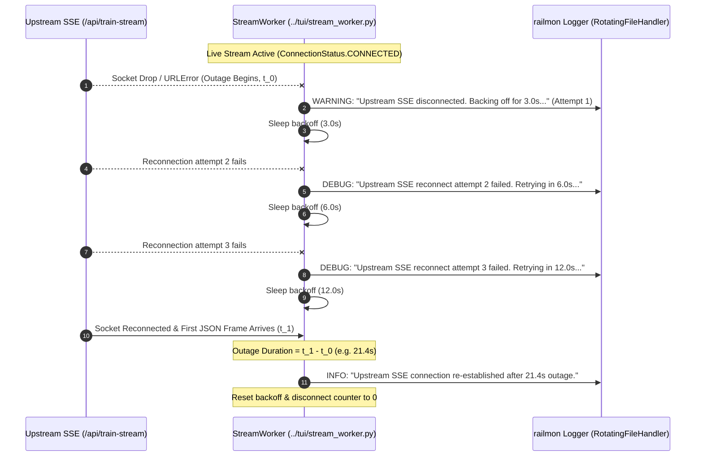

# Implementation Plan — P1-8: Non-Compliant Logging Hierarchy & Missing `RotatingFileHandler`

> **Reference:** [Production Readiness & Architecture Review (`P1-8`)](../../../architecture/production-readiness-review.md#p1-8-non-compliant-logging-hierarchy--missing-rotatingfilehandler)  
> **Target Modules:** [`../../../../train_tracker.py`](../../../../train_tracker.py), [`../../../../storage/recorder.py`](../../../../storage/recorder.py), [`../../../../tui/stream_worker.py`](../../../../tui/stream_worker.py), [`../../../../storage/db.py`](../../../../storage/db.py), [`../../../../storage/schema.py`](../../../../storage/schema.py), [`../../../../storage/repository.py`](../../../../storage/repository.py), [`../../../../tui/app.py`](../../../../tui/app.py)  
> **Test Suites:** [`../../../../tests/test_cli.py`](../../../../tests/test_cli.py), [`../../../../tests/test_logging.py`](../../../../tests/test_logging.py), [`../../../../tests/test_tracker.py`](../../../../tests/test_tracker.py), [`../../../../tests/test_storage_recorder.py`](../../../../tests/test_storage_recorder.py)  
> **Relevant Rules & Skills:** [`../../../../.agents/rules/logging-and-observability.md`](../../../../.agents/rules/logging-and-observability.md), [`../../../../.agents/rules/security-and-data-protection.md`](../../../../.agents/rules/security-and-data-protection.md), [`../../../../.agents/rules/resilience-and-fallbacks.md`](../../../../.agents/rules/resilience-and-fallbacks.md), [`../../../../.agents/rules/diagrams-and-visual-documentation.md`](../../../../.agents/rules/diagrams-and-visual-documentation.md), [`../../../../.agents/rules/markdown-relative-paths.md`](../../../../.agents/rules/markdown-relative-paths.md), [`../../../../.agents/skills/ci-quality-gate/SKILL.md`](../../../../.agents/skills/ci-quality-gate/SKILL.md)

---

## 1. Executive Summary & Defect Overview

`railmon` executes both as an interactive full-screen curses TUI and as an unattended background ingestion daemon (`railmon record`, `railmon --record`, `railmon --daemon`). In production environments, observability, diagnostics, and operational auditing depend on structured, bounded logging that does not corrupt terminal displays, leak unhandled traces, or exhaust host storage.

As diagnosed in [`../../../architecture/production-readiness-review.md`](../../../architecture/production-readiness-review.md#p1-8-non-compliant-logging-hierarchy--missing-rotatingfilehandler), the system currently scores **4/10** in *Observability & Logging*, suffering from four interconnected deficiencies:

1. **Inconsistent Logger Hierarchy & Missing Package Root Management:**
   - While some modules use `logging.getLogger("railmon." + __name__)`, the parent package logger `railmon` is never initialized with a `logging.NullHandler()` at library import time.
   - Core storage and TUI modules ([`../../../../storage/db.py`](../../../../storage/db.py), [`../../../../storage/schema.py`](../../../../storage/schema.py), [`../../../../storage/repository.py`](../../../../storage/repository.py), [`../../../../tui/app.py`](../../../../tui/app.py)) lack standard per-module loggers entirely.
   - When `train_tracker.py` is invoked as a script, `__name__` evaluates to `"__main__"`, generating `railmon.__main__` rather than canonical `railmon.train_tracker`.
   - Without an explicit handler attached to the `railmon` logger, uncaught records bubble up to Python's root logger, where the default `logging.lastResort` handler writes `WARNING` and `ERROR` events directly to `sys.stderr`.

2. **Missing `RotatingFileHandler` & Bounded Disk Logging in Daemon Mode:**
   - Background recording mode (`railmon record`) and daemon executions do not initialize file-based logging.
   - No `logging.handlers.RotatingFileHandler` is configured to enforce the mandated bounds:
     - Target size: $10\text{ MB}$ (`maxBytes=10_485_760`)
     - Backup count: $3$ retained rotations (`backupCount=3`)
     - Standard log layout: `%(asctime)s [%(levelname)s] [%(threadName)s] %(name)s: %(message)s`
     - Platform paths:
       - Linux/macOS: `~/.local/state/railmon/railmon.log` (honoring `$XDG_STATE_HOME/railmon/railmon.log`)
       - Windows: `%LOCALAPPDATA%\railmon\logs\railmon.log`
   - Violates [`../../../../.agents/rules/logging-and-observability.md`](../../../../.agents/rules/logging-and-observability.md#L26-L36).

3. **Curses Buffer Corruption from Unisolated Console Logging:**
   - In interactive TUI mode, background worker threads ([`StreamWorker`](../../../../tui/stream_worker.py) and [`TelemetryRecorder`](../../../../storage/recorder.py)) emit `WARNING` messages (e.g. rate limits, network reconnects, queue saturation).
   - Because `sys.stderr` is not isolated from curses and logger propagation is unconstrained, warning messages print over the active curses screen buffer, destroying the Braille map and window borders.
   - Violates [`../../../../.agents/rules/logging-and-observability.md`](../../../../.agents/rules/logging-and-observability.md#L5-L8).

4. **Violation of Upstream Disconnection Reporting Discipline:**
   - [`StreamWorker._run_loop`](../../../../tui/stream_worker.py#L145-L160) and [`RailwayGovClient.stream_train_positions`](../../../../train_tracker.py#L557-L584) log **every** reconnection attempt at `WARNING`, spamming logs during transient outages.
   - Re-establishment of upstream SSE streams fails to log at `INFO` with the elapsed outage duration.
   - Violates [`../../../../.agents/rules/logging-and-observability.md`](../../../../.agents/rules/logging-and-observability.md#L37-L41).

This implementation plan establishes a comprehensive logging subsystem: defining platform path resolvers, POSIX `0600` permissions enforcement, a bounded `RotatingFileHandler`, TUI screen isolation, compliant retry-backoff logging discipline, and top-level CLI controls (`--log-file`, `--log-level`, `--debug`).

---

## 2. Root-Cause Defect Analysis

### A. Defect Mechanisms

#### 1. Incomplete Hierarchy & Logger Leaks to `lastResort`
- **Location:** [`../../../../train_tracker.py`](../../../../train_tracker.py#L27), [`../../../../storage/recorder.py`](../../../../storage/recorder.py#L20), [`../../../../tui/stream_worker.py`](../../../../tui/stream_worker.py#L17)
- **Current Pattern:**
  ```python
  # In train_tracker.py:
  logger = logging.getLogger("railmon." + __name__)
  ```
- **Failure Mode:**
  1. When executed directly (`python train_tracker.py`), `__name__` is `"__main__"`, resulting in logger name `railmon.__main__`.
  2. The parent logger `railmon` has no handlers or `NullHandler()` attached by default.
  3. When `logger.warning(...)` is called (e.g., when `TelemetryRecorder` queue saturates or HTTP 429 occurs), the message traverses up to the root logger.
  4. In the absence of root handlers, Python's `logging.lastResort` handler writes the raw string to `sys.stderr`. During unit tests or curses TUI execution, this dumps unformatted warning lines into stdout/stderr.

#### 2. Absence of File Logging in Daemon & Recording Modes
- **Location:** [`../../../../train_tracker.py`](../../../../train_tracker.py#L1140-L1225) (`run_record_mode`), [`../../../../storage/recorder.py`](../../../../storage/recorder.py#L170-L260)
- **Failure Mode:**
  - `run_record_mode()` prints periodic terminal status text via `print()` (or suppresses it with `--quiet`), but diagnostic messages from `TelemetryRecorder` and `RailwayGovClient` are never persisted to a dedicated log file.
  - When running as an unattended background service (via `systemd`, `supervisord`, or Docker daemon), operators cannot inspect historical operational events, batch flush timings, deadband compression ratios, or network backoffs.
  - No rotation or size cap exists, risking disk exhaustion if unstructured shell redirects (`railmon record >> railmon.log 2>&1`) are used.

#### 3. Curses Screen Buffer Corruption
- **Location:** [`../../../../tui/app.py`](../../../../tui/app.py#L499-L541), [`../../../../train_tracker.py`](../../../../train_tracker.py#L840-L955) (`run_tui_mode`)
- **Failure Mode:**
  - Curses controls `sys.stdout` and the terminal display.
  - If `StreamWorker` logs a network disconnect (`logger.warning(...)`), and the handler directs to `sys.stderr` or `lastResort`, the characters are written directly to the terminal's active video cell matrix outside curses' knowledge.
  - The TUI displays garbled text, breaks window borders, and corrupts the 2×4 Braille subpixel raster until the next full redraw.

#### 4. Disconnection Log Spam & Missing Outage Duration Telemetry
- **Location:** [`../../../../tui/stream_worker.py`](../../../../tui/stream_worker.py#L141-L161), [`../../../../train_tracker.py`](../../../../train_tracker.py#L554-L585)
- **Current Logic:**
  ```python
  # In StreamWorker:
  msg = f"Connection error: {exc}. Reconnecting in {sleep_time:.1f}s..."
  logger.warning(msg)  # Emitted on EVERY failure loop!
  ```
- **Failure Mode:**
  - During a prolonged 30-minute upstream outage with exponential backoff (e.g., 30s intervals), 60 identical `WARNING` entries are logged.
  - Violates the rule requirement:
    - First disconnect: Log at `WARNING` with backoff interval.
    - Subsequent retry attempts: Log at `DEBUG` or `INFO`.
    - Re-establishment: Log at `INFO` with duration of outage.
  - Furthermore, upon successful stream re-establishment, no `INFO` log records the total duration of the outage.

---

### B. Visual Comparison (ASCII & Mermaid)

#### ASCII Representation: Logging Architecture & Screen Safety

```text
BEFORE (Unconfigured Hierarchy, Leaks to stderr, Corrupts Curses):
  +--------------------+     +-----------------------+     +--------------------+
  |   StreamWorker     |     |   TelemetryRecorder   |     |  RailwayGovClient  |
  +--------------------+     +-----------------------+     +--------------------+
            | (warning)                  | (warning)                 | (warning)
            +----------------------------+---------------------------+
                                         |
                                         v
                    Logger: "railmon.tui.stream_worker"
                                         | (propagate = True)
                                         v
                    Logger: "railmon" (No Handlers Attached!)
                                         | (propagate = True)
                                         v
                    Root Logger / logging.lastResort Handler
                                         |
                                         v
                    sys.stderr (Direct terminal write!)
                                         |
                                         x --> OVERWRITES CURSES TUI DISPLAY!
                                         x --> TRASHES TERMINAL BUFFER!
                                         x --> NO ROTATING LOG FILE SAVED!

AFTER (Isolated Hierarchy, Bounded RotatingFileHandler, Clean TUI):
  +--------------------+     +-----------------------+     +--------------------+
  |   StreamWorker     |     |   TelemetryRecorder   |     |  RailwayGovClient  |
  +--------------------+     +-----------------------+     +--------------------+
            |                            |                           |
            +----------------------------+---------------------------+
                                         |
                                         v
                    Logger: "railmon.*" (Child Modules)
                                         | (propagate = True)
                                         v
       +-------------------------------------------------------------------+
       |                       Logger: "railmon"                           |
       |  - propagate = False (Blocks leak to root/sys.stderr)            |
       |  - Level: INFO / DEBUG                                            |
       +-------------------------------------------------------------------+
                         |                                 |
         (Daemon/Record/TUI Mode)             (CLI Plain Stream / Verbose)
                         v                                 v
       +-----------------------------------+     +-------------------------+
       |       RotatingFileHandler         |     |      StreamHandler      |
       | - 10 MB limit (maxBytes)          |     | - sys.stdout/sys.stderr |
       | - 3 backup generations            |     | - Only when TUI inactive|
       | - POSIX 0600 file permissions     |     +-------------------------+
       | - ~/.local/state/railmon/         |
       +-----------------------------------+
```

#### Mermaid Sequence Diagram: Disconnection & Reconnection Reporting Flow



---

## 3. Comprehensive Technical Specification

### A. Subsystem Architecture & Components

```text
+-------------------------------------------------------------------------------+
|                      RAILMON OBSERVABILITY SUBSYSTEM                          |
+-------------------------------------------------------------------------------+
|  1. Path Resolution Engine: resolve_default_log_path()                        |
|     - POSIX: $XDG_STATE_HOME/railmon/railmon.log or ~/.local/state/railmon/   |
|     - Windows: %LOCALAPPDATA%\railmon\logs\railmon.log                        |
+-------------------------------------------------------------------------------+
|  2. Security & Permissions: _ensure_secure_log_file()                         |
|     - Directory creation: 0700 (owner read/write/execute)                     |
|     - Log file creation: 0600 (owner read/write)                              |
+-------------------------------------------------------------------------------+
|  3. Rotation & Formatting Engine: setup_logging()                             |
|     - RotatingFileHandler: maxBytes=10_485_760 (10 MB), backupCount=3         |
|     - Formatter: %(asctime)s [%(levelname)s] [%(threadName)s] %(name)s: ...  |
|     - Encoding: utf-8                                                         |
+-------------------------------------------------------------------------------+
|  4. TUI Screen Isolation:                                                     |
|     - railmon_logger.propagate = False                                        |
|     - No StreamHandler attached to stdout/stderr while curses runs            |
+-------------------------------------------------------------------------------+
|  5. Outage Reporting Engine:                                                  |
|     - Attempt 1: WARNING                                                      |
|     - Attempt 2+: DEBUG                                                       |
|     - Reconnect: INFO with duration of outage                                 |
+-------------------------------------------------------------------------------+
```

---

### B. Platform-Specific Log Path Resolution

Per [`../../../../.agents/rules/logging-and-observability.md`](../../../../.agents/rules/logging-and-observability.md#L29-L31):

1. **Linux / macOS:**
   - Primary: Check environment variable `$XDG_STATE_HOME`. If non-empty, use `os.path.join(os.path.abspath(os.environ["XDG_STATE_HOME"]), "railmon", "railmon.log")`.
   - Fallback: `os.path.expanduser("~/.local/state/railmon/railmon.log")`.
2. **Windows:**
   - Primary: Check environment variable `%LOCALAPPDATA%`.
   - Fallback: `os.path.expanduser(r"~\AppData\Local")`.
   - Target path: `os.path.join(local_app_data, "railmon", "logs", "railmon.log")`.

```python
def resolve_default_log_path() -> str:
    """Determine platform-standard persistent log file destination.

    Returns:
        str: Absolute canonical file path to railmon.log.
    """
    if sys.platform == "win32":
        local_app_data = os.environ.get("LOCALAPPDATA")
        if not local_app_data or not local_app_data.strip():
            local_app_data = os.path.expanduser(r"~\AppData\Local")
        return os.path.join(os.path.abspath(local_app_data), "railmon", "logs", "railmon.log")
    
    xdg_state = os.environ.get("XDG_STATE_HOME")
    if xdg_state and xdg_state.strip():
        base_dir = os.path.abspath(xdg_state.strip())
    else:
        base_dir = os.path.expanduser("~/.local/state")
    return os.path.join(base_dir, "railmon", "railmon.log")
```

---

### C. Security Hardening & File Permissions (POSIX `0600` / `0700`)

Per [`../../../../.agents/rules/security-and-data-protection.md`](../../../../.agents/rules/security-and-data-protection.md#L14-L26), log files and directories must not be readable by unprivileged system users:

1. **Parent Directory:** Created with permissions `0700` (`rwx------`).
2. **Log File & Rotations:** Created with permissions `0600` (`rw-------`).
3. Implementation wraps directory creation in `os.umask(0o077)` and enforces `os.chmod()` on existing and newly opened log targets.

```python
def _ensure_secure_log_path(log_path: str) -> None:
    """Create parent directories and enforce 0700/0600 POSIX permissions."""
    log_dir = os.path.dirname(os.path.abspath(log_path))
    if not os.path.exists(log_dir):
        old_umask = os.umask(0o077)
        try:
            os.makedirs(log_dir, mode=0o700, exist_ok=True)
        finally:
            os.umask(old_umask)

    if sys.platform != "win32" and os.path.exists(log_path):
        try:
            os.chmod(log_path, 0o600)
        except OSError:
            pass
```

---

### D. RotatingFileHandler & Logging Hierarchy Initialization

The setup routine configures the package root logger `railmon` with:
- Standard log format: `%(asctime)s [%(levelname)s] [%(threadName)s] %(name)s: %(message)s`
- Handler: `logging.handlers.RotatingFileHandler`
- Parameters: `maxBytes=10_485_760` (10 MB), `backupCount=3`, `encoding="utf-8"`
- `propagate = False`: Stops propagation to root logger, preventing stderr leaks during curses TUI or unconfigured runs.

```python
LOG_FORMAT = "%(asctime)s [%(levelname)s] [%(threadName)s] %(name)s: %(message)s"
MAX_LOG_BYTES = 10_485_760  # 10 MB
BACKUP_COUNT = 3

def setup_logging(
    log_file: Optional[str] = None,
    log_level: str = "INFO",
    is_tui: bool = False,
    enable_console: bool = False,
) -> logging.Logger:
    """Configure structured logging hierarchy for railmon.

    Args:
        log_file: Optional path override. If None, resolves to platform default.
        log_level: Desired log level string (DEBUG, INFO, WARNING, ERROR, CRITICAL).
        is_tui: True if interactive curses mode is active (suppresses console output).
        enable_console: True if diagnostic console stream should be enabled.

    Returns:
        logging.Logger: The configured 'railmon' root logger.
    """
    target_path = os.path.abspath(log_file) if log_file else resolve_default_log_path()
    _ensure_secure_log_path(target_path)

    railmon_logger = logging.getLogger("railmon")
    numeric_level = getattr(logging, log_level.upper(), logging.INFO)
    railmon_logger.setLevel(numeric_level)
    railmon_logger.propagate = False

    # Remove existing railmon handlers to ensure idempotency
    for h in list(railmon_logger.handlers):
        railmon_logger.removeHandler(h)
        h.close()

    # Configure RotatingFileHandler
    formatter = logging.Formatter(LOG_FORMAT)
    file_handler = logging.handlers.RotatingFileHandler(
        target_path,
        maxBytes=MAX_LOG_BYTES,
        backupCount=BACKUP_COUNT,
        encoding="utf-8",
    )
    file_handler.setFormatter(formatter)
    file_handler.setLevel(numeric_level)
    railmon_logger.addHandler(file_handler)

    # POSIX permission hardening on newly opened file
    if sys.platform != "win32" and os.path.exists(target_path):
        try:
            os.chmod(target_path, 0o600)
        except OSError:
            pass

    # Console logging: strictly forbidden when TUI is active
    if enable_console and not is_tui:
        console_handler = logging.StreamHandler(sys.stderr)
        console_handler.setFormatter(formatter)
        console_handler.setLevel(numeric_level)
        railmon_logger.addHandler(console_handler)

    return railmon_logger
```

---

### E. Upstream Disconnection Reporting Discipline

Per Section 4 of [`../../../../.agents/rules/logging-and-observability.md`](../../../../.agents/rules/logging-and-observability.md#L37-L41):

1. **State Tracking:** Maintain `_disconnect_time: Optional[float]` and `_consecutive_failures: int`.
2. **On Failure:**
   - If `_consecutive_failures == 0`:
     - Record `_disconnect_time = time.monotonic()`
     - Log at `logging.WARNING`: `"Upstream connection lost: %s. Reconnecting in %.1fs...", exc, backoff`
   - If `_consecutive_failures > 0`:
     - Log at `logging.DEBUG`: `"Upstream reconnection attempt %d failed: %s. Retrying in %.1fs...", attempt, exc, backoff`
   - Increment `_consecutive_failures += 1`
3. **On Success / Re-establishment:**
   - If `_consecutive_failures > 0` and `_disconnect_time is not None`:
     - Calculate `outage_sec = time.monotonic() - _disconnect_time`
     - Log at `logging.INFO`: `"Upstream connection re-established after %.1fs outage.", outage_sec`
   - Reset `_consecutive_failures = 0` and `_disconnect_time = None`

This logic will be applied consistently in both:
- [`RailwayGovClient.stream_train_positions`](../../../../train_tracker.py#L461-L595)
- [`StreamWorker._run_loop`](../../../../tui/stream_worker.py#L90-L165)

---

### F. CLI Argument Integration

Top-level arguments added to [`build_parser()`](../../../../train_tracker.py#L604-L799):

```python
parser.add_argument(
    "--log-file",
    type=str,
    default=None,
    help="Custom path for rotating log file (default: platform state dir).",
)
parser.add_argument(
    "--log-level",
    type=str,
    default="INFO",
    choices=["DEBUG", "INFO", "WARNING", "ERROR", "CRITICAL"],
    help="Logging severity threshold (default: INFO).",
)
parser.add_argument(
    "--debug",
    action="store_true",
    help="Shortcut for --log-level DEBUG.",
)
```

In `main()`:
```python
log_level = "DEBUG" if getattr(args, "debug", False) else getattr(args, "log_level", "INFO")
is_tui = getattr(args, "tui", False) and not (getattr(args, "headless", False) or getattr(args, "daemon", False))

setup_logging(
    log_file=getattr(args, "log_file", None),
    log_level=log_level,
    is_tui=is_tui,
    enable_console=False,  # Core CLI modes manage stdout/stderr explicitly
)
```

---

## 4. File-by-File Implementation Plan

### 1. [`../../../../train_tracker.py`](../../../../train_tracker.py)
- **Import:** Add `logging.handlers`.
- **Top-Level Package Root:** Attach `logging.NullHandler()` to `logging.getLogger("railmon")` so importing `train_tracker` as a library never causes unhandled log leaks.
- **Logger Name:** Update module logger to use canonical name:
  ```python
  logger = logging.getLogger("railmon.train_tracker")
  ```
- **Logging Engine:** Implement `resolve_default_log_path()`, `_ensure_secure_log_path()`, and `setup_logging()`.
- **CLI Options:** Add `--log-file`, `--log-level`, and `--debug` to `build_parser()`.
- **Stream Reconnection Discipline:** Update `stream_train_positions()` to track `_disconnect_time` and `_consecutive_failures`, logging the first disconnect at `WARNING`, subsequent attempts at `DEBUG`, and successful re-establishment at `INFO` with elapsed outage seconds.
- **Main Dispatch:** Invoke `setup_logging()` on entry in `main()`.

### 2. [`../../../../storage/recorder.py`](../../../../storage/recorder.py)
- **Logger Hierarchy:** Ensure `logger = logging.getLogger("railmon.storage.recorder")`.
- **Operational Logs:** Log session startup, batch commits, deadband ratio summaries, and shutdown WAL truncate checkpoints cleanly through the hierarchy.

### 3. [`../../../../tui/stream_worker.py`](../../../../tui/stream_worker.py)
- **Logger Hierarchy:** Ensure `logger = logging.getLogger("railmon.tui.stream_worker")`.
- **Outage Tracking:** Add `_disconnect_time: Optional[float]` and `_consecutive_failures: int` to `StreamWorker.__init__()`.
- **Backoff Reporting:** In `_run_loop()`, log initial drop at `WARNING`, repeated retries at `DEBUG`, and recovery at `INFO` with total outage duration.

### 4. Supporting Modules ([`../../../../storage/db.py`](../../../../storage/db.py), [`../../../../storage/schema.py`](../../../../storage/schema.py), [`../../../../storage/repository.py`](../../../../storage/repository.py), [`../../../../tui/app.py`](../../../../tui/app.py))
- Define standard loggers:
  - `storage/db.py`: `logger = logging.getLogger("railmon.storage.db")`
  - `storage/schema.py`: `logger = logging.getLogger("railmon.storage.schema")`
  - `storage/repository.py`: `logger = logging.getLogger("railmon.storage.repository")`
  - `tui/app.py`: `logger = logging.getLogger("railmon.tui.app")`

---

## 5. Verification & Test Suite Plan

A dedicated test suite [`../../../../tests/test_logging.py`](../../../../tests/test_logging.py) will be authored alongside test extensions in [`../../../../tests/test_cli.py`](../../../../tests/test_cli.py):

| Test ID | Test Method | Verification Scope | Target Assertion |
|---|---|---|---|
| **TC-LOG-01** | `test_default_log_path_posix_default` | Linux default path resolution without `XDG_STATE_HOME` | Resolves to `~/.local/state/railmon/railmon.log` |
| **TC-LOG-02** | `test_default_log_path_posix_xdg` | Linux path resolution with custom `$XDG_STATE_HOME` | Resolves to `$XDG_STATE_HOME/railmon/railmon.log` |
| **TC-LOG-03** | `test_default_log_path_windows` | Windows path resolution with `%LOCALAPPDATA%` | Resolves to `%LOCALAPPDATA%\railmon\logs\railmon.log` |
| **TC-LOG-04** | `test_setup_logging_rotating_handler` | Verifies `RotatingFileHandler` configuration | `maxBytes == 10_485_760`, `backupCount == 3`, format string matches |
| **TC-LOG-05** | `test_setup_logging_posix_permissions` | Tests POSIX `0600` / `0700` permission enforcement | Log file `stat().st_mode & 0o777 == 0o600` on POSIX |
| **TC-LOG-06** | `test_setup_logging_tui_mode_suppression` | Tests that TUI mode attaches no console `StreamHandler` | No `StreamHandler` on `railmon.handlers` when `is_tui=True` |
| **TC-LOG-07** | `test_logger_hierarchy_propagation` | Verifies child module loggers route to `railmon` file | Messages from `railmon.storage.recorder` appear in file; `propagate=False` |
| **TC-LOG-08** | `test_upstream_disconnection_reporting` | Simulates multi-retry disconnect and recovery in `StreamWorker` | 1st failure = `WARNING`; 2nd failure = `DEBUG`; Reconnect = `INFO` with duration |
| **TC-LOG-09** | `test_cli_log_file_argument` | Verifies `--log-file /custom/path.log` parsed and applied | Custom file target configured in handler |
| **TC-LOG-10** | `test_cli_log_level_and_debug_flags` | Verifies `--log-level DEBUG` and `--debug` flags | Logger level sets to `logging.DEBUG` |

---

## 6. Rollout & Remediation Checklist

- [ ] Define `resolve_default_log_path()` and `_ensure_secure_log_path()` in [`../../../../train_tracker.py`](../../../../train_tracker.py).
- [ ] Implement `setup_logging()` with `RotatingFileHandler(10MB, backupCount=3, utf-8)` and `propagate = False`.
- [ ] Attach `logging.NullHandler()` to `logging.getLogger("railmon")` at library level.
- [ ] Standardize module loggers across [`../../../../train_tracker.py`](../../../../train_tracker.py), [`../../../../storage`](../../../../storage), and [`../../../../tui`](../../../../tui) to `railmon.<module>`.
- [ ] Add outage tracking and tiered log levels (`WARNING` $\to$ `DEBUG` $\to$ `INFO`) to `RailwayGovClient.stream_train_positions()` and `StreamWorker._run_loop()`.
- [ ] Add `--log-file`, `--log-level`, and `--debug` CLI flags to `build_parser()`.
- [ ] Wire `setup_logging()` invocation in `main()`.
- [ ] Author comprehensive unit tests in [`../../../../tests/test_logging.py`](../../../../tests/test_logging.py).
- [ ] Run full test suite (`python3 -m unittest discover tests/`) and verify 0 regressions.
- [ ] Update [`../../../architecture/production-readiness-review.md`](../../../architecture/production-readiness-review.md) to mark P1-8 as RESOLVED.
