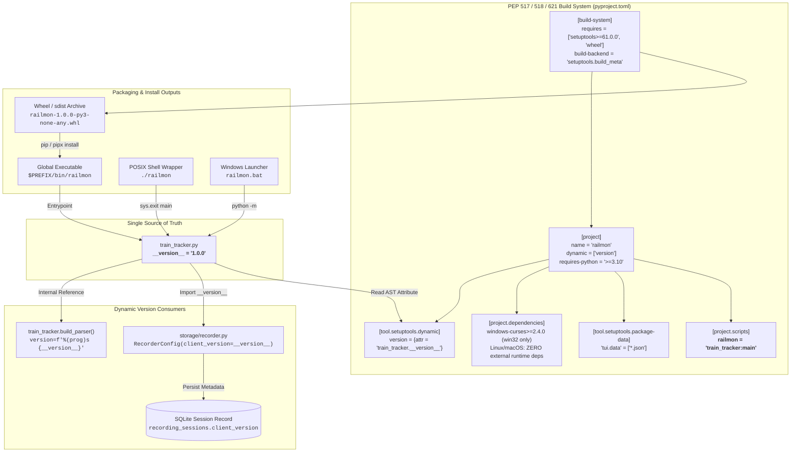

# Implementation Plan — P1-9: Missing `pyproject.toml` & Single-Source `__version__`

> **Reference:** [Production Readiness & Architecture Review (`P1-9`)](../../../architecture/production-readiness-review.md#p1-9-missing-pyproject-toml--single-source-__version__)  
> **Target Modules:** [`../../../../train_tracker.py`](../../../../train_tracker.py), [`../../../../storage/recorder.py`](../../../../storage/recorder.py), [`../../../../pyproject.toml`](../../../../pyproject.toml)  
> **Test Suites:** [`../../../../tests/test_packaging.py`](../../../../tests/test_packaging.py), [`../../../../tests/test_cli.py`](../../../../tests/test_cli.py), [`../../../../tests/test_storage_recorder.py`](../../../../tests/test_storage_recorder.py)  
> **Relevant Rules & Skills:** [`../../../../.agents/rules/release-and-versioning.md`](../../../../.agents/rules/release-and-versioning.md), [`../../../../.agents/rules/architecture.md`](../../../../.agents/rules/architecture.md), [`../../../../.agents/rules/diagrams-and-visual-documentation.md`](../../../../.agents/rules/diagrams-and-visual-documentation.md), [`../../../../.agents/rules/markdown-relative-paths.md`](../../../../.agents/rules/markdown-relative-paths.md), [`../../../../.agents/skills/package-distribution-validator/SKILL.md`](../../../../.agents/skills/package-distribution-validator/SKILL.md), [`../../../../.agents/skills/ci-quality-gate/SKILL.md`](../../../../.agents/skills/ci-quality-gate/SKILL.md)

---

## 1. Executive Summary & Defect Overview

`railmon` is designed as a standalone, production-grade terminal monitor and telemetry persistence daemon for Hellenic Railways (`railway.gov.gr`). A foundational architectural principle defined in [`../../../../.agents/rules/release-and-versioning.md`](../../../../.agents/rules/release-and-versioning.md) and [`../../../../.agents/skills/package-distribution-validator/SKILL.md`](../../../../.agents/skills/package-distribution-validator/SKILL.md) is **single-source versioning** and **standardized packaging** while maintaining **zero external runtime dependencies on Linux and macOS**.

As diagnosed in [`../../../architecture/production-readiness-review.md`](../../../architecture/production-readiness-review.md#p1-9-missing-pyproject-toml--single-source-__version__), the repository exhibits two critical packaging and versioning deficiencies:

1. **Absence of Canonical Module Version & Version Drift:**
   - [`train_tracker.py`](../../../../train_tracker.py) lacks a module-level `__version__` definition.
   - Version strings are duplicated independently across components:
     - `build_parser()` in [`../../../../train_tracker.py`](../../../../train_tracker.py#L868) hardcodes `version="%(prog)s 1.0.0"`.
     - `RecorderConfig` in [`../../../../storage/recorder.py`](../../../../storage/recorder.py#L34) hardcodes `client_version: str = "1.0.0"`.
   - Modifying the release version requires error-prone manual edits across multiple files, violating Rule 2 of [`../../../../.agents/rules/release-and-versioning.md`](../../../../.agents/rules/release-and-versioning.md#L11-L15) and inviting silent version drift between the CLI output, recorded SQLite session metadata, and release artifacts.

2. **Missing `pyproject.toml` Build Specification:**
   - No `pyproject.toml` (PEP 517 / PEP 518 / PEP 621) exists in the repository root.
   - Users and operators cannot install `railmon` into virtual environments, system paths, or containers via modern package managers (`pip install .`, `pip install -e .`, or `pipx install .`).
   - The CLI executable entry point is constrained to invoking `./railmon` from the repository root rather than providing a globally discoverable `railmon` binary in standard binary paths (`$PATH` / `bin/`).
   - Package assets required by the TUI and mock engine ([`../../../../tui/data/stations.json`](../../../../tui/data/stations.json) and [`../../../../tui/data/tracks.json`](../../../../tui/data/tracks.json)) have no declared packaging manifest, risking runtime asset resolution failures if wheel or sdist distributions are assembled.

This implementation plan establishes a canonical `__version__` in [`../../../../train_tracker.py`](../../../../train_tracker.py), wires all consumers dynamically to this single source of truth, authors a standard PEP 517/518/621 [`../../../../pyproject.toml`](../../../../pyproject.toml) supporting dynamic version extraction via `setuptools`, preserves zero-dependency runtime purity on POSIX, specifies package data inclusion for TUI topology files, and validates packaging integrity with a dedicated automated test suite.

---

## 2. Root-Cause Defect Analysis & Architecture Gaps

### A. Defect Mechanisms

#### 1. Hardcoded and Fragmented Version Strings
- **Location:** [`../../../../train_tracker.py`](../../../../train_tracker.py#L866-L869), [`../../../../storage/recorder.py`](../../../../storage/recorder.py#L33-L35)
- **Current Implementation:**
  ```python
  # train_tracker.py (build_parser):
  parser.add_argument(
      "-v",
      "--version",
      action="version",
      version="%(prog)s 1.0.0",
  )

  # storage/recorder.py (RecorderConfig):
  @dataclass
  class RecorderConfig:
      db_path: str = "data/railway_telemetry.db"
      batch_size: int = 50
      flush_interval_sec: float = 5.0
      client_version: str = "1.0.0"
  ```
- **Consequences:**
  1. No public `__version__` attribute exists on the top-level `train_tracker` module or `railmon` package namespace. Attempting to programmatically query `import train_tracker; train_tracker.__version__` raises `AttributeError`.
  2. When preparing release `1.1.0` or `1.0.1`, developers must manually locate and alter multiple disassociated strings.
  3. If a developer updates `build_parser` but neglects `RecorderConfig`, SQLite historical telemetry recorded in the `recording_sessions` table (`client_version` column) permanently records an obsolete version identifier, corrupting analytical queries and schema audit trails.

#### 2. Missing `pyproject.toml` Build Manifest
- **Location:** Repository root
- **Current State:** Only `requirements.txt` and `requirements-dev.txt` exist. No `setup.py` or `pyproject.toml` is provided.
- **Consequences:**
  1. Standard installation commands (`pip install .` or `pipx install git+https://...`) fail immediately with:
     ```text
     ERROR: Directory '.' is not installable. Neither 'setup.py' nor 'pyproject.toml' found.
     ```
  2. Deployment in production (e.g. systemd service units, cron jobs, containerized deployments) requires manual clone and PATH manipulation or wrapper scripting rather than standardized wheel installation.
  3. Tool configurations (`pytest`, `black`, `mypy`, `coverage`) cannot be unified in a modern single-file configuration hub.

---

### B. Dual Architecture Diagrams: Version Propagation & Packaging Flow

#### 1. ASCII Diagram — Single-Source Versioning & Distribution Topology

```text
+-----------------------------------------------------------------------------------------+
|                    CANONICAL SINGLE-SOURCE VERSION ARCHITECTURE                         |
+-----------------------------------------------------------------------------------------+
|                                                                                         |
|                       +-----------------------------------+                             |
|                       |         train_tracker.py          |                             |
|                       |                                   |                             |
|                       |    __version__ = "1.0.0"          | <--- [CANONICAL SOURCE]     |
|                       |    __author__  = "Hellenic..."    |                             |
|                       +-----------------+-----------------+                             |
|                                         |                                               |
|               +-------------------------+-------------------------+                     |
|               |                         |                         |                     |
|               v                         v                         v                     |
|  +------------------------+  +----------------------+  +--------------------+           |
|  |     build_parser()     |  |   storage/recorder   |  |   pyproject.toml   |           |
|  |                        |  |                      |  |                    |           |
|  | version=               |  | from train_tracker   |  | [tool.setuptools.  |           |
|  |   f"%(prog)s           |  |   import __version__ |  |  dynamic]          |           |
|  |     {__version__}"     |  |                      |  | version = {attr =  |           |
|  +-----------+------------+  | RecorderConfig(      |  |  "train_tracker.   |           |
|              |               |  client_version=     |  |   __version__"}    |           |
|              v               |    __version__)      |  +---------+----------+           |
|   railmon --version          +----------+-----------+            |                      |
|   Output: "railmon 1.0.0"               |                        v                      |
|                                         v              +--------------------+           |
|                              recording_sessions table  |   pip / pipx wheel |           |
|                              (client_version column)   |   railmon-1.0.0-   |           |
|                                                        |   py3-none-any.whl |           |
|                                                        +---------+----------+           |
|                                                                  |                      |
|                                                                  v                      |
|                                                        [project.scripts]                |
|                                                        railmon = "train_tracker:main"   |
|                                                                                         |
+-----------------------------------------------------------------------------------------+
```

#### 2. Mermaid Diagram — Packaging, Build & Runtime Distribution Lifecycle



---

## 3. Architecture & Technical Specification

### A. Single-Source Versioning Specification

1. **Location:** Module-level in [`../../../../train_tracker.py`](../../../../train_tracker.py) directly beneath standard library imports and preceding helper routines.
2. **Format:** Semantic Versioning 2.0.0 conforming string:
   ```python
   __version__ = "1.0.0"
   __author__ = "Hellenic Train Tracking Contributors"
   ```
3. **Public Export:** Added to `__all__` if declared or accessible as standard module attribute `train_tracker.__version__`.

### B. Dynamic Propagation Across Subsystems

#### 1. CLI Parser (`build_parser`)
- In [`../../../../train_tracker.py`](../../../../train_tracker.py), `build_parser()` will reference `__version__`:
  ```python
  parser.add_argument(
      "-v",
      "--version",
      action="version",
      version=f"%(prog)s {__version__}",
  )
  ```
- Retains compatibility with `prog="railmon"` and standalone execution `python train_tracker.py --version`.

#### 2. Telemetry Ingestion Daemon (`RecorderConfig`)
- In [`../../../../storage/recorder.py`](../../../../storage/recorder.py), import `__version__` from `train_tracker`:
  ```python
  from train_tracker import TrainPosition, __version__
  ```
- In `RecorderConfig`, set default value:
  ```python
  @dataclass
  class RecorderConfig:
      db_path: str = "data/railway_telemetry.db"
      batch_size: int = 50
      flush_interval_sec: float = 5.0
      client_version: str = __version__
  ```
- Ensures all new recording sessions stored in SQLite carry the true canonical application version without manual synchronization.

### C. Standard PEP 517 / PEP 518 / PEP 621 `pyproject.toml`

Author [`../../../../pyproject.toml`](../../../../pyproject.toml) at repository root conforming to modern Python packaging standards:

```toml
[build-system]
requires = ["setuptools>=61.0.0", "wheel"]
build-backend = "setuptools.build_meta"

[project]
name = "railmon"
dynamic = ["version"]
description = "Hellenic Railways (railway.gov.gr) Live Train Tracker & Terminal Map"
readme = "README.md"
requires-python = ">=3.10"
license = { text = "MIT" }
authors = [
    { name = "Hellenic Train Tracking Contributors" },
]
keywords = [
    "railway",
    "trains",
    "curses",
    "tui",
    "greece",
    "telemetry",
    "sse",
    "transit",
]
classifiers = [
    "Development Status :: 4 - Beta",
    "Environment :: Console :: Curses",
    "Intended Audience :: End Users/Desktop",
    "Intended Audience :: Developers",
    "License :: OSI Approved :: MIT License",
    "Operating System :: OS Independent",
    "Programming Language :: Python :: 3",
    "Programming Language :: Python :: 3.10",
    "Programming Language :: Python :: 3.11",
    "Programming Language :: Python :: 3.12",
    "Topic :: Terminals",
    "Topic :: Utilities",
]

# Zero external runtime dependencies on Linux/macOS!
# Only windows-curses is required on Windows platforms for curses support.
dependencies = [
    'windows-curses>=2.4.0; sys_platform == "win32"',
]

[project.optional-dependencies]
dev = [
    "pytest>=7.0.0",
    "pytest-cov>=4.0.0",
    "mypy>=1.4.0",
    "flake8>=6.0.0",
    "black>=23.7.0",
]

[project.scripts]
railmon = "train_tracker:main"

[project.urls]
Homepage = "https://railway.gov.gr"
Repository = "https://github.com/train-tracker/railmon"
Issues = "https://github.com/train-tracker/railmon/issues"

[tool.setuptools.dynamic]
version = { attr = "train_tracker.__version__" }

[tool.setuptools]
py-modules = ["train_tracker"]
packages = ["storage", "tui", "tui.data"]

[tool.setuptools.package-data]
"tui.data" = ["*.json"]

# Tool configurations
[tool.pytest.ini_options]
testpaths = ["tests"]
python_files = ["test_*.py"]

[tool.black]
line-length = 88
target-version = ["py310"]

[tool.mypy]
python_version = "3.10"
warn_unused_configs = true
disallow_untyped_defs = false
ignore_missing_imports = true

[tool.coverage.run]
source = ["train_tracker", "storage", "tui"]
omit = ["tests/*"]

[tool.coverage.report]
show_missing = true
exclude_lines = [
    "pragma: no cover",
    "def __repr__",
    "if __name__ == .__main__.:",
    "raise NotImplementedError",
    "if TYPE_CHECKING:",
]
```

### D. Packaging & Inclusion Matrix

| Component | Repository Path | Packaging Directive | Required by |
|---|---|---|---|
| Top-level CLI & Engine | [`train_tracker.py`](../../../../train_tracker.py) | `py-modules = ["train_tracker"]` | All CLI & daemon commands |
| Storage Subsystem | [`storage/`](../../../../storage) | `packages = ["storage"]` | Historical telemetry, SQLite WAL |
| TUI Core Subsystem | [`tui/`](../../../../tui) | `packages = ["tui", "tui.data"]` | Curses interface, Braille canvas |
| Station Hub Data | [`tui/data/stations.json`](../../../../tui/data/stations.json) | `package-data = {"tui.data" = ["*.json"]}` | Geospatial station markers & mock engine |
| Track Geometry Data | [`tui/data/tracks.json`](../../../../tui/data/tracks.json) | `package-data = {"tui.data" = ["*.json"]}` | Railway track vector polylines |
| CLI Executable Entrypoint | `railmon = train_tracker:main` | `[project.scripts]` | Global system binary execution |

---

## 4. Step-by-Step Implementation Plan

### Step 1: Define Canonical `__version__` in `train_tracker.py`
- Open [`../../../../train_tracker.py`](../../../../train_tracker.py).
- Directly following standard imports (line ~27), add:
  ```python
  __version__ = "1.0.0"
  __author__ = "Hellenic Train Tracking Contributors"
  ```
- Ensure `__version__` is placed at the top level so `setuptools.dynamic` can extract it via AST parsing without triggering heavy imports or environment side-effects.

### Step 2: Refactor `build_parser()` to Use `__version__`
- In [`../../../../train_tracker.py`](../../../../train_tracker.py), find the `--version` argument definition in `build_parser()`.
- Replace the hardcoded string `"version=\"%(prog)s 1.0.0\""` with:
  ```python
  parser.add_argument(
      "-v",
      "--version",
      action="version",
      version=f"%(prog)s {__version__}",
  )
  ```

### Step 3: Refactor `storage/recorder.py` to Inherit `__version__`
- Open [`../../../../storage/recorder.py`](../../../../storage/recorder.py).
- Update the import line from `train_tracker`:
  ```python
  from train_tracker import TrainPosition, __version__
  ```
- Update `RecorderConfig`:
  ```python
  @dataclass
  class RecorderConfig:
      db_path: str = "data/railway_telemetry.db"
      batch_size: int = 50
      flush_interval_sec: float = 5.0
      client_version: str = __version__
  ```

### Step 4: Create Modern `pyproject.toml`
- Create [`../../../../pyproject.toml`](../../../../pyproject.toml) at the repository root.
- Populate with the complete PEP 517/518/621 specification defined in Section 3.C.
- Confirm zero runtime dependencies for POSIX systems and inclusion of `tui.data` JSON files.

### Step 5: Implement Packaging Test Suite & Update CLI Tests
- Create a dedicated test file [`../../../../tests/test_packaging.py`](../../../../tests/test_packaging.py) verifying:
  1. `train_tracker.__version__` is defined and conforms to SemVer regex (`^\d+\.\d+\.\d+$`).
  2. `RecorderConfig().client_version == train_tracker.__version__`.
  3. `pyproject.toml` exists, is syntactically valid TOML, and dynamically points to `train_tracker.__version__`.
  4. Runtime dependencies in `pyproject.toml` contain only `windows-curses` for Windows, preserving zero dependencies on Linux/macOS.
  5. Console script entry point `railmon` routes to `train_tracker:main`.
  6. Package data includes `tui/data/stations.json` and `tracks.json`.
- In [`../../../../tests/test_cli.py`](../../../../tests/test_cli.py#L84-L91), strengthen `test_version_flag` to verify that `mock_stdout.getvalue()` dynamically matches `f"railmon {train_tracker.__version__}"`.

### Step 6: Validate Packaging & Quality Gates
- Execute package distribution validation procedure from [`../../../../.agents/skills/package-distribution-validator/SKILL.md`](../../../../.agents/skills/package-distribution-validator/SKILL.md):
  1. Audit runtime dependency manifest: zero external runtime dependencies on Linux/macOS.
  2. Verify `./railmon --version` and `./railmon --help`.
  3. Verify `railmon.bat --help`.
- Run full unit test suite:
  ```bash
  python3 -m unittest discover tests
  ```
- Run code linters and formatting checks.
- Update [`../../../architecture/production-readiness-review.md`](../../../architecture/production-readiness-review.md#p1-9-missing-pyproject-toml--single-source-__version__) marking P1-9 as `[RESOLVED]`.

---

## 5. Testing Strategy & Verification Specifications

### Test Cases Matrix

| Test ID | Target Component | Description / Assertion | Expected Result |
|---|---|---|---|
| **TC-PKG-01** | `train_tracker.__version__` | Verify module attribute exists and matches SemVer pattern `r"^\d+\.\d+\.\d+"`. | Valid SemVer (e.g. `"1.0.0"`). |
| **TC-PKG-02** | `train_tracker.build_parser` | Verify `--version` output matches `f"railmon {__version__}"`. | Formatted string exits with code 0. |
| **TC-PKG-03** | `storage/recorder.py` | Verify `RecorderConfig().client_version` matches `train_tracker.__version__`. | Identical version string without drift. |
| **TC-PKG-04** | `pyproject.toml` Metadata | Verify `pyproject.toml` file exists, has `build-backend = "setuptools.build_meta"`, `[project.scripts]` mapping `railmon = "train_tracker:main"`. | Syntactically valid TOML with expected keys. |
| **TC-PKG-05** | Runtime Purity | Verify `dependencies` in `pyproject.toml` specifies zero unconditional PyPI packages, matching `requirements.txt`. | Only `windows-curses` under `sys_platform == "win32"`. |
| **TC-PKG-06** | Package Data Integrity | Verify `tui.data` package data includes `*.json` and both `stations.json` and `tracks.json` exist on disk. | Package data properly declared and resolvable. |

### Concrete Test Implementation (`tests/test_packaging.py`)

```python
"""Tests for package metadata, PEP 621 pyproject.toml, and single-source versioning."""

import os
import re
import unittest
from pathlib import Path

import train_tracker
from storage.recorder import RecorderConfig

REPO_ROOT = Path(__file__).resolve().parent.parent


class TestPackagingAndVersioning(unittest.TestCase):
    """Test suite validating single-source versioning and pyproject.toml packaging."""

    def test_single_source_version_format(self):
        """TC-PKG-01: train_tracker.__version__ exists and conforms to SemVer 2.0.0."""
        self.assertTrue(hasattr(train_tracker, "__version__"))
        version = train_tracker.__version__
        self.assertIsInstance(version, str)
        semver_pattern = r"^\d+\.\d+\.\d+(-[0-9A-Za-z.-]+)?(\+[0-9A-Za-z.-]+)?$"
        self.assertRegex(version, semver_pattern, f"Version {version!r} is not valid SemVer")

    def test_recorder_config_inherits_version(self):
        """TC-PKG-03: RecorderConfig.client_version matches train_tracker.__version__."""
        config = RecorderConfig()
        self.assertEqual(config.client_version, train_tracker.__version__)

    def test_pyproject_toml_exists_and_configured(self):
        """TC-PKG-04: pyproject.toml exists and specifies correct build backend and entrypoint."""
        pyproject_path = REPO_ROOT / "pyproject.toml"
        self.assertTrue(pyproject_path.exists(), "pyproject.toml not found at repo root")
        content = pyproject_path.read_text(encoding="utf-8")

        # Verify build-system
        self.assertIn("build-backend = \"setuptools.build_meta\"", content)
        self.assertIn("setuptools>=61.0.0", content)

        # Verify dynamic versioning
        self.assertIn("dynamic = [\"version\"]", content)
        self.assertIn("version = { attr = \"train_tracker.__version__\" }", content)

        # Verify entry points
        self.assertIn("railmon = \"train_tracker:main\"", content)

        # Verify package data
        self.assertIn("\"tui.data\" = [\"*.json\"]", content)

    def test_runtime_dependencies_purity(self):
        """TC-PKG-05: Runtime dependencies enforce zero PyPI dependencies on Linux/macOS."""
        pyproject_path = REPO_ROOT / "pyproject.toml"
        content = pyproject_path.read_text(encoding="utf-8")

        # Extract dependencies section
        dep_match = re.search(r"dependencies\s*=\s*\[(.*?)\]", content, re.DOTALL)
        self.assertIsNotNone(dep_match, "dependencies table not found in pyproject.toml")
        deps_block = dep_match.group(1).strip()
        lines = [line.strip().strip(",").strip("\"'") for line in deps_block.splitlines() if line.strip()]

        for dep in lines:
            if not dep:
                continue
            # The only permitted runtime dependency is windows-curses on win32
            self.assertTrue(
                "windows-curses" in dep and "win32" in dep,
                f"Unexpected runtime dependency in pyproject.toml: {dep}"
            )

    def test_package_data_files_exist(self):
        """TC-PKG-06: Package data files referenced in packaging exist on filesystem."""
        stations_file = REPO_ROOT / "tui" / "data" / "stations.json"
        tracks_file = REPO_ROOT / "tui" / "data" / "tracks.json"
        self.assertTrue(stations_file.exists(), "tui/data/stations.json missing")
        self.assertTrue(tracks_file.exists(), "tui/data/tracks.json missing")
```

---

## 6. Risk Analysis, Defenses & Rollback Strategy

| Identified Risk | Severity | Probability | Mitigation Strategy |
|---|---|---|---|
| Circular Import between `storage.recorder` and `train_tracker` | Medium | Low | `__version__` is defined at the very top of `train_tracker.py` before any subsystem imports. `storage.recorder` already imports `TrainPosition` from `train_tracker`, so importing `__version__` creates zero circular references. |
| AST version extraction failure in older `setuptools` | Low | Low | Set `[build-system] requires = ["setuptools>=61.0.0", "wheel"]`. Modern `pip` isolates build environments and downloads compliant setuptools automatically. |
| Missing package data in wheel distribution | High | Low | Explicitly declare `packages = ["storage", "tui", "tui.data"]` and `[tool.setuptools.package-data] "tui.data" = ["*.json"]`. Verify with `TC-PKG-06`. |
| Breaking changes to `./railmon` executable launcher | Low | Negligible | `./railmon` invokes `from train_tracker import main; sys.exit(main())`, which remains completely unchanged and backward-compatible. |

---

## 7. Production Readiness Verification Gate & Success Metrics

Before marking P1-9 as resolved, the implementation must pass all gates:

1. **Single-Source Version Integrity:**
   - `python3 -c "import train_tracker; print(train_tracker.__version__)"` prints `1.0.0`.
   - `python3 -c "from storage.recorder import RecorderConfig; print(RecorderConfig().client_version)"` prints `1.0.0`.
   - `python3 railmon --version` prints `railmon 1.0.0`.
2. **Packaging Purity:**
   - Zero external runtime dependencies on Linux/macOS in both `requirements.txt` and `pyproject.toml`.
3. **Automated Test Suite:**
   - 100% pass across all existing 319 unit tests plus newly added packaging test cases:
     ```bash
     python3 -m unittest discover tests
     ```
4. **Documentation & Traceability:**
   - `docs/production-readiness-review.md` updated with reference to this plan and resolution status.
