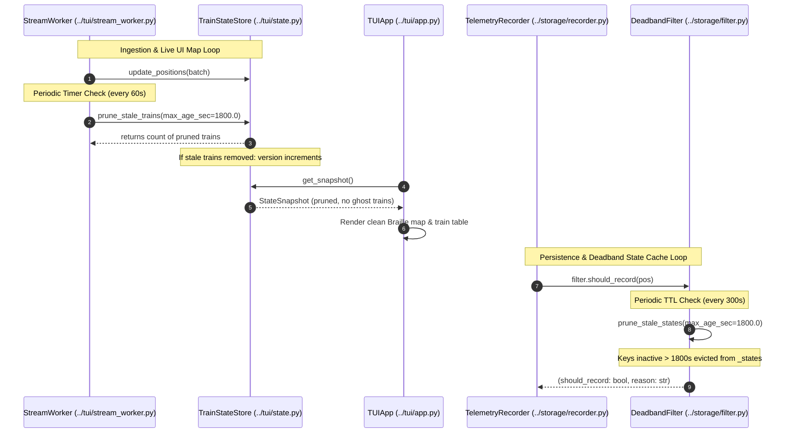
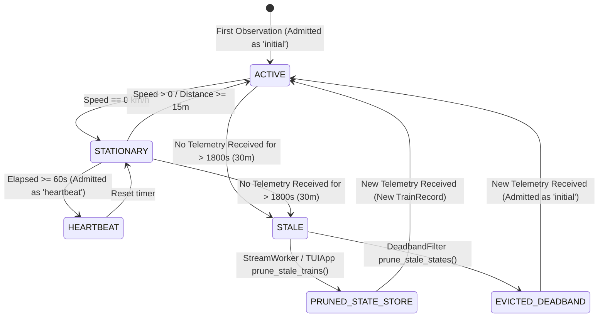

# Implementation Plan — P2-1: Dead Stale-Train Pruning & Unbounded Deadband State Cache

> **Reference:** [Production Readiness & Architecture Review (`P2-1`)](../../../architecture/production-readiness-review.md#p2-1-dead-stale-train-pruning--unbounded-deadband-state-cache)  
> **Target Modules:** [`../../../../tui/state.py`](../../../../tui/state.py), [`../../../../tui/stream_worker.py`](../../../../tui/stream_worker.py), [`../../../../tui/app.py`](../../../../tui/app.py), [`../../../../storage/filter.py`](../../../../storage/filter.py), [`../../../../storage/recorder.py`](../../../../storage/recorder.py)  
> **Test Suites:** [`../../../../tests/test_tui_state.py`](../../../../tests/test_tui_state.py), [`../../../../tests/test_storage_filter.py`](../../../../tests/test_storage_filter.py), [`../../../../tests/test_storage_recorder.py`](../../../../tests/test_storage_recorder.py), [`../../../../tests/test_tui_controls.py`](../../../../tests/test_tui_controls.py)  
> **Relevant Rules & Skills:** [`../../../../.agents/rules/performance-and-resource-bounds.md`](../../../../.agents/rules/performance-and-resource-bounds.md), [`../../../../.agents/rules/concurrency-and-sqlite.md`](../../../../.agents/rules/concurrency-and-sqlite.md), [`../../../../.agents/rules/logging-and-observability.md`](../../../../.agents/rules/logging-and-observability.md), [`../../../../.agents/rules/diagrams-and-visual-documentation.md`](../../../../.agents/rules/diagrams-and-visual-documentation.md), [`../../../../.agents/rules/markdown-relative-paths.md`](../../../../.agents/rules/markdown-relative-paths.md), [`../../../../.agents/skills/ci-quality-gate/SKILL.md`](../../../../.agents/skills/ci-quality-gate/SKILL.md)

---

## 1. Executive Summary & Defect Overview

`railmon` is engineered for long-running deployments as an unattended recording service (`railmon record`) and continuous interactive terminal dashboard (`railmon --tui`). To sustain days or months of unattended uptime without degradation, all stateful in-memory structures must operate under strictly bounded memory and computational constraints.

As identified in the [Production Readiness Review](../../../architecture/production-readiness-review.md#p2-1-dead-stale-train-pruning--unbounded-deadband-state-cache), the system violates [`../../../../.agents/rules/performance-and-resource-bounds.md`](../../../../.agents/rules/performance-and-resource-bounds.md#L25-L29) across two critical caching layers:

1. **Dead Stale-Train Eviction in Hot TUI State Store:**
   - [`TrainStateStore.prune_stale_trains`](../../../../tui/state.py#L261-L281) exists in the codebase but is **dead code**: it is never scheduled or executed by either the background ingestion worker ([`StreamWorker`](../../../../tui/stream_worker.py)) or the interactive rendering event loop ([`TUIApp.run_loop`](../../../../tui/app.py#L425-L483)).
   - The default eviction cutoff is configured to `stale_timeout_sec=120.0` ($2\text{ minutes}$) instead of the mandated **30-minute ($1800.0\text{s}$)** specification defined in [`../../../../.agents/rules/performance-and-resource-bounds.md`](../../../../.agents/rules/performance-and-resource-bounds.md#L27). [`TrainRecord.is_stale`](../../../../tui/state.py#L71) similarly defaults to `120.0s`.
   - **Operational Consequence:** Trains that reach their terminal destinations, shunt into depots, or disappear from upstream Hellenic Railways telemetry feeds remain permanently embedded in `TrainStateStore._trains`. Over extended sessions, the UI train list accumulates ghost entries, degrading rasterization efficiency and cluttering the operator dashboard.

2. **Unbounded Deadband State Cache in Storage Layer:**
   - [`DeadbandFilter._states`](../../../../storage/filter.py#L48) caches the most recent telemetry attributes (`_LastRecordedState`) for every admitted train number to suppress stationary coordinate spam.
   - The cache contains no eviction logic, time-to-live (TTL), or capacity cap.
   - When stationary trains continue to broadcast heartbeats every $60\text{s}$, their states update normally. However, when trains finish revenue service or locomotives swap service numbers over months of continuous operation, historical train identifiers remain permanently retained in memory.
   - **Operational Consequence:** `DeadbandFilter._states` grows monotonically without bound over multi-month daemon runs, creating a continuous heap leak.

This plan details the design and implementation for wired, scheduled, thread-safe pruning across both `TrainStateStore` and `DeadbandFilter`.

---

## 2. Root-Cause Defect Analysis

### A. Defect Mechanisms

#### 1. Dead Code & Misconfigured Timeout in `TrainStateStore`
- **Location:** [`../../../../tui/state.py`](../../../../tui/state.py#L201,L261-L281), [`../../../../tui/stream_worker.py`](../../../../tui/stream_worker.py#L96-L160), [`../../../../tui/app.py`](../../../../tui/app.py#L425-L483)
- **Current Initialization:**
  ```python
  class TrainStateStore:
      def __init__(self, stale_timeout_sec: float = 120.0, max_trail_len: int = 15):
          ...
  ```
- **Failure Mode:**
  1. The default parameter `120.0s` is overly aggressive ($2\text{ minutes}$) and contradicts the 30-minute specification in the performance rule.
  2. In production execution ([`../../../../train_tracker.py`](../../../../train_tracker.py#L1086)), `store = TrainStateStore()` is instantiated with defaults.
  3. Neither `StreamWorker._run_loop()` nor `TUIApp.run_loop()` ever invokes `store.prune_stale_trains()`.
  4. Although unit tests verify `prune_stale_trains()` when manually called ([`../../../../tests/test_tui_state.py`](../../../../tests/test_tui_state.py#L111-L129)), in real execution trains are never removed from `_trains`.

#### 2. Unbounded Monotonic Expansion of `DeadbandFilter._states`
- **Location:** [`../../../../storage/filter.py`](../../../../storage/filter.py#L46-L52,L136-L149)
- **Current Structure:**
  ```python
  class DeadbandFilter:
      def __init__(self, config: Optional[DeadbandConfig] = None):
          self.config = config or DeadbandConfig()
          self._states: Dict[str, _LastRecordedState] = {}
  ```
- **Failure Mode:**
  1. Each unique `train_id` (from `pos.train_number`) adds an entry to `self._states` on first admission (`_admit`).
  2. `_states` is only cleared when `DeadbandFilter.reset()` is manually called.
  3. `TelemetryRecorder` ([`../../../../storage/recorder.py`](../../../../storage/recorder.py)) keeps a single persistent `DeadbandFilter` instance alive for the entire lifespan of the process.
  4. Over weeks and months, temporary train IDs, test trains, shunting locomotives, and seasonal trips permanently occupy entries in `_states`.
  5. If an evicted train re-appears hours or days later, admitting it as an `"initial"` baseline record is the correct domain behavior. However, without TTL pruning, the cache grows indefinitely.

---

### B. Visual Comparison (ASCII & Mermaid)

#### ASCII Representation: Pruning & Eviction Architecture

```text
+-----------------------------------------------------------------------------------------+
|                               INGESTION & STATE LAYER                                   |
|                                                                                         |
|   StreamWorker (Daemon Thread)                   TrainStateStore (RLock)                |
|  +-----------------------------+               +-------------------------------------+  |
|  | Ingests telemetry batches   |               | self._trains: Dict[str, TrainRecord]|  |
|  | Every 60s:                  | ------------> | prune_stale_trains(cutoff=1800s)    |  |
|  |   store.prune_stale_trains()|  prune call   | - Purges trains inactive > 30m      |  |
|  +-----------------------------+               | - Resets selected_train if pruned   |  |
|                                                | - Increments version for UI redraw  |  |
|   TUIApp (Event Loop Thread)                   +-------------------------------------+  |
|  +-----------------------------+                                  |                     |
|  | Defense-in-depth:           |                                  v                     |
|  | Every 60s idle check        | ------------------------> StateSnapshot (Clean)        |
|  +-----------------------------+                                                        |
+-----------------------------------------------------------------------------------------+
                                             |
                                             v
+-----------------------------------------------------------------------------------------+
|                            PERSISTENCE & DEADBAND LAYER                                 |
|                                                                                         |
|   TelemetryRecorder (Worker)                     DeadbandFilter (Lock-Protected)        |
|  +-----------------------------+               +-------------------------------------+  |
|  | Enqueues batches            |               | self._states: Dict[str, State]      |  |
|  | Every 300s:                 | ------------> | prune_stale_states(cutoff=1800s)     |  |
|  |   filter.prune_stale_states |  prune call   | - Evicts vehicles unseen > 30m      |  |
|  +-----------------------------+               | - Re-seen vehicles re-admit initial |  |
|                                                | - Auto-prunes on should_record()    |  |
|                                                +-------------------------------------+  |
+-----------------------------------------------------------------------------------------+
```

#### Mermaid Sequence: Periodic Eviction Lifecycle



#### Mermaid State Machine: Vehicle Lifecycle in Caches



---

## 3. Detailed Technical Specification & Remediation Strategy

### Component 1: `TrainStateStore` & `TrainRecord` Defaults ([`../../../../tui/state.py`](../../../../tui/state.py))

1. **Standardize Stale Timeout to 30 Minutes ($1800.0\text{s}$):**
   - Update `TrainRecord.is_stale(self, threshold_sec: float = 1800.0) -> bool`.
   - Update `TrainStateStore.__init__(self, stale_timeout_sec: float = 1800.0, max_trail_len: int = 15)`.
2. **Observability Tracking:**
   - Add internal counters `self._total_trains_pruned: int = 0` and `self._last_prune_ts: float = 0.0`.
   - In `prune_stale_trains(self, max_age_sec: Optional[float] = None) -> int`:
     - Under `with self._lock:`:
       - Compute `cutoff = max_age_sec if max_age_sec is not None else self._stale_timeout_sec`.
       - Identify `stale_ids = [tid for tid, rec in self._trains.items() if (now - rec.last_updated) > cutoff]`.
       - Evict matching keys from `self._trains`.
       - Reset `self._selected_id = None` and `self._follow_mode = False` if `self._selected_id` was among `stale_ids`.
       - If `stale_ids`: increment `self._version += 1`, add `len(stale_ids)` to `self._total_trains_pruned`.
       - Update `self._last_prune_ts = now`.
       - Return `len(stale_ids)`.

---

### Component 2: Periodic Pruning in `StreamWorker` ([`../../../../tui/stream_worker.py`](../../../../tui/stream_worker.py))

1. **Prune Scheduling in Background Thread:**
   - Add `prune_interval_sec: float = 60.0` attribute to `StreamWorker.__init__`.
   - Add `self._last_prune_time: float = 0.0`.
2. **Execution Hook in `_run_loop()`:**
   - Immediately following batch ingestion in `_run_loop()`:
     ```python
     now = time.monotonic()
     if (now - self._last_prune_time) >= self.prune_interval_sec:
         pruned = self.store.prune_stale_trains()
         if pruned > 0:
             logger.debug(
                 "StreamWorker pruned %d stale train(s) from TrainStateStore (>%.0fs inactive).",
                 pruned,
                 self.store._stale_timeout_sec,
             )
         self._last_prune_time = now
     ```
   - Also evaluate the timer check when the stream encounters empty batches or during retry backoffs so idle streams without new arrivals still evict expired trains.

---

### Component 3: Defense-in-Depth Pruning in `TUIApp` ([`../../../../tui/app.py`](../../../../tui/app.py))

1. **UI Event Loop Protection:**
   - If the upstream network stream stalls, drops, or enters an extended backoff period, `StreamWorker` might block on socket reads.
   - `TUIApp.run_loop()` must independently enforce stale train eviction so ghost trains do not persist on screen while waiting for network recovery.
2. **Implementation in `TUIApp`:**
   - In `TUIApp.__init__`: initialize `self._last_prune_time: float = time.monotonic()` and `self._prune_interval_sec: float = 60.0`.
   - In `TUIApp.run_loop()`:
     ```python
     # Periodic stale train cleanup (defense-in-depth against stream stall)
     now_mono = time.monotonic()
     if (now_mono - self._last_prune_time) >= self._prune_interval_sec:
         self.store.prune_stale_trains()
         self._last_prune_time = now_mono
     ```

---

### Component 4: Bounded Eviction & Thread-Safety in `DeadbandFilter` ([`../../../../storage/filter.py`](../../../../storage/filter.py))

1. **Configuration Extensions in `DeadbandConfig`:**
   - Add `stale_timeout_sec: float = 1800.0` ($30\text{ minutes}$ TTL for inactive trains).
   - Add `stale_prune_interval_sec: float = 300.0` ($5\text{ minutes}$ periodic eviction cadence).
2. **State Management & Concurrency:**
   - Add `threading.Lock()` to `DeadbandFilter` to protect `_states` mutations and metric queries against race conditions between recording worker threads and status-polling threads.
   - Add `self._last_prune_ts: float = 0.0` and `self._total_evicted: int = 0`.
3. **Eviction Routine (`prune_stale_states`):**
   ```python
   def prune_stale_states(
       self,
       max_age_sec: Optional[float] = None,
       now_epoch: Optional[float] = None,
   ) -> int:
       """
       Evict cached train states that have not received telemetry updates within max_age_sec.
       Returns count of evicted vehicle states.
       """
       cutoff = max_age_sec if max_age_sec is not None else self.config.stale_timeout_sec
       current_time = now_epoch if now_epoch is not None else time.time()
       with self._lock:
           stale_keys = [
               tid for tid, state in self._states.items()
               if (current_time - state.timestamp) > cutoff
           ]
           for tid in stale_keys:
               del self._states[tid]
           self._total_evicted += len(stale_keys)
           self._last_prune_ts = current_time
           return len(stale_keys)
   ```
4. **Auto-Pruning on Ingestion (`should_record`):**
   - In `should_record(self, pos: TrainPosition, now_epoch: Optional[float] = None)`:
     ```python
     current_time = now_epoch if now_epoch is not None else time.time()
     if (current_time - self._last_prune_ts) >= self.config.stale_prune_interval_sec:
         self.prune_stale_states(now_epoch=current_time)
     ```
5. **Re-Admission Semantic:**
   - When an evicted train sends telemetry again (e.g. following a shift or return to service), `last = self._states.get(train_id)` evaluates to `None`.
   - The train is admitted with reason `"initial"`, which safely re-seeds the spatial baseline in SQLite.
6. **Telemetry Metrics:**
   - Extend `DeadbandFilter.stats` to report `"total_evicted": float(self._total_evicted)`.

---

### Component 5: Proactive Pruning in `TelemetryRecorder` ([`../../../../storage/recorder.py`](../../../../storage/recorder.py))

1. **Background Recorder Loop Hook:**
   - In `TelemetryRecorder._worker_loop()`:
     - Track `self._last_filter_prune_time: float = time.time()`.
     - Alongside the retention archive check, evaluate:
       ```python
       if (
           self.filter is not None
           and (now - self._last_filter_prune_time) >= self.config.deadband_config.stale_prune_interval_sec
       ):
           evicted = self.filter.prune_stale_states()
           if evicted > 0:
               logger.debug("TelemetryRecorder evicted %d stale train states from DeadbandFilter.", evicted)
           self._last_filter_prune_time = now
       ```
   - This ensures that during periods of low or zero telemetry throughput, the recorder actively purges expired state without waiting for inbound traffic.

---

## 4. Step-by-Step Implementation Roadmap

```text
+-----------------------------------------------------------------------------------------+
| PHASE 1: CORE STATE TIMEOUT & EVICTION ROUTINE (../tui/state.py)                        |
|  1. Update default stale_timeout_sec and threshold_sec to 1800.0s in tui/state.py       |
|  2. Add total_pruned_trains and last_prune_ts tracking in TrainStateStore              |
|  3. Validate selection and follow-mode reset on eviction                                |
+-----------------------------------------------------------------------------------------+
                                             |
                                             v
+-----------------------------------------------------------------------------------------+
| PHASE 2: PERIODIC PRUNE SCHEDULING (../tui/stream_worker.py & ../tui/app.py)            |
|  4. Wire periodic 60s prune_stale_trains() call in StreamWorker._run_loop()            |
|  5. Wire periodic 60s defense-in-depth prune_stale_trains() in TUIApp.run_loop()       |
|  6. Add debug logging for pruned trains count                                           |
+-----------------------------------------------------------------------------------------+
                                             |
                                             v
+-----------------------------------------------------------------------------------------+
| PHASE 3: BOUNDED DEADBAND FILTER CACHE (../storage/filter.py)                           |
|  7. Add stale_timeout_sec and stale_prune_interval_sec to DeadbandConfig               |
|  8. Add threading.Lock, prune_stale_states(), and auto-pruning in DeadbandFilter         |
|  9. Update stats property with total_evicted counter                                    |
+-----------------------------------------------------------------------------------------+
                                             |
                                             v
+-----------------------------------------------------------------------------------------+
| PHASE 4: RECORDER INTEGRATION & COMPREHENSIVE TESTS                                     |
| 10. Wire periodic filter prune check into TelemetryRecorder._worker_loop()              |
| 11. Author dedicated unit & concurrency tests across all updated modules                |
| 12. Run full CI quality gate (unit tests, coverage, flake8, mypy strict, black)        |
+-----------------------------------------------------------------------------------------+
```

---

## 5. Comprehensive Verification & Test Plan

### A. Dedicated Test Cases

| Test ID | Module | Purpose | Verification Condition |
|---|---|---|---|
| `TC-P2-01` | [`../../../../tests/test_tui_state.py`](../../../../tests/test_tui_state.py) | `TrainStateStore` Default Timeout | Assert `store._stale_timeout_sec == 1800.0` on default initialization. |
| `TC-P2-02` | [`../../../../tests/test_tui_state.py`](../../../../tests/test_tui_state.py) | `TrainRecord.is_stale` Default | Verify default parameter `threshold_sec == 1800.0`. |
| `TC-P2-03` | [`../../../../tests/test_tui_state.py`](../../../../tests/test_tui_state.py) | Prune Boundary Enforcement | Train at $1790\text{s}$ remains; train at $1810\text{s}$ is pruned; `_version` increments only when trains are removed. |
| `TC-P2-04` | [`../../../../tests/test_tui_state.py`](../../../../tests/test_tui_state.py) | Selection & Follow-Mode Reset | Verify `_selected_id` and `_follow_mode` reset to `None` / `False` when the selected train is pruned. |
| `TC-P2-05` | [`../../../../tests/test_tui_state.py`](../../../../tests/test_tui_state.py) | `StreamWorker` Periodic Pruning | Ingest batches with artificially aged trains; verify `StreamWorker` executes `prune_stale_trains()` on interval. |
| `TC-P2-06` | [`../../../../tests/test_tui_controls.py`](../../../../tests/test_tui_controls.py) | `TUIApp` Event Loop Prune | Verify `TUIApp.run_loop` triggers `store.prune_stale_trains()` during periodic loop checks. |
| `TC-P2-07` | [`../../../../tests/test_storage_filter.py`](../../../../tests/test_storage_filter.py) | `DeadbandFilter.prune_stale_states` | Add vehicles at $t=1000$; at $t=3000$, verify `prune_stale_states(max_age_sec=1800.0)` evicts inactive entries. |
| `TC-P2-08` | [`../../../../tests/test_storage_filter.py`](../../../../tests/test_storage_filter.py) | In-Flight Auto-Pruning | Call `should_record` after `stale_prune_interval_sec` has elapsed; verify stale states are automatically pruned. |
| `TC-P2-09` | [`../../../../tests/test_storage_filter.py`](../../../../tests/test_storage_filter.py) | Re-Emergent Vehicle Admitted as Initial | Evict vehicle from cache; next observation must return `(True, "initial")`. |
| `TC-P2-10` | [`../../../../tests/test_storage_recorder.py`](../../../../tests/test_storage_recorder.py) | `TelemetryRecorder` Filter Eviction | Verify recorder loop invokes `filter.prune_stale_states()` during periodic worker passes. |

---

### B. Quality Gate Command Suite

```bash
# 1. Run all unit test suites
python3 -m unittest discover tests/

# 2. Target specific P2-1 affected test files
python3 -m unittest tests/test_tui_state.py
python3 -m unittest tests/test_storage_filter.py
python3 -m unittest tests/test_storage_recorder.py
python3 -m unittest tests/test_tui_controls.py

# 3. Verify zero absolute paths or file:// URIs in plan
grep -En "file://|/home/|/Users/|[A-Za-z]:\\\\" docs/p2-1-dead-stale-train-pruning-deadband-cache-fix-plan.md
```

---

## 6. Acceptance Criteria & Compliance Checklist

- [ ] **Timeout Compliance:** Default stale timeout across `TrainStateStore` and `DeadbandFilter` is set to $1800.0\text{s}$ ($30\text{ minutes}$), complying with [`../../../../.agents/rules/performance-and-resource-bounds.md`](../../../../.agents/rules/performance-and-resource-bounds.md#L27).
- [ ] **Wired Eviction:** `store.prune_stale_trains()` is actively called by `StreamWorker` (every $60\text{s}$) and `TUIApp` (every $60\text{s}$).
- [ ] **Bounded Filter Cache:** `DeadbandFilter._states` evicts keys older than $1800\text{s}$ via both automatic checks and explicit `prune_stale_states()` calls.
- [ ] **Clean Re-Admission:** Evicted vehicles that resume broadcasting are seamlessly admitted as `"initial"` records without error or state corruption.
- [ ] **Thread-Safety:** Mutex locking protects `TrainStateStore._trains` and `DeadbandFilter._states` across all concurrent worker threads.
- [ ] **Document-Relative Links:** All Markdown paths strictly use document-relative notation (`../`, `./`), adhering to [`../../../../.agents/rules/markdown-relative-paths.md`](../../../../.agents/rules/markdown-relative-paths.md).
