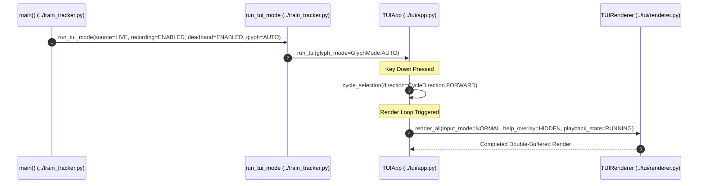

# Implementation Plan — P2-4: Boolean Parameters in Function Signatures Instead of Enums

> **Reference:** [Production Readiness & Architecture Review (`P2-4`)](../../../architecture/production-readiness-review.md#p2-4-boolean-parameters-in-function-signatures-instead-of-enums)  
> **Target Modules:** [`../../../../train_tracker.py`](../../../../train_tracker.py), [`../../../../tui/app.py`](../../../../tui/app.py), [`../../../../tui/renderer.py`](../../../../tui/renderer.py)  
> **Test Suites:** [`../../../../tests/test_cli.py`](../../../../tests/test_cli.py), [`../../../../tests/test_cli_storage.py`](../../../../tests/test_cli_storage.py), [`../../../../tests/test_tui_controls.py`](../../../../tests/test_tui_controls.py), [`../../../../tests/test_tui_renderer.py`](../../../../tests/test_tui_renderer.py), [`../../../../tests/test_tui_integration.py`](../../../../tests/test_tui_integration.py)  
> **Relevant Rules & Skills:** [`../../../../.agents/rules/communication.md`](../../../../.agents/rules/communication.md), [`../../../../.agents/rules/python-idioms.md`](../../../../.agents/rules/python-idioms.md), [`../../../../.agents/rules/diagrams-and-visual-documentation.md`](../../../../.agents/rules/diagrams-and-visual-documentation.md), [`../../../../.agents/rules/markdown-relative-paths.md`](../../../../.agents/rules/markdown-relative-paths.md), [`../../../../.agents/skills/ci-quality-gate/SKILL.md`](../../../../.agents/skills/ci-quality-gate/SKILL.md)

---

## 1. Executive Summary & Defect Overview

Per [`../../../../.agents/rules/communication.md`](../../../../.agents/rules/communication.md#L17), function signatures must:
> "Use strongly typed `Enum` instead of boolean parameters in function signatures to make call sites readable and explicit."

Boolean parameters in function signatures suffer from "boolean blindness": at call sites, passing `True` or `False` obscures semantic intent (e.g., `cycle_selection(True)` or `run_tui_mode(True, 15.0, 3.0, True, ...)`), requiring developers to inspect function definitions to understand argument meaning. Furthermore, boolean flags cannot scale when binary states naturally evolve into multi-state choices (such as adding simulation replay, headless export modes, or alternate overlay dialogs).

As identified in the [Production Readiness Review (`P2-4`)](../../../architecture/production-readiness-review.md#p2-4-boolean-parameters-in-function-signatures-instead-of-enums), five key public functions and methods violate this architectural principle:
1. [`run_tui_mode`](../../../../train_tracker.py#L989-L999): uses `demo: bool = False`, `record: bool = False`, `enable_deadband: bool = True`, and `ascii_mode: Optional[bool] = None`.
2. [`run_plain_stream_mode`](../../../../train_tracker.py#L1163-L1172): uses `demo: bool = False`, `record: bool = False`, and `enable_deadband: bool = True`.
3. [`run_record_mode`](../../../../train_tracker.py#L1275-L1286): uses `demo: bool = False`, `enable_deadband: bool = True`, and `quiet: bool = False`.
4. [`TUIApp.cycle_selection`](../../../../tui/app.py#L271): uses `forward: bool = True`.
5. [`TUIRenderer.render_all`](../../../../tui/renderer.py#L1123-L1134) (and companion [`render_status_bar`](../../../../tui/renderer.py#L969)): uses `search_mode: bool = False`, `show_help: bool = False`, and `paused: bool = False`.

This plan specifies the refactoring to replace raw boolean parameters with strongly typed standard library `Enum` classes, while preserving 100% backward compatibility via defensive coercion for existing callers and mock-based unit tests.

---

## 2. Root-Cause Defect Analysis

### A. Defect Mechanisms

#### 1. Boolean Blindness & Positional Ambiguity
At call sites, boolean literals convey zero context:
```python
# Unreadable call site:
run_tui_mode(True, 15.0, 3.0, True, "railway.db", False)

# Strongly typed enum call site:
run_tui_mode(
    source=TelemetrySource.DEMO,
    fps=15.0,
    reconnect_delay=3.0,
    recording=RecordingMode.ENABLED,
    db_path="railway.db",
    deadband=DeadbandFilterMode.DISABLED,
)
```

#### 2. Modality & State Machine Collisions in TUI
In [`../../../../tui/app.py`](../../../../tui/app.py), navigation through the roster is expressed as `cycle_selection(forward=True)` and `cycle_selection(forward=False)`. Converting this to `CycleDirection.FORWARD` and `CycleDirection.BACKWARD` makes keybinding dispatch explicit.

In [`../../../../tui/renderer.py`](../../../../tui/renderer.py), `render_all()` accepts three separate boolean flags: `search_mode: bool`, `show_help: bool`, and `paused: bool`. Noticeably:
- `tui.app` already defines `InputMode(Enum)` with `InputMode.NORMAL` and `InputMode.SEARCH`, yet `render_all` converts it into an untyped boolean `(self.input_mode == InputMode.SEARCH)`.
- `show_help` represents a modal dialog layer (`HelpOverlay.VISIBLE` vs `HelpOverlay.HIDDEN`).
- `paused` represents stream playback lifecycle (`PlaybackState.PAUSED` vs `PlaybackState.RUNNING`).

---

### B. Defect Inventory

```text
+-----------------------+-------------------------+-----------------------------------------+---------------------------------------+
| Module                | Function / Method       | Current Boolean Parameters              | Remediated Strongly Typed Enum(s)     |
+-----------------------+-------------------------+-----------------------------------------+---------------------------------------+
| train_tracker.py      | run_tui_mode            | demo: bool                              | source: TelemetrySource               |
|                       |                         | record: bool                            | recording: RecordingMode              |
|                       |                         | enable_deadband: bool                   | deadband: DeadbandFilterMode          |
|                       |                         | ascii_mode: Optional[bool]              | glyph_mode: GlyphMode                 |
+-----------------------+-------------------------+-----------------------------------------+---------------------------------------+
| train_tracker.py      | run_plain_stream_mode   | demo: bool                              | source: TelemetrySource               |
|                       |                         | record: bool                            | recording: RecordingMode              |
|                       |                         | enable_deadband: bool                   | deadband: DeadbandFilterMode          |
+-----------------------+-------------------------+-----------------------------------------+---------------------------------------+
| train_tracker.py      | run_record_mode         | demo: bool                              | source: TelemetrySource               |
|                       |                         | enable_deadband: bool                   | deadband: DeadbandFilterMode          |
|                       |                         | quiet: bool                             | verbosity: OutputVerbosity            |
+-----------------------+-------------------------+-----------------------------------------+---------------------------------------+
| tui/app.py            | TUIApp.cycle_selection  | forward: bool                           | direction: CycleDirection             |
+-----------------------+-------------------------+-----------------------------------------+---------------------------------------+
| tui/renderer.py       | TUIRenderer.render_all  | search_mode: bool                       | input_mode: InputMode                 |
|                       |                         | show_help: bool                         | help_overlay: HelpOverlay             |
|                       |                         | paused: bool                            | playback_state: PlaybackState         |
+-----------------------+-------------------------+-----------------------------------------+---------------------------------------+
| tui/renderer.py       | render_status_bar       | search_mode: bool                       | input_mode: InputMode                 |
|                       |                         | paused: bool                            | playback_state: PlaybackState         |
+-----------------------+-------------------------+-----------------------------------------+---------------------------------------+
```

---

### C. Visual Topologies

#### ASCII Architecture Diagram

```text
+-----------------------------------------------------------------------------------------+
|                    STRONGLY TYPED ENUM DISPATCH & EXECUTION MODEL                       |
+-----------------------------------------------------------------------------------------+
                                             |
                                    CLI Parsing (main)
                                             |
                  +--------------------------+--------------------------+
                  |                                                     |
                  v                                                     v
      +------------------------+                           +------------------------+
      |      run_tui_mode      |                           | run_plain_stream_mode  |
      | source: TelemetrySource|                           | source: TelemetrySource|
      | record: RecordingMode  |                           | record: RecordingMode  |
      | deadband: DeadbandMode |                           | deadband: DeadbandMode |
      | glyph: GlyphMode       |                           +------------------------+
      +------------------------+                                        |
                  |                                                     |
                  v                                                     v
      +------------------------+                           +------------------------+
      |       TUIApp           |                           |   TelemetryRecorder    |
      | cycle(CycleDirection)  |                           | run_record_mode:       |
      +------------------------+                           | verbosity: OutputVerbo |
                  |                                        +------------------------+
                  v
      +----------------------------------------------------+
      | TUIRenderer.render_all                             |
      | - input_mode: InputMode (NORMAL / SEARCH)          |
      | - help_overlay: HelpOverlay (HIDDEN / VISIBLE)     |
      | - playback_state: PlaybackState (RUNNING / PAUSED) |
      +----------------------------------------------------+
```

#### Mermaid Sequence Diagram



---

## 3. Detailed Architectural Changes

### A. New Enums in [`../../../../train_tracker.py`](../../../../train_tracker.py)

```python
from enum import Enum


class TelemetrySource(Enum):
    """Source stream for train positions."""
    LIVE = "live"
    DEMO = "demo"


class RecordingMode(Enum):
    """SQLite telemetry persistence mode."""
    DISABLED = "disabled"
    ENABLED = "enabled"


class DeadbandFilterMode(Enum):
    """Deadband filtering mode for stationary coordinate noise suppression."""
    ENABLED = "enabled"
    DISABLED = "disabled"


class OutputVerbosity(Enum):
    """Console output verbosity level."""
    NORMAL = "normal"
    QUIET = "quiet"


class GlyphMode(Enum):
    """Terminal character set rendering mode."""
    AUTO = "auto"
    UTF8 = "utf8"
    ASCII = "ascii"
```

### B. Upgraded CLI & Daemon Signatures in [`../../../../train_tracker.py`](../../../../train_tracker.py)

#### 1. `run_tui_mode`
```python
def run_tui_mode(
    source: TelemetrySource = TelemetrySource.LIVE,
    fps: float = 15.0,
    reconnect_delay: float = 3.0,
    recording: RecordingMode = RecordingMode.DISABLED,
    db_path: str = "railway_history.db",
    deadband: DeadbandFilterMode = DeadbandFilterMode.ENABLED,
    retention_days: Optional[int] = None,
    archive_path: Optional[str] = None,
    glyph_mode: GlyphMode = GlyphMode.AUTO,
    # Backward compatibility shims:
    demo: Optional[bool] = None,
    record: Optional[bool] = None,
    enable_deadband: Optional[bool] = None,
    ascii_mode: Optional[bool] = None,
) -> None:
    # Defensive normalization for legacy callers
    if demo is not None:
        source = TelemetrySource.DEMO if demo else TelemetrySource.LIVE
    elif isinstance(source, bool):
        source = TelemetrySource.DEMO if source else TelemetrySource.LIVE

    if record is not None:
        recording = RecordingMode.ENABLED if record else RecordingMode.DISABLED
    elif isinstance(recording, bool):
        recording = RecordingMode.ENABLED if recording else RecordingMode.DISABLED

    if enable_deadband is not None:
        deadband = DeadbandFilterMode.ENABLED if enable_deadband else DeadbandFilterMode.DISABLED
    elif isinstance(deadband, bool):
        deadband = DeadbandFilterMode.ENABLED if deadband else DeadbandFilterMode.DISABLED

    if ascii_mode is not None:
        glyph_mode = GlyphMode.ASCII if ascii_mode else GlyphMode.UTF8
    elif isinstance(glyph_mode, bool):
        glyph_mode = GlyphMode.ASCII if glyph_mode else GlyphMode.UTF8
```

#### 2. `run_plain_stream_mode`
```python
def run_plain_stream_mode(
    source: TelemetrySource = TelemetrySource.LIVE,
    reconnect_delay: float = 3.0,
    recording: RecordingMode = RecordingMode.DISABLED,
    db_path: str = "railway_history.db",
    deadband: DeadbandFilterMode = DeadbandFilterMode.ENABLED,
    retention_days: Optional[int] = None,
    archive_path: Optional[str] = None,
    stop_event: Optional[threading.Event] = None,
    # Backward compatibility shims:
    demo: Optional[bool] = None,
    record: Optional[bool] = None,
    enable_deadband: Optional[bool] = None,
) -> None:
    if demo is not None:
        source = TelemetrySource.DEMO if demo else TelemetrySource.LIVE
    elif isinstance(source, bool):
        source = TelemetrySource.DEMO if source else TelemetrySource.LIVE

    if record is not None:
        recording = RecordingMode.ENABLED if record else RecordingMode.DISABLED
    elif isinstance(recording, bool):
        recording = RecordingMode.ENABLED if recording else RecordingMode.DISABLED

    if enable_deadband is not None:
        deadband = DeadbandFilterMode.ENABLED if enable_deadband else DeadbandFilterMode.DISABLED
    elif isinstance(deadband, bool):
        deadband = DeadbandFilterMode.ENABLED if deadband else DeadbandFilterMode.DISABLED
```

#### 3. `run_record_mode`
```python
def run_record_mode(
    db_path: str = "railway_history.db",
    source: TelemetrySource = TelemetrySource.LIVE,
    deadband: DeadbandFilterMode = DeadbandFilterMode.ENABLED,
    batch_size: int = 50,
    flush_interval_sec: float = 2.0,
    verbosity: OutputVerbosity = OutputVerbosity.NORMAL,
    reconnect_delay: float = 3.0,
    retention_days: Optional[int] = None,
    archive_path: Optional[str] = None,
    stop_event: Optional[threading.Event] = None,
    # Backward compatibility shims:
    demo: Optional[bool] = None,
    enable_deadband: Optional[bool] = None,
    quiet: Optional[bool] = None,
) -> int:
    if demo is not None:
        source = TelemetrySource.DEMO if demo else TelemetrySource.LIVE
    elif isinstance(source, bool):
        source = TelemetrySource.DEMO if source else TelemetrySource.LIVE

    if enable_deadband is not None:
        deadband = DeadbandFilterMode.ENABLED if enable_deadband else DeadbandFilterMode.DISABLED
    elif isinstance(deadband, bool):
        deadband = DeadbandFilterMode.ENABLED if deadband else DeadbandFilterMode.DISABLED

    if quiet is not None:
        verbosity = OutputVerbosity.QUIET if quiet else OutputVerbosity.NORMAL
    elif isinstance(verbosity, bool):
        verbosity = OutputVerbosity.QUIET if verbosity else OutputVerbosity.NORMAL
```

---

### C. Upgraded Navigation in [`../../../../tui/app.py`](../../../../tui/app.py)

#### 1. `CycleDirection` Enum
```python
class CycleDirection(Enum):
    """Direction for cycling cursor selection through active train roster."""
    FORWARD = auto()
    BACKWARD = auto()
```

#### 2. `TUIApp.cycle_selection`
```python
def cycle_selection(
    self,
    direction: CycleDirection = CycleDirection.FORWARD,
    *,
    forward: Optional[bool] = None,
) -> None:
    """Cycle cursor to next or previous train in filtered roster.

    Args:
        direction: Direction to cycle selection (FORWARD or BACKWARD).
        forward: Optional legacy boolean flag (True -> FORWARD, False -> BACKWARD).
    """
    if forward is not None:
        direction = CycleDirection.FORWARD if forward else CycleDirection.BACKWARD
    elif isinstance(direction, bool):
        direction = CycleDirection.FORWARD if direction else CycleDirection.BACKWARD

    if direction == CycleDirection.FORWARD:
        self.store.select_next()
    else:
        self.store.select_prev()
```

---

### D. Upgraded Rendering in [`../../../../tui/renderer.py`](../../../../tui/renderer.py)

#### 1. Rendering Enums
```python
from enum import Enum, auto


class HelpOverlay(Enum):
    """Visibility state of the modal keyboard help overlay."""
    HIDDEN = auto()
    VISIBLE = auto()


class PlaybackState(Enum):
    """Execution state of the live telemetry ingestion stream."""
    RUNNING = auto()
    PAUSED = auto()
```

#### 2. `TUIRenderer.render_all`
```python
def render_all(
    self,
    windows: Dict[str, Any],
    geometry: PaneGeometry,
    snapshot: StateSnapshot,
    projector: GeoProjector,
    msg_rate: float = 0.0,
    input_mode: InputMode = InputMode.NORMAL,
    search_buffer: str = "",
    help_overlay: HelpOverlay = HelpOverlay.HIDDEN,
    playback_state: PlaybackState = PlaybackState.RUNNING,
    *,
    # Backward compatibility shims:
    search_mode: Optional[bool] = None,
    show_help: Optional[bool] = None,
    paused: Optional[bool] = None,
) -> None:
    # Normalize legacy booleans
    if search_mode is not None:
        input_mode = InputMode.SEARCH if search_mode else InputMode.NORMAL
    elif isinstance(input_mode, bool):
        input_mode = InputMode.SEARCH if input_mode else InputMode.NORMAL

    if show_help is not None:
        help_overlay = HelpOverlay.VISIBLE if show_help else HelpOverlay.HIDDEN
    elif isinstance(help_overlay, bool):
        help_overlay = HelpOverlay.VISIBLE if help_overlay else HelpOverlay.HIDDEN

    if paused is not None:
        playback_state = PlaybackState.PAUSED if paused else PlaybackState.RUNNING
    elif isinstance(playback_state, bool):
        playback_state = PlaybackState.PAUSED if playback_state else PlaybackState.RUNNING
```

#### 3. `TUIRenderer.render_status_bar`
```python
def render_status_bar(
    self,
    win: Any,
    snapshot: StateSnapshot,
    msg_rate: float = 0.0,
    input_mode: InputMode = InputMode.NORMAL,
    search_buffer: str = "",
    playback_state: PlaybackState = PlaybackState.RUNNING,
    *,
    search_mode: Optional[bool] = None,
    paused: Optional[bool] = None,
) -> None:
    if search_mode is not None:
        input_mode = InputMode.SEARCH if search_mode else InputMode.NORMAL
    elif isinstance(input_mode, bool):
        input_mode = InputMode.SEARCH if input_mode else InputMode.NORMAL

    if paused is not None:
        playback_state = PlaybackState.PAUSED if paused else PlaybackState.RUNNING
    elif isinstance(playback_state, bool):
        playback_state = PlaybackState.PAUSED if playback_state else PlaybackState.RUNNING
```

---

## 4. Test Suite & Verification Strategy

### A. Dedicated Test Assertions

1. **`tests/test_enums.py` (New):**
   - Verify all newly defined enums (`TelemetrySource`, `RecordingMode`, `DeadbandFilterMode`, `OutputVerbosity`, `GlyphMode`, `CycleDirection`, `HelpOverlay`, `PlaybackState`) expose expected members and values.
   - Verify coercion logic: passing raw boolean values or legacy keywords (`demo=True`, `record=True`, `forward=False`, `search_mode=True`) resolves identically to their typed Enum counterparts.

2. **`tests/test_tui_controls.py`:**
   - Update `app.cycle_selection` test assertions to invoke `CycleDirection.FORWARD` and `CycleDirection.BACKWARD`.
   - Verify `render_all` accepts `input_mode=InputMode.SEARCH`, `help_overlay=HelpOverlay.VISIBLE`, and `playback_state=PlaybackState.PAUSED`.

3. **`tests/test_cli.py` & `tests/test_cli_storage.py`:**
   - Verify `main()` dispatches to `run_tui_mode`, `run_plain_stream_mode`, and `run_record_mode` using the newly defined typed Enums.
   - Validate both positional and keyword invocations.

### B. CI Quality Gate Commands

```bash
# 1. Run full unit and integration test suite
python3 -m unittest discover tests -v

# 2. Run flake8 linting
flake8 train_tracker.py tui/ storage/ tests/ --max-line-length=100 --extend-ignore=E203,W503

# 3. Run mypy static type checking
mypy train_tracker.py tui/ storage/
```

---

## 5. Risk Assessment & Mitigations

| Risk | Impact | Likelihood | Mitigation Strategy |
|---|---|---|---|
| **Call Site Breakage in External Scripts** | High | Low | Implement defensive normalization for legacy boolean arguments (`demo: Optional[bool] = None`, `forward: Optional[bool] = None`) with fallback checks. |
| **Mock Signature Mismatches in Existing Tests** | Medium | Medium | Update mock call assertions in `test_cli.py` to match new enum arguments while retaining backward compatibility shims. |
| **Circular Import Between `tui.app` and `tui.renderer`** | Medium | Low | Define `HelpOverlay` and `PlaybackState` in `tui.renderer` (or a shared `tui.models` module) and import `InputMode` safely without circular dependencies. |

---

## 6. Implementation Deliverables

1. Enums defined:
   - `TelemetrySource`, `RecordingMode`, `DeadbandFilterMode`, `OutputVerbosity`, `GlyphMode` in [`../../../../train_tracker.py`](../../../../train_tracker.py).
   - `CycleDirection` in [`../../../../tui/app.py`](../../../../tui/app.py).
   - `HelpOverlay`, `PlaybackState` in [`../../../../tui/renderer.py`](../../../../tui/renderer.py).
2. Refactored function and method signatures in:
   - [`../../../../train_tracker.py`](../../../../train_tracker.py) (`run_tui_mode`, `run_plain_stream_mode`, `run_record_mode`, `main`).
   - [`../../../../tui/app.py`](../../../../tui/app.py) (`TUIApp.cycle_selection`, `TUIApp.run_loop`).
   - [`../../../../tui/renderer.py`](../../../../tui/renderer.py) (`TUIRenderer.render_all`, `TUIRenderer.render_status_bar`).
3. Dedicated unit tests in [`../../../../tests/test_enums.py`](../../../../tests/test_enums.py) and updated assertions across existing test suites.
4. Updated status and link in [`../../../architecture/production-readiness-review.md`](../../../architecture/production-readiness-review.md).
