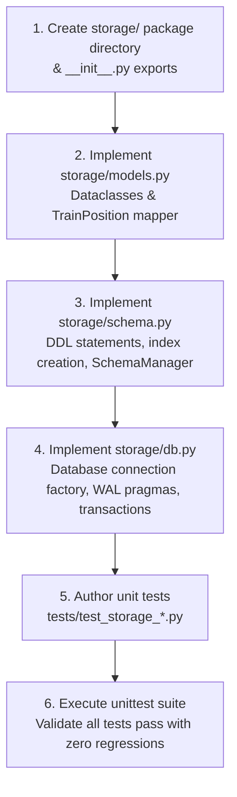

# Phase 1 Implementation Plan: Storage Infrastructure & Schema Setup

Detailed engineering specification, database connection management, relational schema definitions, migration system, type-safe data models, and automated test procedures for **Phase 1** of the Hellenic Railways (`railway.gov.gr`) SQLite historical storage engine.

Refer to the master [Historical Telemetry Storage in SQLite Implementation Plan](./sqlite-historical-data-plan.md) for overall system architecture.

---

## 1. Overview & Objectives

Phase 1 establishes the foundational storage layer for the `railmon` historical telemetry database. It provides an embedded, zero-external-dependency SQLite persistence subsystem optimized for high-frequency write throughput, concurrent non-blocking reads, relational integrity, and safe schema evolution.

```text
+-----------------------------------------------------------------------------------+
|                        Phase 1 Architecture & Component Flow                      |
+-----------------------------------------------------------------------------------+

     [Application / Tests]
               |
               v
     +-------------------+          +-----------------------------------------+
     |   storage/db.py   | <------> |            storage/schema.py            |
     | (Database Class)  |          | - DDL & Index Specifications            |
     | - WAL Config      |          | - Versioned Schema Migration Runner     |
     | - Thread Factory  |          | - PRAGMA Integrity & FK Verification    |
     | - Transaction Ctx |          +-----------------------------------------+
     +-------------------+                               |
               |                                         v
               |                             +------------------------+
               +---------------------------> |   SQLite Database File |
               |                             |   (*.db / :memory:)    |
               v                             |   - WAL journal        |
     +-------------------+                   +------------------------+
     | storage/models.py |                               ^
     | - TrainRecordDB   |                               |
     | - TripRecordDB    |                               |
     | - TelemetryRow    | ------------------------------+
     | - SessionAudit    |    (Type-safe Tuples / Row Factories)
     +-------------------+
```

### 1.1 Primary Deliverables

1. **`storage/__init__.py`**: Clean public API exporting `Database`, `SchemaManager`, and core data models.
2. **`storage/models.py`**: Immutable and mutable dataclasses representing database entities:
   - `TrainRecordDB`: Static and slowly-changing vehicle metadata.
   - `ScheduledTripDB`: Daily timetabled trip records.
   - `ScheduleStopDB`: Intermediate timetable stops with scheduled vs. actual times.
   - `TelemetryHistoryRow`: High-frequency sensor snapshots (coordinates, speed, heading, delay, chainage).
   - `RecordingSessionDB`: Audit records for recording sessions.
   - Interoperability helper `TelemetryHistoryRow.from_train_position(pos, schedule_id)` bridging the live [`TrainPosition`](../../../train_tracker.py#L27-L83) object.
3. **`storage/schema.py`**:
   - Complete DDL statements with strict SQLite data typing and foreign key constraints.
   - Optimized composite B-Tree indexes for temporal, spatial, and corridor queries.
   - Idempotent migration engine tracking version history in `schema_migrations`.
   - Comprehensive schema validation and integrity verification routines.
4. **`storage/db.py`**:
   - `Database` connection and transaction coordinator.
   - Automated `PRAGMA` configuration: `journal_mode=WAL`, `synchronous=NORMAL`, `foreign_keys=ON`, `temp_store=MEMORY`, `cache_size=-64000`.
   - Python context managers for automatic commit/rollback semantics (`with db.transaction() as cur:`).
   - Maintenance helpers: WAL checkpointing (`wal_checkpoint()`), database file size inspection (`get_size_bytes()`), and vacuuming.
5. **Automated Test Suite**:
   - `tests/test_storage_schema.py`: Verifies DDL execution, constraint enforcement, migrations, and index presence.
   - `tests/test_storage_db.py`: Verifies WAL configuration, transaction rollback on exceptions, connection factories, and checkpointing.
   - `tests/test_storage_models.py`: Verifies serialization round-trips, dataclass mapping, and `TrainPosition` conversion.

---

## 2. Technical Specifications & File Contracts

### 2.1 `storage/models.py` Data Model Contract

The data models provide strong typing and clean separation between raw API payloads and database storage formats.

```python
"""Domain models and dataclasses for SQLite persistence."""

from dataclasses import dataclass
from datetime import datetime
from typing import Any, Dict, Optional, Tuple

from train_tracker import TrainPosition


@dataclass(frozen=True)
class TrainRecordDB:
    """Persistent vehicle entity."""
    train_number: str
    locomotive_number: Optional[str] = None
    default_name: Optional[str] = None
    train_type: Optional[str] = None
    service_type: Optional[str] = None
    first_observed_at: str = ""
    last_observed_at: str = ""

    def to_db_row(self) -> Tuple[Any, ...]:
        return (
            self.train_number,
            self.locomotive_number,
            self.default_name,
            self.train_type,
            self.service_type,
            self.first_observed_at,
            self.last_observed_at,
        )


@dataclass(frozen=True)
class ScheduledTripDB:
    """Scheduled service trip for a given date."""
    schedule_id: str
    train_number: str
    origin: Optional[str] = None
    destination: Optional[str] = None
    corridor: Optional[str] = None
    service_date: str = ""
    scheduled_departure: Optional[str] = None
    scheduled_arrival: Optional[str] = None
    raw_json: Optional[str] = None
    created_at: str = ""

    def to_db_row(self) -> Tuple[Any, ...]:
        return (
            self.schedule_id,
            self.train_number,
            self.origin,
            self.destination,
            self.corridor,
            self.service_date,
            self.scheduled_departure,
            self.scheduled_arrival,
            self.raw_json,
        )


@dataclass(frozen=True)
class ScheduleStopDB:
    """Intermediate scheduled timetable stop."""
    schedule_id: str
    stop_sequence: int
    station_name: str
    station_id: Optional[str] = None
    scheduled_arrival: Optional[str] = None
    scheduled_departure: Optional[str] = None
    actual_arrival: Optional[str] = None
    actual_departure: Optional[str] = None
    platform: Optional[str] = None
    delay_sec: int = 0
    id: Optional[int] = None

    def to_db_row(self) -> Tuple[Any, ...]:
        return (
            self.schedule_id,
            self.stop_sequence,
            self.station_id,
            self.station_name,
            self.scheduled_arrival,
            self.scheduled_departure,
            self.actual_arrival,
            self.actual_departure,
            self.platform,
            self.delay_sec,
        )


@dataclass(frozen=True)
class TelemetryHistoryRow:
    """High-frequency spatial and operational telemetry snapshot."""
    train_number: str
    recorded_at: str
    lat: float
    lng: float
    speed: float
    course: float
    schedule_id: Optional[str] = None
    track_heading: Optional[float] = None
    altitude: Optional[float] = None
    delay_min: int = 0
    status: str = "Κανονική"
    progress: Optional[float] = None
    chainage_m: Optional[int] = None
    dist_to_dest_m: Optional[int] = None
    next_station: Optional[str] = None
    corridor: Optional[str] = None
    id: Optional[int] = None

    @classmethod
    def from_train_position(
        cls, pos: TrainPosition, recorded_at: Optional[str] = None
    ) -> "TelemetryHistoryRow":
        """Instantiate a database row from a live TrainPosition telemetry entity."""
        timestamp = recorded_at or pos.timestamp or datetime.utcnow().isoformat() + "Z"
        return cls(
            train_number=pos.train_number,
            schedule_id=pos.schedule_id,
            recorded_at=timestamp,
            lat=pos.lat,
            lng=pos.lng,
            speed=pos.speed,
            course=pos.course,
            track_heading=pos.track_heading,
            altitude=pos.altitude,
            delay_min=pos.delay,
            status=pos.status,
            progress=pos.progress,
            chainage_m=pos.chainage_m,
            dist_to_dest_m=pos.distance_to_destination_m,
            next_station=pos.next_station,
            corridor=pos.corridor,
        )

    def to_db_row(self) -> Tuple[Any, ...]:
        return (
            self.train_number,
            self.schedule_id,
            self.recorded_at,
            self.lat,
            self.lng,
            self.speed,
            self.course,
            self.track_heading,
            self.altitude,
            self.delay_min,
            self.status,
            self.progress,
            self.chainage_m,
            self.dist_to_dest_m,
            self.next_station,
            self.corridor,
        )


@dataclass(frozen=True)
class RecordingSessionDB:
    """Metadata tracking recording session lifecycles."""
    started_at: str
    mode: str
    client_version: str
    ended_at: Optional[str] = None
    total_records_written: int = 0
    session_id: Optional[int] = None
```

---

### 2.2 `storage/schema.py` Schema DDL & Migration Runner

The schema specification encapsulates versioned database evolution and integrity verification.

```python
"""Database schema DDL, index definitions, and migration engine."""

import sqlite3
from typing import List, Tuple

CURRENT_SCHEMA_VERSION = 1

SCHEMA_V1_STATEMENTS: List[str] = [
    # Schema version tracking
    """
    CREATE TABLE IF NOT EXISTS schema_migrations (
        version INTEGER PRIMARY KEY,
        applied_at TIMESTAMP DEFAULT CURRENT_TIMESTAMP,
        description TEXT NOT NULL
    );
    """,
    # 1. Trains registry
    """
    CREATE TABLE IF NOT EXISTS trains (
        train_number TEXT PRIMARY KEY,
        locomotive_number TEXT,
        default_name TEXT,
        train_type TEXT,
        service_type TEXT,
        first_observed_at TIMESTAMP NOT NULL,
        last_observed_at TIMESTAMP NOT NULL
    );
    """,
    # 2. Scheduled service trips
    """
    CREATE TABLE IF NOT EXISTS scheduled_trips (
        schedule_id TEXT PRIMARY KEY,
        train_number TEXT NOT NULL,
        origin TEXT,
        destination TEXT,
        corridor TEXT,
        service_date TEXT NOT NULL,
        scheduled_departure TIMESTAMP,
        scheduled_arrival TIMESTAMP,
        raw_json TEXT,
        created_at TIMESTAMP DEFAULT CURRENT_TIMESTAMP,
        FOREIGN KEY (train_number) REFERENCES trains(train_number) ON DELETE CASCADE
    );
    """,
    # 3. Intermediate timetable stops
    """
    CREATE TABLE IF NOT EXISTS schedule_stops (
        id INTEGER PRIMARY KEY AUTOINCREMENT,
        schedule_id TEXT NOT NULL,
        stop_sequence INTEGER NOT NULL,
        station_id TEXT,
        station_name TEXT NOT NULL,
        scheduled_arrival TIMESTAMP,
        scheduled_departure TIMESTAMP,
        actual_arrival TIMESTAMP,
        actual_departure TIMESTAMP,
        platform TEXT,
        delay_sec INTEGER DEFAULT 0,
        FOREIGN KEY (schedule_id) REFERENCES scheduled_trips(schedule_id) ON DELETE CASCADE,
        UNIQUE(schedule_id, stop_sequence)
    );
    """,
    # 4. Telemetry history (Time-series)
    """
    CREATE TABLE IF NOT EXISTS telemetry_history (
        id INTEGER PRIMARY KEY AUTOINCREMENT,
        train_number TEXT NOT NULL,
        schedule_id TEXT,
        recorded_at TIMESTAMP NOT NULL,
        lat REAL NOT NULL,
        lng REAL NOT NULL,
        speed REAL NOT NULL,
        course REAL NOT NULL,
        track_heading REAL,
        altitude REAL,
        delay_min INTEGER DEFAULT 0,
        status TEXT,
        progress REAL,
        chainage_m INTEGER,
        dist_to_dest_m INTEGER,
        next_station TEXT,
        corridor TEXT,
        FOREIGN KEY (train_number) REFERENCES trains(train_number),
        FOREIGN KEY (schedule_id) REFERENCES scheduled_trips(schedule_id)
    );
    """,
    # 5. Recording session audit log
    """
    CREATE TABLE IF NOT EXISTS recording_sessions (
        session_id INTEGER PRIMARY KEY AUTOINCREMENT,
        started_at TIMESTAMP NOT NULL,
        ended_at TIMESTAMP,
        mode TEXT NOT NULL,
        total_records_written INTEGER DEFAULT 0,
        client_version TEXT
    );
    """,
    # Composite B-tree indexes
    "CREATE INDEX IF NOT EXISTS idx_telemetry_train_time ON telemetry_history (train_number, recorded_at);",
    "CREATE INDEX IF NOT EXISTS idx_telemetry_schedule_time ON telemetry_history (schedule_id, recorded_at);",
    "CREATE INDEX IF NOT EXISTS idx_telemetry_time ON telemetry_history (recorded_at);",
    "CREATE INDEX IF NOT EXISTS idx_telemetry_corridor_time ON telemetry_history (corridor, recorded_at);",
    "CREATE INDEX IF NOT EXISTS idx_trips_date ON scheduled_trips (service_date, train_number);",
]


class SchemaManager:
    """Manages schema creation, version checking, and database migrations."""

    @classmethod
    def initialize_schema(cls, conn: sqlite3.Connection) -> int:
        """Apply pending migrations up to CURRENT_SCHEMA_VERSION.
        
        Returns:
            The schema version of the database after migration.
        """
        conn.execute("PRAGMA foreign_keys = ON;")
        current_v = cls.get_schema_version(conn)

        if current_v == 0:
            # Clean database: execute full V1 DDL in a single transaction
            with conn:
                for statement in SCHEMA_V1_STATEMENTS:
                    conn.execute(statement)
                conn.execute(
                    "INSERT INTO schema_migrations (version, description) VALUES (?, ?);",
                    (1, "Initial V1 schema setup"),
                )
            return 1

        # Incremental migration dispatcher for future versions
        # (e.g. if current_v < 2: apply_v2(conn))
        return current_v

    @classmethod
    def get_schema_version(cls, conn: sqlite3.Connection) -> int:
        """Query current applied schema version."""
        cursor = conn.cursor()
        try:
            cursor.execute(
                "SELECT name FROM sqlite_master WHERE type='table' AND name='schema_migrations';"
            )
            if not cursor.fetchone():
                return 0
            cursor.execute("SELECT MAX(version) FROM schema_migrations;")
            res = cursor.fetchone()
            return int(res[0]) if res and res[0] is not None else 0
        finally:
            cursor.close()

    @classmethod
    def verify_integrity(cls, conn: sqlite3.Connection) -> Tuple[bool, List[str]]:
        """Run PRAGMA integrity_check and foreign_key_check.
        
        Returns:
            Tuple of (is_healthy, list_of_error_strings).
        """
        errors: List[str] = []
        cursor = conn.cursor()
        try:
            cursor.execute("PRAGMA integrity_check;")
            rows = cursor.fetchall()
            for r in rows:
                if r[0] != "ok":
                    errors.append(f"Integrity check failure: {r[0]}")

            cursor.execute("PRAGMA foreign_key_check;")
            fk_rows = cursor.fetchall()
            for fk in fk_rows:
                errors.append(f"Foreign key violation in table {fk[0]} rowid {fk[1]}")

            return len(errors) == 0, errors
        finally:
            cursor.close()
```

---

### 2.3 `storage/db.py` Database Manager Contract

The `Database` class encapsulates file path handling, connection factories with WAL pragmas, contextual transactions, and checkpoint operations.

```python
"""Database connection factory and transaction manager."""

import contextlib
import os
import sqlite3
from typing import Generator, Optional

from storage.schema import SchemaManager


class Database:
    """
    High-performance SQLite database connection coordinator.
    Configures Write-Ahead Logging (WAL) and memory pragmas for high-throughput ingestion.
    """

    def __init__(self, db_path: str = "railway_history.db", auto_migrate: bool = True):
        self.db_path = db_path
        self._is_memory = (db_path == ":memory:") or db_path.startswith("file::memory:")

        # For in-memory databases, maintain persistent connection to avoid teardown
        self._shared_memory_conn: Optional[sqlite3.Connection] = None
        if self._is_memory:
            self._shared_memory_conn = self._create_connection()

        if auto_migrate:
            with self.connection() as conn:
                SchemaManager.initialize_schema(conn)

    def _create_connection(self) -> sqlite3.Connection:
        """Create a new connection configured with optimal ingestion pragmas."""
        if not self._is_memory:
            parent = os.path.dirname(os.path.abspath(self.db_path))
            if parent and not os.path.exists(parent):
                os.makedirs(parent, exist_ok=True)

        conn = sqlite3.connect(
            self.db_path,
            timeout=30.0,
            detect_types=sqlite3.PARSE_DECLTYPES | sqlite3.PARSE_COLNAMES,
        )
        conn.row_factory = sqlite3.Row

        # Apply high-throughput performance pragmas
        cursor = conn.cursor()
        try:
            if not self._is_memory:
                cursor.execute("PRAGMA journal_mode = WAL;")
                cursor.execute("PRAGMA synchronous = NORMAL;")
            cursor.execute("PRAGMA foreign_keys = ON;")
            cursor.execute("PRAGMA temp_store = MEMORY;")
            cursor.execute("PRAGMA cache_size = -64000;")  # 64MB cache
        finally:
            cursor.close()

        return conn

    @contextlib.contextmanager
    def connection(self) -> Generator[sqlite3.Connection, None, None]:
        """Context manager yielding an active SQLite connection."""
        if self._is_memory and self._shared_memory_conn is not None:
            yield self._shared_memory_conn
        else:
            conn = self._create_connection()
            try:
                yield conn
            finally:
                conn.close()

    @contextlib.contextmanager
    def transaction(self) -> Generator[sqlite3.Cursor, None, None]:
        """Context manager for atomic transactions (commits on success, rolls back on error)."""
        with self.connection() as conn:
            cursor = conn.cursor()
            try:
                with conn:  # Context manager on conn manages BEGIN / COMMIT / ROLLBACK
                    yield cursor
            finally:
                cursor.close()

    def checkpoint_wal(self, mode: str = "PASSIVE") -> None:
        """Trigger WAL checkpoint to write changes to base file (PASSIVE, FULL, RESTART, TRUNCATE)."""
        if self._is_memory:
            return
        with self.connection() as conn:
            cursor = conn.cursor()
            try:
                cursor.execute(f"PRAGMA wal_checkpoint({mode});")
            finally:
                cursor.close()

    def get_size_bytes(self) -> int:
        """Return total disk size of the main database and WAL files."""
        if self._is_memory:
            return 0
        total = 0
        for suffix in ["", "-wal", "-shm"]:
            f = f"{self.db_path}{suffix}"
            if os.path.exists(f):
                total += os.path.getsize(f)
        return total

    def close(self) -> None:
        """Close shared memory connection if opened."""
        if self._shared_memory_conn:
            self._shared_memory_conn.close()
            self._shared_memory_conn = None
```

---

## 3. Automated Test Suite Specification

### 3.1 Schema Tests (`tests/test_storage_schema.py`)
- **`test_schema_initialization_on_empty_db`**: Verify tables (`trains`, `scheduled_trips`, `schedule_stops`, `telemetry_history`, `recording_sessions`, `schema_migrations`) are created and version is set to 1.
- **`test_schema_idempotency`**: Calling `initialize_schema()` multiple times on the same connection is a safe no-op.
- **`test_foreign_key_constraints`**:
  - Insert trip with non-existent `train_number` -> raises `sqlite3.IntegrityError`.
  - Delete parent train -> child trips are cascaded (`ON DELETE CASCADE`).
- **`test_unique_constraint_schedule_stops`**: Duplicate `(schedule_id, stop_sequence)` -> raises `sqlite3.IntegrityError`.
- **`test_indexes_created`**: Query `sqlite_master` to assert all 5 composite indexes exist.
- **`test_integrity_verification`**: Verify `SchemaManager.verify_integrity()` returns `(True, [])` on clean and populated DB.

### 3.2 Database & Connection Tests (`tests/test_storage_db.py`)
- **`test_wal_pragmas_enabled_on_file_db`**: Verify `journal_mode` is `wal`, `synchronous` is `1` (`NORMAL`), and `foreign_keys` is `1`.
- **`test_in_memory_connection_lifecycle`**: Verify `:memory:` mode retains tables across transaction contexts while open.
- **`test_transaction_commit`**: Insert record within `with db.transaction() as cur:` -> verify persistence.
- **`test_transaction_rollback_on_exception`**: Raise exception inside `with db.transaction():` -> assert uncommitted records are rolled back.
- **`test_wal_checkpoint`**: Run `db.checkpoint_wal("TRUNCATE")` without error.
- **`test_get_size_bytes`**: Write records, flush, and assert size is $> 0$.

### 3.3 Models Tests (`tests/test_storage_models.py`)
- **`test_telemetry_row_from_train_position`**: Convert complete `TrainPosition` instance to `TelemetryHistoryRow` and check field parity.
- **`test_to_db_row_tuple_order`**: Validate tuple ordering matches parameterized `INSERT` statements.
- **`test_sqlite_row_conversion`**: Round-trip from dataclass $\to$ DB $\to$ `sqlite3.Row` $\to$ dataclass.

---

## 4. Step-by-Step Implementation Roadmap



### Task Checklist
- [x] Create `storage/` package directory.
- [x] Create `storage/models.py` with `TrainRecordDB`, `ScheduledTripDB`, `ScheduleStopDB`, `TelemetryHistoryRow`, and `RecordingSessionDB`.
- [x] Create `storage/schema.py` with DDL constants, version checks, and `SchemaManager`.
- [x] Create `storage/db.py` with `Database` class, connection factory, and transaction context manager.
- [x] Create `storage/__init__.py` exporting public interfaces.
- [x] Write `tests/test_storage_models.py`.
- [x] Write `tests/test_storage_schema.py`.
- [x] Write `tests/test_storage_db.py`.
- [x] Run `python3 -m unittest discover tests` and ensure all existing 109 tests + new storage tests pass.

---

## 5. Risk Assessment & Mitigations

| Risk | Impact | Mitigation Strategy |
|---|---|---|
| **SQLite WAL Lock Contention** | Low | In Phase 1, connections use 30s timeout and WAL mode. Writer thread exclusivity in Phase 2 guarantees single-writer safety. |
| **In-Memory Testing Database Eviction** | Medium | `:memory:` SQLite databases discard contents when the connection closes. The `Database` class maintains a persistent `_shared_memory_conn` for in-memory instances to keep tables intact across test transactions. |
| **Schema Drift & Data Corruption** | Medium | Versioned `schema_migrations` table and `SchemaManager.verify_integrity()` ensure strict validation and automated integrity checks. |
