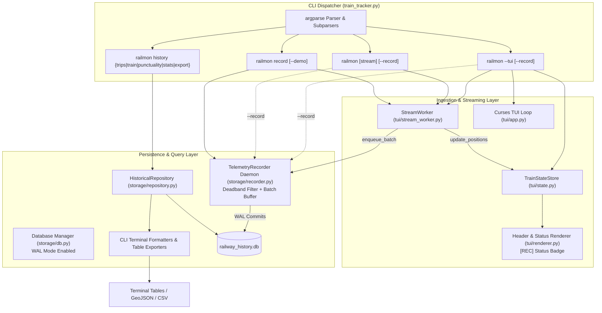

# Phase 4 Implementation Plan: CLI & System Integration

Detailed engineering specification, CLI command architecture, Curses TUI telemetry recorder hooks, visual status indicators, analytical terminal reporting, and automated integration suites for **Phase 4** of the Hellenic Railways (`railway.gov.gr`) SQLite historical storage engine.

Refer to the master [Historical Telemetry Storage in SQLite Implementation Plan](./sqlite-historical-data-plan.md) and earlier phase specifications:
- [Phase 1 Specification: Storage Infrastructure & Schema Setup](./storage-phase-1-infrastructure-and-schema.md)
- [Phase 2 Specification: Asynchronous Recorder & Deadband Filter](./storage-phase-2-asynchronous-recorder-and-deadband-filter.md)
- [Phase 3 Specification: Historical Repository & Query Engine](./storage-phase-3-historical-repository-and-query-engine.md)

---

## 1. Overview & Objectives

Phase 4 completes the end-to-end integration of the SQLite telemetry persistence architecture across all user-facing execution modes of `railmon`:
1. **Interactive Curses TUI (`railmon --tui`):** Allowing optional concurrent telemetry recording in the background without frame drops or rendering stutter.
2. **Plain Console Streaming (`railmon stream`):** Streaming live positions to stdout while asynchronously persisting to SQLite.
3. **Headless Ingestion Daemon (`railmon record`):** Running unattended as a dedicated recording service (e.g. systemd daemon, background task, or Docker container) capturing live network telemetry.
4. **Historical Query & Analytics CLI (`railmon history`):** Exposing the analytical power of the Phase 3 `HistoricalRepository` directly to the terminal for inspecting trips, corridor punctuality, station dwell profiles, and GIS exports (GeoJSON/CSV).



### 1.1 Key Engineering Objectives

1. **Seamless Backward Compatibility:** Preserve all existing invocation semantics (`railmon`, `railmon --tui`, `railmon --demo`, `railmon schedules`, `railmon --fps 30`) while introducing modern subcommands (`record`, `history`).
2. **Zero-Contention Stream Decoupling:** Connect `StreamWorker` to `TelemetryRecorder` using non-blocking FIFO queues (`queue.Queue.put_nowait`), ensuring that disk flushes or SQLite locks never interrupt network SSE ingestion or Curses TUI rendering.
3. **Real-Time Visual Feedback:** Render an eye-catching, high-contrast `[REC]` status indicator in the Curses TUI top header bar when recording is active.
4. **Rich Terminal Analytics:** Deliver formatted, Unicode-aligned terminal outputs for punctuality summaries, trip overviews, and station dwell metrics, with zero third-party dependencies (built exclusively on the Python standard library).
5. **Clean Signal Handling & Lifecycle Safety:** Guarantee that `SIGINT` (Ctrl+C) and `SIGTERM` gracefully drain the ingestion queue, flush remaining telemetry buffers, finalize audit logs in `recording_sessions`, and report summary metrics before exiting.

### 1.2 Primary Deliverables

1. **CLI Parser & Command Router (`train_tracker.py`)**:
   - Upgraded `build_parser()` supporting global `--db`, `--record`, `--filter-deadband`, and dedicated `record` and `history` subcommands.
   - Headless recording runner: `run_record_mode()`.
   - Historical inspection dispatcher: `run_history_mode()`.
2. **Worker & Storage Pipeline Integration (`tui/stream_worker.py`)**:
   - Optional `recorder` binding on `StreamWorker`.
   - Automated forwarding of incoming `TrainPosition` batches to `recorder.enqueue_batch()`.
3. **TUI State & Visual Badge Integration (`tui/state.py`, `tui/renderer.py`, `tui/app.py`)**:
   - Added `is_recording` attribute on `StateSnapshot` and `TrainStateStore`.
   - Highlighting `[● REC]` badge in `render_header()` when background recording is enabled.
4. **Terminal Formatters & Exporters (`storage/cli_formatters.py` or `train_tracker.py`)**:
   - Tabular formatting for trips, train breadcrumbs, corridor punctuality, station dwell, and audit sessions.
   - Direct export utilities for GeoJSON RFC 7946 and CSV.
5. **Automated Test Suites (`tests/test_cli_storage.py` and `tests/test_storage_integration.py`)**:
   - Comprehensive test coverage for CLI argument parsing, subcommands, worker-recorder coordination, TUI header badges, and terminal formatters.

---

## 2. CLI Architecture & Command Specification

### 2.1 Command-Line Grammar

The CLI interface supports two invocation styles:
- **Flag-Driven Mode (Legacy & TUI):** `railmon [--tui] [--demo] [--record] [--db PATH]`
- **Subcommand-Driven Mode (Historical & Headless):** `railmon <subcommand> [options]`

```text
railmon [-h] [-v] [--tui] [--demo] [--record] [--db PATH] [--fps FPS]
        [--reconnect-delay SEC] [--no-filter-deadband]
        [mode | subcommand] ...

Subcommands / Modes:
  stream                 Live train position monitor on console (default)
  schedules              List upcoming passenger train timetables
  record                 Run headless telemetry recording daemon
  history                Query and export historical telemetry from SQLite
```

### 2.2 Global & Common Options

| Option | Type | Default | Description |
| :--- | :--- | :--- | :--- |
| `--db PATH` | `str` | `railway_history.db` | Path to the SQLite historical database file. |
| `--record` | `flag` | `False` | Enable background telemetry persistence in `stream` or `--tui` modes. |
| `--no-filter-deadband` | `flag` | `False` | Disable deadband coordinate compression (record every raw position update). |
| `--demo` | `flag` | `False` | Use offline synthetic telemetry engine rather than live SSE stream. |
| `--fps FPS` | `float` | `20.0` | Curses TUI target refresh rate (range: 5.0–60.0). |
| `--reconnect-delay SEC`| `float` | `3.0` | Initial reconnect backoff delay in seconds for live SSE interruptions. |
| `-v, --version` | `action`| — | Print railmon version and exit. |
| `-h, --help` | `action`| — | Print help documentation and exit. |

---

### 2.3 Detailed Specification: `railmon record`

The `record` subcommand runs a dedicated, headless background telemetry ingestion daemon. It connects to the live SSE stream (or offline mock engine), batches records, filters stationary noise, and persists data into the SQLite database.

```text
railmon record [-h] [--demo] [--db PATH] [--no-filter-deadband]
               [--batch-size N] [--flush-interval SEC] [--quiet]
```

#### Arguments & Options:
- `--demo`: Stream from `MockTelemetryEngine` instead of live network SSE.
- `--db PATH`: Destination SQLite database file (default: `railway_history.db`).
- `--no-filter-deadband`: Disable deadband filter (record stationary points).
- `--batch-size N`: Maximum buffered rows before atomic commit (default: `50`).
- `--flush-interval SEC`: Maximum buffer age in seconds before flush (default: `2.0`).
- `--quiet`: Suppress periodic console heartbeat status rows.

#### Console UX & Progress Display:
```text
======================================================================
  railmon - Hellenic Railways Telemetry Ingestion Daemon
  Source: Live SSE Stream (/api/train-stream)
  Database: railway_history.db (WAL mode)
  Deadband Compression: ENABLED (distance >= 15m, delay delta >= 1m)
======================================================================
[2026-11-18 21:35:00] Session #4 initialized. Recording started. Press Ctrl+C to stop.

  Timestamp   | Trains | Batch Rows | Total Stored | Compressed | DB Size 
-------------+--------+------------+--------------+------------+---------
 21:35:05     |     24 |         48 |           48 |      42.8% | 1.12 MB
 21:35:10     |     25 |         46 |           94 |      47.1% | 1.18 MB
 21:35:15     |     24 |         42 |          136 |      51.4% | 1.24 MB
^C
[2026-11-18 21:35:22] Shutting down recorder... draining queue and flushing buffer...
[2026-11-18 21:35:23] Session #4 finalized.
  - Duration: 23.4s
  - Total Telemetry Rows Stored: 182
  - Positions Filtered (Deadband): 198 (52.1% compression ratio)
  - Final Database File Size: 1.29 MB
```

---

### 2.4 Detailed Specification: `railmon history`

The `history` command exposes analytical queries and data exports from the SQLite database. It provides dedicated actions:

```text
railmon history [-h] [--db PATH] {trips,train,punctuality,dwell,stats,sessions,export} ...
```

#### 2.4.1 `railmon history trips`
List distinct train trips and services recorded in the database.

```text
railmon history trips [-h] [--date YYYY-MM-DD] [--corridor NAME] [--limit N]
```

**Output Example:**
```text
Recorded Trips for 2026-11-18 (Corridor: All):
-------------------------------------------------------------------------------------------------
Train    Date       Corridor            Points  Max Delay  Avg Delay  Max Speed  First Seen  Last Seen
-------------------------------------------------------------------------------------------------
IC50     2026-11-18 Ath-Thess-Ath         1420      +12m      +4.2m   158.4 km/h  06:22:10   10:35:40
IC53     2026-11-18 Ath-Thess-Ath         1388       +4m      +1.1m   159.2 km/h  07:15:00   11:28:15
1597     2026-11-18 Chalkida-Athens        412       +8m      +3.5m   118.0 km/h  08:10:04   09:25:30
2232     2026-11-18 Suburban Network       360       +0m      +0.0m    88.5 km/h  09:00:12   09:58:45
-------------------------------------------------------------------------------------------------
Total matching trips: 4 | Database: railway_history.db
```

#### 2.4.2 `railmon history train <TRAIN_NO>`
Inspect historical breadcrumbs and telemetry timeline for a specific train.

```text
railmon history train <train_number> [-h] [--start ISO] [--end ISO] [--limit N] [--desc]
```

**Output Example:**
```text
Telemetry History for Train IC50 (Limit: 5):
---------------------------------------------------------------------------------------------------
Recorded At (UTC)    Lat       Lng       Speed       Heading  Delay   Status    Chainage    Next Station
---------------------------------------------------------------------------------------------------
2026-11-18 07:15:02  38.0450   23.7210   112.5 km/h   352.0°    +2m   Κανονική   18,400 m   SKG Main
2026-11-18 07:15:12  38.0485   23.7218   115.0 km/h   355.0°    +2m   Κανονική   18,720 m   SKG Main
2026-11-18 07:15:22  38.0520   23.7225   118.2 km/h   358.0°    +3m   Κανονική   19,050 m   SKG Main
---------------------------------------------------------------------------------------------------
Showing 3 of 1,420 recorded points.
```

#### 2.4.3 `railmon history punctuality`
Generate corridor-level on-time reliability and delay volatility metrics.

```text
railmon history punctuality [-h] [--corridor NAME] [--start-date YYYY-MM-DD]
                            [--end-date YYYY-MM-DD] [--threshold MIN]
```

**Output Example:**
```text
Corridor Punctuality Report (Threshold: <= 5 min on-time):
--------------------------------------------------------------------------------------------------
Corridor                 Trips    Obs     On-Time %   Avg Delay   Max Delay  Delayed  Severe (>=30m)
--------------------------------------------------------------------------------------------------
Ath-Thess-Ath (Main)        18   22,450       83.3%       +5.4m       +42m         3               1
Suburban Network            42   15,120       95.2%       +1.2m       +14m         2               0
Chalkida-Athens             12    4,890       75.0%       +8.1m       +28m         3               0
Peloponnese Regional         8    2,110       87.5%       +3.8m       +18m         1               0
--------------------------------------------------------------------------------------------------
Network Average Punctuality: 88.75% | Evaluated Trips: 80
```

#### 2.4.4 `railmon history dwell <TRAIN_NO>`
Analyze station stop arrival, departure, and dwell durations.

```text
railmon history dwell <train_number> [-h] [--start ISO] [--end ISO]
                            [--speed-threshold KMH] [--min-dwell SEC]
```

**Output Example:**
```text
Station Dwell Profile for Train IC50:
------------------------------------------------------------------------------------------------
Station Name            Arrival (UTC)        Departure (UTC)      Dwell Time   Arr Delay  Dep Delay
------------------------------------------------------------------------------------------------
SKG Main                2026-11-18 06:22:10  2026-11-18 06:26:45  4m 35s              0m        +1m
Platy                   2026-11-18 06:50:12  2026-11-18 06:52:30  2m 18s             +1m        +1m
Katerini                2026-11-18 07:18:05  2026-11-18 07:21:10  3m 05s             +2m        +3m
Larissa                 2026-11-18 08:02:40  2026-11-18 08:08:15  5m 35s             +3m        +5m
------------------------------------------------------------------------------------------------
```

#### 2.4.5 `railmon history stats`
Display overall database storage diagnostics, table volume, and session audits.

```text
railmon history stats [-h]
```

**Output Example:**
```text
SQLite Telemetry Storage Summary:
----------------------------------------------------
  Database File:        railway_history.db
  Journal Mode:         WAL (Write-Ahead Logging)
  File Size on Disk:    14.28 MB
  Total Telemetry Rows: 124,590
  Total Unique Trains:  48
  Total Recorded Trips: 162
  Audit Sessions:       12
  Earliest Record:      2026-11-15 08:00:12 UTC
  Latest Record:        2026-11-18 21:30:45 UTC
  Data Time Span:       3.56 days
----------------------------------------------------
```

#### 2.4.6 `railmon history export <TRAIN_NO>`
Export trajectory coordinates to GeoJSON (RFC 7946) or CSV format.

```text
railmon history export <train_number> [-h] [--format {geojson,csv}] [--feature-type {LineString,Point}]
                                     [--out FILE] [--start ISO] [--end ISO]
```

---

## 3. Technical Specifications & File Modifications

### 3.1 `train_tracker.py` CLI Refactoring

The entry point `train_tracker.py` is refactored to support subcommands while maintaining compatibility with legacy positional arguments.

```python
def build_parser() -> argparse.ArgumentParser:
    """Construct command-line argument parser supporting legacy flags and modern subcommands."""
    parser = argparse.ArgumentParser(
        prog="railmon",
        description="railmon - Hellenic Railways (railway.gov.gr) Live Train Tracker & Terminal Map.",
        formatter_class=argparse.RawDescriptionHelpFormatter,
    )
    
    # Global persistence flags
    parser.add_argument("--db", type=str, default="railway_history.db",
                        help="Path to SQLite historical database (default: railway_history.db).")
    parser.add_argument("--record", action="store_true",
                        help="Enable background telemetry recording to SQLite in stream/TUI modes.")
    parser.add_argument("--no-filter-deadband", action="store_true",
                        help="Disable deadband filtering and record all raw coordinates.")
    
    # Existing TUI/Stream flags
    parser.add_argument("--tui", action="store_true", help="Launch interactive curses terminal map.")
    parser.add_argument("--demo", action="store_true", help="Run using offline mock simulation.")
    parser.add_argument("--fps", type=float, default=20.0, help="TUI refresh frame rate.")
    parser.add_argument("--reconnect-delay", type=float, default=3.0, help="SSE reconnect delay (s).")
    parser.add_argument("-v", "--version", action="version", version="%(prog)s 1.0.0")

    subparsers = parser.add_subparsers(dest="subcommand", help="Available subcommands")

    # 1. 'record' subcommand
    record_parser = subparsers.add_parser("record", help="Run headless telemetry recording daemon.")
    record_parser.add_argument("--demo", action="store_true", help="Record synthetic demo telemetry.")
    record_parser.add_argument("--batch-size", type=int, default=50, help="Batch commit size threshold.")
    record_parser.add_argument("--flush-interval", type=float, default=2.0, help="Max flush interval (s).")
    record_parser.add_argument("--quiet", action="store_true", help="Suppress periodic terminal stats.")

    # 2. 'history' subcommand
    history_parser = subparsers.add_parser("history", help="Query historical telemetry and performance.")
    hist_subs = history_parser.add_subparsers(dest="history_action", help="History actions")

    # history trips
    trips_p = hist_subs.add_parser("trips", help="List recorded train trips.")
    trips_p.add_argument("--date", type=str, help="Filter by date (YYYY-MM-DD).")
    trips_p.add_argument("--corridor", type=str, help="Filter by corridor name.")
    trips_p.add_argument("--limit", type=int, default=50, help="Max trips to return.")

    # history train
    train_p = hist_subs.add_parser("train", help="Inspect breadcrumbs for a train.")
    train_p.add_argument("train_number", type=str, help="Train number (e.g. 1597, IC50).")
    train_p.add_argument("--start", type=str, help="Start ISO timestamp.")
    train_p.add_argument("--end", type=str, help="End ISO timestamp.")
    train_p.add_argument("--limit", type=int, default=50, help="Max rows to return.")
    train_p.add_argument("--desc", action="store_true", help="Order descending (newest first).")

    # history punctuality
    punc_p = hist_subs.add_parser("punctuality", help="Corridor punctuality analytics.")
    punc_p.add_argument("--corridor", type=str, help="Filter by corridor name.")
    punc_p.add_argument("--start-date", type=str, help="Start date (YYYY-MM-DD).")
    punc_p.add_argument("--end-date", type=str, help="End date (YYYY-MM-DD).")
    punc_p.add_argument("--threshold", type=int, default=5, help="On-time threshold in minutes.")

    # history dwell
    dwell_p = hist_subs.add_parser("dwell", help="Station dwell time analysis.")
    dwell_p.add_argument("train_number", type=str, help="Train number.")
    dwell_p.add_argument("--start", type=str, help="Start timestamp.")
    dwell_p.add_argument("--end", type=str, help="End timestamp.")
    dwell_p.add_argument("--speed-threshold", type=float, default=2.0, help="Max speed (km/h) for stop.")
    dwell_p.add_argument("--min-dwell", type=int, default=30, help="Min dwell duration in seconds.")

    # history stats & sessions
    hist_subs.add_parser("stats", help="Database storage diagnostics and row counts.")
    sess_p = hist_subs.add_parser("sessions", help="Audit log of recording sessions.")
    sess_p.add_argument("--limit", type=int, default=20, help="Max sessions to list.")

    # history export
    exp_p = hist_subs.add_parser("export", help="Export train trajectory to GeoJSON or CSV.")
    exp_p.add_argument("train_number", type=str, help="Train number.")
    exp_p.add_argument("--format", choices=["geojson", "csv"], default="geojson", help="Export format.")
    exp_p.add_argument("--feature-type", choices=["LineString", "Point"], default="LineString")
    exp_p.add_argument("--out", "-o", type=str, help="Output destination file path.")
    exp_p.add_argument("--start", type=str, help="Start timestamp.")
    exp_p.add_argument("--end", type=str, help="End timestamp.")

    return parser
```

---

### 3.2 `tui/stream_worker.py` Integration

The `StreamWorker` is enhanced to optionally accept an instantiated `TelemetryRecorder`. Whenever a batch is received, it forwards it to the recorder in a non-blocking operation:

```python
class StreamWorker:
    def __init__(
        self,
        store: TrainStateStore,
        client: Optional[RailwayGovClient] = None,
        mock_engine: Optional[MockTelemetryEngine] = None,
        custom_stream: Optional[Any] = None,
        recorder: Optional["TelemetryRecorder"] = None,   # NEW: Optional recorder
        base_backoff_sec: float = 1.0,
        max_backoff_sec: float = 30.0,
    ):
        self.store = store
        self.client = client
        self.mock_engine = mock_engine
        self.custom_stream = custom_stream
        self.recorder = recorder                         # Attached recorder reference
        ...

    def _run_loop(self) -> None:
        ...
        for batch in stream:
            if self._stop_event.is_set():
                break
            self._pause_event.wait()
            if self._stop_event.is_set():
                break

            if batch:
                # 1. Update live UI state
                self.store.update_positions(batch)
                
                # 2. Enqueue to persistence recorder (non-blocking)
                if self.recorder and self.recorder.is_running:
                    self.recorder.enqueue_batch(batch)
```

---

### 3.3 TUI Status & Header Integration (`tui/state.py` & `tui/renderer.py`)

#### State Model Updates (`tui/state.py`)
Add `is_recording: bool = False` to `StateSnapshot` and `TrainStateStore`:

```python
@dataclass(frozen=True)
class StateSnapshot:
    ...
    is_recording: bool = False
    recording_db: Optional[str] = None
```

#### Visual Badge in Header (`tui/renderer.py`)
In `render_header()`, when `snapshot.is_recording` is `True`, render a prominent `[● REC]` badge next to the title or train counts:

```python
def render_header(self, win: Any, snapshot: StateSnapshot, width: int) -> None:
    ...
    rec_badge = " [● REC] " if snapshot.is_recording else ""
    rec_attr = safe_color_pair(PAIR_TRAIN_WARN, curses.A_BOLD) | curses.A_REVERSE

    # Draw left text with recording indicator
    safe_addstr(win, 0, 0, left_text, header_attr)
    left_w = get_string_display_width(left_text)

    if snapshot.is_recording and width > left_w + 12:
        safe_addstr(win, 0, left_w + 1, rec_badge, rec_attr)
        left_w += get_string_display_width(rec_badge) + 1
```

---

### 3.4 Headless Daemon Execution (`run_record_mode`)

When `railmon record` is invoked, `run_record_mode()` initializes the database, configures the `TelemetryRecorder`, attaches signals, and prints live diagnostic telemetry metrics until interrupted:

```python
def run_record_mode(
    db_path: str = "railway_history.db",
    demo: bool = False,
    enable_deadband: bool = True,
    batch_size: int = 50,
    flush_interval_sec: float = 2.0,
    quiet: bool = False,
    reconnect_delay: float = 3.0,
) -> int:
    """Execute dedicated headless recording daemon with terminal metrics display."""
    from storage.db import Database
    from storage.recorder import RecorderConfig, TelemetryRecorder
    from tui.mock_engine import MockTelemetryEngine

    db = Database(db_path)
    db.init_schema()

    config = RecorderConfig(
        batch_size=batch_size,
        flush_interval_sec=flush_interval_sec,
        enable_deadband=enable_deadband,
        mode="demo" if demo else "live",
    )
    recorder = TelemetryRecorder(db, config)
    recorder.start()

    stop_event = threading.Event()

    def _sig_handler(sig, frame):
        stop_event.set()

    signal.signal(signal.SIGINT, _sig_handler)
    signal.signal(signal.SIGTERM, _sig_handler)

    try:
        if demo:
            engine = MockTelemetryEngine()
            stream = engine.stream_positions(interval_sec=1.0)
        else:
            client = RailwayGovClient()
            stream = client.stream_train_positions(reconnect_delay=reconnect_delay)

        for batch in stream:
            if stop_event.is_set():
                break
            if batch:
                recorder.enqueue_batch(batch)
            if not quiet:
                # Print periodic progress table
                ...
    finally:
        recorder.stop(timeout_sec=5.0)
        # Print final session audit table
```

---

## 4. Signal Handling, Concurrency & Failure Recovery

1. **Graceful Shutdown Protocol:**
   - Both `SIGINT` (Ctrl+C) and `SIGTERM` must trigger cooperative shutdown.
   - The ingestion stream terminates its loop.
   - `recorder.stop(timeout_sec=5.0)` awakens the worker thread with a sentinel (`None`), drains any remaining positions in the queue, commits the final in-memory buffer, and updates `recording_sessions.ended_at`.
2. **Database Busy / Lock Handling:**
   - SQLite connections in `storage/db.py` are initialized with `timeout=30.0`.
   - In WAL mode, concurrent reads from `railmon history` execute in parallel with `railmon record` writes without deadlocks or errors.
3. **Queue Overflow Protection:**
   - The queue in `TelemetryRecorder` is bounded (`maxsize=10,000`). If a slow disk stalls commits, `put_nowait` logs a dropped batch warning rather than crashing the application or ballooning memory.

---

## 5. Verification & Test Plan

### 5.1 CLI Parsing Test Suite (`tests/test_cli_storage.py`)

- **TC-CLI-P4-01: Default Ingestion Flags:** Verify `--record` flag initializes `args.record=True` and `--db` defaults to `railway_history.db`.
- **TC-CLI-P4-02: Record Subcommand Arguments:** Verify parsing of `railmon record --demo --db test.db --batch-size 25 --no-filter-deadband`.
- **TC-CLI-P4-03: History Trips Dispatch:** Verify parsing of `railmon history trips --date 2026-11-18 --corridor Ath-Thess-Ath`.
- **TC-CLI-P4-04: History Train Dispatch:** Verify parsing of `railmon history train IC50 --limit 10 --desc`.
- **TC-CLI-P4-05: History Export Dispatch:** Verify parsing of `railmon history export IC50 --format geojson --out test.geojson`.

### 5.2 System Integration Test Suite (`tests/test_storage_integration.py`)

- **TC-INT-P4-01: StreamWorker & Recorder Pipeline:**
  - Instantiate `StreamWorker` with attached `TelemetryRecorder`.
  - Push 100 mock train positions through worker.
  - Assert all 100 positions are enqueued and written to the SQLite database without loss.
- **TC-INT-P4-02: Concurrent TUI and Recording:**
  - Launch `run_tui_mode` with `--record` in a headless thread.
  - Verify state store snapshot has `is_recording=True`.
  - Verify header renderer outputs `[● REC]` badge.
  - Terminate and verify recording session is marked ended in SQLite.
- **TC-INT-P4-03: Headless Record Mode Lifecycle:**
  - Run `run_record_mode()` with `demo=True` and signal abort after 3 batches.
  - Verify database tables `trains`, `telemetry_history`, and `recording_sessions` contain expected rows.
- **TC-INT-P4-04: History CLI Terminal Output:**
  - Seed an in-memory or temporary SQLite database with known historical trips and positions.
  - Execute `run_history_mode()` for `trips`, `train`, `punctuality`, `dwell`, and `stats`.
  - Assert stdout outputs correctly formatted tables matching expected column headers and numerical metrics.
- **TC-INT-P4-05: GeoJSON and CSV File Export:**
  - Execute `run_history_mode(["export", "IC50", "--format", "geojson", "--out", temp_file])`.
  - Parse `temp_file` with `json.loads` and assert valid RFC 7946 `FeatureCollection` with `LineString` coordinates.

---

## 6. Implementation Rollout Steps

1. **Step 1: CLI Parser Expansion (`train_tracker.py`)**
   - Update `build_parser()` to support `record` and `history` subparsers and global flags.
2. **Step 2: StreamWorker Hook (`tui/stream_worker.py`)**
   - Add `recorder` argument and `enqueue_batch` invocation in `StreamWorker._run_loop()`.
3. **Step 3: TUI Recording Indicator (`tui/state.py` & `tui/renderer.py`)**
   - Add `is_recording` attribute to `StateSnapshot` and render `[● REC]` badge in `render_header()`.
4. **Step 4: Headless Daemon Implementation (`run_record_mode`)**
   - Implement `run_record_mode()` with signal handling, batch progress logs, and final summary report.
5. **Step 5: History CLI Query Dispatcher (`run_history_mode`)**
   - Implement terminal table formatters and map subcommands to `HistoricalRepository` methods.
6. **Step 6: Automated Test Verification**
   - Author `tests/test_cli_storage.py` and `tests/test_storage_integration.py`.
   - Run complete test suite: `python -m unittest discover tests`.
7. **Step 7: Master Documentation Synchronization**
   - Update [`docs/sqlite-historical-data-plan.md`](./sqlite-historical-data-plan.md) and [`README.md`](../../../README.md) with Phase 4 command usage.
