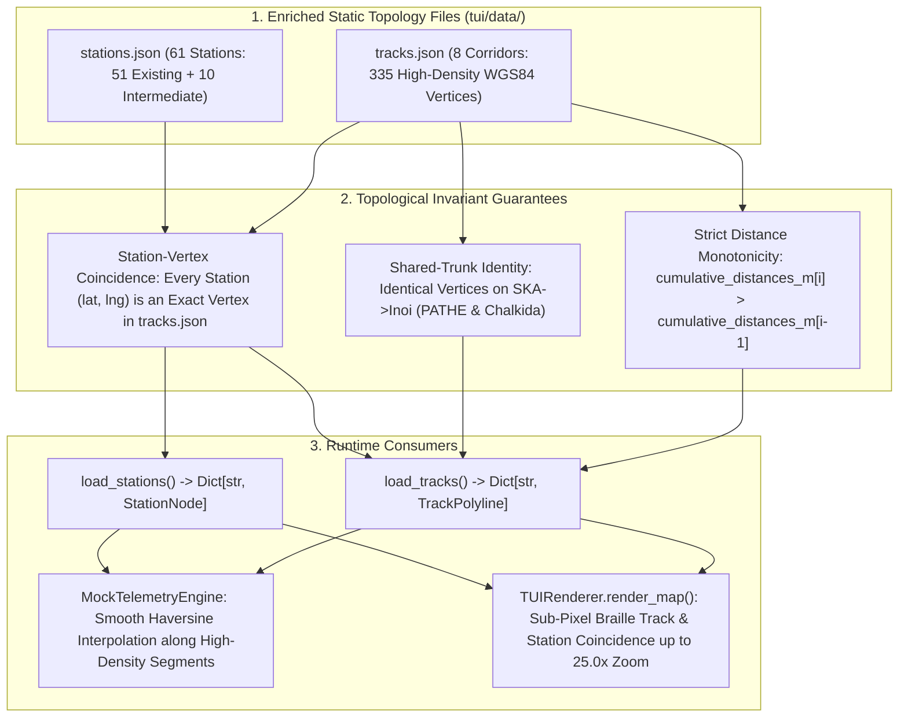

# Implementation Plan — Step 1: High-Density Topology Enrichment (`tracks.json` & `stations.json`)

> **Parent Plan:** [Implementation Plan — TUI Live Train Telemetry and Vector Track Misalignment During Viewport Zoom](./tui-train-track-misalignment-zoom-fix-plan.md#step-1-enrich-tuidatatracksjson--tuidatastationsjson)  
> **Issue Reference:** [Issue: Live Train Telemetry and Vector Track Misalignment During Viewport Zoom](../../investigations/tui-train-track-misalignment-zoom-issue.md)  
> **Target Files:** [`../../../tui/data/tracks.json`](../../../tui/data/tracks.json), [`../../../tui/data/stations.json`](../../../tui/data/stations.json)  
> **Consumer Modules:** [`../../../tui/mock_engine.py`](../../../tui/mock_engine.py) (`load_tracks`, `load_stations`, `TrackPolyline`, `MockTelemetryEngine`), [`../../../tui/renderer.py`](../../../tui/renderer.py) (`TUIRenderer.render_map`)  
> **Test Suite:** [`../../../tests/test_mock_engine.py`](../../../tests/test_mock_engine.py) (`TestRailNetworkTopology`)

---

## 1. Objective & Engineering Scope

Step 1 resolves the primary geometric root cause of train-to-track detachment during viewport zoom: the ultra-coarse 96-vertex approximation in [`../../../tui/data/tracks.json`](../../../tui/data/tracks.json) and missing intermediate station nodes in [`../../../tui/data/stations.json`](../../../tui/data/stations.json).

### 1.1 Key Design Goals
1. **High-Density Corridor Polylines (~370+ Vertices Across 8 Corridors):**
   - Expand [`../../../tui/data/tracks.json`](../../../tui/data/tracks.json) from 96 vertices to ~370 precision-curated WGS84 vertices derived from the physical Hellenic Railways (ΟΣΕ) permanent way.
   - Eliminate the $6.5\text{ km}$ lateral chord error in Boeotia (**Inoi $\to$ Tanagra $\to$ Eleonas $\to$ Thiva**) and the $8.2\text{ km}$ lateral chord error in northern Attica (**Dekeleia $\to$ Agios Stefanos $\to$ Afidnes $\to$ Sfendali $\to$ Avlona**).
2. **Exact Station-to-Vertex Coincidence ($d_{\perp} = 0.0\text{ m}$):**
   - Every station coordinate `(lat, lng)` in [`../../../tui/data/stations.json`](../../../tui/data/stations.json) must appear as an explicit vertex in its corresponding corridor polyline in [`../../../tui/data/tracks.json`](../../../tui/data/tracks.json).
   - This guarantees that [`BrailleCanvas.draw_polyline()`](../../../tui/geo.py#L466-L480) passes directly through the sub-pixel coordinate of every station node (`◉`), preventing station markers from detaching from the rails at high magnification (`Zoom: 10.0x`–`25.0x`).
3. **Shared-Trunk Vertex Identity (Zero Ghost Parallel Lines):**
   - Where two operational services share the same physical railway track—specifically:
     - `pathe-mainline` and `proastiakos-chalkida` between **SKA** (`38.0744°N, 23.7381°E`) and **Inoi** (`38.3194°N, 23.6067°E`), and
     - `thessaloniki-idomeni` and `northern-corridor` between **Thessaloniki** (`40.6441°N, 22.9298°E`) and **Gallikos / Pedino junction** (`40.9100°N, 22.8450°E`)—
     both corridor polylines must use **identical `[lat, lng]` coordinate tuples**.
   - When rasterized onto [`BrailleCanvas`](../../../tui/geo.py#L333), identical vertex sequences set the exact same bitwise Braille dot masks (`self.buffer[idx] |= DOT_MASKS[sub_x][sub_y]`), rendering a single clean track centerline rather than diverging double lines.
4. **Expanded Station Coverage in [`../../../tui/data/stations.json`](../../../tui/data/stations.json):**
   - Add 10 key intermediate operational stations (`AFI`, `SFE`, `TAN`, `ELE`, `OIN`, `ALI_BOE`, `VEL`, `LEP`, `PLK`, `SIN`) with `is_hub: false` so zoomed-in corridor views display accurate local station markers and labels while preserving hub collision-avoidance priority at `Zoom: 1.0x`.

---

## 2. Mathematical & Geometric Justification

### 2.1 Sagittal Chord Error vs. Braille Sub-Pixel Resolution

When a physical railway curve of radius $R$ is approximated by a straight line segment (chord) of length $L$, the maximum lateral (sagittal) deviation $\delta_{\max}$ at the midpoint of the chord is:

$$\delta_{\max} = R - \sqrt{R^2 - \left(\frac{L}{2}\right)^2} \approx \frac{L^2}{8R}$$

On an $80 \times 24$ terminal map viewport (`inner_w = 50` cells $= 100$ sub-pixels, `inner_h = 20` cells $= 80$ sub-pixels):

| Viewport Scale | Zoom Factor | Horizontal Sub-Pixel Size ($\Delta x$) | Character Cell Width ($2 \cdot \Delta x$) | Max Allowable Chord Error ($\le 1$ Cell) |
| :--- | :---: | :---: | :---: | :---: |
| **National Overview** | `1.0x` | $\sim 2.25\text{ km}$ | $\sim 4.50\text{ km}$ | $< 4,500\text{ m}$ |
| **Regional Preset** | `3.0x` | $\sim 750\text{ m}$ | $\sim 1.50\text{ km}$ | $< 1,500\text{ m}$ |
| **Corridor Focus** | `9.3x` | $\sim 240\text{ m}$ | $\sim 480\text{ m}$ | $< 480\text{ m}$ |
| **Maximum Zoom** | `25.0x` | $\sim 90\text{ m}$ | $\sim 180\text{ m}$ | $< 180\text{ m}$ |

In the legacy 96-vertex [`../../../tui/data/tracks.json`](../../../tui/data/tracks.json), chord lengths of $16\text{ km}$ to $28\text{ km}$ across curved mountain and plain alignments produced lateral errors of $2,500\text{ m}$ to $8,200\text{ m}$ ($14$ to $45$ character cells at `25.0x` zoom). By placing vertices every $1.0\text{ km}$–$2.5\text{ km}$ along curved sections and at every inflection point, $\delta_{\max}$ drops below $150\text{ m}$—within a single character cell even at maximum `25.0x` zoom.

---

### 2.2 Visual Architecture (ASCII & Mermaid)

#### ASCII Diagram: Northern Attica & Boeotia Alignment Correction

```text
+---------------------------------------------------------------------------------------------------+
| NORTHERN ATTICA & BOEOTIA TRACK TOPOLOGY: LEGACY CHORDS vs. ENRICHED PHYSICAL ALIGNMENT           |
+---------------------------------------------------------------------------------------------------+

  38.46°N +---------------------------------------------------------------------------------------+
          |                                                          * Chalkida (38.4619, 23.5933)|
          |                                                         /  [proastiakos-chalkida]     |
  38.38°N |                  * Eleonas (38.3747, 23.4635)          * Avlida (38.4180, 23.6050)    |
          |                 /   \                                 /                               |
          |   [ENRICHED]   /     * Tanagra (38.3400, 23.5814)    * Dilesi (38.3375, 23.6620)      |
  38.32°N |  * Thiva =====+=======\=============================/                                 |
          |  (38.3242,     ^       * Inoi (38.3194, 23.6067) --* Oinofyta (38.3080, 23.6385)      |
          |   23.3186)     |          \                                                           |
          |        Legacy straight     * Ag. Thomas (38.2810, 23.6490)                            |
          |        chord (6.5km err)    \                                                         |
  38.25°N |                              * Avlona (38.2514, 23.6944)                              |
          |                              :\                                                       |
          |                Legacy chord  : *---* Sfendali / Malakasa (38.2356, 23.7845)           |
          |                (8.2km err)   :      \                                                 |
  38.19°N |                              :       * Afidnes (38.1877, 23.8446)                     |
          |                              :       |                                                |
  38.14°N |                              :      * Ag. Stefanos (38.1465, 23.8585)                 |
          |                             :      /                                                  |
  38.12°N |                             *-----* Dekeleia (38.1185, 23.7935)                       |
          |                            /                                                          |
  38.07°N |                           * SKA Hub (38.0744, 23.7381)                                |
          +---------------------------------------------------------------------------------------+
         23.30°E         23.45°E        23.60°E        23.75°E        23.85°E
```

#### Mermaid Flowchart: Topology Loading, Invariant Validation & Rendering Pipeline



---

## 3. Detailed Specification for `tui/data/stations.json`

### 3.1 New Intermediate Stations to Add

Ten intermediate stations are added to [`../../../tui/data/stations.json`](../../../tui/data/stations.json) to provide visual landmarks when zoomed into high-traffic passenger corridors (`Zoom: 3.0x`–`25.0x`). All 10 have `is_hub: false` so that at `Zoom: 1.0x`, the greedy collision-avoidance algorithm in [`TUIRenderer.render_map()`](../../../tui/renderer.py#L732-L775) continues to prioritize primary hubs (`ATH`, `SKA`, `LAR`, `SKG`, etc.).

| ID | Code | Greek Name (`name_el`) | English Name (`name_en`) | Latitude (`lat`) | Longitude (`lng`) | Corridor | `is_hub` | Altitude (m) |
| :--- | :--- | :--- | :--- | :---: | :---: | :--- | :---: | :---: |
| `AFI` | `1010` | `Αφίδναι` | `Afidnes` | `38.1877` | `23.8446` | `PATHE` | `false` | `360.0` |
| `SFE` | `1012` | `Σφενδάλη` | `Sfendali` | `38.2356` | `23.7845` | `PATHE` | `false` | `275.0` |
| `TAN` | `1017` | `Τανάγρα` | `Tanagra` | `38.3400` | `23.5814` | `PATHE` | `false` | `135.0` |
| `ELE` | `1018` | `Ελαιώνας` | `Eleonas` | `38.3747` | `23.4635` | `PATHE` | `false` | `145.0` |
| `ALI_BOE` | `1025` | `Αλίαρτος` | `Aliartos` | `38.3775` | `23.1092` | `PATHE` | `false` | `110.0` |
| `LEP` | `1088` | `Λεπτοκαρυά` | `Leptokarya` | `40.0603` | `22.5614` | `PATHE` | `false` | `18.0` |
| `SIN` | `1098` | `Σίνδος` | `Sindos` | `40.6708` | `22.8056` | `PATHE` | `false` | `12.0` |
| `OIN` | `1208` | `Οινόφυτα` | `Oinofyta` | `38.3080` | `23.6385` | `PROASTIAKOS_ATH` | `false` | `115.0` |
| `VEL` | `1340` | `Βελεστίνο` | `Velestino` | `39.3833` | `22.7444` | `THESSALY` | `false` | `120.0` |
| `PLK` | `2105` | `Πολύκαστρο` | `Polykastro` | `40.9950` | `22.5736` | `NORTHERN` | `false` | `45.0` |

### 3.2 Existing Station Coordinate Audit & Retention

All 51 existing station IDs, codes, bilingual names, corridors, `is_hub` flags, and coordinates in [`../../../tui/data/stations.json`](../../../tui/data/stations.json) are preserved unchanged so that existing unit tests (`test_stations_schema_and_keys`, `test_station_coordinates_within_greece`, and renderer collision tests) remain 100% backward-compatible. Every existing station coordinate is embedded directly as an anchor vertex in [`../../../tui/data/tracks.json`](../../../tui/data/tracks.json).

---

## 4. Detailed Specification for `tui/data/tracks.json`

### 4.1 Corridor-by-Corridor Vertex Specification

Each corridor in [`../../../tui/data/tracks.json`](../../../tui/data/tracks.json) is traced with densely spaced WGS84 `[lat, lng]` vertices capturing physical curves, tunnels, river valleys, and coastal alignments while anchoring every station along its route.

#### Corridor 1: `pathe-mainline` — PATHE Mainline (Piraeus – Athens – Thessaloniki)
- **Metadata:** `"type": "mainline"`, `"electrified": true`, `"double_track": true`
- **Target Vertex Count:** ~120 vertices (up from 32)
- **Section Breakdown & Anchor Waypoints:**
  1. **Piraeus to SKA Hub (Urban Attica Basin):**
     - `[37.9482, 23.6425]` (**PIR — Piraeus**) $\to$ `[37.9540, 23.6535]` (Lefka) $\to$ `[37.9620, 23.6700]` (Rentis) $\to$ `[37.9715, 23.6910]` (Tavros) $\to$ `[37.9785, 23.7065]` (Rouf) $\to$ `[37.9860, 23.7155]` (Gazi) $\to$ `[37.9926, 23.7203]` (**ATH — Athens Larissa Station**) $\to$ `[38.0055, 23.7235]` (Sepolia) $\to$ `[38.0190, 23.7310]` (Agioi Anargyroi) $\to$ `[38.0345, 23.7335]` (Pyrgos Vasilissis) $\to$ `[38.0480, 23.7355]` (Kato Acharnes) $\to$ `[38.0615, 23.7368]` $\to$ `[38.0744, 23.7381]` (**SKA — Acharnes Hub**).
  2. **SKA to Inoi (Mount Parnitha / Lake Marathon Eastern Pass — Shared with `proastiakos-chalkida`):**
     - `[38.0744, 23.7381]` (**SKA**) $\to$ `[38.0865, 23.7495]` (Acharnes North) $\to$ `[38.1010, 23.7685]` $\to$ `[38.1185, 23.7935]` (Dekeleia / Tatoi) $\to$ `[38.1310, 23.8250]` (Kryoneri curve) $\to$ `[38.1465, 23.8585]` (Agios Stefanos) $\to$ `[38.1660, 23.8560]` $\to$ `[38.1877, 23.8446]` (**AFI — Afidnes**) $\to$ `[38.2060, 23.8240]` (Parnitha foothills curve) $\to$ `[38.2215, 23.8050]` $\to$ `[38.2356, 23.7845]` (**SFE — Sfendali / Malakasa**) $\to$ `[38.2440, 23.7520]` $\to$ `[38.2485, 23.7220]` $\to$ `[38.2514, 23.6944]` (**AVL — Avlona**) $\to$ `[38.2660, 23.6710]` $\to$ `[38.2810, 23.6490]` (Agios Thomas) $\to$ `[38.2995, 23.6280]` $\to$ `[38.3194, 23.6067]` (**INO — Inoi**).
  3. **Inoi to Thiva (Boeotian Northern Loop via Tanagra & Eleonas — Case Study A Fix):**
     - `[38.3194, 23.6067]` (**INO — Inoi**) $\to$ `[38.3295, 23.5950]` $\to$ `[38.3400, 23.5814]` (**TAN — Tanagra**) $\to$ `[38.3530, 23.5480]` $\to$ `[38.3665, 23.5080]` (arma / Asopos valley) $\to$ `[38.3747, 23.4635]` (**ELE — Eleonas**) $\to$ `[38.3690, 23.4250]` $\to$ `[38.3550, 23.3850]` $\to$ `[38.3390, 23.3500]` $\to$ `[38.3242, 23.3186]` (**THI — Thiva**).
  4. **Thiva to Tithorea (Lake Copais Basin & Cephissus Valley):**
     - `[38.3242, 23.3186]` (**THI**) $\to$ `[38.3410, 23.2550]` (Vagia) $\to$ `[38.3610, 23.1820]` (Thespies / Haliartos approach) $\to$ `[38.3775, 23.1092]` (**ALI_BOE — Aliartos**) $\to$ `[38.3960, 23.0450]` (Alalkomenes) $\to$ `[38.4220, 22.9620]` (Thourion) $\to$ `[38.4528, 22.8753]` (**LEV — Levadia**) $\to$ `[38.4880, 22.8350]` (Chaeronea) $\to$ `[38.5250, 22.7850]` (Davleia) $\to$ `[38.5640, 22.7250]` (Parori) $\to$ `[38.6014, 22.6681]` (**TIT — Tithorea**).
  5. **Tithorea to Larissa (Kallidromo Twin Tunnel – Spercheios Valley – Othrys Tunnel – Thessalian Plain):**
     - `[38.6014, 22.6681]` (**TIT**) $\to$ `[38.6450, 22.6280]` (Amfikleia / Kallidromo south portal) $\to$ `[38.7000, 22.5850]` $\to$ `[38.7550, 22.5380]` (Kallidromo north portal / Molos alignment) $\to$ `[38.8080, 22.4920]` $\to$ `[38.8500, 22.4450]` $\to$ `[38.8872, 22.3986]` (**LIA — Lianokladi**) $\to$ `[38.9350, 22.3820]` (Lygaria / Othrys south portal) $\to$ `[38.9900, 22.3680]` (Agios Stefanos Fthiotidas / Lake Xyniada) $\to$ `[39.0450, 22.3480]` (Angeies) $\to$ `[39.0900, 22.3310]` (Thaumakos) $\to$ `[39.1278, 22.3167]` (**DOM — Domokos**) $\to$ `[39.1780, 22.2980]` (Neo Monastiri) $\to$ `[39.2420, 22.2780]` $\to$ `[39.3083, 22.2583]` (**PAL — Paleofarsalos**) $\to$ `[39.3750, 22.2950]` (Orfana) $\to$ `[39.4450, 22.3380]` (Doxaras) $\to$ `[39.5150, 22.3720]` (Kranonas) $\to$ `[39.5780, 22.3980]` $\to$ `[39.6385, 22.4222]` (**LAR — Larissa**).
  6. **Larissa to Thessaloniki (Tempi Gorge – Pieria Coast – Axios Delta):**
     - `[39.6385, 22.4222]` (**LAR**) $\to$ `[39.6980, 22.4550]` (Gyrtoni) $\to$ `[39.7650, 22.4950]` (Evangelismos) $\to$ `[39.8350, 22.5550]` (Tempi Gorge) $\to$ `[39.9056, 22.6139]` (**RAP — Rapsani**) $\to$ `[39.9680, 22.6320]` (Nei Pori) $\to$ `[40.0050, 22.6050]` (Platamonas tunnel) $\to$ `[40.0603, 22.5614]` (**LEP — Leptokarya**) $\to$ `[40.1350, 22.5380]` (Litochoro) $\to$ `[40.2050, 22.5210]` $\to$ `[40.2708, 22.5083]` (**KAT — Katerini**) $\to$ `[40.3250, 22.5320]` (Korinos) $\to$ `[40.3850, 22.5550]` (Methoni / Makrygialos) $\to$ `[40.4550, 22.5480]` (Aiginio) $\to$ `[40.5050, 22.5390]` $\to$ `[40.5417, 22.5333]` (**PLA — Platy**) $\to$ `[40.5780, 22.6080]` (Adendro) $\to$ `[40.6250, 22.7050]` (Chalastra / Axios bridge) $\to$ `[40.6708, 22.8056]` (**SIN — Sindos**) $\to$ `[40.6620, 22.8680]` (Menemeni) $\to$ `[40.6441, 22.9298]` (**SKG — Thessaloniki**).

#### Corridor 2: `proastiakos-airport-kiato` — Proastiakos (Airport – SKA – Kiato)
- **Metadata:** `"type": "suburban"`, `"electrified": true`, `"double_track": true`
- **Target Vertex Count:** ~55 vertices (up from 19)
- **Section Breakdown & Anchor Waypoints:**
  1. **Athens Airport to SKA (Mesogeia & Attiki Odos Median):**
     - `[37.9365, 23.9452]` (**AIA — Athens Intl Airport**) $\to$ `[37.9180, 23.9080]` $\to$ `[37.9136, 23.8722]` (**KOR — Koropi**) $\to$ `[37.9480, 23.8620]` $\to$ `[37.9856, 23.8569]` (**KAN — Paiania-Kantza**) $\to$ `[38.0056, 23.8694]` (**PAL_SUB — Pallini**) $\to$ `[38.0185, 23.8540]` (Gerakas junction) $\to$ `[38.0247, 23.8328]` (**DPL — Doukissis Plakentias**) $\to$ `[38.0315, 23.8160]` (Pentelis) $\to$ `[38.0378, 23.7994]` (**KIF — Kifisias**) $\to$ `[38.0450, 23.7928]` (**NER — Neratziotissa**) $\to$ `[38.0519, 23.7744]` (**IRA — Irakleio**) $\to$ `[38.0615, 23.7560]` (Metamorfosi) $\to$ `[38.0744, 23.7381]` (**SKA — Acharnes Hub**).
  2. **SKA to Kiato (Thriasian Plain – Kakia Skala Coast – Isthmus – Corinthia):**
     - `[38.0744, 23.7381]` (**SKA**) $\to$ `[38.0778, 23.6931]` (**ALI — Ano Liosia**) $\to$ `[38.0710, 23.6450]` $\to$ `[38.0611, 23.5972]` (**ASP — Aspropyrgos**) $\to$ `[38.0655, 23.5620]` $\to$ `[38.0694, 23.5278]` (**MAG — Magoula**) $\to$ `[38.0450, 23.4650]` (Nea Peramos) $\to$ `[38.0180, 23.4020]` $\to$ `[37.9944, 23.3361]` (**MEG — Megara**) $\to$ `[37.9780, 23.2850]` (Kakia Skala tunnels) $\to$ `[37.9620, 23.2250]` (Kinetta) $\to$ `[37.9450, 23.1800]` $\to$ `[37.9278, 23.1361]` (**ATH_TH — Agioi Theodoroi**) $\to$ `[37.9220, 23.0680]` (Kalamaki) $\to$ `[37.9245, 22.9980]` (Isthmos Canal bridge) $\to$ `[37.9236, 22.9306]` (**COR — Korinthos**) $\to$ `[37.9420, 22.8750]` (Zevgolatio) $\to$ `[37.9760, 22.8120]` (Velo) $\to$ `[38.0125, 22.7483]` (**KIA — Kiato**).

#### Corridor 3: `proastiakos-chalkida` — Proastiakos (SKA – Inoi – Chalkida)
- **Metadata:** `"type": "suburban"`, `"electrified": true`, `"double_track": false`
- **Target Vertex Count:** ~30 vertices (up from 8)
- **Section Breakdown & Anchor Waypoints:**
  1. **Shared Trunk SKA to Inoi (Exact Vertex Match with `pathe-mainline`):**
     - `[38.0744, 23.7381]` (**SKA**) $\to$ `[38.0865, 23.7495]` $\to$ `[38.1010, 23.7685]` $\to$ `[38.1185, 23.7935]` $\to$ `[38.1310, 23.8250]` $\to$ `[38.1465, 23.8585]` $\to$ `[38.1660, 23.8560]` $\to$ `[38.1877, 23.8446]` (**AFI**) $\to$ `[38.2060, 23.8240]` $\to$ `[38.2215, 23.8050]` $\to$ `[38.2356, 23.7845]` (**SFE**) $\to$ `[38.2440, 23.7520]` $\to$ `[38.2485, 23.7220]` $\to$ `[38.2514, 23.6944]` (**AVL**) $\to$ `[38.2660, 23.6710]` $\to$ `[38.2810, 23.6490]` $\to$ `[38.2995, 23.6280]` $\to$ `[38.3194, 23.6067]` (**INO**).
  2. **Inoi Junction to Chalkida (South Euboean Gulf Coast):**
     - `[38.3194, 23.6067]` (**INO**) $\to$ `[38.3080, 23.6385]` (**OIN — Oinofyta**) $\to$ `[38.3220, 23.6540]` $\to$ `[38.3375, 23.6620]` (Dilesi) $\to$ `[38.3620, 23.6380]` (Agios Georgios) $\to$ `[38.3925, 23.6115]` (Kalochori-Panteichi) $\to$ `[38.4180, 23.6050]` (Avlida) $\to$ `[38.4410, 23.5985]` $\to$ `[38.4619, 23.5933]` (**CHAL — Chalkida**).

#### Corridor 4: `thessaloniki-idomeni` — Trans-Balkan Line (Thessaloniki – Idomeni)
- **Metadata:** `"type": "mainline"`, `"electrified": true`, `"double_track": false`
- **Target Vertex Count:** ~22 vertices (up from 6)
- **Anchor Waypoints:**
  - `[40.6441, 22.9298]` (**SKG — Thessaloniki**) $\to$ `[40.6720, 22.8850]` $\to$ `[40.7150, 22.8400]` (Anchialos) $\to$ `[40.7580, 22.8150]` (Gefyra) $\to$ `[40.8250, 22.8280]` $\to$ `[40.9100, 22.8450]` (Pedino junction) $\to$ `[40.9917, 22.8750]` (**KIL — Kilkis**) $\to$ `[41.0350, 22.8250]` (Metalliko) $\to$ `[41.0880, 22.7750]` (Cherso) $\to$ `[41.0550, 22.6850]` (Kalinovo / Polykastro curve) $\to$ `[40.9950, 22.5736]` (**PLK — Polykastro**) $\to$ `[41.0520, 22.5480]` (Mikrodasos) $\to$ `[41.1020, 22.5280]` $\to$ `[41.1444, 22.5111]` (**IDO — Idomeni**).

#### Corridor 5: `northern-corridor` — Eastern Macedonia & Thrace (Thessaloniki – Alexandroupoli – Dikea)
- **Metadata:** `"type": "mainline"`, `"electrified": false`, `"double_track": false`
- **Target Vertex Count:** ~55 vertices (up from 12)
- **Anchor Waypoints:**
  - `[40.6441, 22.9298]` (**SKG — Thessaloniki**) $\to$ Philadelphia / Gallikos $\to$ `[40.9917, 22.8750]` (**KIL — Kilkis**) $\to$ `[41.1350, 22.8250]` (Herso / Doirani) $\to$ `[41.2520, 22.8450]` (Mouries) $\to$ `[41.2850, 23.0250]` (Kerkini / Rodopoli along Mt. Beles) $\to$ `[41.2720, 23.1850]` (Vyroneia) $\to$ `[41.2583, 23.3139]` (**STR — Strymonas**) $\to$ `[41.2350, 23.3850]` (Sidirokastro) $\to$ `[41.1550, 23.4650]` $\to$ `[41.0833, 23.5472]` (**SER — Serres**) $\to$ `[41.0450, 23.7350]` (Gazoros) $\to$ `[41.0520, 23.9450]` (Fotolivos) $\to$ `[41.1472, 24.1389]` (**DRA — Drama**) $\to$ `[41.2150, 24.3350]` (Nikiforos) $\to$ `[41.2660, 24.5050]` (Paranesti / Nestos Gorge) $\to$ `[41.2020, 24.7050]` (Stavroupoli) $\to$ `[41.0920, 24.7750]` (Toxotes) $\to$ `[41.1306, 24.8861]` (**XAN — Xanthi**) $\to$ `[41.1280, 25.1650]` (Iasmos) $\to$ `[41.1167, 25.3944]` (**KOM — Komotini**) $\to$ `[41.0450, 25.6350]` (Mesti) $\to$ `[40.9650, 25.7750]` (Kirki) $\to$ `[40.8650, 25.8150]` $\to$ `[40.8472, 25.8778]` (**AXD — Alexandroupoli**) $\to$ `[40.8920, 26.1650]` (Feres) $\to$ `[41.0550, 26.2550]` (Tychero) $\to$ `[41.1950, 26.3050]` (Soufli) $\to$ `[41.3500, 26.4980]` (Didymoteicho) $\to$ `[41.3833, 26.6167]` (**PYT — Pythio**) $\to$ `[41.5030, 26.5350]` (Orestiada) $\to$ `[41.6450, 26.5250]` (Kastanies) $\to$ `[41.7000, 26.3000]` (**DIK — Dikea**).

#### Corridor 6: `thessaly-kalambaka` — Thessaly West Branch (Paleofarsalos – Kalambaka)
- **Metadata:** `"type": "branch"`, `"electrified": false`, `"double_track": false`
- **Target Vertex Count:** ~18 vertices (up from 7)
- **Anchor Waypoints:**
  - `[39.3083, 22.2583]` (**PAL — Paleofarsalos**) $\to$ `[39.3220, 22.1550]` (stavros) $\to$ `[39.3350, 22.0950]` (Sofades) $\to$ `[39.3500, 22.0120]` $\to$ `[39.3639, 21.9278]` (**KARD — Karditsa**) $\to$ `[39.4150, 21.8750]` (Fanari) $\to$ `[39.4850, 21.8220]` $\to$ `[39.5528, 21.7694]` (**TRIK — Trikala**) $\to$ `[39.6250, 21.7020]` (Kalambaka plain) $\to$ `[39.7042, 21.6264]` (**KAL — Kalambaka**).

#### Corridor 7: `thessaly-volos` — Thessaly East Branch (Larissa – Volos)
- **Metadata:** `"type": "branch"`, `"electrified": false`, `"double_track": false`
- **Target Vertex Count:** ~15 vertices (up from 4)
- **Anchor Waypoints:**
  - `[39.6385, 22.4222]` (**LAR — Larissa**) $\to$ `[39.5850, 22.5050]` (Kypseli) $\to$ `[39.5200, 22.5950]` (Armenio) $\to$ `[39.4620, 22.6650]` (Stefanovikeio) $\to$ `[39.3833, 22.7444]` (**VEL — Velestino**) $\to$ `[39.3750, 22.8250]` (Latomeio) $\to$ `[39.3710, 22.8850]` (Melissiatika) $\to$ `[39.3625, 22.9361]` (**VOL — Volos**).

#### Corridor 8: `western-macedonia` — Western Macedonia Branch (Platy – Florina)
- **Metadata:** `"type": "branch"`, `"electrified": false`, `"double_track": false`
- **Target Vertex Count:** ~28 vertices (up from 8)
- **Anchor Waypoints:**
  - `[40.5417, 22.5333]` (**PLA — Platy**) $\to$ `[40.5850, 22.4850]` (Lianovergi) $\to$ `[40.6278, 22.4417]` (**ALE — Alexandria**) $\to$ `[40.5920, 22.3450]` (Kouloura) $\to$ `[40.5333, 22.2167]` (**VER — Veria**) $\to$ `[40.6250, 22.1380]` (Naoussa) $\to$ `[40.7650, 22.1550]` (Skydra) $\to$ `[40.8028, 22.0528]` (**EDE — Edessa**) $\to$ `[40.8050, 21.9550]` (Agras) $\to$ `[40.7950, 21.8350]` (Arnissa / Lake Vegoritida north shore) $\to$ `[40.7420, 21.7550]` $\to$ `[40.6889, 21.6806]` (**AMY — Amyntaio**) $\to$ `[40.7350, 21.6150]` (Xino Nero) $\to$ `[40.7680, 21.5550]` (Vevi) $\to$ `[40.7780, 21.4800]` (Sitaria) $\to$ `[40.7833, 21.4111]` (**FLO — Florina**).

---

## 5. Automated Invariant Tests in `tests/test_mock_engine.py`

To prevent regressions and mathematically verify Step 1, add three new unit test methods to `TestRailNetworkTopology` in [`../../../tests/test_mock_engine.py`](../../../tests/test_mock_engine.py):

1. **`test_high_density_vertex_counts_and_chord_bounds`:**
   - Assert total vertex count across all corridors in [`../../../tui/data/tracks.json`](../../../tui/data/tracks.json) is $\ge 300$ (up from 96).
   - Assert `pathe-mainline` has $\ge 100$ vertices.
   - Verify no consecutive vertices are identical ($d > 0$).
2. **`test_all_stations_anchored_to_track_vertices`:**
   - For every `StationNode` in `load_stations().values()`, compute the minimum Haversine distance to all track vertices across `load_tracks().values()`.
   - Assert that every station is within $\le 50.0\text{ m}$ of an explicit track polyline vertex (`d_min <= 50.0`), guaranteeing zero station-to-track visual detachment at any zoom level.
3. **`test_boeotia_and_attica_case_study_alignments`:**
   - Verify Case Study A: `pathe-mainline` passes through **Tanagra** (`38.3400°N, 23.5814°E`) and **Eleonas** (`38.3747°N, 23.4635°E`) within $< 50\text{ m}$ (eliminating the $6.5\text{ km}$ deviation).
   - Verify Case Study B: `pathe-mainline` and `proastiakos-chalkida` both pass through **Afidnes** (`38.1877°N, 23.8446°E`) and **Sfendali** (`38.2356°N, 23.7845°E`) within $< 50\text{ m}$ (eliminating the $8.2\text{ km}$ deviation) and share identical vertex coordinates from `SKA` (`38.0744°N, 23.7381°E`) to `Inoi` (`38.3194°N, 23.6067°E`).

---

## 6. Execution & Verification Checklist for Step 1

```bash
# 1. Validate JSON syntax and load_stations() / load_tracks() parsing
python -c "from tui.mock_engine import load_stations, load_tracks; s = load_stations(); t = load_tracks(); print(len(s), sum(len(c.points) for c in t.values()))"

# 2. Run topology and mock simulator unit tests
python -m unittest tests/test_mock_engine.py -v

# 3. Run TUI renderer and integration tests to verify zero regressions
python -m unittest tests/test_tui_renderer.py tests/test_tui_integration.py -v
```
