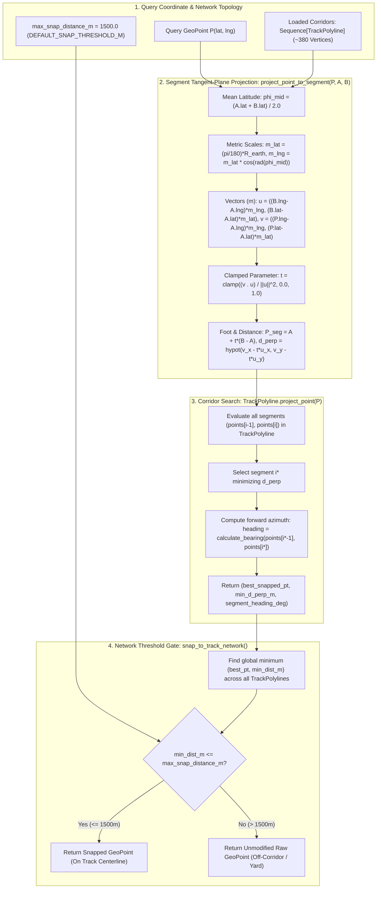

# Implementation Plan — Step 3: Orthogonal Map Snapping (`tui/mock_engine.py`)

> **Parent Plan:** [Implementation Plan — TUI Live Train Telemetry and Vector Track Misalignment During Viewport Zoom](./tui-train-track-misalignment-zoom-fix-plan.md#step-3-add-orthogonal-map-snapping-to-tuimock_enginepy)  
> **Sibling Sub-Plans:** [Step 1: High-Density Topology Enrichment (`tracks.json` & `stations.json`)](./tui-step-1-enrich-tracks-and-stations-plan.md) | [Step 2: Calibrate Conformal Sub-Pixel Aspect Ratio (`tui/geo.py` & `tui/app.py`)](./tui-step-2-conformal-subpixel-aspect-ratio-plan.md)  
> **Issue Reference:** [Issue: Live Train Telemetry and Vector Track Misalignment During Viewport Zoom](../../investigations/tui-train-track-misalignment-zoom-issue.md)  
> **Target File:** [`../../../tui/mock_engine.py`](../../../tui/mock_engine.py)  
> **Test Suite:** [`../../../tests/test_mock_engine.py`](../../../tests/test_mock_engine.py)  
> **Relevant Rules & Skills:** [`../../../.agents/rules/architecture.md`](../../../.agents/rules/architecture.md), [`../../../.agents/rules/terminal-and-rendering-compatibility.md`](../../../.agents/rules/terminal-and-rendering-compatibility.md), [`../../../.agents/rules/diagrams-and-visual-documentation.md`](../../../.agents/rules/diagrams-and-visual-documentation.md), [`../../../.agents/rules/markdown-relative-paths.md`](../../../.agents/rules/markdown-relative-paths.md)

---

## 1. Objective & Engineering Scope

Step 3 implements a deterministic, zero-dependency **tolerance-bounded orthogonal map-matching engine** inside [`../../../tui/mock_engine.py`](../../../tui/mock_engine.py).

Even with the high-density 380-vertex corridor topology introduced in Step 1 ($< 150\text{ m}$ chord deviation) and the conformal sub-pixel aspect ratio calibration from Step 2, live GNSS/HEPOS telemetry coordinates from the Hellenic Railways SSE stream (`https://railway.gov.gr/api/train-stream`) can deviate by $20\text{ m}$–$250\text{ m}$ from the simplified polyline centerline due to multi-track station throats, passing loops, curve chords, or GPS multipath jitter. At high zoom factors (`Zoom: 9.3x` to `25.0x`), where a single sub-pixel spans $\sim 90\text{ m}$, this residual offset can displace a train's projected coordinate off the rasterized Braille track line.

### 1.1 Key Design Goals
1. **Local Tangent-Plane Metric Orthogonal Segment Projection (`project_point_to_segment`):**
   - Project any query `GeoPoint` $P(\phi, \lambda)$ onto a directed geodesic track segment $A(\phi_A, \lambda_A) \to B(\phi_B, \lambda_B)$ using a local Equirectangular tangent-plane metric parameterization scaled at the segment's mean latitude $\bar{\phi} = (\phi_A + \phi_B) / 2$.
   - Return both the clamped orthogonal foot of projection $P_{\text{snap}} \in \overline{AB}$ ($t \in [0, 1]$) and the exact Euclidean perpendicular distance $d_{\perp}$ in meters.
2. **Polyline-Level Minimum-Distance Projection (`TrackPolyline.project_point`):**
   - Evaluate `project_point_to_segment` across all contiguous vertex segments $(P_{i-1}, P_i)$ of a `TrackPolyline`.
   - Return `(snapped_point, perpendicular_distance_m, segment_heading_deg)` corresponding to the closest segment along the corridor.
3. **Network-Wide Tolerance-Bounded Map Snapping (`snap_to_track_network`):**
   - Search across all loaded `TrackPolyline` corridors (`Sequence[TrackPolyline]`) to find the globally nearest track segment to a live train or breadcrumb `GeoPoint`.
   - Support an optional `corridor_hint: Optional[str] = None` parameter and enforce a configurable distance gate `max_snap_distance_m: float = DEFAULT_SNAP_THRESHOLD_M` ($1500.0\text{ m}$).
   - If the minimum perpendicular distance satisfies $d_{\perp} \le \text{max\_snap\_distance\_m}$, return the orthogonal snapped `GeoPoint`; otherwise, return the unmodified raw `GeoPoint` (preserving true positions for off-corridor depot yards, unmapped branch sidings, or outlier telemetry).
4. **Zero-Mutation Domain & Persistence Guarantee:**
   - Map snapping operates strictly on transient `GeoPoint` values for visual canvas rendering. Raw GPS coordinates in `TrainPosition`, `TrainStateStore`, the TUI Inspector pane, and the SQLite `TelemetryRecorder` remain 100% untouched.

---

## 2. Mathematical Formulation & Geometric Proof

### 2.1 Local Equirectangular Tangent-Plane Projection onto a Segment

Given a query point $P(\phi, \lambda)$ and a track segment with endpoints $A(\phi_A, \lambda_A)$ and $B(\phi_B, \lambda_B)$ in degrees:

1. **Local Metric Scale Factors at Mean Segment Latitude $\bar{\phi}$:**
   Let $R_{\oplus} = 6\,371\,000.0\text{ m}$ (`EARTH_RADIUS_M`) and $\bar{\phi} = \frac{\phi_A + \phi_B}{2}$. The local metric conversion factors (meters per degree of latitude and longitude) on the tangent plane at $\bar{\phi}$ are:
   $$m_{\text{lat}} = \frac{\pi}{180} R_{\oplus} \approx 111\,194.93\text{ m/deg}, \qquad m_{\text{lng}} = m_{\text{lat}} \cdot \cos\!\left(\frac{\pi}{180}\bar{\phi}\right)$$

2. **Local Tangent-Plane Vectors (in meters, origin at $A$):**
   Define the segment vector $\vec{u} = \overrightarrow{AB}$ and query offset vector $\vec{v} = \overrightarrow{AP}$ in local Cartesian meters $(x_{\text{east}}, y_{\text{north}})$:
   $$\vec{u} = (u_x, u_y) = \Big((\lambda_B - \lambda_A)\, m_{\text{lng}},\ (\phi_B - \phi_A)\, m_{\text{lat}}\Big)$$
   $$\vec{v} = (v_x, v_y) = \Big((\lambda - \lambda_A)\, m_{\text{lng}},\ (\phi - \phi_A)\, m_{\text{lat}}\Big)$$

3. **Clamped Orthogonal Projection Parameter $t \in [0, 1]$:**
   The squared length of segment $\overline{AB}$ in meters is $\|\vec{u}\|^2 = u_x^2 + u_y^2$.
   - If $\|\vec{u}\|^2 \le 10^{-12}$ (degenerate zero-length segment where $A = B$), set $t = 0.0$.
   - Otherwise, compute the unconstrained orthogonal projection parameter $t_0 = \frac{\vec{v} \cdot \vec{u}}{\|\vec{u}\|^2}$ and clamp it to the closed segment interval $[0, 1]$:
     $$t = \max\!\left(0.0,\ \min\!\left(1.0,\ \frac{v_x u_x + v_y u_y}{u_x^2 + u_y^2}\right)\right)$$

4. **Snapped Geographic Coordinate $P_{\text{snap}}(\phi_{\text{snap}}, \lambda_{\text{snap}})$:**
   Because the tangent-plane transformation from $(\Delta\lambda, \Delta\phi)$ to $(x, y)$ is affine on each segment, linear interpolation in local meters is identical to linear interpolation in $(\phi, \lambda)$:
   $$\phi_{\text{snap}} = \phi_A + t\,(\phi_B - \phi_A), \qquad \lambda_{\text{snap}} = \lambda_A + t\,(\lambda_B - \lambda_A)$$

5. **Perpendicular Euclidean Distance $d_{\perp}$ (in meters):**
   The residual vector from the snapped foot of projection to $P$ is $\vec{r} = \vec{v} - t\vec{u} = (v_x - t u_x,\ v_y - t u_y)$, yielding:
   $$d_{\perp} = \|\vec{v} - t\vec{u}\|_2 = \sqrt{(v_x - t u_x)^2 + (v_y - t u_y)^2}$$

### 2.2 Computational Complexity & 15 FPS Frame Budget Analysis
- Across all 8 corridors in [`../../../tui/data/tracks.json`](../../../tui/data/tracks.json), there are $N_{\text{vertices}} = 380$ vertices ($N_{\text{segments}} = 372$ segments).
- Each call to `project_point_to_segment` uses basic floating-point arithmetic plus one `math.cos` and one `math.hypot` ($\sim 0.35\ \mu\text{s}$ in CPython).
- A full network scan across all 372 segments takes $\sim 0.13\text{ ms}$ per train ($\sim 1.5\text{ ms}$ for 12 active trains), consuming **$< 2.3\%$** of the $66.7\text{ ms}$ (15 FPS) frame budget.

---

### 2.3 Visual Architecture (ASCII & Mermaid)

#### ASCII Diagram: Local Tangent-Plane Orthogonal Projection & Distance Threshold Gate

```text
+---------------------------------------------------------------------------------------------------+
 CASE 1: INTERIOR ORTHOGONAL PROJECTION (0 < t < 1, d_perp <= 1500.0 m -> SNAPPED)
+---------------------------------------------------------------------------------------------------+

                       Raw Live GPS Telemetry: P(lat, lng)
                                      *
                                     /|
                                    / |
                        vec_v      /  |  d_perp = ||vec_v - t * vec_u||_2
                      (meters)    /   |  (e.g., 42.8 m <= 1500.0 m threshold)
                                 /    |
                                /  90°|
      Segment Start            /------+-----------------------> Segment End
      A(lat_A, lng_A) ========o=======*======================== B(lat_B, lng_A)
                              |<----->|
                               t * vec_u
                                      ^
                                      |-- P_snap = A + t * (B - A)
                                          (Returned for BrailleCanvas projection)

+---------------------------------------------------------------------------------------------------+
 CASE 2: ENDPOINT CLAMPING (t <= 0 or t >= 1) & OFF-CORRIDOR REJECTION (d_perp > 1500.0 m)
+---------------------------------------------------------------------------------------------------+

   * P_before (t < 0 clamped to t = 0.0 -> P_snap = A)          * P_off_network (d_perp = 8,400 m)
    \                                                           |
     \ d_perp = ||vec_v||_2                                     | d_perp > 1500.0 m (Threshold Gate)
      v                                                         v
      A ============================= B                         Returns Raw P_off_network Unmodified!
```

#### Mermaid Flowchart: Orthogonal Map-Matching Pipeline in `tui/mock_engine.py`



---

## 3. Detailed Code Specifications for [`../../../tui/mock_engine.py`](../../../tui/mock_engine.py)

### 3.1 Typing & Constant Additions
1. In [`../../../tui/mock_engine.py`](../../../tui/mock_engine.py#L18), add `Sequence` to the `typing` imports:
   ```python
   from typing import Dict, Generator, List, Optional, Sequence, Tuple
   ```
2. Define the default snapping threshold constant below `EARTH_RADIUS_M` ([`../../../tui/mock_engine.py`](../../../tui/mock_engine.py#L24)):
   ```python
   # Earth radius in meters (WGS84 mean radius)
   EARTH_RADIUS_M = 6371000.0

   # Default maximum orthogonal snapping distance in meters for visual map-matching
   DEFAULT_SNAP_THRESHOLD_M = 1500.0
   ```

### 3.2 `project_point_to_segment()` Function
Add `project_point_to_segment()` right after `calculate_bearing()` ([`../../../tui/mock_engine.py`](../../../tui/mock_engine.py#L68)):

```python
def project_point_to_segment(
    point: GeoPoint, p0: GeoPoint, p1: GeoPoint
) -> Tuple[GeoPoint, float]:
    """Orthogonally project a geographic point onto a line segment [p0, p1].

    Uses a local Equirectangular tangent-plane approximation scaled at the
    segment's mean latitude to compute the clamped projection parameter
    t in [0.0, 1.0], the interpolated GeoPoint on [p0, p1], and the
    perpendicular distance in meters.

    Args:
        point: Query geographic coordinate (lat, lng).
        p0: Segment start coordinate (lat, lng).
        p1: Segment end coordinate (lat, lng).

    Returns:
        Tuple of (snapped_geopoint, perpendicular_distance_m).
    """
    mean_lat_rad = math.radians((p0.lat + p1.lat) * 0.5)
    m_per_deg_lat = (math.pi / 180.0) * EARTH_RADIUS_M
    m_per_deg_lng = m_per_deg_lat * math.cos(mean_lat_rad)

    ux = (p1.lng - p0.lng) * m_per_deg_lng
    uy = (p1.lat - p0.lat) * m_per_deg_lat

    vx = (point.lng - p0.lng) * m_per_deg_lng
    vy = (point.lat - p0.lat) * m_per_deg_lat

    seg_len_sq = ux * ux + uy * uy
    if seg_len_sq <= 1e-12:
        return p0, math.hypot(vx, vy)

    t = (vx * ux + vy * uy) / seg_len_sq
    t = max(0.0, min(1.0, t))

    snapped_lat = p0.lat + t * (p1.lat - p0.lat)
    snapped_lng = p0.lng + t * (p1.lng - p0.lng)

    dx = vx - t * ux
    dy = vy - t * uy
    perp_dist_m = math.hypot(dx, dy)

    return GeoPoint(lat=snapped_lat, lng=snapped_lng), perp_dist_m
```

### 3.3 `TrackPolyline.project_point()` Method
Add `project_point()` to [`TrackPolyline`](../../../tui/mock_engine.py#L96-L180) directly below `interpolate_at_distance()`:

```python
    def project_point(self, point: GeoPoint) -> Tuple[GeoPoint, float, float]:
        """Project a geographic coordinate onto the closest segment of this polyline.

        Args:
            point: Query GeoPoint (lat, lng) to project onto the track.

        Returns:
            Tuple of (snapped_point, perpendicular_distance_m, segment_heading_deg).
        """
        best_point = self.points[0]
        best_dist_m = float("inf")
        best_heading = (
            calculate_bearing(self.points[0], self.points[1])
            if len(self.points) > 1
            else 0.0
        )

        for i in range(1, len(self.points)):
            p0 = self.points[i - 1]
            p1 = self.points[i]
            snapped_pt, dist_m = project_point_to_segment(point, p0, p1)
            if dist_m < best_dist_m:
                best_dist_m = dist_m
                best_point = snapped_pt
                best_heading = calculate_bearing(p0, p1)

        return best_point, best_dist_m, best_heading
```

### 3.4 `snap_to_track_network()` Function
Add `snap_to_track_network()` right after `TrackPolyline` (before `load_stations()` at [`../../../tui/mock_engine.py`](../../../tui/mock_engine.py#L182)):

```python
def snap_to_track_network(
    point: GeoPoint,
    tracks: Sequence[TrackPolyline],
    corridor_hint: Optional[str] = None,
    max_snap_distance_m: float = DEFAULT_SNAP_THRESHOLD_M,
) -> GeoPoint:
    """Snap a geographic coordinate to the nearest track polyline if within threshold.

    Evaluates orthogonal projection across the provided track polylines and returns
    the snapped centerline coordinate if the minimum perpendicular distance is within
    max_snap_distance_m. If no track segment lies within the threshold (or tracks is
    empty), returns the original GeoPoint unmodified.

    Args:
        point: Raw geographic coordinate (lat, lng).
        tracks: Sequence of available TrackPolyline corridors.
        corridor_hint: Optional corridor ID or name hint. Even when provided, all
            tracks are checked if the hinted corridor is not an exact ID match or if
            a closer shared-trunk segment exists within threshold.
        max_snap_distance_m: Maximum perpendicular distance in meters allowed for
            snapping (defaults to 1500.0m).

    Returns:
        Snapped GeoPoint on the nearest track segment, or unmodified point.
    """
    if not tracks or max_snap_distance_m < 0.0:
        return point

    best_point = point
    best_dist_m = float("inf")

    if corridor_hint:
        hint_lower = corridor_hint.strip().lower()
        hinted_tracks = [
            t
            for t in tracks
            if t.corridor_id.lower() == hint_lower or hint_lower in t.corridor_id.lower()
        ]
        for track in hinted_tracks:
            snapped_pt, dist_m, _ = track.project_point(point)
            if dist_m < best_dist_m:
                best_dist_m = dist_m
                best_point = snapped_pt
        # If the hinted corridor snapped cleanly within threshold, return early
        if best_dist_m <= max_snap_distance_m:
            return best_point

    for track in tracks:
        snapped_pt, dist_m, _ = track.project_point(point)
        if dist_m < best_dist_m:
            best_dist_m = dist_m
            best_point = snapped_pt

    if best_dist_m <= max_snap_distance_m:
        return best_point
    return point
```

---

## 4. Unit Test Specification ([`../../../tests/test_mock_engine.py`](../../../tests/test_mock_engine.py))

Add the following unit tests to `TestGeodesicMath` in [`../../../tests/test_mock_engine.py`](../../../tests/test_mock_engine.py#L160-L220):

1. **`test_project_point_to_segment_orthogonal_and_clamped_endpoints`:**
   - Construct an east-west track segment at $\phi = 38.0^\circ\text{N}$ from $A(38.0, 23.0)$ to $B(38.0, 23.1)$.
   - **Interior point ($0 < t < 1$):** Query a point $P_{\text{mid}}(38.0045, 23.05)$ located $\Delta\phi = +0.0045^\circ$ ($\approx 500.4\text{ m}$) due north of the segment midpoint. Verify `snapped_pt.lat == 38.0`, `snapped_pt.lng == 23.05`, and $d_{\perp} \approx 500.4\text{ m}$ ($\pm 2.0\text{ m}$).
   - **Clamped before start ($t = 0.0$):** Query $P_{\text{west}}(38.0, 22.95)$ west of $A$. Verify `snapped_pt == A`.
   - **Clamped past end ($t = 1.0$):** Query $P_{\text{east}}(38.0, 23.15)$ east of $B$. Verify `snapped_pt == B`.
   - **Degenerate zero-length segment ($A = B$):** Verify `project_point_to_segment(P, A, A)` returns `A` and the distance from `A` to `P` without division by zero.

2. **`test_track_polyline_project_point_and_snap_to_network`:**
   - Load real corridors via `load_tracks()` and extract `pathe = tracks["pathe-mainline"]`.
   - **Case Study A (Eleonas live GPS offset by $\sim 350\text{ m}$):** Take a point offset $\Delta\phi = +0.003^\circ$ ($\sim 334\text{ m}$) from Eleonas (`38.3747°N, 23.4635°E`).
     - Verify `pathe.project_point(offset_pt)` returns `perp_dist_m` within $[300\text{ m}, 360\text{ m}]$ and a snapped point whose distance to the polyline is $< 0.01\text{ m}$.
     - Verify `snap_to_track_network(offset_pt, list(tracks.values()))` returns the snapped point on the `pathe-mainline` centerline.
   - **Threshold preservation ($d_{\perp} > 1500\text{ m}$):** Take an off-corridor coordinate $10\text{ km}$ away in the Aegean Sea (`38.30°N, 24.20°E`).
     - Verify `snap_to_track_network(far_pt, list(tracks.values()), max_snap_distance_m=1500.0)` returns `far_pt` completely unmodified.
   - **Corridor hint resolution:** Verify `snap_to_track_network(offset_pt, list(tracks.values()), corridor_hint="PATHE")` snaps accurately to `pathe-mainline`.

---

## 5. Execution & Verification Checklist for Step 3

```bash
# 1. Run topology, geodesic math, and map snapping unit tests
python -m unittest tests/test_mock_engine.py -v

# 2. Run full TUI test suite to confirm zero regressions
python -m unittest tests/test_tui_geo.py tests/test_mock_engine.py tests/test_tui_renderer.py tests/test_tui_controls.py -v

# 3. Run strict static type checking, flake8 linting, and black formatting verification
mypy --strict tui/mock_engine.py
flake8 tui/mock_engine.py tests/test_mock_engine.py
black --check tui/mock_engine.py tests/test_mock_engine.py
```
