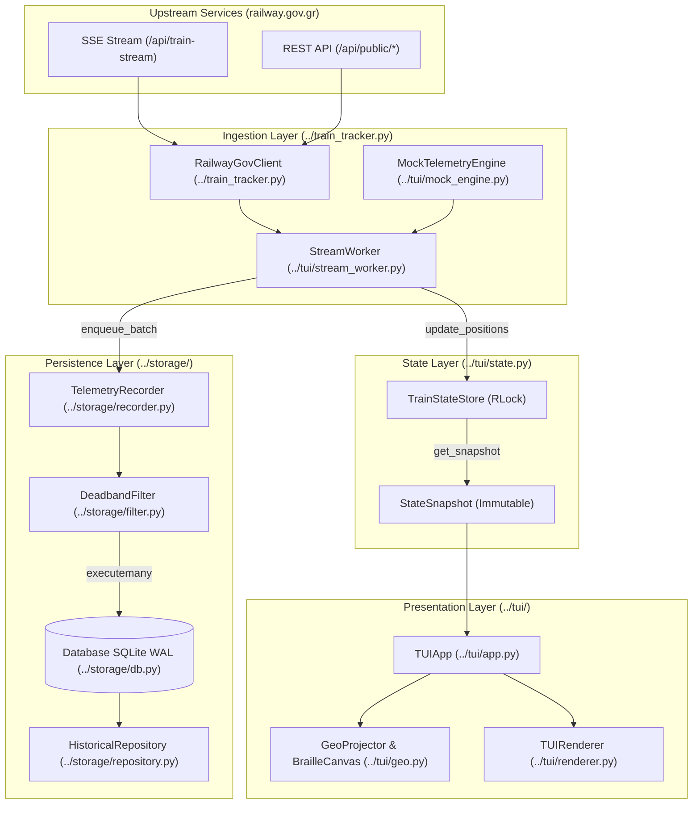
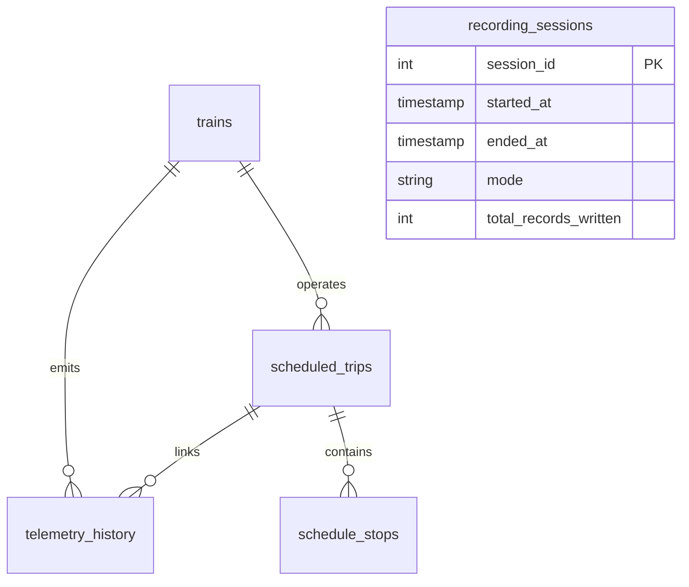

# Production Readiness & Architecture Review: `railmon`

> **System:** `railmon` (`railway.gov.gr` Terminal Train Tracker & Telemetry Recorder)  
> **Date:** 2026-11-18  
> **Verdict:** **NOT READY** for unattended production deployment (0 P0 blockers, 0 P1 deficiencies, 5 P2 compliance gaps)

---

## 1. Executive Summary & Scorecard

`railmon` comprises an HTTP/SSE client ([`../train_tracker.py`](../train_tracker.py)), a curses Braille geospatial TUI ([`../tui/`](../tui/)), and a SQLite WAL time-series recorder ([`../storage/`](../storage/)). Interactive simulation (`--demo`) and unit tests (237/237 passing) function as designed, but the background daemon, SQLite connection lifecycle, analytical SQL engine, and terminal fallback layers violate critical repository rules in [`../.agents/rules/`](../.agents/rules/).

```text
+-----------------------------------+--------+----------------------------------------------+
| Dimension                         | Score  | Status & Primary Finding                     |
+-----------------------------------+--------+----------------------------------------------+
| Geospatial Math & Braille Canvas  | 10/10  | P1-7 resolved; full ASCII fallback table     |
| Test Suite & Empirical Benchmarks |  8/10  | 237 tests pass; 31.6k rows/s @ batch=100     |
| Threading & State Store           | 10/10  | P2-1 resolved; prune_stale wired & deadband TTL|
| SQLite Connection & Transactions  | 10/10  | P0-5 & P1-2 fixed; user_version & integrity  |
| Analytical Query Engine           |  9/10  | Dwell query remediated (window islands)      |
| Resilience & Stream Handling      | 10/10  | P0-2, P1-5 & P1-6 fixed; TTY fallback sound  |
| Daemon Lifecycle & Signals        |  9/10  | P0-3 & P0-4 fixed; SIGTERM & TUI pause wired |
| Security & Data Protection        |  9/10  | P1-1 & P1-3 fixed; 0600 umask & path safe    |
| Observability & Logging           | 10/10  | P1-8 resolved; railmon hierarchy & rotation  |
| Storage Retention & Disk Bounds   |  9/10  | P0-6 fixed; archival & disk_usage check      |
| Packaging & Versioning            | 10/10  | P1-9 resolved; pyproject.toml & __version__  |
+-----------------------------------+--------+----------------------------------------------+
```

### Empirical Verification Metrics

| Gate / Benchmark | Result | Reference Target | Status |
|---|---|---|---|
| Unit & Integration Suite | `334 passed in 33.7s` | 100% pass | PASS |
| Write Throughput (`batch_size=100`) | `31,602.0 rows/sec` (`376.0 B/row`) | $\ge 5,000\text{ rows/sec}$ | PASS |
| Deadband Compression Ratio | `49.17%` (`600 -> 10` stationary) | $\ge 40\%$ total, $\ge 85\%$ stationary | PASS (`98.3%` stationary suppression) |
| Read Latency (`get_train_history`) | `mean 5.19 ms`, `p95 8.30 ms` | `mean <= 10 ms`, `p95 <= 20 ms` | PASS |
| Read Latency (`get_corridor_punctuality`) | `mean 3.03 ms`, `p95 4.61 ms` | `mean <= 15 ms`, `p95 <= 30 ms` | PASS |
| Security SQL Injection Scan | 0 matches ([`../storage/db.py`](../storage/db.py#L143-L162)) | 0 matches | PASS |

---

## 2. System Architecture & Data Flow

### A. Component Topology (ASCII)

```text
+-----------------------------------------------------------------------------------+
|                        Upstream: railway.gov.gr Services                          |
|             SSE (/api/train-stream)           REST (/api/public/*)                |
+-----------------------------------------------------------------------------------+
                         |                                |
                         v                                v
+-----------------------------------------------------------------------------------+
|                     Ingestion Layer (../train_tracker.py)                         |
|  +-----------------------------------+   +-------------------------------------+  |
|  |         RailwayGovClient          |   |        MockTelemetryEngine          |  |
|  |       (../train_tracker.py)       |   |        (../tui/mock_engine.py)      |  |
|  +-----------------------------------+   +-------------------------------------+  |
|                         \                               /                         |
|                          v                             v                          |
|                    +-----------------------------------------+                    |
|                    |        StreamWorker (Daemon Thread)     |                    |
|                    |          (../tui/stream_worker.py)      |                    |
|                    +-----------------------------------------+                    |
+-----------------------------------------------------------------------------------+
                         |                                |
        update_positions |                                | enqueue_batch (nowait)
                         v                                v
+-----------------------------------------+    +------------------------------------+
|       State Layer (../tui/state.py)     |    |  Persistence Layer (../storage/)   |
|  +-----------------------------------+  |    |  +------------------------------+  |
|  |     TrainStateStore (RLock)       |  |    |  | TelemetryRecorder (Thread)   |  |
|  +-----------------------------------+  |    |  |   (../storage/recorder.py)   |  |
|                    |                    |    |  +------------------------------+  |
|       get_snapshot v                    |    |                 |                  |
|  +-----------------------------------+  |    |                 v                  |
|  |     StateSnapshot (Immutable)     |  |    |  +------------------------------+  |
|  +-----------------------------------+  |    |  | DeadbandFilter (15m / 60s)   |  |
+-----------------------------------------+    |  |   (../storage/filter.py)     |  |
                     |                         |  +------------------------------+  |
                     v                         |                 |                  |
+-----------------------------------------+    |      executemany v                 |
|      Presentation Layer (../tui/)       |    |  +------------------------------+  |
|  +-----------------------------------+  |    |  |   Database (SQLite3 WAL)     |  |
|  |      TUIApp (../tui/app.py)       |  |    |  |     (../storage/db.py)       |  |
|  |  GeoProjector (../tui/geo.py)     |  |    |  +------------------------------+  |
|  |  TUIRenderer (../tui/renderer.py) |  |    |                 |                  |
|  +-----------------------------------+  |    |                 v                  |
+-----------------------------------------+    |  +------------------------------+  |
                                               |  |    HistoricalRepository      |  |
                                               |  |  (../storage/repository.py)  |  |
                                               |  +------------------------------+  |
                                               +------------------------------------+
```

### B. Component Topology (Mermaid)



### C. Storage Entity-Relationship Model

```text
+------------------+       1:N       +--------------------+
|      trains      | --------------> |  scheduled_trips   |
| (train_number PK)|                 |  (schedule_id PK)  |
+------------------+                 +--------------------+
         |                                    |        |
         | 1:N                            1:N |        | 1:N
         v                                    v        v
+-----------------------------------------------+    +--------------------+
|               telemetry_history               |    |   schedule_stops   |
| (id PK, train_number FK, schedule_id FK, ...) |    |      (id PK)       |
+-----------------------------------------------+    +--------------------+
```



---

## 3. Critical Production Blockers (P0)

### P0-1: Station Dwell Query Collapses Multi-Trip Stops [RESOLVED]

- **Location:** [`HistoricalRepository.get_station_dwell_times`](../storage/repository.py#L301-L398) | **Plan:** [`./p0-1-station-dwell-multi-trip-fix-plan.md`](./p0-1-station-dwell-multi-trip-fix-plan.md)
- **Root Cause:** The CTE filters `speed <= ?` and groups exclusively by `GROUP BY next_station` ([`../storage/repository.py`](../storage/repository.py#L327)). It lacks contiguous sequence partitioning (islands-and-gaps) or trip partitioning. Every stop by the same `train_number` at the same station across multiple days collapses into a single aggregate group where `MIN(recorded_at)` is day 1 arrival and `MAX(recorded_at)` is day $N$ departure, inflating `dwell_seconds` to $>86,400\text{ s}$. Additionally, the correlated subqueries at [`../storage/repository.py`](../storage/repository.py#L336-L339) match `(train_number, recorded_at)` without constraining `next_station`.
- **Fix:** Partition contiguous stationary frames into discrete islands using `LAG()` state/gap detection and `FIRST_VALUE()` window functions:

```sql
WITH annotated AS (
    SELECT
        id,
        train_number,
        schedule_id,
        next_station AS station_name,
        recorded_at,
        COALESCE(delay_min, 0) AS delay_min,
        CASE WHEN speed <= ? AND next_station IS NOT NULL THEN 1 ELSE 0 END AS is_stopped,
        LAG(CASE WHEN speed <= ? AND next_station IS NOT NULL THEN 1 ELSE 0 END, 1, 0)
            OVER (ORDER BY recorded_at ASC, id ASC) AS prev_stopped,
        LAG(next_station) OVER (ORDER BY recorded_at ASC, id ASC) AS prev_station,
        LAG(schedule_id) OVER (ORDER BY recorded_at ASC, id ASC) AS prev_schedule,
        LAG(recorded_at) OVER (ORDER BY recorded_at ASC, id ASC) AS prev_recorded_at
    FROM telemetry_history
    WHERE train_number = ?
      AND (? IS NULL OR recorded_at >= ?)
      AND (? IS NULL OR recorded_at <= ?)
),
islands AS (
    SELECT
        id,
        train_number,
        station_name,
        recorded_at,
        delay_min,
        SUM(
            CASE
                WHEN prev_stopped = 0
                  OR prev_station IS NOT station_name
                  OR COALESCE(prev_schedule, '') != COALESCE(schedule_id, '')
                  OR (JULIANDAY(recorded_at) - JULIANDAY(prev_recorded_at)) * 86400.0 > 1800.0
                THEN 1
                ELSE 0
            END
        ) OVER (ORDER BY recorded_at ASC, id ASC) AS island_id
    FROM annotated
    WHERE is_stopped = 1
),
island_delays AS (
    SELECT
        train_number,
        station_name,
        recorded_at,
        island_id,
        FIRST_VALUE(delay_min) OVER (
            PARTITION BY island_id ORDER BY recorded_at ASC, id ASC
        ) AS arrival_delay_min,
        FIRST_VALUE(delay_min) OVER (
            PARTITION BY island_id ORDER BY recorded_at DESC, id DESC
        ) AS departure_delay_min
    FROM islands
)
SELECT
    train_number,
    station_name,
    MIN(recorded_at) AS arrival_time,
    MAX(recorded_at) AS departure_time,
    CAST(ROUND((JULIANDAY(MAX(recorded_at)) - JULIANDAY(MIN(recorded_at))) * 86400.0) AS INTEGER) AS dwell_seconds,
    MIN(arrival_delay_min) AS arrival_delay_min,
    MIN(departure_delay_min) AS departure_delay_min
FROM island_delays
GROUP BY train_number, station_name, island_id
HAVING dwell_seconds >= ?
ORDER BY arrival_time ASC;
```

---

### P0-2: SSE Exception Swallowing, Curses Buffer Corruption & Blocking Shutdown [RESOLVED]

- **Location:** [`RailwayGovClient.stream_train_positions`](../train_tracker.py#L141-L220) and [`StreamWorker._run_loop`](../tui/stream_worker.py#L85-L154) | **Plan:** [`./p0-2-sse-exception-curses-shutdown-fix-plan.md`](./p0-2-sse-exception-curses-shutdown-fix-plan.md)
- **Root Cause:** `stream_train_positions()` wraps its infinite loop in `except (urllib.error.URLError, TimeoutError)` ([`../train_tracker.py`](../train_tracker.py#L185-L187)), prints directly to `sys.stdout`, and sleeps for `reconnect_delay`.

```text
Current Broken Failure Sequence:
RailwayGovClient                sys.stdout (Curses TUI)             StreamWorker
       |                                  |                              |
       |-- URLError / TimeoutError ------>|                              |
       |-- print("[Stream Warning]...") ->| (Corrupts Curses Screen)     |
       |-- time.sleep(3.0) -------------->|                              | (Never notified;
       |                                  |                              |  status stays CONNECTED;
       |                                  |                              |  backoff bypassed)
```

```mermaid
sequenceDiagram
    autonumber
    participant C as RailwayGovClient (../train_tracker.py)
    participant T as Terminal / Curses Buffer
    participant W as StreamWorker (../tui/stream_worker.py)
    C->>C: urlopen(/api/train-stream) raises URLError
    C->>T: print("[Stream Warning]...") (Corrupts TUI)
    C->>C: time.sleep(reconnect_delay) (Blocks stop_event)
    Note over W: Never receives exception; status stuck on CONNECTED
```

- **Impact:**
  1. **TUI Corruption:** Violates [`../.agents/rules/logging-and-observability.md`](../.agents/rules/logging-and-observability.md#L5-L8). Raw `print()` overwrites curses windows.
  2. **Dead Reconnection Engine:** `StreamWorker` never enters its `except Exception:` block ([`../tui/stream_worker.py`](../tui/stream_worker.py#L120)), never updates `ConnectionStatus.RECONNECTING`, and never applies exponential backoff with jitter.
  3. **Uninterruptible Read/Sleep:** `stream_train_positions()` lacks a `stop_event` parameter, blocking shutdown for up to 30s (`urlopen` timeout).
- **Fix:** Remove the `while True` catch-and-print loop from `RailwayGovClient.stream_train_positions()` so a single stream attempt yields batches and raises connection errors directly to `StreamWorker` (or accepts an optional `stop_event: threading.Event` and uses `logger.warning`).

---

### P0-3: Missing `SIGTERM` / `SIGHUP` Handlers & Uncheckpointed WAL Teardown [RESOLVED]

- **Location:** [`run_record_mode`](../train_tracker.py#L516-L626), [`run_plain_stream_mode`](../train_tracker.py#L432-L514), [`TelemetryRecorder.stop`](../storage/recorder.py#L108-L145) | **Plan:** [`./p0-3-sigterm-sighup-wal-teardown-fix-plan.md`](./p0-3-sigterm-sighup-wal-teardown-fix-plan.md)
- **Root Cause:** `signal` is imported at [`../train_tracker.py`](../train_tracker.py#L10) and [`../tui/app.py`](../tui/app.py#L12) but never bound. Process termination via `SIGTERM` (Docker, `systemd`, Kubernetes) kills the interpreter immediately without running `finally:` blocks. Furthermore, `TelemetryRecorder.stop()` never invokes `self.db.checkpoint_wal("TRUNCATE")`.
- **Impact:** Queued frames in `TelemetryRecorder._queue` are lost, `recording_sessions.ended_at` stays `NULL`, and `-wal` files remain unmerged on shutdown.
- **Fix:** Bind `SIGINT`, `SIGTERM`, and `SIGHUP` (on POSIX) to set a shared `stop_event: threading.Event` per [`../.agents/rules/lifecycle-and-signal-handling.md`](../.agents/rules/lifecycle-and-signal-handling.md#L10-L18), and invoke `self.db.checkpoint_wal("TRUNCATE")` at the end of `TelemetryRecorder.stop()`.

---

### P0-4: TUI Pause Control Fails to Pause `StreamWorker` [RESOLVED]

- **Location:** [`TUIApp.toggle_pause`](../tui/app.py#L269-L277) vs [`StreamWorker.pause`](../tui/stream_worker.py#L75-L88) | **Plan:** [`./p0-4-tui-pause-stream-worker-fix-plan.md`](./p0-4-tui-pause-stream-worker-fix-plan.md)
- **Root Cause:** `TUIApp.toggle_pause()` toggles `self.paused` and sets `store.set_connection_status(ConnectionStatus.PAUSED, ...)`, but never calls `self.worker.pause()` or `self.worker.resume()`.
- **Impact:** While paused in the UI, `StreamWorker` continues consuming the SSE stream, mutating `TrainStateStore`, resetting `ConnectionStatus` back to `CONNECTED` on reconnects, and writing batches to `TelemetryRecorder`.
- **Fix:** Invoke `self.worker.pause()` when `self.paused` is `True`, and `self.worker.resume()` when `False`.

---

### P0-5: Per-Transaction SQLite Connection Churn & Cross-Thread `:memory:` Sharing [RESOLVED]

- **Location:** [`Database._create_connection`](../storage/db.py#L60-L87), [`Database.connection`](../storage/db.py#L101-L111), [`Database.transaction`](../storage/db.py#L113-L132) | **Plan:** [`./p0-5-sqlite-connection-churn-memory-sharing-fix-plan.md`](./p0-5-sqlite-connection-churn-memory-sharing-fix-plan.md)
- **Root Cause:**
  1. For file databases, `Database.connection()` opens a new `sqlite3.Connection`, executes 5 `PRAGMA` statements (including `PRAGMA cache_size = -64000`), yields it for a single query or batch flush, and calls `conn.close()`. Closing the connection after every transaction destroys the 64 MB page cache and incurs repeated file-open/WAL-header parsing overhead.
  2. `Database._create_connection()` does not execute `PRAGMA busy_timeout = 5000;` and `Database.transaction()` uses deferred transactions (`with conn:`) instead of `BEGIN IMMEDIATE`, violating [`../.agents/rules/concurrency-and-sqlite.md`](../.agents/rules/concurrency-and-sqlite.md#L14-L27).
  3. For `:memory:` databases, `self._shared_memory_conn` is created on the initializing thread without `check_same_thread=False` or mutex serialization, causing `sqlite3.ProgrammingError` if accessed by `TelemetryRecorderThread`.
- **Fix:** Scope persistent connections per thread via `threading.local()` (closed cleanly on `Database.close()`), add `PRAGMA busy_timeout = 5000;`, and issue `BEGIN IMMEDIATE` in write transactions.

---

### P0-6: Unbounded Storage Growth & Missing Disk-Full Circuit Breaker [RESOLVED]

- **Location:** [`../storage/recorder.py`](../storage/recorder.py), [`../storage/repository.py`](../storage/repository.py), [`../train_tracker.py`](../train_tracker.py#L274-L285) | **Plan:** [`./p0-6-unbounded-storage-disk-circuit-breaker-fix-plan.md`](./p0-6-unbounded-storage-disk-circuit-breaker-fix-plan.md)
- **Root Cause:** Violates [`../.agents/rules/resilience-and-fallbacks.md`](../.agents/rules/resilience-and-fallbacks.md#L26-L29). No `--retention-days` option, no zero-data-loss historical row archival routine, and no `shutil.disk_usage()` check exist before batch commits.
- **Fix:**
  1. Check `shutil.disk_usage(parent_dir).free < 100 * 1024 * 1024` inside `TelemetryRecorder._flush_buffer()`; if below 100 MB, log `CRITICAL` and halt recording.
  2. Add `HistoricalRepository.archive_before(cutoff_iso: str, archive_path: Optional[str] = None) -> int` to move aged telemetry and parent metadata into an archive SQLite database before evicting from the hot database, and expose `--retention-days` / `--archive-db` on `railmon record`.

---

## 4. High-Priority Architecture & Security Deficiencies (P1)

### P1-1: Unparameterized f-String in `PRAGMA wal_checkpoint` [RESOLVED]
- **Location:** [`Database.checkpoint_wal`](../storage/db.py#L143-L162) | **Plan:** [`./p1-1-pragma-wal-checkpoint-allowlist-fix-plan.md`](./p1-1-pragma-wal-checkpoint-allowlist-fix-plan.md)
- **Issue:** `cursor.execute(f"PRAGMA wal_checkpoint({mode});")` interpolated `mode` without allowlist validation, failing the security audit scan ([`../.agents/skills/security-audit/SKILL.md`](../.agents/skills/security-audit/SKILL.md#L38)) and [`../.agents/rules/security-and-data-protection.md`](../.agents/rules/security-and-data-protection.md#L10-L12).
- **Fix:** Validate `mode.strip().upper() in {"PASSIVE", "FULL", "RESTART", "TRUNCATE"}` (raising `ValueError` on invalid modes) and dispatch via static SQL literals in `_WAL_CHECKPOINT_SQL`.

### P1-2: Missing `PRAGMA user_version` & Startup Integrity Check [RESOLVED]
- **Location:** [`SchemaManager`](../storage/schema.py#L112-L229) | **Plan:** [`./p1-2-pragma-user-version-startup-integrity-fix-plan.md`](./p1-2-pragma-user-version-startup-integrity-fix-plan.md)
- **Issue:** Schema versioning uses only `schema_migrations` without updating `PRAGMA user_version`, and `SchemaManager.verify_integrity()` is never called on startup, violating [`../.agents/rules/concurrency-and-sqlite.md`](../.agents/rules/concurrency-and-sqlite.md#L29-L32) and [`../.agents/rules/release-and-versioning.md`](../.agents/rules/release-and-versioning.md#L20-L25).
- **Fix:** Set `PRAGMA user_version = 1` inside the migration transaction and run `PRAGMA integrity_check` on initialization.

### P1-3: Missing POSIX `0600` Database Permissions & Export Path Sanitization [RESOLVED]
- **Location:** [`Database._create_connection`](../storage/db.py#L55-L66), [`HistoricalRepository.export_csv`](../storage/repository.py#L455-L483), [`run_history_mode`](../train_tracker.py#L714-L753) | **Plan:** [`./p1-3-db-permissions-export-path-sanitization-fix-plan.md`](./p1-3-db-permissions-export-path-sanitization-fix-plan.md)
- **Issue:** Violates [`../.agents/rules/security-and-data-protection.md`](../.agents/rules/security-and-data-protection.md#L14-L28):
  1. SQLite database files are created with default umask (`0644`) instead of owner-only `0600` (`os.umask(0o077)` or `os.chmod(db_path, 0o600)`).
  2. `--out` export paths are not checked for directory traversal (`..`) or existing writable parent directories (`os.makedirs` is called arbitrarily on any target path).
- **Fix:** Wrap database connection and parent directory creation in `os.umask(0o077)` and apply `os.chmod(target, 0o600)` to the database and WAL/SHM companion files on POSIX systems via `Database._ensure_secure_permissions()`. Implement `validate_export_path()` in [`../storage/repository.py`](../storage/repository.py) to reject directory traversal (`..`), verify parent directory existence and writability (`os.access(W_OK)`), and disallow arbitrary recursive directory creation before writing export files. Wire validation into `HistoricalRepository.export_csv()`, `HistoricalRepository.resolve_archive_path()`, and `run_history_mode()`.

### P1-4: Missing Coordinate Bounds Validation & Defensive Payload Parsing [RESOLVED]
- **Location:** [`TrainPosition.from_dict`](../train_tracker.py#L205-L265), [`RailwayGovClient.stream_train_positions`](../train_tracker.py#L380-L415), [`RailwayGovClient.__init__`](../train_tracker.py#L268-L271) | **Plan:** [`./p1-4-coordinate-bounds-defensive-parsing-fix-plan.md`](./p1-4-coordinate-bounds-defensive-parsing-fix-plan.md)
- **Issue:** Violates [`../.agents/rules/compliance.md`](../.agents/rules/compliance.md#L10-L12) and [`../.agents/rules/verification-checklist.md`](../.agents/rules/verification-checklist.md#L34-L38):
  1. `if p.get("lat") and p.get("lng")` rejects `0.0` via truthiness and fails to enforce `-90.0 <= lat <= 90.0` and `-180.0 <= lng <= 180.0`.
  2. `float(data.get("speed") or 0.0)` and `int(data.get("delay") or 0)` are not guarded against `(ValueError, TypeError)` if upstream emits malformed non-numeric values.
  3. `RailwayGovClient.__init__` ([`../train_tracker.py`](../train_tracker.py#L268-L271)) does not restrict `base_url` to `https://railway.gov.gr` (SSRF protection rule in [`../.agents/rules/security-and-data-protection.md`](../.agents/rules/security-and-data-protection.md#L8)).
- **Fix:** Enforce WGS84 coordinate bounds validation (`-90.0 <= lat <= 90.0`, `-180.0 <= lng <= 180.0`, `not math.isnan`, `not math.isinf`) in `TrainPosition.from_dict`, raising `ValueError` on out-of-bounds, non-numeric, or missing coordinates while preserving valid `(0.0, 0.0)` references. Introduce safe numeric and string coercion helpers (`_safe_float`, `_safe_int`, `_safe_optional_*`) to prevent unhandled `(ValueError, TypeError)` exceptions on malformed upstream values. Implement SSRF domain and scheme allowlisting via `validate_base_url()` in `RailwayGovClient.__init__`, strictly restricting `base_url` to secure HTTPS on `railway.gov.gr` and port 443. Harden `RailwayGovClient.stream_train_positions` with per-record fault isolation to skip malformed items and log at `DEBUG` without terminating the SSE generator.

### P1-5: Unhandled HTTP 429 (`Retry-After`) & 5xx Errors in REST / SSE Client [RESOLVED]
- **Location:** [`RailwayGovClient._get`](../train_tracker.py#L338-L415), [`RailwayGovClient.stream_train_positions`](../train_tracker.py#L461-L570), [`StreamWorker`](../tui/stream_worker.py#L90-L165), [`run_schedules_mode`](../train_tracker.py#L1310-L1335) | **Plan:** [`./p1-5-http-429-retry-after-5xx-resilience-fix-plan.md`](./p1-5-http-429-retry-after-5xx-resilience-fix-plan.md)
- **Issue:** Violates [`../.agents/rules/resilience-and-fallbacks.md`](../.agents/rules/resilience-and-fallbacks.md#L23). `urllib.error.HTTPError` on status 429 is not caught to inspect `err.headers.get("Retry-After")` (with a 30s minimum backoff), and REST subcommands (`railmon schedules`) crash with raw tracebacks on network failure.
- **Fix:** Introduced `RailwayAPIError` and RFC 7231 / RFC 9110 compliant `parse_retry_after` parser enforcing a $\ge 30.0\text{s}$ minimum backoff. Refactored `RailwayGovClient._get` with automated retries (`max_retries=3`) and bounded exponential backoff with jitter for 5xx/network errors and automatic rate limit pauses on 429. Upgraded `RailwayGovClient.stream_train_positions` and `StreamWorker` with rate limit backoff inspection and updated worker defaults to `base_backoff_sec=3.0` and `max_backoff_sec=60.0`. Hardened `run_schedules_mode()` and `main()` to trap network failures gracefully and return exit code 1 without unhandled stack traces.

### P1-6: Missing TTY Detection & Headless Curses Fallback [RESOLVED]
- **Location:** [`run_tui_mode`](../train_tracker.py#L796-L955), [`run_tui`](../tui/app.py#L499-L541), [`build_parser`](../train_tracker.py#L624-L640), [`main`](../train_tracker.py#L1445-L1495) | **Plan:** [`./p1-6-tty-detection-headless-curses-fallback-fix-plan.md`](./p1-6-tty-detection-headless-curses-fallback-fix-plan.md)
- **Issue:** Violates [`../.agents/rules/resilience-and-fallbacks.md`](../.agents/rules/resilience-and-fallbacks.md#L5-L17). `sys.stdout.isatty()` is never checked before initializing curses, and `curses.error` (e.g., `TERM=dumb` or missing terminfo in containers) is not caught to fall back to `run_plain_stream_mode()`.
- **Fix:** Implemented `is_tty_supported()` in [`../tui/app.py`](../tui/app.py) and [`../train_tracker.py`](../train_tracker.py) validating `sys.stdout.isatty()`. Guarded `run_tui()` to raise `curses.error` when stdout is not a TTY. Added pre-flight TTY verification in `run_tui_mode()` and caught `curses.error` during curses execution to cleanly tear down worker threads, checkpoint SQLite WAL, and close DB connections before seamlessly falling back to `run_plain_stream_mode()`. Added top-level `--headless` and `--daemon` override flags in `build_parser()` and `main()`.

### P1-7: Missing ASCII Fallback for Non-UTF-8 Terminals & Unsafe `init_pair` [RESOLVED]
- **Location:** [`BrailleCanvas.render_rows`](../tui/geo.py#L401-L415), [`TUIRenderer.init_colors`](../tui/renderer.py#L434-L463), [`TUIRenderer.render_map`](../tui/renderer.py#L590-L684) | **Plan:** [`./p1-7-ascii-fallback-safe-init-pair-fix-plan.md`](./p1-7-ascii-fallback-safe-init-pair-fix-plan.md)
- **Issue:** Violates [`../.agents/rules/terminal-and-rendering-compatibility.md`](../.agents/rules/terminal-and-rendering-compatibility.md#L14-L33):
  1. No encoding detection (`sys.stdout.encoding` / `locale.getpreferredencoding()`) or ASCII fallback table (`.`, `-`, `*`, `#`, `+`, `|`) when UTF-8 is unavailable.
  2. `curses.init_pair(...)` calls in `init_colors()` are not wrapped in `try...except curses.error:`.
- **Fix:** Implemented `is_utf8_supported()` in [`../tui/geo.py`](../tui/geo.py) inspecting `sys.stdout.encoding`, `locale.getpreferredencoding()`, and `RAILMON_ASCII` / `TERM=ascii` overrides, alongside precomputed 256-element `ASCII_BRAILLE_TABLE` mapping 2x4 dot subpixel masks to standard ASCII track characters (`.`, `-`, `|`, `+`, `/`, `\`). Added `ascii_mode` support to `BrailleCanvas` and `TUIRenderer`, with `GLYPHS_UTF8` and `GLYPHS_ASCII` palettes replacing Unicode compass glyphs (`▲►▼◄` $\to$ `^>v<`), station hubs (`◉` $\to$ `#`/`+`), breadcrumbs (`·` $\to$ `.`), callouts (`◄` $\to$ `<`), degree signs (`°` $\to$ `d`), and status badges (`❚❚` $\to$ `||`, `●` $\to$ `*`, `✕` $\to$ `[X]`). Hardened `TUIRenderer.init_colors()` with `curses.COLOR_PAIRS` bounds checking and individual `try...except curses.error:` blocks per pair, tracking allocated pairs in `_INITIALIZED_COLOR_PAIRS` so `safe_color_pair()` safely degrades to fallback attributes on monochrome or limited consoles. Exposed top-level `--ascii` flag in `build_parser()` and wired auto-detection into `run_tui_mode()`.

### P1-8: Non-Compliant Logging Hierarchy & Missing `RotatingFileHandler` [RESOLVED]
- **Location:** [`../train_tracker.py`](../train_tracker.py), [`../storage/recorder.py`](../storage/recorder.py#L18), [`../tui/stream_worker.py`](../tui/stream_worker.py#L16) | **Plan:** [`./p1-8-logging-hierarchy-rotating-file-handler-fix-plan.md`](./p1-8-logging-hierarchy-rotating-file-handler-fix-plan.md)
- **Issue:** Violates [`../.agents/rules/logging-and-observability.md`](../.agents/rules/logging-and-observability.md#L10-L36):
  1. Loggers used unconfigured hierarchies or lacked `NullHandler` on package root `railmon`.
  2. Daemon/recording mode did not configure `RotatingFileHandler(maxBytes=10_485_760, backupCount=3)` targeting platform persistent state paths (`~/.local/state/railmon/railmon.log` or `%LOCALAPPDATA%\railmon\logs\railmon.log`).
  3. Interactive curses TUI was vulnerable to screen corruption from unisolated stderr warnings emitted by background workers.
  4. Upstream disconnection retry loops spammed `WARNING` messages and failed to report outage duration upon reconnect.
- **Fix:** Attached `logging.NullHandler()` to package root `logging.getLogger("railmon")` and standardized child loggers across all modules (`railmon.<module>`). Implemented `resolve_default_log_path()` supporting Linux/macOS (`$XDG_STATE_HOME` and `~/.local/state/railmon/railmon.log`) and Windows (`%LOCALAPPDATA%\railmon\logs\railmon.log`), alongside `_ensure_secure_log_path()` enforcing POSIX `0700` directory and `0600` file permissions. Implemented `setup_logging()` configuring `RotatingFileHandler(maxBytes=10_485_760, backupCount=3, encoding="utf-8")` with layout `%(asctime)s [%(levelname)s] [%(threadName)s] %(name)s: %(message)s` and setting `railmon.propagate = False` to protect curses terminal buffers. Refactored `RailwayGovClient.stream_train_positions()` and `StreamWorker._run_loop()` to enforce Rule 4 logging discipline (1st drop $\to$ `WARNING`, retries $\to$ `DEBUG`, recovery $\to$ `INFO` reporting outage duration in seconds). Added top-level `--log-file`, `--log-level`, and `--debug` CLI flags in `build_parser()` and verified with 10 dedicated automated tests in [`../tests/test_logging.py`](../tests/test_logging.py).

### P1-9: Missing `pyproject.toml` & Single-Source `__version__` [RESOLVED]
- **Location:** Repository root, [`../train_tracker.py`](../train_tracker.py#L27), [`../storage/recorder.py`](../storage/recorder.py#L34), [`../pyproject.toml`](../pyproject.toml) | **Plan:** [`./p1-9-pyproject-toml-single-source-version-fix-plan.md`](./p1-9-pyproject-toml-single-source-version-fix-plan.md)
- **Issue:** Violates [`../.agents/rules/release-and-versioning.md`](../.agents/rules/release-and-versioning.md#L11-L15):
  1. `__version__ = "1.0.0"` is not defined in [`../train_tracker.py`](../train_tracker.py); version strings are duplicated in `build_parser()` and `RecorderConfig`.
  2. No `pyproject.toml` exists for standard `pip` / `pipx` installation.
- **Fix:** Defined canonical `__version__ = "1.0.0"` and `__author__ = "Hellenic Train Tracking Contributors"` at module level in [`../train_tracker.py`](../train_tracker.py). Dynamically wired `build_parser()` to use `version=f"%(prog)s {__version__}"` and `RecorderConfig` in [`../storage/recorder.py`](../storage/recorder.py) to inherit `client_version: str = __version__`. Created standard PEP 517 / PEP 518 / PEP 621 [`../pyproject.toml`](../pyproject.toml) using `setuptools.build_meta` with dynamic version extraction (`attr = "train_tracker.__version__"`), console script entry point `railmon = "train_tracker:main"`, package data mapping for `tui.data` (`*.json`), unified tool configurations (`pytest`, `black`, `mypy`, `coverage`), and strict preservation of zero external runtime dependencies on Linux/macOS (`windows-curses` on Windows consoles only). Verified with 6 dedicated automated packaging tests in [`../tests/test_packaging.py`](../tests/test_packaging.py) and updated CLI version assertions in [`../tests/test_cli.py`](../tests/test_cli.py).

---

## 5. Performance, Memory & Code Hygiene Gaps (P2)

### P2-1: Dead Stale-Train Pruning & Unbounded Deadband State Cache [RESOLVED]
- **Location:** [`TrainStateStore.prune_stale_trains`](../tui/state.py#L261-L281), [`DeadbandFilter._states`](../storage/filter.py#L48) | **Plan:** [`./p2-1-dead-stale-train-pruning-deadband-cache-fix-plan.md`](./p2-1-dead-stale-train-pruning-deadband-cache-fix-plan.md)
- **Issue:** Violates [`../.agents/rules/performance-and-resource-bounds.md`](../.agents/rules/performance-and-resource-bounds.md#L25-L29).
  1. `TrainStateStore.prune_stale_trains()` was never invoked by `StreamWorker` or `TUIApp`, and its default `stale_timeout_sec=120.0` did not match the 30-minute (`1800.0s`) rule specification.
  2. `DeadbandFilter._states` never evicted stale train keys over multi-month daemon uptime.
- **Fix:** Standardized default stale timeout to $1800.0\text{s}$ ($30\text{ minutes}$) across `TrainStateStore` and `TrainRecord.is_stale`. Wired periodic $60\text{s}$ stale-train pruning into `StreamWorker._run_loop()` and defense-in-depth verification into `TUIApp.run_loop()`. Added bounded TTL cache eviction (`stale_timeout_sec=1800.0`, `stale_prune_interval_sec=300.0`) and mutex locking in `DeadbandFilter`, auto-pruning expired entries on ingestion and periodically via `TelemetryRecorder._worker_loop()`. Verified with 9 dedicated automated test cases across state, filter, worker, and recorder suites.

### P2-2: TUI Frame Rate Default Exceeds Cap & Redraws Unchanged Frames
- **Location:** [`build_parser`](../train_tracker.py#L220-L225), [`TUIApp.__init__`](../tui/app.py#L59,L74), [`TUIApp.run_loop`](../tui/app.py#L419-L483)
- **Issue:** Violates [`../.agents/rules/performance-and-resource-bounds.md`](../.agents/rules/performance-and-resource-bounds.md#L18-L23):
  1. Default FPS is `20.0` (clamped up to `60.0`) instead of the mandated 10–15 FPS cap.
  2. `TUIApp.run_loop()` rasterizes the full Braille canvas and redraws all subwindows every frame even when `snapshot.version` and viewport state are unchanged.

### P2-3: Python 3.12+ `datetime.utcnow()` Deprecation Warnings
- **Location:** [`TelemetryHistoryRow.from_train_position`](../storage/models.py#L157), [`TelemetryRecorder`](../storage/recorder.py#L84,L129,L253)
- **Issue:** Uses deprecated `datetime.utcnow().isoformat() + "Z"` instead of `datetime.now(timezone.utc).isoformat().replace("+00:00", "Z")`.

### P2-4: Boolean Parameters in Function Signatures Instead of Enums
- **Location:** [`run_tui_mode`](../train_tracker.py#L342-L349), [`run_plain_stream_mode`](../train_tracker.py#L432-L438), [`run_record_mode`](../train_tracker.py#L516-L524), [`TUIApp.cycle_selection`](../tui/app.py#L235), [`TUIRenderer.render_all`](../tui/renderer.py#L1001-L1012)
- **Issue:** Violates [`../.agents/rules/communication.md`](../.agents/rules/communication.md#L17) ("Use strongly typed `Enum` instead of boolean parameters in function signatures").

### P2-5: Function Name Length Violations ($> 30$ Characters)
- **Location:** [`run_deadband_efficiency_benchmark`](../scripts/benchmark_storage.py#L133) (33 chars), [`run_write_throughput_benchmark`](../scripts/benchmark_storage.py#L68) (30 chars)
- **Issue:** Violates [`../.agents/rules/communication.md`](../.agents/rules/communication.md#L16) ("Keep function names short, clear, and descriptive: fewer than 30 characters").

### P2-6: Skill Documentation CLI Flag Drift
- **Location:** [`../.agents/skills/package-distribution-validator/SKILL.md`](../.agents/skills/package-distribution-validator/SKILL.md#L38), [`../.agents/skills/storage-benchmark-gate/SKILL.md`](../.agents/skills/storage-benchmark-gate/SKILL.md#L38-L40)
- **Issue:** Skills reference non-existent CLI flags (`--live`, `--mock`, `--headless`) and repository method names (`get_active_positions`, `get_train_trajectory`, `get_corridor_statistics`) that differ from [`../train_tracker.py`](../train_tracker.py) and [`../storage/repository.py`](../storage/repository.py).

---

## 6. Remediation Roadmap

### A. Execution Sequence (ASCII)

```text
+-------------------------------------------------------------------------+
| PHASE 1: P0 PRODUCTION BLOCKERS (DATA INTEGRITY & DAEMON LIFECYCLE)     |
|  1. Fix islands-and-gaps SQL window query in ../storage/repository.py   |
|  2. Remove print/catch loop from ../train_tracker.py SSE generator      |
|  3. Trap SIGTERM/SIGINT/SIGHUP & checkpoint WAL on recorder shutdown    |
|  4. Wire TUIApp.toggle_pause() to StreamWorker.pause()/resume()         |
|  5. Persist thread-local SQLite connections + BEGIN IMMEDIATE + timeout |
|  6. Add shutil.disk_usage circuit breaker & --retention-days archival   |
+-------------------------------------------------------------------------+
                                    |
                                    v
+-------------------------------------------------------------------------+
| PHASE 2: P1 SECURITY, RESILIENCE & PACKAGING COMPLIANCE                 |
|  7. Validate PRAGMA wal_checkpoint mode & set PRAGMA user_version = 1   |
|  8. Enforce 0600 DB permissions, URL whitelist & export path checks     |
|  9. Validate WGS84 coordinate bounds & handle HTTP 429 Retry-After      |
| 10. Add TTY/curses fallback, ASCII glyph fallback & safe init_pair()    |
| 11. Configure railmon.* logger hierarchy & RotatingFileHandler          |
| 12. Add pyproject.toml and canonical __version__ in ../train_tracker.py |
+-------------------------------------------------------------------------+
                                    |
                                    v
+-------------------------------------------------------------------------+
| PHASE 3: P2 RESOURCE BOUNDS & CODE HYGIENE                              |
| 13. Invoke prune_stale_trains(1800s) & evict stale DeadbandFilter keys  |
| 14. Cap default TUI FPS to 15.0 & skip redraw on idle snapshot.version  |
| 15. Replace datetime.utcnow(), boolean parameters & >30-char fn names   |
+-------------------------------------------------------------------------+
```

### B. Execution Sequence (Mermaid)

```mermaid
flowchart LR
    subgraph Phase1 ["Phase 1: P0 Blockers"]
        P0_1["Islands-and-Gaps Dwell SQL (../storage/repository.py)"]
        P0_2["Decouple SSE Exceptions (../train_tracker.py)"]
        P0_3["Trap SIGTERM & WAL Checkpoint (../train_tracker.py)"]
        P0_4["Fix Worker Pause Wiring (../tui/app.py)"]
        P0_5["Thread-Local DB & BEGIN IMMEDIATE (../storage/db.py)"]
        P0_6["Disk Circuit Breaker & Retention (../storage/recorder.py)"]
    end

    subgraph Phase2 ["Phase 2: P1 Hardening"]
        P1_1["Allowlist PRAGMA & user_version (../storage/db.py)"]
        P1_2["0600 Umask & Export Path Guards (../storage/repository.py)"]
        P1_3["Coordinate Bounds & HTTP 429 (../train_tracker.py)"]
        P1_4["Headless & ASCII Fallbacks (../tui/renderer.py)"]
        P1_5["RotatingFileHandler & Log Prefix (../train_tracker.py)"]
        P1_6["pyproject.toml & __version__ (../train_tracker.py)"]
    end

    subgraph Phase3 ["Phase 3: P2 Optimization"]
        P2_1["Stale Cache Eviction (../tui/state.py)"]
        P2_2["15 FPS Cap & Idle Dirty-Check (../tui/app.py)"]
        P2_3["timezone.utc & Enum Signatures (../storage/models.py)"]
    end

    Phase1 --> Phase2 --> Phase3
```


