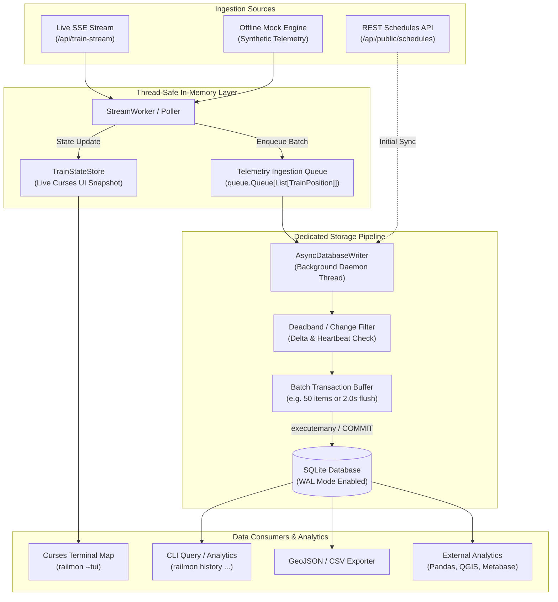
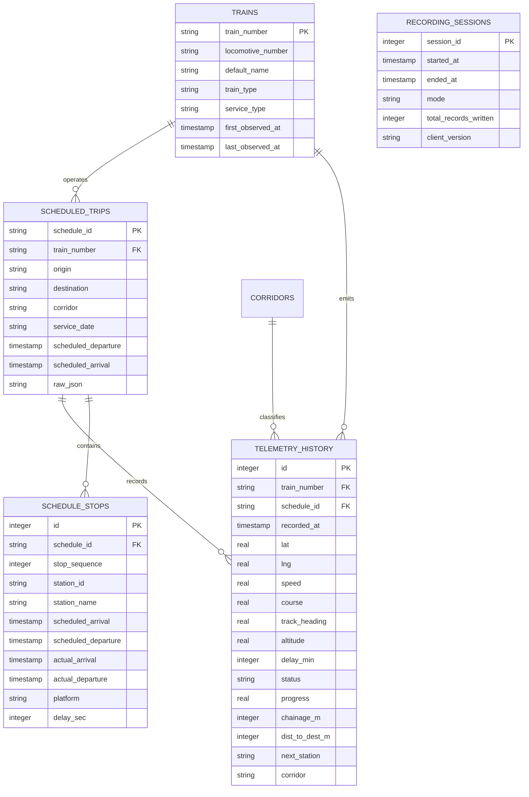

# Historical Telemetry Storage in SQLite: Implementation Plan

Detailed architectural design, relational schema, asynchronous ingestion pipeline, query capabilities, and rollout roadmap for persisting live and scheduled Hellenic Railways (`railway.gov.gr`) telemetry data into an embedded SQLite database.

---

## 1. Executive Summary & Objectives

The primary objective is to enable persistent, historical recording of live train telemetry and scheduled services emitted by the Hellenic Railways platform. This will unlock:

1. **Trajectory & Breadcrumb Replay:** Reconstructing historical train runs, routes, and geographic positions over arbitrary time intervals.
2. **Delay & Punctuality Analytics:** Tracking how delays accumulate across specific corridors, stations, or operating times.
3. **Speed & Dwell Profiling:** Analyzing speed profiles against track chainage and calculating station dwell times.
4. **Offline Historical Analysis:** Providing a zero-dependency, local file-based database (`.db` / `.sqlite`) that can be queried with standard SQL tools, Pandas, or exported to GeoJSON for GIS platforms (QGIS, Kepler.gl).

### Non-Functional Requirements & System Constraints
* **Zero UI Blocking:** Database write operations must never block the Curses TUI rendering loop (20–60 FPS) or interrupt SSE network streaming.
* **Low Write Overhead:** High write frequencies (10–50 train positions every 1–3 seconds) must be batched to prevent disk I/O thrashing.
* **Data Integrity & Crash Safety:** Use SQLite Write-Ahead Logging (WAL) to support concurrent reads while writes are ongoing, with automatic recovery on process termination.
* **Storage Efficiency:** Implement deadband filtering to discard redundant stationary snapshots without losing motion resolution.
* **Zero External Dependencies:** Built solely on Python 3's built-in `sqlite3` module.

---

## 2. System Architecture & Ingestion Pipeline



### Architecture Highlights
- **Decoupled Producer-Consumer:** The [`StreamWorker`](../tui/stream_worker.py) (or a dedicated headless recorder) pushes received batches into a bounded `queue.Queue`.
- **Asynchronous Writer Thread (`TelemetryRecorder`):** A single background daemon thread exclusively manages SQLite write transactions, ensuring thread safety without requiring multi-threaded SQLite connection locks.
- **Batching & Deadband Filter:** The writer buffers records and only commits to disk when either $N$ records accumulate (e.g., 50–100) or a time threshold (e.g., 2 seconds) elapses. Stationary trains with identical coordinates and unchanged delays are rate-limited to reduce database bloat by 40–60%.

---

## 3. Relational Database Schema

The database schema is organized into metadata, reference schedules, and high-frequency time-series telemetry.



### DDL Specification

```sql
-- Core Pragmas for High-Performance Telemetry Ingestion
PRAGMA journal_mode = WAL;
PRAGMA synchronous = NORMAL;
PRAGMA foreign_keys = ON;
PRAGMA temp_store = MEMORY;
PRAGMA cache_size = -64000; -- 64MB cache

-- 1. Persistent Vehicle Register
CREATE TABLE IF NOT EXISTS trains (
    train_number TEXT PRIMARY KEY,
    locomotive_number TEXT,
    default_name TEXT,
    train_type TEXT,
    service_type TEXT,
    first_observed_at TIMESTAMP NOT NULL,
    last_observed_at TIMESTAMP NOT NULL
);

-- 2. Daily Scheduled Trips & Services
CREATE TABLE IF NOT EXISTS scheduled_trips (
    schedule_id TEXT PRIMARY KEY,
    train_number TEXT NOT NULL,
    origin TEXT,
    destination TEXT,
    corridor TEXT,
    service_date TEXT NOT NULL,
    scheduled_departure TIMESTAMP,
    scheduled_arrival TIMESTAMP,
    raw_json TEXT,
    created_at TIMESTAMP DEFAULT CURRENT_TIMESTAMP,
    FOREIGN KEY (train_number) REFERENCES trains(train_number) ON DELETE CASCADE
);

-- 3. Scheduled Intermediate Stops
CREATE TABLE IF NOT EXISTS schedule_stops (
    id INTEGER PRIMARY KEY AUTOINCREMENT,
    schedule_id TEXT NOT NULL,
    stop_sequence INTEGER NOT NULL,
    station_id TEXT,
    station_name TEXT NOT NULL,
    scheduled_arrival TIMESTAMP,
    scheduled_departure TIMESTAMP,
    actual_arrival TIMESTAMP,
    actual_departure TIMESTAMP,
    platform TEXT,
    delay_sec INTEGER DEFAULT 0,
    FOREIGN KEY (schedule_id) REFERENCES scheduled_trips(schedule_id) ON DELETE CASCADE,
    UNIQUE(schedule_id, stop_sequence)
);

-- 4. High-Frequency Telemetry History (Time Series)
CREATE TABLE IF NOT EXISTS telemetry_history (
    id INTEGER PRIMARY KEY AUTOINCREMENT,
    train_number TEXT NOT NULL,
    schedule_id TEXT,
    recorded_at TIMESTAMP NOT NULL,
    lat REAL NOT NULL,
    lng REAL NOT NULL,
    speed REAL NOT NULL,
    course REAL NOT NULL,
    track_heading REAL,
    altitude REAL,
    delay_min INTEGER DEFAULT 0,
    status TEXT,
    progress REAL,
    chainage_m INTEGER,
    dist_to_dest_m INTEGER,
    next_station TEXT,
    corridor TEXT,
    FOREIGN KEY (train_number) REFERENCES trains(train_number),
    FOREIGN KEY (schedule_id) REFERENCES scheduled_trips(schedule_id)
);

-- 5. Session Audit Log
CREATE TABLE IF NOT EXISTS recording_sessions (
    session_id INTEGER PRIMARY KEY AUTOINCREMENT,
    started_at TIMESTAMP NOT NULL,
    ended_at TIMESTAMP,
    mode TEXT NOT NULL, -- 'live', 'demo'
    total_records_written INTEGER DEFAULT 0,
    client_version TEXT
);

-- Optimized Indices
CREATE INDEX IF NOT EXISTS idx_telemetry_train_time 
    ON telemetry_history (train_number, recorded_at);

CREATE INDEX IF NOT EXISTS idx_telemetry_schedule_time 
    ON telemetry_history (schedule_id, recorded_at);

CREATE INDEX IF NOT EXISTS idx_telemetry_time 
    ON telemetry_history (recorded_at);

CREATE INDEX IF NOT EXISTS idx_telemetry_corridor_time 
    ON telemetry_history (corridor, recorded_at);

CREATE INDEX IF NOT EXISTS idx_trips_date 
    ON scheduled_trips (service_date, train_number);
```

---

## 4. Performance, Concurrency & Storage Sizing

### 4.1 Write-Ahead Logging (WAL) Mode
SQLite default rollback journal blocks readers during write transactions. In WAL mode:
- Readers (such as the TUI or analysis scripts) never block writers.
- The writer thread appends pages to the `-wal` file sequentially without locking readers.
- `PRAGMA synchronous = NORMAL` provides full durability against application crashes while eliminating blocking disk syncs on every small commit.

### 4.2 Storage Estimation & Deadband Filtering
- **Raw Volume:** Assuming 25 active trains emitting 1 update every 2 seconds:
  $$\frac{25 \text{ trains}}{2 \text{ seconds}} = 12.5 \text{ rows/sec} \approx 45,000 \text{ rows/hour} \approx 1,080,000 \text{ rows/day}$$
  At $\approx 110$ bytes per row including indices, raw storage is $\approx 120 \text{ MB/day}$.
- **Deadband Filtering Strategy:**
  Trains spend significant time waiting at terminal stations, passing loops, or sidings (speed $< 1.0\text{ km/h}$).
  - A new telemetry row is written **only if**:
    1. Distance traveled from last recorded point is $> 15\text{ meters}$, **OR**
    2. Delay value changed by $\ge 1\text{ minute}$, **OR**
    3. Status / next station changed, **OR**
    4. Heartbeat interval ($\ge 60\text{ seconds}$) has elapsed since the last stored record.
  - **Result:** Storage footprint is reduced by approximately **50% to ~55–60 MB/day**, preserving full motion fidelity during active transit while preventing stationary database bloat.

---

## 5. Proposed Codebase Architecture & File Structure

```text
train-tracker-railway-gov-gr/
├── storage/                       # NEW: Embedded SQLite persistence package
│   ├── __init__.py                # Package exports (Database, Recorder, Repository)
│   ├── schema.py                  # DDL statements, migrations, and index definitions
│   ├── db.py                      # Thread-safe connection factory and WAL configuration
│   ├── models.py                  # Dataclass mapping for historical records & query results
│   ├── recorder.py                # Asynchronous TelemetryRecorder daemon thread with batching
│   ├── filter.py                  # Deadband & duplicate suppression filter
│   └── repository.py              # Query API (trips, speed profiles, delays, GeoJSON exports)
│
├── train_tracker.py               # Updated CLI with recorder modes and --db argument
├── tui/
│   ├── stream_worker.py           # Updated: hook to publish raw batches to TelemetryRecorder
│   └── app.py                     # Optional recording indicator in status bar
└── tests/
    ├── test_storage_db.py         # Unit tests for connection, WAL, and schema migration
    ├── test_storage_recorder.py   # Unit tests for async queue ingestion and batch commits
    ├── test_storage_filter.py     # Unit tests for deadband coordinate suppression
    └── test_storage_repository.py # Unit tests for history query, aggregation, and GeoJSON export
```

---

## 6. Detailed Implementation Roadmap

### Phase 1: Storage Infrastructure & Schema Setup
*(See detailed specification in [`docs/storage-phase-1-infrastructure-and-schema.md`](./storage-phase-1-infrastructure-and-schema.md))*
- Create `storage/schema.py` containing complete DDL, index definitions, and migration checks.
- Create `storage/db.py` managing SQLite connections, WAL pragmas, and schema creation.
- Create `storage/models.py` mapping domain records (`TrainRecord`, `TelemetryHistoryRow`, `TripRecord`).
- **Deliverables:** Working SQLite connection manager with WAL support and automated test suite.

### Phase 2: Asynchronous Recorder & Deadband Filter
*(See detailed specification in [`docs/storage-phase-2-asynchronous-recorder-and-deadband-filter.md`](./storage-phase-2-asynchronous-recorder-and-deadband-filter.md))*
- Implement `storage/filter.py` (`DeadbandFilter`): compares position, delay, speed, and time delta against thresholds.
- Implement `storage/recorder.py` (`TelemetryRecorder`):
  - Starts background daemon thread reading from `queue.Queue`.
  - Maintains in-memory buffer with batch size (default: 50 records) and timeout flush (default: 2.0s).
  - Handles session auditing (`recording_sessions` table).
  - Ensures clean shutdown and final queue flush on `SIGINT` or `stop()`.
- **Deliverables:** Verified asynchronous batch writer with zero thread contention.

### Phase 3: Historical Repository & Query Engine
*(See detailed specification in [`docs/storage-phase-3-historical-repository-and-query-engine.md`](./storage-phase-3-historical-repository-and-query-engine.md))*
- Implement `storage/repository.py` (`HistoricalRepository`):
  - `get_train_history(train_number, start_time, end_time) -> List[TelemetryHistoryRow]`
  - `get_corridor_punctuality(corridor, date) -> Dict[str, Any]`
  - `get_active_trips(date) -> List[TripSummary]`
  - `export_trip_geojson(train_number, start_time, end_time) -> Dict[str, Any]`
  - `export_csv(query_type, target_file, params)`
- **Deliverables:** High-level Python API for querying historical data with comprehensive unit tests.

### Phase 4: CLI & System Integration
*(See detailed specification in [`docs/storage-phase-4-cli-and-system-integration.md`](./storage-phase-4-cli-and-system-integration.md))*
- Extend [`train_tracker.py`](../train_tracker.py) CLI parser:
  - Add global `--db <filepath>` argument (default: `railway_history.db` when enabled).
  - Add dedicated sub-command: `railmon record [--demo] [--db PATH] [--filter-deadband]` for headless recording.
  - Add `--record` flag to `railmon --tui` and `railmon stream` modes.
  - Add `railmon history` sub-command for quick terminal inspection of recorded trains and trip delays.
- Integrate into [`tui/stream_worker.py`](../tui/stream_worker.py):
  - Allow attaching an optional `TelemetryRecorder` listener to stream updates.
- Update TUI status header to display a `[REC]` status badge when active.
- **Deliverables:** End-to-end integration across CLI, TUI, and headless daemon modes.

### Phase 5: Verification, Benchmarking & Documentation
- Execute automated integration tests simulating long-running telemetry streams.
- Measure disk write overhead and confirm WAL checkpointing behavior.
- Document schema, CLI commands, and SQL analysis recipes in [`docs/historical-storage-sqlite.md`](./historical-storage-sqlite.md).
- Update [`README.md`](../README.md) and [`docs/architecture.md`](./architecture.md).

---

## 7. Sample Analytical Queries Enabled by the Schema

### 1. Punctuality and Delay Aggregation by Corridor
```sql
SELECT 
    corridor,
    COUNT(DISTINCT train_number) AS total_trains,
    ROUND(AVG(delay_min), 1) AS avg_delay_minutes,
    MAX(delay_min) AS max_delay_minutes,
    ROUND(100.0 * SUM(CASE WHEN delay_min <= 5 THEN 1 ELSE 0 END) / COUNT(*), 1) AS punctuality_pct
FROM telemetry_history
WHERE recorded_at >= datetime('now', '-24 hours')
  AND corridor IS NOT NULL
GROUP BY corridor
ORDER BY avg_delay_minutes DESC;
```

### 2. Trajectory Reconstruction for Train Trip
```sql
SELECT 
    recorded_at,
    lat,
    lng,
    speed,
    delay_min,
    chainage_m,
    next_station
FROM telemetry_history
WHERE train_number = '1597'
  AND recorded_at BETWEEN '2026-11-18 10:00:00' AND '2026-11-18 16:00:00'
ORDER BY recorded_at ASC;
```

### 3. Station Dwell & Speed Profile Analysis
```sql
SELECT 
    next_station,
    MIN(recorded_at) AS arrival_time,
    MAX(recorded_at) AS departure_time,
    ROUND((JULIANDAY(MAX(recorded_at)) - JULIANDAY(MIN(recorded_at))) * 86400) AS dwell_seconds
FROM telemetry_history
WHERE train_number = '2232'
  AND speed < 2.0
GROUP BY next_station
HAVING dwell_seconds > 20
ORDER BY arrival_time ASC;
```

---

## 8. Verification & Test Plan

1. **Unit Tests (`tests/test_storage_*.py`):**
   - SQLite table creation, PRAGMA verification (`journal_mode=wal`).
   - Deadband filter accuracy: assert stationary coordinates within distance threshold are skipped while delays/heartbeats trigger writes.
   - Buffer flushing logic: verify records flush on reaching count limit and on timeout timer.
2. **Integration Tests:**
   - Run `StreamWorker` with `MockTelemetryEngine` piped directly into `TelemetryRecorder`.
   - Verify 500+ records written without dropped packets or thread deadlocks.
   - Verify database clean shutdown on interrupt.
3. **Load & Concurrency Verification:**
   - Execute parallel read queries on the SQLite database while the writer thread is continuously inserting records at 50 records/sec. Confirm zero database lock errors (`sqlite3.OperationalError: database is locked`).
