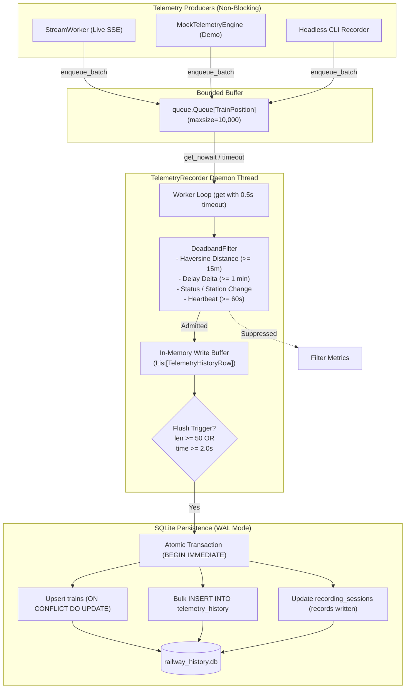
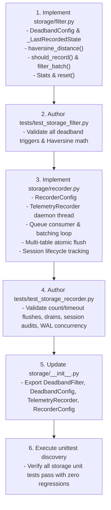

# Phase 2 Implementation Plan: Asynchronous Recorder & Deadband Filter

Detailed engineering specification, asynchronous queuing architecture, deadband coordinate compression algorithms, batch transaction flushing, session auditing, and automated verification suites for **Phase 2** of the Hellenic Railways (`railway.gov.gr`) SQLite historical storage engine.

Refer to the master [Historical Telemetry Storage in SQLite Implementation Plan](./sqlite-historical-data-plan.md) and the completed [Phase 1 Specification](./storage-phase-1-infrastructure-and-schema.md).

---

## 1. Overview & Objectives

Phase 2 builds directly upon the Phase 1 storage infrastructure (`storage/db.py`, `storage/schema.py`, `storage/models.py`) to deliver a high-throughput, non-blocking telemetry recording engine. 

The primary challenge in live railway tracking is balancing high spatial fidelity with database storage size and UI responsiveness:
1. **Zero UI Jitter & Zero Network Latency:** SQLite disk writes must be fully decoupled from the Curses rendering loop and the SSE network stream via a thread-safe producer-consumer queue.
2. **Database Bloat Prevention:** Stationary trains at terminals or passing loops emit identical coordinates every 1–3 seconds. A deadband filter must intelligently suppress redundant records while capturing every meaningful state transition (motion, delay variance, station change, or periodic heartbeat).
3. **Batch Commit Efficiency:** Grouping 50–100 records per transaction reduces SQLite I/O operations from 25–50 fsyncs per second down to 1 every 2 seconds, maintaining SQLite Write-Ahead Logging (WAL) write throughput with zero lock contention.



### 1.1 Primary Deliverables

1. **`storage/filter.py` (`DeadbandFilter`, `DeadbandConfig`)**:
   - In-memory per-train state cache tracking spatial, temporal, and operational attributes.
   - Great-circle Haversine distance calculation in pure Python (`math` module).
   - Multi-factor admission rules: $\Delta d \ge 15\text{ m}$, $\Delta \text{delay} \ge 1\text{ min}$, status/station transitions, and heartbeat expiry ($\Delta t \ge 60\text{ s}$).
   - Compression statistics tracking (inspected, admitted, suppressed, ratio).
2. **`storage/recorder.py` (`TelemetryRecorder`, `RecorderConfig`)**:
   - Dedicated background daemon thread pulling from a thread-safe `queue.Queue`.
   - In-memory batch accumulation with dual flush triggers: count threshold ($N \ge 50$) and elapsed time ($t \ge 2.0\text{ s}$).
   - Atomic multi-table write transactions: `trains` upsert + `telemetry_history` bulk insert + `recording_sessions` progress tracking.
   - Session lifecycle audit logging (`recording_sessions` table).
   - Clean shutdown guarantees: queue draining, buffer flushing, session closure, and resource disposal on `SIGINT` or `stop()`.
3. **`storage/__init__.py` Updates**:
   - Clean export of `DeadbandFilter`, `DeadbandConfig`, `TelemetryRecorder`, and `RecorderConfig`.
4. **Automated Test Suites**:
   - `tests/test_storage_filter.py`: Unit tests for deadband evaluation, threshold transitions, heartbeat triggers, and statistics.
   - `tests/test_storage_recorder.py`: Unit tests for thread lifecycle, queue batching, dual flush triggers, graceful shutdown, session logging, and concurrent reader-writer execution.

---

## 2. Technical Specifications & Component Contracts

### 2.1 `storage/filter.py` Deadband Filter

The deadband filter evaluates each incoming [`TrainPosition`](../train_tracker.py#L27-L83) against the previous recorded state for that specific vehicle.

#### 2.1.1 Haversine Distance Formulation
To calculate the displacement between successive GPS coordinates $(lat_1, lng_1)$ and $(lat_2, lng_2)$ without third-party dependencies:

$$\Delta \phi = \text{radians}(lat_2 - lat_1), \quad \Delta \lambda = \text{radians}(lng_2 - lng_1)$$
$$a = \sin^2\left(\frac{\Delta \phi}{2}\right) + \cos(\text{radians}(lat_1)) \cdot \cos(\text{radians}(lat_2)) \cdot \sin^2\left(\frac{\Delta \lambda}{2}\right)$$
$$c = 2 \cdot \operatorname{atan2}\left(\sqrt{a}, \sqrt{1 - a}\right)$$
$$d = R \cdot c$$

where Earth radius $R = 6,371,000 \text{ meters}$.

#### 2.1.2 Class Contract & Implementation

```python
"""
Deadband filtering and coordinate compression for high-frequency telemetry.
"""

from dataclasses import dataclass
from datetime import datetime
import math
import time
from typing import Dict, List, Optional, Tuple

from train_tracker import TrainPosition


@dataclass(frozen=True)
class DeadbandConfig:
    """Configurable thresholds for telemetry deadband suppression."""
    min_distance_m: float = 15.0              # Position movement threshold
    min_delay_delta_min: int = 1              # Delay change threshold
    min_speed_delta_kmh: float = 5.0          # Speed change threshold
    max_heartbeat_interval_sec: float = 60.0  # Periodic snapshot heartbeat
    track_status_change: bool = True          # Force admit if status changed
    track_station_change: bool = True         # Force admit if next_station changed
    track_schedule_change: bool = True        # Force admit if schedule_id changed


@dataclass
class _LastRecordedState:
    """Internal state cache tracking the last persisted attributes of a train."""
    timestamp: float       # Epoch seconds
    lat: float
    lng: float
    speed: float
    delay: int
    status: str
    next_station: Optional[str]
    schedule_id: Optional[str]


class DeadbandFilter:
    """
    Evaluates train telemetry against spatial, temporal, and operational thresholds
    to suppress uninformative stationary records and reduce storage volume by 40-60%.
    """

    def __init__(self, config: Optional[DeadbandConfig] = None):
        self.config = config or DeadbandConfig()
        self._states: Dict[str, _LastRecordedState] = {}
        self._total_inspected: int = 0
        self._total_admitted: int = 0
        self._total_suppressed: int = 0

    @staticmethod
    def haversine_distance(lat1: float, lng1: float, lat2: float, lng2: float) -> float:
        """Calculate great-circle distance between two coordinates in meters."""
        r = 6371000.0  # Earth radius in meters
        phi1 = math.radians(lat1)
        phi2 = math.radians(lat2)
        delta_phi = math.radians(lat2 - lat1)
        delta_lambda = math.radians(lng2 - lng1)

        a = (
            math.sin(delta_phi / 2.0) ** 2
            + math.cos(phi1) * math.cos(phi2) * math.sin(delta_lambda / 2.0) ** 2
        )
        c = 2.0 * math.atan2(math.sqrt(a), math.sqrt(1.0 - a))
        return r * c

    def should_record(
        self, pos: TrainPosition, now_epoch: Optional[float] = None
    ) -> Tuple[bool, Optional[str]]:
        """
        Evaluate if a TrainPosition meets admission criteria for storage.

        Returns:
            Tuple of (should_record: bool, reason: Optional[str])
            Reason is one of: 'initial', 'distance', 'delay', 'status', 'station',
                              'schedule', 'speed', 'heartbeat', or None if suppressed.
        """
        self._total_inspected += 1
        current_time = now_epoch if now_epoch is not None else time.time()
        train_id = pos.train_number

        last = self._states.get(train_id)
        if last is None:
            self._admit(train_id, pos, current_time)
            return True, "initial"

        # 1. Status transition check
        if self.config.track_status_change and pos.status != last.status:
            self._admit(train_id, pos, current_time)
            return True, "status"

        # 2. Next station change check
        if self.config.track_station_change and pos.next_station != last.next_station:
            self._admit(train_id, pos, current_time)
            return True, "station"

        # 3. Schedule change check
        if self.config.track_schedule_change and pos.schedule_id != last.schedule_id:
            self._admit(train_id, pos, current_time)
            return True, "schedule"

        # 4. Delay change check
        if abs(pos.delay - last.delay) >= self.config.min_delay_delta_min:
            self._admit(train_id, pos, current_time)
            return True, "delay"

        # 5. Distance displacement check
        dist_m = self.haversine_distance(last.lat, last.lng, pos.lat, pos.lng)
        if dist_m >= self.config.min_distance_m:
            self._admit(train_id, pos, current_time)
            return True, "distance"

        # 6. Speed change check
        if abs(pos.speed - last.speed) >= self.config.min_speed_delta_kmh:
            self._admit(train_id, pos, current_time)
            return True, "speed"

        # 7. Heartbeat interval check
        elapsed = current_time - last.timestamp
        if elapsed >= self.config.max_heartbeat_interval_sec:
            self._admit(train_id, pos, current_time)
            return True, "heartbeat"

        # Suppressed
        self._total_suppressed += 1
        return False, None

    def filter_batch(
        self, positions: List[TrainPosition], now_epoch: Optional[float] = None
    ) -> List[TrainPosition]:
        """Filter a batch of positions, returning only admitted entities."""
        return [p for p in positions if self.should_record(p, now_epoch=now_epoch)[0]]

    def _admit(self, train_id: str, pos: TrainPosition, current_time: float) -> None:
        """Update internal cache with newly admitted telemetry state."""
        self._states[train_id] = _LastRecordedState(
            timestamp=current_time,
            lat=pos.lat,
            lng=pos.lng,
            speed=pos.speed,
            delay=pos.delay,
            status=pos.status,
            next_station=pos.next_station,
            schedule_id=pos.schedule_id,
        )
        self._total_admitted += 1

    def reset(self) -> None:
        """Clear all cached vehicle states and reset metric counters."""
        self._states.clear()
        self._total_inspected = 0
        self._total_admitted = 0
        self._total_suppressed = 0

    @property
    def stats(self) -> Dict[str, float]:
        """Return compression and admission metrics."""
        ratio = (
            (self._total_suppressed / self._total_inspected * 100.0)
            if self._total_inspected > 0
            else 0.0
        )
        return {
            "total_inspected": self._total_inspected,
            "total_admitted": self._total_admitted,
            "total_suppressed": self._total_suppressed,
            "suppression_ratio_pct": round(ratio, 2),
            "tracked_trains": len(self._states),
        }
```

---

### 2.2 `storage/recorder.py` Asynchronous Recorder

The `TelemetryRecorder` acts as a dedicated storage daemon, running in its own thread to eliminate lock contention and UI blocking.

#### 2.2.1 Queue & Buffer Architecture
- **In-Memory Queue (`queue.Queue`)**: Holds raw `TrainPosition` or `List[TrainPosition]` batches pushed by streaming workers. Configured with a default `maxsize=10,000` to prevent memory exhaustion if the database becomes sluggish.
- **Write Buffer (`List[TelemetryHistoryRow]`)**: Accumulates records on the consumer thread until either:
  1. Record count threshold is reached ($N \ge \text{batch\_size}$, default: 50 records).
  2. Time elapsed since last commit exceeds threshold ($t \ge \text{flush\_interval\_sec}$, default: 2.0 seconds).
- **Thread Confinement**: The worker thread instantiates its own SQLite connection via `db.connection()` ensuring that SQLite handle operations are 100% thread-local.

#### 2.2.2 Multi-Table Atomic Transaction Specification
When a flush triggers, the recorder executes the following operations inside an atomic transaction:

```sql
-- 1. Upsert train metadata into trains register
INSERT INTO trains (
    train_number, locomotive_number, default_name, train_type, service_type,
    first_observed_at, last_observed_at
) VALUES (?, ?, ?, ?, ?, ?, ?)
ON CONFLICT(train_number) DO UPDATE SET
    locomotive_number = COALESCE(excluded.locomotive_number, trains.locomotive_number),
    default_name = COALESCE(excluded.default_name, trains.default_name),
    train_type = COALESCE(excluded.train_type, trains.train_type),
    service_type = COALESCE(excluded.service_type, trains.service_type),
    last_observed_at = excluded.last_observed_at;

-- 2. Bulk insert telemetry rows into telemetry_history
INSERT INTO telemetry_history (
    train_number, schedule_id, recorded_at, lat, lng, speed, course,
    track_heading, altitude, delay_min, status, progress, chainage_m,
    dist_to_dest_m, next_station, corridor
) VALUES (?, ?, ?, ?, ?, ?, ?, ?, ?, ?, ?, ?, ?, ?, ?, ?);

-- 3. Update session statistics in recording_sessions
UPDATE recording_sessions 
SET total_records_written = total_records_written + ?
WHERE session_id = ?;
```

#### 2.2.3 Class Contract & Implementation

```python
"""
Asynchronous background telemetry recorder and batch persistence daemon.
"""

from dataclasses import dataclass
from datetime import datetime
import logging
import queue
import threading
import time
from typing import Any, Dict, List, Optional, Union

from storage.db import Database
from storage.filter import DeadbandConfig, DeadbandFilter
from storage.models import RecordingSessionDB, TelemetryHistoryRow, TrainRecordDB
from train_tracker import TrainPosition

logger = logging.getLogger(__name__)


@dataclass(frozen=True)
class RecorderConfig:
    """Configuration parameters for asynchronous telemetry recorder."""
    batch_size: int = 50                     # Records buffer threshold for write
    flush_interval_sec: float = 2.0          # Max latency before flushing buffer
    queue_maxsize: int = 10000               # Bounded buffer to avoid memory bloat
    enable_deadband: bool = True             # Enable coordinate deadband filtering
    deadband_config: Optional[DeadbandConfig] = None
    client_version: str = "1.0.0"
    mode: str = "live"                       # 'live' or 'demo'


class TelemetryRecorder:
    """
    Background daemon thread managing batched, non-blocking persistence
    of Hellenic Railways telemetry snapshots into SQLite.
    """

    def __init__(
        self,
        db: Database,
        config: Optional[RecorderConfig] = None,
    ):
        self.db = db
        self.config = config or RecorderConfig()
        self.filter = (
            DeadbandFilter(self.config.deadband_config)
            if self.config.enable_deadband
            else None
        )

        self._queue: queue.Queue[Optional[Union[TrainPosition, List[TrainPosition]]]] = (
            queue.Queue(maxsize=self.config.queue_maxsize)
        )
        self._thread: Optional[threading.Thread] = None
        self._stop_event = threading.Event()

        self._session_id: Optional[int] = None
        self._session_started_at: str = ""
        self._total_records_written: int = 0
        self._total_batches_flushed: int = 0
        self._last_flush_time: float = 0.0

        self._lock = threading.Lock()

    @property
    def is_running(self) -> bool:
        """Check if background worker thread is active."""
        return self._thread is not None and self._thread.is_alive()

    @property
    def session_id(self) -> Optional[int]:
        """Return the active audit recording session ID."""
        return self._session_id

    def start(self) -> None:
        """Start the background recorder daemon and initialize audit session."""
        with self._lock:
            if self.is_running:
                return

            self._stop_event.clear()
            self._session_started_at = datetime.utcnow().isoformat() + "Z"
            self._total_records_written = 0
            self._total_batches_flushed = 0
            self._last_flush_time = time.time()

            # Create session in recording_sessions table
            with self.db.transaction() as cur:
                cur.execute(
                    """
                    INSERT INTO recording_sessions (started_at, mode, total_records_written, client_version)
                    VALUES (?, ?, 0, ?)
                    """,
                    (self._session_started_at, self.config.mode, self.config.client_version),
                )
                self._session_id = cur.lastrowid

            self._thread = threading.Thread(
                target=self._worker_loop,
                name="TelemetryRecorderThread",
                daemon=True,
            )
            self._thread.start()
            logger.info("TelemetryRecorder started. Session ID: %s", self._session_id)

    def stop(self, timeout_sec: float = 5.0) -> None:
        """
        Signal recorder to stop, drain queued items, flush buffers,
        and finalize the recording session.
        """
        with self._lock:
            if not self.is_running:
                return

            self._stop_event.set()
            # Push sentinel to awaken queue worker if waiting
            try:
                self._queue.put_nowait(None)
            except queue.Full:
                pass

        if self._thread:
            self._thread.join(timeout=timeout_sec)

        # Finalize session audit
        with self._lock:
            ended_at = datetime.utcnow().isoformat() + "Z"
            with self.db.transaction() as cur:
                cur.execute(
                    """
                    UPDATE recording_sessions
                    SET ended_at = ?, total_records_written = ?
                    WHERE session_id = ?
                    """,
                    (ended_at, self._total_records_written, self._session_id),
                )
            logger.info(
                "TelemetryRecorder stopped. Session %s ended. Total rows written: %d",
                self._session_id,
                self._total_records_written,
            )

    def enqueue(self, position: TrainPosition) -> bool:
        """
        Enqueue a single train position. Non-blocking; returns False if queue is saturated.
        """
        if not self.is_running:
            return False
        try:
            self._queue.put_nowait(position)
            return True
        except queue.Full:
            logger.warning("TelemetryRecorder queue saturated. Dropping position for %s", position.train_number)
            return False

    def enqueue_batch(self, positions: List[TrainPosition]) -> int:
        """
        Enqueue a batch of positions. Non-blocking; returns count of successfully enqueued items.
        """
        if not self.is_running or not positions:
            return 0
        try:
            self._queue.put_nowait(positions)
            return len(positions)
        except queue.Full:
            logger.warning("TelemetryRecorder queue saturated. Dropping batch of %d positions", len(positions))
            return 0

    def _worker_loop(self) -> None:
        """Main worker execution loop maintaining buffer batching and timeout flush."""
        buffer: List[TrainPosition] = []
        self._last_flush_time = time.time()

        while not self._stop_event.is_set():
            try:
                # Wait up to 0.5s for incoming item
                item = self._queue.get(timeout=0.5)
                if item is None:
                    # Sentinel encountered
                    break

                if isinstance(item, list):
                    buffer.extend(item)
                else:
                    buffer.append(item)

                self._queue.task_done()

            except queue.Empty:
                pass

            # Check flush triggers
            now = time.time()
            reached_size = len(buffer) >= self.config.batch_size
            reached_time = (now - self._last_flush_time) >= self.config.flush_interval_sec

            if buffer and (reached_size or reached_time):
                self._flush_buffer(buffer)
                buffer.clear()
                self._last_flush_time = time.time()

        # Shutdown drain: drain remaining queue items into buffer
        while not self._queue.empty():
            try:
                item = self._queue.get_nowait()
                if item is not None:
                    if isinstance(item, list):
                        buffer.extend(item)
                    else:
                        buffer.append(item)
                self._queue.task_done()
            except queue.Empty:
                break

        if buffer:
            self._flush_buffer(buffer)
            buffer.clear()

    def _flush_buffer(self, items: List[TrainPosition]) -> int:
        """
        Filter items, extract train records, and write to database within single transaction.
        """
        if not items:
            return 0

        # Apply deadband filter if configured
        admitted: List[TrainPosition] = []
        if self.filter:
            for item in items:
                should_save, _ = self.filter.should_record(item)
                if should_save:
                    admitted.append(item)
        else:
            admitted = items

        if not admitted:
            return 0

        # Prepare train entities and telemetry records
        distinct_trains: Dict[str, TrainPosition] = {}
        for p in admitted:
            distinct_trains[p.train_number] = p

        now_iso = datetime.utcnow().isoformat() + "Z"
        train_rows = [
            (
                p.train_number,
                p.locomotive_number,
                p.name,
                p.train_type,
                p.service_type,
                p.timestamp or now_iso,
                p.timestamp or now_iso,
            )
            for p in distinct_trains.values()
        ]

        history_rows = [
            TelemetryHistoryRow.from_train_position(p).to_db_row()
            for p in admitted
        ]

        try:
            with self.db.transaction() as cur:
                # 1. Upsert trains table
                cur.executemany(
                    """
                    INSERT INTO trains (
                        train_number, locomotive_number, default_name, train_type, service_type,
                        first_observed_at, last_observed_at
                    ) VALUES (?, ?, ?, ?, ?, ?, ?)
                    ON CONFLICT(train_number) DO UPDATE SET
                        locomotive_number = COALESCE(excluded.locomotive_number, trains.locomotive_number),
                        default_name = COALESCE(excluded.default_name, trains.default_name),
                        train_type = COALESCE(excluded.train_type, trains.train_type),
                        service_type = COALESCE(excluded.service_type, trains.service_type),
                        last_observed_at = excluded.last_observed_at
                    """,
                    train_rows,
                )

                # 2. Bulk insert telemetry_history
                cur.executemany(
                    """
                    INSERT INTO telemetry_history (
                        train_number, schedule_id, recorded_at, lat, lng, speed, course,
                        track_heading, altitude, delay_min, status, progress, chainage_m,
                        dist_to_dest_m, next_station, corridor
                    ) VALUES (?, ?, ?, ?, ?, ?, ?, ?, ?, ?, ?, ?, ?, ?, ?, ?)
                    """,
                    history_rows,
                )

                # 3. Update session records written
                cur.execute(
                    """
                    UPDATE recording_sessions
                    SET total_records_written = total_records_written + ?
                    WHERE session_id = ?
                    """,
                    (len(history_rows), self._session_id),
                )

            self._total_records_written += len(history_rows)
            self._total_batches_flushed += 1
            return len(history_rows)

        except Exception as exc:
            logger.error("Failed to flush telemetry batch to SQLite: %s", exc, exc_info=True)
            return 0

    def get_stats(self) -> Dict[str, Any]:
        """Return real-time metrics for queue depth, records written, and filter ratios."""
        filter_stats = self.filter.stats if self.filter else {}
        return {
            "is_running": self.is_running,
            "session_id": self._session_id,
            "queue_size": self._queue.qsize(),
            "total_records_written": self._total_records_written,
            "total_batches_flushed": self._total_batches_flushed,
            "filter": filter_stats,
        }

    def __enter__(self) -> "TelemetryRecorder":
        self.start()
        return self

    def __exit__(self, exc_type, exc_val, exc_tb) -> None:
        self.stop()
```

---

## 3. Automated Test Suite Specification

### 3.1 Deadband Filter Tests (`tests/test_storage_filter.py`)

| Test Name | Precondition / Input | Expected Behavior |
|---|---|---|
| `test_initial_observation_always_recorded` | First time train `1597` is encountered. | `should_record` returns `(True, "initial")`. Train cached in `_states`. |
| `test_stationary_train_under_distance_threshold_suppressed` | Train moves 5m ($< 15\text{m}$), same delay, same status, $\Delta t = 2\text{s}$. | `should_record` returns `(False, None)`. Suppressed count increments. |
| `test_moving_train_exceeding_distance_threshold_admitted` | Train moves 50m ($> 15\text{m}$), $\Delta t = 2\text{s}$. | `should_record` returns `(True, "distance")`. Cache updated with new lat/lng. |
| `test_delay_change_triggers_admission_even_if_stationary` | Train stationary (0m moved), delay changes from 2 to 3 min. | `should_record` returns `(True, "delay")`. Admitted count increments. |
| `test_status_transition_triggers_admission` | Train stationary, status changes from "Κανονική" to "Στάση". | `should_record` returns `(True, "status")`. |
| `test_next_station_change_triggers_admission` | Train stationary, `next_station` changes from "Λειανοκλάδι" to "Τιθορέα". | `should_record` returns `(True, "station")`. |
| `test_heartbeat_triggers_admission_after_timeout` | Train stationary (0m moved), unchanged delay, $\Delta t = 61\text{s}$ ($> 60\text{s}$). | `should_record` returns `(True, "heartbeat")`. |
| `test_haversine_formula_accuracy` | Synthesize coordinates for Athens (37.9838, 23.7275) to Thessaloniki (40.6401, 22.9444). | Distance matches expected geodesic range ($302\text{ km} \pm 1\text{ km}$). |
| `test_filter_batch_and_statistics` | Batch of 10 trains (5 stationary duplicates, 5 moving). | Returns list of length 5; `stats` reflects 50% suppression ratio. |
| `test_filter_reset` | Filter with 10 tracked trains called `reset()`. | Cache emptied, all counters reset to 0. |

---

### 3.2 Asynchronous Recorder Tests (`tests/test_storage_recorder.py`)

| Test Name | Precondition / Input | Expected Behavior |
|---|---|---|
| `test_recorder_lifecycle_and_session_creation` | Start recorder on `:memory:` or temp file DB. | `session_id` created in `recording_sessions`. Status is running. |
| `test_batch_flush_on_count_threshold` | Batch size = 5. Enqueue 5 distinct moving train positions. | Buffer immediately flushes without waiting for interval. 5 rows inserted into `telemetry_history`. |
| `test_timeout_flush_on_idle_queue` | Batch size = 50, flush interval = 0.2s. Enqueue 2 positions. | After 0.3s sleep, buffer automatically flushes. 2 rows written. |
| `test_trains_table_upsert_on_telemetry_flush` | Enqueue position for new train `IC52`. | `trains` table has entry with `first_observed_at` and `last_observed_at`. Second update updates `last_observed_at`. |
| `test_graceful_shutdown_drains_queue_and_finalizes_session` | Enqueue 15 items and immediately call `recorder.stop()`. | All 15 items flushed before thread exits. `ended_at` and `total_records_written` updated in `recording_sessions`. |
| `test_queue_saturation_drop_handling` | Set `queue_maxsize=2`. Enqueue 5 items rapidly. | First items accepted, excess items dropped without crashing; warning logged. |
| `test_deadband_integration_in_recorder` | Enable deadband. Enqueue 10 identical stationary snapshots. | Only 1 record written to SQLite; 9 suppressed. |
| `test_concurrent_reader_writer_wal_isolation` | Recorder actively writing 50 items/sec while 2 separate reader threads run `SELECT count(*) FROM telemetry_history`. | Zero `sqlite3.OperationalError: database is locked`. Reader and writer proceed concurrently. |
| `test_context_manager_usage` | Use `with TelemetryRecorder(db) as rec:` block. | Automatically starts on entry, stops and finalizes session on exit. |

---

## 4. Step-by-Step Implementation Roadmap



### Task Checklist

- [x] **Task 2.1**: Implement `storage/filter.py` with `DeadbandConfig` and `DeadbandFilter`.
- [x] **Task 2.2**: Implement `tests/test_storage_filter.py` with 12 unit test cases covering all criteria.
- [x] **Task 2.3**: Implement `storage/recorder.py` with `RecorderConfig` and `TelemetryRecorder`.
- [x] **Task 2.4**: Implement `tests/test_storage_recorder.py` with 9 unit test cases covering batching, shutdown, concurrency, and audit logs.
- [x] **Task 2.5**: Update `storage/__init__.py` to export the new classes and configurations.
- [x] **Task 2.6**: Run `python3 -m unittest discover tests` and verify 100% pass rate.
- [x] **Task 2.7**: Update documentation links in [`docs/sqlite-historical-data-plan.md`](./sqlite-historical-data-plan.md).

---

## 5. Edge Cases & Resilience Strategy

1. **High-Frequency Bursts & Backpressure:**
   - If network or disk I/O causes a temporary backlog, `queue_maxsize=10000` cushions bursts.
   - If the queue fills completely, `enqueue()` / `enqueue_batch()` drop new incoming frames and log a warning rather than blocking the Curses UI or exhausting system RAM.
2. **Abrupt Process Termination (`SIGINT` / `SIGTERM`):**
   - The recorder worker runs as a `daemon=True` thread, ensuring Python can exit cleanly.
   - When stopped gracefully via `stop()` or context manager exit, it pushes a sentinel `None` to wake the thread immediately, drains remaining queue items, flushes the buffer to disk, and updates `recording_sessions.ended_at`.
3. **Database Write Failure / Disk Full:**
   - If `cur.executemany()` raises an exception, the transaction rolls back cleanly via `with self.db.transaction():`.
   - The error is logged without terminating the worker thread, allowing subsequent telemetry batches to attempt writing once disk pressure abates.
4. **GPS Drift on Stationary Trains:**
   - GPS receivers fluctuate slightly even when stopped ($\pm 3\text{--}8\text{ meters}$).
   - The `min_distance_m = 15.0` default threshold absorbs typical GPS noise, ensuring stationary trains don't produce false motion events.
5. **Heartbeat Timestamp Alignment:**
   - A train parked at a terminal for 4 hours will still emit a heartbeat snapshot every 60 seconds (configurable), ensuring analytical queries can establish continuous presence and dwell duration without data gaps.

---

## 6. Risk Assessment & Mitigations

| Risk | Impact | Mitigation Strategy |
|---|---|---|
| **Thread Connection Sharing Violation** | High | SQLite connections are not thread-safe. `TelemetryRecorder` executes writes via context-managed connections confined exclusively to its own worker thread. |
| **Deadband Loss of Critical Operational Events** | Medium | Multi-factor evaluation: any change in delay ($\ge 1\text{ min}$), operational status ("Στάση" vs "Κανονική"), or `next_station` triggers immediate record admission regardless of spatial displacement. |
| **Worker Thread Starvation / Queue Bloat** | Medium | Bounded queue with `put_nowait()` ensures upstream UI and network workers are never blocked. Dual flush triggers (size + interval timeout) guarantee timely commits. |
| **In-Memory State Leak over Days of Execution** | Low | Vehicle registry in `DeadbandFilter` is keyed by `train_number` (~30–50 active passenger/freight trains across Greece). Memory footprint is $< 50\text{ KB}$. |
