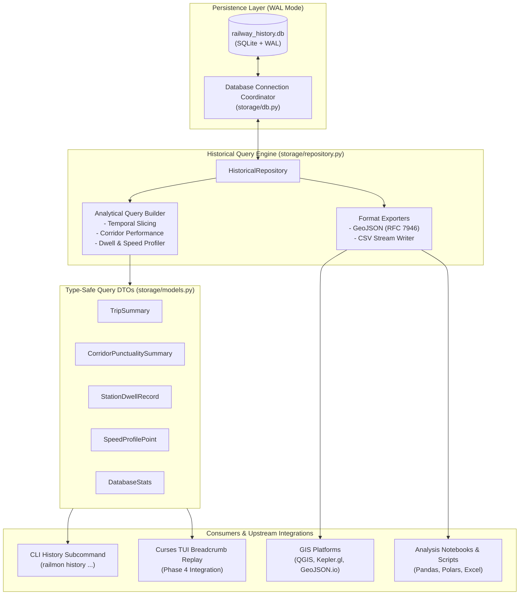

# Phase 3 Implementation Plan: Historical Repository & Query Engine

Detailed engineering specification, analytical query engine, domain query models, GeoJSON/CSV exporters, spatial-temporal aggregations, and automated verification suites for **Phase 3** of the Hellenic Railways (`railway.gov.gr`) SQLite historical storage engine.

Refer to the master [Historical Telemetry Storage in SQLite Implementation Plan](./sqlite-historical-data-plan.md) and earlier phase specifications:
- [Phase 1 Specification: Storage Infrastructure & Schema Setup](./storage-phase-1-infrastructure-and-schema.md)
- [Phase 2 Specification: Asynchronous Recorder & Deadband Filter](./storage-phase-2-asynchronous-recorder-and-deadband-filter.md)

---

## 1. Overview & Objectives

Phase 3 delivers the analytical query and extraction layer for historical telemetry stored in SQLite. While Phase 1 designed the relational schema and Phase 2 implemented the asynchronous ingestion pipeline, Phase 3 provides high-level domain abstractions to query, aggregate, replay, and export historical train data without exposing raw SQL or database connection details to higher-level consumers (CLI commands, Curses TUI replay, GIS tools, and external analytics pipelines).



### 1.1 Key Engineering Objectives

1. **Non-Blocking Concurrent Reads:** Exploit SQLite Write-Ahead Logging (WAL) to execute long-running analytical queries (e.g., aggregating 500,000+ points across corridors) concurrently with active telemetry writes without read-write deadlocks or UI stutter.
2. **Zero External Dependencies:** Implement all queries, geometric GeoJSON transformations, and CSV formatting using Python's standard library (`sqlite3`, `json`, `csv`, `math`, `dataclasses`, `typing`).
3. **Trajectory & Spatial Replay:** Reconstruct chronologically ordered breadcrumb trails and GeoJSON `FeatureCollection` structures (`LineString` and `Point`) for any recorded train journey.
4. **Punctuality & Dwell Analytics:** Provide SQL-driven operational metrics:
   - Corridor-level punctuality percentages, average delay, and delay volatility.
   - Station dwell time calculation using spatial clustering and speed thresholds.
   - Speed vs. chainage profiles along specific railway corridors.
5. **Safe & Defensible Querying:** Guard against SQL injection via strictly parameterized queries, validate timestamp inputs, and provide safe limit/offset pagination.

### 1.2 Primary Deliverables

1. **`storage/models.py` Extensions**:
   - `TripSummary`: Aggregated metadata for a distinct train trip or operating day.
   - `CorridorPunctualitySummary`: Aggregated corridor punctuality, average delays, and on-time compliance.
   - `StationDwellRecord`: Station arrival, departure, and dwell duration analysis.
   - `SpeedProfilePoint`: Speed and distance points for chainage/elevation graphs.
   - `DatabaseStats`: System-level summary of database size, total records, active trains, and recording span.
2. **`storage/repository.py` (`HistoricalRepository`)**:
   - `get_train_history(train_number, start_time, end_time, limit, order)`
   - `get_active_trips(date, corridor, limit)`
   - `get_corridor_punctuality(corridor, start_date, end_date, on_time_threshold_min)`
   - `get_speed_profile(train_number, start_time, end_time)`
   - `get_station_dwell_times(train_number, start_time, end_time, speed_threshold, min_dwell_sec)`
   - `export_trip_geojson(train_number, start_time, end_time, feature_type)`
   - `export_csv(query_type, target, params)`
   - `get_recording_sessions(limit)`
   - `get_database_stats()`
3. **`storage/__init__.py` Updates**:
   - Public export of `HistoricalRepository` and query data models.
4. **Automated Test Suite (`tests/test_storage_repository.py`)**:
   - Comprehensive unit and integration tests covering parameter filtering, spatial aggregation, dwell calculations, GeoJSON compliance, and concurrent read/write transactions.

---

## 2. Domain Models & Data Transfer Objects

Phase 3 introduces type-safe query models in [`storage/models.py`](../storage/models.py) to encapsulate query results into structured dataclasses rather than raw tuples or untyped dictionaries.

### 2.1 Specification of Query Data Models

```python
@dataclass(frozen=True)
class TripSummary:
    """Aggregated summary of a distinct train service recorded in telemetry history."""
    train_number: str
    schedule_id: Optional[str]
    service_date: str
    corridor: Optional[str]
    first_seen: str
    last_seen: str
    total_points: int
    max_delay_min: int
    avg_delay_min: float
    max_speed_kmh: float
    avg_speed_kmh: float
    origin: Optional[str] = None
    destination: Optional[str] = None


@dataclass(frozen=True)
class CorridorPunctualitySummary:
    """Operational punctuality and delay metrics for a railway corridor."""
    corridor: str
    total_trips: int
    total_observations: int
    avg_delay_min: float
    max_delay_min: int
    on_time_count: int         # Delay <= threshold (default: 5 min)
    delayed_count: int         # Delay > threshold
    severe_delay_count: int    # Delay >= 30 min
    punctuality_rate_pct: float
    start_date: Optional[str] = None
    end_date: Optional[str] = None


@dataclass(frozen=True)
class StationDwellRecord:
    """Station stop and dwell duration analysis derived from telemetry speed profiles."""
    train_number: str
    station_name: str
    arrival_time: str
    departure_time: str
    dwell_seconds: int
    arrival_delay_min: int
    departure_delay_min: int


@dataclass(frozen=True)
class SpeedProfilePoint:
    """Spatial and kinematic point along a railway track for speed/chainage profiling."""
    recorded_at: str
    chainage_m: Optional[int]
    speed_kmh: float
    dist_to_dest_m: Optional[int]
    lat: float
    lng: float
    altitude: Optional[float] = None


@dataclass(frozen=True)
class DatabaseStats:
    """High-level storage and audit metrics for the SQLite database."""
    total_telemetry_rows: int
    total_trains: int
    total_trips: int
    total_sessions: int
    file_size_bytes: int
    earliest_record: Optional[str]
    latest_record: Optional[str]
    wal_mode_enabled: bool
```

---

## 3. Technical Specifications & File Contracts

### 3.1 `storage/repository.py` Class Contract

The `HistoricalRepository` accepts a [`Database`](../storage/db.py) instance and executes queries using context-managed read connections.

```python
"""
Historical data repository and analytical query engine for Hellenic Railways telemetry.
"""

from datetime import datetime
import json
import os
from typing import Any, Dict, Generator, Iterable, List, Optional, TextIO, Union

from storage.db import Database
from storage.models import (
    CorridorPunctualitySummary,
    DatabaseStats,
    RecordingSessionDB,
    SpeedProfilePoint,
    StationDwellRecord,
    TelemetryHistoryRow,
    TripSummary,
)


class HistoricalRepository:
    """
    High-level query API for historical telemetry, timetables, and performance analytics.
    Thread-safe for concurrent read execution under SQLite WAL mode.
    """

    def __init__(self, db: Database):
        self.db = db

    # -------------------------------------------------------------------------
    # 1. Telemetry Retrieval & Trajectory Replay
    # -------------------------------------------------------------------------

    def get_train_history(
        self,
        train_number: str,
        start_time: Optional[str] = None,
        end_time: Optional[str] = None,
        limit: Optional[int] = None,
        order: str = "ASC",
    ) -> List[TelemetryHistoryRow]:
        """
        Retrieve chronologically ordered telemetry breadcrumbs for a specific train.

        Args:
            train_number: Hellenic Railways train identifier (e.g. '1597', 'IC50').
            start_time: Optional ISO timestamp lower bound (inclusive).
            end_time: Optional ISO timestamp upper bound (inclusive).
            limit: Maximum number of rows to return (None for all).
            order: 'ASC' for chronological replay, 'DESC' for most recent first.

        Returns:
            List of TelemetryHistoryRow instances.
        """
        ...

    def iter_train_history(
        self,
        train_number: str,
        start_time: Optional[str] = None,
        end_time: Optional[str] = None,
        chunk_size: int = 2000,
    ) -> Generator[TelemetryHistoryRow, None, None]:
        """
        Stream large telemetry sequences using a memory-efficient cursor generator.
        """
        ...

    # -------------------------------------------------------------------------
    # 2. Trip & Service Discovery
    # -------------------------------------------------------------------------

    def get_active_trips(
        self,
        service_date: Optional[str] = None,
        corridor: Optional[str] = None,
        limit: int = 100,
    ) -> List[TripSummary]:
        """
        Discover recorded train trips grouped by train number and calendar date.
        Derives operational statistics (speed, delay, start/end) directly from history.

        Args:
            service_date: ISO date string 'YYYY-MM-DD' (defaults to current UTC date).
            corridor: Filter by specific railway corridor.
            limit: Max trips to return.
        """
        ...

    # -------------------------------------------------------------------------
    # 3. Punctuality & Performance Analytics
    # -------------------------------------------------------------------------

    def get_corridor_punctuality(
        self,
        corridor: Optional[str] = None,
        start_date: Optional[str] = None,
        end_date: Optional[str] = None,
        on_time_threshold_min: int = 5,
    ) -> List[CorridorPunctualitySummary]:
        """
        Calculate punctuality rates and delay distributions aggregated by corridor.

        Args:
            corridor: Filter by corridor (None returns all corridors).
            start_date: ISO date 'YYYY-MM-DD' or timestamp lower bound.
            end_date: ISO date 'YYYY-MM-DD' or timestamp upper bound.
            on_time_threshold_min: Max minutes of delay considered 'on-time' (default: 5).

        Returns:
            List of CorridorPunctualitySummary records sorted by punctuality percentage.
        """
        ...

    # -------------------------------------------------------------------------
    # 4. Kinematic & Station Stop Profiling
    # -------------------------------------------------------------------------

    def get_speed_profile(
        self,
        train_number: str,
        start_time: Optional[str] = None,
        end_time: Optional[str] = None,
    ) -> List[SpeedProfilePoint]:
        """
        Extract speed, elevation, and chainage profile along track distance.
        """
        ...

    def get_station_dwell_times(
        self,
        train_number: str,
        start_time: Optional[str] = None,
        end_time: Optional[str] = None,
        speed_threshold_kmh: float = 2.0,
        min_dwell_sec: int = 20,
    ) -> List[StationDwellRecord]:
        """
        Detect station dwell events by identifying contiguous stationary intervals
        grouped by reported next_station name.
        """
        ...

    # -------------------------------------------------------------------------
    # 5. GIS & Data Export Engine
    # -------------------------------------------------------------------------

    def export_trip_geojson(
        self,
        train_number: str,
        start_time: Optional[str] = None,
        end_time: Optional[str] = None,
        feature_type: str = "LineString",
    ) -> Dict[str, Any]:
        """
        Export train trajectory as an RFC 7946 compliant GeoJSON FeatureCollection.

        Args:
            train_number: Train identifier.
            start_time: Optional start timestamp.
            end_time: Optional end timestamp.
            feature_type: 'LineString' (continuous track geometry) or 'Point' (individual breadcrumbs).

        Returns:
            Dictionary matching GeoJSON FeatureCollection schema.
        """
        ...

    def export_csv(
        self,
        query_type: str,
        target: Union[str, TextIO],
        params: Optional[Dict[str, Any]] = None,
    ) -> int:
        """
        Export query results directly to a CSV file or file-like stream.

        Args:
            query_type: One of 'telemetry', 'trips', 'punctuality', 'dwell'.
            target: Destination file path string or open TextIO stream.
            params: Query filter dictionary (e.g. {'train_number': '1597'}).

        Returns:
            Number of data rows exported.
        """
        ...

    # -------------------------------------------------------------------------
    # 6. Audit & System Health
    # -------------------------------------------------------------------------

    def get_recording_sessions(self, limit: int = 50) -> List[RecordingSessionDB]:
        """Retrieve recent recorder session audit logs."""
        ...

    def get_database_stats(self) -> DatabaseStats:
        """Calculate total rows, file size, date bounds, and storage metrics."""
        ...
```

---

## 4. Query Implementation Details & SQL Specifications

### 4.1 Chronological Telemetry Retrieval (`get_train_history`)

Utilizes composite index `idx_telemetry_train_time ON telemetry_history (train_number, recorded_at)`.

```sql
SELECT 
    id, train_number, schedule_id, recorded_at, lat, lng, speed, course,
    track_heading, altitude, delay_min, status, progress, chainage_m,
    dist_to_dest_m, next_station, corridor
FROM telemetry_history
WHERE train_number = ?
  AND (? IS NULL OR recorded_at >= ?)
  AND (? IS NULL OR recorded_at <= ?)
ORDER BY recorded_at ASC
LIMIT COALESCE(?, -1);
```

### 4.2 Active Trip Aggregation (`get_active_trips`)

Computes summary metrics for individual train runs over a calendar date:

```sql
SELECT 
    th.train_number,
    th.schedule_id,
    DATE(th.recorded_at) AS service_date,
    th.corridor,
    MIN(th.recorded_at) AS first_seen,
    MAX(th.recorded_at) AS last_seen,
    COUNT(*) AS total_points,
    MAX(th.delay_min) AS max_delay_min,
    ROUND(AVG(th.delay_min), 1) AS avg_delay_min,
    ROUND(MAX(th.speed), 1) AS max_speed_kmh,
    ROUND(AVG(th.speed), 1) AS avg_speed_kmh,
    st.origin,
    st.destination
FROM telemetry_history th
LEFT JOIN scheduled_trips st ON th.schedule_id = st.schedule_id
WHERE (? IS NULL OR DATE(th.recorded_at) = ?)
  AND (? IS NULL OR th.corridor = ?)
GROUP BY th.train_number, DATE(th.recorded_at), th.corridor
ORDER BY first_seen DESC
LIMIT ?;
```

### 4.3 Corridor Punctuality Calculation (`get_corridor_punctuality`)

Groups telemetry observations across corridors to compute punctuality percentages against a configurable threshold:

```sql
SELECT 
    corridor,
    COUNT(DISTINCT train_number) AS total_trips,
    COUNT(*) AS total_observations,
    ROUND(AVG(delay_min), 1) AS avg_delay_min,
    MAX(delay_min) AS max_delay_min,
    SUM(CASE WHEN delay_min <= ? THEN 1 ELSE 0 END) AS on_time_count,
    SUM(CASE WHEN delay_min > ? THEN 1 ELSE 0 END) AS delayed_count,
    SUM(CASE WHEN delay_min >= 30 THEN 1 ELSE 0 END) AS severe_delay_count,
    ROUND(100.0 * SUM(CASE WHEN delay_min <= ? THEN 1 ELSE 0 END) / COUNT(*), 1) AS punctuality_rate_pct
FROM telemetry_history
WHERE corridor IS NOT NULL
  AND (? IS NULL OR corridor = ?)
  AND (? IS NULL OR recorded_at >= ?)
  AND (? IS NULL OR recorded_at <= ?)
GROUP BY corridor
ORDER BY punctuality_rate_pct DESC, avg_delay_min ASC;
```

### 4.4 Station Dwell Detection Algorithm

Station dwells are calculated by identifying stationary windows ($\text{speed} \le 2.0\text{ km/h}$) grouped by reported `next_station`.

```sql
SELECT 
    train_number,
    next_station AS station_name,
    MIN(recorded_at) AS arrival_time,
    MAX(recorded_at) AS departure_time,
    ROUND((JULIANDAY(MAX(recorded_at)) - JULIANDAY(MIN(recorded_at))) * 86400) AS dwell_seconds,
    (SELECT delay_min FROM telemetry_history 
     WHERE train_number = t.train_number AND recorded_at = MIN(t.recorded_at) LIMIT 1) AS arrival_delay_min,
    (SELECT delay_min FROM telemetry_history 
     WHERE train_number = t.train_number AND recorded_at = MAX(t.recorded_at) LIMIT 1) AS departure_delay_min
FROM telemetry_history t
WHERE train_number = ?
  AND (? IS NULL OR recorded_at >= ?)
  AND (? IS NULL OR recorded_at <= ?)
  AND next_station IS NOT NULL
  AND speed <= ?
GROUP BY next_station
HAVING dwell_seconds >= ?
ORDER BY arrival_time ASC;
```

---

## 5. GeoJSON & CSV Exporters Specification

### 5.1 GeoJSON RFC 7946 Specification

The GeoJSON exporter generates GIS-ready data compatible with QGIS, Kepler.gl, Mapbox, and GeoJSON.io.

#### 5.1.1 `LineString` Format (Continuous Track Profile)
Produces a single `Feature` where `geometry.coordinates` is an array of `[longitude, latitude, altitude]` tuples, and `properties` contains trip-level aggregates and coordinate-indexed timestamps and speeds:

```json
{
  "type": "FeatureCollection",
  "features": [
    {
      "type": "Feature",
      "id": "1597",
      "geometry": {
        "type": "LineString",
        "coordinates": [
          [23.7258, 37.9941, 45.0],
          [23.7312, 38.0125, 52.0]
        ]
      },
      "properties": {
        "train_number": "1597",
        "corridor": "SKG-ATH",
        "start_time": "2026-11-18T10:00:00Z",
        "end_time": "2026-11-18T14:30:00Z",
        "total_points": 2,
        "max_speed_kmh": 142.5,
        "timestamps": ["2026-11-18T10:00:00Z", "2026-11-18T10:01:00Z"],
        "speeds_kmh": [0.0, 142.5],
        "delays_min": [0, 4]
      }
    }
  ]
}
```

#### 5.1.2 `Point` Format (Discrete Breadcrumb Features)
Produces a `Feature` for every recorded position snapshot:

```json
{
  "type": "FeatureCollection",
  "features": [
    {
      "type": "Feature",
      "geometry": {
        "type": "Point",
        "coordinates": [23.7258, 37.9941, 45.0]
      },
      "properties": {
        "train_number": "1597",
        "recorded_at": "2026-11-18T10:00:00Z",
        "speed_kmh": 115.2,
        "course": 345.0,
        "delay_min": 2,
        "status": "Κανονική",
        "next_station": "ΟΙΝΟΗ"
      }
    }
  ]
}
```

### 5.2 CSV Exporter Specification

Using Python's built-in `csv` module, `export_csv` supports writing directly to file paths or file-like streams (`io.StringIO`, `sys.stdout`).

Supported `query_type` targets:
1. `'telemetry'`: Full columnar export of `telemetry_history` rows matching train or date filters.
2. `'trips'`: Aggregated daily trip summaries from `get_active_trips`.
3. `'punctuality'`: Aggregated corridor punctuality table from `get_corridor_punctuality`.
4. `'dwell'`: Station dwell and stop table from `get_station_dwell_times`.

---

## 6. Implementation Plan & Step-by-Step Execution

### Step 1: Extend Domain Models in `storage/models.py`
- Add `TripSummary`, `CorridorPunctualitySummary`, `StationDwellRecord`, `SpeedProfilePoint`, and `DatabaseStats` dataclasses.
- Implement row conversion helper methods (`from_db_row(cls, row)`) for clean transformation from `sqlite3.Row`.

### Step 2: Implement Core Query Logic in `storage/repository.py`
- Construct `HistoricalRepository.__init__(self, db: Database)`.
- Implement parameterized `get_train_history` and `iter_train_history`.
- Implement `get_active_trips` and `get_corridor_punctuality`.

### Step 3: Implement Kinematic Profiling & Dwell Analysis
- Implement `get_speed_profile` extracting chainage, speed, and coordinates.
- Implement `get_station_dwell_times` detecting stationary segments at stations.

### Step 4: Implement Format Exporters (GeoJSON & CSV)
- Implement `export_trip_geojson` handling both `LineString` and `Point` structures conforming to RFC 7946.
- Implement `export_csv` supporting path strings or open text streams with proper header formatting.

### Step 5: Implement Audit & Statistics
- Implement `get_recording_sessions` querying the `recording_sessions` table.
- Implement `get_database_stats` aggregating table counts and file sizes.

### Step 6: Public Package Exports in `storage/__init__.py`
- Expose `HistoricalRepository` and all new query DTOs in `__all__`.

### Step 7: Create Comprehensive Unit Test Suite
- Write [`tests/test_storage_repository.py`](../tests/test_storage_repository.py) covering all query methods, exporters, and edge conditions.

---

## 7. Automated Test Suites & Verification Plan

### 7.1 Test Cases in `tests/test_storage_repository.py`

| Test Category | Test Case Method | Description & Assertions |
| :--- | :--- | :--- |
| **Telemetry Query** | `test_get_train_history_basic` | Query telemetry for a specific train; assert correct chronological ordering and field values. |
| **Time Filtering** | `test_get_train_history_time_window` | Query with `start_time` and `end_time`; verify points outside the window are excluded. |
| **Limit & Ordering** | `test_get_train_history_limit_and_order` | Verify `limit` cap and `DESC` reverse ordering. |
| **Streaming Generator**| `test_iter_train_history_streaming` | Verify `iter_train_history` yields expected rows in batches without memory bloat. |
| **Trip Summaries** | `test_get_active_trips_aggregation` | Verify multi-point telemetry aggregates correctly into single `TripSummary` with correct min/max/avg values. |
| **Corridor Punctuality**| `test_get_corridor_punctuality_metrics` | Insert varied delay values; verify calculation of on-time, delayed, severe, and punctuality percentage. |
| **Speed Profiling** | `test_get_speed_profile` | Verify speed vs. chainage points sorted by timestamp. |
| **Dwell Detection** | `test_station_dwell_times_calculation` | Insert stationary train records (< 2 km/h) for > 20 seconds; verify station dwell duration and arrival/departure delay. |
| **GeoJSON Export** | `test_export_trip_geojson_linestring` | Validate GeoJSON RFC 7946 compliance for `LineString`, checking coordinates `[lng, lat, alt]`. |
| **GeoJSON Points** | `test_export_trip_geojson_points` | Validate GeoJSON `Point` feature collection format. |
| **CSV Export** | `test_export_csv_telemetry_and_trips` | Export to `io.StringIO`; parse with `csv.reader` to verify headers and data rows. |
| **Database Stats** | `test_get_database_stats` | Verify row counts, file size reporting, and WAL status. |
| **WAL Read Concurrency**| `test_concurrent_query_during_writes` | Execute background writes with `TelemetryRecorder` while running concurrent queries in `HistoricalRepository`. Confirm zero lock errors. |

---

## 8. Acceptance Criteria & Definition of Done

Phase 3 will be considered complete when:

1. [ ] **Domain Models Defined:** All query DTOs (`TripSummary`, `CorridorPunctualitySummary`, `StationDwellRecord`, `SpeedProfilePoint`, `DatabaseStats`) are implemented in [`storage/models.py`](../storage/models.py) with full type annotations.
2. [ ] **Repository Implemented:** [`storage/repository.py`](../storage/repository.py) implements all 9 specified public methods without external dependencies beyond standard library modules.
3. [ ] **Strict Parameterization:** All SQL queries use safe `?` placeholders with zero string formatting/concatenation for values.
4. [ ] **RFC 7946 GeoJSON Valid:** Exported GeoJSON loads cleanly into standard GIS tools and validates against GeoJSON schemas.
5. [ ] **Public API Exported:** [`storage/__init__.py`](../storage/__init__.py) cleanly exposes `HistoricalRepository` and the query models.
6. [ ] **Automated Test Coverage:** `python3 -m unittest discover tests/ -p "test_storage_*.py"` passes with 100% test success across all storage tests including the new repository suite.
7. [ ] **Zero Regressions:** Existing Phase 1 and Phase 2 test suites remain 100% green.
8. [ ] **Portable Documentation:** Zero `file://` or local workstation links exist in the documentation.
