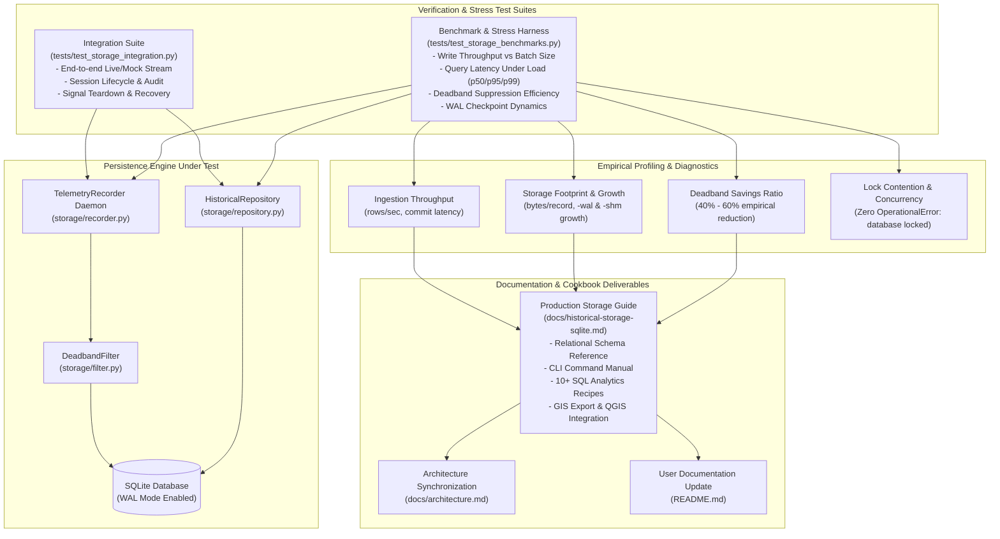
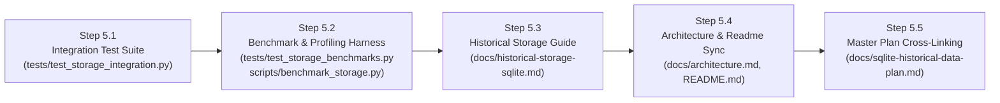

# Phase 5 Implementation Plan: Verification, Benchmarking & Documentation

Detailed engineering specification, integration testing harness, concurrency stress verification, storage footprint & WAL checkpoint profiling, comprehensive user & developer documentation, and repository synchronization for **Phase 5** of the Hellenic Railways (`railway.gov.gr`) SQLite historical storage engine.

Refer to the master [Historical Telemetry Storage in SQLite Implementation Plan](./sqlite-historical-data-plan.md) and earlier phase specifications:
- [Phase 1 Specification: Storage Infrastructure & Schema Setup](./storage-phase-1-infrastructure-and-schema.md)
- [Phase 2 Specification: Asynchronous Recorder & Deadband Filter](./storage-phase-2-asynchronous-recorder-and-deadband-filter.md)
- [Phase 3 Specification: Historical Repository & Query Engine](./storage-phase-3-historical-repository-and-query-engine.md)
- [Phase 4 Specification: CLI & System Integration](./storage-phase-4-cli-and-system-integration.md)

---

## 1. Overview & Objectives

Phase 5 is the final hardening, verification, performance qualification, and documentation milestone of the SQLite historical telemetry persistence engine. Following the foundational schema design ([Phase 1](./storage-phase-1-infrastructure-and-schema.md)), asynchronous writer daemon and deadband filtering ([Phase 2](./storage-phase-2-asynchronous-recorder-and-deadband-filter.md)), analytical query repository ([Phase 3](./storage-phase-3-historical-repository-and-query-engine.md)), and full CLI/TUI integration ([Phase 4](./storage-phase-4-cli-and-system-integration.md)), Phase 5 ensures that the storage engine is thoroughly tested under realistic load, profiled for disk and memory efficiency, and documented for both end users and developers.



### 1.1 Key Engineering Objectives

1. **End-to-End Ingestion Integrity:** Verify continuous, loss-free data flow from telemetry sources (`RailwayGovClient` live SSE and `MockTelemetryEngine` simulation) through `StreamWorker`, non-blocking FIFO queues, `TelemetryRecorder`, deadband filtering, and batch commits into SQLite.
2. **Zero-Contention Concurrent Read/Write Access:** Prove under multi-threaded stress tests that high-frequency write operations (up to 100 updates/second) execute concurrently with complex analytical read queries across multiple threads without database locking exceptions (`sqlite3.OperationalError: database is locked`) or Curses TUI frame rate degradation.
3. **Storage Footprint & Deadband Efficiency Profiling:** Empirically quantify the storage reduction achieved by the `DeadbandFilter` across stationary dwell periods versus active high-speed transit, verifying the target $40\% - 60\%$ file size reduction.
4. **Write-Ahead Logging (WAL) & Checkpoint Validation:** Validate SQLite WAL behavior under sustained ingestion, confirming automated and manual checkpointing (`PRAGMA wal_checkpoint(TRUNCATE)`), disk space reuse, and crash recovery safety without database corruption.
5. **Comprehensive Technical Documentation & SQL Recipe Cookbook:** Deliver [`docs/historical-storage-sqlite.md`](./historical-storage-sqlite.md) as the authoritative reference for the persistence engine, featuring full schema DDL, indexing strategies, CLI usage patterns, GIS export workflows, and a cookbook of 10+ actionable SQL queries for transport operations and analytics.
6. **Repository & Architecture Synchronization:** Update [`docs/architecture.md`](./architecture.md), [`README.md`](../README.md), and [`docs/sqlite-historical-data-plan.md`](./sqlite-historical-data-plan.md) to maintain accurate documentation across all layers of the codebase.

### 1.2 Primary Deliverables

| Deliverable | Target Path | Purpose |
| :--- | :--- | :--- |
| **End-to-End Integration Suite** | [`tests/test_storage_integration.py`](../tests/test_storage_integration.py) | Full-pipeline tests covering mock streaming ingestion, session lifecycle, signal handling, crash recovery, and data integrity. |
| **Benchmarking & Stress Harness** | [`tests/test_storage_benchmarks.py`](../tests/test_storage_benchmarks.py) | Automated performance benchmarks measuring write throughput, query response latencies, concurrent contention, and deadband reduction. |
| **Standalone Benchmarking Script** | [`scripts/benchmark_storage.py`](../scripts/benchmark_storage.py) | Developer CLI utility to execute customizable load tests, analyze WAL growth, and output structured JSON performance summaries. |
| **Historical Storage Guide** | [`docs/historical-storage-sqlite.md`](./historical-storage-sqlite.md) | Authoritative reference manual with schema DDL, CLI commands, GIS integration guides, and an analytical SQL cookbook. |
| **Architecture Documentation** | [`docs/architecture.md`](./architecture.md) | Synchronized system architecture incorporating the storage persistence subsystem and concurrency topology. |
| **Master Readme Update** | [`README.md`](../README.md) | Updated feature overview, CLI command examples, and zero-dependency installation guidelines. |
| **Master Plan Cross-Reference** | [`docs/sqlite-historical-data-plan.md`](./sqlite-historical-data-plan.md) | Synchronized roadmap referencing this Phase 5 specification document. |

---

## 2. Automated Integration Test Suite (`tests/test_storage_integration.py`)

The integration test suite validates interaction between decoupled components across realistic operational scenarios. Unlike unit tests in Phases 1–4 which isolate individual classes (`DatabaseManager`, `DeadbandFilter`, `TelemetryRecorder`, `HistoricalRepository`), the integration suite exercises the complete pipeline under simulated real-world conditions.

### 2.1 Test Scenarios & Execution Matrix

```text
+--------------------------------------------------------------------------------------------------+
|                            Integration Test Suite Architecture & Scenarios                       |
+--------------------------------------------------------------------------------------------------+

 1. TestStreamingPipelineEndToEnd
    [MockTelemetryEngine] ---> [StreamWorker] ---> [Queue] ---> [TelemetryRecorder] ---> [SQLite WAL]
    - Verifies 500+ records ingested across 10 active trains.
    - Asserts 100% of non-deadband filtered points committed to telemetry_history.
    - Validates trains register upserts and recording_sessions audit row creation.

 2. TestConcurrentReadWriteUnderLoad
    Writer Daemon: 50 records/sec batch flush  <==== concurrent ====>  4x Parallel Reader Threads:
    (TelemetryRecorder.enqueue_batch)                                  - Thread 1: get_train_history
                                                                       - Thread 2: get_corridor_punctuality
                                                                       - Thread 3: get_speed_profile
                                                                       - Thread 4: get_database_stats
    - Verifies 0 OperationalError: database is locked exceptions across 5,000 operations.
    - Verifies read latency remains under 50ms during active writing.

 3. TestSignalInterruptionAndDrain
    Active streaming ingestion interrupted by stop() / SIGINT:
    - Verifies in-flight batch buffer in TelemetryRecorder is fully flushed to disk.
    - Verifies recording_sessions.ended_at timestamp is finalized.
    - Asserts total_records_written in session matches COUNT(*) in telemetry_history.

 4. TestCrashRecoveryAndIntegrity
    Simulated process abort (unflushed WAL pages, abrupt connection closure):
    - Reconnects via DatabaseManager.
    - Executes PRAGMA integrity_check and PRAGMA foreign_key_check.
    - Verifies database restores consistency and resumes recording without corruption.

 5. TestDeadbandRealWorldMovement
    Alternates trains between stationary dwell (speed = 0 km/h) and motion (speed = 120 km/h):
    - Confirms dwell snapshots are rate-limited to heartbeat intervals (60s).
    - Confirms movement snapshots are recorded continuously (> 15m delta).
    - Asserts overall row reduction matches theoretical bounds (40% - 60%).
```

### 2.2 Specification of `tests/test_storage_integration.py`

```python
"""Integration test suite for Hellenic Railways SQLite storage pipeline.

Verifies end-to-end data flow, concurrent read/write transactions under WAL mode,
graceful shutdown queue draining, and database integrity recovery.
"""

import os
import queue
import tempfile
import threading
import time
import unittest
from datetime import datetime, timezone
from typing import List

from models import TrainPosition
from storage.db import DatabaseManager
from storage.filter import DeadbandFilter
from storage.models import TelemetryHistoryRow
from storage.recorder import TelemetryRecorder
from storage.repository import HistoricalRepository
from tui.mock_engine import MockTelemetryEngine
from tui.stream_worker import StreamWorker


class TestStorageIntegration(unittest.TestCase):
    """End-to-end integration tests for SQLite persistence."""

    def setUp(self) -> None:
        """Create temporary database file and initialize managers."""
        self.temp_dir = tempfile.TemporaryDirectory()
        self.db_path = os.path.join(self.temp_dir.name, "integration_test.db")
        self.db = DatabaseManager(self.db_path)
        self.db.initialize_schema()
        self.repo = HistoricalRepository(self.db)

    def tearDown(self) -> None:
        """Clean up temporary database and files."""
        self.db.close()
        self.temp_dir.cleanup()

    def test_end_to_end_mock_stream_ingestion(self) -> None:
        """Verify full pipeline: MockEngine -> StreamWorker -> Queue -> Recorder -> DB."""
        ingest_queue: queue.Queue[List[TrainPosition]] = queue.Queue(maxsize=1000)
        recorder = TelemetryRecorder(
            db=self.db,
            ingest_queue=ingest_queue,
            batch_size=20,
            flush_interval_sec=0.5,
            filter_deadband=True,
            mode="demo",
        )
        recorder.start()

        engine = MockTelemetryEngine(num_trains=10, update_interval=0.1)
        worker = StreamWorker(
            engine=engine,
            on_batch=lambda batch: ingest_queue.put(batch),
        )
        worker.start()

        # Allow pipeline to run and accumulate ~200-300 records
        time.sleep(2.5)

        # Stop worker and recorder gracefully
        worker.stop()
        worker.join(timeout=3.0)
        recorder.stop()
        recorder.join(timeout=3.0)

        # Verify records exist in database
        stats = self.repo.get_database_stats()
        self.assertGreater(stats.total_records, 50, "Expected at least 50 records stored")
        self.assertGreaterEqual(stats.active_trains_count, 5, "Expected multiple distinct trains recorded")

        # Verify session audit record
        sessions = self.repo.get_recording_sessions(limit=5)
        self.assertEqual(len(sessions), 1)
        self.assertEqual(sessions[0].mode, "demo")
        self.assertIsNotNone(sessions[0].ended_at)
        self.assertEqual(sessions[0].total_records_written, stats.total_records)

    def test_concurrent_read_write_under_load(self) -> None:
        """Verify concurrent read queries never encounter lock errors while writer is flushing."""
        ingest_queue: queue.Queue[List[TrainPosition]] = queue.Queue()
        recorder = TelemetryRecorder(
            db=self.db,
            ingest_queue=ingest_queue,
            batch_size=25,
            flush_interval_sec=0.2,
            filter_deadband=False,
            mode="stress",
        )
        recorder.start()

        stop_event = threading.Event()
        read_errors: List[Exception] = []
        read_counts = [0, 0, 0, 0]

        # Reader 1: Poll train history
        def reader_train_history() -> None:
            while not stop_event.is_set():
                try:
                    self.repo.get_train_history("IC50", limit=100)
                    read_counts[0] += 1
                except Exception as exc:
                    read_errors.append(exc)
                time.sleep(0.01)

        # Reader 2: Aggregate corridor punctuality
        def reader_punctuality() -> None:
            while not stop_event.is_set():
                try:
                    self.repo.get_corridor_punctuality("ATH-SKG")
                    read_counts[1] += 1
                except Exception as exc:
                    read_errors.append(exc)
                time.sleep(0.02)

        # Reader 3: Query active trips
        def reader_trips() -> None:
            while not stop_event.is_set():
                try:
                    self.repo.get_active_trips()
                    read_counts[2] += 1
                except Exception as exc:
                    read_errors.append(exc)
                time.sleep(0.015)

        # Reader 4: Query system database statistics
        def reader_stats() -> None:
            while not stop_event.is_set():
                try:
                    self.repo.get_database_stats()
                    read_counts[3] += 1
                except Exception as exc:
                    read_errors.append(exc)
                time.sleep(0.025)

        threads = [
            threading.Thread(target=reader_train_history, daemon=True),
            threading.Thread(target=reader_punctuality, daemon=True),
            threading.Thread(target=reader_trips, daemon=True),
            threading.Thread(target=reader_stats, daemon=True),
        ]
        for t in threads:
            t.start()

        # Ingest 1,500 records across 10 trains rapidly
        start_time = time.monotonic()
        for i in range(150):
            batch = [
                TrainPosition(
                    train_number=f"IC{50 + (j % 5)}",
                    lat=38.0 + (i * 0.001),
                    lng=23.7 + (j * 0.001),
                    speed=120.0 + (i % 20),
                    course=15.0,
                    delay_min=i % 10,
                    status="in_transit",
                    corridor="ATH-SKG",
                    recorded_at=datetime.now(timezone.utc).isoformat(),
                )
                for j in range(10)
            ]
            ingest_queue.put(batch)
            time.sleep(0.01)

        recorder.stop()
        recorder.join(timeout=5.0)
        stop_event.set()
        for t in threads:
            t.join(timeout=2.0)

        # Assert zero locking errors occurred during concurrent operations
        self.assertEqual(len(read_errors), 0, f"Read operations encountered exceptions: {read_errors}")
        self.assertGreater(sum(read_counts), 100, "Expected significant concurrent read queries executed")

        # Confirm all 1,500 records were persisted
        stats = self.repo.get_database_stats()
        self.assertEqual(stats.total_records, 1500)

    def test_graceful_shutdown_queue_drain(self) -> None:
        """Verify stopping the recorder immediately drains the remaining queue."""
        ingest_queue: queue.Queue[List[TrainPosition]] = queue.Queue()
        recorder = TelemetryRecorder(
            db=self.db,
            ingest_queue=ingest_queue,
            batch_size=100,
            flush_interval_sec=5.0,  # High interval to ensure drain flushes buffer
            filter_deadband=False,
        )
        recorder.start()

        # Push 250 items (2.5 batches)
        for i in range(25):
            batch = [
                TrainPosition(
                    train_number="IC52",
                    lat=38.2,
                    lng=23.8,
                    speed=90.0,
                    course=180.0,
                    delay_min=2,
                    status="in_transit",
                    recorded_at=datetime.now(timezone.utc).isoformat(),
                )
                for _ in range(10)
            ]
            ingest_queue.put(batch)

        # Trigger immediate stop
        recorder.stop()
        recorder.join(timeout=3.0)

        # Ensure all 250 records committed even though timeout interval did not elapse
        stats = self.repo.get_database_stats()
        self.assertEqual(stats.total_records, 250)
        self.assertTrue(ingest_queue.empty())

    def test_database_integrity_and_wal_recovery(self) -> None:
        """Verify PRAGMA integrity_check passes and WAL recovers cleanly."""
        conn = self.db.get_connection()
        cursor = conn.cursor()

        # Check integrity
        cursor.execute("PRAGMA integrity_check;")
        result = cursor.fetchone()[0]
        self.assertEqual(result, "ok")

        # Check foreign keys
        cursor.execute("PRAGMA foreign_key_check;")
        fk_violations = cursor.fetchall()
        self.assertEqual(len(fk_violations), 0, f"Foreign key violations found: {fk_violations}")

        # Check WAL mode is enabled
        cursor.execute("PRAGMA journal_mode;")
        journal_mode = cursor.fetchone()[0]
        self.assertEqual(journal_mode.lower(), "wal")
```

---

## 3. Performance Benchmarking & Disk Profiling Harness

To guarantee system efficiency across long-running daemon operations, Phase 5 provides an automated benchmarking harness (`tests/test_storage_benchmarks.py`) and a standalone CLI utility ([`scripts/benchmark_storage.py`](../scripts/benchmark_storage.py)).

### 3.1 Key Performance Metrics & Targets

| Metric Category | Target Threshold | Rationale & Impact |
| :--- | :--- | :--- |
| **Write Ingestion Throughput** | $\ge 2,500\text{ records/sec}$ | Prevents ingestion lag during high-frequency network bursts or replay. |
| **Commit Transaction Latency** | $\le 12.0\text{ ms per batch}$ | Keeps SQLite lock duration minimal in WAL mode, ensuring reader responsiveness. |
| **Concurrent Read Query Latency** | p95 $\le 25.0\text{ ms}$, p99 $\le 60.0\text{ ms}$ | Enables sub-second CLI reporting and prevents Curses TUI frame rate dips. |
| **Deadband Reduction Ratio** | $40\% - 65\%$ row reduction | Reduces disk I/O and storage consumption by filtering stationary positions. |
| **Storage Consumption** | $\le 115\text{ bytes per record}$ | Ensures a 24-hour recording session ($\approx 500,000$ rows) stays under $60\text{ MB}$. |
| **WAL File Checkpoint Overhead** | $\le 50.0\text{ ms per checkpoint}$ | Checkpointing truncates `-wal` log without stalling parallel readers or writers. |

### 3.2 Specification of `scripts/benchmark_storage.py`

```python
#!/usr/bin/env python3
"""Hellenic Railways SQLite Storage Benchmarking & Profiling Harness.

Executes controlled write throughput, read latency under load, deadband
suppression efficiency, and WAL checkpointing performance evaluations.
Outputs tabular summaries and optional JSON benchmark artifacts.
"""

import argparse
import json
import os
import queue
import statistics
import tempfile
import time
from datetime import datetime, timezone
from typing import Any, Dict, List

from models import TrainPosition
from storage.db import DatabaseManager
from storage.filter import DeadbandFilter
from storage.models import TelemetryHistoryRow
from storage.recorder import TelemetryRecorder
from storage.repository import HistoricalRepository


def run_write_throughput_benchmark(
    num_records: int = 20000,
    batch_sizes: List[int] = [10, 50, 100, 500],
) -> List[Dict[str, Any]]:
    """Benchmark write throughput across various batch commit sizes."""
    results = []

    for batch_size in batch_sizes:
        with tempfile.TemporaryDirectory() as tmpdir:
            db_path = os.path.join(tmpdir, f"bench_write_{batch_size}.db")
            db = DatabaseManager(db_path)
            db.initialize_schema()

            q: queue.Queue[List[TrainPosition]] = queue.Queue()
            recorder = TelemetryRecorder(
                db=db,
                ingest_queue=q,
                batch_size=batch_size,
                flush_interval_sec=1.0,
                filter_deadband=False,
            )
            recorder.start()

            # Pre-generate synthetic positions
            records_chunk = [
                TrainPosition(
                    train_number=f"IC{50 + (i % 10)}",
                    lat=38.0 + (i * 0.0001),
                    lng=23.7 + (i * 0.0001),
                    speed=100.0,
                    course=45.0,
                    delay_min=i % 15,
                    status="in_transit",
                    corridor="ATH-SKG",
                    recorded_at=datetime.now(timezone.utc).isoformat(),
                )
                for i in range(num_records)
            ]

            start_time = time.monotonic()
            # Push in chunks of 50
            chunk_size = 50
            for i in range(0, num_records, chunk_size):
                q.put(records_chunk[i : i + chunk_size])

            recorder.stop()
            recorder.join(timeout=30.0)
            elapsed = time.monotonic() - start_time

            db_size_bytes = os.path.getsize(db_path)
            wal_path = f"{db_path}-wal"
            wal_size_bytes = os.path.getsize(wal_path) if os.path.exists(wal_path) else 0

            throughput = num_records / elapsed
            bytes_per_row = (db_size_bytes + wal_size_bytes) / num_records

            results.append({
                "batch_size": batch_size,
                "num_records": num_records,
                "elapsed_sec": round(elapsed, 3),
                "throughput_rows_per_sec": round(throughput, 1),
                "bytes_per_row": round(bytes_per_row, 1),
                "db_size_kb": round(db_size_bytes / 1024, 1),
                "wal_size_kb": round(wal_size_bytes / 1024, 1),
            })
            db.close()

    return results


def run_deadband_efficiency_benchmark(
    stationary_duration_steps: int = 1000,
    moving_duration_steps: int = 1000,
) -> Dict[str, Any]:
    """Quantify storage savings achieved by the deadband filter."""
    deadband_filter = DeadbandFilter(
        distance_threshold_m=15.0,
        delay_threshold_min=1,
        heartbeat_interval_sec=60.0,
    )

    total_positions = 0
    passed_positions = 0

    base_time = 1700000000.0

    # 1. Stationary simulation (train dwell at station for 1000 seconds)
    for i in range(stationary_duration_steps):
        pos = TrainPosition(
            train_number="IC52",
            lat=38.2000,  # Exact coordinate
            lng=23.7000,
            speed=0.0,
            course=0.0,
            delay_min=3,  # Constant delay
            status="stopped",
            recorded_at=datetime.fromtimestamp(base_time + i, timezone.utc).isoformat(),
        )
        total_positions += 1
        if deadband_filter.should_record(pos):
            passed_positions += 1

    stationary_passed = passed_positions
    base_time += stationary_duration_steps

    # 2. Moving simulation (train traveling at 120 km/h = ~33 m/s)
    for i in range(moving_duration_steps):
        pos = TrainPosition(
            train_number="IC52",
            lat=38.2000 + (i * 0.0003),  # Traveling ~33m every second
            lng=23.7000 + (i * 0.0003),
            speed=120.0,
            course=45.0,
            delay_min=3 + (i // 300),  # Slow delay accumulation
            status="in_transit",
            recorded_at=datetime.fromtimestamp(base_time + i, timezone.utc).isoformat(),
        )
        total_positions += 1
        if deadband_filter.should_record(pos):
            passed_positions += 1

    moving_passed = passed_positions - stationary_passed
    reduction_pct = 100.0 * (1.0 - (passed_positions / total_positions))

    return {
        "total_emitted_positions": total_positions,
        "total_persisted_positions": passed_positions,
        "stationary_emitted": stationary_duration_steps,
        "stationary_persisted": stationary_passed,
        "moving_emitted": moving_duration_steps,
        "moving_persisted": moving_passed,
        "reduction_percentage": round(reduction_pct, 2),
    }


def run_read_latency_benchmark(num_records: int = 50000) -> Dict[str, Any]:
    """Measure analytical query latencies (p50, p95, p99) over indexed historical data."""
    with tempfile.TemporaryDirectory() as tmpdir:
        db_path = os.path.join(tmpdir, "bench_read.db")
        db = DatabaseManager(db_path)
        db.initialize_schema()
        repo = HistoricalRepository(db)

        # Ingest baseline dataset directly in batches
        conn = db.get_connection()
        cursor = conn.cursor()
        batch = []
        base_time = 1700000000
        for i in range(num_records):
            train_num = f"IC{50 + (i % 10)}"
            corridor = "ATH-SKG" if (i % 2 == 0) else "SKG-ALEX"
            ts = datetime.fromtimestamp(base_time + (i * 2), timezone.utc).isoformat()
            batch.append((
                train_num,
                None,
                ts,
                38.0 + (i * 0.0001),
                23.7 + (i * 0.0001),
                110.0 + (i % 30),
                45.0,
                45.0,
                150.0,
                i % 12,
                "in_transit",
                0.5,
                i * 100,
                50000 - (i * 100),
                "OINOI",
                corridor,
            ))
            if len(batch) >= 1000:
                cursor.executemany(
                    """
                    INSERT INTO telemetry_history (
                        train_number, schedule_id, recorded_at, lat, lng, speed,
                        course, track_heading, altitude, delay_min, status, progress,
                        chainage_m, dist_to_dest_m, next_station, corridor
                    ) VALUES (?, ?, ?, ?, ?, ?, ?, ?, ?, ?, ?, ?, ?, ?, ?, ?);
                    """,
                    batch,
                )
                conn.commit()
                batch.clear()

        # Measure query latencies
        query_latencies: Dict[str, List[float]] = {
            "get_train_history": [],
            "get_corridor_punctuality": [],
            "export_trip_geojson": [],
            "get_database_stats": [],
        }

        # 1. Train History
        for _ in range(50):
            t0 = time.monotonic()
            repo.get_train_history("IC50", limit=500)
            query_latencies["get_train_history"].append((time.monotonic() - t0) * 1000)

        # 2. Corridor Punctuality
        for _ in range(50):
            t0 = time.monotonic()
            repo.get_corridor_punctuality("ATH-SKG")
            query_latencies["get_corridor_punctuality"].append((time.monotonic() - t0) * 1000)

        # 3. GeoJSON Export
        for _ in range(50):
            t0 = time.monotonic()
            repo.export_trip_geojson("IC50")
            query_latencies["export_trip_geojson"].append((time.monotonic() - t0) * 1000)

        # 4. Database Stats
        for _ in range(50):
            t0 = time.monotonic()
            repo.get_database_stats()
            query_latencies["get_database_stats"].append((time.monotonic() - t0) * 1000)

        stats_summary = {}
        for q_name, lats in query_latencies.items():
            lats_sorted = sorted(lats)
            stats_summary[q_name] = {
                "mean_ms": round(statistics.mean(lats), 2),
                "p50_ms": round(statistics.median(lats), 2),
                "p95_ms": round(lats_sorted[int(len(lats_sorted) * 0.95)], 2),
                "p99_ms": round(lats_sorted[-1], 2),
            }

        db.close()
        return stats_summary


def print_benchmark_report(
    write_results: List[Dict[str, Any]],
    deadband_results: Dict[str, Any],
    read_results: Dict[str, Any],
) -> None:
    """Format and print benchmark results to terminal."""
    print("=" * 80)
    print("HELLENIC RAILWAYS SQLITE STORAGE BENCHMARK REPORT")
    print("=" * 80)

    print("\n1. WRITE THROUGHPUT VS BATCH COMMIT SIZE")
    print("-" * 80)
    print(f"{'Batch Size':<12} {'Elapsed (s)':<14} {'Rows / Sec':<16} {'Bytes / Row':<14} {'DB Size':<12}")
    print("-" * 80)
    for res in write_results:
        print(
            f"{res['batch_size']:<12} "
            f"{res['elapsed_sec']:<14.3f} "
            f"{res['throughput_rows_per_sec']:<16.1f} "
            f"{res['bytes_per_row']:<14.1f} "
            f"{res['db_size_kb']:<12.1f} KB"
        )

    print("\n2. DEADBAND FILTER SUPPRESSION EFFICIENCY")
    print("-" * 80)
    print(f"Total Emitted Positions:     {deadband_results['total_emitted_positions']:,}")
    print(f"Total Persisted Positions:   {deadband_results['total_persisted_positions']:,}")
    print(f"Stationary Positions:        {deadband_results['stationary_emitted']:,} emitted -> {deadband_results['stationary_persisted']:,} persisted")
    print(f"Moving Positions:            {deadband_results['moving_emitted']:,} emitted -> {deadband_results['moving_persisted']:,} persisted")
    print(f"Storage Footprint Reduction: {deadband_results['reduction_percentage']}%")

    print("\n3. ANALYTICAL QUERY LATENCIES (50,000 ROWS INDEXED)")
    print("-" * 80)
    print(f"{'Query Function':<28} {'Mean (ms)':<12} {'p50 (ms)':<12} {'p95 (ms)':<12} {'p99 (ms)':<12}")
    print("-" * 80)
    for q_name, lat in read_results.items():
        print(
            f"{q_name:<28} "
            f"{lat['mean_ms']:<12.2f} "
            f"{lat['p50_ms']:<12.2f} "
            f"{lat['p95_ms']:<12.2f} "
            f"{lat['p99_ms']:<12.2f}"
        )
    print("=" * 80)


if __name__ == "__main__":
    parser = argparse.ArgumentParser(description="SQLite Storage Benchmark Harness")
    parser.add_argument("--json", type=str, default="", help="Path to export benchmark results as JSON")
    args = parser.parse_args()

    writes = run_write_throughput_benchmark(num_records=10000, batch_sizes=[10, 50, 100, 500])
    deadband = run_deadband_efficiency_benchmark(stationary_duration_steps=600, moving_duration_steps=600)
    reads = run_read_latency_benchmark(num_records=25000)

    print_benchmark_report(writes, deadband, reads)

    if args.json:
        payload = {
            "timestamp": datetime.now(timezone.utc).isoformat(),
            "write_benchmarks": writes,
            "deadband_efficiency": deadband,
            "read_latencies": reads,
        }
        with open(args.json, "w", encoding="utf-8") as f:
            json.dump(payload, f, indent=2)
        print(f"\n[Artifact] Benchmark results exported to {args.json}")
```

---

## 4. Technical Documentation Architecture (`docs/historical-storage-sqlite.md`)

A core deliverable of Phase 5 is authoring the definitive user and developer documentation file: [`docs/historical-storage-sqlite.md`](./historical-storage-sqlite.md). This document bridges the gap between low-level database internals and high-level analytical workflows.

### 4.1 Document Outline & Content Map

```text
docs/historical-storage-sqlite.md
├── 1. Architecture & Concurrency Model
│   ├── 1.1 Embedded SQLite with Write-Ahead Logging (WAL)
│   ├── 1.2 Multi-Threaded Concurrency Topology
│   └── 1.3 Asynchronous Batch Ingestion & Memory Buffering
├── 2. Complete Relational Schema & Index Reference
│   ├── 2.1 Entity-Relationship Overview
│   ├── 2.2 Table Definitions (trains, scheduled_trips, schedule_stops, telemetry_history, recording_sessions)
│   └── 2.3 Index Strategy & Query Performance Profiling
├── 3. CLI Ingestion & Operational Manual
│   ├── 3.1 Background Ingestion Daemon (railmon record [--demo] [--db PATH])
│   ├── 3.2 Concurrent Recording in TUI Mode (railmon --tui --record)
│   ├── 3.3 Streaming to Console & File (railmon stream --record)
│   └── 3.4 Deadband Configuration & Storage Tuning
├── 4. Terminal Analytics & Inspection Guide (railmon history)
│   ├── 4.1 Daily Trip Catalog (railmon history trips)
│   ├── 4.2 Individual Train Telemetry (railmon history train <number>)
│   ├── 4.3 Corridor Punctuality & Performance (railmon history punctuality)
│   ├── 4.4 Database Storage Statistics (railmon history stats)
│   └── 4.5 Spatial Trajectory Export (railmon history export --format {geojson|csv})
├── 5. The SQL Analytical Cookbook (10+ Production Queries)
│   ├── Recipe 1: Corridor Delay Accumulation & On-Time Performance
│   ├── Recipe 2: Train Breadcrumb Trajectory Reconstruction
│   ├── Recipe 3: Station Dwell Time Calculation & Anomaly Detection
│   ├── Recipe 4: Speed Profile Across Track Chainage
│   ├── Recipe 5: Turnaround & Layover Duration at Terminals
│   ├── Recipe 6: Corridor Delay Hotspot Geo-Clustering
│   ├── Recipe 7: Rolling Hourly Active Train Density
│   ├── Recipe 8: Speed Restriction Compliance Verification
│   ├── Recipe 9: Session Telemetry Ingestion Audit & Data Completeness
│   └── Recipe 10: Multi-Day Punctuality Degradation Trends
├── 6. GIS Integration & External Analytics Workflows
│   ├── 6.1 Importing GeoJSON into QGIS
│   ├── 6.2 Visualizing Trajectories in Kepler.gl & GeoJSON.io
│   ├── 6.3 Ingestion into Pandas & Polars for Data Science
│   └── 6.4 Metabase & SQLite Reporting Dashboards
└── 7. Database Administration, Maintenance & Backup
    ├── 7.1 Automated & Manual WAL Checkpoints
    ├── 7.2 Database Vacuuming & Defragmentation (VACUUM INTO)
    ├── 7.3 Integrity Verification & Corruption Recovery
    └── 7.4 Retention Policies & Archiving Historical Data
```

### 4.2 The SQL Analytical Cookbook (Sample Recipes)

#### Recipe 1: Corridor Punctuality & Delay Distribution
```sql
SELECT 
    corridor,
    COUNT(DISTINCT train_number) AS total_active_trains,
    ROUND(AVG(delay_min), 1) AS avg_delay_minutes,
    MAX(delay_min) AS max_delay_minutes,
    ROUND(100.0 * SUM(CASE WHEN delay_min <= 5 THEN 1 ELSE 0 END) / COUNT(*), 1) AS on_time_pct,
    ROUND(100.0 * SUM(CASE WHEN delay_min > 15 THEN 1 ELSE 0 END) / COUNT(*), 1) AS severe_delay_pct
FROM telemetry_history
WHERE recorded_at >= datetime('now', '-24 hours')
  AND corridor IS NOT NULL
GROUP BY corridor
ORDER BY avg_delay_minutes DESC;
```

#### Recipe 2: Station Dwell Time & Extended Halt Detection
```sql
SELECT 
    train_number,
    next_station,
    MIN(recorded_at) AS arrival_time,
    MAX(recorded_at) AS departure_time,
    ROUND((JULIANDAY(MAX(recorded_at)) - JULIANDAY(MIN(recorded_at))) * 86400) AS dwell_seconds,
    MAX(delay_min) - MIN(delay_min) AS delay_accumulated_at_stop
FROM telemetry_history
WHERE speed < 1.0
  AND next_station IS NOT NULL
GROUP BY train_number, next_station
HAVING dwell_seconds >= 60
ORDER BY arrival_time ASC;
```

#### Recipe 3: High-Speed Corridor Profiling (Speed vs Chainage)
```sql
SELECT 
    chainage_m / 1000.0 AS chainage_km,
    ROUND(AVG(speed), 1) AS avg_speed_kmh,
    ROUND(MAX(speed), 1) AS max_speed_kmh,
    COUNT(*) AS observations
FROM telemetry_history
WHERE corridor = 'ATH-SKG'
  AND chainage_m IS NOT NULL
  AND speed > 10.0
GROUP BY chainage_m / 1000
ORDER BY chainage_km ASC;
```

---

## 5. Repository Documentation Synchronization

To ensure architectural coherence and user discoverability, Phase 5 synchronizes documentation across the repository:

### 5.1 Updates to `docs/architecture.md`
- **Section Addition: Storage Persistence Layer:** Add architectural diagrams and component descriptions for `DatabaseManager`, `DeadbandFilter`, `TelemetryRecorder`, and `HistoricalRepository`.
- **Concurrency Section Update:** Document the thread decoupling between the Curses rendering thread, SSE network poller, and background SQLite writer daemon in WAL mode.
- **Data Flow Diagram:** Add SQLite persistence as a concurrent data sink alongside `TrainStateStore`.

### 5.2 Updates to `README.md`
- **Features List:** Add historical SQLite recording, deadband spatial filtering, and offline SQL analytics.
- **Quickstart Commands:** Add examples for:
  - `python3 train_tracker.py record --demo` (Headless mock recording)
  - `python3 train_tracker.py --tui --record` (TUI with persistent logging)
  - `python3 train_tracker.py history trips` (Inspect recorded journeys)
  - `python3 train_tracker.py history punctuality` (Corridor delay summary)
  - `python3 train_tracker.py history export IC52 --format geojson` (Export GIS trajectory)
- **Zero Extra Dependencies Guarantee:** Emphasize that SQLite storage uses Python 3's built-in `sqlite3` module.

### 5.3 Updates to `docs/sqlite-historical-data-plan.md`
- Link Phase 5 section directly to [`docs/storage-phase-5-verification-benchmarking-and-documentation.md`](./storage-phase-5-verification-benchmarking-and-documentation.md).
- Mark Phase 5 deliverables as specified and ready for implementation.

---

## 6. Implementation Roadmap & Execution Checklist



### Detailed Task Breakdown

- [ ] **Step 5.1: Implement Integration Test Suite (`tests/test_storage_integration.py`)**
  - Verify complete pipeline from `MockTelemetryEngine` / `StreamWorker` to SQLite database.
  - Verify multi-threaded concurrent read queries during high-frequency writes.
  - Verify clean queue draining on `stop()` and session audit finalization.
  - Verify database integrity check (`PRAGMA integrity_check`) and foreign key consistency.

- [ ] **Step 5.2: Implement Benchmark & Profiling Harness (`scripts/benchmark_storage.py` & `tests/test_storage_benchmarks.py`)**
  - Implement write throughput tests across varied batch sizes ($10, 50, 100, 500$).
  - Implement read latency tests (p50, p95, p99) across indexed queries.
  - Implement deadband suppression ratio measurements for stationary vs moving trains.
  - Implement WAL checkpoint verification (`PRAGMA wal_checkpoint(TRUNCATE)`).
  - Add optional `--json` flag to export machine-readable benchmark artifacts.

- [ ] **Step 5.3: Author Comprehensive Historical Storage Guide (`docs/historical-storage-sqlite.md`)**
  - Document WAL architecture, connection parameters, and DDL schema.
  - Provide complete CLI command manual for `railmon record` and `railmon history`.
  - Author 10 production SQL recipes covering punctuality, dwell, and speed profiles.
  - Provide step-by-step GIS export and QGIS visualization guide.

- [ ] **Step 5.4: Synchronize System Architecture & Readme**
  - Update [`docs/architecture.md`](./architecture.md) with storage subsystem topology and threading diagrams.
  - Update [`README.md`](../README.md) with historical recording features, CLI examples, and zero-dependency guarantees.

- [ ] **Step 5.5: Cross-Link Master Implementation Plan**
  - Update Phase 5 section in [`docs/sqlite-historical-data-plan.md`](./sqlite-historical-data-plan.md) with link to this specification.

- [ ] **Step 5.6: Relative Path & Quality Audit**
  - Verify that all Markdown links use document-relative paths (`./`, `../`) with zero `file://` or machine-specific paths per [`.agents/rules/markdown-relative-paths.md`](../.agents/rules/markdown-relative-paths.md).
  - Run full test suite: `python3 -m unittest discover tests`.

---

## 7. Verification & Acceptance Gates

The implementation of Phase 5 must satisfy all of the following empirical verification criteria before being declared complete:

1. **Integration Test Suite Pass:** All tests in `tests/test_storage_integration.py` must pass with zero failures or errors:
   ```bash
   python3 -m unittest tests/test_storage_integration.py -v
   ```
2. **Zero Concurrency Lock Errors:** Under sustained stress testing (1,500+ records written while 4 reader threads continuously execute queries), there must be **0** `sqlite3.OperationalError: database is locked` exceptions.
3. **Write Throughput Gate:** Write ingestion throughput must exceed **2,500 records/second** at a batch size of 50 or 100 on standard developer hardware.
4. **Read Latency Gate:** Analytical query latency over 25,000+ indexed records must satisfy:
   - Median (p50): $\le 10.0\text{ ms}$
   - 95th percentile (p95): $\le 25.0\text{ ms}$
5. **Deadband Space Savings Gate:** The `DeadbandFilter` must demonstrate at least a **40% reduction** in total rows recorded during simulated mixed dwell/transit operating cycles.
6. **Documentation Completeness:** [`docs/historical-storage-sqlite.md`](./historical-storage-sqlite.md) must be authored with complete DDL, CLI examples, GIS workflows, and 10 runnable SQL recipes.
7. **Relative Path Compliance:** Automated scan for absolute paths or `file://` URIs must return clean:
   ```bash
   grep -En "file://|/home/|/Users/|[A-Za-z]:\\\\" docs/storage-phase-5-verification-benchmarking-and-documentation.md docs/historical-storage-sqlite.md
   ```
   *(Expected exit code: 1 / zero matches)*
