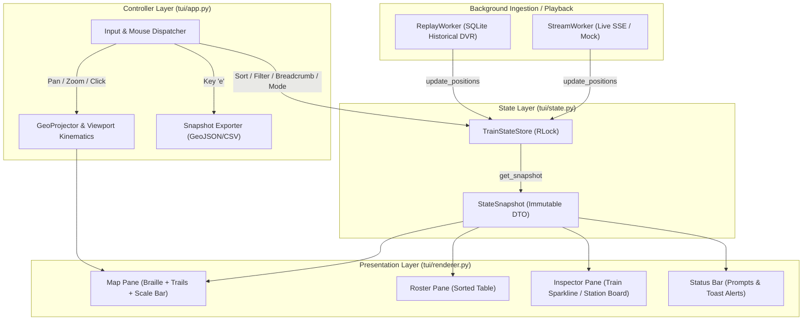
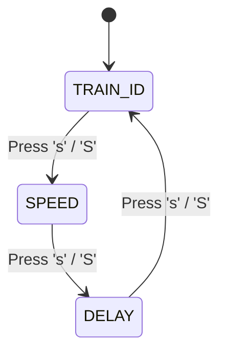
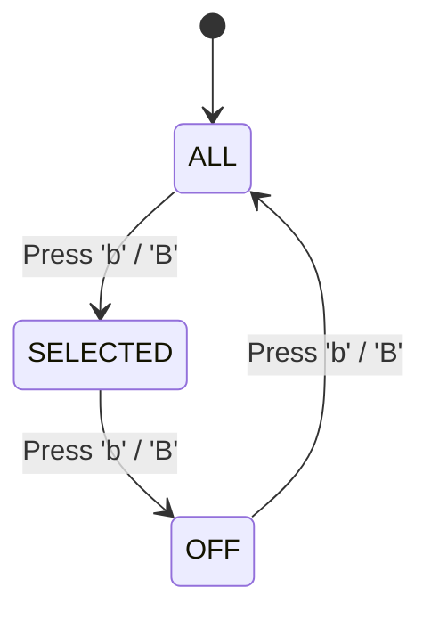
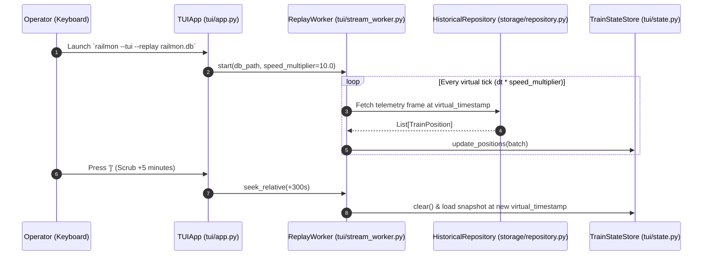

# TUI Feature Enhancements & Expansion Specification

Detailed architectural and technical specification for upcoming interactive, analytical, and geospatial enhancements to the `railmon` Curses Terminal User Interface (`tui/`).

---

## 1. Executive Summary

While the current `railmon` TUI provides a real-time Braille GIS terminal map, live train roster, telemetry inspector, corridor presets (`0`–`3`), camera follow mode (`f`), interactive filtering (`/`), dynamic train roster sorting (`s`), and historical breadcrumb trail mode toggling (`b`), several high-value analytical, interactive, and storage features can be added to further enrich the operator experience while preserving zero-dependency standard-library purity.

### Feature Summary Matrix

| Tier | Feature ID | Feature Name | Keybinding | Status | Primary Modules Affected |
| :--- | :--- | :--- | :--- | :--- | :--- |
| **Tier 1 (Parity)** | **F-1.1** | Dynamic Train Roster Sorting (`ID`, `Speed`, `Delay`) | `s` / `S` | **Implemented** | [`tui/state.py`](../tui/state.py), [`tui/app.py`](../tui/app.py), [`tui/renderer.py`](../tui/renderer.py) |
| **Tier 1 (Parity)** | **F-1.2** | Historical Breadcrumb Trail Mode Toggle (`All`, `Selected`, `Off`) | `b` / `B` | **Implemented** | [`tui/state.py`](../tui/state.py), [`tui/app.py`](../tui/app.py), [`tui/renderer.py`](../tui/renderer.py) |
| **Tier 2 (Inspector)** | **F-2.1** | Live Speed Sparkline & Telemetry Age Indicator | *(Auto)* | Proposed | [`tui/renderer.py`](../tui/renderer.py), [`tui/state.py`](../tui/state.py) |
| **Tier 2 (Inspector)** | **F-2.2** | WGS84 Coordinate Readout, Next-Station Distance & ETA | *(Auto)* | Proposed | [`tui/renderer.py`](../tui/renderer.py), [`tui/geo.py`](../tui/geo.py) |
| **Tier 3 (Map & UX)** | **F-3.1** | Terminal Mouse Interaction (Click-to-Select & Scroll Zoom) | Mouse | Proposed | [`tui/app.py`](../tui/app.py), [`tui/renderer.py`](../tui/renderer.py) |
| **Tier 3 (Map & UX)** | **F-3.2** | Station Departure Board & Proximity Inspector Mode | `m` / Click | Proposed | [`tui/state.py`](../tui/state.py), [`tui/app.py`](../tui/app.py), [`tui/renderer.py`](../tui/renderer.py) |
| **Tier 3 (Map & UX)** | **F-3.3** | Map Layer Toggles (Station Labels & Corridor Colors) | `v` / `t` | Proposed | [`tui/app.py`](../tui/app.py), [`tui/renderer.py`](../tui/renderer.py) |
| **Tier 3 (Map & UX)** | **F-3.4** | Dynamic Conformal Map Scale Bar Overlay | *(Auto)* | Proposed | [`tui/renderer.py`](../tui/renderer.py), [`tui/geo.py`](../tui/geo.py) |
| **Tier 4 (Storage)** | **F-4.1** | Instant In-TUI GeoJSON / CSV Trajectory Snapshot Export | `e` | Proposed | [`tui/app.py`](../tui/app.py), [`storage/repository.py`](../storage/repository.py) |
| **Tier 4 (Storage)** | **F-4.2** | SQLite Historical DVR Playback & Timeline Scrubbing | `--replay` | Proposed | [`tui/app.py`](../tui/app.py), [`storage/repository.py`](../storage/repository.py), [`train_tracker.py`](../train_tracker.py) |

---

## 2. Updated Dashboard Layout & Visual Mockup

### 2.1 Enhanced Multi-Pane Console Mockup (ASCII)

```text
+---------------------------------------------------------------------------------------------------+
| RAILMON | HELLENIC RAILWAYS (railway.gov.gr) | View: PATHE Mainline | Active: 14 | Delayed: 3 [●] |
+--------------------------------------------------------------------+------------------------------+
| [Map Viewport: 39.80°N, 22.50°E | Zoom: 1.5x | Trails: ALL]        | [ACTIVE TRAINS (14) | Sort:▼]|
|                                                                    |  #   TRAIN  TYPE  SPD▼  DLY  |
|   Thessaloniki                                                     | > 1  1599   IC    142   +9m  |
|     ◉===========================                                   |   2  1597   IC    118   +4m  |
|       \                        \                                   |   3  2232   PR    114    0m  |
|        \ Platy                  \                                  |   4  1314   PR     92   +1m  |
|         ◉===                     ◉ Kilkis                          |   5  2236   PR     86    0m  |
|          \  \                                                      |   6  1598   IC      0    0m  |
|           \  \ Katerini                                            +------------------------------+
|            \  ◉                                                    | [SELECTED TRAIN TELEMETRY]   |
|             \  \  ·                                                | Train No:     1599 (IC)      |
|              \  \  ·                                               | Locomotive:   120-024        |
|               \  ◉ Larissa                                         | Route:        ΑΘΗΝ -> ΘΕΣΣ   |
|                \  \  ·                                             | Next Station: Λάρισα (14.2km)|
|                 \  \  ▲ ◄ [1599] (142km/h, +9m)                    | Est. Arrival: ~6 min         |
|                  \  \                                              | Speed:        142.0 km/h     |
|                   \  ◉ Domokos                                     | Speed Trend:  ▂▃▅▆▇██▇▇█     |
|                    \  \                                            | Delay:        +9 min (Minor) |
|                     \  ◉ Lianokladi                                | Coords:       39.4821N,22.34E|
|                                                                    | Telemetry:    Updated 2s ago |
|  |---- 25 km ----|                                                 | Progress:     [======>--] 68%|
+--------------------------------------------------------------------+------------------------------+
| [q]Quit [h/j/k/l]Pan [+/-]Zoom [s]Sort [b]Trails [e]Export [m]Stations [f]Follow [/]Filter [?]Help|
+---------------------------------------------------------------------------------------------------+
```

### 2.2 Architectural Data & Event Flow (Mermaid)



---

## 3. Tier 1: Documentation Parity & Core Roster Controls

These two features are listed in the Controls Reference table of [`README.md`](../README.md#L168-L180) (`s` and `b`) and have been **implemented** to establish full parity between documentation and runtime behavior.

---

### F-1.1: Dynamic Train Roster Sorting (`s` / `S`) — *Implemented*

#### Problem Statement
[`README.md`](../README.md#L177) documents `s` to *"Cycle train roster sorting (Train ID, Speed, Delay)"*. Previously, [`TrainStateStore._compute_filtered_list`](../tui/state.py#L543-L575) sorted exclusively by `_natural_sort_key` (Train ID).

#### Technical Design & Implementation Plan
1. **`RosterSortMode` Enum & Sort Keys in [`tui/state.py`](../tui/state.py#L40-L46):**
   ```python
   class RosterSortMode(Enum):
       """Ordering criteria for the active train roster table."""

       TRAIN_ID = auto()  # Ascending natural alphanumeric train number (e.g. 50 before 1597)
       SPEED = auto()     # Descending speed in km/h (fastest first), tie-broken by TRAIN_ID
       DELAY = auto()     # Descending delay in minutes (most delayed first), tie-broken by TRAIN_ID
   ```
   - **Deterministic Comparator Functions ([`tui/state.py`](../tui/state.py#L225-L244)):**
     - `_natural_sort_key(rec: TrainRecord) -> Tuple[int, str]`: Extracts numeric digits to order commercial numbers naturally (`(0, f"{int(digits):010d}_{tn}")`) before non-numeric identifiers (`(1, tn or rec.position.id)`).
     - `_speed_sort_key(rec: TrainRecord) -> Tuple[float, Tuple[int, str]]`: Returns `(-spd, _natural_sort_key(rec))` where `spd = float(rec.position.speed) if rec.position.speed is not None else 0.0`.
     - `_delay_sort_key(rec: TrainRecord) -> Tuple[float, Tuple[int, str]]`: Returns `(-dly, _natural_sort_key(rec))` where `dly = float(rec.position.delay) if rec.position.delay is not None else 0.0`.

2. **State Machine Transition:**



```text
+-------------------------+  Press 's' / 'S'  +-------------------------+  Press 's' / 'S'  +-------------------------+
| RosterSortMode.TRAIN_ID | ----------------> |  RosterSortMode.SPEED   | ----------------> |  RosterSortMode.DELAY   |
|   (Ascending: TRAIN▲)   |                   |   (Descending: SPD▼)    |                   |   (Descending: DLY▼)    |
+-------------------------+                   +-------------------------+                   +-------------------------+
             ^                                                                                           |
             +------------------------------------ Press 's' / 'S' --------------------------------------+
```

3. **Store & Snapshot Extension in [`tui/state.py`](../tui/state.py):**
   - Initialize `self._sort_mode: RosterSortMode = RosterSortMode.TRAIN_ID` in [`TrainStateStore.__init__`](../tui/state.py#L267).
   - Expose `sort_mode: RosterSortMode = RosterSortMode.TRAIN_ID` on immutable [`StateSnapshot`](../tui/state.py#L128) and populate it in [`TrainStateStore.get_snapshot`](../tui/state.py#L389).
   - Implement [`set_sort_mode(mode: RosterSortMode) -> None`](../tui/state.py#L485-L492) with `isinstance(mode, RosterSortMode)` runtime type validation and version increment on state change.
   - Implement [`cycle_sort_mode() -> RosterSortMode`](../tui/state.py#L494-L505) to cycle `TRAIN_ID -> SPEED -> DELAY -> TRAIN_ID` under `self._lock`, preserving `self._selected_id` (and dynamically recomputing `selected_index` in the newly ordered `filtered_trains` tuple) while incrementing `self._version`.
   - Dispatch sorting in [`_compute_filtered_list`](../tui/state.py#L569-L575) based on `self._sort_mode`, ensuring `select_next()` and `select_prev()` cursor traversal automatically follow the active sort order.

4. **Renderer Glyphs & Header Indicator in [`tui/renderer.py`](../tui/renderer.py):**
   - Extend [`RenderGlyphs`](../tui/renderer.py#L93-L94) with `sort_asc` and `sort_desc`:
     - [`GLYPHS_UTF8`](../tui/renderer.py#L113-L114): `sort_asc="▲"`, `sort_desc="▼"`
     - [`GLYPHS_ASCII`](../tui/renderer.py#L133-L134): `sort_asc="^"`, `sort_desc="v"`
   - Update [`TUIRenderer.render_roster`](../tui/renderer.py#L888-L895) to render the active sort indicator while preserving fixed column alignment (`[Cursor:2][#:3][TRAIN:6][TYPE:5][SPD:5][DLY:5][ST:4]`):
     - `RosterSortMode.TRAIN_ID`: `" #   TRAIN▲ TYPE  SPD   DLY  ST"` (ASCII: `" #   TRAIN^ TYPE  SPD   DLY  ST"`)
     - `RosterSortMode.SPEED`: `" #   TRAIN  TYPE  SPD▼  DLY  ST"` (ASCII: `" #   TRAIN  TYPE  SPDv  DLY  ST"`)
     - `RosterSortMode.DELAY`: `" #   TRAIN  TYPE  SPD   DLY▼ ST"` (ASCII: `" #   TRAIN  TYPE  SPD   DLYv ST"`)
   - Include `[s] Sort` in the bottom status bar shortcuts ([`TUIRenderer.render_status_bar`](../tui/renderer.py#L1093)) and document `s / S` in [`TUIRenderer.render_help_modal`](../tui/renderer.py#L1167).

5. **Controller Keybinding in [`tui/app.py`](../tui/app.py):**
   - Add [`TUIApp.cycle_sort() -> RosterSortMode`](../tui/app.py#L377-L379) delegating to `self.store.cycle_sort_mode()`.
   - Bind `key in (ord("s"), ord("S"))` in [`TUIApp._handle_normal_input`](../tui/app.py#L449-L451) to `self.cycle_sort()` (leaving `InputMode.SEARCH` unaffected so typing `s` in a search query appends to `search_buffer`).

6. **Verification Coverage:**
   - [`tests/test_tui_state.py`](../tests/test_tui_state.py#L344-L400) (`test_sort_mode_cycling_and_ordering`): Verifies `TRAIN_ID -> SPEED -> DELAY -> TRAIN_ID` cycling, deterministic natural ID tie-breaking, selection preservation across sort changes, `select_next()` order adherence, and `TypeError` validation on invalid enum values.
   - [`tests/test_tui_controls.py`](../tests/test_tui_controls.py#L697-L718) (`test_key_s_cycles_roster_sort_mode_in_normal_mode`, `test_key_s_in_search_mode_appends_character_without_sorting`): Verifies `s`/`S` key dispatch in `NORMAL` vs. `SEARCH` modes.
   - [`tests/test_tui_renderer.py`](../tests/test_tui_renderer.py#L954-L994) (`test_render_roster_displays_sort_direction_indicators_utf8_and_ascii`): Verifies `TRAIN▲`/`SPD▼`/`DLY▼` and `TRAIN^`/`SPDv`/`DLYv` header rendering.

---

### F-1.2: Historical Breadcrumb Trail Mode Toggle (`b` / `B`) — *Implemented*

#### Problem Statement
[`README.md`](../README.md#L176) documents `b` to *"Toggle historical breadcrumb trails"*. Previously, [`TUIRenderer.render_map`](../tui/renderer.py#L744-L771) unconditionally rendered breadcrumb trails for all trains in `snapshot.trains.values()` (even trains excluded by an active search or corridor filter). On dense suburban corridors, operators need the ability to isolate trails to the currently selected train or hide trails completely.

#### Technical Design & Implementation Plan
1. **`BreadcrumbMode` Enum in [`tui/state.py`](../tui/state.py#L48-L53):**
   ```python
   class BreadcrumbMode(Enum):
       """Visibility policy for historical breadcrumb trails on the map canvas."""

       ALL = auto()       # Draw breadcrumb dots for all active filtered trains
       SELECTED = auto()  # Draw breadcrumb dots only for snapshot.selected_train
       OFF = auto()       # Hide all historical breadcrumb trails
   ```
2. **State Machine Transition:**



```text
+--------------------+  Press 'b' / 'B'  +-------------------------+  Press 'b' / 'B'  +--------------------+
| BreadcrumbMode.ALL | ----------------> | BreadcrumbMode.SELECTED | ----------------> | BreadcrumbMode.OFF |
|   (Trails: ALL)    |                   |      (Trails: SEL)      |                   |   (Trails: OFF)    |
+--------------------+                   +-------------------------+                   +--------------------+
          ^                                                                                      |
          +----------------------------------- Press 'b' / 'B' ----------------------------------+
```

3. **Store & Snapshot Extension in [`tui/state.py`](../tui/state.py):**
   - Initialize `self._breadcrumb_mode: BreadcrumbMode = BreadcrumbMode.ALL` in [`TrainStateStore.__init__`](../tui/state.py#L268).
   - Expose `breadcrumb_mode: BreadcrumbMode = BreadcrumbMode.ALL` on [`StateSnapshot`](../tui/state.py#L129) and populate it in [`TrainStateStore.get_snapshot`](../tui/state.py#L390).
   - Implement [`set_breadcrumb_mode(mode: BreadcrumbMode) -> None`](../tui/state.py#L507-L514) with `isinstance(mode, BreadcrumbMode)` runtime type validation and version increment on change.
   - Implement [`cycle_breadcrumb_mode() -> BreadcrumbMode`](../tui/state.py#L516-L527) to cycle `ALL -> SELECTED -> OFF -> ALL` under `self._lock` while incrementing `self._version`.

4. **Renderer Integration in [`tui/renderer.py`](../tui/renderer.py#L716-L771):**
   - **Map Viewport Title Badge ([`tui/renderer.py`](../tui/renderer.py#L716-L728)):**
     - Map `snapshot.breadcrumb_mode` to `trails_label` (`"ALL"`, `"SEL"`, or `"OFF"`) and display `| Trails: {trails_label}` in the map viewport header:
       `[ Map Viewport: 39.80°N, 22.50°E | Zoom: 1.5x | Trails: ALL ]`.
   - **Filtered Trail Resolution ([`tui/renderer.py`](../tui/renderer.py#L744-L757)):**
     - `BreadcrumbMode.OFF`: `trail_records = ()` (skips rendering historical breadcrumb dots).
     - `BreadcrumbMode.SELECTED`: Renders `snapshot.selected_train` trail if and only if `snapshot.selected_train` is not `None` and is currently visible in `snapshot.filtered_trains`; otherwise `trail_records = ()`.
     - `BreadcrumbMode.ALL`: `trail_records = snapshot.filtered_trains` (ensuring trains hidden by corridor or text filters do not leak ghost trails onto the map).
   - **Status Bar & Help Modal:**
     - Include `[b] Trails` in the status bar cheat sheet ([`TUIRenderer.render_status_bar`](../tui/renderer.py#L1093)) and document `b / B` in [`TUIRenderer.render_help_modal`](../tui/renderer.py#L1168).

5. **Controller Keybinding in [`tui/app.py`](../tui/app.py):**
   - Add [`TUIApp.cycle_breadcrumbs() -> BreadcrumbMode`](../tui/app.py#L381-L383) delegating to `self.store.cycle_breadcrumb_mode()`.
   - Bind `key in (ord("b"), ord("B"))` in [`TUIApp._handle_normal_input`](../tui/app.py#L453-L455) to `self.cycle_breadcrumbs()`.

6. **Verification Coverage:**
   - [`tests/test_tui_state.py`](../tests/test_tui_state.py#L401-L442) (`test_breadcrumb_mode_cycling_and_explicit_set`): Verifies `ALL -> SELECTED -> OFF -> ALL` transitions, version increments, idempotent `set_breadcrumb_mode`, and `TypeError` validation.
   - [`tests/test_tui_controls.py`](../tests/test_tui_controls.py#L719-L740) (`test_key_b_cycles_breadcrumb_mode_in_normal_mode`, `test_key_b_in_search_mode_appends_character_without_toggling_breadcrumbs`): Verifies `b`/`B` key handling in `NORMAL` vs. `SEARCH` modes.
   - [`tests/test_tui_renderer.py`](../tests/test_tui_renderer.py#L996-L1084) (`test_render_map_breadcrumb_modes_all_selected_off_and_filter_exclusion`): Verifies map title badge (`Trails: ALL`/`SEL`/`OFF`), corridor filter trail exclusion, and trail dot rendering across all three modes.

---

## 4. Tier 2: Telemetry Inspector & Analytical Enhancements

These enhancements enrich the **Selected Train Telemetry** pane ([`TUIRenderer.render_inspector`](../tui/renderer.py#L903-L992)) using data already present in [`TrainRecord`](../tui/state.py#L51-L92) and [`tui/data/stations.json`](../tui/data/stations.json).

---

### F-2.1: Live Speed Sparkline & Telemetry Age Indicator

#### Overview
Each [`TrainRecord`](../tui/state.py#L51) maintains a `trail: Deque[HistoricalBreadcrumb]` (up to 15 samples) where every [`HistoricalBreadcrumb`](../tui/state.py#L41) stores `(lat, lng, timestamp, speed)`, as well as `record.last_updated` and `record.update_count`. Surfacing these in the Inspector gives instant visibility into whether a train is accelerating, cruising, braking, or experiencing a telemetry drop.

#### Technical Design
1. **Unicode / ASCII Sparkline Generator (`format_speed_sparkline` in [`tui/renderer.py`](../tui/renderer.py)):**
   - **UTF-8 Glyphs:** `("▁", "▂", "▃", "▄", "▅", "▆", "▇", "█")` (8 levels normalized against $V_{\max} = \max(160.0, \max(\text{speeds}))$).
   - **ASCII Fallback (`--ascii`):** `("_", ".", "-", "=", "+", "*", "#", "@")`.
   - Append instantaneous trend arrow: `▲` (accelerating $> +3\text{ km/h}$), `▼` (braking $< -3\text{ km/h}$), or `─` (steady).
2. **Telemetry Age & Stale Warning Row:**
   - Compute `age_sec = max(0, int(time.time() - record.last_updated))`.
   - Format as `"Updated 2s ago (#48)"` (where `#48` is `record.update_count`).
   - Color-code with `PAIR_TRAIN_WARN` if `age_sec > 30` and `PAIR_TRAIN_ALERT` if `age_sec > 120` to alert the user of a dead GPS transponder.

---

### F-2.2: WGS84 Coordinate Readout, Next-Station Distance & ETA

#### Overview
While the map viewport title displays the camera center coordinates, the Inspector does not currently show the selected train's exact latitude/longitude or how far it is from `next_station`.

#### Technical Design
1. **Haversine Distance Helper in [`tui/geo.py`](../tui/geo.py):**
   - Implement `haversine_distance_km(a: GeoPoint, b: GeoPoint) -> float` using standard spherical Earth radius $R = 6371.0\text{ km}$.
2. **Station Lookup Index in [`TUIRenderer.__init__`](../tui/renderer.py#L505):**
   - Build a normalized lookup dictionary mapping Greek (`name_el`), English (`name_en`), and station `id` keys from `self.stations` to their `StationNode`.
3. **Next-Station Distance & Kinematic ETA:**
   - When `pos.next_station` matches a known `StationNode`:
     - Compute straight-line/track distance $d_{\text{km}}$ between `(pos.lat, pos.lng)` and `station.point`.
     - If `pos.speed >= 5.0`, compute $\text{ETA}_{\min} = \text{round}\left(\frac{d_{\text{km}}}{\text{pos.speed}} \times 60\right)$.
     - Render in Inspector: `Next Station: Λάρισα (14.2 km, ~6m)`.
4. **Coordinate Readout Row:**
   - Render `Coordinates: 39.6384°N, 22.4192°E` (or `39.6384d N, 22.4192d E` in `--ascii` mode).

---

## 5. Tier 3: Map Canvas & Interactive UX Features

---

### F-3.1: Terminal Mouse Interaction (Click-to-Select & Scroll Zoom)

#### Overview
Modern terminal emulators (Windows Terminal, iTerm2, Kitty, Alacritty, GNOME Terminal, xterm) report mouse clicks and wheel events through `curses.getmouse()`. Adding mouse support makes spatial exploration and train selection instantaneous while keeping keyboard navigation 100% functional.

#### Technical Design
1. **Mouse Initialization in [`TUIApp.setup_terminal`](../tui/app.py#L199):**
   ```python
   try:
       curses.mousemask(curses.ALL_MOUSE_EVENTS | curses.REPORT_MOUSE_POSITION)
   except curses.error:
       pass  # Gracefully degrade on terminals without mouse support
   ```
2. **Event Dispatch (`key == curses.KEY_MOUSE`) in [`TUIApp.process_input`](../tui/app.py#L498):**
   - Call `_, mx, my, _, bstate = curses.getmouse()`.
   - **Region 1: Roster Pane (`geometry.roster_x <= mx < roster_x + roster_w` and `roster_y <= my < roster_y + roster_h`):**
     - **Left Click (`BUTTON1_CLICKED | BUTTON1_PRESSED`):** Map clicked row `r_idx = my - (geometry.roster_y + 2)` + active `scroll_offset` to `snapshot.filtered_trains[item_idx]` and call `self.store.select_by_id(...)`.
     - **Double Click (`BUTTON1_DOUBLE_CLICKED`):** Select train and engage follow camera (`self.store.set_follow_mode(True)`).
     - **Scroll Wheel Up / Down (`BUTTON4_PRESSED` / `BUTTON5_PRESSED`):** Cycle train selection backward / forward.
   - **Region 2: Map Pane (`geometry.map_x < mx < map_x + map_w - 1` and `map_y < my < map_y + map_h - 1`):**
     - **Left Click:** Hit-test `(col = mx - map_x - 1, row = my - map_y - 1)` against projected train cells (Manhattan radius $\le 1$ cell). If a train is hit, select it; otherwise, if double-clicked on empty canvas, recenter the viewport on the clicked geographic coordinate via `projector.subpixel_to_geo(col * 2 + 1, row * 4 + 2)`.
     - **Scroll Wheel Up / Down:** Zoom in (`self.zoom(1.25)`) / Zoom out (`self.zoom(0.8)`).

---

### F-3.2: Station Departure Board & Proximity Inspector Mode (`m`)

#### Overview
Allow users to switch the bottom-right Inspector pane between **Train Telemetry Mode** (default) and **Station Proximity Board Mode** (`m` key or clicking a station node `◉` on the map).

#### Visual Layout of Station Inspector Mode

```text
+------------------------------+
| [STATION BOARD: Larissa]     |
| Corridor: PATHE Mainline     |
| Coords:   39.6310°N, 22.423E |
|                              |
| APPROACHING / AT STATION:    |
| TRAIN  DIR  DIST   ETA   DLY |
| 1597   NNW  4.2km  ~2m   +4m |
| 2591   SSE  11.8km ~7m    0m |
| 1598   HLT  0.1km  AT    0m  |
+------------------------------+
```

#### Technical Design
- Add `selected_station_id: Optional[str]` to [`TrainStateStore`](../tui/state.py).
- Pressing `m` cycles focus through major hub stations (or nearest station to current viewport center).
- Compute Haversine distance from the selected `StationNode` to all active trains, filter for trains within $80\text{ km}$ or whose `next_station` / `origin` / `destination` matches the station, and sort by ascending distance.

---

### F-3.3: Map Layer Toggles (`v` Station Labels / `t` Corridor Track Colors)

#### Overview
At low zoom levels (`0.5x`–`1.0x`), station labels can crowd narrow corridors, and monochromatic white Braille tracks make it harder to distinguish suburban lines from the mainline trunk.

#### Technical Design
1. **Station Label Visibility Mode (`v` key):**
   - Cycles through:
     1. `HUBS_AND_SECONDARY` (default: all stations with collision avoidance)
     2. `HUBS_ONLY` (only `stn.is_hub == True` labels shown)
     3. `MARKERS_ONLY` (draw `◉` glyphs without text labels for maximum track visibility)
2. **Corridor-Colored Braille Tracks (`t` key):**
   - Toggle between uniform dim-white tracks (`PAIR_TRACK`) and corridor-colored track layers:
     - `PATHE`: `PAIR_TRACK` (White)
     - `PROASTIAKOS`: `PAIR_TRAIN_PROAST` (Cyan)
     - `NORTHERN` / `THESSALY`: `PAIR_STATION_DIM` (Yellow)

---

### F-3.4: Dynamic Conformal Map Scale Bar Overlay

#### Overview
Because the zoom factor ranges from `0.2x` to `25.0x`, users benefit from a live geographic scale bar in the bottom-left corner of the map viewport showing real-world distance.

#### Technical Design
1. **Scale Calculation in [`GeoProjector`](../tui/geo.py):**
   - Compute kilometers per terminal column cell at current viewport center latitude $\phi_0$:
     $$\text{km\_per\_cell} = \frac{2.0}{S_x \cdot \cos(\phi_0)} \times 111.32$$
   - Snap a target bar width of $12\text{--}18$ cells to the nearest standard cartographic interval in $\{1, 2, 5, 10, 20, 25, 50, 100, 200\}\text{ km}$.
2. **Rendering in [`TUIRenderer.render_map`](../tui/renderer.py):**
   - Draw `|--- 25 km ---|` (or `├──── 25 km ────┤` in UTF-8 mode) at row `max_y - 2`, column `2` inside the map window before overlaying trains.

---

## 6. Tier 4: Historical Storage & Replay Integration

The repository already includes a rich SQLite historical subsystem in [`storage/`](../storage/) ([`storage/repository.py`](../storage/repository.py), [`storage/recorder.py`](../storage/recorder.py)). Integrating it directly with the interactive TUI bridges live monitoring and post-trip analysis.

---

### F-4.1: Instant In-TUI GeoJSON / CSV Trajectory Snapshot Export (`e`)

#### Overview
When observing an interesting delay event or anomaly in the TUI, pressing `e` immediately exports the selected train's trajectory to a timestamped `.geojson` file in the working directory without leaving the dashboard.

#### Technical Design
1. **Dual-Source Trajectory Resolution:**
   - **If `--record` is active** (`snapshot.is_recording and snapshot.recording_db`): Query full recorded trip points for `selected_train.position.train_number` via [`HistoricalRepository.export_geojson`](../storage/repository.py).
   - **If running without `--record` (Live or `--demo`):** Build an RFC 7946 GeoJSON `FeatureCollection` directly from the in-memory `selected_train.trail` (`Deque[HistoricalBreadcrumb]`) and current [`TrainPosition`](../train_tracker.py).
2. **Filename & Security Validation:**
   - Reuse path sanitization rules from [`storage/repository.py`](../storage/repository.py) to write `railmon_train_<train_no>_<YYYYMMDD_HHMMSS>.geojson`.
3. **Transient Status Bar Toast Notification:**
   - Add `toast_message: Optional[str]` and `toast_expiry: float` to [`TUIApp`](../tui/app.py).
   - Display `[✓ Exported railmon_train_1597_20261119.geojson]` in the status bar for 4 seconds.

---

### F-4.2: SQLite Historical DVR Playback & Timeline Scrubbing (`--replay <db>`)

#### Overview
Allow `railmon --tui --replay railway_history.db` to replay recorded historical telemetry through the exact same Curses TUI dashboard, complete with pause, fast-forward (`1x`, `5x`, `15x`, `60x`), and timeline scrubbing (`[` / `]` to jump $\pm 5\text{ minutes}$).

#### Sequence Diagram



#### ASCII Architecture Diagram

```text
+----------------------------------+       seek / speed        +----------------------------------+
|            TUIApp                | ------------------------> |          ReplayWorker            |
|  Keys: [Space] Pause             |                           |  Virtual Clock: t_cur            |
|        [ / ]   Scrub -/+ 5m      |                           |  Multiplier: 1x / 5x / 15x / 60x |
|        < / >   Speed Multiplier  |                           +----------------------------------+
+----------------------------------+                                            |
                 ^                                                              | SQL Window Query
                 | get_snapshot()                                               v
+----------------------------------+                           +----------------------------------+
|         TrainStateStore          | <------------------------ |       HistoricalRepository       |
|   (In-Memory Active Positions)   |     update_positions()    |     (SQLite WAL Read-Only)       |
+----------------------------------+                           +----------------------------------+
```

---

## 7. Consolidated Controls Reference

| Key | Mode | Action | Status |
| :--- | :--- | :--- | :--- |
| `h` / `j` / `k` / `l` or Arrows | Normal | Pan map viewport West / South / North / East | Existing |
| `+` / `-` | Normal | Zoom In / Zoom Out (`0.2x` to `25.0x`) | Existing |
| `0` / `1` / `2` / `3` | Normal | Apply corridor viewport & filter presets | Existing |
| `Tab` / `n` / `p` | Normal | Cycle active train selection forward / backward | Existing |
| `f` / `F` | Normal | Toggle camera auto-follow on selected train | Existing |
| `c` / `C` | Normal | Clear search filter, corridor filter, and selection | Existing |
| `/` | Normal | Open interactive real-time search filter prompt | Existing |
| `Space` | Normal | Pause / resume telemetry stream or replay clock | Existing |
| `?` | Normal | Toggle interactive Keyboard Controls modal | Existing |
| `q` / `Esc` | Normal | Clean exit from `railmon` TUI | Existing |
| **`s` / `S`** | **Normal** | **Cycle roster sorting (`Train ID` → `Speed` → `Delay`)** | **Implemented (Tier 1)** |
| **`b` / `B`** | **Normal** | **Cycle breadcrumb trails (`All` → `Selected` → `Off`)** | **Implemented (Tier 1)** |
| **`v`** | **Normal** | **Cycle station labels (`All` → `Hubs Only` → `Markers Only`)** | **Proposed (Tier 3)** |
| **`t`** | **Normal** | **Toggle corridor-colored Braille track rendering** | **Proposed (Tier 3)** |
| **`m`** | **Normal** | **Toggle Inspector between Train Telemetry & Station Board** | **Proposed (Tier 3)** |
| **`e`** | **Normal** | **Export selected train trajectory to GeoJSON file** | **Proposed (Tier 4)** |
| **`[` / `]`** | **Replay** | **Scrub historical replay timeline `-5 min` / `+5 min`** | **Proposed (Tier 4)** |
| **`<` / `>`** | **Replay** | **Decrease / Increase historical replay speed (`1x`..`60x`)** | **Proposed (Tier 4)** |

---

## 8. Phased Implementation & Verification Plan

### Phase 1: Tier 1 Parity (`s` Sorting & `b` Breadcrumb Modes) — *Completed*
1. **State & Comparators ([`tui/state.py`](../tui/state.py#L40-L53)):**
   - Added [`RosterSortMode`](../tui/state.py#L40) (`TRAIN_ID`, `SPEED`, `DELAY`) and [`BreadcrumbMode`](../tui/state.py#L48) (`ALL`, `SELECTED`, `OFF`) enums, plus `_natural_sort_key`, `_speed_sort_key`, and `_delay_sort_key` comparators ([`tui/state.py`](../tui/state.py#L225-L244)).
   - Added `sort_mode` and `breadcrumb_mode` fields to [`StateSnapshot`](../tui/state.py#L128-L129) and implemented thread-safe `set_sort_mode`, `cycle_sort_mode`, `set_breadcrumb_mode`, and `cycle_breadcrumb_mode` on [`TrainStateStore`](../tui/state.py#L485-L527).
2. **Controller & Presentation ([`tui/app.py`](../tui/app.py), [`tui/renderer.py`](../tui/renderer.py)):**
   - Wired `s`/`S` (`TUIApp.cycle_sort`) and `b`/`B` (`TUIApp.cycle_breadcrumbs`) in [`TUIApp._handle_normal_input`](../tui/app.py#L449-L455).
   - Updated [`TUIRenderer.render_roster`](../tui/renderer.py#L888-L895) to show `TRAIN▲`/`SPD▼`/`DLY▼` (and ASCII `TRAIN^`/`SPDv`/`DLYv`), [`TUIRenderer.render_map`](../tui/renderer.py#L716-L771) to filter breadcrumb overlays and show `| Trails: ALL | SEL | OFF`, and updated the status bar and help modal ([`tui/renderer.py`](../tui/renderer.py#L1093-L1169)).
3. **Unit & Integration Test Suite:**
   - Verified sort stability, natural ID tie-breaking, selection preservation across sort changes, keyboard mode isolation (`NORMAL` vs. `SEARCH`), and UTF-8/ASCII breadcrumb rendering in [`tests/test_tui_state.py`](../tests/test_tui_state.py#L344-L442), [`tests/test_tui_controls.py`](../tests/test_tui_controls.py#L697-L740), and [`tests/test_tui_renderer.py`](../tests/test_tui_renderer.py#L954-L1084).

### Phase 2: Tier 2 Inspector Analytics (Sparklines, Telemetry Age, Distance & ETA)
1. Add `haversine_distance_km` to [`tui/geo.py`](../tui/geo.py).
2. Add `format_speed_sparkline` and station distance/ETA lookup to [`tui/renderer.py`](../tui/renderer.py).
3. Verify both UTF-8 and `--ascii` fallback rendering via [`tests/test_tui_renderer.py`](../tests/test_tui_renderer.py).

### Phase 3: Tier 3 Interactive Map & Mouse Support
1. Enable `curses.mousemask` and coordinate hit-testing in [`tui/app.py`](../tui/app.py).
2. Add dynamic scale bar calculation, station label mode `v`, corridor track colors `t`, and station proximity board `m` in [`tui/renderer.py`](../tui/renderer.py).

### Phase 4: Tier 4 Storage Export & Historical Replay
1. Wire `e` in [`tui/app.py`](../tui/app.py) to export GeoJSON snapshots with status bar toast notifications.
2. Implement `ReplayWorker` and `--replay <db>` CLI option in [`train_tracker.py`](../train_tracker.py) and [`tui/stream_worker.py`](../tui/stream_worker.py).
