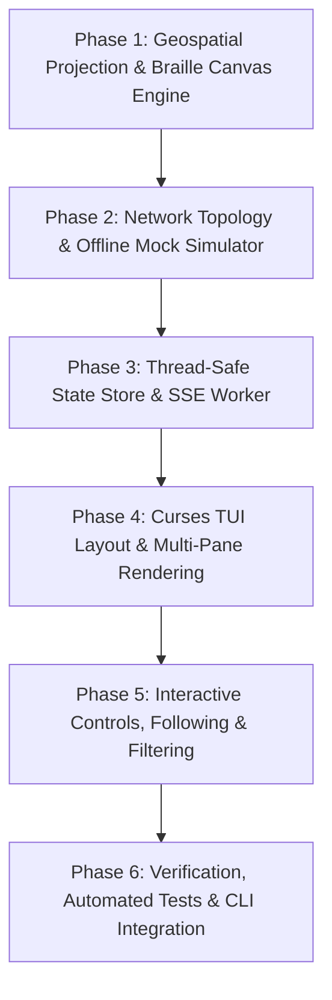

# Hellenic Railways Live Console TUI Map: Implementation Plan

Detailed engineering specification, geospatial projection pipeline, multi-pane terminal architecture, and phased implementation roadmap for the Hellenic Railways (`railway.gov.gr`) real-time terminal map dashboard.

---

## 1. Executive Summary & Terminal Visual Mockup

The goal of this project is to provide a live, interactive, real-time terminal map displaying the Hellenic railway network, station nodes, and live train positions (derived from the HEPOS GNSS positioning system and track-snapping engine) directly within standard terminal emulators.

### 1.1 Console Dashboard Layout

```text
+---------------------------------------------------------------------------------------------------+
|  HELLENIC RAILWAYS (railway.gov.gr) LIVE MAP | View: PATHE Corridor | Active: 14 | Delayed: 3     |
+--------------------------------------------------------------------+------------------------------+
| [Map Viewport: 39.8°N, 22.5°E | Zoom: 1.2x | Follow: #1597]       | ACTIVE TRAINS ROSTER         |
|                                                                    | #   TRAIN  TYPE  SPD  DLY  ST |
|   Thessaloniki (Θεσσαλονίκη)                                       | > 1  1597  IC   118   +4m  RUN|
|     ◉===========================                                  |   2  2232  PR   114   +0m  RUN|
|       \                        \ [IDOMENI]                         |   3  1598  IC     0   +0m  HLT|
|        \ Platy (Πλατύ)          \                                  |   4  1314  PR    92   +1m  RUN|
|         ◉===                                                       |   5  4601  SH     0   +0m  HLT|
|          \  \                                                      |   6  1599  IC   124   +9m  RUN|
|           \  \ Katerini (Κατερίνη)                                 |   7  2236  PR    86   +0m  RUN|
|            \  ◉                                                    |------------------------------+
|             \  \                                                   | SELECTED TRAIN TELEMETRY     |
|              \  \                                                  | Train No:      1597 (IC)     |
|               \  ◉ Larissa (Λάρισα)                                | Locomotive:    120010        |
|                \  \                                                | Status:        Κανονική      |
|                 \  \  ◄ [1597] (118 km/h, +4m)                     | Route:         ΑΘΗΝ -> ΘΕΣΣ  |
|                  \  \                                              | Next Station:  Κατερίνη      |
|                   \  ◉ Domokos                                     | Speed:         118.2 km/h    |
|                    \  \                                            | Delay:         +4 min (Warn) |
|                     \  ◉ Lianokladi (Λιανοκλάδι)                   | Track Head:    342.5° (NNW)  |
|                      \  \                                          | Chainage:      248.5 km      |
|                       \  ◉ Thiva (Θήβα)                            | Progress:      [=====>---]62%|
|                        \  \                                        +------------------------------+
|                         \  ◉ SKA (Acharnes Hub)                    | LEGEND & CONTROLS            |
|                          \  / \                                    | ▲/▼/◄/► Train Heading        |
|                           ◉====◉ Athens Central / Airport          | ◉ Station   ⠶ Track Segment  |
|                           [PIR]                                    | Green: Normal | Red: Delay   |
+--------------------------------------------------------------------+------------------------------+
| [q] Quit  [h/j/k/l] Pan  [+/-] Zoom  [Tab] Select Train  [f] Follow  [/] Filter  [0..3] Presets   |
+---------------------------------------------------------------------------------------------------+
```

---

## 2. Core Architectural Principles & Layer Boundaries

The TUI implementation adheres strictly to the repository architecture defined in [`.agents/rules/architecture.md`](../.agents/rules/architecture.md) and Python idioms in [`.agents/rules/python-idioms.md`](../.agents/rules/python-idioms.md):

1. **Layer Separation:**
   - **Presentation Layer (`tui/`):** Manages screen layout, curses windows, user keystrokes, and spatial viewport transformations. No low-level HTTP socket manipulation.
   - **State Management Layer (`tui/state.py`):** Thread-safe container coordinating incoming `TrainPosition` objects, breadcrumb trails, station lookups, and active filters.
   - **Client Layer (`train_tracker.py`):** Uses [`RailwayGovClient`](../train_tracker.py) for SSE real-time streaming (`/api/train-stream`) and REST API endpoints (`/api/msd/geo`, `/api/public/stations`).
   - **Domain Model Layer (`train_tracker.py`):** Type-annotated dataclasses (`TrainPosition`, `TrainSchedule`).
2. **Standard Library First:**
   - The primary TUI engine is implemented using Python's standard `curses` library and standard library threading/math modules, ensuring zero required external package dependencies for installation and execution.
   - Modular design allows optional higher-level terminal backends (e.g. `rich` or `textual`) to be integrated cleanly in the future without changing core state or client logic.
3. **Resilience & Offline Simulation:**
   - SSE connection drops trigger automatic background reconnection with exponential backoff without freezing the UI event loop.
   - Dynamic terminal resize (`SIGWINCH` / `curses.KEY_RESIZE`) recalculates projection bounds and canvas dimensions without crashing.
   - Includes an **Offline Mock Engine** (`--demo`) producing synthetic train movements along the Greek railway network for development, verification, and offline demonstrations.

---

## 3. Geospatial & Terminal Projection Engine

### 3.1 Terminal Coordinate Transformation

The Greek railway network spans approximately:
- **Latitude:** $37.5^\circ\text{N}$ (Peloponnese / Southern Attica) to $41.3^\circ\text{N}$ (Northern Borders / Idomeni / Dikea).
- **Longitude:** $21.5^\circ\text{E}$ (Patras) to $26.6^\circ\text{E}$ (Alexandroupoli / Evros).

Terminal character cells are non-square; a single character row is approximately twice as tall as it is wide ($\text{aspect ratio } R \approx 2.0 - 2.2$). Without compensation, geographical maps appear vertically stretched.

#### Equirectangular Projection with Aspect Ratio Compensation

Given a geographic coordinate $(\text{lat}, \text{lng})$ and a viewport centered at $(\text{lat}_0, \text{lng}_0)$ with horizontal zoom scale $S_x$ and aspect ratio correction factor $R$:

$$X = \text{Center}_X + S_x \cdot (\text{lng} - \text{lng}_0) \cdot \cos(\text{lat}_0)$$

$$Y = \text{Center}_Y - \frac{S_x}{R} \cdot (\text{lat} - \text{lat}_0)$$

*(In terminal screen space, $Y$ increases downwards, matching terminal row indexing).*

### 3.2 Braille Sub-Pixel Canvas (`\u2800` – `\u28FF`)

To render crisp railway lines and curves without chunky full-block characters, the map engine implements a **Braille Sub-Pixel Canvas**:
- Each character cell in the terminal corresponds to a $2 \times 4$ dot matrix (2 columns, 4 rows of sub-pixels).
- A $100 \times 40$ character terminal provides an effective drawing resolution of $200 \times 160$ sub-pixels.
- Sub-pixel bitmask mapping:

```text
Braille Dot Layout:
(0,0) dot 1 (0x01)   (1,0) dot 4 (0x08)
(0,1) dot 2 (0x02)   (1,1) dot 5 (0x10)
(0,2) dot 3 (0x04)   (1,2) dot 6 (0x20)
(0,3) dot 7 (0x40)   (1,3) dot 8 (0x80)

Character Code = 0x2800 + sum(bitmasks of active dots)
```

- Railway segments between geographic coordinates are rasterized onto the sub-pixel canvas using Bresenham's line algorithm.

### 3.3 Dynamic Viewport Presets

Users can jump between predefined Greek railway corridor views with single keystrokes:
- **`[0]` All Greece:** Complete national network overview ($\text{lat}_0 = 39.5^\circ, \text{lng}_0 = 23.5^\circ$).
- **`[1]` Proastiakos (Suburban Athens):** Piraeus - Athens - SKA - Airport - Kiato - Chalkida ($\text{lat}_0 = 38.05^\circ, \text{lng}_0 = 23.75^\circ$).
- **`[2]` PATHE Mainline Trunk:** Athens to Thessaloniki corridor ($\text{lat}_0 = 39.6^\circ, \text{lng}_0 = 22.6^\circ$).
- **`[3]` Northern Greece:** Thessaloniki - Platy - Edessa / Florina & Drama - Alexandroupoli ($\text{lat}_0 = 40.8^\circ, \text{lng}_0 = 23.8^\circ$).

---

## 4. Component Architecture & Data Flow

```text
+-------------------------------------------------------------------------------+
|                      TUI Architecture & Threading Model                       |
+-------------------------------------------------------------------------------+

                      [Live Upstream /api/train-stream]
                                     |
                                     v
                        [SSE Stream Worker Thread]
                                     |
                        yield List[TrainPosition]
                                     v
                        [TrainStateStore (Thread-Safe)]
                        |-- Trains dict: {id: TrainPosition}
                        |-- Trails dict: {id: Deque[Point]}
                        |-- Static Network: Stations & Tracks
                        |-- Viewport: {center, zoom, follow_id}
                        |-- Filters: {corridor, type, query}
                                     |
            +------------------------+------------------------+
            | Read state (thread lock)                        |
            v                                                 v
  [Map Canvas Engine]                               [Roster & Detail Panel]
  - Project WGS84 -> Braille Subpixels              - Sorted train list
  - Rasterize tracks (Bresenham)                    - Delay status badges
  - Overlay stations (◉) & names                    - Selected train stats
  - Plot train heading glyphs (▲►▼◄)                - Speed & ETA progress
            \                                                 /
             +-----------------------+-----------------------+
                                     |
                                     v
                      [Curses / ANSI Screen Buffer]
                      - Double buffering (no flicker)
                      - Color pairs: Green, Cyan, Yellow, Red
                      - Non-blocking input loop (20 FPS)
                                     |
                                     v
                              [Terminal stdout]
```

### 4.1 Directional Train Glyphs

Based on the train's HEPOS-derived `track_heading` or `course` ($0^\circ - 360^\circ$ clockwise from North):

$$\text{heading\_glyph} = \begin{cases}
\text{"▲"} & 337.5^\circ \le \theta < 22.5^\circ \text{ (North)} \\
\text{"◥"} & 22.5^\circ \le \theta < 67.5^\circ \text{ (NE)} \\
\text{"►"} & 67.5^\circ \le \theta < 112.5^\circ \text{ (East)} \\
\text{"◢"} & 112.5^\circ \le \theta < 157.5^\circ \text{ (SE)} \\
\text{"▼"} & 157.5^\circ \le \theta < 202.5^\circ \text{ (South)} \\
\text{"◣"} & 202.5^\circ \le \theta < 247.5^\circ \text{ (SW)} \\
\text{"◄"} & 247.5^\circ \le \theta < 292.5^\circ \text{ (West)} \\
\text{"◤"} & 292.5^\circ \le \theta < 337.5^\circ \text{ (NW)}
\end{cases}$$

### 4.2 Color Palette & Status Mapping

Matching the official web platform's design language:
- **Intercity / Passenger (`Επιβατικά`):** Green (`COLOR_GREEN`)
- **Suburban / Proastiakos (`Προαστιακός`):** Cyan (`COLOR_CYAN`)
- **Freight (`Εμπορικά`):** Blue (`COLOR_BLUE`)
- **Stationary / Shunting (`Στάση`):** Dim white / Slate
- **Delay Badges:**
  - On-time ($\le 3$ min): Dim green / Normal text
  - Minor delay ($4 - 10$ min): Yellow (`COLOR_YELLOW`)
  - Major delay ($> 10$ min): Bold Red (`COLOR_RED`)

---

## 5. Directory Structure & File Additions

The TUI components will be structured as follows:

```text
train-tracker-railway-gov-gr/
├── train_tracker.py             # Existing client & domain models
├── tui/
│   ├── __init__.py              # TUI package entry point
│   ├── app.py                   # Main Curses application loop & lifecycle
│   ├── state.py                 # Thread-safe TrainStateStore & view settings
│   ├── geo.py                   # WGS84 projections, aspect ratio, Braille canvas
│   ├── renderer.py              # Panel layout, color setup, and screen drawing
│   ├── stream_worker.py         # Background daemon thread for SSE ingestion
│   ├── mock_engine.py           # Offline demo simulator (synthetic train physics)
│   └── data/
│       ├── stations.json        # Key national railway station coordinates & names
│       └── tracks.json          # Curated Greek rail vector network segments
├── tests/
│   ├── test_tracker.py          # Existing unit tests
│   ├── test_tui_geo.py          # Projection & Braille canvas math tests
│   ├── test_tui_state.py        # Thread-safe state store & filter tests
│   └── test_mock_engine.py      # Simulator motion & route progress tests
└── docs/
    ├── architecture.md          # Core architecture documentation
    └── tui-map-implementation-plan.md # This implementation plan document
```

---

## 6. Phased Implementation Roadmap



### Phase 1: Geospatial Projection & Braille Canvas Engine
*(Detailed specification: [Phase 1 Implementation Plan](./phase-1-geospatial-projection-braille-canvas.md))*
- **Files:** `tui/geo.py`, `tests/test_tui_geo.py`
- **Deliverables:**
  - Mathematical projection functions converting $(lat, lng) \to (x, y)$ with terminal aspect-ratio correction.
  - `BrailleCanvas` class supporting sub-pixel $(2 \times 4)$ dot setting, line rasterization (Bresenham), and character grid serialization.
  - Viewport boundary calculations (bounding box extraction, clipping, zoom scaling).
- **Acceptance Criteria:** Unit tests verifying coordinate mapping accuracy, aspect-ratio scaling, and Braille dot bitmask combinations.

### Phase 2: Rail Network Topology & Offline Mock Simulator
*(Detailed specification: [Phase 2 Implementation Plan](./phase-2-rail-network-topology-mock-simulator.md))*
- **Files:** `tui/data/stations.json`, `tui/data/tracks.json`, `tui/mock_engine.py`, `tests/test_mock_engine.py`
- **Deliverables:**
  - Bundled coordinate points for all major Greek railway stations (Athens, SKA, Airport, Kiato, Chalkida, Larissa, Thessaloniki, etc.).
  - Vector track polylines for the main corridors.
  - `MockTelemetryEngine` producing continuous `TrainPosition` updates simulating real trains traversing corridors with realistic speeds and headings.
- **Acceptance Criteria:** The mock engine runs independently and generates valid `TrainPosition` batches when offline or during off-peak hours.

### Phase 3: Thread-Safe State Store & SSE Worker
*(Detailed specification: [Phase 3 Implementation Plan](./phase-3-thread-safe-state-store-sse-worker.md))*
- **Files:** `tui/state.py`, `tui/stream_worker.py`, `tests/test_tui_state.py`
- **Deliverables:**
  - `TrainStateStore` holding active trains, decaying historical trails (last 10 coordinates), selection cursor, viewport focus, and filter predicates.
  - `StreamWorker` thread continuously reading from `RailwayGovClient.stream_train_positions()` or `MockTelemetryEngine`, updating the store with mutex protection.
  - Graceful reconnection handler with exponential backoff on stream interruptions.
- **Acceptance Criteria:** Multi-threaded test verifying safe concurrent writes from stream worker and reads from UI loop without race conditions.

### Phase 4: Curses TUI Layout & Multi-Pane Rendering
*(Detailed specification: [Phase 4 Implementation Plan](./phase-4-curses-tui-layout-multi-pane-rendering.md))*
- **Files:** `tui/renderer.py`, `tui/app.py`
- **Deliverables:**
  - Dynamic panel split: Map viewport (left / 65% width), Train roster (right-top / 35% width), Inspector panel (right-bottom), Status bar (bottom line).
  - Terminal color palette initialization (curses color pairs for train statuses, routes, and delays).
  - Train heading arrow rendering and station label collision avoidance.
  - Double-buffered refresh loop running smoothly at 15–20 FPS.
- **Acceptance Criteria:** Flawless rendering without cursor stutter; responsive resizing on `curses.KEY_RESIZE` / `SIGWINCH`.

### Phase 5: Interactive Controls, Following & Filtering
*(Detailed specification: [Phase 5 Implementation Plan](./phase-5-interactive-controls-following-filtering.md))*
- **Files:** `tui/app.py`, `tui/state.py`
- **Deliverables:**
  - Panning (`h/j/k/l` or arrows) and Zooming (`+`, `-`).
  - Corridor preset shortcuts (`0` All Greece, `1` Suburban, `2` PATHE Mainline, `3` North).
  - Train Selection (`Tab`, `Up`/`Down`) and Auto-follow mode (`f` locks map viewport center to the selected train).
  - Search / Filtering (`/` to filter trains by number, station, or corridor).
- **Acceptance Criteria:** Smooth transitions, responsive keyboard event dispatch, and clear visual indicators for active follow and filter modes.

### Phase 6: Verification, Automated Tests & CLI Integration
- **Files:** `train_tracker.py`, `tests/test_tracker.py`, `docs/architecture.md`
- **Deliverables:**
  - Expose `--tui` and `--demo` flags in `train_tracker.py` CLI:
    ```bash
    python3 train_tracker.py --tui          # Connect to live SSE stream
    python3 train_tracker.py --tui --demo   # Run offline simulator
    ```
  - Comprehensive automated test suite in `tests/`.
  - Update [`docs/architecture.md`](./architecture.md) with TUI architecture, presentation layer diagrams, and usage examples.
- **Acceptance Criteria:** All unit tests pass cleanly (`python3 -m unittest discover tests`); CLI boots cleanly in interactive terminals and exits cleanly on `q` or `Ctrl+C`.

---

## 7. Verification & Quality Assurance Strategy

1. **Unit & Mathematical Testing:**
   - Verify coordinate projection invariance: $(\text{lat}, \text{lng}) \to (x, y) \to (\text{lat}', \text{lng}')$ round-trip within precision limits.
   - Verify Braille canvas pixel rasterization boundaries and sub-pixel index computations.
2. **Mock Network Boundaries:**
   - Per [`.agents/rules/testing.md`](../.agents/rules/testing.md), unit tests will mock network connections using synthetic SSE payloads and pre-recorded JSON responses.
3. **Terminal Compatibility:**
   - Support ANSI 8-color and 256-color terminals (`xterm-256color`, `vt100`, `tmux`, Linux console).
   - Clean terminal restoration: always restore cursor visibility and exit alternate screen buffer (`curses.endwin()`) using context managers or `try...finally` guards.
